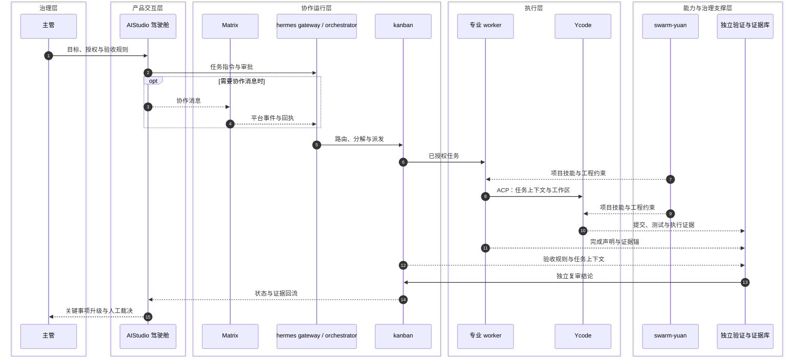
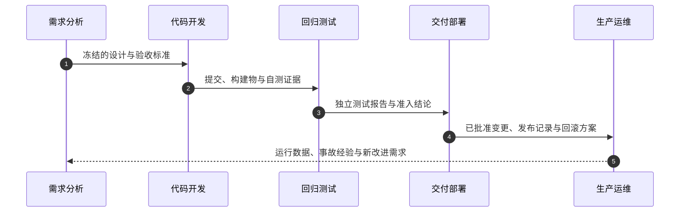
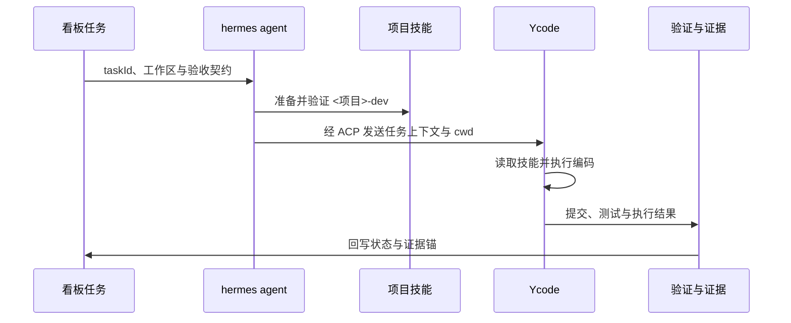

# AIStudio 终态设计文档

> AIStudio 唯一整合设计正本。

## 1、理念

### 1.1 系统定义

AIStudio 是一套由人指挥 AI 团队交付软件的工作系统。
它把需求、协作、编码、测试和治理放在同一套契约下。
人负责目标、授权和关键判断，AI 团队承担可授权的执行工作。

系统由五个组件构成：

| 组件 | 职责 | 归属 |
|---|---|---|
| AIStudio 驾驶舱 | 呈现工作全景，承接人的操作与审批 | 本仓产品面 |
| Matrix | 传递人机消息与协作事件 | 外部通信基础设施 |
| hermes agent | 运行智能体团队，承接消息、任务与工具调用 | 运行面 |
| Ycode | 在本机执行任务导向的编码工作 | 编码引擎 |
| swarm-yuan | 从目标仓库生成项目专属开发技能 | 能力层 |

这五个组件服务四条主线：分布式需求分析、研发协作、实施交付、
测试验证。全流程推演 harness 用真实链路演练这四条主线，
并保存可供审计的证据。

### 1.2 服务对象

第一用户是负责交付的主管，而不是 AI 智能体。
主管需要知道现在做什么、哪里停滞、何时需要自己决定，
以及每个结论能否反查证据。

其他用户包括业务分析、产品、架构、研发、测试、安全、
运维和审计人员。AI 智能体主要通过 Matrix、看板 API 和工具接口工作，
不需要模仿人的驾驶舱操作。

### 1.3 要解决的外部问题

| 外部问题 | 产品回应 |
|---|---|
| 跨角色、跨地域交付的信息散落在聊天、看板、终端和文档中 | 用三种工作模式组织人的视图，用统一对象标识连接工作上下文 |
| 多智能体协作时，任务该由谁接、能做什么、出了结果谁负责不清楚 | 用团队名册、能力边界、看板责任和授权策略明确分工 |
| 长任务的真实进展难以观察，完成声明与客观状态可能不一致 | 用运行观测、催办、独立验证和证据锚呈现真实状态 |
| AI 提速后，大量协调与审核占用主管的时间和注意力 | 用机械检查处理常规事项，把例外和关键判断升级给人 |
| 组织改变研发流程时，缺少不影响真实工作的验证环境 | 用隔离推演验证流程、角色和质量门，再决定是否采用 |
| 项目知识依赖个人经验，新成员和新智能体难以复用 | 用 swarm-yuan 从目标仓库生成组件清单、关系、配方和门禁 |
| 自动化可能越过人的目标、权限或业务后果边界 | 用人工审批、认证授权和不可逆动作边界限制执行 |

### 1.4 目标与产品边界

系统追求四个结果：需求可追踪，协作可授权，执行可验证，
交付可审计。界面必须让没有内部背景的人看懂，
不能让读者从机读日志反推产品状态。

产品边界如下：

- AIStudio 面向软件交付，不是通用社交聊天产品。内嵌 Matrix 客户端只承担交付协作。
- AIStudio 负责协作与治理，不替代 kanban、Git、Ycode 等底层执行系统。
- 产品不承诺无人监督的自主交付，也不要求所有任务都自动化。
- 产品不保证所有模型、工具和平台开箱即用，新接入必须满足对应契约。
- 推演结论只适用于实际验证过的流程与环境，不等同于生产交付结论。
- 未验证的能力只能标为未验证，不能作为已交付能力对外承诺。

已否决的方向不再重开：第二套任务真值、全系统唯一中央网关、模型自评放行、
推演数据写入日常、整体移植外部框架、没有执行载体的设计。

### 1.5 设计原则与公理

设计原则覆盖判断权、结构、执行和演化四组关系，任一组都不能替代另一组。
hermes 的设计公理与 AIStudio 的工程原则按同一语义合并，不并列重复。

| 关系 | 原则 | 工程含义 |
|---|---|---|
| 判断权 | 规格先于实现 | 先澄清需求并冻结验收标准，再允许编码 |
| 判断权 | 生产与验证分离 | 退出码、阈值和独立证据决定通过与否，不信生产者自评 |
| 判断权 | 人保留关键判断 | 目标、授权、发布、不可逆动作和业务后果由人决定 |
| 结构 | 全量认知 | 项目盘点采用全量穷举，不用抽样冒充完整清单 |
| 结构 | 单一事实源 | 每类契约、状态和配置只在一个权威位置定义 |
| 结构 | 能力边界先于派发 | 工具、技能、密级和纪律在编制时确定，子代理不得扩权 |
| 结构 | 版本与来源可追 | 标准库和引用版本锁定，使用前回查现行来源 |
| 执行 | 执法锚在自持门禁 | 不把宿主工具的拦截层当作唯一保证 |
| 执行 | 证据先于声明 | 完成声明必须回到任务、提交、测试或运行证据 |
| 执行 | 高风险执行受控关闭 | 严格策略启用后，权限或必要配置缺失时拒绝执行 |
| 执行 | 读取失败可降级 | 读模型缺源时呈现空态或不可用，不阻断无关工作 |
| 演化 | 生成厚、使用薄 | 生成侧建设完整资产，使用侧按需加载，成本只压缩注入材料 |
| 演化 | 新规则先影子运行 | 误报数据达到门禁配置的阈值后才允许拦停 |
| 演化 | 受管迁移与保留 | 新归属面接管后才退役旧入口，历史按保留策略可查 |

组件清单覆盖率有明确门槛，具体数值和验真规则见 4.7。
清单必须逐条验真，不能用检索结果的数量冒充覆盖率。

### 1.6 目标态与四个设计支柱

“AI 驱动 ALL”是严格授权下的目标态：AI 承担可自动化的执行工位，
人保留需求、授权、验收和异常裁决。它不代表当前已经实现无人交付。
人在环内（in the loop）作出必经决策，在环上（on the loop）监督并随时介入。
组织还要成为会学习的智慧型组织：复盘改变下一轮准入，
缺陷根治后代偿退役，经验受控注入后续任务。

多智能体组织不是目标本身。采用它是为了获得专业分工、独立验证和独立留痕。
自由交互的复杂度则由通道、名册和领域边界约束。
采用多智能体还基于三个工程事实：模型会错且语气自信，
自由交互随节点增加而复杂，完成声明不等于客观状态。
组织设计分别用判断权分离、通道与边界、机械证据回应这三件事。

运行面的工作循环依次是看清系统结构与边界、获取有效信息、
用验证保可靠、用反馈保有效。
四个环节在工程上落到四组支柱：看清对应本体与领域模型，
看准对应观测和运行图，保可靠对应 harness 与质量门，
保有效对应长期记忆与经验回流。

| 支柱 | 作用 | 对应环节 |
|---|---|---|
| 本体与领域模型 | 统一需求、任务、证据和治理概念，减少各视图语义分叉 | 看清 |
| harness 与质量门 | 把设计意图变成可执行、可复验的工程检查 | 保可靠 |
| multi-agent loop-graph | 组织多智能体分工、事件流转、停滞检测和恢复 | 看准 |
| 长期记忆与经验回流 | 让复盘、失败样本和有效经验受控影响后续工作 | 保有效 |

目标态与当前实现必须分开陈述。
自动执行范围以真实授权和验证证据为准，不能由理念反推能力已经存在。

### 1.7 事实优先级

事实按以下顺序裁决：

1. 当前代码、配置、测试和真实运行证据决定实际行为。
2. 已冻结的需求与有效 spec 决定设计意图和验收口径。
3. 本设计汇总稳定结构，不覆盖前两类事实源。
4. 组件内部实现由对应专题文档和 ADR 提供证据，正文按统一主题组织。
5. 旧设计稿只用于理解决策来路，不再指导新的实现。

“终态”指结构已经归一，不代表所有能力已在所有环境验证。
无法核实的状态必须写成未验证，不得写成已交付。

## 2、设计

本章描述产品应当呈现为什么样：三种工作模式、六个阶段、
协作与审批、四类专题工作台，以及对象与呈现的边界。
模式切换改变工作视图，不改变对象真值。

### 2.1 三种工作模式

| 模式 | 入口 | 主要任务 |
|---|---|---|
| 日常工作台 | `/app` | 组织、需求、设计、协作、审批、验收与治理 |
| IDE 工作区 | `/app/ide` | 围绕任务编码、审查、运行命令和查看变更 |
| 全流程推演 | `/app/sim` | 在隔离环境演练完整交付并收集证据 |

模式切换只改变工作视图，不改变对象真值。
跨日常与推演的链接必须标明目标环境。
用户不能在不知情的情况下把推演动作写入日常系统。

### 2.2 日常工作的六个阶段

| 阶段 | 内容 | 主要产出 |
|---|---|---|
| 搭台 | 组织、账号、团队、资产、模型与平台配置 | 可用的工作与授权环境 |
| 需求 | 收集、分诊、冻结范围、排期和验收标准 | 已冻结的需求基线 |
| 设计 | 系统分析、spec、方案与评审 | 可实施且可验证的设计 |
| 开发 | 看板、任务分派、编码、分支与产物 | 可审查的实现 |
| 验收 | 测试、用户验收、安全检查与发布准出 | 发布或打回结论 |
| 治理 | 评审、度量、安全审计、问题单、复盘与文档 | 可追踪的治理记录 |

阶段是工作导航，不是彼此割裂的数据系统。
同一任务可以跨阶段呈现，但其状态和责任人只有一份真值。

阶段与侧栏使用状态点表示阻塞、进行中和完成，
分别用红、黄、绿三色；待办徽标只统计需要人出手的事项。
徽标和状态点使用同一计数源，不能各算一套。

### 2.3 协作、审批与检索

工作台概览按「三问」组织：现在需要我做什么 → 系统是否健康、在做对的事 → 工作进展如何。
健康状态零占位，只在异常时出现；异常最多列三条，超出折叠成「还有 N 条」。
每个数字必须等于它链接列表的长度；标签写「等谁、要什么」，不出现内部状态码。

看板承接任务真值。任务卡记录负责人、状态、验收要求和关联证据。
视图可以按阶段或角色筛选，但不能复制出第二套任务状态。

审批收件箱集中呈现需要人决定的事项。
批准、打回和紧急处置都要记录主体、时间、对象和依据。
模拟审批必须标明代理身份，不计入真人审批结论。

沟通同时使用 Matrix 房间和统一身份聊天窗。
人的 Matrix 客户端可以直接连接通信基座。
智能体消息与执行委托必须经过本机 hermes gateway。
统一身份聊天窗支持 Agent 发起的声明式界面（Ekko UI Surface）。
Agent 只能发送 `ekko-ui/v1` JSON 描述，宿主按受信任的白名单组件渲染原生界面，
视觉与主题全归宿主（默认皮肤＝科技感玻璃拟态：皮肤交互色 --ekko-skin-accent 由宿主定义，亮 #0891b2/暗 #22d3ee 随主题切换，
Agent 无任何颜色/主题控制面，见 specs/2026-11-18-ekko-ui-tech-skin.md）；用户一次提交后以结构化结果回到同一轮执行。
Agent 不能发送 HTML、脚本或任意样式；危险操作审批与简单澄清保持独立职责，
不被普通界面替代。
托管 MCP 服务在服务启动时自动补齐到各 profile；用户自管或显式禁用的同名服务不覆盖。

顶部搜索框和 `Cmd/Ctrl+K` 是全局检索入口。
检索覆盖会话与房间、任务、运行、治理文档、人员和命令。
人员主源是治理仓 roster，运行结果为空时给出进入推演的明确去向。
「roster」在本体系指三种不同东西，文档一律用全称，不再单说 roster：
**治理人员名册**（外部治理仓的人工人员表）、**推演编制**（推演环境的 15 人/30 账号参考编制，见 3.4）、
**agent 角色目录**（运行时 `$HERMES_HOME/agent-roster.yaml` 与 `runtime/roster/` 下的 squad 名册）。
筛选按看板而不是一次性工作区目录分组；某类结果为 0 时如实显示 0。
会话检索装载本地 CLI 会话档案（含压缩档案），按来源过滤下推。
推演会话走跨实例只读库直读，推演栈未启动也可检索；
结果带紫色徽章区分来源，点击时如实降级，不冒充在线可操作会话。
旧 `/app/search` 链接只承担兼容唤起，不另建检索页面。

跨页面共用任务上下文、RACI、双凭证、证据锚、结构化判词、
代偿标识和纪律提示。它们必须使用同一数据口径，
不能因页面样式不同而改变状态含义。

判定席位是包在既有 LLM 判定点外面的一层策略，不是第二套判定核。
它只回答「这一步该不该付一次模型调用」，不改变 toolresultguard 的 S0/S1/τ 三段门控、
eval 的多裁判多数决或派单的确定性纯函数。
判定来源固定四态：规则、快路径、模型、人。
强制回交条件按序为：用户刚发言、上一步失败、连续自动判定达 3 步、策略与运行时版本不一致、情境不可复现。
快路径只用于精确情境键（阶段＋工具＋来源＋内容指纹）与策略/模型版本完全一致的情形；
固化只认 3 次独立模型调用一致（缓存重放不算证据），人工翻案或版本变化立即失效，
条目超过 30 天未再验证自动过期。
快路径是「可复现缓存」，不是「正确性证明」；它不承诺减少误判，也不把命中写成有效。
强制回交后判定端不可用时，沿用已知保守判定兜底，不把已知的重处置降成放行。
当前接入 toolresultguard，两个开关默认全关、互不联动：`TRG_FASTPATH=1` 启用快路径，
`TRG_HANDOFF=1` 时灰区回交更强模型（S2 失败回落既有「灰区放行+警示」）；
不开时行为与既有版本一致。eval judge 核验后不需要改（键已含 state/questions/model/salt，
跑批另有 judgeFingerprint）；派单链来源字段留待批二在途合并后接入。

### 2.4 IDE 工作区

IDE 以看板任务为工作上下文，而不是以聊天会话为唯一中心。
任务栏、会话、文件、终端、审查、变更和沟通共享同一任务锚。
编程模式与工作模式复用既有编码运行时，不另造一套执行链。

模型、思考档和引擎配置由权威配置源决定。
用量与上下文视图优先读取既有会话记录，不重复埋点。
AIStudio IDE 会话默认关闭电脑操作，并注入禁用标记。
Ycode 插件可以默认内置启用，但实际执行仍受会话环境、
操作系统权限和 broker 凭据闸约束。

### 2.5 全流程推演

推演以独立运行根执行完整交付流程。
主链包含 26 个步骤和六道质量门。
运行总览在同一上下文中呈现产品服务、gateway、驱动、监督器、
派发器和休眠工作者的健康状态。异常必须直接可见，不靠人翻日志。

| 质量门 | 核心判断 |
|---|---|
| G1 需求冻结 | 范围、验收标准、非目标和敏感面是否明确 |
| G2 架构评审 | 设计、影响面、备选方案和验证计划是否成立 |
| G3 编码门禁 | 实现是否来自已批准设计，并带有任务与测试证据 |
| G4 独立测试 | 测试是否独立，缺陷是否修复并复验 |
| G5 发布准出 | 发布证据、人工授权和回滚条件是否齐备 |
| G6 复盘 | 问题、行动项与经验是否回到治理系统 |

导演台用于启动、观察和介入，监督机制用于发现停滞与断环。
每道质量门都要呈现判据原文、判词来源和当前证据。
质量门失败的准出结论只有一条路径：登记修复单、完成真修复并复审通过。
非准出检查项的豁免见 4.4，但不能改变准出结论。
不能通过拆门、改标签或沿用旧轮 PASS 放行。
问题单、修复证据和复审结论必须进入同一治理追踪关系。
运行观测时间线用于定位停滞与介入，不要求人翻原始日志还原过程。

G5 采用三条取证线：集成真值、缺陷修复与复审和安全条件。
三条线只取证，不分别下结论，终判由单一出口给出。
发布门与 UAT 独立 append-only，不修改 run-state 闸键；
导演 run 与 26 步 run 分流，不混用轮次。

每轮报告与证据属于该轮运行，不得用旧轮产物冒充本轮结果。
界面下钻与报告共用四段结构：实际工作、交付物及质量判据、
已知问题、处置改进。任一来源缺席时保留空态，不补写另一套叙事。

受控 harness 启动器已有独立入口，但默认关闭，并受管理员权限、
运行标识白名单和驱动锁约束。它不等于无需环境供给的无人值守开轮。

**证据帧纪律。** 每步的证据帧按注册形态二态：真实发生操作的步骤保留
操作前、动作和完成态三帧；没有动作的步骤只拍完成态单帧，
不制造「操作前后」的孪生帧。帧拍完立即做零变化校验，可疑帧以失效后缀
隔离出证据池——保留可查、不参与报告、不计入实拍。摘要按核验态分级
呈现「实拍可核验／内容不符／零变化已隔离」，不得笼统写「全部实拍」；
无法给出产物证据的步骤按降级凭证如实呈现，不回补表演性截图。

**派发姿态与净额。** 派发决策权可以从脚本移交给组织负责人（总监姿态）：
脚本只投递需求草稿与框架指令，任务书由负责人自主产出并点名执行者；
超时或投递失败降级为负责人自主组织消息，不回退到脚本预写的任务书。
组织自派发落独立台账（一行＝一次真实自主派单），计入净额；
自派发不进代偿账，避免把「组织做对了」记成「欠导演一笔」。

**G4 判分器可靠性。** 除本轮产物判分外，G4 还跑固定黄金集
（全应通过的材料集）测量判分器本身：未达成按缺口登记、不阻断，
同输入稳定性复测固定两次。判分器未校准阶段只开观察态，
校准收敛后再升硬判据；主判据与子门叠加而不互相替换，防归因混淆。

### 2.6 专题工作台与治理视图

专题工作台把分散的运行痕迹转成可核对视图。
它们从权威源读取，除明确标注的标注层外，不保存第二份业务真值。
四项工作台是入口；以下五组视图属于读模型或标注层，不另立工作台。

| 工作台 | 设计职责 | 主要数据源 |
|---|---|---|
| 流程架构 BPA | 流程定义、节点与执行视图、架构映射 | 流程与架构注册表 |
| 本体 | 概念、实例、词表及关联设计文档。FIBO 37 个概念、12 个官方域、4 个真实场景逐条来源 | 本体存储、FIBO 术语表、spec 索引 |
| 评测 | 评测集、运行、红队与处置入口；失败回流和分桶机制见 4.8 | 运行轨迹、评测库、看板与 UAT |
| 技能治理 | 技能目录、供给对账、能力发现与使用证据 | 技能库、能力上报、profile 配置 |

FIBO 表只把概念与设计规格的提及关系作为读侧投影，不在本体里复制 spec 正文。
新增概念必须同时补来源和守门测试；
概念、域和场景数量由本体守门测试锁定。

**能力供需视图。** 治理页在度量纪律之后展示能力供需表：每个能力标签的需求、供给单元/Agent/技能包、
缺口、跨板复用、供给时效与源可用性；任务抽屉展示单任务的能力准入与候选。
两者都是只读投影，不接管派单；源缺席显示 `available:false` 与缺口，不渲染成 0。

**交付效能。** 日报汇总当日任务、阻塞和建议。
难度×步骤矩阵看活有多难、干到哪一步。
介入账本按协作层/交付层和提出需求、补充上下文、催进度、解决卡点、
拍板确认、纠错返工六类归因。
成熟度按介入数据给参考档位，界面明确标注“参考读数非结论”。
数据源是既有台账、看板与运行痕迹，只读消费，不新增埋点。

**度量纪律。** 指标分两条轨、互不串用：`measure/*` 只进学习看板，`settle/*` 只进分配口径；
结算指标引用测量指标在配置层直接报错。
四类核心指标——自主运营比例、人机配比、单任务人时、返工率——全部从既有台账派生，不新增埋点；
样本不足返回 `available:false` 并写明缺口，不猜数。
每个指标须登记「它改变过哪个决策」，没有消费者的指标标为装饰并在界面标红；
这是判断看板是否只是装饰的机械口径。
技能调用计量分两段：**声明覆盖率**来自任务创建事件的 skills 字段，
**调用频次与失败率**来自 hermes 工具审计面对 skill 类工具的记录；
审计面只记工具名与成败、不记技能名，因此「按技能分布」明写不可得，不编造。
反向指标「接口数」不再占位：它按任务面板九个面中可用面数的中位数派生，
取样最近三个已完成任务并回报样本量。运行时未记录的数据一律如实报缺口，不为凑指标去插桩。

**能力供需。** 能力标签以能力台账 L2/L3 与既有技能标签为词表，不新建第五套标签。
任务 `skills` 声明的需求与能力图、技能清单、profile 声明、舰队上报的供给做只读供需投影；
缺口只表示「有需求且完全无供给」，不用减法制造虚假缺口。
派单前能力准入只警告，不改派单权威、不自动改派；缺供给是否升级为硬拦截另立开关与评审。
能力组三项指标——供给时效、跨项目复用率、人机团队成功率——未发生实际决策前只登记
`consumerPlan`（计划决策/阈值/owner），仍按装饰计数；人机团队成功率在
OutcomeTeam/Settlement 落地前返回 `available:false`，不写 0 或 100。

**自治刻度与责任边界。** 每个可自动执行的目标（profile 或 workflow 节点）登记一条自治配置：
AL0–AL5 自主等级、60 分线（验收判据、真实样例、停止条件）、抽样审计比例与人工策略扫描。
AL5 不是禁止项而是条件项——须同时具备抽样审计与人工策略扫描才成立；AL4 缺抽样则告警。
停止条件为空即判「假 AI 化」：拿不出什么条件下该停掉的判据，就等于没有闭环。
三圈（自主／协作／人类）只报配比不设硬阈值，两条退化自检各有判词：
全在人审＝只有控制没有治理；无自主＝有框架无授权。
流程级自治阶梯（洞察／辅助／自动执行）与任务级 AL 刻度语义正交，只做只读映射、不合并配置。
高风险变更（生产发布、权限提升、数据外发、模型替换、删除类）要求双签。
双签在**风险档可重算**的审批分支上真拦：高风险批准须两个不同签署人，
否则返回缺口并要求重签；单人部署可用 `waiver=single-operator` 显式豁免，豁免必落账可见——
从「悄悄单签」变成「显式豁免」。判不了档位的分支（看板、评审卡、人工门、文件队列）不拦，
也不猜档位，响应里明示不覆盖范围。被拦下的那次尝试本身即第一签，必须落账，
否则第二个人看不到已有签署，审批会自锁。
决策权审计按介入阶段（发起／设计／评审／实施／事后）统计两个比例：设计阶段介入比与实质否决率；
缺阶段的历史记录单独计数，不按类目猜测回填。

**假设登记簿。** 承重判断登记为假设对象：陈述须可被证伪，影响面必填，复核日期到期进队列，
被推翻时生成重评项并可查询受影响对象；重评项不可静默删除，处置须带理由。
登记簿不保存第二份业务真值：影响面是读侧计算，锚失联如实标 stale。
假设逾期在发布门判 CONDITIONAL 而非 FAIL，避免用阻断倒逼把复核日期一律后推。

**协作画像与判例。** 协作画像以人×概念×证据墙呈现谁懂什么，
支持检索和跨域概念冲突提示。
过往案例把一次 run 当作判例单元，记录派发原话、问题与处置计数，
活跃 run 和归档 run 都可通过锚点抽取。
两者都是检索面，不改变任务状态。

**群体协作读数。** 交付效能页的群体协作读数包括四组：
通信拓扑（协作消息开销比、锚点保真、回灌与回执缺席信号）；
信用分配（per-agent 贡献、观察口径关键支撑度、任务粒度 Shapley 近似）；
帕累托（消息成本×完成锚的非支配前沿）；
社会动力学（UAT 无条件通过率、G5 打回类问题单、流程拦截面）。
对抗性注入没有数据时如实写 no_data。
这些读数只观测，不直接进门禁；实验旋钮状态和分桶口径见 4.8。

**工作项全景。** 以看板 taskId 为统一上下文锚，
一次查询汇聚任务卡、看板事件、证据、评测、评审、计划、图运行和 trace 八面。
每面独立 fail-soft，源缺席返回 available:false。
trace 没有 taskId 索引、评测任务按 origin 双路匹配等覆盖边界写在返回里，
不把“未建立关联”误报成“没有产物”。
泳道时间线把交接与会话证据投影到同一任务视图，便于看跨列接力。

**影响推演与业务地图。** 影响推演用需求文本对本体实例、板级知识图、
FIBO 术语和历史 spec 做词面提及与全文检索，命中即带词面和来源，
再给出与导演台同源的建议模块。
它是规则式推演，不上 LLM，改造范围必须人工确认。
AI 拆模块是可选增强，判定端不可用时回落词表并如实标注来源。
业务地图把需求、本体/板级图/FIBO 三路实体、历史 spec 和建议模块
分成可独立开关的图层，实体与 spec 的共现边来自读侧计算。
节点标注按需求指纹持久化，采用 LWW 合并并广播房间变更和在线人数。
标注不是任务真值，其他页面不能把它当作新的验收结论。

### 2.7 设置与权限

设置覆盖个人、团队、模型、平台、通知、界面和集成。
个人偏好、组织治理配置与引擎参数必须分层，不互相复制。
治理视图回答“发生了什么”，设置视图回答“允许怎样运行”。
同一配置只能有一个编辑归属。

权限至少区分超级管理员、领导层和普通成员。
团队负责人判定与全局角色分开处理。
组织关键权限变更需要双人会签。
紧急通道必须带 `[BREAK-GLASS]` 标记，并保留完整审计记录。

### 2.8 对象、控制面与呈现的整合边界

任务对象按域隔离。任务展示键由域、run、看板和任务 ID 组成，
日常任务与推演任务同 ID 不互相覆盖，推演任务不写日常看板；
写操作只接受日常任务引用。定时 Loop、Workflow、Graph 与 Sim
运行各有详情页与跳转，不跨 API 传递裸 ID。

控制面单源。设置目录与侧栏由同一注册表派生并共用收编壳；
阶段页签保持 key 稳定，合并元数据、加载逻辑与属性传递；
面包屑、最近轨迹与浏览器标题共用同一页面解析。
workspace 是提醒调度与跨板任务加载的唯一正身，
重复调度、无消费者的预取和卸载后仍存活的通道不进入共享路径。
错误、部分可用与陈旧数据必须如实标注，不得冒充空态。

呈现做减法。IDE 左侧保留唯一 CLI 会话列表，中央只显示当前对象；
推演区左侧是唯一导航。正文以 14px 为主，辅助文字不低于 12px，
主要动作提供 40–44px 命中区，沿用中性 tokens 与共享状态基元。
Legacy Loop 的定时、自治与预算能力保留；①搭建的主动性编辑保留、
⑥治理视图为只读投影；模型、记忆、看板、审批与 Matrix 的作用域
不强行合并。

### 2.9 全局视觉皮肤（2026-11-19）

全站视觉皮肤＝科技感青蓝系（亮 #0891b2 / 暗 #22d3ee），与聊天内 Ekko UI Surface 卡片同源同值。
皮肤色正本在 theme.ts / variables.scss 的 accent/primary base（补丁 801）；
用户 accentColor 定制仍优先于皮肤 base（上游 resolveThemeCustomization 通道不冲突）。
custom 的 skin.scss 只做全局无损叠加（发光反馈/骨架玻璃/光带），不动布局与字号——克制纪律沿用 polish.scss D22。
走查清偿批（2026-11-19-tech-skin-closeout）：主光线挂 .app-box 顶缘（header 随视图隐藏）；侧栏三连类提权渐变；
看板域细改（告警条降饱和/筛选聚焦描边/任务卡 hover 微光）；全局 muted 过 WCAG AA（补丁 802，亮 #767676/暗 #9a9a9a）。
Agent 侧（A2UI 协议）依旧无任何颜色/主题控制面，视觉全归宿主。

## 3、架构

本章描述系统怎样分层、由哪些组件构成、跨层与跨域靠什么契约连接。
三层之间只传递契约，不共享隐含内部状态。

### 3.1 分层协作与总体协作

下图按逻辑职责分层。消息编号表示一次典型任务的主顺序。
人的行权和独立验证共同构成治理，不是另加一个业务组件。



第 1—6 步形成并下发任务，第 7—12 步提供技能并汇聚执行证据，
第 13—15 步完成独立复审、状态回流和治理升级。
编号按完整路径标注；实际跳过可选分支时编号不重排。
Matrix 位于可选协作分支：需要协作消息时使用，
不表示所有任务都必须经过 Matrix。

产品面不另建任务或技能真值。
读模型从权威来源取数，写操作回到权威来源。
Matrix 协作、Studio/IDE 会话与统一身份聊天窗消息分别定义消息真值及投影关系。
审批、评测、标注和策略可以拥有明确归属的产品侧状态。
目标技能运行时不依赖产品服务；产品可以通过受管端点触发生成。

### 3.2 三层职责与边界判据

| 层 | 组成 | 设计约束 |
|---|---|---|
| 产品面 | Vue、Koa、Electron、定制组件与读模型 | 任务消息不另立真值，自有领域状态明确归属 |
| 运行面 | hermes agent、Matrix、看板、Ycode 与证据保存 | 承接真实执行，维护身份、权限和审计 |
| 能力层 | swarm-yuan 生成器与目标项目技能 | 提供仓库知识和工程约束，运行时不调用产品服务 |

产品面内部再分六层：表现层（三模式壳）、页面层（六阶段与专题工作台）、
读模型层（端点与适配器）、机制层（证据、门禁、审批、观测）、
服务层（studio server 域）、注入层（对上游的定制改造）。
读模型不复制运行面数据，页面不建第二份任务表。

四条边界判据约束跨层实现：

- 写入口唯一：任务真值只在 kanban，技能只在能力层生成，
  产品面不建第二份任务或技能库。
  产品可以通过受管端点触发生成，但不保存技能副本。
- 读模型不复制：派生视图可重建，不保存影子任务、消息或技能真值。
  审批、评测、标注和策略等自有状态必须明确归属。
- 不反向依赖：目标技能运行时不调用产品服务，运行面不引用 UI 组件。
  产品面可以更换呈现方式，运行面仍独立工作。
- 治理实现单源：六闸判读、判词语义、熔断、UAT 判定、问题配对、
  台账阈值与评测判据的计算正本只在产品治理域
  （`custom/server/governance` 与 `custom/server/eval/e2e-verdict`）；
  推演侧只经治理客户端调用并落证据，不持第二套判据。
  G5 与 UAT 状态机实现属治理域，推演兼容路由冻结，启动器属推演域；
  报告撰写留在推演域，报告验收规则属治理域。

三层之间只传递契约，不共享隐含内部状态。
能力层的开发和测试可以引用 AIStudio 的仓级契约，
但目标技能运行时不依赖产品服务，两件事不能混写。

### 3.3 hermes 上游引擎

hermes 上游以 `AIAgent` 会话循环为核心。
CLI、gateway、ACP 和 cron 等入口复用同一套会话能力，
不各自复制模型调用和工具执行逻辑。

| 内部面 | 职责 |
|---|---|
| 入口与会话 | 接收不同平台事件，维护会话键、上下文和消息生命周期 |
| 提示词与模型 | 组装身份、技能、记忆和任务上下文，解析模型与凭据 |
| 工具与插件 | 注册并调度工具，按配置接入平台、记忆和上下文引擎 |
| 状态与持久化 | 用 SQLite 保存会话、血缘和检索信息，按平台隔离状态 |
| gateway | 授权用户，路由消息，维护长驻会话与平台适配器 |

一次调用依次经过入口解析、提示词装配、提供方解析、模型与工具调用、
上下文处理和结果持久化。平台、记忆和上下文引擎通过插件扩展，
但不能绕过授权与工具边界。

### 3.4 agent teams 的组织与治理

agent teams 在上游引擎之上定义组织。
orchestrator 负责路由、分解和派发，专业 worker 在授权边界内执行，
独立验证者复核证据。kanban 卡是任务交接物，模型自述不是完成判据。
人类与 AI 身份在 Matrix 中以账号存在，任务责任以看板卡为准，
二者通过授权关系关联，不能混成同一张责任表。
运行面按接入、调度、执行和支撑四层组织：
gateway 接消息，orchestrator 路由分解，worker 执行，
支撑层提供技能、知识、记忆和证据。

| 岗位范式 | 职责 | 隔离原则 |
|---|---|---|
| 基座岗位 | 需求分析、编码、测试等通用方法 | 不挂载特定领域知识 |
| 领域岗位 | 在通用方法上增加领域知识与判据 | 领域知识不外溢到互斥团队 |
| 治理岗位 | 调度、本体、技能、权限与运行治理 | 治理者与生产者分离 |

领域岗位挂载本域知识库和红线，领域差异主要是知识差异，不是方法差异；
基座岗位不重复领域知识。

worker 的能力边界由可用工具、可加载技能、资料密级和角色纪律共同确定。
派单不能突破这些边界，子代理也不能获得高于发起者的权限。
身份记录把能力边界与工具白名单分两项维护：
能力边界写「被设计来做什么、不做什么」，工具白名单写「被允许调用什么」，
二者语义分立——能力边界写宽不等于权限放宽。
审计要求（抽样比例与留存期）随身份登记，与凭证可撤销是两件事。
存量身份缺能力边界或审计要求时注册仍放行，缺口在治理视图逐条可见并由门禁拦截新增长。

参考编制需要区分推演环境与当前仓库部署。全流程推演的参考编制是 15 个人类岗位、
30 个账号、42 个智能体配置，以及 28 块看板；
这些是推演参数，不是产品硬上限。
产品实际部署以 `team/` 和组织注册表为准。
当前仓库 `team/profiles` 提供 30 个 agent profile（含 orchestrator），
看板按领域注册表配置，不能把推演编制当成通用部署数量。
当前团队按领域分板，orchestrator 只调度，worker 按领域团队归属；
团队与板的数量由 `team/` 和领域注册表定义，不在正文写死。

五组口径回答不同问题，不能互相换算：

| 视图 | 回答什么 | 口径 |
|---|---|---|
| 运行四层 | 消息如何到执行 | 接入、调度、执行、支撑 |
| 岗位三范式 | 岗位如何分工 | 基座、领域、治理 |
| 接力五岗位 | 一单需求如何流转 | 需求、开发、测试、交付、运维 |
| 推演编制 | 演练环境多大 | 15 人、30 账号、42 智能体配置、28 看板 |
| 当前仓库 | 本仓有多少活动 profile | 30 个 agent profile |

42 是推演环境的配置总量，含调度与执行实例；
30 是当前 `team/profiles` 的活动 profile 数。
两者不是同一口径，不能相减当成缺口。

能力装配分四层，每层只消费上一层的结果，不互相改写：

| 层 | 机制 | 判据来源 |
|---|---|---|
| 委托 | 四维能力描述岗位，否定式合成只收窄不扩张 | 组织注册与角色模板 |
| 身份裁决 | 工具白名单与委托白名单取交集，未登记身份不因默认配置扩权 | 身份配置 |
| 能力目录 | 每机上报 profile、角色和技能数，供派发与审计读取 | 能力上报 |
| 技能供给 | 按 manifest 补齐缺失，先干跑再应用，失败可回滚 | 中央供给清单 |

领域隔离采用三层隔离：手册层只让岗位加载白名单技能；
派单层只认本板名册；建卡层拒绝跨域建卡。
资料密级沿引用链合取，多个标签取最严格一档，派单前检查。
操作权限按“谁×什么事”两维判定，没有声明的操作默认只能提案。
高危动作走 staged 提案、批准、执行、执行时复验，
子代理权限不得高于发起者。
隔离配置损坏时按既有降级策略告警并留痕，不能静默当成已隔离。

七类机制共同支撑这个组织：S1 调度与编排，S2 组织与能力边界，
S3 治理与验收，S4 成本工程，S5 知识资产治理，S6 韧性安全垫，
S7 领域能力。模型、MCP、技能和知识库的供应链约束横切全部机制。
S1—S7 是集群内部的工作分类，第 4 章按交付顺序重排，不逐节沿用编号。
第 3.9 节定义其数据与治理契约。

### 3.5 Matrix、Ycode 与 swarm-yuan 的协作位置

| 组件 | 在交付链中的位置 | 不承担的职责 |
|---|---|---|
| Matrix | 传递协作消息、房间事件和跨机回执 | 不替代看板任务真值或本地会话存储 |
| Ycode | 在任务工作区执行编码并产生实现与测试证据（编码后端白名单之首，与 Zcode、DeepSeek Harness 共用四挡权限契约） | 不决定任务是否获准发布，不持有会话/审批/事件所有权 |
| swarm-yuan | 把仓库事实转成项目技能、门禁和验证器 | 不调用产品服务，不代替人作业务决策 |

Matrix 对端过滤只能屏蔽已经确认的 bot。
MXID 本身不能判断人或 bot，人类账号不得屏蔽，入口过滤只是辅助。

产品面读取运行面模型时，通过 AgentBridge、hermes CLI 子进程或引擎 WebSocket 桥接，
只读不复制。任务、审批和消息的写操作回到对应权威接口，
不能在产品侧维护影子队列或第二份状态。
产品可以通过受管端点触发项目技能生成，这属于产品调用能力层，
不是能力层反向依赖产品。

### 3.6 编排域（super-agent 吸收）

`custom/server/orchestrator/` 承载环境事件到授权工作单元的流水，语义对照
DeepSeek Harness 团队的 super-agent 设计（`dsh-superagent-prototype` 文档 000-007）：

| 概念 | 本仓落法 | 边界 |
|---|---|---|
| Source | 事件源，`kanban:<board>` / `file` / `git` / `webhook` / `im` | 只声明与准入，不直接执行 |
| Trigger | 不可变事件，`UNIQUE(source_id, external_id)` 去重，全局 id 可重放 | 落 SQLite，不落内存 |
| Thread | 同源同 `thread_key` 的事件流（如 `task:<board>:<id>`） | 订阅只投递上下文，不授予授权 |
| Decision | 四值 `accept/stop/ignore/unavailable`，带强度与策略版本 | 只记录，不派发 |
| Mandate | 凭证：`decisionId + ticketId + scope + strength + policyVersion + expiresAt` | 未撤销未过期即可续作 |
| Admission | 每源准入表（发送者名单 × 是否明确指向 → accept/ignore/inferred），源级 `off/observe/auto` | 默认 `observe`，只记录不执行 |
| Assignment | 工单到执行器（profile）的绑定记录 | 执行仍由 kanban dispatcher 驱动 |

两层边界：**kanban** 是工单与执行的事实源（任务、尝试、事件、并发闸）；
**loop** 是单工单内部的执行图；orchestrator 只做「事件 → 授权 → 工单引用」，
不复制前两者的状态机。三条不变量沿用仓级规则：单一事实源、fail-soft 不造假、
执行层强制。

授权强度三档：`explicit`（人明确请求或非请求方真人批准）、`delegated`（同一主体代批，
审计可区分）、`inferred`（规则推断，依赖准入表仍允许）。策略版本变更默认只告警放行
（`ORCHESTRATOR_STRICT_POLICY=1` 才拒绝）；HumanGate 的角色白名单与自批拒绝分别由
`HUMAN_GATE_DECIDER_ROLES` 与 `HUMAN_GATE_REQUIRE_HUMAN_DECIDER=1` 开启。

**Router 能力在本仓的落法。** 不新设常驻 Router 会话：AIStudio 已有 `mention-dispatch`
与 kanban dispatcher 两条派发链，第三条会互相抢占。上游 Router 真正缺的两件事落在
orchestrator 域内——`evaluator.ts` 做语义评估（程序准入之后判断这条事件值不值得处理），
`summarizer.ts` 做人类交互汇总（同一 Thread 的增量事件合成一条消息，Worker 不各自刷屏）。
语义评估走既有 hermes gateway 会话（`POST /p/<profile>/api/sessions/<id>/chat`），
三项配置 `ORCHESTRATOR_EVAL_PROFILE`/`ORCHESTRATOR_EVAL_BASE_URL`/`API_SERVER_KEY`
缺任一项即判 `unavailable`；超时与排队不重发（该端点无幂等键，重发会双跑一轮）。

汇总规则：时间窗默认 5 分钟；终态与阻塞事件保留任务标题，纯列变更只给计数；
全部是列变更且无终态事件时静默。评估推进规则：只有源 `mode=auto` 且 `accept` 才把
Trigger 置为 `routed`，`observe` 下只记 Decision。

**汇总投递。** digest 落库后由 `delivery.ts` 投递：按 `thread_key`（`task:<board>:<id>`）
反查看板库的 `kanban_notify_subs` 拿原信道，只投 `platform=matrix` 的房间，用
`matrixSend` 直发（`thread_id` 非空时挂 `m.relates_to` 线程关系）。发送成功置
`delivered`，失败累加 `attempts` 并留 `last_error` 等下一轮；订阅为空记 skipped 不算失败。
E2EE 房不在支持范围（明文发送在加密房会显示不可解密）。

**编排轮。** `tick.ts` 按 `ORCHESTRATOR_TICK_INTERVAL_MS`（默认 0=关）跑一轮：
桥接（default + `aiteam` + `data` 三块板，`ORCHESTRATOR_KANBAN_DBS` 支持 `~/` 展开）→
语义评估（每轮上限 `ORCHESTRATOR_EVAL_LIMIT`，默认 2；`ORCHESTRATOR_EVAL_ON_TICK=0` 可关）→
汇总（只为有订阅的线程生成，生成后推进订阅游标；纯列变更静默但游标照推）→ 投递。
任一步失败记入 `errors` 并继续其余步骤。定时轮取代了原来单独的投递定时器。

#### 3.6.1 Always-on 运行面（五组件装配）

常驻智能体的运行语义按 Anthropic《Building always-on agents》的五组件对账装配，不新造
第六套运行时：事件收件箱由 `session_admissions` 承担（六源汇入、去重、按会话单活跃
claim）；定时器分 cron（外部日程）与 follow-up（agent 自设跟进，唤醒原会话）；持久
记忆走 Hindsight 唯一 provider，任务进度用 `session_checkpoints` 五节文档；权限沿用
审批账本与四挡契约；发件箱由 `custom/server/outbox` 承担。

**Run 收口三态。** 每次后台 Run 结束只允许三种结局（`custom/server/notify/run-outcome`）：
写发件箱 `outbox`／判定无需通知 `silence`／延迟调用 `deferred`；`reasonCode` 为闭集
（`delivered/nothing-new/below-threshold/cooldown/quiet-hours/budget-capped/duplicate/
deferred-window/deferred-approval/deferred-followup/error`），JSONL append-only、环形
2000 行。沉默因此可审计：earned attention 的接受率/忽略率之外，多一条「系统主动选择
不打扰」的分母。治理轮与 automation 桶派发即接线点；chat 回合不入三态（用户发起、
回复即交付，无「不通知」语义可记）。

**发件箱。** `custom/server/outbox` 管待发队列：入队校验 + `dedupeKey` 六小时幂等 +
环形 500；派发器在派发时复检注意力预算（安静时段/日 8/时 3），critical 豁免；同
`mergeKey` 的 normal 消息合成一条 digest（≤10 条）；失败按 30s/120s 退避，三次转
`failed` 死信；通道为 inbox（恒可用，`proactive_notice` 类型）与 matrix（仅
`OUTBOX_MATRIX_ROOM` 配置时启用）。`OUTBOX_DISPATCH=off` 关闭派发，
`OUTBOX_TICK_INTERVAL_MS` 缺省 60s。治理裁决因此从「只记账」变为「真发送」：
`deliver/escalate` 立即入队、`batch` 带合并键、`defer` 带 `notBefore` 到期重投、
`suppress/hold` 只落收口账本。

**follow-up 定时器。** agent 用 `followup_manage` 给自己设一次性提醒（`30m/1h/2d`），
存 SessionDB `state_meta: followup:<id>`，状态机 `active→firing→fired/failed`；
网关 `_followup_watcher`（15s）到期只提交 admission（`admit_route_wake`,
producer=`followup`）唤醒**原会话**，不是新开 cron 会话；会话忙顺延，失败三次转
failed，陈旧 firing 五分钟自愈。cron 仍负责用户日程/周期任务（新会话执行）。

**进度文件。** kanban worker 的 `session_checkpoints`（五节 ≤800 字符）写触发从
「预算触顶」扩为「预算触顶 ∪ 正常轮终（10 分钟/task 节流）∪ 中断（不受节流）」；
`build_worker_context` 每次 worker 启动都注入 checkpoint，首次无文件 no-op。新 Run
读进度文档接续，不全量重推理。

**空闲 dreaming。** 网关安静 ≥30 分钟且无运行中会话时，`_dreaming_watcher`（30 分钟
粗节拍）调 Hindsight `reflect` 做跨会话模式提炼，产出以 tag `dream` retain 回同一
bank；每 profile 24h 至多一次（`state_meta: memory:dream:last_at`），空结果不占预算；
`HERMES_MEMORY_DREAMING=off` 关闭。30 份 profile 的 `hindsight/config.json` 键归一为
provider 实际读取的 `recall_prefetch_method`。

**延迟工具调用。** 审批超时在无人值守场景（`approvals.defer_on_timeout` 缺省
`unattended`，只看 kanban/cron 信号）不就地 deny：落 `<HERMES_HOME>/approvals/
deferred.json`（24h TTL），工具结果带 `[deferred_tool_call:<id>]` 机器标记，回合在
工具批次后结束（不占线程等用户）。用户答复走既有 `responses/<request_id>.json`；
`_deferred_approval_watcher`（10s）settle 后经 `admit_route_wake` 唤醒原会话继续；
过期标 `expired` 并告知一次。AIStudio 审批收件箱新增 `deferredfile:` 源，跨重启可见、
可裁决（已答幂等 404）。交互场景保持 fail-closed deny（有人在场时阻塞等待是正确体验）。

落地状态（2026-11-16）：收口三态、发件箱派发链、follow-up 定时器、进度文件轮终写、
空闲 dreaming 与延迟工具调用六项全部落地（补丁 786-791；spec
`2026-11-16-always-on-agents-absorption.md`）。

### 3.7 单仓与代码归属

AIStudio 是单一完整项目仓。
上游基线、二次开发、运行面扩展、推演程序和技能本体均在仓内。

| 路径 | 职责 |
|---|---|
| `custom/client/`、`custom/server/` | 产品面的纯新增扩展 |
| `patches/`、`zcode-patches/` | 对钉版上游的受管变更 |
| `vendor/` | hermes-studio、hermes-agent 与 zcode 基线 |
| `runtime/`、`team/` | agent 运行时扩展与团队部署资产 |
| `simharness/` | 全流程推演程序与场景——其中的组织/治理/串联类功能＝**研发治理和协作的能力**（2026-11-21 立法，产品正身：组织=roster/角色/board 围栏、治理=六闸/审计/判词/台账、串联=26 步主链/派单/审批传输；判读/报告/评测/运行中心已产品承接，能力面按 P1-P4 路线图收敛——P1 对账＋P2 场景库/P3 拍摄位 REST 已落地、P4 归档预备态，spec 2026-11-21-sim-product-absorption-roadmap）；环境供给/采集/场景为推演设施。运行态：SIM 实体随 11-18 归档轮拆除，重建走 mx-setup |
| `skills/swarm-yuan/` | 项目技能生成器本体 |
| `registries/`、`config/` | 注册入口与特性配置 |
| `docs/superpowers/specs/` | 设计正本、专题规格与决策档案 |

`vendor/` 的 git 跟踪内容保持 pristine。
注入后的工作树脏态是构建结果，不作为新的上游基线提交。
各 profile 的依赖目录相互隔离；worktree 通过软链复用主检出的 vendor 依赖，
不重复安装。依赖声明以 vendor 清单为源，overlay 新增依赖走补丁入册。

### 3.8 运行与发布视图

运行时包含五个组件，发布时按四个模块组织：

| 发布模块 | 内容 |
|---|---|
| 驾驶舱 | 产品面、hermes-studio 基线和 simharness 源码 |
| agent teams | hermes-agent 基线、团队 profiles 与运行时扩展 |
| Ycode | zcode 基线与分叉补丁 |
| yuan skill | swarm-yuan 技能生成器 |

Matrix 是外部基础设施，不作为本项目的独立发布模块。
整体源码包汇总四个模块和仓级工程文件。
各模块版本与产物以 `RELEASE-MANIFEST.json` 为准。
对外分发只发两件主资产，口径见 5.5。

浏览器是日常开发、评估和走查的主要形态；
Electron 桌面构建是可选发布能力。
桌面 runtime 钉版、构建根目录和逐平台验收见 5.5。

### 3.9 权威数据源与跨域契约

| 数据 | 权威来源 | 产品面的使用方式 |
|---|---|---|
| 任务与责任 | kanban SQLite | 通过看板服务读取和提交命令 |
| 看板库布局 | `custom/server/services/hermes/kanban-layout.ts` | 主库三态/分板双布局/板名推导的唯一解析器；server 非测试面不得自拼路径，字面量由棘轮守门（允许清单只减不增，存量见挂账台账 N02） |
| Matrix 协作消息 | Matrix 房间与事件 | 按房间和身份读取，不复制消息真值 |
| Studio/IDE 会话消息 | 产品 SQLite 的会话与消息表 | 按会话持久化，按授权范围读取 |
| 统一身份聊天窗消息 | 产品 SQLite 的群聊消息表 | 本地消息可按受控桥接投影到 Matrix |
| 团队与身份 | `team/`、profiles 与组织注册信息 | 按授权范围解析和呈现 |
| 能力供需 | kanban `tasks.required_capabilities`（declared，Task 8）＋`tasks.skills`（回退）、`runtime/governance/capability-ledger.yaml`、`team/shared/capability-graph.yaml`、`skill-provisioning.json`、`profiles.yaml`、舰队能力上报 | 只读投影（`custom/server/capabilitypool`），不建第二份能力真值；派单准入只警告，不改派 |
| 审批与治理 | 审批、评审和治理台账 | 追加动作与结论，保留来源 |
| 评测数据 | 评测库与运行证据 | 通过评测域读写，产品只读投影 |
| 标注数据 | 业务地图标注存储（按需求指纹） | 通过标注端点写入，LWW 合并 |
| 策略配置 | 工具策略与主动性策略存储 | 通过策略域写入，执行面读取 |
| 产品配置 | 设置域配置存储 | 个人、组织、引擎分层，单一编辑归属 |
| 运行证据 | 运行目录中的事件、日志和证据文件 | 按任务或运行标识读取 |
| 设计决策 | `docs/superpowers/specs/` 与组件 ADR | 作为设计与审计索引 |
| 项目技能 | 目标项目技能目录与受管发现链接 | 生成、验证和装载，不双写 |
| 上游基线 | `vendor/VENDOR.md` | 升级与注入对账 |
| 发布契约 | `RELEASE-MANIFEST.json` | 版本、模块和打包检查 |
| 命令行契约 | `config/cli-contract.json` | 退出码、错误类别与结果信封的单一词表 |
| 业务结果合同 | `custom/server/outcome/`（`OUTCOME_WORKBENCH=1` 启用） | OutcomeContract/事件台账/测量/结算唯一正本；工程完成≠业务达成，任务经 `tasks.outcome_id` 关联不双写；客户端消费面为根任务抽屉 OutcomeSection（`custom/client/kanban/components/`，门关整段不渲染，根卡建模表单/测量/结算读写面真实接端点、读不可用时降级回显会话内提交并如实标注） |
| 结果决策画像 | `custom/server/outcome/decision-matrix.ts`＋双侧共享判定向量 | 风险×可逆性×四挡授权矩阵；TS 与 Python（审批守卫）同向量同边界，声明只可调严 |
| 结果团队 | `custom/server/outcome/`（team.json＋`team_confirmed` 事件，随合同目录） | OutcomeTeam 唯一正本；owner 确认才 active，高风险复核必须不同 active 自然人；快照 teamVersion 取自已确认团队，无团队为 null 不猜 |
| 组织工作台议程 | `custom/server/orgworkbench/`（`OUTCOME_WORKBENCH=1` 启用，补丁 810 挂载） | 六源只读投影零写面（待审批/双签、逾期、PremiseLog、评审分歧/升级、待审核学习候选、待确认团队）；逐源 available，失败不伪装「没有待决事项」；处理回原权威域，学习/团队决定经 decision-recorder 落统一决策引用（fire-and-forget） |
| 贡献回顾 | `custom/server/agentidentity/judgments.ts` 判别联合（`kind='contribution_review'`） | 人署名唯一写面（human-entry）；签署人限合同 owner/verifier、person 禁自评；事实面 fail-soft，无总分/排名/因果信用比例 |

`runtime/hermes-records/` 是仓内脱敏工作副本，不是全部记录的系统正本。
集群设计正本在 `team/`，部分决策注册表的系统源位置由 MANIFEST 标明。

六条跨域契约：

| 契约 | 连接内容 | 必须守住的结果 |
|---|---|---|
| 技能供给 | 生成器、目标项目、profile 与引擎 | 技能来源唯一，装载可验证 |
| 能力发现与委托 | 团队身份、能力目录、策略与任务派发 | 不把任务派给无权限身份 |
| 能力供需 | 能力台账/能力图/技能清单与任务 `skills` 声明 | 标签同词表、缺口可回指证据、候选只读不改派 |
| 任务与证据 | 看板、实现、测试和运行证据 | 完成状态可反查 |
| 治理与审批 | 审批、评审、安全和治理台账 | 人的决定真实留痕 |
| 推演验证 | 图运行、质量门、报告与证据库 | 不改道、不拆门、不混用轮次 |
| 命令行与自动化 | CLI 入口、机读输出、流水线与智能体消费 | 退出码与错误信封同源，stdout 只出结果 |

新的跨域功能应归入既有契约。
无法归入时，先补充明确的设计决策，不能在调用方隐式创造新协议。

### 3.10 五类治理接口

治理不止是审批按钮。人通过五类接口行权，
机械机制负责常规检查，人负责业务目标与后果判断。

| 接口 | 人决定什么 | 系统如何配合 |
|---|---|---|
| 决策接口 | 优先级、流程变更和失败是否可接受 | 提供方案、证据和回放，不代替人取舍 |
| 使用接口 | 谁执行任务，谁承担审核，审核量是否可接受 | 机械验收处理常规项，只升级高代价事项 |
| 数据接口 | 数据口径、质量和访问授权 | 按领域维护口径，按能力圈控制访问 |
| 系统接口 | 环境、身份、接口和上线窗口 | 保留变更记录，按风险进入对应部署通道 |
| 风险接口 | 安全、合规和业务后果，何时暂停 | 机器检查技术风险，人判断后果并保留暂停权 |

## 4、实现

本章描述机制如何真正运转：一单需求怎样流转、状态机怎样走、
证据怎样产生与判定、失败怎样修复与复盘。
第 5 章讲改代码与发版的工程约束，两章不重复。

### 4.1 从需求到运维的岗位接力

一单需求由五类岗位接力。岗位是职责范式，不等于固定进程或团队数量。



| 岗位 | 主要交付 | 不得兼任的判断 |
|---|---|---|
| 需求分析 | 影响面、领域约束、冻结规格与验收标准 | 不用自身分析替代开发结果 |
| 代码开发 | 基于既有组件的实现、提交与自测证据 | 不自行宣布独立测试通过 |
| 回归测试 | 独立用例、执行输出、失败归因与复核结论 | 不把生产者自评作为验收依据 |
| 交付部署 | 发布准入、评审记录、实施与观察结果 | 不把发布动作等同于任务完成 |
| 生产运维 | 监控、事件回顾、后评价与改进输入 | 不评价自己实施的变更 |

开发自测是生产者的交付义务，独立测试是验证者的判定权。
两者必须同时存在，不能互相替代。

### 4.2 消息、调度与看板状态机

目标及默认收敛拓扑是每个运行节点一个 gateway 复用多个 profile。
本机 gateway 是该节点智能体消息和执行委托的统一入口。
当前仍保留 standalone 兼容路径，预检失败时也可能回落到单 profile 网关。
远端智能体通过受控 peer 协议或 Matrix 事件进入。
多节点通过 peer API、Matrix 和 git 制品协同，不设全网唯一中央网关。
任何产品功能不得另起一条绕过本机 gateway 的智能体执行链。

执行面统一契约（2026-11-10 裁决，spec 见 `superpowers/specs/2026-11-10-execution-kernel-unification.md`）：
Hermes `AIAgent` 是唯一会话/审批/记忆/事件所有者；通用对话内核只此一个（Ekko 运行时退役）。
编码后端白名单只保留三个可选 app——Ycode（仓内分叉）、Zcode（官方 CLI）、DeepSeek Harness，
其余具名后端承接结清后逐家退役。权限统一为 ZCode 四挡（build/guarded/plan/yolo），
单一事实源=`zcode-agent-model-state.ts` 的模式目录；`edit` 保留历史映射不删。
本机执行准入由 Hermes 审批链合流裁决（含 yolo 挡免审记录）；跨机 HumanGate 裁决保持独立，不并入单机库。
活会话事实源=Hermes `state.db`，Studio 侧为可重建投影。
长期记忆统一在 Hermes MemoryProvider 链上、唯一 provider=Hindsight（local_external 单守护，
spec 见 `superpowers/specs/2026-11-10-memory-unification-hindsight.md`）；Ekko 双记忆面
（runtime 记忆与 Person 每账号记忆）随 P3 退役，存量一次性迁入 Hindsight bank。

一次重型任务经过五个阶段：唯一入口接收，orchestrator 分解，
dispatcher 按名册派发，worker 隔离执行，独立验证收口。
轻量问答可以直接回复，不必为了形式完整而建立重型任务流。
路由依据必须是可复核指标。下表是当前路由契约的摘要，
权威阈值在路由配置；调整走设计变更，不能由模型凭感觉临时改变。
任一条件满足即升级，同时满足多档时取最高档。

| 级别 | 触发条件 | 处理方式 |
|---|---|---|
| 轻量 | 工具调用不超过 2 次且不写文件 | 直接回复，不留任务记录 |
| 中等 | 3—5 次调用，或写 1—2 个文件 | 干完补一张任务卡 |
| 重型 | 6 次以上调用，或 3 个以上文件，或研究/编码/安全/部署类任务 | 先建卡 triage，再分解派发 |

路由结果必须留痕，便于统计“多少消息走了哪条路由”。
阈值调整属于设计变更，不能在执行时临时改档。

派发并发受运行面上限约束，超过上限的任务排队，不无限 spawn。
并行宽度按可用工位而不是固定线程数；
测试分片各自写 testlog，聚合必须幂等。
长任务按里程碑报进度：开发按节点、测试首个用例即报、报告先出首片。
卡住先唤醒，再要验证账本，三次不交付建议换人。

分解时命名、schema、接口形态等设计决策收归 orchestrator，
派单前写进子卡。依赖沿用同板 `parents` 规则。
切片优先做到窄而完整、可独立演示、单个上下文能装下。
宽重构采用 expand-contract 三段，不能按层水平切开。

多机部署时，每台机器本地执行，Matrix 传协作，git 传制品，
中央 bare 仓保存集成结果。
各机上报能力和健康，读取方按新鲜度判断可用性；
过期显示陈旧，不猜在线。
进度联邦按房间心跳聚合，未接线时如实标 wired:false。

| 看板状态 | 进入条件 | 离开条件 |
|---|---|---|
| triage | 重型任务已登记，方案仍待细化 | 规格与验收标准齐备后进入待办 |
| todo | 任务已形成，但依赖尚未全部满足 | 所有依赖完成后转为 ready |
| ready | 任务已具备派发资格 | dispatcher 认领后转为 running |
| running | worker 已锁定认领并执行 | 交付、请求评审或阻塞 |
| review | 任务需要独立评审 | 通过后 done，打回后重新排队 |
| blocked | 等待外部依赖、能力或人工输入 | 阻塞条件解除后重新调度 |
| done / archived | 验收通过或归档保留 | 作为证据与经验来源 |

状态词表只有一个正本：kernel `hermes_cli/kanban_workflow.py` 的 `DEFAULT_STATUSES`
（上表八列加 `scheduled`，共九态；`scheduled` 只由排期动作进入，不是拖拽目标）。
产品侧消费面常量是 `custom/server/kanban/kanban-status.ts`，列编排
（`runtime/roster/columns.yaml`）、交接规则（`team/shared/handoff-rules.yaml`）、
客户端转移表都必须落在该集合内；任一侧增删列而另一侧没跟，由守门测试
`custom/server/kanban/__tests__/kanban-status-contract.test.ts` 拦下。
列编排的触发面是前端拖卡成功后的 `/api/column-automation/dispatch`（传真实 from/to），
所以挂在 `running` 上只会自触发——「实现」步骤挂 `ready`。

事件侧同样以 kernel 实际写入的 kind 为准：状态直写发 `status`（payload `{status, requested_status}`），
列门通过后补记 `column_transition`（payload `{to, mode, results}`）。
产品不为看板另造事件名，客户端适配器（`custom/client/shared/adapters/event-adapter.ts`）
负责把上游 kind 翻译成产品文案。没有配置列门的板不发 `column_transition`，
这是「没启用」而不是「没发生」，不能据此判断流转未生效。

决策分层未标层的卡按 T2 执行（从严默认，防漏标绕过 T2/T3 HumanGate）——
Python 与 TS 同边界同 env（`KANBAN_UNMARKED_TIER`，非法值回落 T2）。列编排派单
先过 AI 五问准入（信息可获取/规则明确/目标清晰/过程可控/结果可验证；机械启发式
判据见 `custom/server/kanban/dispatch-readiness.ts`）：默认 warn 缺口可见，
`HERMES_DISPATCH_READINESS_ENFORCE=1` 时缺项在派发前以 422 拦截。

看板 done 表示任务完成；发布类任务还要经过 4.5 的观察窗，
才能对外收口。

任务依赖 `parents` 只在同板内用于阻塞判定。
跨板协作通过卡内引用和上下文注入表达。
认领锁与心跳防止重复执行，超时任务按回收规则处理。
催办根据负责人、任务状态和真实进展升级，
不能只凭日志文件的新鲜度判断智能体正在工作。

状态流转可配置声明式列门：完成、评审和就绪列可要求人工批准、
检查清单或验证命令。没有配置列门的板保持放行，
不能把“机制在场”写成“已经启用”。
可复用多步流程用 YAML 定义，至少复用两次成功后才转成工作流资产，
避免囤积一次性管线。

### 4.3 编码执行与模型路由

目标编码契约按以下顺序运行：



任务工作区就是编码会话的项目根。
目标契约要求项目技能先准备并验证，再进入正式编码。
验收必须检查 Skill 证据，不能仅凭生成器存在就判定该契约已生效。
当前实现边界见 4.7：技能发现不等于已验证，编码前不一定完成装载和调用。

`zcode` 是 ACP provider 与桥标识，不足以证明实际引擎身份。
`zcode-acp-delegate.py` 的解析顺序为显式 `ZCODE_BIN`、官方捆绑、
Ycode 分叉部署位、桥兜底。直接 `acp_send` 只解析 ACP 桥命令，
不经过这套引擎校正。`engine_bin_source` 是驱动选择的来源标记，
不是桥最终启动引擎的完整证明。
需要强制使用 Ycode 分叉时，必须显式指定部署位，
并检查 `engine_bin` 路径与实际引擎版本或日志。

模型路由按任务阶段选择能力档位。
设计、开发、代码审查和裁决使用主模型。
只有输出可由机械检查验证且不涉及架构判断的任务，才允许使用辅助模型。
共享台账与产线代码即使看似简单，也不能仅为了省成本而降档。
当前注册表以 `aim` 作为主模型占位符，实际提供方由代理层解析。
当前只保留主模型和辅助模型两档，不新增第三模型或第三供应商；
扩展接线要先提案并验证。
路由表是声明性契约，验收仍需检查实际 profile 配置与执行日志。

已批准任务内的普通编码可以自动执行。
需求变更、权限扩张、发布准出和其他关键决策需要人的授权。
后台委托可以自动携带完整任务上下文，IDE 交互仍由用户发起。
长任务由 coding-delegate 后台驱动，运行时技能经 external_dirs 只读挂载，
不复制第二份执行脚本。

### 4.4 验证与证据

验证不是单一的“测试通过”。硬性检查看退出码，指标看阈值，
结论可信度看证据档位。三者不能互相替代。

**三种判定。** 退出码判定回答硬性检查是否通过，0 用例等于空跑，不算通过。
阈值判定回答量化指标是否过线，阈值和比较方向必须预先冻结。
证据五档回答结论可以有多强，缺证据按最坏档处理。
质量门判定至少区分通过、失败、警告、跳过和不确定；
不确定不得当作通过，未执行不得写成零问题。

| 证据档位 | 含义 | 可支持的结论 |
|---|---|---|
| missing / unobserved | 没有证据或未观测（≤59 分） | 不得交付 |
| present | 存在但未接线（≤74 分） | 只能说明“有”，不得宣称可用 |
| wired | 已接入工作流（≤84 分） | 可用，但未证明真实用过 |
| exercised | 真实用过并留下结果（≤94 分） | 可作为本轮证据 |
| outcome-supported | 有后续结果支撑（100 分） | 可作为效果结论 |

分数区间是当前证据契约的档位上限；
评分量表、打分人和复核方式由对应验证契约定义。
证据强度自评不高于 74 分不得交付；配置存在不等于在用。
证据还要看来源独立性：自产自验最弱，实现派生、本体派生、规格派生、
运行观察、既有独立证据、人工复核依次增强。
只有自产自验的任务，即使档位到 exercised，也要补独立来源证据才能放行。
四套状态词不能互换：质量门用通过、失败、警告、跳过、不确定；
单条主张用已验证、证据不足、存在反证；
能力总体用已验证、未验证、不可用、存在反证；
对外交付用已验证、未验证、已交付。
证据不足不等于未验证，不确定不等于失败。
PASS/FAIL 是通过/失败的同义标记，不另立第三套状态。

**完成声明与证据锚。** 完成声明必须同时携带提交号与任务卡号，缺一不可。
证据锚至少包括事件、提交、任务卡和房间四类；
测试、审批和运行记录可以补充，但不能替代双凭证。
只有报告文字而没有实物锚点时，状态保持未验证。
视觉证据同样受此约束：帧必须对应真实页面状态，零变化或与步骤不符的帧
按 2.5 的帧纪律隔离或降级，不得计入实拍数量。

**署名与遥测分立。** 人的判断记录（验收结论、打回理由、推翻与升级依据）
由人填写并署名，与工具遥测（调用量、时长、次数）分账保存；
遥测不得自动生成「已复核」一类结论，也不得直接转为人事结论。

**豁免。** 显式豁免不是无证据放行。
豁免只适用于非准出检查；准出门失败、证据不足或存在反证不得豁免。
豁免必须记录理由、范围、批准人、缓解措施、有效期和复验触发条件。
到期自动回到证据不足；同一检查项连续两次豁免强制升级。
指定决策与证据账在保留期内采用追加写，避免静默改写结论。
追加写不等于所有数据永久不删，保留期、轮转和裁剪规则必须公开。

**长程可信执行。** 长程任务不能只看最后一条“做完了”。
每条完成主张由非主张人独立复核，结论分为已验证、证据不足和存在反证三态。
完成态采用双准入：全部主张已验证，且工作区完整性 clean，完成提议才准入；
否则降为未信任并累计伪造尝试。
完整性栅栏对小文件用 sha256、大文件用大小和修改时间，
自报 clean 与框架观察冲突时以观察为准。
原子断点保存案件摘要与工作区摘要，恢复时核对一致或分歧。
事件账使用前向哈希链，角色工具面按审计者、执行者、管理者单调受限。
治理页签呈现案件、主张、准入结论和断点状态，读面不作为判定源。

**会话级防线。** 会话终点要有独立验证，识别空转、漫谈和混合失效，
受保护资产要按 deny/advisory 拦截。
这些门只降低风险，不替代独立测试和人工判断。

### 4.5 发布与生产运维

发布准入不是填一张表。任务卡必须带授权源、构建物、影响面、质量、安全、
合规、运维、容量、发布、验证和回滚资料；缺失项要写 N/A 和理由，不能静默跳过。

交付部署按四步执行：

1. 检查准入资料和回滚可执行性。
2. 完成技术评审与运维评审。两票独立，任何一票都可以否决。
3. 按批准路径实施。紧急止血可以先执行，但必须补齐授权、验证和复盘。
4. 进入观察窗。发布后的机械复验与回访无异常，才允许任务收口。

新信息源或服务进入监控前要做监控纳管：检查可达性、反爬结论、抓取方式、更新周期、
已知问题、依赖、质量信号和下线预案；不满足的不纳管。
持续监测采用双雷达：外部领域雷达和内部摩擦雷达，异常进入差距台账，
高严重度自动派卡。
看门狗分层值守并互相检查，防止监督层自身失效。

事件回顾依次保留时间线、关联方补充、根因与整改、调度审议和独立效果验证。
根因要写到文件或行级锚点，提出多个候选假设逐一证实或证伪，
证据不足不越界定因。
后评价使用四维读数：变更达成率、工具失败率趋势、问题回顾完成率和整改验证。
运维人员不评价自己实施的变更。

### 4.6 治理与审计

审批入口见 2.3，本节讲判定、凭证与审计机制。
评审分级按风险判定。重要改动要人审并绑定具体提交，
评审针对冻结快照，评审期间不改内容。
agent 互审只审 diff、按类打包、不重复意见，轮次上限为 3，且不顶替人审名额。

安全审计依次做覆盖账本、对抗验证、三态结论和独立复核，
结论再进入整改跟踪与复核关闭。
审计面同时覆盖代码仓和部署根：代码仓看密钥、依赖声明和危险 API，
部署根看配置与日志中的密钥形态。
审计不保存敏感原值，失败可见但不阻断无关业务。

执行证据链按四维呈现：执行状态、仿真有效性、证据完整性、质量判词。
四维各自带来源与限制，缺席标 unknown，不把「跑完了」当「条件成立」或「质量通过」。
运行轨迹 schema 1.2 用 `span_kind` 区分入口、模型回合、LLM、工具、压缩、人工等待
与中断；旧 `kind/phase` 保留可读。每次模型请求落一份 Context Manifest，
记录实际来源的类型、作用域、内容哈希、token 计量与权限依据，不复制正文。

副作用动作走三态账本：执行前记 intent，进入外部系统后记 sent，拿到成功凭据记 confirmed；
超时或断线只记 sent，不记 failed。恢复计划先查账本，存在未结算动作即 `manual_gate`，
要求先核对退款单、消息 id、PR 等外部真实状态，禁止直接重放。
账本守卫默认只记账，`HERMES_ACTION_LEDGER_GUARD=1` 才拦截同键未结算动作。

团队级停止条件按派生派单数、返工轮次、连续无进展与显式委派深度判定；
`TEAM_STOP_ENFORCE=1` 才拒绝派单，默认只带告警。预算租约把预留、结算、撤销分开，
预算状态按「已花费＋未结算预留」判定；默认无租约时行为不变。
模型请求的硬准入尚未接到 Hermes 请求咽喉，当前只做账本与租约语义，
接入点留待执行内核统一。

策略引擎按身份、沙箱、预算、策略、自治阶梯和权限模式依次裁决。
strict 模式下无命中即拒绝，策略加载失败也拒绝；每次拒绝记录 policyRuleId。
OS 级沙箱只在高风险命令且配置开启时执行，
未开启时如实标为未治理，不能显示为已启用。

巡检检测器覆盖 gateway、kanban、session、delivery、machine 等面。
异常进入治理面板，不默认发 Matrix 群，避免告警淹没协作。
会话耗尽单独检测：应答行仍然新鲜、但真实工作长时间停摆时，给出换会话建议。

审批收件箱聚合当前责任契约列出的 14 类人工介入点。
来源包括关卡、审批、清偿和 UAT；某一来源缺席时如实显示缺席，
不把空态当成零介入。
每项记录主体、时间、对象、依据和处置结果。
审批凭证带范围和有效期，只认绑定当前提交的人类批准。
模拟审批标明代理身份，不计入真人净额。

**结果绑定审批以合同门为权威。** 绑定结果合同的审批条目随条目下发
`dual_sign_required`，为真即走 owner＋verifier 双签，与风险档闸互斥分流——
绑定条目不再按档位重算拦放，两分类器分歧的角落取合同门。
测量与结算读面（`/api/hermes/outcomes/:id/measurements`、`/:id/settlement`）
与 outcome 域全端点同受 `OUTCOME_WORKBENCH` 门管辖，门关一律 404。

**gateway 双签经 mxid 桥释放。** 双签释放只认「两笔 consent 的 actor 经
people.mxids 显式登记映射到 owner 与 verifier 两个不同 person」；未登记
mxid 永不命中，同人两 mxid 不构成两签，CLI/transport 单身份直答面维持
deny-only 并指引收件箱（批二立法：映射错误＝越权放行，代价不对称，故不自动映射）。
**对照投影 effect 三态。** 同口径结果对照（`/comparison`）恒
`improved|degraded|unknown`——不足两个同 measure 定义的已结算结果时恒
unknown 且带缺口说明；投影只读不写账，「已注入」永不等于「有效」。

**批准前复核。** 任务类批准在签发前重新读取任务并重算版本，
与建单时记录不符即以冲突拒绝并提示重签；任务不可达时放行但标注「复核不可用」，
不拿不可达冒充「已复核」，也不拿抖动冒充「已过期」。

**判词回执。** 每次质量门或房间闸判词在返回前追加一行回执：
闸、结论、来源房间与卡面摘要。幂等键含结论——同来源同结论只记首行，
改判追加新行，末行即当前判词。回执落盘失败不影响判词返回。

代偿台账记录代做动作、主体、理由和证据，支持 resolve 与 waive；
净额排除代理代做。
清偿灯与开轮 prelaunch 使用同一台账和同一净额口径。
组织自派发走独立台账（一行＝一次真实自主派单），计入净额、不进代偿账。

**判定链 fail-closed。** 清偿门在台账锚无法解析且仓内已有历史台账时报错退出，
不得把「找不到台账」当成「零代偿」放行；只有全仓确实没有任何一轮台账，
才允许判首轮零代偿。同一个 fail-open 形状在别处出现时按同一规则处理：
判据输入解析失败要显式失败，不能退化成默认通过。

**记账与修复分离。** 同一事实按（键, 主体）幂等记账，重跑不重复计数；
摘要把「记账完成率」与「修复率」分列，净额与含代偿口径双行并列，
不以记账完成冒充修复完成。跨轮核心指标追加到仓内指标档
（`docs/governance/run-metrics.jsonl`），运行产物可清、指标不灭，
「连续两轮低于基线」一类判据才有数据基础。

**执行单元责任台账。** 每个 AI 执行单元在身份册登记责任卡：
任务边界、交付标准、主责任人与复核人（高风险强制分离、不得同一人）、
升级与暂停条件、接管人、检验用例版本与成本预算。
生命周期按登记、准入、运行、变更、退出五阶段推进，每次迁移由在岗自然人署名。
存量无卡单元按登记态缺省并列入缺口，不批量回填、不自动补责任人。
人的判断与验证以署名记录留存，只收人填写，不从工具遥测派生；
六问完成判据（责任链可还原、无无主执行单元、调用量与资源消耗可解释、
连续稳定运行有数据、存在同口径基准、验证投入与例外处置有署名记录）
只回答记录是否够用，`unknown` 必须写明缺口，不作个人排序与评分。

容量阈值异常进入巡检与治理面板，不依赖人偶然查看报表。
凭证治理只保存归属、用途和轮换记录等元数据，不保存密钥原值。

### 4.7 项目技能、知识与成本

swarm-yuan 对任意代码仓库生成项目专属开发技能。
它不是技能商店：不发通用技能包，而是按目标仓库的代码、配置和调用关系
生成组件清单、关系边集和任务配方。
产出三份实物：组件库清单（组件、接口、数据，每项带路径与约束）、
关系边集（依赖、映射和语义关系）、配方（业务功能清单与高频任务拼装步骤）。

生成侧走八环链：认知、规范、框架与业务、组件库与拼装、
习惯、装配、日常、成长。
项目认知采用全量穷举，组件清单覆盖率不低于 95%，
每个路径逐条验真，编造即阻断交付。
覆盖率按实际组件数与清单数比对，抽样结果不计入。

目标技能使用六段目录：技能说明、工作流、参考资料、资产、门禁配置和脚本。
开发工作流依次为需求、探查、spec、计划、编码、测试、审查、合入和发布。
规格四要素是变更、决策记录、验证和设计文档影响；
触及设计正本或数字总账时声明 DESIGN_SYNC touched 并同批修订，
纯内部变更声明 none 并给出理由。

执行层用门禁四层落实约束：L1 写时钩子、L2 提交钩子、
L3 spec-first 检查、L4 状态机守卫。
四层判据来自同一份门禁库，不能各写一套。
新规则先影子运行，误报数据达到门禁配置的阈值后才允许拦停。

目标技能命名 `<项目>-dev`，字符集归一为 `[A-Za-z0-9._-]`。
项目可以直接使用 `.agents/skills`，
也可以把 `.claude/skills` 的产物软链到 `~/.zcode/skills` 供兼容宿主发现。
Ycode 分叉（`zcode-patches` 009）直接读取用户目录与工作区的 `.claude/skills`，
同一级内排在 `.zcode`、`.agents` 两个原生根之后，这类会话内不需要软链。
兼容根与原生根一样受目录监听：`~/.claude/skills` 在会话开始后才创建时，新建的技能同样会被发现。
两条路径共享同一份产物，具体选择由目标宿主能力决定。
当前 worker-coder 在首次编码前只保证生成与发现，
完整性校验和升级发生在编码之后；ACP 驱动也没有独立技能检查。
因此，宿主发现技能文件不等于技能已验证，也不等于技能参与了本次编码。

知识按实际能力分类，不按名称堆积。
新技能默认不进入所有岗位，挂载由类目白名单和单点指定共同决定。
领域知识库必须锁定版本，引用前检查现行来源。
退役资产先归档并保留召回路径，不静默删除。
同主题技能不超过 3 本，技能正文有字节预算，禁止为单一 bug 建长期技能。

成本控制作用于提示词、工具说明、技能正文和历史上下文。
共享参数集中定义，技能正文按需读取，工具按岗位最小化配置。
不得为了账面成本删除完成工作所需的模型能力或关键证据。

方法论库按族组织，门禁和变量有负向预算。
分发面与生成器侧分离，避免让目标技能承担生成器的版本注记。
证据分 A/B/C，二手转述不得进基线。
新增概念必须说明消费者、验证方式和退役条件，不能只增不减。
机制预算对门、脚本、账本和 npm 脚本四类要求上限等于在册数：退役机制后同批下调上限，
上限高于在册数与超限同样算预算失守（补丁两类随上游重锚日常增减，不按此贴死）。

能力层决策台账只增不改。修正以新决策记录并标注替代关系，不回写历史结论。
外部机制按兼容性和证据选择性吸收，不整体移植另一套架构。

工程上下文按四层计：项目知识（knowledge）、工程约束（harness）、需求规格（specs）、
检查规则（hooks）。四层是否真被使用有读数：读取工具在工具边界按路径归层，落
`.qgate/reads.jsonl`，经 `/api/harness/obs-signals` 的 `contextReads` 面按层与按日呈现。
读数只用于趋势判断，不参与结算——钩子是 fire-and-forget，事件可能滞后。

已合入主干的 spec 是有内容收据的：正文规范化后取 blob 哈希，写入
`.swarm-yuan/spec-receipts.jsonl` 并随提交落盘。收据不符即 drift，只有显式
`SPEC_REBIND=1` 才能重绑。未合入的草稿可自由迭代，每次重绑。这让"评审过的决策记录
被静默改写"从不可见变为可拦（默认 warn，可置 block）。
团队采纳了 DeepSeek Harness 的防御性编程、可逆效果和可追溯审计，
同时否决 Cordis 整体移植。

### 4.8 评测、记忆与经验回流

评测系统使用既有任务、对话、工具和运行证据构造样本。
评测集、运行、红队、校准和处置链分别记录，失败样本可以回流到回归库，
再经过复现、修复和关闭。
原始失败证据与修复后的新证据必须区分：原证据复现证明问题存在，
新证据修复证明问题关闭，混合证据不得关单。

评测读数支持难度和角色分桶、同输入稳定性复测、
行为信号（真实使用遥测）和经营语言摘要。
观测读数（包括群体协作）不直接进入发布判据；
只有经过独立验证的指标才进入质量门。
裁判代理先与人工判定做一致性校准，未通过校准只能辅助分析。
FAIL 判词要带判据引文、观察证据和理由；
归因从 Prompt、Tool、Knowledge、Planning、Memory、Model、Policy 七维选主因，
Model 归因须排除前六维。

**判分器可靠性。** 评测集本身要能证明判据有区分力：基线证据必须判不通过、
解法证据必须判通过（F2P），可选 P2P 样本要求两侧都通过，证明判据不过严。
校准是证据级校准，不执行被测代码，不能对外声称等价于可执行 benchmark。
黄金集门检默认跑 P2P 读数；请求 `calibrate` 时增跑 30 条合成负例做 F2P 配对，
输出 `f2pPassed/f2pTotal`、`p2pPassed/p2pTotal` 与未通过清单。
默认仍是观察态；`enforce=1`（或 `GOLDEN_GATE_ENFORCE=1`）且校准未达标才阻断。
门检运行不触发失败样本自动回流，避免负例污染回归库。
失败分类保留 eval 六类原值，另加 canonical 七类（ENV/TIMEOUT/PRODUCT/SCRIPT/
FLOW/UNKNOWN/FLAKY）做跨域对账；归因顺序仍是先环境、再 Harness、最后模型。

改进实验可以比较候选方案，但不得绕过评测泄漏、成本、预算和人工批准约束。
改进实验台采用提案退火预算、失败假设不复提和停滞转向未探索面。
选择端做泄漏批评、噪声带接受地板（不可调参）、成本覆盖和剪枝信号。
AI 只起草，门禁和人工批准原样生效。
消融和对抗性注入默认关闭，实验数字必须来自真实运行，没有运行就写未验证。
混合动机场景独立运行，profile 分桶只补数据面。

**经验试用期与注入效果归因。** 审核通过的经验不再永久生效：批准即进入试用期
（probation，20 任务窗／最少 5 样本），试用期可注入但简报行带「（试用期）」标记——
不注入就没有效果数据。结算走惰性结算：下一次列派单触发到期检测（幂等有界），
双比例 z 检验（α=0.05 单侧只测劣化）显著差于同列未注入基线即退役（probation_regression，
历史保留）；样本不足首次延长一次、二次记 effect_unknown 挂人工，不猜数；无劣化证据即转正。
注入留痕三路同账：历史经验、双轨（dual）、fewshot 三条注入路都落 injectionLog
（kind 区分，带 taskId/column），退役候选不再被选中。record 维度归因
（`GET /api/expcandidates/effects`）按候选聚合注入→任务终态，与同列未注入基线对照，
样本不足或终态缺失恒 unknown——它回答「这条经验有没有用」；
outcome 维度对照（comparison.ts）回答「这个结果有没有改善」，两问并存不合并。
数据面自动（退役/不注入）、文件面显式：退役联动工作台回滚提案仅在
`HARNESS2_AUTO_ROLLBACK=1` 显式门下触发，默认只记不写。

晋级判定要拿得出三类相互独立的证据：未改动 harness 重复评测的噪声离散度、
同等预算下的基线读数、语义等价变换下的反事实读数。三类证据由一键探测自动供给，
不提供手工填写入口；预算不足或变换集建不起来时如实标缺，不阻断主探测。
验证信号按强度分层记录（命令验收 > 密封留出 > 历史回归 > 仅裁判判分 > 无），
某面长期停在裁判层而分数上涨，按「在同一判分器上自我强化」告警。
晋级裁决按字典序分层：先安全（约束退化、泄漏），再质量（通过率倒退、证据缺失），
最后才是成本（token/预算超支）。高层 fail 时成本 blocker 暂缓为警告——先修安全与质量，
成本裁决下轮再算；反方向永远不成立，任何成本收益抵消不了安全或质量 fail。
评测采样默认 k=3：两个样本以下区分不了运气与能力，按 blocker 拦；
预算确实受限时走带理由留痕的显式豁免（min_k），豁免人工承担统计风险，不静默。
评测集分三向角色：train 给进化调参读，eval 作晋级比较，sealed 是密封验证；
晋级证据只认 eval 或 sealed——拿训练集晋级等于教到考上再自己打分。
train 集建集时显式声明、不可密封、不得同时是黄金集。
晋级前记录「不许退化」的行为约束，任一退化即拦；约束全部通过不等于有对抗证据，
长期零失败时要求做单层消融，防止删除的护栏被其余护栏掩护而在聚合分上不可见。
技能面晋级要求同集有技能/无技能两态对照，负增益按负担技能告警。
评测集可带任务族标签，族级增益与面级增益背离时按单任务特化告警。
只出建议的面（记忆、工具描述）不写盘：工作台导出结构化建议产物，
由既有管理面人审应用后回标记，回读验证以新产物为基线重开提案。

改进实验按多目标搜索组织：质量、成本与安全各自作为独立目标报数，不压成一个分数；
目标空间用一组权重向量分解，每个子问题保留一个代表解，选择时盯住自己欠得最多的目标，
避免「一边涨一点另一边掉一点、总分持平就停」。换分布后的增益保留率是必报口径：
留出集增益与演化集增益都在时才给数，任一缺席就写未测，不用水平比值冒充。
单次改动面过宽（整块重写）按不可归因告警——实测整块重写比不演化更差。
安全读数由评测的红线断言聚合而来（守住红线的比例），因此不必另建一套安全基准；
交接要同时管意图与运行态：阶段键声明「该交什么」，认领回合读数回答「接手方到底交出没有」
（交付率、掉落率、停滞、抖动、依赖等待），两者都不进晋级判据，只作信号积累。
交接的「交出什么」要能逐条判：断言写成可判定项（文件存在/可读/大小/尾部内容、命令退出码、
测试摘要），判定要消费实测证据而不是自述；不可判定的条目按「未验成」处理，整体不放行——
不可判定不等于通过。
「谁说的」也要能追溯到「凭什么」：主张必须引用本任务的证据回执，未引用、引用不存在、
引用别的任务的证据，一律判未验证；空主张不判通过。
进化要沉淀零件而不只换整机：每次晋级的选中变体作为组件入库（带证据与版本），
同一组件的多个版本并存、旧版不被新轮次覆盖——整机冠军会随回滚消失，零件库不会。
派单有进程级并发上限：达到上限按策略拒绝（具名理由）或暂缓等待，排队超时同样拒绝；
未配置上限时不改变既有行为。
调度策略是独立可演化面（探测题数、采样次数、并发位、重试退避），改它即改变探测行为；并发按在途估值预扣预算，并按「单元数」与「预算允许的超支」二次收敛（配置只表达上限）；trace 归因按单元隔离目录，不靠禁止并发。
候选之间的结构距离只能当监测，不能当优化目标：它与目标空间的相关性极低且可被改写刷高，
忠实度量要比较行为（通过模式、工具轨迹）。
改进环路的读数按 RSI 数学生效条件解释：固定改进器的增益按几何衰减，
从各面已采纳轮的正增益序列估收缩系数 γ，增益落进噪声带即到顶，
此时继续打磨同一产物不抵噪声，应改改进器本身（元改进）而不是加码重试；
多候选择优是带噪声的最大值选择，最优-次优间隔落在噪声带内时不构成可区分增益，
最优读数与留出读数的差按「选择乐观＋分布迁移」混合解释，不宣称纯因果衰减；
代理分连续两轮上涨而留出读数不动或下跌，判代理过拟合倾向。
三项都是只读诊断，不参与晋级 ok/blockers 判定。

主动性分两轴治理：权限轴决定「最多能做到哪一步」，注意力轴决定「现在该不该出现」。
注意力轴按四道门裁决：置信不足先澄清、收益不抵成本则抑制、时机不当（安静时段/非断点/预算触顶）则延后或合并、不可逆且对外影响则优雅不动，代价可逆或影响团队则要求确认。
时机信号来自看板生命周期事件：状态边界与长间歇判为断点，非断点时按历史节奏推测下一个断点，信息型干预延后到断点再递。
成本按性质分账：建议与提醒花用户注意力，环境动作花资源与风险，二者不共用一把预算尺；
近期被忽略与拒绝的比例会折减当前收益（反复打扰会烧掉后续接受度）。
critical 与安全告警不受节流，agent 协作面不套人的安静时段。
每次决策与后续反馈（接受/拒绝/忽略/修改/接管/稍后）都落 append-only 台账，
派生用户层读数（打扰次数、接受率、忽略率、撤回率、信任校准）；拒绝按退避处理，
不再换说法重劝。反馈只呈报不改用户显式配置——控制感优先于自动调参。
主动收益估计分两层：默认走静态启发式，显式同步时可先做反事实预演
（act 与 abstain 两分支判定，差值即干预价值），预演只作排序信号不作精确预测，
失败或关闭时回静态表（fail-open），低置信差值向静态分回撤。
跨会话的挂起工作用 standing agenda 承载：立案必须写委托目标与证据锚点，
注册恢复条件后挂起；事件命中只产出恢复建议并走注意力轴治理链裁决，
不直接动看板或唤醒 agent，恢复由人确认，目标失焦时先重对齐再恢复。
权限挡位建议以审批账本的决议分布为 track record：人介入率过高或审批积压过大
建议收紧，大样本零介入且自动放行占高才建议放宽；建议器默认只呈报不动档，
放宽永远须人确认。收紧可在显式开启时自动写会话权限档（只收紧不放宽，
四挡到七档权限模式的映射只在建议器一处声明并受守门测试锁定），写入返回原档可回滚。
跨会话挂起工作支持按看板卡锚定：议程绑定卡号后只有该卡的事件能恢复它，
跨卡的同列流转不再误触发；卡锚存在议程域自身账本，不改上游看板结构。
会话溯源按三个既有账本聚合：审批决策轨迹、持久意图、交付证据与交付快照 diff；
卡锚可由议程反查派生，未覆盖的会话档案与 fork 血缘在响应里显式声明未接入。
评测集支持发现测试形态：无显式任务，评「发现了什么值得做」——发现必须带
证据锚点（无锚点判 unsupported），对已解决问题的重复报告计为行动偏差，
发现条数超限计入人工验证负担。干预落账携带触发证据链（来源/锚点/推断/不确定度），
同话题在高不确定下反复投递计为偏差复利信号，进机制层读数。

loop-graph 以图定义阶段、依赖和并行关系，以事件日志记录实际推进。
图运行按定义生成任务卡并由调度派发，任务派发、状态迁移、
质量门和恢复共用同一运行上下文。
停滞处理只能沿已声明的修复与复审边前进，不能靠旁路写成完成。

记忆分三层：个人随身笔记、团队长期记忆（Hindsight）和会话库。
团队长期记忆按团队隔离，跨团队不共享原始内容。
团队长期记忆即唯一长期记忆通道：Hermes MemoryProvider 链上唯一 provider=Hindsight
（local_external 单守护，bank 按机器与 profile 分区）；Ekko 双记忆面（runtime 记忆与
Person 每账号记忆）随执行内核统一 P3 退役，存量一次性迁入（2026-11-10 记忆统一批）。
记忆写入要登记来源、写入主体、保留周期、授权范围和隔离边界；
未登记或未经批准的记忆不得作为事实注入新任务。
决策知识采用 CANDIDATE→owner review→OFFICIAL 流转，
废弃内容标为 DEPRECATED，不能静默消失。
长期记忆从写入到受控注入的完整链路未验证。

经验回流先登记真实问题，合并同族条目，避免重复建账。
修复完成后记录方法、验证结果和适用范围；
每项发现按吸收、观察、驳回或合并处置，不把一切都升级成设计。
复发时重新打开并写明原因，模型换代或规则变更时重跑既有探针。
同一个问题第二次出现时，应当已有机制能够识别或承接。
差距台账合并同类条目，高严重度条目自动派卡。
线上失败轨迹可以转成回归样本，但只能作为候选，不能直接改写验收标准。

经验分两轨演进：环境事实（FACT）只陈述环境是什么样，条件式技巧（TIP）必须写成
「在什么条件下：做什么」；两轨独立编号、独立证据计数与独立生命周期，避免把偶然成立的
操作当成环境规律。每批任务后走归因→退役→矛盾合成→归纳：每条失败轨迹最多归因一条规则
且必须定位到出错步骤，归因命中即退役并留原因与批次；退役池里的「同条件不同动作／同动作
相反极性」只登记为矛盾候选，合成必须由人或 agent 显式提交一条条件更明确的 TIP，不自动
改写经验库。归纳操作（新增/确认/修订/移除）由 AI 起草、引擎校验计数与形态（新增 +2、
确认/修订 +1、移除 −1 或 −3，计数归零删除）。经验注入默认关闭，按 FACT/TIP 分块、
各通道独立编号、各封顶 3 条。

评测集可以要求先通过校准再正式运行。
校准用两条证据自证判据有区分力：
基线证据必须判不通过、解法证据必须判通过（F2P）；可选的 P2P 样本要求两侧都通过，
证明判据不过严。至少一条 F2P 才算校准通过，集的内容指纹或集级澄清变化都会使校准失效。
三类验收强度分开计：文件存在与内容包含是弱判据，git/看板状态是外部事实判据，
命令退出码是强判据。命令验收器默认关闭，开启后 argv 必须显式、不经 shell，
工作目录必须落在允许根内，超时上限 30 秒，失败一律判未通过。
隐藏断言只在服务端判分时参与，任何对外接口只暴露条数不暴露内容。
集级澄清事实随运行冻结，判分读快照，事后改集不改变历史运行的解释口径。

### 4.9 安全、自主与供应链边界

高风险执行面在严格策略启用后采用 fail-closed。
权限缺失、策略加载失败、路径越界或必要配置缺席时拒绝动作。
端点必须校验输入，文件访问必须防止路径穿越。
密钥只通过受管环境或凭据通道提供，不写入源码、日志或审计原值。
当前工具执法总闸和 strict 模式均为显式配置，
默认仍存在观察与 fail-open 区域。
因此不能把“全系统默认失败即关闭”写成已经生效的事实。
读模型采用 fail-soft，但不可用状态必须显式呈现。

任务按不确定性、后果和可逆性三个轴分层，评分时取保守高判。

| 层级 | 进入条件 | 执行与治理方式 |
|---|---|---|
| T1 常规自动化 | 参数与验收明确，影响局部，失败可低成本撤回 | guardrails 内自动执行，冻结命令验收，抽样机械审计 |
| T2 人主导、AI 支持 | 方案或影响面存在分叉，需要人作取舍 | AI 提供方案与证据，人拍板，risk 与 fact 双视角复核 |
| T3 重大后果人责 | 任一轴触顶，或涉及发布、删除、资金、共享态和不可逆外发 | 单一责任人，risk、red、fact 三视角复核，执行前人审 |

T2 和 T3 的任务必须写明前置假设。
T3 同时进入 staged 提案、确认、执行和验证流程，不能用普通任务卡豁免。
动作风险另按可逆性分级：纯新增可低成本撤回，改动既有产线需备份和迁移，
删除、对外发布和不可逆外发属于高风险。
高风险动作即使其他维度评分较低，也要叠加 staged 与人工确认。

自主性另按两轴裁决。横轴看谁定义问题，纵轴看做到哪一步。

| 横轴：谁定义问题 | 允许的上限 |
|---|---|
| L1 指令 | 可到不可逆执行，仍受失败代价约束 |
| L2 时间规则 | 可到不可逆执行，仍受失败代价约束 |
| L3 事件触发 | 可到不可逆执行，仍受失败代价约束 |
| L4 目标差距，无目标契约 | 起草，等人确认 |
| L4 目标差距，有目标且验收规则明确 | 可升到不可逆执行，逐子任务受失败代价约束 |
| L5 推断目标 | 只告知，不动手 |

纵轴五档为告知、建议、起草待确认、可逆执行、不可逆对外执行。
失败代价按能否撤回、影响到谁、结果能否验证三要素定档；
中高代价任务自动压低执行上限。
授权跟着子任务走，不跟着目标走。
长期目标默认超过 7 天未复核时压回起草；
目标漂移不能由单次审批豁免。
执法门默认关闭，只有显式开启才拦截；
L4 无契约的拦截可以走审批桥，由人核成“起草待确认”状态。
两轴模型在搭建与治理各有一个页签，复用同一组件；
矩阵上限由服务端下发，客户端不复算。

T 层与两轴的关系必须同时满足：

| 机制 | 决定什么 |
|---|---|
| T1/T2/T3 | 评审强度和责任层级 |
| 主动性两轴 | 能否越过指令继续行动 |

不能用高自主性绕过 T3，也不能用低风险 T1 绕过目标未确认。
判定顺序是 T 层先定评审强度，主动性两轴再定能否越过指令，
动作可逆性最后压低执行上限；三者取最严。

高风险工具调用受策略、沙箱和审计约束。
电脑操作按 2.4 的会话闸执行，
Ycode 插件的内置默认值不等于会话已获授权。
紧急处置必须留下可反查的 `[BREAK-GLASS]` 记录。
模型、MCP、技能和知识库必须经过来源检查与准入控制；
技能注册扫描、执行拦截和输出审核分别留痕，准入记录可追溯。

上游没有 turn 边界 hook 时，不引入 prepareNextTurn 等价的动态替换机制。
该决定保持为观察项，出现 hook 或明确消费方后再评审，
避免只写一份没有执行载体的设计。

### 4.10 读写、隔离与恢复

读模型可以缓存索引和派生视图，但必须能重建。
缓存不能成为唯一数据源，也不能掩盖源数据缺席。
写操作必须经过权威服务或受管写通道。

执行失败与读取失败采用不同策略。
严格策略覆盖的权限、对外发布、文件写入和工具执行，失败即关闭。
未启用执法的区域必须如实标为观察或未治理，不能呈现严格边界已生效。
只读聚合中的单一来源失败可以局部降级，其他区域继续工作。
任何降级都要呈现受影响范围。
监控聚合端点的性能契约是秒级返回且只读轻量。
测量时延超过该目标时，应呈现退化或不可用，不能隐藏超时换取表面成功。

日常与推演使用不同的运行根和写入面。
日常视图可以合并当前推演的只读投影，但必须带来源和运行标识。
设计契约要求推演任务在所有日常入口保持只读。
当前只读观察端点和部分前端守卫已存在，但批量操作和注意力入口
尚未排除 SIM 任务。该边界未机械闭合前，不得声称全入口隔离已生效。
每个用户的任务、身份和会话按授权边界隔离。
跨用户或跨租户的数据和执行面不得交叉可读；
租户隔离在服务端强制，不靠界面隐藏。
运行产物、依赖目录和截图等中间产物不进入源码仓。
例外只有一处：`evidence/` 下 2026-10-28 之前的 34 张历史走查截图为冻结白名单，
保留作当时的执行证据、不再新增（守门 `custom/__tests__/evidence-binary-freeze.test.ts`）。

验证证据同样按此纪律分离：已隔离的失效帧保留在盘上但退出证据池，
报告与摘要只统计在池证据；隔离、降级与缺帧三种状态各有专用词，
不得互相冒充（详见 2.5 与 4.4）。

原子断点记录任务状态和工作区摘要；长程可信案件使用案件摘要和工作区摘要。
恢复时先检查一致性，再决定继续或人工处理。
发生分歧时不得把旧断点当作当前事实继续执行。
备份、快照和回滚方案必须定期演练，
恢复后还要核对工作区、配置和运行状态的一致性。

### 4.11 常见失效模式与防线

| 失效模式 | 典型表现 | 对应防线 |
|---|---|---|
| 嘴炮不交卷 | 说做完了，没有提交和卡号 | 双凭证、零交付检测、独立复核 |
| 静默失败 | 命令报错没有回显，流程继续 | 静态门禁、退出码、崩溃锚 |
| 容量饥饿 | 并发闸与扇出失配，任务排队不动 | 可复核路由、并发预算、稳定年龄键 |
| 会话饥饿 | 上下文压力导致只应答不出活 | 会话耗尽检测、换会话建议 |
| 闸死锁或拆闸 | FAIL 后没有修复出口，或直接绕过质量门 | 修复单、复审通过、禁拆闸 |
| 代偿循环 | 人替 AI 做，净额失真 | 代偿台账、净额、清偿门 |
| 报告失真 | 报告好看，台账对不上 | 真值脚本、审计熔断、证据锚 |
| 判词盲区 | 只看存在性，不看归属 | 结论行和归属判据 |
| 判据 fail-open | 输入解析失败，判据退化成通过 | 清偿门式 fail-closed、解析失败即报错 |
| 记账污染 | 同一事实每轮重记，键数虚高 | （键, 主体）幂等、去重族 |
| 口径失真 | 「全部实拍」「100% 闭环」与明细打架 | 核验态分级、双指标、双行净额 |
| 派发令过长 | 一句话塞多个目标，执行漂移 | 30 分钟粒度、单步令 |
| 合并丢失或死锚 | 合入后证据失效 | 分支保留、锚点活性检查 |
| 驱动误改 | 运行中改脚本，行为错乱 | 冻结、原子替换 |
| 帧壳页或刷单 | 页面像完成，实际无产物 | 幂等键、产物哈希、独立验收、帧隔离 |

失效模式不是历史清单，而是设计检查表。
新增问题先入差距台账，再决定是否升级为原则、门禁或测试。

## 5、工程实施

本章描述改代码与发版必须遵守的工程约束：
改造落在哪里、变更走什么流程、命令行对智能体承诺什么、依赖与发布以什么为准。

### 5.1 两类改造与注入

A 类改造只新增 `custom/`、注册表或配置，不变更上游文件。
B 类改造需要改变上游行为，必须进入对应补丁序列。
直接在 `vendor/` 中留下无法重放的变更不属于有效交付。

注入流程按补丁序列变更工作树，并生成派生配置和链接。
清理流程应能反向还原。上游升级先替换 pristine 基线，
再重放补丁并运行回归，不能在注入态上猜测升级结果。

当前失败语义按目标树和失败类型区分：hermes-studio 补丁应用失败会中止，
hermes-agent 与 Ycode 补丁应用失败可以告警后跳过。
series 登记的补丁文件缺失时仍会中止。
注入清单中的 `appliedPatches` 与 `appliedZcodePatches` 记录 series 处理结果，
不是逐补丁成功凭证。验收必须检查目标代码和实际运行。
运行面部署另有逐补丁哈希与真实状态的 manifest；注入清单与部署 manifest
是两个口径，不能互相替代。

### 5.2 变更工作流

变更从需求和既有组件探查开始。
源码改动先写 spec，再进入隔离分支或 worktree 实施。
提交前运行目标测试，合并前运行项目全量验证。
涉及服务端模块时，还要执行对应类型检查。

用户界面改动必须打开真实页面走查。
运行面改动需要端点、协议或真实运行证据。
文档中的既有通过记录不能替代本轮验证。

变更按风险分三类，这套规则称为变更三分法，定级在改动发生前完成：

| 类别 | 判定 | 授权与事后 |
|---|---|---|
| standard | 低风险、程序固定、同型改动有先例 | 机械验收门即授权，留痕备案 |
| normal | 改共享规则、批量配置、护栏/调度/存储，或引入新外部依赖 | 独立评审通过才实施 |
| emergency | 事故进行中等不及评审的止血动作 | 先执行，24 小时内补验证与复盘。逾期按未授权变更 |

拿不准按 normal。混合变更按最高类。
紧急通道不是绕过记录。

工程纪律还包括：质量优先于成本；删除前先存档并保留恢复路径；
现状不等于应该，缺失登记为待建项；反复失败先挂起人工审查，
不自动放弃；完成不等于通过。

改前端通常由 vite 热更新，不重启后端。
改服务端或 B 类补丁后重新注入并重启后端；
改派生配置才重启前端。

在跑的推演轮次内禁止 inject。所有换装必须进入部署窗。
开发中的测试注入与运行中的推演环境必须隔离，
不能让共享服务继续读取已经改变的模块或数据库结构。
清理注入态前先停后端；服务在线时拒绝带服 clean，
避免运行进程与工作树状态分裂。

### 5.3 命令行与自动化契约

给智能体、流水线和值守脚本调用的命令行入口共用一份契约，
不各写一套输出格式：

| 项 | 契约 |
|---|---|
| 输出模式 | 显式 `--format json｜human`，默认 human；禁止按 TTY 或 CI 环境变量自动切换 |
| 机读净度 | JSON 模式下 stdout 只出现最终结果信封，进度、告警与第三方输出走 stderr |
| 退出码 | 0 成功／1 业务结论为负／2 环境或前置不满足（未执行）／3 用法错误／4 部分成功（有错误但完成） |
| 错误对象 | 每条错误同时给 `category`、`reason`（发生了什么）与 `remediation`（下一条该跑什么）；只给类别不算报错 |
| 事件流 | 进度事件用 NDJSON 单独输出，与结果信封互斥，避免两条 JSON 流混在一起 |
| 凭据 | 输出前统一脱敏，密钥与令牌不得出现在任何模式 |

契约词表、状态枚举与字段名在 `config/cli-contract.json` 单一事实源定义，
Shell 与 Python 只做词表镜像，并由一致性测试断言。
存量入口按静态棘轮祖父化：基线只许减不许增，新增入口未接契约即失败。
退出码 2 与 4 的分工是硬要求——环境失败不得被当成「部分成功」放行，
否则评测集建不起来时质量门会被误置为通过。

### 5.4 依赖与运行资产

源码仓只保存源码、脚本、文档和依赖清单。
`node_modules`、构建目录、运行数据、截图和离线包不入库。
`evidence/` 的 2026-10-28 前历史截图按冻结白名单保留，属唯一例外。
依赖声明的权威位置由仓库工作规则定义，不重复维护第二份清单。

hermes-agent 基线已经随仓保存。
运行时扩展通过 `runtime-manifest.json` 和注册脚本部署。
Ycode 通过受管构建与安装脚本落到部署位。
Ycode 命令行入口的 `--version` 读的是 CLI 工作区自己的版本号，
与基线包版本是两套编号，不互相推算。
基线升级只由上游稳定发版触发；未发版时保持钉版，
不追逐上游 main 分支漂移。**例外：zcode** 按上游 main 同步、不看版本 tag
（2026-10-25 用户裁定，见 `vendor/VENDOR.md`）。

当前基线（核实日 2026-11-24，v1.0.20-overlay 发版轮复核）：

| 树 | 当前钉版 | 载体 |
|---|---|---|
| hermes-studio | v0.8.30 | `vendor/VENDOR.md` |
| hermes-agent | v0.23.3 | `vendor/VENDOR.md` |
| zcode | 包版本 4.0.0 | `vendor/zcode/package.json` |

升级批次、补丁再生与退役记录归各自 spec 与 git 历史，不写入本节。
补丁数量由 `patches/series` 与 `zcode-patches/series` 计算，不在正文维护。
技术组件台账只收外部组件型调研线，不含仓内四大基线。

### 5.5 发布与版本

发布清单是模块、版本、产物和安装方式的唯一事实源。
`npm run release:check` 检查清单一致性。
默认 `npm run release:packages` 只打整体源码包；确需四模块加整体的 4+1 全量时
显式使用 `--all-modules`。模块边界与包含清单仍保留，
用于发布检查与改动归属，不因上传面收窄而删除。

对外只发两件主资产，各附 `SHA256SUMS` 校验件：

1. 整体源码包 `aistudio-full-<版本>-src.tar.gz`。
2. swarm-yuan 离线 everything 包。

GitHub Release 只挂这两件。ModelScope 只更新 `swarm-yuan/` 目录：按版本放 everything
离线包与单条 `SHA256SUMS-v<版本>.txt`，旧版本保留；整体源码包只在 GitHub Release 发布，
ModelScope 的 `aistudio/` 目录保留 1.0.15 与 1.0.16 两版历史件，不再更新。
四模块源码包与 DMG/zip 构建物不再上传远端，也不再是默认打包目标。
版本前进不等于模块包重发：模块声明进位而内容未变时，按资产政策不重发该模块包。

上游源码随所属模块包提供，在线依赖由安装过程解析。
simharness 随驾驶舱源码发布，但不因此进入桌面安装包。
桌面发布目标是 mac arm64 和 win x64，每个平台单独构建、安装和启动验收。
日常验证走浏览器 web 版，不要求安装桌面包。
桌面 runtime 由安装或首次启动按钉版获取，下载后按可用 SHA256 校验。
桌面版本升级必须考虑本机缓存，不能复用旧版本号冒充新包。
单仓构建的上游根按显式 `OVERLAY_UPSTREAM_ROOT`＞仓内 `vendor/`＞旧兄弟 `upstream/` 解析；
使用隔离构建树时须显式设置该环境变量并检查实际输出路径；未做逐平台验收就保持未验证。

## 6、使用、验证与维护

本章面向使用者、验证者与文档维护者：
怎么把系统跑起来、不同角色读哪几章、每层验证需要什么证据、
哪些边界仍未闭合、后续文档怎样保持一致。

### 6.1 最小使用路径

日常评估从浏览器开始。

```bash
npm run inject
cd vendor/hermes-studio
npm install --no-audit --no-fund --ignore-scripts
mkdir -p dist
cd ../..
npm run serve
```

另开终端运行 `npm run dev`，然后访问 `http://localhost:8649`。
首次空库引导需要显式启用开发引导环境变量。
已有账号环境不应重新设置默认凭据。

| 用途 | 入口或命令 |
|---|---|
| 后端 | `npm run serve`，默认监听 8647 |
| 前端 | `npm run dev`，默认监听 8649 |
| 本机 gateway | 8650，profile 复用入口 |
| 注入与还原 | `npm run inject` / `npm run clean` |
| 根 vitest（只覆盖 `custom/` 与 `scripts/`，不是全量） | `npm test` |
| 回归矩阵：合并前 | `npm run regress -- --scope merge`（根 vitest、类型检查、构建，加推送前的全部测试面） |
| 回归矩阵：全量 | `npm run regress -- --scope full`（另含 swarm-yuan 全量、Ycode 工程测试与发布检查） |
| 服务端类型检查 | `npm run typecheck:harness` |
| 全量构建 | `npm run build:full` |
| 基线同步 | `npm run vendor:sync`，提交需显式 `VENDOR_SYNC=1` |
| 发布检查与打包 | `npm run release:check` / `npm run release:packages` |

端口是本地默认值，冲突时以启动日志为准，按监听 PID 精确处置，
不使用模糊进程名杀进程。

### 6.2 角色阅读路径

| 角色 | 建议路径 |
|---|---|
| 主管与产品 | 第 1 章理念、第 2 章设计、第 3.9 节治理契约 |
| 架构与研发 | 第 3 章架构、第 4 章实现、第 5 章工程实施 |
| 测试与安全 | 第 2.5 节推演质量门、第 4.4 节验证、第 4.9 节安全 |
| 运维与审计 | 第 3.9 节数据契约、第 4.5—4.6 节发布与治理、第 6 章验证 |

### 6.3 验证分层

| 层 | 需要的证据 |
|---|---|
| 规格与契约 | spec、决策记录、接口与负例检查 |
| 代码与单元行为 | 目标测试、类型检查和必要的静态检查 |
| 集成与回归 | 全量测试、补丁重放和构建结果 |
| 用户界面 | 真实浏览器走查与可定位的页面证据 |
| 协议与运行 | 端点、Matrix、gateway、ACP 或运行目录证据 |
| 发布与复盘 | 人工准出、回滚条件、发布记录与行动项 |

提交强拦（spec-first 的 L2 层）的判定库、提交钩子与最小判定面配置随仓入库，
落在 `.swarm-yuan/hooks/`，并由字节一致守门测试锁住与生成器资产的一致性。
`core.hooksPath` 是本地配置、不随 clone 复制，因此由 `npm run hooks:install` 安装，
并在 `ensure-injected`（predev/pretest/prebuild 的公共前置）里被动补装；已指向别处时不覆盖。
准确边界是：新克隆执行任一 npm 入口后即具备提交强拦，裸 `git commit` 之前仍是 git 自身
机制说了算。

本地推送前执行 qgate 的 L0 门集（trigger 传 pre_commit）和回归矩阵的推送前档，
默认强制拦截，`QGATE_PREPUSH_ENFORCE=0` 降为告警，`QGATE_PREPUSH_SKIP=1` 关闭；
根 vitest 全量不放在这一层。

**回归矩阵。** `config/regression-matrix.json` 是“有哪些测试面、各由哪条命令跑、在哪个
关口必须跑”的唯一事实源。根 `npm test` 只执行 `custom/` 与 `scripts/` 两个目录；
推演 harness、Python runtime、team、swarm-yuan 与 Ycode 的测试都在它之外，
它们的归属只在这份矩阵里登记。`scripts/regression-matrix.mjs` 按矩阵选择并执行：
失败、未执行、超时三种结局分开记账，退出码遵循 5.3 的命令行契约——未执行不算通过，
工具链缺席时给出补齐办法并以退出码 2 拦下。执行器不给测试子进程传递 `GIT_` 开头的环境变量：
推送前钩子由 git 启动、环境里带 `GIT_DIR` 等内部变量，而推演门的夹具会自建 git 仓库，
继承这些变量就会波及调用方仓库及其远端（2026-11-24 事故）。推送前档里，推演 harness 门、Python runtime
与 team 测试每次推送都跑（2026-11-21 的两处真红就是由 `runtime/` 与 `docs/` 的改动
引起、却断在推演门上，触发路径写窄就会漏），Ycode 与 swarm-yuan 锁测试按变更路径触发；
根 vitest 全量留给合并前纪律。把关测试 `scripts/__tests__/regression-matrix.test.ts`
锁定四件事：仓内发现的测试文件都能对应到一个测试面、带测试文件的面由钩子或 CI 强制、
矩阵里的 CI 引用可解析、钩子与入口确实接线。CI 目前仍未覆盖推演 harness、Python 与
Ycode 三个测试面，这三个面只靠推送前钩子强制。

每条需求在附表 A 有承接章节；能自动验证的走测试，
不能自动验证的走查并留证据。
每一层只证明自身覆盖的范围。
单元测试通过不能证明真实多机可用。
页面走查通过不能证明发布已经获准。
历史推演通过不能替代当前版本的验证。

能力状态使用“已验证”“未验证”“不可用”和“存在反证”等明确词语。
验证结论必须带时间、环境和证据入口。
没有真实模型、第二名会签人或多机环境时，相应结论保持未验证。
动态测试结果以当次命令输出为准，不累计成常设数字。

### 6.4 实现边界与开放问题

本节汇总跨模块实现状态；正文中的“当前”句只作边界说明，
结论以本节为准。未列入“已验证”的能力，不能当作已交付。

| 边界 | 当前事实 | 验收要求 |
|---|---|---|
| 引擎身份 | 委托脚本与直接 `acp_send` 的引擎解析不同 | 检查 `engine_bin` 路径和实际引擎版本或日志 |
| 技能先行 | 提示词纪律与独立生成端点并存，ACP 未全程机械保证 | 检查技能生成、装载和真实调用证据 |
| SIM 只读 | 观察端点与部分守卫已存在，批量和注意力入口有缺口 | 所有写入口排除 SIM 任务后才可宣称隔离 |
| 补丁注入 | agent 与 Ycode 补丁应用失败可跳过，登记文件缺失仍中止；部署侧 manifest 另记逐补丁真实状态 | 检查目标代码，不把 applied 清单当成功凭证 |
| 工具执法 | 总闸与 strict 均为显式配置 | 区分观察、fail-open 与严格拒绝区域 |
| 桌面构建 | 上游根按显式 `OVERLAY_UPSTREAM_ROOT`＞仓内 `vendor/`＞旧兄弟 `upstream/` 解析，runtime 独立钉版 | 隔离构建时显式设置根目录，分别验证 Web UI 与 runtime |
| 产品命名 | 主品牌为 AIStudio，桌面工程与产物仍保留 SwarmStudio 标识 | 区分品牌文案与安装、协议兼容标识 |
| 性能基线 | 首载与聚合时延未在当前版本复测 | 以本轮实测为准，不沿用旧秒数 |
| 外部集成 | 分享房、真实 Matrix 双账号、多机和第二名会签人未在本轮复验 | 在目标环境实测后再宣称 |
| 真实 ACP 回合 | 技能生成与发现已验证；装载、编码前调用和真实 ACP 回合未验证 | 以 Skill 调用日志和真实回合补证 |
| 长期记忆 | 写入、保留和受控注入的全链未验证；统一口径已立（Hindsight 唯一 provider）；Ekko 存量实测零数据、M1 空集收口，随 P3 退役未执行 | 保持目标契约，不宣称已生效；退役验收按记忆统一批 M2 |
| 长程可信执行 | 三态审计、双准入、完整性栅栏和断点已有实现与测试，真实长任务全链未复验 | 真实长任务和断点恢复证据 |
| 图执行可信地板（2026-11-16） | 编辑器 gate 复用 `runSandboxed`，只有 `status=ok + exitCode=0` 通过并保留脱敏有界证据；通用 `agent`、`subgraph` 与无真桥 `agent-task` 在节点副作用前 fail-closed，DryRun 仅显式 shadow；`CustomSpecRuntime` 每 run 先持久化 GraphSpec、contentHash 与 runtimeKind，resume/重启/fork/export/deposit-template 读快照，`legacy-unpinned/runtime-defined` 保持兼容回退，legacy export 明示 `legacy-current-draft`、deposit 拒绝；本批未开放通用 Agent、subgraph 或 publish | macOS `sandbox-exec` 零/非零退出、v1/v2 恢复导出和 Director 无 JWT/完整模板拒绝已实测；Linux 真执行未验证。受信目录由服务端 env（`LOOP_GATE_COMMANDS`/`LOOP_GATE_CWD` 等）驱动，未配置即空表 fail-closed；editor 与 director 共享同一目录，REST/装配层已在 macOS 真实 sandbox 验证零/非零退出。画布内保存后点击试跑的纯 UI 路径仍未验证 |
| 主动性执行 | 两轴判定与页签已接线，执法门默认关闭 | 显式开启后的拦截与豁免审计 |
| 桌面安装 | 未逐平台构建和安装验收 | mac/win 分别构建、安装、启动核对 |
| 运行面新增模块 | 未逐项列为稳定契约，避免把未验证实现写死 | 以代码、测试和专题文档为准 |
| 任务模型读投影（2026-11-04 W3/W4） | taskmodel v1 只读派生（kanban-task-fast 详情→schemaVersion/userGoal/inputRefs/artifactRefs/runs/conversation）；W4 起补丁 750 在 run 开启（claim CAS）时写 input_manifest（body sha256+附件行清单）入 task_runs.metadata，读侧 inputVersions 据实为 true | 读投影 fail-soft（缺字段 null 不猜）；宿主运行时未部署补丁 750 前，旧 runtime 认领的 run 仍无 manifest（inputVersions=false 是真实读数——生效三层：仓内已合、部署与网关重启归运维面） |
| 执行记录关联面（2026-11-04 W3/W4） | ExecutionRecord v2 增可选 traceId/stepId/workflowVersion/promptVersion/inputRef/outputRef/retryCount/approvalId；/api/harness/execution-join 四源归并（记录/审计/批单/结果投影）；W4 起 traceId 兜底=sessionId（otel 同口径，只兜底不覆盖显式值）、run-manifest 落账置 ambient 关联（promptVersion=promptHash 生产者） | v1 旧档缺字段=未知不猜；单源缺席 available:false 不得 500；显式关联不得被兜底覆盖 |
| 平台身份核心（2026-11-06 平台重写 P0） | Matrix 任意 IdP＋零权限建号：新身份 disabled＋空 profiles 不签 JWT/不存 session；已有账号 origin+MXID 联合绑定（冲突 409）；统一认证四通道拒普通 admin 空授权；路由政策注册表（6 受管 Router）启动双向对账+未登记写面默认 403 | 跨 IdP 认领/pending 得 token/空授权访问/跨 profile 读写四负例守门；harness/eval/orchestrator 写面按后续节奏扩登记（`registries/server/platform-route-policy.ts` 头注边界） |
| 平台执行与证据核心（2026-11-06 P0/P1） | 未知 MCP 硬拒（mcp-unknown）+真实路径沙箱（cwd 解析/canonicalize/悬垂 symlink 检出）+OS 沙箱 attestation（声明可观测化）；EvidenceRecord 九字段+追加式存储；六闸四态（缺完成键=unknown，无 M1 数值成绩） | 未知工具判 read/相对与符号链接越界/空状态首过/类型工具故障退 0 四负例守门；terminal 无证明=unavailable 不可审批放行 |
| 平台交付核心（2026-11-06 P1） | 注入 manifest v2（逐补丁 sha256/真实状态/严格尾部增量/失败回滚）+部署三态（kept=partial）+统一上游根四入口前置+bundle 身份（build 产 bundleId，release:gate 终检缺席/畸形/过期/复算不符全拦）+release:gate 14 步真跑链（--require-pass/--no-cache/--since，waived/CONDITIONAL/缓存/过期全拦） | failed 混入 applied/deploy kept 报 complete/身份过期过门/任一步非零仍续行四负例守门；release:gate 于本批提交树 14 步全绿 |
| 平台推演与文档核心（2026-11-06 P2） | SIM_ROOT 单一所有权（owner/driver-lock/resident/clean-lease 四因子判活，link 独占提交，product/bash/relay/sim-launch 四方共守）+烧机收据 digest 真身绑定（最新 fail 覆盖）+clearance 投影跨清场+DISP 末次适用 pairing 同构（泛指不批量解禁）+文档 marker 块生成器（真注册链单一事实源）+催办 routed/sent/received 诚实三态 | 双 owner/旧 pass 盖新 fail/清场删债/伪键回写解禁四反例守门（终审核真）；真烧机与桌面构建未活体=已知开口按 spec 红线不宣称 |
| 总监派发（2026-11-06 O7，run28 后复核） | director 姿态已完成首跑，记录 14 次自主派发；需求草稿移交、等待自主任务书、超时降级 strict、`self-dispatch.jsonl` 独立台账与报告净额实算均已进入实跑；缺省零行为不变 | 按轮对照自主派发与 `dispatch-preset` 计数，核对自主派发确由组织产出而非脚本代写 |
| 黄金集门检（2026-11-06 G4 子门，run28 后复核） | 30 例 P2P 材料已在 run28 完成观察态真跑并落 `evidence/evals/golden-gate.json`；实测 14 例误杀，说明判分器尚未校准，当前仍不阻断主门 | 保持观察态并校准误杀；未达到校准判据前不得升为硬门，也不得把本轮主门通过解释为黄金集全过 |
| 帧证据二态（2026-11-06，run28 后复核） | run28 帧采集与独立核验已完成；报错态与整板空白态判据已修，问题帧翻红、补拍与降级凭证均按真实状态呈现 | 继续按注册帧形态核验，保留报错、空白和缺帧的负面结论；摘要不得写「全部实拍」，隔离与降级步不计入可核验实拍 |
| 跨轮指标留档（2026-11-06 O1，run28 后复核；2026-11-24 更新） | `docs/governance/run-metrics.jsonl` 已有 run27 至 run31 五轮记录（另含 run7 一轮），连续两轮判据已具备实际输入 | 按既定指标阈值消费两轮序列；缺轮、断档或指标缺席仍如实标注，不把两轮留档直接写成长期趋势结论 |
| 执行证据链（2026-11-12 handbook 吸收） | run-trace schema 1.2（span_kind/Context Manifest/step/compaction/HITL span）在插件侧实现并有行为门；HITL 只做同 trace 边界标记（trace_boundary=interrupt/resume），不新建 trace 文件；Manifest 权限模式与信任级来自部署 env，缺省不猜；schema 1.2 事件须插件部署到目标 profile 后才出现在新 trace（旧 JSONL 读侧兼容已守门） | 以真实会话 trace 核对 span_kind 覆盖与 manifest 指纹稳定性；不得据旧 1.1 trace 宣称已有该面 |
| 恢复真值与多 agent 预算（2026-11-12 handbook 吸收） | Action Ledger/幂等三态/恢复查未结算已接线（guard 默认关）；LLM 请求硬准入未接——`call_id/attempt_id` 已随 span 落账，预算租约先立账本语义，接入点属执行内核统一范围；团队停止 enforce 默认关且委派深度仅采纳调用方显式值（台账无 parent 链不猜）；黄金集 F2P 用合成负例，非 ground truth | 硬准入接入前不得宣称"LLM 调用受预算拦截"；深度事实须有真实 parent 链来源后才可注入；F2P 读数只证明判据区分力下限 |
| 交接合同闭环（2026-11-13 超级智能体吸收批一） | 看板 PATCH/DELETE/decompose 三写入口接入 `authorizeTaskIds`＋`requestBoard`（隐藏 profile 404 与 complete/block 同权，补丁 770）；证据压缩器归档失败即 passthrough（无全文不摘要、模型零调用，补丁 771）；delegate_task 每任务 `strict_output_schema` 显式严格合同（失败关闭；interrupted/执行错误/max_iterations 原因优先不被覆盖；默认宽松行为字节级不变，补丁 772） | 严格模式仅由调用方显式声明生效，不得描述为默认行为；归档失败保真由 runtime/tests 与补丁内 vendor 测试双面锁定；三入口授权与既有写路径同权以控制器行为测试核验 |
| 任务版本化与分级验证（2026-11-14 超级智能体吸收批二） | tasks 行级 `version` 乐观锁——所有改任务行路径（操作者动词＋claim/recompute_ready/reclaim 等内核迁移）事务内递增，携带 `expected_version` 不匹配即 409，缺省兼容放行记 legacy 事件；task_events 每行五字段 envelope（version/actor/time/reason/trace_id）；卡级 `verification` 三档（standard 缺省/independent=review handoff 回执/strict:pr=PR acceptance 必过），complete_task 单点拦、拒绝不自动改状态；runtime 六镜像（kanban_db/kanban_db_connect/kanban/kanban_parser/kanban_tools/kanban_tools_schemas）随批同构 | 兼容期 legacy 流量可识别可收敛；等级证据只认 kanban 库内源（PR acceptance store/review lane），Person/claims 留后续接入点；Vue 客户端 expectedVersion 发送挂账下一批 |
| 回归矩阵（2026-11-24） | `config/regression-matrix.json` 登记全部测试面及其关口，推送前钩子执行其推送前档，口径见 6.3。CI 仍未覆盖推演 harness、Python 与 Ycode 三个测试面，`product-tests` 对 `team/**` 设了路径忽略——这三个面目前只靠钩子强制 | 把关测试断言发现、归属、CI 引用与钩子接线四项；给 CI 补这三个面须先在分支上验证再合入，不得只改工作流文件 |
| 会话库缺席（2026-11-24） | `$HERMES_HOME/state.db` 尚未生成时（全新安装、从未启动过的 profile），会话列表与详情读面返回空结果（补丁 817）；此前只读开库直接抛错，IDE 壳与协作历史页共 7 条路由得到 500 | `custom/upstream-compat/__tests__/sessions-db-missing-home.test.ts` 先红后绿；库存在时走原路径，行为不变 |
| 注入尾部增量（2026-11-24） | 增量注入改为按通道比对前缀：非末位通道的尾部追加不再被误判成中插；此前给 hermes-studio 通道每加一枚补丁都被迫全量重放 | `inject-manifest` 三例（通道尾部追加放行、同通道中插仍拒、通道顺序颠倒仍拒）；补丁 817 经增量通道真实应用 |

这些边界是实现检查项，不是新的设计原则。
主要代码锚点为 `zcode-acp-delegate.py` 的 `resolve_engine_bin_env`、
`inject.mjs` 的补丁应用函数、`enforce-gate.ts` 的执法判定、
`build-dmg.mjs` 的上游根解析、`cua/policy.ts` 的会话闸、
`SwarmKanbanView.vue` 的批量动作入口与 `mx-compensation-ledger.sh` 的清偿门解析。
修复后应更新对应 spec 和本节，不回写历史验证记录。

处理顺序是先修可机械闭合的边界，包括 SIM 写入口、技能先行检查和补丁失败语义；
再补环境验证，包括真实 ACP、桌面双平台、多机与双账号；
最后做性能和体验优化。这个顺序不替代各条目的验收要求。

## 附表 A：需求追踪

### A.1 功能需求

| 编号 | 需求 | 主要承接章节 |
|---|---|---|
| R1 | 运行健康可见 | 2.5、4.6 |
| R2 | 停滞与静默可见并提醒 | 4.2、4.6 |
| R3 | 质量门判据透明，FAIL 经修复单到复审 PASS | 2.5、4.4、3.9 |
| R4 | 完成声明带提交号与任务卡号双凭证 | 4.4、6.3 |
| R5 | 人工介入集中呈现并留痕 | 2.3、4.6 |
| R6 | 代偿全量入账，resolve/waive 与开轮判定同源 | 4.6 |
| R7 | 数字与判词可反查证据 | 4.4、3.9 |
| R8 | 导航按人的关注面组织 | 2.1、2.2 |
| R9 | 设置按归属分层且无重复 | 2.7、3.9 |
| R10 | 主管可观察工作流与研判时间线 | 2.5、2.6、4.2 |
| R11 | 开轮与续跑减少手工操作 | 2.5、4.10 |
| R12 | 界面下钻与报告证据同构 | 2.5 |
| R13 | 容量与凭证风险可预警、可审计 | 4.5、4.6、4.9 |
| R14 | 变更与审计可查 | 4.6、5.2 |

### A.2 非功能需求

| 编号 | 约束 | 主要承接章节 |
|---|---|---|
| N1 | 缺数据和代偿如实呈现 | 1.5、4.6、4.10 |
| N2 | 数字来自实测或权威计算 | 4.4、6.3 |
| N3 | 界面与文档说人话 | 1.2、1.4 |
| N4 | 在跑轮次内禁 inject，换装只走部署窗 | 5.2 |
| N5 | 严格策略覆盖的端点失败关闭。未覆盖区域显式标为观察或未治理。校验输入、防路径穿越、密钥不落源码 | 4.9、4.10 |
| N6 | 监控聚合秒级返回且只读轻量 | 4.10 |
| N7 | 审计与数据留存满足适用规范 | 4.4、4.6、3.9 |
| N8 | 每条需求可自动验证或走查 | 6.3 |

新增需求先变更需求基线，再变更实现。

## 附表 B：术语

| 术语 | 含义 |
|---|---|
| 产品面 | 人使用的驾驶舱、读模型与命令入口 |
| 运行面 | 智能体、通信、看板、编码和证据的真实执行系统 |
| 能力层 | swarm-yuan 及其生成的目标项目技能 |
| orchestrator | 负责路由、分解和派发的调度角色，不代替 worker 生产 |
| worker | 在授权边界内执行具体任务的智能体 |
| 读模型 | 从权威数据派生的呈现视图，可重建且不另立真值 |
| ACP | hermes agent 委托 Ycode 编码时使用的协议通道 |
| 项目技能 | 描述特定仓库组件、关系、配方和门禁的开发技能 |
| 质量门 | 阶段准出判据，失败后必须修复并复验 |
| 证据五档 | missing、present、wired、exercised、outcome-supported 五级证据强度 |
| 双凭证 | 完成声明同时带提交号与任务卡号 |
| 双准入 | 完成主张全部已验证且工作区完整性 clean，才允许完成 |
| 长程可信 | 对长任务主张做独立审计、完整性检查和断点恢复 |
| 变更三分法 | standard、normal、emergency 三类变更授权 |
| 三层隔离 | 手册、派单、建卡三层领域隔离 |
| 主动性两轴 | 谁定义问题 × 做到哪一步的自主性裁决 |
| 决策分层 | T1 常规自动化、T2 人主导、T3 重大后果人责 |
| harness | 约束、执行和验证 AI 工作的工程框架 |
| loop-graph | 以图定义阶段、依赖和运行推进的编排 |
| 本体 | 统一概念、实例和关系的领域模型 |
| RACI | 负责、批准、咨询、知会四类任务角色 |
| 结构化判词 | 带判据、证据和结论的结构化验收结论 |
| 判词回执 | 判词返回前落盘的追加式记录；幂等键含结论，改判追加行 |
| 纪律提示 | 页面上的操作约束与红线提醒 |
| fail-open | 条件缺失时仍放行，属需显式标注的降级 |
| fail-closed | 执行所需条件缺失时拒绝动作；判据输入解析失败同样显式失败 |
| fail-soft | 只读来源失败时局部降级，并明确不可用范围 |
| 净额 | 扣除代理代做后的真实人工投入 |
| 自派发 | 组织负责人自主产出的派单；落独立台账并计入净额 |
| SIM | 隔离的全流程推演环境＝治理程序的执行环境（2026-11-21 现状：实体已拆除，重建走 mx-setup） |
| 闸键 | 质量门或运行状态机的判定字段 |
| 帧二态 | 操作步三帧（前/中/后）与无动作步单帧（完成态）的注册形态 |
| 零变化隔离 | 拍后校验同图或零差异的帧退出证据池，保留盘上可查 |
| 黄金集 | 全应通过的固定判分材料集，用于测量判分器本身 |
| 静态棘轮 | 存量违规祖父化、基线只减不增的守门机制 |
| LWW | 最后写入胜出的并发合并规则 |
| 群体协作读数 | 通信拓扑、信用分配、帕累托和社会动力学四组观测 |
| 代偿 | 由程序或其他主体代替规定角色完成的动作，需单独记账 |
| pristine | 未叠加本仓补丁的上游基线状态 |

“运行”指系统、进程或其持续过程，“执行”指任务或动作。
“设置”指人使用的配置界面，“配置”指具体参数及其取值。
这些词承担不同语义，不作机械互换。
