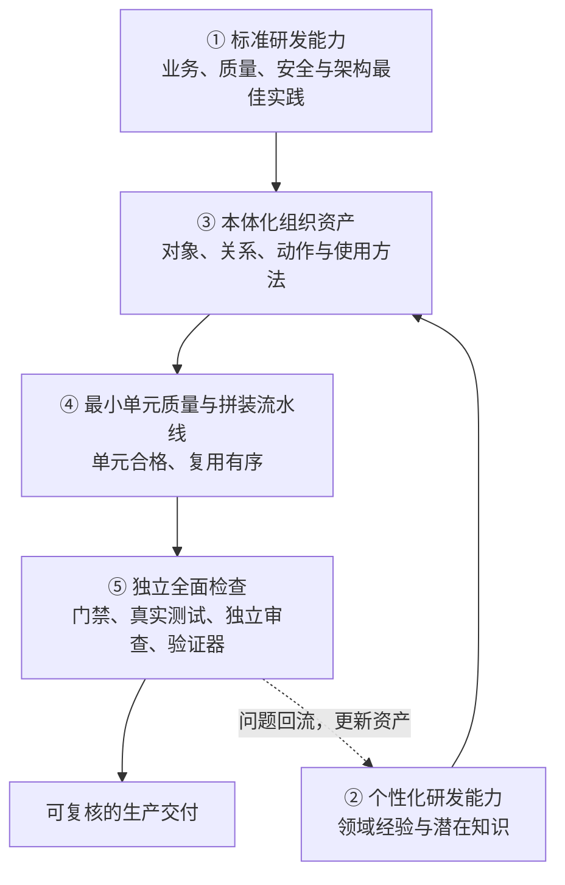
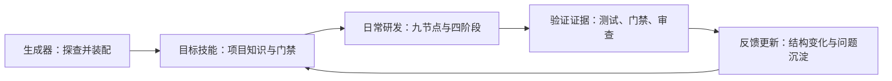
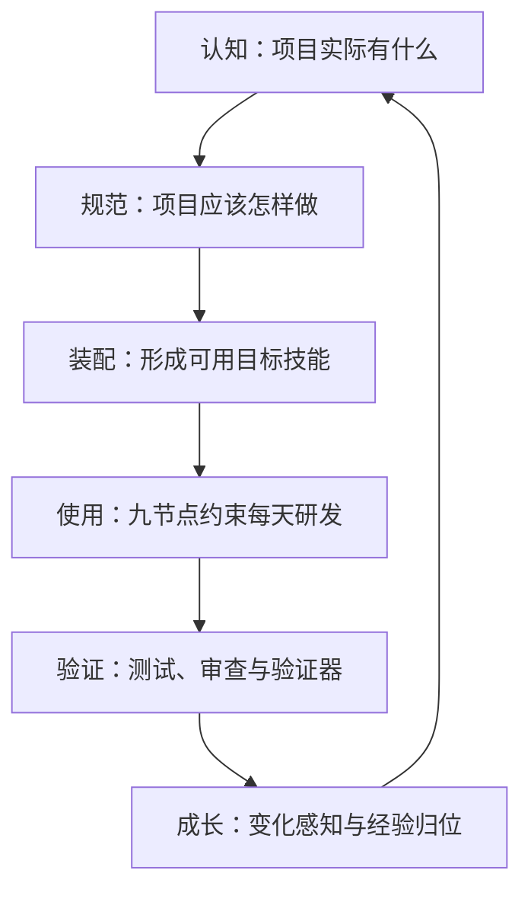
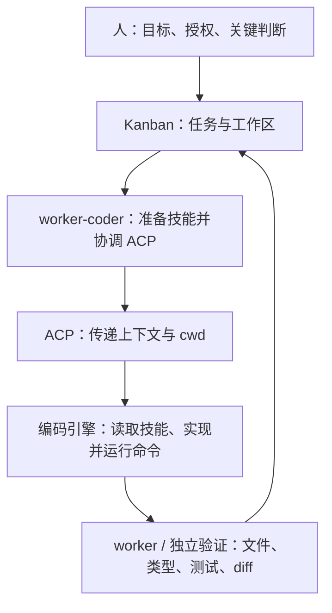

# swarm-yuan 产品、技术与操作培训手册

本手册面向第一次接触 swarm-yuan 的研发、测试、技术负责人和技能维护者。全书以**研发人员能力的 SOP 化**为总主线：把行业标准与项目经验转化为可查询的组织资产、可执行的研发流程和可复核的交付证据。学员最终应能生成可信的项目技能，用它约束日常研发，判读门禁与测试证据，并在项目变化后更新技能。

- **当前版本**：v2.100.3，依据 `RELEASE-MANIFEST.json:88-101` 与 `skills/swarm-yuan/CHANGELOG.md:3-11`。
- **事实优先级**：当前脚本、配置和测试优先于有效 spec 与设计 README；历史案例只证明其所属版本和场景。易变数字以 `skills/swarm-yuan/assets/facts.conf` 为正本。
- **编写范围**：本手册核对了当前源码与有效文档，没有在本轮执行安装、生成、激活、真实项目研发、真实 ACP 编码回合或其他真实模型编码。文中的历史数字均标明版本，不能当作本轮复测结果。
- **核心分工**：生成器产出目标技能，目标技能约束研发；门禁检查过程与结构，真实测试和独立审查核验业务结果。

## 导读：这门课怎样学

建议用一天完成：三层投影、四论与五项能力 1.5 小时，生成流程与研发流程 1.5 小时，操作演示 1 小时，贯穿实训 2.5 小时，考核 0.5 小时。第一次学习按章节顺序读；已经装好技能的人可直接从第三部分操作章开始，但仍需阅读证据边界。想先了解它调研和吸收了哪些框架、运行时与方法论，可先读第二部分开头的「吸收全景」。

完成课程后，学员应能回答并实践以下问题：

1. 说明“研发人员能力的 SOP 化”五项形成链，以及生成器、目标技能和项目运行态的职责边界。
2. 讲述认知、规范、装配、使用、验证、成长六层设计，指出标准与经验怎样变成实物文件和检查证据。
3. 完成安装、生成、填充、strict 激活、日常研发、门禁判读、失败处置、反馈更新与离线安装。
4. 判断什么算完成、失败怎样恢复、留什么证据，并解释门禁全绿为何仍不能证明业务正确、fixture 通过为何仍有**外部有效性边界**。

文中路径默认相对 AIStudio 仓根。操作卡中的 `/absolute/path/to/...` 是必须替换的绝对路径；命令没有在本轮执行。每张操作卡都有“做什么、怎样解释、完成标志、失败处置、留存证据”五字段，写操作与只读检查分别标识。

# 第一部分 产品：它解决什么问题

## 总主线：研发人员能力的 SOP 化

SOP 是“标准作业程序”。研发人员能力的 SOP 化，是把优秀研发人员依据规范、识别项目、复用资产、实施变更和验证交付的做法，转成团队与 AI 都能执行、检查和更新的工作系统。手册后续所有生成、编码与门禁操作，都服务这条主线。

### 五项能力怎样形成一条链



**① 标准研发能力解决“共同底线从哪里来”。** 国内外行业标准的业务、质量和安全规范，与技术栈、架构最佳实践共同形成标准能力。业务侧包括需求、过程、追溯与交付物要求；质量侧包括测试、可靠性、维护性和覆盖率；安全侧包括 OWASP、STRIDE、CWE 等约束；技术侧把框架规律放到当前项目代码中取证。标准矩阵、安全规范、框架规则和门禁配置分别承接这些内容，不能把标准原文贴进提示词就算落地。`skills/swarm-yuan/references/standards-compliance.md:8-17`；`skills/swarm-yuan/references/security-spec.md:3-7`

**② 个性化研发能力解决“这个项目为什么这样做”。** 领域特色、业务状态约束、既有实现惯例和潜在知识构成项目个性。潜在知识是未完整写成制度的实际经验，例如 Git 历史中的共变关系、代码里的隐式耦合、资深研发避开的坑。17 项特征卡、`mine-habits.sh`、领域规律验证、任务配方和 lessons 把这些经验显性化；统计与猜测必须由代码证据和 AI 审读约束，不能冒充书面规范。`skills/swarm-yuan/references/domain-knowledge.md:3-8`；`skills/swarm-yuan/scripts/mine-habits.sh:1-14`

**③ 本体化组织资产解决“知识怎样可查、可拼装、可行动”。** 本体在这里是明确的类型与约束系统，不是概念名词装饰。机制本体的对象目录登记 Repository、Skill、RuleFile、Ledger、Generation、GateExecution 等类型；关系目录用 `represents`、`governs`、`records` 等关系说明谁表征、治理或记录谁；动作目录用 `generate_skill`、`update_map_entry`、`run_gates` 等动作说明状态怎样被允许改变。每种关系和动作都要求机器锚与留痕载体。`skills/swarm-yuan/assets/ontology/objects.md:17-54`；`skills/swarm-yuan/assets/ontology/links.md:9-28`；`skills/swarm-yuan/assets/ontology/actions.md:8-28`

项目资产按下面方式重组，文件不再只是被动文档：

| 本体视角 | 项目实物 | 重组后的使用方式 |
|---|---|---|
| 对象 | 组件库清单、接口与数据条目 | 每行登记路径、说明、稳定性等属性，回答“有什么、能否复用”，并由计数和 path-check 验真 |
| 关系 | `relations.jsonl` 关系边集 | 用 from/to/kind/evidence 表达 import、字段映射、调用、路由和消息关系，回答“改谁会影响谁” |
| 动作 | 任务配方与受治理脚本 | 配方写触发场景、前置查询、复用件、胶水、门禁与验证；脚本执行状态变换，trace、decisions、gate-runs 留下行动证据 |

还要区分两层本体：`assets/ontology/` 是生成器和目标技能的**机制本体**；订单、支付、客户等属于目标项目的**业务本体**。业务本体先统一术语、定义、标识符和代码映射，再约束对象关系，不应把业务类直接塞进机制类型目录。`skills/swarm-yuan/references/business-ontology-methodology.md:253-258`

**④ 最小单元质量与拼装流水线解决“正确零件怎样形成正确产品”。** 最小单元同时受两类标准约束：质量标准要求职责与契约清楚、路径真实、测试覆盖正常和失败路径、错误处理与安全检查不裁剪；拼装标准要求先查复用件、保持依赖方向、声明稳定单元变更、以最小新增胶水连接，并评估下游影响。spec-first、测试先行、复用阶梯、九节点与研发四阶段把这些要求编排成标准研发流水线。`skills/swarm-yuan/README.md:75-80,190-196`

**⑤ 独立全面检查解决“凭什么达到生产标准”。** 机械门禁检查词法、结构、流程与配置；真实测试执行代码并核验业务行为；独立审查由非实现者检查需求、设计和证据；独立验证器用正反例与合成夹具检查门禁的检出能力；真实历史缺陷语料的外部有效性证据仍在采集。这四类证据不能互相替代，“严苛、细致、独立”也不等于隐瞒跳过项或让实现者自报通过。Mutation Check 不属于这四类证据，它是另一套变异探针方法：故意注入故障后重跑，确认测试或门禁断言真的能发现它——生成器侧用它检验门禁夹具，项目侧用它检验测试敏感度。`skills/swarm-yuan/README.md:151-184`

五项形成闭环：标准提供底线，个性补充项目事实，本体组织资产，流水线调用资产，独立检查验证结果，发现的问题再回流为项目经验。生成器只是承载这条链的工具，不能替代其中任何一环。

## 谁定方向、谁守门、谁干活：三层投影与四论

**一句话定位：人定方向 · 机器守门 · AI 干活。** 一个人或少数几个人带少量 AI 助手时，可以靠人盯、靠模型自觉；AI 员工多了之后，质量不能靠模型自觉，必须靠机制——每个“必须”都要有机器检查、可复核证据和失败阻断。`docs/manuals/AI协作标准手册.md:225-228`

| 层 | 对象 | 人机分工 | 与手册章节的对应 |
|---|---|---|---|
| 人机界面层 | SwarmStudio 驾驶舱 | 人定方向、看清证据、裁决例外与发布 | 第 14-15 节研发与门禁判读、第 25 节验收 |
| 组织控制层 | hermes 集群 | AI 干活、机械验收守门、记录任务与审批 | 第 10 节 ACP 证据、第 6 节研发四阶段 |
| 机制执行层 | swarm-yuan 目标技能 | 把守门落进编码回路：读写、提交、构建与合入 | 第 5 节 Step 1-13、第 7 节 precheck、第 8 节 L1-L4 |

三层是同一条原则的三次投影，不是三个独立产品：上层不替代下层证据，执行层门禁也不能替人作发布裁决；本手册主要讲最下面一层，它守得住，上面两层的“看清”和“裁决”才有事实基础。

系统论、信息论、科学方法论、控制论共同构成面向复杂系统的认识与行动方法体系——系统论解决“看清”，信息论解决“看准”，科学方法论解决“认识可靠”，控制论解决“行动有效”；四者通过“认识—信息—模型—行动—反馈”相互耦合，把对复杂系统的认知转化为可验证、可执行、可持续优化的能力。这套理念是 hermes agent teams 的灵魂，也是驾驶舱、swarm-yuan 技能与设计文档整体重构的驱动。

| 理论 | 解决的问题 | 在本产品的落地机制 | 证据 |
|---|---|---|---|
| 系统论 | 看清边界、要素、层次与依赖 | 组件库清单、关系边集、机制本体 | path-check 与计数核验、`relations.jsonl`、本体类型对账 |
| 信息论 | 看准口径、度量与噪声 | 单一事实源 `facts.conf`、证据可度量、降噪与诚实披露 | facts 对账、skip 单列、返回码与 gate-runs |
| 科学方法论 | 认识可靠、结论可复现 | 假设与证据分级、正反例与变异、外部有效性边界 | fixture、Mutation Check、`verifier/v2/external-validity.md` |
| 控制论 | 行动有效、偏差可纠正 | 门禁-测试-审查闭环、gate-runs、阶段状态机、反馈更新 | `gate-runs.jsonl`、`state.yaml`、指纹与升级预演 |

**三项分工一句话说清**：五项回答“能力由什么构成”，四论回答“凭什么相信这套能力可靠”，三层回答“责任落在哪一层”。工程纪律是“开环提要求必须配闭环兜底”：只写进提示词是开环，写成 hooks、门禁或状态机准入才是闭环。`skills/swarm-yuan/references/four-theories-methodology.md:5-18,104-118`

这一原则落到操作有四条：人只做方向与例外；每个“必须”都要有机器对应物，写不出检查项就只能算约定；AI 的自述不是证据，完成与通过要有当次输出支撑；机制本身也要被检查，门禁要能被变异探针抓失效。

## 1. 生成器、目标技能和日常研发怎样连成生命周期

swarm-yuan 是项目研发技能的生成器。它探查一个具体仓库，产出项目专属的目标技能；此后 AI 在该项目里工作，先查组件、关系、配方和规范，再修改代码。`skills/swarm-yuan/SKILL.md:6-13`



这条生命周期有两类反馈。项目文件结构变化时，项目指纹给出变化范围，执行局部重探查；解决新问题后，把新知识归入组件库清单、任务配方或规则。技能不是一次性脚手架，而是随项目维护的研发资产。`skills/swarm-yuan/README.md:202-215`

### 哪些场景适合使用

| 适合 | 不适合或不必使用 | 更轻的选择 |
|---|---|---|
| 多人协作、中长期维护的中大型仓库 | 个人脚本、一次性原型 | 直接对 AI 提需求 |
| 需要统一组件复用、改造边界、测试与发布纪律的团队 | typo 级小改 | 直接修改并跑既有测试 |
| 强监管、合规交付，需要过程证据的项目 | 纯人工开发 | 传统评审、lint、测试 |
| 小项目也需要基础认知与门禁，可选 lite 档 | 只要一个静态检查，不要项目认知 | 单文件门禁或传统 lint |
| 已在使用 AI 编码，希望减少重复造轮子和越界修改 | 只是做一个普通需求 | 使用该项目已有目标技能，不重跑生成器 |

能力边界必须写进交付结论：swarm-yuan 不替代编码宿主，不替代真实工具链，不替代人的需求、架构和发布裁决，也不是操作系统沙箱。门禁擅长发现词法与结构问题，算法错误、契约破坏和遗漏边界仍要靠测试与独立审查。`skills/swarm-yuan/SKILL.md:15-27`

## 2. 三类目录怎样划界

| 对象 | 当前位置 | 职责与证据 |
|---|---|---|
| 生成器源码 | 本仓 `skills/swarm-yuan/`，安装后通常为 `~/.agents/skills/swarm-yuan/` | `scripts/` 生成与核验，`assets/` 提供模板和门禁，`tests/`、`verifier/` 验证生成器自身 |
| 目标技能 | 默认家级 `~/.agents/skills/<项目>-dev/`；项目内已有受支持技能目录时优先复用 | 保存该项目的 `SKILL.md`、references、assets、scripts、rules.d 与宿主配置 |
| 项目运行态 | 目标项目根 `.swarm-yuan/` | 保存 `state.yaml`、notes、tasks、trace、decisions、gate-runs、指纹与恢复数据 |

目标技能内部还可能有另一个 `.swarm-yuan/`，保存 `activation-report.json` 等生成或升级证据。技能根的 `skill-manifest.json` 与 `.swarm-yuan-version` 记录交付身份。两处同名目录不能合并理解；项目运行态是否入库也由目标项目规则决定，不能按目录名一律删除或提交。`skills/swarm-yuan/scripts/generator/subcommands.sh:865-869` 当前目录规则有四级：先复用项目内既有技能目录；再命中家级 `~/.agents/skills/<name>`；再让 legacy 家级 `~/.zcode/skills/<name>` 原位续命；最后兜底到家级 `~/.agents/skills`。第三个位置参数可显式指定目标目录。`skills/swarm-yuan/scripts/generator/subcommands.sh:978-1006` 安装生成器也默认写入 `~/.agents/skills/`。无参数安装只披露检测到的宿主，不分流到各家目录；`--all` 或 `--claude`、`--zcode` 等显式旗标才写对应宿主目录。`skills/swarm-yuan/install.sh:727-744`

## 3. 六层设计怎样把知识变成交付能力

六层不是六份互不相干的文档。上一层的输出是下一层的输入，每层都有实物和检查。



| 层 | 输入 | 处理 | 输出与实物文件 | 主要检查 |
|---|---|---|---|---|
| 认知 | 代码、配置、AGENTS/CLAUDE、设计与需求文档、Git 历史 | 形态判定，枚举组件、接口、数据，提取 import 与声明式映射，AI 补语义关系 | `references/reference-manual.md`、`relations.jsonl`、`recipes.md`、`codebase.md` | 清单计数不少于自动枚举的 95%，路径验真，稳定性信号复核；设计与代码冲突须显式记录 |
| 规范 | 书面规则、行为统计、探查推导、17 项特征卡 | AI 审读统计与证据，形成铁律、三值规则和门禁参数 | `SKILL.md`、`rules.d/`、`precheck*.conf`、`dev-guide.md` | 书面规则优先于行为统计；P0 六项先填具体值，激活前 P1 也清零；规则 forbid 必须给替代方案 |
| 装配 | 认知产物、规范、框架证据、分发清单 | 创建六段骨架，AI 填充，注入框架门禁，配置宿主并终审 | 目标技能目录、manifest、版本文件、activation report | Step 1-13，draft/active 状态门，strict 完整性、清单和预算核验 |
| 使用 | 新需求、目标技能、项目运行态 | 九节点推进，spec-first 四层拦截，按任务执行 precheck | spec、plan、代码、测试、`state.yaml`、trace、decisions、gate-runs | 研发四阶段顺序，L1-L4 实际生效面，返回码与跳过项判读 |
| 验证 | 代码改动、测试、门禁结果、审查记录 | 真跑构建和测试，独立审查，正反例与变异验证 | 测试输出、`review-record.md`、验证器日志、当次 ACP 证据 | 退出码、真实用例、断言与负向路径、可选变异分数；模型自述不能代替验证 |
| 成长 | 项目结构变化、新问题、新版本生成器 | 指纹 diff、局部重探查、内容三态更新、工具链升级、经验归位 | 更新后的清单/配方/规则、`lessons.md`、新指纹基线 | 条目骤降保护、清单复核、升级预演、决策留痕；新增知识须受预算约束 |

# 第二部分 技术设计：机制怎样落地

## 技术总图：五项能力怎样映射到实物和证据

五项是能力视角，六层是实现视角，两者不是一一对应。认知和规范主要形成标准、个性与组织资产，装配和使用形成流水线，验证承担独立检查，成长把检查结果回流到全部资产。

| 能力项 | 输入 | 机制 | 实物 | 检查 | 证据 |
|---|---|---|---|---|---|
| 标准研发能力 | 业务/质量/安全标准，技术栈与架构规则，项目代码 | 标准矩阵映射，框架证据提取，规则与 conf 实例化 | `standards-compliance.md`、`security-spec.md`、`framework-knowledge.md`、`precheck*.conf` | `--compliance`、`--security`、`--framework`、清单核验 | 条款映射、代码锚点、门禁输出、框架 fixture |
| 个性化研发能力 | 领域模型、既有实现、Git 习惯、历史缺陷与排障经验 | 特征卡、行为挖掘、领域规律验证、问题三选一归位 | `codebase.md`、组件库清单、`recipes.md`、`lessons.md`、habits notes | AI 审读、领域测试、路径验真、配方结构检查 | 代码证据、行为初稿采纳记录、决策、更新 diff |
| 本体化组织资产 | 组件、接口、数据、依赖与允许的状态变换 | objects/links/actions 类型目录，清单、边集与配方重组 | `references/ontology/`、`reference-manual.md`、`relations.jsonl`、`recipes.md` | 计数与 path-check、relations verify、机制本体 self-check | 边集证据列、trace、decisions、gate-runs、指纹 |
| 最小单元质量与拼装流水线 | 稳定单元、契约、配方、测试与工程方法 | 复用阶梯、最小胶水、spec-first、测试先行、九节点与四阶段 | spec、plan、代码、测试、`workflow.md`、状态与合并记录 | `--reuse`、`--stable-diff`、构建、真实测试、独立审查 | 单元测试、回归报告、review-record、merge 与 main 回归 |
| 独立全面检查 | 当次变更、门禁配置、测试与审查对象 | L1-L4、precheck、真实测试、非实现者审查、独立验证器；Mutation Check 作有效性探针 | `gate-runs.jsonl`、测试报告、`review-record.md`、验证器日志、变异前后夹具输出 | 门禁查结构，测试查行为，审查查语义与证据，验证器以正反例和真实语料查检出能力；Mutation Check 只查“检查本身是否有效” | 返回码与 skip、用例和断言、审查 actor、验证器正反例结果、变异前后对照 |

独立检查尤其要避免“一个脚本包打天下”：precheck 返回 0 不能替代真实测试，测试全绿不能替代独立审查，独立验证器通过也不能外推为所有真实缺陷都可拦截。检查和证据必须能对上同一个项目快照与同一个变更。

四论在技术实现中各有对应机制：系统论靠清单、边集与本体看边界和依赖；信息论靠 `facts.conf` 单一事实源、skip 单列与返回码看准口径和噪声；科学方法论靠模板双态夹具、Mutation Check 与外部有效性边界保证结论可复现；控制论靠门禁-测试-审查闭环、gate-runs、状态机与反馈更新完成纠偏。四者不是四套新工具，而是对已有机制的归类，证据面与上表逐列对齐。

## 吸收全景：81 个框架、15 个运行时和 61 份方法论从哪里来

这一节回答“它凭什么有这些能力、每样从哪里来、什么时候生效”。来源分三类，分开列以免把外部吸收误当自研：**外部调研吸收**（真实项目研究、开源技能与方法论）、**行业标准映射**、**自研机制**。全部条目登记在 `skills/swarm-yuan/references/capability-map.md`（吸收台账单一事实源：逐档来源、证据、消费节点与触发），自检用 G25 双向对账、孤儿零容忍，所以下面每一项都可回查，不是宣传清单。

### 81 个技术栈框架规则

每个框架一份规则文档加一组门禁片段。只有项目真的用到某个框架，`--inject-frameworks` 才把对应门禁挂进目标技能；用不到的不会进来。名单以 `skills/swarm-yuan/references/frameworks/` 目录与 `FACT_FRAMEWORKS=81` 为正本：

| 生态域 | 覆盖的框架与中间件 |
|---|---|
| 前端与客户端（16） | react、vue、angular、nextjs、nuxt、antd、element、naiveui、tailwind、vite、webpack、flutter、android、ios-swiftui、react-native、harmonyos |
| 后端框架与语言栈（19） | spring-boot、spring-cloud、spring-security、spring-data-jpa、spring-batch、nestjs、express、koa、fastify、gin、kratos、django、flask、fastapi、dotnet、c-cpp、php、ruby、cargo |
| 数据访问与存储（18） | mysql、postgresql、opengauss、sqlserver、dameng、redis、elasticsearch、doris、hive、tdengine、paimon、mybatis、gorm、prisma、typeorm、sqlalchemy、druid、sharding |
| 消息、调度与分布式（12） | kafka、rabbitmq、rocketmq、quartz、xxl-job、elasticjob、seata、sentinel、nacos、dubbo、netty、celery |
| 工具与序列化（4） | jackson、lombok、mapstruct、validation |
| 测试（3） | junit5-mockito、jest-vitest、pytest |
| 数据处理（3） | spark、flink、kettle |
| 基础设施与可观测（4） | dockerfile、kubernetes、terraform、opentelemetry |
| AI 应用（2） | langchain、rag-pipeline |

### 15 个外部运行时（三层接线）

接线深度不同，责任不同。三层各自带降级载体：深度层回退内置 grep 与本地解析，CLI 层用随技能分发的降级载体或仓内物化原文，方法论层只是引用、缺席不阻塞；共同边界是**未装不阻塞但逐项披露**，分层说明见 `skills/swarm-yuan/SKILL.md:46`：

| 层 | 对象 | 怎样接线 | 未安装时 |
|---|---|---|---|
| 深度接线（4） | GitNexus、graphify、claude-mem、open-code-review | precheck.sh 以真实命令调用，产出直接进证据 | 对应门禁降级为提示并逐项披露，不阻断 |
| CLI 接线（6） | OpenSpec、comet、gsd-core、codex-security、mattpocock-skills、diagram-design | 门禁与状态机按需调用 CLI；mattpocock-skills 与 diagram-design 为仓内物化（前者物化 27 技能并带 MANIFEST 与 LICENSE） | 同上 |
| 方法论引用（5） | superpowers、gstack、ECC、Ruflo、impeccable | AI 按九节点引用其模式，不做硬依赖 | 引用面缺席，流程仍可走 |

外部运行时的版本随时间变化，不写进手册；当前实测版本看 `self-check.sh --check-only` 输出。行业 profile 不是运行时，用 `--industry <name|none>` 显式加载并由 conf-render 注入，**不是自动识别**；自动检测只决定 lite/standard/compliance 档位，不替你选行业。

### 27 个物化技能（读原文执行）

`skills/swarm-yuan/runtime/mattpocock-skills/` 物化 mattpocock/skills 共 27 个（engineering 20 + productivity 7），消费方式是读技能原文执行，不随目标技能分发：

| 组 | 全部技能 |
|---|---|
| engineering（20） | ask-matt、code-review、codebase-design、diagnosing-bugs、domain-modeling、grill-with-docs、implement、implement-spec、improve-codebase-architecture、pr、prototype、research、retro、setup-matt-pocock-skills、tdd、to-spec、to-tickets、triage、wayfinder、wizard |
| productivity（7） | grill-me、grilling、handoff、teach、to-questionnaire、wait-what、writing-for-agents |

名单以目录与 `MANIFEST.md` 为正本；目标技能侧不随包，缺失时按方法论层改写降级。

### 61 份方法论与规范文档

分组按主要用途归纳，权威登记以 capability-map 与 `skills/swarm-yuan/references/` 目录为准；带来源的条目在文件头保留原始出处，版本与轮次细节见 `skills/swarm-yuan/assets/facts.conf:54-79` 注释：

| 主题域 | 文档 | 代表性来源 |
|---|---|---|
| 生成与研发流程（13） | generation-flow、exploration-guide、template-spec、task-methodology-router、agent-skills-methodology、codex-methodology、dsh-engineering-methodology、claude-code-capabilities、subagent-orchestration、mea-loop-methodology、lazy-generation-methodology、mattpocock-skills-methodology、memory-persistence | lazy-generation 吸收自 DietrichGebert/ponytail（七层复用阶梯）；mattpocock-skills 吸收自 mattpocock/skills v1.2.3（访谈设计树、spec 测试缝、纵切拆分、诊断回路） |
| 领域与本体（4） | domain-knowledge、business-ontology-methodology、fibo-financial-ontology、togaf-metamodel-methodology | FIBO master_2026Q3 源码级术语（MIT）蒸馏出业务本体五步法 |
| 质量验证与排障（10） | review-methodology、rsi-evidence-methodology、pstack-methodology、failure-taxonomy、bugfix-runbook、remote-debug-jvm、canary-monitoring、clean-code-metrics-methodology、quality-management-standards、ai-process-records | rsi-evidence 三源吸收（清华 RSI 综述＋D2I-ai＋字节论文）；clean-code-metrics 吸收自 unclebob/ub-mode |
| 安全与合规（9） | security-spec、crypto-spec、cwe-database、standards-compliance、compliance-checkpoints、regulatory-checkpoint-table、security-certification-profiles、mcp-governance、codex-security-methodology | codex-security 吸收自 openai/codex-security；regulatory-checkpoint-table 执法检查主表 173 条 |
| 认知与思维（5） | cognition-framework、cognitive-bias、logic-razor、four-theories-methodology、gsd-patterns | four-theories＝系统论、信息论、科学方法论、控制论四论闭环 |
| 知识治理与吸收（6） | capability-map、knowledge-lifecycle-methodology、knowledge-retrieval-ladder、context-engineering-layering、cordis-composability-methodology、code-graph-tools | knowledge-lifecycle 吸收自京东海博实践；cordis-composability 吸收自 DeepSeek Harness |
| 表达与呈现（3） | frontend-design-methodology、diagram-production-methodology、controlled-language-methodology | impeccable v4.0.2；diagram-design v2.6.110（生成器侧档）；受控语言 ASD-STE100 |
| 估算与治理（3） | cost-estimation-methodology、decision-governance、governance-agents | cost-estimation＝NESMA GB/T 42588-2023 功能点估算 |
| 行业 profile（8） | industry-profile-automotive、industry-profile-energy、industry-profile-finance、industry-profile-gov、industry-profile-industrial、industry-profile-medical、industry-profile-payment、industry-profile-telecom | payment 吸收 hermes pay-team 人格内核；配置覆盖层见 `skills/swarm-yuan/assets/industry-profiles/` |

### 研究与案例档案（生成器侧）

`skills/swarm-yuan/docs/research/` 现有 106 篇研究档案，R 编号档跨度 R1–R144、允许同号多档（如 R124、R143 各两档）；全量清单以目录为准，`ls skills/swarm-yuan/docs/research/` 即可枚举。下表按文件名关键词分组（runtime-refresh/ponytail、regression/jvm、drill、absorption/capability-map、audit/hardening/standards，其余归基础设计与外部调研），各组合计 106：

| 主题 | 代表编号 | 篇数 |
|---|---|---|
| 运行时刷新与整合轮 | R16、R105、R140–R144 | 51 |
| 基础设计与外部调研 | R1–R9、R11–R19、R101–R104、R114 | 26 |
| 真实项目回归 | R44、R72、R118、R121、R124、R143 | 10 |
| 方法论吸收与台账 | R14、R37、R86、R88、R143-ponytail、2026-10-20 台账 | 10 |
| 审计与安全加固 | R7、R8、R54、R119、R126 | 5 |
| 换栈演练 | R58、R60、R62、R64 | 4 |

这些是生成器侧档案，不随目标技能分发；分发面以 `UNIVERSAL_FILES=109`（lite 51）为正本。

### 行业标准映射

`skills/swarm-yuan/assets/standards-map.conf` 用五字段（规则或门禁 id、CWE、GB/ISO、ASVS5 节、置信度）把门禁挂到标准条文；compliance 档分发该映射，SARIF 转换器把 CWE 与 GB/ISO 写进规则元数据（`skills/swarm-yuan/scripts/to-sarif.sh:42-65`），合规门校验矩阵与映射完整性（`skills/swarm-yuan/assets/gates/compliance/compliance.sh:23-87`）。边界不变：映射是可裁剪基线，不等于自动合规或认证。

### 为什么这份全景可信

- **单一事实源**：capability-map 逐档登记来源、证据、消费节点与触发；自检 G25 双向对账，孤儿零容忍。
- **三载体一致**：每次方法论吸收要求 references、SKILL.md、facts.conf 三处同步，G13/G14/G15/G17 逐项实测。
- **吞吐有界**：新增知识受预算约束（门禁 59、变量 204、上下文表面等以 facts.conf 为准），吸收不是无限堆料。
- **默认不启用**：框架规则按命中注入、行业 profile 显式选择、方法论层是引用不是依赖——知道“有什么”不等于“全都开着”。

## 4. 六段目录和生成档位各装什么

| 逻辑段 | 主要文件与职责 |
|---|---|
| meta | `SKILL.md` 是入口，写项目铁律、改造分类和工作流；`skill-manifest.json` 记录 profile、框架和文件计数，`.swarm-yuan-version` 记录生成来源 |
| workflow | `references/workflow.md` 承载九节点的准入、产出、状态控制、调用追踪和完成检查 |
| reference | `codebase.md`、`dev-guide.md`、`release.md`、`reference-manual.md`、`recipes.md`、`relations.jsonl`、`framework-knowledge.md` 承载项目知识；`lessons.md` 保存升级时要保留的经验 |
| assets | spec、plan、审查记录等模板，以及分支、环境、数据样例、任务类型门禁映射与行业标准映射 |
| check | `scripts/precheck.sh`、`precheck*.conf`、`gate-enforce-level.conf`、`rules.d/` 与 hooks/commands/settings 等，负责注册、配置和执行检查 |
| scripts | `state-machine.sh`、`trace-log.sh`、`memory-writeback.sh`、关系与清单工具、项目指纹等，承载状态、证据和维护动作 |

分发清单以 `UNIVERSAL_FILES` 为准，项目内容保留清单以 `PROJECT_SPECIFIC_FILES` 为准。lite 保留核心认知、模板与门禁脚本，不含完整 hooks/commands/settings 和完整九节点 workflow；standard 是完整骨架；compliance 在 standard 上增加合规资料与矩阵。auto 根据合规、规模、形态、框架和 monorepo 信号选档，信号模糊时走 standard；也可在位置参数前显式写 `--profile lite|standard|compliance`。`skills/swarm-yuan/scripts/generate-skill.sh:940-968,984-994` 目标技能要“薄”，生成器可以“厚”。每次会话重复加载的入口和 references 受字节预算约束；新增知识必须替换、压缩或登记例外，不能只增不减。预算值不要手抄进项目文档，统一读取 `skills/swarm-yuan/assets/facts.conf`。`skills/swarm-yuan/README.md:45-47,135-149`

## 5. Step 1-13 怎样生成可信技能

下表是生成流程的概念顺序。脚本负责枚举、复制、渲染和核验，AI 负责特征判断、规律实例化、填充和审查。只创建骨架不能宣布完成。

| Step | 做什么 | 主要产出与完成判据 |
|---:|---|---|
| 1 | 用 `self-check.sh --check-only` 检查生成器、运行时和文档一致性 | 自检通过；不带 `--check-only` 可能安装或升级运行时，课堂排障只用只读形态 |
| 2 | 读取 AGENTS/CLAUDE/记忆，运行 `mine-habits.sh` 形成行为统计初稿 | `.swarm-yuan/notes/habits.md` 经 AI 审读，统计事实不直接当规范 |
| 3 | 并行探查结构、规范、代码组织，逐路记录调用 | 探查报告落 notes，调用进 trace；子代理结论须复核 |
| 4 | 判定形态，形成组件库清单、调用链、关系边集、框架证据与配方素材 | `reference-manual.md`、`relations.jsonl`、框架证据；每条框架规律有项目代码证据 |
| 5 | 填充 17 项特征卡 | P0 六项为具体值；P1 可在 draft 期增量补，但激活前必须清零 |
| 6 | `generate-skill.sh <name> <project-dir> [target-dir]` 创建 auto/lite/standard/compliance 骨架 | 目标技能与初始 `status: draft`、manifest、版本文件；已有 draft 可续传 |
| 7 | AI 用探查结果填充全部项目文件 | SKILL、references、recipes、framework-knowledge 等不含空泛模板话 |
| 8 | 审核 precheck 配置、rules.d、测试容量与 Mutation Check | `# TODO:model` 语义项有真实值；门禁变异后仍能抓出故障才证明断言有效 |
| 9 | 定制 hooks、commands、settings、MCP 与 workflow 标注 | 非 lite Git 项目装配 L2 pre-commit；只启用适用且已理解的宿主配置 |
| 10 | 运行目标技能 `precheck.sh --all`，修复后重跑 | 核心检查有真实结果；构建和测试副作用按项目规则处理 |
| 11 | 独立第三方审查并运行 `precheck.sh --review` | `references/review-record.md` 有 findings、结论和处置，不以口头声明替代 |
| 12 | `memory-writeback.sh` 写回项目知识或已配置记忆后端 | 每个后端披露写入、跳过或失败；写回失败不伪造成功 |
| 13 | strict 完整性、清单 strict、预算与 manifest 核验后 `--mark-active` | 所有必需检查通过，draft 才变 active，全量与合规套件才解锁 |

权威总览见 `skills/swarm-yuan/SKILL.md:56-82`，自动化与 AI 的分工见 `skills/swarm-yuan/references/generation-flow.md:9-32`。

### strict 激活到底检查什么

`--mark-active` 不是简单改 frontmatter，当前顺序如下：

1. 要求 `SKILL.md` 存在；若不是 draft，报告无需标记并退出 0，不重跑激活检查。
2. 检查已激活框架的 glob，防止配置全空导致框架门禁空转。
3. 检查 spec-first 接线，防止 `SPEC_REQUIRED=1` 但可写区等关键配置为空。
4. 执行 `verify_completeness --strict`，检查占位符、九节点形态、项目内容和决策记录。
5. 执行 `inventory-verify.sh --tsv --path-check --stability-audit --strict`，阻断清单缺漏、形态矛盾、扫描错误和幻觉路径。
6. 关系边集若存在则抽样验证，失锚只告警；随后检查最终产物预算。
7. 重写 `skill-manifest.json`，写 `.swarm-yuan/activation-report.json`。
8. `audit-closure` 的 open goal 只告警；最后才把 `status: draft` 改为 `status: active`。

任一必需步骤失败都在改状态前退出 1，保持 draft。relations 与 audit-closure 是 advisory，不阻断。activation report 只证明当次激活链通过，不保证以后持续全绿。`skills/swarm-yuan/scripts/generator/subcommands.sh:798-885`

独立运行 `verify_completeness` 时，draft 非 strict 模式允许列出占位并返回 0，便于续传；`--strict` 或 active 状态下发现缺失返回 1。两种语义不能混用。`skills/swarm-yuan/scripts/generator/subcommands.sh:384-407,436-519`

### SCHEMA_EPOCH 为什么不会放松新决策要求

决策校验的 Python 主路径使用 `SCHEMA_EPOCH=2026-10-28T00:00:00+00:00`：

- 每行都必须是合法 JSON 对象；`UserChallenge:incomplete` 在任何时期都不能作为完整决策。
- 边界前记录，以及时间戳缺失或不可解析的记录，按历史处理，不追溯后来新增的完整字段。
- 边界后记录必须有非空 `type`、`ai_suggestion`（或兼容字段 `suggestion`）和 `user_action`；`UserChallenge` 还须有 `alternatives`、`missing_context`、`cost_if_wrong`。
- strict 仍要求至少一条非空决策记录，其他完整性、清单、预算和激活检查均不放宽。

这项 grandfathering 只解决新 schema 回溯误杀历史账本，不允许新决策缺字段。无 Python 时还有旧 grep 降级路径，不能把上述边界默认外推到降级路径。`skills/swarm-yuan/scripts/generator/subcommands.sh:290-380`

### 升级为什么不会重写项目经验

`references/lessons.md` 属于 `PROJECT_SPECIFIC_FILES`，升级保留项目内容。`test-lessons-preserve.sh` 在第一次 upgrade 后比较 lessons.md 与 SKILL.md 的 MD5（含手加的 lessons 入口行），确认两者整体字节级保留；第二次 upgrade 再验证 lessons.md 幂等。升级仍应先预演、检查在途任务，再更新工具链并局部重探查项目内容；升级不等于自动理解新项目。`skills/swarm-yuan/scripts/generate-skill.sh:187-198`；`skills/swarm-yuan/tests/test-lessons-preserve.sh:37-73`

## 6. 九节点、四阶段和六状态怎样对应

Step 1-13 负责生成技能，日常九节点负责使用技能，两套编号不能混用。


| 研发四阶段 | 节点 | 完成含义 |
|---|---|---|
| 分支开发 | ⑤ | feature 分支从最新 `origin/main` 起步，测试与实现同分支，不在 main 直接开发 |
| 分支测试 | ⑥⑦ | 测试、门禁和独立审查都在 feature 分支完成，全绿才允许合入 |
| 主干合并 | ⑧ | 核验前序证据、回滚、迁移兼容和设计文档，再按授权合入 |
| 主干回归 | ⑨ | 合入后在 main 复跑全量回归，全绿才构建发布 |

⑨用于发现并行合入交互和合并语义问题，不能替代⑥⑦。状态机的六阶段对应为：open=①②，design=③④，build=⑤，verify=⑥⑦，archive=⑧，operate=⑨及发布后观察。`skills/swarm-yuan/references/template-spec.md:254-282`

### 状态机守什么，又不守什么

state-machine 只能逐级前进，普通 `set phase` 和 `set created_at` 被拒绝；`verify_result=pass` 前必须先写 `verify_evidence`。transition 只做准入检查和状态更新，不会自动 merge 或 release。`skills/swarm-yuan/assets/state-machine.sh:354-404,675-700`

| 状态 | 准入与明确的降级面 |
|---|---|
| open | 初始化 change、phase、build_mode、isolation、pending 结论与证据空位；已有状态在非交互环境须显式 `--force` 才重置 |
| design | 需要 proposal 或可替代的 SPEC_FILE；缺 decisions.jsonl 主要告警 |
| build | 需要 build_mode/isolation；`SPEC_REQUIRED=1` 时还需已批准 spec；判定库缺失会披露并降级跳过 spec 检查 |
| verify | tasks 文件存在时有未勾项会失败；文件不存在会降级跳过 |
| archive | `verify_result` 必须为 pass；verify_evidence 为空在 archive guard 里只 warn，破窗清单和 delta spec 提示也不阻断 |
| operate | verify 状态和 operate-report 主要是提示，不是强阻断发布控制器 |

状态机是流程辅助，不是操作系统沙箱。不使用它、直接编辑状态文件或绕开调用链，脚本自身无法根除，必须由 Git、门禁和独立审查补证。`skills/swarm-yuan/assets/state-machine.sh:184-351`

## 7. precheck 怎样执行、汇总和留证

配置分 core、arch、compliance，可加载 industry，最后加载 `precheck.patch.conf` 用户覆盖层。项目定制优先放覆盖层，降低升级漂移。`TEST_CMD`、`BUILD_CMD`、`MUTATION_CMD` 会作为 shell 命令执行，只能使用受信任配置。

当前数字以 `skills/swarm-yuan/assets/facts.conf:24-46` 为准：门禁总数 59，其中 FULL 53、advisory-only 6；聚合执行面记为 `--all`=12、`--all-full`=32、`--compliance-suite`=19，分别对应核心、standard 和合规套件。FULL 53 由 standard 32、compliance 19 和 `decision_audit/state_phase` 2 组成，不等于 `--all-full` 的数量。配置变量为 204，即 core 30、arch 126、compliance 48。

三种聚合模式都会遍历各自数组并累计 FAIL，最后统一汇总。单个 FAIL 不中止后续检查，也不会被后续 PASS 抵消。`skills/swarm-yuan/assets/precheck.sh:1879-1898`

strict、warn、advisory 是按 `fail()` 能力划分的横切强度，与 core/standard/compliance 家族正交。实时名单用 `--list-gates` 查看，不要在培训材料里另抄一份会漂移的清单。`skills/swarm-yuan/assets/facts.conf:94-101`

### 返回码和覆盖范围怎样一起判读

| 返回码 | 当前语义 |
|---:|---|
| 0 | 没有 FAIL/ERROR；WARN、advisory 和默认模式下的 SKIPPED 不阻断。`--fix-suggest` 即使收集到 FAIL 也固定返回 0，只能看建议，不能当验收通过 |
| 1 | 业务 FAIL 或门禁自身 ERROR 的最终汇总失败；未知模式、非法 `--format` 等部分 CLI 用法错误也返回 1，须结合输出判断 |
| 2 | 三类：①配置、项目根、门禁实现完整性等启动或运行错误；②显式 `--strict-skip` 且没有 FAIL、但存在 SKIPPED；③所属技能仍为 draft 时执行 `--all-full` 或 `--compliance-suite`，门禁在启动阶段直接拒绝。第三类不是代码失败，回操作卡 4 完成 strict 激活后再跑。不能把 2 一律解释成“部分跳过” |

最终输出单列 fail、warn、advisory、skip 计数。skip 不计 warn，也不等于 pass；默认有跳过仍可能返回 0，所以“通过”不等于“全部覆盖”。`skills/swarm-yuan/assets/precheck.sh:2031-2087`

### gate-runs 和失败标记怎样使用

- `GATE_RUNS_DIR` 默认为空，JSONL 证据落盘默认关闭；`--format json` 或设置该目录会启用输出捕获，但只有目录非空才写 `gate-runs.jsonl`。目录不可创建时告警并关闭落盘，不伪造文件。
- 每条记录含 `ts/run/gate/status/ids/duration_s`；`run` 是按当前 JSONL 行数递增的单门禁记录序号，不是整套套件共享的批次号。状态包括 pass/fail/error/skip/warn/advisory，耗时单位为秒。
- `state-machine.sh` 的 `verify_evidence` 可引用 `gate-run#N`，还要结合时间、命令和工作区确认它属于当次任务。
- FAIL/ERROR 会写项目根 `.swarm-yuan/.gate-fail-flag`，供白名单拦截使用；只有覆盖式聚合运行全绿才清旧标记，单个门禁变绿不会清除全局失败状态。

实现见 `skills/swarm-yuan/assets/precheck.sh:1255-1321,1338-1467,1969-1975,2038-2087`。

ADR 的 `shortcut: <上限>, <何时升级>` 挂在既有 `check_adr` 第 5 段：有标记表示已登记的妥协，缺少逗号后的升级触发条件会按 `no-trigger` 告警。它复用 architecture 族的 warn 门禁，不新增 `check_*`，所以门禁总数仍为 59。当前扫描不含 shell 文件，不能声称覆盖所有语言。`skills/swarm-yuan/assets/gates/architecture/adr.sh:80-99`

## 8. spec-first 的 L1-L4 怎样互补

四层共享 `spec-first-lib.sh` 的判定内核，但触发点和关联面不同。机器所谓“已批准 spec”的基础判据是包含非占位“决策记录”段，不等于真实人类评审已经完成。

| 层 | 实际触发 | 主要降级或绕过面 |
|---|---|---|
| L1 写时 hooks | spec-first 在 PreToolUse 的 Write/Edit/MultiEdit 触及 `WRITABLE_DIRS` 时检查；Bash 的 rules.d 和推进态命令是相邻但不同的拦截面 | 宿主未装或未启用 hooks、宿主配置未实测、draft、非可写区、`SPEC_REQUIRED=0`、配置或判定库缺失会降级 |
| L2 Git pre-commit | staged 文件触及可写区时，检查实际 index 中的 spec 与关联变更 | `git commit --no-verify` 可跳过；draft、开关关闭、检测目录为空、判定库或 conf 缺失会 fail-open，由 L3/L4 和审计补位 |
| L3 precheck spec-first | `--all` 核心序列或显式 `--spec-first` 时，检查 staged、branch diff 和 untracked 中的可写区变更 | 只有真运行才生效；开关关闭、无目录、无判定库或非 Git 项目会 SKIPPED |
| L4 state-machine build guard | `transition build` 或 `auto` 进入 build 时检查已批准 spec | 不使用状态机就不触发；`SPEC_REQUIRED=0` 或判定库缺失会降级 |

L1/L4 检查存在性；L2 以 staged ∪ branch 和 index 正文为准；L3 以 staged ∪ branch ∪ untracked 和 worktree 正文为准。L1 已有 Claude Code、Codex、ZCode 的宿主实证；Cursor、Gemini、OpenCode、Kimi-Code、Windsurf/Devin CLI 当前只有生成配置，尚未实证。强制面以 L2-L4 为准，不能把“生成了配置”写成“运行时已经拦截”。`skills/swarm-yuan/assets/spec-first-lib.sh:105-185`；`skills/swarm-yuan/assets/facts.conf:130-136`

## 9. 测试、独立验证和变异验证怎样防止虚报通过

`check_test` 先运行真实 `TEST_CMD`，再检查零用例空跑、覆盖率、零断言、断言密度、聚焦测试和负向/边界比例；配置 `MUTATION_CMD` 后继续检查变异结果。负向比例主要按含相关关键词的测试文件占比计算，不是对业务语义的完整理解。`skills/swarm-yuan/assets/gates/quality/test.sh:3-90`；`skills/swarm-yuan/assets/gates-strict.sh:198-275`

两种变异验证必须分开：

- **生成器侧 Mutation Check**：故意给门禁函数注入故障，重跑 violating/compliant fixture。变异后仍能抓出故障，才证明断言有效。
- **项目侧变异测试**：只有配置 `MUTATION_CMD` 后才执行；命令失败、无法解析阈值分数或分数低于阈值都会 fail。

fixture 双态测试只能证明违规样例被抓、合规样例通过和重构前后行为一致，不能证明所有真实缺陷都能被拦截。当前外部有效性文档仍记录真实历史 bug 语料待采集；既有试验中 fixture 曾漏掉 3 个 P0/P1 bug。因此课堂结论必须限定到已测项目、框架和用例，不得宣称普遍质量保障。`skills/swarm-yuan/verifier/v2/external-validity.md:1-13,47-52`

## 10. worker、ACP 和编码引擎的交付证据怎样分层

ACP（Agent Client Protocol）在这里承担任务上下文和工作区到编码引擎的传递。技能准备先于编码，编码后的结果由 worker 亲自复核，不由引擎自我宣布完成。



| 证据层 | 文件或通道 | 当次必须核对的内容 |
|---|---|---|
| 任务与上下文 | `materials/delegate-result.json` | `taskId/board/taskTitle/taskStatus/assignee/branch`、`promptSha256/promptChars`，确认哪张卡、哪份最终上下文被装配 |
| 会话与工作区 | 同上 | `sessionId/cwd/model`，cwd 还应与 Kanban 规范 workspace 对账 |
| 引擎身份 | result JSON 与 `materials/delegate-log.txt` | `engineBin/engineBinSource`，区分 env、official-bundle、ycode-fork、bridge-default |
| 回合结果 | result JSON、日志与 `materials/runs.jsonl` | `exit/stopReason/stage/startedAt/endedAt/usage`；成功判据不能只看日志存在 |
| 技能装载 | worker 的 `yuan_skill` handoff、ACP `session/update`、diff 与测试 | 技能路径只证明交付位置；工具调用 pending→completed、路径引用和当次改动才能证明实际使用 |
| 实现质量 | worker handoff、测试和审查记录 | `changed_files/tests/diff`、构建/类型/测试真实输出与独立复核 |

字段实现见 `runtime/hermes-skills/coding-delegate/scripts/zcode-acp-delegate.py:258-339`。必须保留四个边界：

1. `provider="zcode"` 只是 provider/桥标识，不能证明实际启动的是 Ycode 分叉，还要核对 `engineBin` 和 `engineBinSource`。
2. 技能生成端点成功只代表生成、扫描和链接流程完成，不代表目标技能 active，也不代表当前 worktree 激活。
3. 宿主发现技能不等于本次编码实际读取和使用了技能。
4. 源码单测、协议冒烟、一次真实 Skill E2E、每个生产回合是四层不同证据，不能互相替代。

历史证据按范围理解：2026-10-27 的 echo-dev 探针记录到真实 Skill pending→completed、预期回文、任务 cwd 和 `end_turn`，但该次 `engine_bin_source=official-bundle`，不证明 Ycode 分叉身份。2026-11-07 的 `zcode-acp-server 0.82.1` 真机冒烟证明该版本桥的特定协议兼容与实物落盘，不证明每次 worker 都读取目标技能。任何新交付仍须提交当次技能装载、cwd、引擎身份和测试结果。`docs/superpowers/specs/2026-10-26-delegate-task-context.md:33-50`；`docs/superpowers/specs/2026-11-07-vendor-upgrade-studio-v0817.md:20`

# 第三部分 操作使用：怎样做完并留下证据

## 11. 操作前怎样准备路径和检查环境

### 操作卡 1：设置变量并做只读环境检查

- **做什么**：在生成器源码树可用、目标项目路径已确定的终端中设置变量。Windows 使用 Git Bash 或 WSL，并用 POSIX 路径。

```bash
export PROJECT_DIR="/absolute/path/to/target-project" \
  SKILL_NAME="$(basename "$PROJECT_DIR" | sed 's/[^A-Za-z0-9._-]/-/g')-dev" \
  YUAN_SRC="/absolute/path/to/AIStudio/skills/swarm-yuan" \
  YUAN_HOME="$HOME/.agents/skills/swarm-yuan"

bash --version; git --version; python3 --version
bash "$YUAN_SRC/install.sh" --version
bash "$YUAN_SRC/install.sh" --list
git -C "$PROJECT_DIR" status --short --branch
```

以上均为只读检查。Python 缺席不等于核心脚本不可用，但 SCHEMA_EPOCH 的 Python 主路径无法按完整语义核验；项目的 Java、Node、Maven 等真实工具链按目标项目要求另行检查。

- **怎样解释**：`YUAN_SRC` 指向源码树，安装前使用；`YUAN_HOME` 指向默认安装位，安装后使用。`SKILL_NAME` 只是建议名，实际 `SKILL_DIR` 必须以生成命令打印的“目标 skill 目录”为准，因为项目内既有技能目录会优先复用。
- **完成标志**：Bash 可用，源码树含 `install.sh` 与 `SKILL.md`，目标项目路径正确，Git 状态显示的是预期工作区；宿主清单只是检测结果，不代表已经安装。
- **失败处置**：路径错误先修正变量，不要在错误目录继续；CRLF 导致脚本解析失败时按安装器提示重新以 LF 克隆或转换；Windows 路径无法转换时改用 `/c/...` 或 `/mnt/c/...`。缺项目工具链时先补齐项目前提，不把它伪装成 swarm-yuan 缺陷。
- **留存证据**：保存版本、宿主清单、目标项目绝对路径和 `git status` 到课堂环境记录；只记录工具版本与路径，不记录凭证或敏感环境变量。

## 12. 怎样安装生成器

### 操作卡 2：安装到家级统一技能根并复核

- **做什么**：先执行只读 `--list`，再执行写操作安装，最后用只读文件检查和 `--check-only` 自检。

```bash
# 只读：确认当前检测到的环境
bash "$YUAN_SRC/install.sh" --list

# 写操作：默认安装到 ~/.agents/skills/，并备份同名既有安装
bash "$YUAN_SRC/install.sh"

# 只读：确认安装入口存在，检查生成器自身
test -f "$YUAN_HOME/SKILL.md" && test -f "$YUAN_HOME/scripts/generate-skill.sh"
bash "$YUAN_HOME/scripts/self-check.sh" --check-only
```

需要单家原生目录时改用 `--claude` 或 `--zcode` 等显式旗标；需要全部已检测环境才用 `--all`。不要为“装得多”而默认选择 `--all`。

- **怎样解释**：默认安装是跨工具单副本，zcode 原生读取该根；安装到 agents 根时会向当前原生宿主渲染规则。`--check-only` 用于检查，不走运行时自动安装或升级通道。
- **完成标志**：安装器以成功状态结束，`$YUAN_HOME` 下入口齐全，self-check 返回 0；若 self-check 有 WARN，需在读后说明其影响，不能只看最终“完成”字样。
- **失败处置**：同名目录、外指符号链接、权限或源树不完整导致失败时，先读错误并保护已有备份，不手工删除旧技能。修复后重跑同一安装与自检；未恢复前不得进入生成。
- **留存证据**：保存安装器摘要、实际安装根、备份路径、self-check 退出码和完整输出。不要只截“安装完成”一行。

## 13. 怎样生成、填充并 strict 激活目标技能

### 操作卡 3：完成 Step 1-12 的探查、骨架、填充与验证

- **做什么**：先自检，再按 Step 2-12 形成真实项目内容。下面命令含写操作，应在目标项目隔离副本或获准工作区运行。

```bash
# Step 1：只读自检
bash "$YUAN_HOME/scripts/self-check.sh" --check-only

# Step 2：写项目笔记；统计初稿仍需 AI 审读
bash "$YUAN_HOME/scripts/mine-habits.sh" "$PROJECT_DIR"
mkdir -p "$PROJECT_DIR/.swarm-yuan/notes"

# Step 3-5：AI 探查结构/规范/代码组织，判定形态并填 17 项特征卡
# Step 6：创建 standard 骨架；旗标必须放在位置参数前
bash "$YUAN_HOME/scripts/generate-skill.sh" --profile standard "$SKILL_NAME" "$PROJECT_DIR"

# 按上一条输出的“目标 skill 目录”设置；默认家级形态如下
export SKILL_DIR="$HOME/.agents/skills/$SKILL_NAME"

# Step 4/7：写关系边集、框架证据并注入框架门禁
bash "$YUAN_HOME/scripts/relations-extract.sh" "$PROJECT_DIR" --skill-dir "$SKILL_DIR"
bash "$YUAN_HOME/scripts/framework-evidence.sh" "$PROJECT_DIR" > "$PROJECT_DIR/.swarm-yuan/notes/framework-evidence.tsv"
bash "$YUAN_HOME/scripts/generate-skill.sh" --inject-frameworks "$SKILL_DIR"

# Step 7-9：AI 按 template-spec 填充 SKILL、references、conf、rules.d 和宿主配置
# Step 10：执行核心门禁；可能运行项目构建和测试
bash "$SKILL_DIR/scripts/precheck.sh" --all

# Step 11：独立审查落 references/review-record.md 后核验
bash "$SKILL_DIR/scripts/precheck.sh" --review

# Step 12：best-effort 写回记忆，逐后端看披露
bash "$SKILL_DIR/scripts/memory-writeback.sh" --skill-dir "$SKILL_DIR" --project-dir "$PROJECT_DIR"
```

AI 填充时至少逐项核对：17 项特征卡已承接，组件库清单和接口按真实形态枚举，配方含触发场景、前置查询、复用件、胶水、门禁与验证，框架规律带项目证据，conf 中 `# TODO:model` 已处理，测试命令真实可执行，独立审查者与实现者不同。

这张操作卡就是五项能力链的装配现场，缺任一项都不能把骨架当成完整能力交付：

- **标准研发能力**：把业务/质量/安全标准与技术栈证据写进标准矩阵、框架知识和 conf。
- **个性化研发能力**：把领域规则、潜在习惯与历史坑写进特征卡、配方和 lessons。
- **本体化组织资产**：把组件、关系、动作分别重组为清单、边集和配方。
- **最小单元质量与拼装流水线**：用单元测试容量、复用声明与九节点 workflow 形成流水线。
- **独立全面检查**：用 precheck、真实测试、独立审查和 Mutation Check 建立四类独立证据。

- **怎样解释**：Step 编号描述职责，不要求把 AI 判断压缩成一条命令。骨架创建后才有接收边集和填充内容的目录；`--inject-frameworks` 只挂入门禁片段，框架 glob 与项目规律仍须填充。`--review` 属于 precheck，不属于 generate-skill。
- **完成标志**：目标技能仍是 draft，但项目内容、配置、测试、审查与记忆写回均已有当次结果；核心 precheck 无未解释 FAIL，占位清单已收敛到可在 strict 终检前清零。
- **失败处置**：自检失败先修生成器环境；探查不足回 Step 3-5，不编造组件；骨架已存在且 active 时改用升级流程，draft 可续传；框架证据为空时判断是不适用还是探查漏项；构建测试失败回对应项目工具链和配置修复。不要用删除检查、清空阈值或 `--no-verify` 制造通过。
- **留存证据**：保存 notes、探查报告、框架 TSV、relations.jsonl、填充 diff、review-record、precheck 输出、memory-writeback 各后端结果和实际 SKILL_DIR。证据应能对应同一项目快照。

### 操作卡 4：执行 Step 13 的 strict 终检和激活

- **做什么**：先补一条真实决策记录，再做只读 strict 预检，最后执行会改状态的激活。

```bash
# 写操作：记录生成/选型决策；UserChallenge 需额外字段
bash "$SKILL_DIR/scripts/trace-log.sh" --project-dir "$PROJECT_DIR" \
  --decision --type Taste --suggestion "按项目探查结果装配 standard 技能" \
  --user-action approved --rationale "组件、配方、框架与测试均已按当前项目证据填充"

# 只读：strict 完整性预检
bash "$YUAN_HOME/scripts/generate-skill.sh" --verify-completeness --strict "$SKILL_DIR"

# 写操作：完整激活链，通过后才把 draft 改为 active
bash "$YUAN_HOME/scripts/generate-skill.sh" --mark-active "$SKILL_DIR"

# 只读：核对最终状态和激活报告
sed -n '1,12p' "$SKILL_DIR/SKILL.md"
cat "$SKILL_DIR/.swarm-yuan/activation-report.json"
```

- **怎样解释**：strict 预检通过并不自动激活；`--mark-active` 会再次执行必需检查。清单路径、计数、预算、框架 glob 或 spec-first 接线失败都必须保持 draft。历史决策由 SCHEMA_EPOCH 兼容，新决策不能借历史豁免缺字段。上面用 `--project-dir "$PROJECT_DIR"` 把决策账本定位到项目根：本项目按 R141 让决策账本落项目侧；`trace-log.sh` 头注仍写“指向技能目录”的旧口径，实际以显式项目侧为准，脚本本身未改。
- **完成标志**：`SKILL.md` 显示 `status: active`，activation report 为 passed，manifest 已刷新；随后 `--all-full` 和 `--compliance-suite` 才解除 draft 状态锁。
- **失败处置**：按输出的第一处未满足项回到对应 Step：占位回 Step 7，语义配置回 Step 8，清单漏项回 Step 4，决策缺字段补决策，预算超标先瘦身。relations 失锚和 audit open goal 是提示，要记录但不能误当硬阻断原因。
- **留存证据**：保存 strict 输出、激活输出、activation report、manifest、最终状态和决策记录。不得只保存 active 字样而丢失检查过程。

## 14. 每个需求怎样按九节点交付

### 操作卡 5：从需求走到分支编码

- **做什么**：在已激活技能的项目中，让 AI 依次完成①需求理解、②探查、③spec、④plan、⑤编码。用状态机记录同一 change，命令中的文件名须与项目配置一致。

```bash
# 写操作：初始化需求状态
bash "$SKILL_DIR/scripts/state-machine.sh" init order-edit

# ①②：AI 复述目标/非目标/验收，先查 recipes、组件清单和关系边集
bash "$SKILL_DIR/scripts/relations-query.sh" "$SKILL_DIR" "$PROJECT_DIR" --file "src/main/java/com/example/OrderService.java"

# ③④：写 proposal/spec/tasks（含变更、决策记录、验证、设计文档影响）；就绪后进入 design
bash "$SKILL_DIR/scripts/state-machine.sh" transition design

# ⑤：创建 feature 分支/worktree，先测试后实现；spec、build_mode、isolation 就绪后进入 build
bash "$SKILL_DIR/scripts/state-machine.sh" transition build
```

①要完成目标、非目标、影响面、约束和验收标准；②要找复用件、消费方、接口影响和回归面；③要把测试设计、回滚、安全与文档影响写清并让人评审；④要把任务拆到可独立验证；⑤要按“是否真需要、代码库已有、标准库、平台原生、已装依赖、一行调用、最小实现”的顺序复用，命中即停。

- **怎样解释**：状态机不替代需求评审，也不替代 Git。L1-L4 的“已批准”机器判据只是非占位决策记录，人的评审仍需真实发生。路径查询无命中可能表示边集缺漏，不能直接推断没有消费者。
- **完成标志**：spec 与 plan 已评审，分支和隔离工作区正确，测试先行，状态已逐级到 build；没有通过手改 `state.yaml` 跨阶段。
- **失败处置**：信息不足先问人；边集缺失先重跑 `relations-extract.sh`；design 缺 proposal 补文件或配置 SPEC_FILE；build 缺 spec 补 spec，不为绕过而关闭 SPEC_REQUIRED。`init` 报状态文件已存在时，先收口旧 change，或换一个 change 名；确需重置用 `state-machine.sh init <change> --force`，它会把 `state.yaml` 重写为 open，作废旧 change 的阶段、结论和证据字段（decisions 与 trace 账本历史仍在），重置前先确认没有在途任务。确需豁免时按项目决策流程留痕。
- **留存证据**：保存需求确认、探查锚点、spec、plan、分支基线、state.yaml、decisions 与 trace。代码 diff 必须能回指这份 spec。

### 操作卡 6：完成分支测试、独立审查、合入与主干回归

- **做什么**：在 feature 分支执行⑥测试和⑦审查，再经授权执行⑧合入，最后在 main 做⑨回归与发布。下面状态命令只在证据已产生后执行。

```bash
# ⑤的编码任务已勾选、进入⑥⑦：写操作，逐级推进到 verify
bash "$SKILL_DIR/scripts/state-machine.sh" transition verify

# 写操作：运行门禁并开启逐门禁证据
GATE_RUNS_DIR="$PROJECT_DIR/.swarm-yuan/gate-runs" \
  bash "$SKILL_DIR/scripts/precheck.sh" --all-full

# ⑦：独立审查并写 review-record；有合规要求时追加 --compliance-suite
# 写操作：把 N 换成当次 gate-runs 的真实记录号或报告路径
bash "$SKILL_DIR/scripts/state-machine.sh" set verify_evidence "gate-run#N"
bash "$SKILL_DIR/scripts/state-machine.sh" set verify_result pass
bash "$SKILL_DIR/scripts/state-machine.sh" transition archive

# ⑧：经授权按项目序列 fetch、ff-only 更新 main、分支 rebase、复测、merge --no-ff
# ⑨：合入后在 main 复跑项目全量回归与适用门禁，再构建发布
bash "$SKILL_DIR/scripts/state-machine.sh" transition operate
```

- **怎样解释**：`--all-full` 是 standard 32，不含合规 19；合规交付要追加套件。`transition archive` 不执行 merge，`transition operate` 也不执行发布。合入后回归失败时，按责任回退 merge 或回分支修复，不在 main 直接补代码。
- **完成标志**：分支测试和审查记录齐全，合入有授权和任务边界，main 全量回归通过，发布物、release notes、告警、runbook 和回滚入口齐全。
- **失败处置**：测试红回⑤；审查发现回⑤；合并冲突由分支属主在 worktree 解决；`verify_result=pass` 被拒说明证据字段为空或顺序错误；发布前回归红则停止发布并保留失败证据。
- **留存证据**：保存测试和构建原始输出、gate-runs、review-record、merge commit、main 回归、发布记录与回滚点。模型自述、聊天截图或单独退出码不能替代整包证据。

## 15. 怎样判读门禁结果和常见失败

### 操作卡 7：运行门禁并解释返回码、跳过和证据

- **做什么**：先只读列出注册，再按任务强度执行门禁并保存原始结果。

```bash
# 只读：看实时门禁名、强度和家族
bash "$SKILL_DIR/scripts/precheck.sh" --list-gates

# 写操作：核心、standard、合规分别执行；合规按需
bash "$SKILL_DIR/scripts/precheck.sh" --all
all_rc=$?
GATE_RUNS_DIR="$PROJECT_DIR/.swarm-yuan/gate-runs" \
  bash "$SKILL_DIR/scripts/precheck.sh" --all-full
full_rc=$?
bash "$SKILL_DIR/scripts/precheck.sh" --compliance-suite
compliance_rc=$?
printf 'all_rc=%s all_full_rc=%s compliance_rc=%s\n' \
  "$all_rc" "$full_rc" "$compliance_rc"

# 只读：查看证据记录
cat "$PROJECT_DIR/.swarm-yuan/gate-runs/gate-runs.jsonl"
```

需要“有跳过也非零”的 CI 策略时显式加 `--strict-skip`；需要修复建议时单独运行 `--fix-suggest`，但其返回 0 不能作为通过证据。

- **怎样解释**：先读每个 FAIL/ERROR，再看返回码，最后看 skip 和 warn。聚合模式继续跑完序列是为了给完整问题清单，不代表前面的失败被抵消。`gate-run#N` 只是记录坐标，还要核对 ts、gate、status、ids 和当次工作区。
- **完成标志**：每个 FAIL/ERROR 已修复或有授权的处置，每个 SKIP 都说明未配置原因，WARN/advisory 经人判断，覆盖式运行全绿后旧失败标记才清除。
- **失败处置**：返回 1 时区分业务 FAIL、门禁 ERROR 和 CLI 用法错误；返回 2 时区分启动/实现错误与 strict-skip；证据目录不可写时先修目录，不能把没有 JSONL 写成已留证。不要把 `framework` 当成 `--framework` 旗标。
- **留存证据**：保存命令、返回码、完整汇总、gate-runs.jsonl、跳过说明和修复后的复跑结果。`--fix-suggest` 输出只能作为处置建议留档。

### 操作卡 8：按症状定位常见失败

- **做什么**：先分类，再处置。下表是课堂排障索引，实际操作仍须读取当次完整错误。

| 症状 | 优先判断 | 正确处置 |
|---|---|---|
| `--all-full` 提示 draft 禁用 | 技能尚未激活，不是门禁误报 | 回操作卡 3-4 完成填充与 strict 激活 |
| strict 报占位、未勾项或九节点缺失 | 模板尚未填完，或 workflow 被裁剪错形 | 回 Step 7 补真实内容，standard/compliance 保留九节点 |
| 激活报框架 glob 全空 | 已声明框架但没有可执行扫描范围 | 填对应 conf；不适用的框架从激活清单和证据中移除 |
| `gate_spec_first_missing` | 变更触及可写区，但关联面没有已批准 spec | 补本变更集 spec；L2 要暂存批准正文，L3 可读 untracked |
| 清单 HALLUCINATION 或计数不足 | 路径虚构、形态误判或探查漏项 | 删除幻觉条目，回真实代码补清单；不靠调低 0.95 比率过关 |
| 有测试文件但 TEST_CMD 未配置 | 探查到测试能力，却没有运行通道 | 回 Step 8 配真实 TEST_CMD 和质量阈值，再跑 |
| Windows 脚本报 CRLF 或路径错误 | 克隆换行或 Windows 路径未转 POSIX | 以 LF 重新获取脚本，使用 Git Bash/WSL 与 `/c/...` 等路径 |
| JDK 与测试框架不兼容 | 环境前提不满足，不一定是产品逻辑错误 | 使用项目声明的 JDK 重跑并记录版本；历史 trade-forge 使用 JDK17 规避过同类问题 |

- **怎样解释**：ENV、TIMEOUT、PRODUCT、SCRIPT、FLOW、UNKNOWN 的处置不同。环境错误先修工具链，业务失败修代码，流程失败补前置产物；无法分类时保留 UNKNOWN，不猜根因。
- **完成标志**：故障在原始触发命令下消失，相邻路径复跑没有新增失败，处置和证据能解释为什么修好了。
- **失败处置**：同一方案反复无效就停止重试，回到最小复现和事实采集；不得通过删除测试、放宽断言、隐藏 skip 或伪造激活报告消红。
- **留存证据**：保存故障前后命令、错误摘要、分类、修复 diff、复跑输出和仍未解决项。环境版本与项目快照必须能对应。

## 16. 项目变化后怎样反馈更新

### 操作卡 9：预演、局部重探查并落新基线

- **做什么**：先只读感知和预演，再写工具链与项目内容，最后核验后写新指纹。

```bash
# 只读：报告结构变化；没有基线时只会明说无法判断
bash "$YUAN_HOME/scripts/generate-skill.sh" --refresh "$SKILL_DIR"

# 只读：升级预演，报告 add/change/delete，不写技能或项目
bash "$YUAN_HOME/scripts/generate-skill.sh" --upgrade --dry-run "$SKILL_NAME" "$PROJECT_DIR"

# 写操作：确认无在途任务、预演可接受后升级工具链
bash "$YUAN_HOME/scripts/generate-skill.sh" --upgrade "$SKILL_NAME" "$PROJECT_DIR"

# 写：AI 只重探查变化 scope，更新清单/配方/规则；只读：复核清单计数、路径与稳定性
bash "$YUAN_HOME/scripts/inventory-verify.sh" "$PROJECT_DIR" \
  --skill-dir "$SKILL_DIR" --tsv --path-check --stability-audit --strict

# 写操作：证据通过后才落新基线
bash "$YUAN_HOME/scripts/generate-skill.sh" --refresh "$SKILL_DIR" --commit-fp
```

使用中解决的新问题按三选一归位：新组件事实进清单，新复用解法进配方，新约束进规则；经验可写 `references/lessons.md`，同时留决策记录。结构变化走 fingerprint diff，内容演化仍需 Git diff 和 AI 审读，指纹不看代码语义。

- **怎样解释**：`--upgrade` 保留项目内容文件，主要刷新工具链；它不会替 AI 更新组件认知。条目骤降超过一半是探查异常信号，默认保留旧基线；真实大重构需要显式决策，不能用 `--force` 掩盖扫描失败。
- **完成标志**：变化范围已核对，清单与配方重新通过 strict 清单检查，旧 lessons 保留，指纹基线与当前项目一致，更新后目标技能仍按需要重新 strict 激活或验证。
- **失败处置**：在途任务先收口或按项目规则解除；预演出现意外删除就停止；升级失败保留原技能并从归档恢复；无指纹基线先明确“首次建立”，不能写成“无变化”。
- **留存证据**：保存 refresh/dry-run 报告、升级 diff、局部探查记录、清单核验、决策和新旧指纹。不要只留“已升级”结论。

## 17. 离线包怎样安装，R134 边界是什么

当前有效的 R134 口径是：`--everything` 等价于 `--no-vendor`、knowledge、docs 和 GitHub 源码包。它包含技能本体、知识资产、docs 与 gstack/superpowers/ECC 源码包，不包含 npm/pip 运行时包。可经镜像安装的内容不打包；everything 与默认档是互补关系。R145“全内嵌”已撤销。`skills/swarm-yuan/scripts/make-offline-bundle.sh:33-47`

### 操作卡 10：校验离线包并选择安装强度

- **做什么**：在可信来源的离线包解压目录中先校验，再显式选择 agents 根。以下命令是教学示例，本轮未执行。

```bash
# 只读：进入包含 install-offline.sh 与 SHA256SUMS 的包根后校验
# macOS 用 shasum -a 256 -c SHA256SUMS；Linux 可用 sha256sum -c SHA256SUMS
shasum -a 256 -c SHA256SUMS

# 写操作：安装技能本体，并尝试经目标机 npm/pip 源安装运行时、GitHub 源码和知识
bash install-offline.sh --agents

# 或：只装技能本体，明确接受外部运行时未安装的降级
bash install-offline.sh --minimal --agents
```

- **怎样解释**：安装器还会逐文件验证 SHA256SUMS，失败拒绝安装。everything 的 npm/pip 运行时及依赖树仍需要目标机镜像源；完全气隙环境只能接受诚实降级，或提前把完整依赖同步到内部镜像。gstack 浏览器面默认 `--no-browser`，Chromium 离线不可引导；含第三方版权材料的知识资产只限本地或内部分发。
- **完成标志**：校验通过，安装器各项结果逐条可解释，`~/.agents/skills/swarm-yuan/` 本体可用；运行时缺件被明确列为跳过或失败，没有写成满配。
- **失败处置**：校验失败停止使用该包；npm/pip 不可达时检查镜像或选择 `--minimal` 接受降级；Windows 实机尚未验证，不能把静态模板和 file://、npm/bun/install 桩测试当成 Windows 实证。
- **留存证据**：保存包版本、`.bundle-version`、SHA 校验结果、`vendor-status.tsv`、安装器逐项输出和未安装清单。公开发布前另做第三方知识资产合规核对。

# 第四部分 贯穿实训：trade-forge 怎样串起全流程

## 18. 案例边界和课堂准备

主案例来自 R143 的 trade-forge JVM 全栈回归，历史版本为 **v2.100.0，日期 2026-11-07**。讲师应提供该轮快照或明确标注的等价练习副本；没有副本时只能做案例推演，不能把课堂讨论写成复测。历史事实见 `skills/swarm-yuan/docs/research/R143-runtime-refresh.md:52-80`。

| 五项主线 | trade-forge 中的具体对应 |
|---|---|
| 标准研发能力 | 分片 DML 必须带分片键，订单终态与未知订单有明确状态码，前后端构建和测试服从项目工具链 |
| 个性化研发能力 | CAS 防并发覆盖、订单状态领域经验，以及 Element Teleport 和输入属性的实际测试经验进入配方 |
| 本体化组织资产 | Mapper、Service、PUT 端点与前端组件是对象，数据映射和调用关系进边集，订单编辑步骤进配方 |
| 最小单元质量与拼装流水线 | 复用既有 Mapper/Service/前端单元，新增最小胶水，按 spec、分支测试、独立审查、合入和 main 回归推进 |
| 独立全面检查 | 静态框架门禁、真实测试、分片物理直查、独立审查与双故障注入分别提供不同证据 |

该轮曾检测 10 个框架，完成订单编辑 feature 与双故障注入 fix。它证明当次生成链、特定测试和三层拦截咬合，不证明当前 v2.100.3 自动获得同样数字，也不证明所有 JVM 项目都覆盖；另有一个可独立重跑的合成练习 `skills/swarm-yuan/tests/e2e/run-fieldchange-e2e.sh`，用临时 Java 样例验证字段映射和任务清单。合成练习便于教学，但不能替代真实业务项目。

## 19. 实训一：再生成时怎样保留真值并激活

### 操作卡 11：在 trade-forge 隔离副本完成再生成

- **做什么**：先跑原项目基线测试，按操作卡 3-4 完成探查、骨架、填充和 strict 激活。再生成时以新架构为底，逐槽合并仍有证据的旧值：precheck 的核心槽位、arch 的框架变量、patch/snippets/tunnel 覆盖层、references 与 SKILL 的项目知识。不要整文件覆盖新骨架。
- **怎样解释**：R143 历史实录显示，整拷旧 precheck.conf 会吞掉新生成尾链的覆盖层，旧 active SKILL.md 会破坏 draft 续传判断。该轮还发现历史决策被新 schema 回溯误杀，随后以 SCHEMA_EPOCH 根治；这是版本化兼容的实例，不是允许缺字段。
- **完成标志**：新骨架结构完整，保留值逐项有来源，strict 零占位，清单路径与计数通过，状态为 active；技能入口和 references 在当前 facts.conf 预算内。
- **失败处置**：先区分合并错误、真实项目变化和生成器缺陷。配置结构被旧文件覆盖就回到新骨架重新分层合并；历史决策误杀要核对时间边界，不回改 append-only 账本。
- **留存证据**：保存旧值来源表、逐槽合并 diff、基线与激活输出、清单报告、决策记录。R143 当次框架 10/10、SKILL 11064B 等数字只作历史对照，不作为本课验收值。

## 20. 实训二：订单编辑怎样走完九节点

### 操作卡 12：实现 order-edit 并证明前后端行为

- **做什么**：在 feature 分支完成订单编辑：Mapper 只更新可编辑字段且 WHERE 带分片键；Service 对 CLOSED 返回 409、unknown 返回 404，并防御影响行数不为 1；提供 PUT 端点；前端只在非终态显示编辑能力，金额约束与创建流程同源。按操作卡 5-6 完成 spec、plan、测试先行、门禁、独立审查与合入。
- **怎样解释**：关键不是端点能返回 200，而是分片、安全状态迁移和前后端契约一起成立。分片 UPDATE 要物理直查目标节点值已变、其余节点零污染；前端要验证真实渲染和交互，不只测函数存在。
- **完成标志**：后端正常、终态、未知订单、异常行数与分片隔离测试通过；前端编辑入口、金额边界和真实组件测试通过；构建、门禁与独立审查证据齐全。
- **失败处置**：后端红先区分编译、契约和环境；前端 Teleport 内容挂到 body 时按真实 DOM 查询，输入属性落在内层 input 时调整断言目标，不通过删除断言规避。
- **留存证据**：保存 spec 的复用清单与验收反例、RED→GREEN 测试输出、分片物理直查、前端测试、gate-runs 和 review-record。R143 v2.100.0 的后端 56/56、前端 29/29、`--all-full` fail 0、warn 27、advisory 9 仅是该轮历史结果。

## 21. 实训三：双故障注入怎样证明测试和门禁真的有效

### 操作卡 13：分别注入 CAS 退化与分片键丢失，再完整还原

- **做什么**：只在隔离练习副本注入两类故障。第一，把 `updateStatusIfCurrent` 的 status 条件移除，制造 CAS 退化；运行 Mapper 与 Service 测试并还原。第二，把 UPDATE 的 WHERE 改为只按 order_no，移除分片键；运行框架门禁、测试和 spec-first 检查并还原。
- **怎样解释**：第一层由业务测试发现语义故障，第二层由框架静态检查发现分片约束故障，第三层由 spec-first 发现无 spec 的 mapper 改动。三种证据互补，不能拿其中一个替代全部。
- **完成标志**：第一次注入时 stale-snapshot 负例精确变红，而 Service 层未受该 Mapper 专项探针影响；第二次注入出现 `fw_sharding_key_in_dml`、`check_test` 与无 spec 时的 `gate_spec_first_missing`；还原后相关测试和门禁重新通过。
- **失败处置**：如果注入后仍绿，先确认故障确实落在被测工作区，再检查测试是否真正执行、断言是否指向该代码路径。不得修改期望来迎合故障，也不得把未执行的套件记为通过。
- **留存证据**：保存两种注入 diff、各自失败输出、还原 diff 和还原后的绿色输出。R143 v2.100.0 的记录是 MapperTest 1/23 精确红、ServiceTest 14 绿，最终零生产代码变更；这些数字不是本轮复测。

## 22. 实训四：研发结果怎样回流技能

### 操作卡 14：把订单编辑和排障经验写回知识资产

- **做什么**：完成还原与回归后，更新接口清单、订单编辑配方、分片与状态迁移约束、前端测试注意事项；将双故障注入登记为后续变异验证案例，再按操作卡 9 复核清单并落新指纹。
- **怎样解释**：新知识要归到消费它的位置。接口事实进 reference-manual，类似任务的步骤进 recipes，反复踩坑进 lessons 或规则。只把经验写在聊天里，下一个任务无法复用。
- **完成标志**：PUT edit 已进入接口清单，配方五要素完整，旧 lessons 未丢，关系边和清单无失锚，指纹基线与还原后的项目一致。
- **失败处置**：发现清单条目异常减少先停止写基线；事实与代码冲突时以当前代码为准并在 spec 记录；不需要把每次临时排障都永久写入技能，按复用价值审查。
- **留存证据**：保存知识 diff、配方、决策、清单核验和新指纹。R143 当次接口清单 6→7 和指纹值只属于历史快照，不要求课堂复制。

### R118 反馈案例给这门课补什么

R118 的 nest-forge 历史版本为 **v2.83.0，日期 2026-10-18**。该轮先让真实工具链通过，再完成生成和两个研发任务。RolesGuard 接线任务从“元数据存在但守卫未注册”定位到 member 越权，又以 member 403、admin 200 验证；随后发现 `addSelects` 被 TypeORM 静默忽略导致登录失败，改为 QueryBuilder `addSelect` 并补注册到登录的回归。最后把四条事实就地更新到 reference-manual，并写新指纹。这个案例说明反馈更新要同时保留业务缺陷、验证锚和环境事实，不能只更新组件名称。其 18/18、7/7 等数字只证明 v2.83.0 的 nest-forge 当次结果。`skills/swarm-yuan/docs/research/R118-nestjs-regression.md:6-20`

## 23. 合成练习怎样独立重跑

### 操作卡 15：运行 fieldchange 端到端夹具

- **做什么**：在生成器源码树可用、允许创建临时目录的 Bash 环境执行：

```bash
# 写操作：脚本在 /tmp 创建隔离样例，生成技能并做故障演练，退出时清理
bash "$YUAN_SRC/tests/e2e/run-fieldchange-e2e.sh"
```

脚本分三段：A 创建 standard 骨架、提取 4 条关系边、填数据映射并注入框架门禁；B 把 `User.orders` 改为 `userOrders`，先让 `fw_mybatis_field_sync` 抓出漏改 XML，再同步修复；C 新增 CleanJob，先让任务清单计数失败，再补清单通过。

- **怎样解释**：这是合成夹具的确定性断言，证明字段映射边能召回 import 看不到的 XML 耦合，清单计数能发现新增任务未登记。脚本显式指定临时 `.claude/skills` 目标目录是测试隔离设计，与当前家级默认落点不冲突。
- **完成标志**：最终输出 `FIELDCHANGE-E2E OK`，A/B/C 各断言均执行，退出码为 0；临时目录由 trap 清理。
- **失败处置**：保留首个失败阶段的输出，检查是生成、边集、门禁还是清单断言失败。不要修改脚本期望值来求绿；需要排障时复制脚本逻辑到自己的隔离样例，不在真实业务仓注入故障。
- **留存证据**：保存完整控制台输出与退出码。该练习没有在本轮执行；即使课堂跑通，也只能声明合成 Java 样例通过，不能声明 trade-forge 或其他真实项目已复测。

# 第五部分 考核与附录

## 24. 学员需要提交哪些实操作品

每位学员或小组提交一个目录，至少包含以下七项；只有文档没有命令输出，或只有退出码没有当次文件与测试证据，都不算完整作品。

1. **生成包**：目标技能路径、profile、SKILL.md、manifest、activation report、strict 与激活输出。
2. **认知包**：17 项特征卡承接说明、组件库清单、relations.jsonl、至少一个五要素完整配方、框架证据。
3. **研发包**：一个真实需求的 spec、plan、feature 分支 diff、测试先行记录、review-record。
4. **证据包**：precheck 原始输出与返回码、gate-runs、skip/warn 处置、构建和测试报告。
5. **反馈包**：一次结构或内容变化后的知识 diff、局部重探查、清单复核和新指纹。
6. **边界声明**：未运行项、外部环境限制、外部有效性边界、ACP 与离线安装中未覆盖的部分。
7. **认知说明**：能说明三层投影与四论闭环在本项目分别对应哪些证据，例如驾驶舱看板、gate-runs、状态机与反馈更新各指向哪份记录。

## 25. 讲师怎样验收

| 维度 | 分值 | 至少一个可观察的通过结果 |
|---|---:|---|
| 标准研发能力 | 15 | spec 明确业务/质量/安全约束，框架规律有代码证据，标准矩阵与适用门禁结果能对应 |
| 个性化研发能力 | 15 | 至少一条领域规则或潜在经验被代码证实，并转成配方、lessons 或规则，而非照抄通用模板 |
| 本体化组织资产 | 20 | 组件清单、关系边集与任务配方能回答“有什么、谁依赖谁、怎样行动”，并通过路径、计数和边集核验 |
| 最小单元质量与拼装流水线 | 20 | 一个复用单元有正常与失败路径测试，新增胶水最小，九节点和研发四阶段证据完整 |
| 独立全面检查 | 20 | gate-runs、真实测试、非实现者 review-record 与一种变异/验证器证据各自独立成立，skip 已解释 |
| 诚实边界 | 10 | 历史数字不冒充当前复测，L1-L4、ACP、R134、外部有效性限制说明准确 |

建议 80 分及格，但“伪造证据、编造路径、删除检查求绿、把 draft 当 active”任一出现即判不合格。讲师应抽查原始命令和文件，不只听汇报。

准入说明（不占分）：学员须先交齐第 24 节七项作品，能当场指出三层投影与四论各自对应的当次证据，才进入评分；认知说明缺失或与证据对不上时，先补证据再评。以上五项能力与认知说明都只核对当次可观察结果，不按模型自述给分。

## 26. 命令速查

速查用于回忆，执行时必须回到对应操作卡读取五字段和副作用；注释里的只读/写是副作用分类。

```bash
bash "$YUAN_SRC/install.sh"                            # 写：装到 ~/.agents/skills
bash "$YUAN_HOME/scripts/self-check.sh" --check-only   # 只读：自检
bash "$YUAN_HOME/scripts/generate-skill.sh" --profile standard "$SKILL_NAME" "$PROJECT_DIR"
bash "$YUAN_HOME/scripts/relations-extract.sh" "$PROJECT_DIR" --skill-dir "$SKILL_DIR"
bash "$YUAN_HOME/scripts/framework-evidence.sh" "$PROJECT_DIR"   # 只读：框架证据
bash "$YUAN_HOME/scripts/generate-skill.sh" --inject-frameworks "$SKILL_DIR"
bash "$YUAN_HOME/scripts/generate-skill.sh" --verify-completeness --strict "$SKILL_DIR"
bash "$YUAN_HOME/scripts/generate-skill.sh" --mark-active "$SKILL_DIR"
bash "$SKILL_DIR/scripts/relations-query.sh" "$SKILL_DIR" "$PROJECT_DIR" --file "relative/path/to/File.java"
bash "$SKILL_DIR/scripts/precheck.sh" --list-gates     # 只读：实时门禁名单
bash "$SKILL_DIR/scripts/precheck.sh" --all            # 写：核心 12
GATE_RUNS_DIR="$PROJECT_DIR/.swarm-yuan/gate-runs" bash "$SKILL_DIR/scripts/precheck.sh" --all-full
bash "$YUAN_HOME/scripts/generate-skill.sh" --upgrade --dry-run "$SKILL_NAME" "$PROJECT_DIR"
bash "$YUAN_HOME/scripts/generate-skill.sh" --upgrade "$SKILL_NAME" "$PROJECT_DIR"
bash "$YUAN_HOME/scripts/generate-skill.sh" --refresh "$SKILL_DIR" --commit-fp
bash "$YUAN_SRC/tests/e2e/run-fieldchange-e2e.sh"
```

## 27. 术语表

| 术语 | 本课含义 |
|---|---|
| 人定方向、机器守门、AI 干活 | 产品总原则：人负责方向、例外与最终裁决；机制负责守门；AI 负责执行。规模扩大后质量不能依赖模型自觉 |
| 三层投影 | 同一原则的三层载体：驾驶舱＝人机界面层，hermes 集群＝组织控制层，swarm-yuan 目标技能＝机制执行层 |
| 四论 | 系统论（看清）、信息论（看准）、科学方法论（认识可靠）、控制论（行动有效），通过“认识—信息—模型—行动—反馈”耦合 |
| 开环与闭环 | 只写提示词是开环，违反不必然被发现；写成 hooks、门禁或状态机准入才是闭环。合法形态是开环提要求＋闭环兜底 |
| 生成器 | swarm-yuan 本体，负责探查、装配、验证和升级目标技能 |
| 目标技能 | 为某个项目生成的 `<项目>-dev`，日常研发实际消费的规则与知识包 |
| 组件库清单 | 组件、接口、数据等项目零件的清单，含路径、说明和约束 |
| 关系边集 | `relations.jsonl` 中的依赖记录，机械边与 AI 补的语义边共同服务影响面反查 |
| 任务配方 | 高频任务的复用步骤，含触发场景、前置查询、复用件、胶水、门禁与验证 |
| 特征卡 | 17 项项目特征，是目标技能内容和门禁参数的来源，不是单一独立文件 |
| 研发人员能力的 SOP 化 | 把标准、经验、组织资产、研发动作与验证方法变成可执行、可检查、可更新的标准作业系统 |
| 机制本体 / 业务本体 | 前者描述生成器与技能的对象、关系、动作；后者统一目标项目的业务术语与约束，两层不能混写 |
| 最小单元 | 可独立指明契约、质量与测试的复用对象；它同时还要满足依赖、复用与最小胶水的拼装标准 |
| draft / active | draft 是可续传骨架；active 是 strict 激活后的可用状态 |
| strict | 此处有两种语境：严格核验模式；门禁按 fail 能力划分的一种强度，须结合上下文 |
| spec-first | 可写源码区发生变更前，先形成并批准治理本次变更的 spec |
| 门禁 | 对流程、词法、结构和配置执行的机器检查，不等于业务语义验证 |
| fixture | 构造的正反例样例，证明特定检查能力，不能替代真实项目外部有效性 |
| Mutation Check | 故意改变门禁或代码，确认测试能抓到故障的验证方法 |
| gate-runs | 显式开启后写入的逐门禁 JSONL 证据，`run` 是记录序号，不是套件批次号 |
| ACP | Agent Client Protocol，本课用于传递任务上下文、cwd 和编码会话事件 |
| R134 | 当前 everything 离线包口径：内嵌源装不了的资料，npm/pip 运行时仍走目标机源 |

## 28. 事实源索引

| 主题 | 当前事实源 |
|---|---|
| 版本与发布 | `RELEASE-MANIFEST.json:88-101`；`skills/swarm-yuan/CHANGELOG.md:3-11` |
| 产品总原则与四论 | `docs/manuals/AI协作标准手册.md:225-228`；`skills/swarm-yuan/references/four-theories-methodology.md:5-18,104-118` |
| 三层投影 | `docs/DESIGN.md:17-19`（驾驶舱与 hermes agent 职责）、`:404-414`（产品交互层与协作运行层分箱）；本手册“三层投影与四论”一节 |
| 标准与个性化研发能力 | `skills/swarm-yuan/references/standards-compliance.md`；`skills/swarm-yuan/references/security-spec.md`；`skills/swarm-yuan/references/domain-knowledge.md`；`skills/swarm-yuan/scripts/mine-habits.sh` |
| 本体化组织资产与拼装 | `skills/swarm-yuan/assets/ontology/`；`skills/swarm-yuan/references/business-ontology-methodology.md:253-258`；`skills/swarm-yuan/README.md:75-80,217-245` |
| 数字与预算 | `skills/swarm-yuan/assets/facts.conf` |
| 吸收全景 | `skills/swarm-yuan/references/capability-map.md`；`skills/swarm-yuan/assets/facts.conf:54-79` |
| 生成总流程与日常入口 | `skills/swarm-yuan/SKILL.md:56-132`；`skills/swarm-yuan/references/generation-flow.md` |
| 安装参数与默认根 | `skills/swarm-yuan/install.sh:1-24,580-754` |
| 生成落点、strict 与 SCHEMA_EPOCH | `skills/swarm-yuan/scripts/generator/subcommands.sh:280-519,798-885,978-1006` |
| precheck 序列、返回码与 gate-runs | `skills/swarm-yuan/assets/precheck.sh:470-587,683-695,1255-1467,1879-2087` |
| 状态机与 spec-first | `skills/swarm-yuan/assets/state-machine.sh`；`skills/swarm-yuan/assets/spec-first-lib.sh` |
| 测试与变异 | `skills/swarm-yuan/assets/gates/quality/test.sh`；`skills/swarm-yuan/assets/gates-strict.sh:198-305` |
| trade-forge 主案例 | `skills/swarm-yuan/docs/research/R143-runtime-refresh.md:52-80` |
| nest-forge 反馈案例 | `skills/swarm-yuan/docs/research/R118-nestjs-regression.md` |
| 家级技能根决策 | `docs/superpowers/specs/2026-11-09-swarm-yuan-agents-skills-root.md` |
| ACP 证据 | `runtime/hermes-skills/coding-delegate/scripts/zcode-acp-delegate.py:186-339`；相关有效 spec |
| R134 离线边界 | `skills/swarm-yuan/scripts/make-offline-bundle.sh:33-47,270-354,466-515` |

## 29. 未验证项与交付前最后检查

本手册没有在本轮做真实新手试课、实体打印、Windows 实机、完全气隙安装、真实业务项目生成或真实模型编码。课堂若完成其中任何一项，应追加当次日期、版本、项目快照、命令和原始结果，不能回写成“手册已经证明”。交付一个真实需求前，最后逐项确认：

- [ ] 目标技能已 strict 激活并有当次读取证据；spec、plan、worktree、分支和基线明确，九节点与研发四阶段顺序完整；precheck 的 FAIL、ERROR、SKIPPED 分别解释，没有把返回 0 写成全部覆盖。
- [ ] L1-L4 的实际生效面已核对，没有把生成配置当成运行实证。
- [ ] 测试有真实输出、负向和边界用例；需要时有变异验证与独立审查。
- [ ] ACP 的技能装载、cwd、引擎身份和当次回合有分层证据，provider 名没有替代引擎身份；技能更新保留项目内容并重新核验，离线安装没有隐去 npm/pip 源、Windows 与气隙边界。
- [ ] 所有结论都能回到当次文件、命令输出或明确标注的历史证据。
