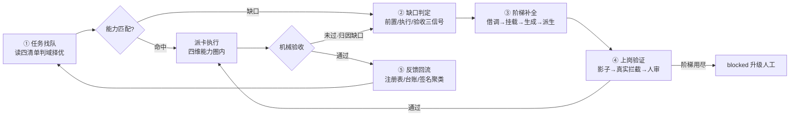

# RSI 工作内核：任务驱动的递归能力补全机制

日期：2026-09-18
状态：单机内核已实施，含 §8 动态本体升级（2026-09-18 二轮）；L2.3 跨机广播待 distributed-delivery M2 后另排（见 §7.1）
受众：hermes 集群维护者、orchestrator 设计者、ncwk overlay 实施者
上游依据：《软件交付标准》v1.3.0（`~/.hermes/delivery/`）、《Hermes Agent 集群设计文档》（`research/hermes-complete-design-doc.md`）、swarm-yuan skill（`~/.zcode/skills/swarm-yuan/SKILL.md`）、《多机多用户分布式交付网络设计》（`2026-09-18-distributed-delivery-network-design.md`）

## 0. 三句话主旨

把 hermes agent teams 与 swarm-yuan 两套已运转方法论中的能力成长机制，收拢成一个可执行的 RSI 主循环：Orchestrator 按任务匹配 agent team，能力不足时沿「借调、挂载、生成、派生」四级阶梯补全，新能力经机械验证与人审后上岗，任务证据回流能力注册表。RSI = Recursive Self-Improvement（递归自我改进），指系统从自身的任务失败与能力缺口中自动产出并采纳改进。本设计不新建回路——集群已有 RSI 的全部零件，缺的是把「夜间批量、被动触发」的成长环接到「任务内联、主动触发」的调度环上。读毕应能回答三个问题：能力缺口怎么判定、补全走哪条阶梯、递归在哪里停。

## 1. 结论

**RSI 内核 = 五步主循环 + 三条安全边界。**五步：任务找队 → 缺口判定 → 阶梯补全 → 上岗验证 → 反馈回流（§3.1）。三条边界：判定权在机制（缺口与补全效果由命令退出码和失败签名判定，不由 agent 自述）、采纳必须人审（编制与技能激活走变更三分法 normal 档）、递归必须有界（任务级自愈 ≤2 轮，阶梯用尽即升级人工）。

支撑结论的事实是：这五步各自已有成文机制，只是互不相连。orchestrator 分解前已被要求读取能力注册表三环，环 3 发现目标技能未生成时「显式披露无资产执法，即 componentization 待办」（设计文档 §3.1 分解算法输入表）；kanban 状态机已有 blocked 状态覆盖「能力缺口」（§3.1 阶段四）；失败签名词表已含 sig-missed-capability 八类轨迹签名（§4.10.1）；swarm-yuan 已能对新仓库五阶段生成目标技能并 mark-active 激活（SKILL.md 第四层）；「新领域需求 = 派生一个领域 team」已成文（§3.7）。当前前两件停在披露与死等，后三件靠人手动触发。RSI 机制就是把它们串成一条流水线，并补上分档判定表。

## 2. 两套方法论的内核蒸馏

本节回答「从两套系统里各取什么」。取的是能力成长相关的内核，其余机制（成本、密级、备份等）不在本文复述。

### 2.1 集群侧：组织如何自持与成长

集群方法论的地基是三条事实：模型会错且错得自信、交互复杂度随规模平方增长、声明不等于状态。由它们推出的设计取向是：判断权、交互结构、状态确认全部由机制承载，模型只做能力供给（设计文档 §1）。这个取向决定了集群里一切成长机制的形状。

调度与找队已经机械化。五阶段流水线（唯一入口量化路由 → 分解决策收拢 → 按名册派发 → 隔离执行 → 机械验收收口）中，分解算法前置读取四个清单：domain-registry 判域、owner-registry 定主责、capability-graph 择优（reliability = done/(done+failed) 实测聚合，`~/.hermes/shared/capability-graph.yaml`）、模块特征卡定技术约束。这是 RSI「任务找队」的现成判据层。

组织成长有三条成文通道。挂载：platform-skill-miner 持有全集群唯一 skills 装卸工具集，白名单挂载、装卸留审计（§2.2.3）。派生：新领域需求不动基座，复制基座编制模式、挂本域知识库成新 team——[已移除]、[已移除] 域即此先例（§3.7）。喂养：领域团队靠领域调研雷达每晚抓取外部情报，差距登记 gap_register，severity=high 自动建卡派工，修复回写闭环台账（§4.10）。内部还有一路自进化探针：evo-nightly 每晚采集八板 done 与失败标签，聚合信号合成提案，晨报人审后落地，P1 阶段零自动落地（§4.10）。

交付流程给成长提供需求侧输入。六阶段 G1-G6 门禁把「什么算完成」冻结在机械断言上；错误自愈最多 2 轮，超限即 blocked 上报（交付标准第三章）；G6 复盘三段式产出行动项，进改进提案管道「提案、试点 1-2 任务、采纳回写、版本号+1」（交付标准第十一章）。M1-M8 度量（首过门禁率、任务可靠性、单任务成本等）让改进有数据答案。

### 2.2 技能侧：swarm-yuan 如何生成与成长

swarm-yuan 是元技能生成器：对任意仓库跑流A（探查 → 特征卡 → 骨架 → 填充 → conf → hooks → 验证 → 审查 → 注入 → 写回 → 终检 → mark-active），产出该项目专属的目标技能；目标技能跑流B 执勤开发（需求理解 → 探查 → spec → 编码 → 测试 → 独立审查 → 合入 → 发布）。两流首尾相接构成总闭环（SKILL.md 第四层）。

它贡献给 RSI 的三件独特机制：

第一，能力可被自动生成。componentization 五阶段流水线（Survey → Distill → Assemble → Gate-Check → Register）把一个陌生仓库变成「特征卡 + 门禁 + 验证器 + 组件库」四类资产，每阶段出口门机械化：每条验收命令实跑 exit=0，且门禁至少真实拦截过一次违规才算有效——「装好了」不等于「有效」（设计文档 §4.3.1）。

第二，能力随项目演化自动保鲜。项目指纹 --diff 感知结构变化，触发局部重探查与清单单条更新，骤降过半拒写防坏基线；问题沉淀走三载体（更新组件清单、配方加条目、规则持久化），全程决策留痕（SKILL.md 反馈回路节）。

第三，新能力上岗有验证范式。三权分立：特征卡立法、门禁执法、验证器司法，任何单一环节失效会被另外两个抓住；mark-active 前过三关（路径存在、特征卡真实性、决策留痕）。这给 RSI 的「上岗验证」提供了可直接复用的模板。

### 2.3 交汇：四条共同内核

两套方法论在能力成长上共享四条内核，即 RSI 的工作公理：

1. **认知先行**。先认识再行动：集群在分解前读三环四清单，swarm-yuan 在编码前穷举组件清单（≥95% 硬红线）。能力匹配的前提是能力可盘点。
2. **能力资产化**。能力不留在会话里：组件库、知识库、注册表、特征卡都是可盘点、可版本锁定的资产。capability-graph 的 reliability 由任务终态聚合自动生成，就是资产化的实证。
3. **机械验收**。声明不等于状态：退出码、门禁阈值、证据五档三种判定形态，缺证据按最坏处理。RSI 对「能力补好了」的判定必须同构。
4. **受控成长**。新规则先影子运行，达标才拦停（公理 7）；自改进提案 P1 零自动落地；变更按三分法在动手前定级。成长本身是受治理的变更，不是自然生长。

## 3. RSI 主循环设计

### 3.1 五步循环

五步各自消费既有机制，不发明新概念：

**① 任务找队**。orchestrator 接单后按四清单匹配：domain-registry 判域（域判错则后续全错）、owner-registry 定主责与 backup、capability-graph 按 reliability 择优、目标模块特征卡定技术约束。跨机场景下目标扩为三级 account/agentTeam/profile，先本机后全网（§4）。

**② 缺口判定**。三个信号源，全部机械可判，不问 agent「你行不行」：

| 信号源 | 判定载体 | 现状锚点 |
|---|---|---|
| 前置判定 | 分解时环 3 查 skill-catalog，目标技能未生成或域未注册 | 设计文档 §3.1 输入表：现为「显式披露」 |
| 执行判定 | worker 上报 blocked，kind=capability-gap | §3.1 状态机：已定义，现为死等 |
| 验收判定 | 失败收尾打标 sig-missed-capability，同类聚 ≥2 次 | §4.10.1 R1：词表已落 output-contract |

**③ 阶梯补全**。四级阶梯，成本递增、门槛递增，逐级尝试：

| 档 | 动作 | 承载机制 | 门槛 |
|---|---|---|---|
| R0 借调 | owner-registry 登记的 backup 接卡；编码类经 ACP 外协编码工具 | 角色矩阵外协列、owner 缺席转 backup 纪律 | 不动编制，可靠性数据跟踪即可 |
| R1 挂载 | 既有 skill 白名单挂载给在编岗 | platform-skill-miner 唯一装卸通道 + 审计 | 供应链来源核验（§3.8 四条） |
| R2 生成 | swarm-yuan 流A 为目标仓库生成目标技能 | componentization 五阶段 | Gate-Check 出口门 + mark-active 三关 |
| R3 派生 | 新 profile 或新领域 team | 复制基座编制模式 + 领域知识库喂养（§3.7 先例） | normal 变更评审 + 试运行标记 |

**④ 上岗验证**。新能力三关，对应 2.3 内核公理 3 与 4：影子运行（首跑只记录不拦停，公理 7）；真实拦截实证（componentization 出口门「≥1 次真实拦截」——从没拦过东西的门禁只算装好，不算有效）；人审采纳（激活即编制变更，走变更三分法）。评审者不能是被评对象，提案判分用机械断言不用 LLM 自评（evo 既有纪律）。

**⑤ 反馈回流**。四路回流：任务续跑（补全完成后重派 ready）；资产登记（capability-graph 手工区 substitutes/notes、skill-catalog 登记、新域进 domain-registry）；缺口台账（gap_register 登记缺口与解法，修过又坏重开必须记因，§5.2 纪律 1）；签名聚类（sig-missed-capability 聚类结果作为下次派单偏好，喂回 capability-graph）。检验标准沿用设计文档 §5.4：每当一个问题第二次出现，它必须已经被某条机制接住——RSI 内核就是这句话的可执行形态。

### 3.2 递归边界

递归自我改进的第一风险是自我放大。四条硬边界：

1. **任务级上限**。错误自愈 ≤2 轮（交付标准第三章）不变；能力补全每档只尝试 1 次，四级用尽即 blocked(kind=capability-gap) 升级人工。不为一个任务无限生成资产。
2. **预算前置**。任务卡 metadata 声明补全预算（允许的阶梯深度与成本档）。lite 级任务（交付标准判级）不值得 R2/R3——定级在先，补全在后。
3. **递归深度 = 1**。补全动作本身是变更，走三分法授权，不再触发 RSI 递归。「为补全而补全」一律人工。
4. **效果判定在机器**。「补好了」的判据是补全后重跑原任务验收命令的退出码，不是补全 agent 的自述——与集群 complete ≠ 通过 纪律同构。

### 3.3 分档采纳通道

补全的「执行」可以自动，「采纳」分档。映射变更三分法（§3.2 组织与能力边界）：

- R0 借调、R1 挂载 = standard 档（预授权程序化变更）：机械验收即授权，内联自动执行，装卸审计兜底。
- R2 生成 = normal 档：生成流水线可自动跑，mark-active 激活须人审（staged 提案，对齐 evo「P1 零自动落地」）。
- R3 派生 = normal + HumanGate：只产出派生提案（编制草稿、知识库清单、成本预估），不自动建 profile。

### 3.4 触发方式裁决

| 选项 | 内容 | 代价 | 判断 |
|---|---|---|---|
| A 夜间批量 | 维持现状，缺口夜里由 evo/雷达收口 | 任务等一夜，用户所要的「直到任务完成」不成立 | 否 |
| B 全内联自动 | 缺口即时补全即时采纳 | 自动采纳绕过人审，违反公理 7 与建设期纪律 | 否 |
| C 内联触发 + 分档采纳（推荐） | 缺口判定与补全执行内联，采纳按 §3.3 分档 | R2/R3 仍需人等一步，任务可先 blocked 挂起 | 取 |

C 的实质：把「等一夜」变成「等一次人审」，且只有重资产档需要等。

### 3.5 跨机合成

分布式交付网络（同日 spec）之上，RSI 扩展三点：

1. 找队半径扩到全网。三级目标 account/agentTeam/profile 中，agentTeam 级匹配消费各节点声明的 teams 能力；本机 capability-graph 无命中时，owner 机 orchestrator 查注册房账号树外派，替代本机 R2/R3——跨机借调优先于本机派生。
2. 承接节点缺口同构处理。外派 target 无能力承接（回执 failed 且签名 missed-capability）时，owner 机走同一阶梯：换节点派（R0 跨机版）→ 本机补 → 提案派生。
3. 新节点入网即最小 RSI 验证。runbook 第 5 步冒烟卡（assign → kanban → receipt 全流程）就是新节点能力的上岗验证，语义上归入 ④。

## 4. 差距清单

已存在（L0，零开发）：

- 能力注册表四件套：`~/.hermes/shared/` 下 domain-registry / owner-registry / capability-graph / profiles.yaml，reliability 由任务终态自动聚合。
- 缺口信号三件：blocked 能力缺口态、sig-missed-capability 词表、分解环 3 的 componentization 待办披露。
- 补全通道三件：platform-skill-miner 装卸、swarm-yuan 生成流、领域 team 派生先例。
- 回流环两件：gap_register 台账 + evo-nightly；交付六阶段与 M1-M8 度量。

需接线（L1，单机可先行）：

1. orchestrator 分解器：环 3 从「披露待办」升级为「自动建 R2 补全卡并入本任务依赖链」。
2. kanban 引擎：blocked(kind=capability-gap) 从死等升级为自动触发阶梯判定，建对应档位补全卡。
3. evo/gap_register：白天任务内联产生的缺口同样登记（现只收夜间信号），补全后按 §3.1 ⑤ 四路回流。
4. capability-graph 派单偏好：签名聚类结果定期写入手工区 substitutes，供 ① 择优消费。

需新建（L2）：

1. capability-ladder 决策表：缺口类型 → 阶梯档位 → 验证关 → 采纳通道的单页机械表，落 `_shared/01-scheduling-bus/`，orchestrator SOUL 引用——决策表是规则不是代码，先表后脚本。
2. 任务卡补全预算字段（metadata.budget）与 R0-R3 尝试留痕字段。
3. 跨机能力广播事件（注册房 state 扩展），排期在 distributed-delivery M1 协议扩展之后。

## 5. 风险与对策

| 风险 | 对策 |
|---|---|
| 自动挂载引入污染 skill | R1 仍走供应链来源核验（§3.8 四条）+ 装卸审计；白名单外零自动 |
| 生成的门禁误报拦死合法工作 | 影子运行首跑只记录；conf 调误报通道既有；Gate-Check 要求真实拦截而非零误报 |
| 为小任务生成大资产（成本失控） | 判级前置：lite 任务止步 R0/R1；预算字段硬顶；M8 单任务成本口径观测环比 |
| 新岗 reliability 冷启动（无数据误派） | null 不参与择优；试运行标记「提案·试运行」；连续两月零执行自动降级的既有规则兜底 |
| 跨机能力声明造假 | 沿用 [UNVERIFIED] 纪律与证据五档；节点能力以冒烟卡实测回执为准，不信声明 |
| 回流污染（错误结论进注册表） | 手工区与自动区分离（capability-graph 既有结构）；修过又坏重开记因 |

## 6. Non-goals

- 不优化模型权重与算力层。openJiuwen 融合已裁定：本机 RSI 只优化组织与手册层（§4.10.1 供应链红线）。
- 不做灰度自动落地。P2 议题未裁决，R2/R3 采纳钉在人审。
- 不新建中央能力服务。分布式 spec D2 已否决中央自建服务路线，跨机走 Matrix 事件。
- 本轮不写实施代码。与 distributed-delivery D1 同体例：设计与差距清单先行，实施按里程碑另排。

## 7. 实施衔接

### 7.1 实施记录（2026-09-18 单机内核完成）

判据单一事实源落盘 `~/.hermes/profiles/_shared/01-scheduling-bus/capability-ladder.md`（含 L2.2 的 rsi-budget / rsi 留痕字段约定）。各件实测锚点：

| 件 | 落点 | 验证 |
|---|---|---|
| L1.1 环 3 升级 | `profiles/orchestrator/SOUL.md`（环 3 改建卡 + 新增「RSI 能力补全」节 + 架构层表引用；备份 SOUL.md.bak-20260918-pre-rsi-ladder） | grep 引用路径全存在 |
| L1.2 看门狗 | `bin/capability-gap-watchdog.py`（扫 block_kind='capability' → platform 板建 R2 卡 + 登记缺口；幂等键 rsi:<board>:<taskId>:R2；--quiet 零命中静默）+ `profiles/orchestrator/scripts/run-capability-gap-watchdog.sh` 包装 + cron 3c14bc0b3058（every 1h，no-agent） | py_compile；live dry-run 零命中；fixture 全链路真跑（建卡命令 + gap 登记 + 二次运行幂等） |
| L1.3 内联登记 | `scripts/gap_register.py` 增 domain=capability → platform-skill-miner 映射（备份 .bak-20260918-pre-rsi-capability） | selftest 14/14 |
| L1.4 聚类建议 | `bin/capability-substitute-suggest.py` → `shared/capability-gap-suggestions.yaml` + 包装脚本 + cron 3740f9965fa8（周一 08:30） | fixture 聚类/写文件真跑；live 首跑达标 0 岗 |
| 生产落地验证 | 受控真跑（14:39，`hermes pause` 门控）：真缺口卡 t_378ae98d（block kind=capability）→ 看门狗真建补全卡 t_e6371bb9（platform 板）→ 台账 gap-20260918-001 登记 → 幂等复跑不重复 → 验证件归档、gap 置 dropped 留痕；cron 链 scheduler→wrapper→脚本经 `hermes cron run` 催化验证（14:40:40 completed） | 全链真实事件，非 fixture |

**实施裁决两处（对 §4 原文的偏差，已回写本 spec）**：

1. L1.4 不直写 capability-graph.yaml 手工区——该区是人工策展区（capability-graph-gen 保全语义），脚本自动改绕过人审。改为脚本所有独立建议文件，orchestrator 环 1 作次级信号消费，人工复核后折叠。§3.1 ⑤ 的「资产登记」人审语义由此兑现。
2. L1.2 不改 kanban 引擎——引擎 watcher 属安装态运行时（hermes update 覆盖），改为外挂确定性看门狗（集群 §4.11 看门狗族惯例），只读业务板 + sanctioned CLI 建卡，禁 sqlite 直写。补全卡建 platform 板 assignee=platform-skill-miner（名册内），跨板依赖走 body 引用不写 parents。

**遗留**：L2.3 跨机能力广播需在 distributed-delivery M2（编排与 UI，跨机能力消费方）实施时同步定 schema，现在单发协议事件无消费方且会被 M2 重塑，登记 backlog。

### 7.2 后续衔接

- 单机 L1 接线不依赖 Matrix，已在 distributed-delivery M1 之后独立完成（§7.1）。
- L2 跨机件随 M2 开工，复用其案例房与守门测试模式。
- 本文档与分布式交付 spec 互为 sibling：那份管「多机怎么协作交付」，这份管「能力不够怎么长出来」；两份合起来覆盖「任务进来直到完成」的全部缺口路径。

## 8. 动态本体转向（2026-09-18 二轮完善）

> 调研触发：OntoFlow/OntoGraph《项目制开发过时了！自研动态本体平台：完整复刻 Palantir「应用是生长出来的」》（微信公众号，2026-09）；上游范式：Palantir Foundry Ontology（object types / link types / **action types**（带校验的受治理写事务）/ functions，AIP 以本体为 agent 的语义层与「工具工厂」）。批评面：锁定、维护负担、schema 刚性、误当数据清洗层——四条均作为本设计的边界输入。

**核心判断：本内核上一轮已完成「规则层」（capability-ladder）与「事件层」（三信号），对照 Palantir 三层，缺的是函数层与动作类型层——orchestrator 面对四个孤立 YAML + 一个 md 目录人肉拼装派单判据，恰是该文批评的「agent 面对一堆孤立数据表」；R0-R3 实为对能力本体自身的写事务，却未声明为一等动作类型。**

要素映射（动态本体八要素 × 能力世界现状）：

| 要素 | 能力世界承载 | 二轮前状态 | 二轮处置 |
|---|---|---|---|
| Object 对象 | profile / skill / team / 目标技能 | 六源分散 | 查询层合一（capability-ontology） |
| Relation 关系 | owner / backup / substitutes / 域编制 | 分散在 registry 手工区 | 同上（导航时一次产出） |
| State 状态 | reliability / 在跑 / backlog | 夜间批快照 | kanban 实时 join（`--state`） |
| Event 事件 | 状态迁移 / block_kind / 收尾标签 | 已有（watchdog+evo） | 不变 |
| Compute 计算 | reliability 聚合 / 缺口聚类 | 夜间批 | 查询时计算（候选排序+惩罚） |
| Rule 规则 | ladder / 三分法 / 四问 | 已有 | 不变 |
| Time 时间 | 终态时间戳 / 聚类窗口 | 已有 | 不变 |
| **Action 动作** | R0-R3 补全事务 | 流程描述，非一等类型 | **声明为动作类型**（`--actions` 自描述） |

二轮落地件：

1. `bin/capability-ontology.py`——能力本体统一查询层（只读）：`--dispatch`（派单导航/推演：编制候选 reliability 排序 + 主责 backup + target_skill 缺口风险 + 补全预告；域判定的语义裁决仍归 orchestrator 路由表，机器不猜语义）、`--state`（对象实时状态：静态本体 × kanban join）、`--actions`（R0-R3 动作类型自描述）、`--who-can/--substitute-for/--show` 委托 capability-graph-gen 真子进程。存储层六源不动，查询层合一。
2. orchestrator SOUL 环 1：四清单必读改为「单接口导航优先，四清单降为溯源细读」。
3. capability-ladder §2 增动作类型视角节。

边界（吸收批评面的四条不作为）：不做全局本体平台，只对「能力世界」这一个域建语义层；不迁移存储层（六源仍是单一事实源，查询层无状态）；本体 schema（注册表字段）演进仍走三分法 normal 档；不当数据清洗层用（本工具只读导航，写动作仍走 ladder 各档既定通道）。遗留：`--dispatch` 的域判定关键词匹配是机械兜底，语义路由永远以 orchestrator SOUL 路由表为准——这是人机分工（事实机器查、决策人拍板）在本工具内的落点。

---

结尾给一个检验画面：RSI 内核跑通的标志不是新增了多少 agent，而是一个具体场景——某个任务因 sig-missed-capability 第二次失败时，系统不再把它派给同一个岗，而是自动出现在晨报上：「缺口 X 已按 R1 挂载补全，影子运行 3 次零误报，待人审激活」；人按下批准，原任务重派，验收命令退出码 0，capability-graph 里那个岗的 skills_count 加一。问题第二次出现时，机制已经接住——这就是内核的全部。
