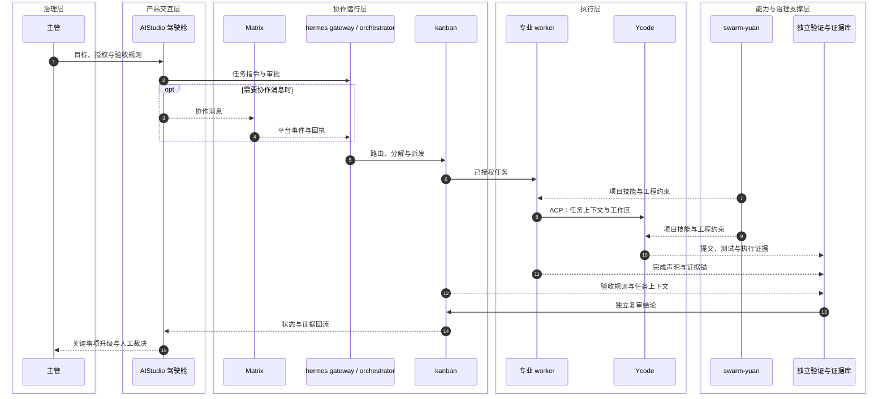
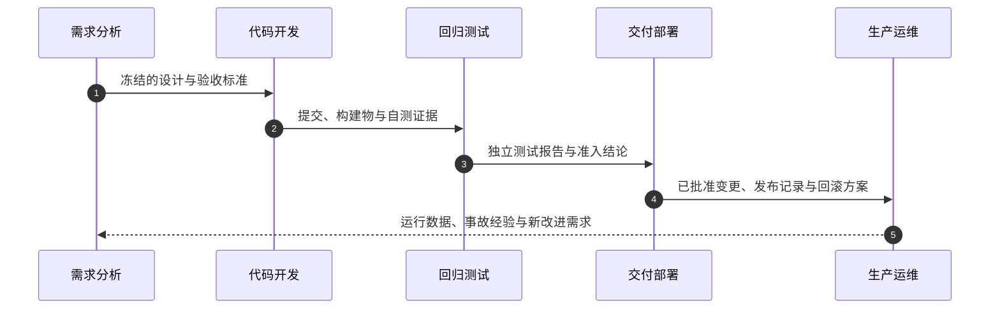
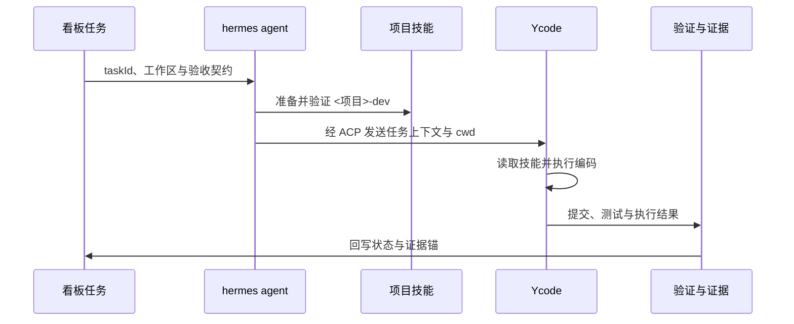

# AIStudio 终态设计文档

> 文档地位：AIStudio 唯一整合设计正本。
> 核实日：2026-10-31。
> 读者：产品、架构、研发、测试、安全与运维人员。
> 范围：稳定理念、产品结构、架构契约、核心机制与工程边界。
> 证据：实施决策归带日期的 spec，运行结果归测试与推演档案。

## 1、系统定义与总体协作

### 1.1 系统定义

AIStudio 是一套由人指挥 AI 团队交付软件的工作系统。
它把需求、协作、编码、测试和治理放在同一套契约下。
人负责目标、授权和关键判断，AI 团队承担可授权的执行工作。

系统由五个组件构成：

| 组件 | 职责 | 归属 |
|---|---|---|
| AIStudio 驾驶舱 | 呈现工作全景，承接人的操作与审批 | 本仓产品面 |
| Matrix | 传递人机消息与协作事件 | 外部通信基础设施 |
| hermes agent | 运行智能体团队，承接消息、任务与工具调用 | 运行面 |
| Ycode | 在本机执行任务导向的编码工作 | 编码引擎 |
| swarm-yuan | 从目标仓库生成项目专属开发技能 | 能力层 |

这五个组件服务四条主线：分布式需求分析、研发协作、实施交付、
测试验证。全流程推演 harness 用真实链路演练这四条主线，
并保存可供审计的证据。

### 1.2 分层协作与治理

下图按逻辑职责分层。消息编号表示一次典型任务的主顺序。
人的行权和独立验证共同构成治理，不是另加一个业务组件。



第 1—6 步形成并下发任务，第 7—12 步提供技能并汇聚执行证据，
第 13—15 步完成独立复审、状态回流和治理升级。
编号按完整路径标注；实际跳过可选分支时编号不重排。
Matrix 位于可选协作分支：需要协作消息时使用，
不表示所有任务都必须经过 Matrix。

产品面不另建任务或技能真值。
读模型从权威来源取数，写操作回到权威来源。
Matrix 协作、Studio/IDE 会话与统一身份聊天窗消息分别定义消息真值及投影关系。
审批、评测、标注和策略可以拥有明确归属的产品侧状态。
目标技能运行时不依赖产品服务；产品可以通过受管端点触发生成。

### 1.3 文档与事实边界

本文回答三个问题：系统为什么这样设计，各部分如何协作，
哪些边界不能越过。它不承载逐轮变更史，也不滚动播报测试总数。

事实按以下顺序裁决：

1. 当前代码、配置、测试和真实运行证据决定实际行为。
2. 已冻结的需求与有效 spec 决定设计意图和验收口径。
3. 本文汇总稳定设计，不覆盖上述事实源。
4. 组件内部实现由对应专题文档和 ADR 提供证据，正文按统一主题组织。
5. 旧设计稿只用于理解决策来路，不再指导新的实现。

“终态”指文档结构已经归一，不代表所有能力已在所有环境验证。
无法核实的状态必须写成未验证，不得写成已交付。

## 2、理念、目标与设计原则

### 2.1 服务对象

第一用户是负责交付的主管，而不是 AI 智能体。
主管需要知道现在做什么、哪里停滞、何时需要自己决定，
以及每个结论能否反查证据。

其他用户包括业务分析、产品、架构、研发、测试、安全、
运维和审计人员。AI 智能体主要通过 Matrix、看板 API 和工具接口工作，
不需要模仿人的驾驶舱操作。

### 2.2 要解决的外部问题

| 外部问题 | 产品回应 |
|---|---|
| 跨角色、跨地域交付的信息散落在聊天、看板、终端和文档中 | 用三种工作模式组织人的视图，用统一对象标识连接工作上下文 |
| 多智能体协作时，任务该由谁接、能做什么、出了结果谁负责不清楚 | 用团队名册、能力边界、看板责任和授权策略明确分工 |
| 长任务的真实进展难以观察，完成声明与客观状态可能不一致 | 用运行观测、催办、独立验证和证据锚呈现真实状态 |
| AI 提速后，大量协调与审核占用主管的时间和注意力 | 用机械检查处理常规事项，把例外和关键判断升级给人 |
| 组织改变研发流程时，缺少不影响真实工作的验证环境 | 用隔离推演验证流程、角色和质量门，再决定是否采用 |
| 项目知识依赖个人经验，新成员和新智能体难以复用 | 用 swarm-yuan 从目标仓库生成组件清单、关系、配方和门禁 |
| 自动化可能越过人的目标、权限或业务后果边界 | 用人工审批、认证授权和不可逆动作边界限制执行 |

### 2.3 目标与产品边界

系统追求四个结果：需求可追踪，协作可授权，执行可验证，
交付可审计。界面必须让没有内部背景的人看懂，
不能让读者从机读日志反推产品状态。

产品边界如下：

- AIStudio 面向软件交付，不是通用社交聊天产品。内嵌 Matrix 客户端只承担交付协作。
- AIStudio 负责协作与治理，不替代 kanban、Git、Ycode 等底层执行系统。
- 产品不承诺无人监督的自主交付，也不要求所有任务都自动化。
- 产品不保证所有模型、工具和平台开箱即用，新接入必须满足对应契约。
- 推演结论只适用于实际验证过的流程与环境，不等同于生产交付结论。
- 未验证的能力只能标为未验证，不能作为已交付能力对外承诺。

### 2.4 设计原则与公理

设计原则覆盖判断权、结构、执行和演化四组关系，任一组都不能替代另一组。
hermes 的设计公理与 AIStudio 的工程原则按同一语义合并，不并列重复。

| 关系 | 原则 | 工程含义 |
|---|---|---|
| 判断权 | 规格先于实现 | 先澄清需求并冻结验收标准，再允许编码 |
| 判断权 | 生产与验证分离 | 退出码、阈值和独立证据决定通过与否，不信生产者自评 |
| 判断权 | 人保留关键判断 | 目标、授权、发布、不可逆动作和业务后果由人决定 |
| 结构 | 全量认知 | 项目盘点采用全量穷举，不用抽样冒充完整清单 |
| 结构 | 单一事实源 | 每类契约、状态和配置只在一个权威位置定义 |
| 结构 | 能力边界先于派发 | 工具、技能、密级和纪律在编制时确定，子代理不得扩权 |
| 结构 | 版本与来源可追 | 标准库和引用版本锁定，使用前回查现行来源 |
| 执行 | 执法锚在自持门禁 | 不把宿主工具的拦截层当作唯一保证 |
| 执行 | 证据先于声明 | 完成声明必须回到任务、提交、测试或运行证据 |
| 执行 | 高风险执行受控关闭 | 严格策略启用后，权限或必要配置缺失时拒绝执行 |
| 执行 | 读取失败可降级 | 读模型缺源时呈现空态或不可用，不阻断无关工作 |
| 演化 | 生成厚、使用薄 | 生成侧建设完整资产，使用侧按需加载，成本只压缩注入材料 |
| 演化 | 新规则先影子运行 | 误报数据达到门禁配置的阈值后才允许拦停 |
| 演化 | 受管迁移与保留 | 新归属面接管后才退役旧入口，历史按保留策略可查 |

组件清单覆盖率有明确门槛，具体数值和验真规则见 5.7。
清单必须逐条验真，不能用检索结果的数量冒充覆盖率。

### 2.5 目标态与四个设计支柱

“AI 驱动 ALL”是严格授权下的目标态：AI 承担可自动化的执行工位，
人保留需求、授权、验收和异常裁决。它不代表当前已经实现无人交付。
人在环内（in the loop）作出必经决策，在环上（on the loop）监督并随时介入。
组织还要成为会学习的智慧型组织：复盘改变下一轮准入，
缺陷根治后代偿退役，经验受控注入后续任务。

多智能体组织不是目标本身。采用它是为了获得专业分工、独立验证和独立留痕。
自由交互的复杂度则由通道、名册和领域边界约束。
采用多智能体还基于三个工程事实：模型会错且语气自信，
自由交互随节点增加而复杂，完成声明不等于客观状态。
组织设计分别用判断权分离、通道与边界、机械证据回应这三件事。

运行面的工作循环依次是看清系统结构与边界、获取有效信息、
用验证保可靠、用反馈保有效。
四个环节在工程上落到四组支柱：看清对应本体与领域模型，
看准对应观测和运行图，保可靠对应 harness 与质量门，
保有效对应长期记忆与经验回流。

| 支柱 | 作用 | 对应环节 |
|---|---|---|
| 本体与领域模型 | 统一需求、任务、证据和治理概念，减少各视图语义分叉 | 看清 |
| harness 与质量门 | 把设计意图变成可执行、可复验的工程检查 | 保可靠 |
| multi-agent loop-graph | 组织多智能体分工、事件流转、停滞检测和恢复 | 看准 |
| 长期记忆与经验回流 | 让复盘、失败样本和有效经验受控影响后续工作 | 保有效 |

目标态与当前实现必须分开陈述。
自动执行范围以真实授权和验证证据为准，不能由理念反推能力已经存在。

## 3、产品设计

### 3.1 三种工作模式

| 模式 | 入口 | 主要任务 |
|---|---|---|
| 日常工作台 | `/app` | 组织、需求、设计、协作、审批、验收与治理 |
| IDE 工作区 | `/app/ide` | 围绕任务编码、审查、运行命令和查看变更 |
| 全流程推演 | `/app/sim` | 在隔离环境演练完整交付并收集证据 |

模式切换只改变工作视图，不改变对象真值。
跨日常与推演的链接必须标明目标环境。
用户不能在不知情的情况下把推演动作写入日常系统。

### 3.2 日常工作的六个阶段

| 阶段 | 内容 | 主要产出 |
|---|---|---|
| 搭台 | 组织、账号、团队、资产、模型与平台配置 | 可用的工作与授权环境 |
| 需求 | 收集、分诊、冻结范围、排期和验收标准 | 已冻结的需求基线 |
| 设计 | 系统分析、spec、方案与评审 | 可实施且可验证的设计 |
| 开发 | 看板、任务分派、编码、分支与产物 | 可审查的实现 |
| 验收 | 测试、用户验收、安全检查与发布准出 | 发布或打回结论 |
| 治理 | 评审、度量、安全审计、问题单、复盘与文档 | 可追踪的治理记录 |

阶段是工作导航，不是彼此割裂的数据系统。
同一任务可以跨阶段呈现，但其状态和责任人只有一份真值。

阶段与侧栏使用状态点表示阻塞、进行中和完成，
分别用红、黄、绿三色；待办徽标只统计需要人出手的事项。
徽标和状态点使用同一计数源，不能各算一套。

### 3.3 协作、审批与检索

看板承接任务真值。任务卡记录负责人、状态、验收要求和关联证据。
视图可以按阶段或角色筛选，但不能复制出第二套任务状态。

审批收件箱集中呈现需要人决定的事项。
批准、打回和紧急处置都要记录主体、时间、对象和依据。
模拟审批必须标明代理身份，不计入真人审批结论。

沟通同时使用 Matrix 房间和统一身份聊天窗。
人的 Matrix 客户端可以直接连接通信基座。
智能体消息与执行委托必须经过本机 hermes gateway。

顶部搜索框和 `Cmd/Ctrl+K` 是全局检索入口。
检索覆盖会话与房间、任务、运行、治理文档、人员和命令。
人员主源是治理仓 roster，运行结果为空时给出进入推演的明确去向。
「roster」在本体系指三种不同东西，文档一律用全称，不再单说 roster：
**治理人员名册**（外部治理仓的人工人员表）、**推演编制**（推演环境的 15 人/30 账号参考编制，见 §4.3）、
**agent 角色目录**（运行时 `$HERMES_HOME/agent-roster.yaml` 与 `runtime/roster/` 下的 squad 名册）。
筛选按看板而不是一次性工作区目录分组；某类结果为 0 时如实显示 0。
会话检索装载本地 CLI 会话档案（含压缩档案），按来源过滤下推。
推演会话走跨实例只读库直读，推演栈未启动也可检索；
结果带紫色徽章区分来源，点击时如实降级，不冒充在线可操作会话。
旧 `/app/search` 链接只承担兼容唤起，不另建检索页面。

跨页面共用任务上下文、RACI、双凭证、证据锚、结构化判词、
代偿标识和纪律提示。它们必须使用同一数据口径，
不能因页面样式不同而改变状态含义。

### 3.4 IDE 工作区

IDE 以看板任务为工作上下文，而不是以聊天会话为唯一中心。
任务栏、会话、文件、终端、审查、变更和沟通共享同一任务锚。
编程模式与工作模式复用既有编码运行时，不另造一套执行链。

模型、思考档和引擎配置由权威配置源决定。
用量与上下文视图优先读取既有会话记录，不重复埋点。
AIStudio IDE 会话默认关闭电脑操作，并注入禁用标记。
Ycode 插件可以默认内置启用，但实际执行仍受会话环境、
操作系统权限和 broker 凭据闸约束。

### 3.5 全流程推演

推演以独立运行根执行完整交付流程。
主链包含 26 个步骤和六道质量门，判据由全流程推演方案定义。
运行总览在同一上下文中呈现产品服务、gateway、驱动、监督器、
派发器和休眠工作者的健康状态。异常必须直接可见，不靠人翻日志。

| 质量门 | 核心判断 |
|---|---|
| G1 需求冻结 | 范围、验收标准、非目标和敏感面是否明确 |
| G2 架构评审 | 设计、影响面、备选方案和验证计划是否成立 |
| G3 编码门禁 | 实现是否来自已批准设计，并带有任务与测试证据 |
| G4 独立测试 | 测试是否独立，缺陷是否修复并复验 |
| G5 发布准出 | 发布证据、人工授权和回滚条件是否齐备 |
| G6 复盘 | 问题、行动项与经验是否回到治理系统 |

导演台用于启动、观察和介入，监督机制用于发现停滞与断环。
每道质量门都要呈现判据原文、判词来源和当前证据。
质量门失败的准出结论只有一条路径：登记修复单、完成真修复并复审通过。
非准出检查项的豁免见 5.4，但不能改变准出结论。
不能通过拆门、改标签或沿用旧轮 PASS 放行。
问题单、修复证据和复审结论必须进入同一治理追踪关系。
运行观测时间线用于定位停滞与介入，不要求人翻原始日志还原过程。

G5 采用三条取证线：集成真值、缺陷修复与复审和安全条件。
三条线只取证，不分别下结论，终判由单一出口给出。
发布门与 UAT 独立 append-only，不修改 run-state 闸键；
导演 run 与 26 步 run 分流，不混用轮次。

每轮报告与证据属于该轮运行，不得用旧轮产物冒充本轮结果。
界面下钻与报告共用四段结构：实际工作、交付物及质量判据、
已知问题、处置改进。任一来源缺席时保留空态，不补写另一套叙事。

受控 harness 启动器已有独立入口，但默认关闭，并受管理员权限、
运行标识白名单和驱动锁约束。它不等于无需环境供给的无人值守开轮。

### 3.6 专题工作台与治理视图

专题工作台把分散的运行痕迹转成可核对视图。
它们从权威源读取，除明确标注的标注层外，不保存第二份业务真值。
四项工作台是入口；以下五组视图属于读模型或标注层，不另立工作台。

| 工作台 | 设计职责 | 主要数据源 |
|---|---|---|
| 流程架构 BPA | 流程定义、节点与执行视图、架构映射 | 流程与架构注册表 |
| 本体 | 概念、实例、词表及关联设计文档。FIBO 37 个概念、12 个官方域、4 个真实场景逐条来源 | 本体存储、FIBO 术语表、spec 索引 |
| 评测 | 评测集、运行、红队与处置入口；失败回流和分桶机制见 5.8 | 运行轨迹、评测库、看板与 UAT |
| 技能治理 | 技能目录、供给对账、能力发现与使用证据 | 技能库、能力上报、profile 配置 |

FIBO 表只把概念与设计规格的提及关系作为读侧投影，不在本体里复制 spec 正文。
新增概念必须同时补来源和守门测试；
概念、域和场景数量由本体守门测试锁定。

**交付效能。** 日报汇总当日任务、阻塞和建议。
难度×步骤矩阵看活有多难、干到哪一步。
介入账本按协作层/交付层和提出需求、补充上下文、催进度、解决卡点、
拍板确认、纠错返工六类归因。
成熟度按介入数据给参考档位，界面明确标注“参考读数非结论”。
数据源是既有台账、看板与运行痕迹，只读消费，不新增埋点。

**协作画像与判例。** 协作画像以人×概念×证据墙呈现谁懂什么，
支持检索和跨域概念冲突提示。
过往案例把一次 run 当作判例单元，记录派发原话、问题与处置计数，
活跃 run 和归档 run 都可通过锚点抽取。
两者都是检索面，不改变任务状态。

**群体协作读数。** 交付效能页的群体协作读数包括四组：
通信拓扑（协作消息开销比、锚点保真、回灌与回执缺席信号）；
信用分配（per-agent 贡献、观察口径关键支撑度、任务粒度 Shapley 近似）；
帕累托（消息成本×完成锚的非支配前沿）；
社会动力学（UAT 无条件通过率、G5 打回类问题单、流程拦截面）。
对抗性注入没有数据时如实写 no_data。
这些读数只观测，不直接进门禁；实验旋钮状态和分桶口径见 5.8。

**工作项全景。** 以看板 taskId 为统一上下文锚，
一次查询汇聚任务卡、看板事件、证据、评测、评审、计划、图运行和 trace 八面。
每面独立 fail-soft，源缺席返回 available:false。
trace 没有 taskId 索引、评测任务按 origin 双路匹配等覆盖边界写在返回里，
不把“未建立关联”误报成“没有产物”。
泳道时间线把交接与会话证据投影到同一任务视图，便于看跨列接力。

**影响推演与业务地图。** 影响推演用需求文本对本体实例、板级知识图、
FIBO 术语和历史 spec 做词面提及与全文检索，命中即带词面和来源，
再给出与导演台同源的建议模块。
它是规则式推演，不上 LLM，改造范围必须人工确认。
AI 拆模块是可选增强，判定端不可用时回落词表并如实标注来源。
业务地图把需求、本体/板级图/FIBO 三路实体、历史 spec 和建议模块
分成可独立开关的图层，实体与 spec 的共现边来自读侧计算。
节点标注按需求指纹持久化，采用 LWW 合并并广播房间变更和在线人数。
标注不是任务真值，其他页面不能把它当作新的验收结论。

### 3.7 设置与权限

设置覆盖个人、团队、模型、平台、通知、界面和集成。
个人偏好、组织治理配置与引擎参数必须分层，不互相复制。
治理视图回答“发生了什么”，设置视图回答“允许怎样运行”。
同一配置只能有一个编辑归属。

权限至少区分超级管理员、领导层和普通成员。
团队负责人判定与全局角色分开处理。
组织关键权限变更需要双人会签。
紧急通道必须带 `[BREAK-GLASS]` 标记，并保留完整审计记录。

### 3.8 对象、控制面与呈现的整合边界

任务对象按域隔离。任务展示键由域、run、看板和任务 ID 组成，
日常任务与推演任务同 ID 不互相覆盖，推演任务不写日常看板；
写操作只接受日常任务引用。定时 Loop、Workflow、Graph 与 Sim
运行各有详情页与跳转，不跨 API 传递裸 ID。

控制面单源。设置目录与侧栏由同一注册表派生并共用收编壳；
阶段页签保持 key 稳定，合并元数据、加载逻辑与属性传递；
面包屑、最近轨迹与浏览器标题共用同一页面解析。
workspace 是提醒调度与跨板任务加载的唯一正身，
重复调度、无消费者的预取和卸载后仍存活的通道不进入共享路径。
错误、部分可用与陈旧数据必须如实标注，不得冒充空态。

呈现做减法。IDE 左侧保留唯一 CLI 会话列表，中央只显示当前对象；
推演区左侧是唯一导航。正文以 14px 为主，辅助文字不低于 12px，
主要动作提供 40–44px 命中区，沿用中性 tokens 与共享状态基元。
Legacy Loop 的定时、自治与预算能力保留；①搭建的主动性编辑保留、
⑥治理视图为只读投影；模型、记忆、看板、审批与 Matrix 的作用域
不强行合并。

## 4、总体架构与组件设计

### 4.1 三层职责

| 层 | 组成 | 设计约束 |
|---|---|---|
| 产品面 | Vue、Koa、Electron、定制组件与读模型 | 任务消息不另立真值，自有领域状态明确归属 |
| 运行面 | hermes agent、Matrix、看板、Ycode 与证据保存 | 承接真实执行，维护身份、权限和审计 |
| 能力层 | swarm-yuan 生成器与目标项目技能 | 提供仓库知识和工程约束，运行时不调用产品服务 |

产品面内部再分六层：表现层（三模式壳）、页面层（六阶段与专题工作台）、
读模型层（端点与适配器）、机制层（证据、门禁、审批、观测）、
服务层（studio server 域）、注入层（对上游的定制改造）。
读模型不复制运行面数据，页面不建第二份任务表。

四条边界判据约束跨层实现：

- 写入口唯一：任务真值只在 kanban，技能只在能力层生成，
  产品面不建第二份任务或技能库。
  产品可以通过受管端点触发生成，但不保存技能副本。
- 读模型不复制：派生视图可重建，不保存影子任务、消息或技能真值。
  审批、评测、标注和策略等自有状态必须明确归属。
- 不反向依赖：目标技能运行时不调用产品服务，运行面不引用 UI 组件。
  产品面可以更换呈现方式，运行面仍独立工作。
- 治理实现单源：六闸判读、判词语义、熔断、UAT 判定、问题配对、
  台账阈值与评测判据的计算正本只在产品治理域
  （`custom/server/governance` 与 `custom/server/eval/e2e-verdict`）；
  推演侧只经治理客户端调用并落证据，不持第二套判据。
  G5 与 UAT 状态机实现属治理域，推演兼容路由冻结，启动器属推演域；
  报告撰写留在推演域，报告验收规则属治理域。

三层之间只传递契约，不共享隐含内部状态。
能力层的开发和测试可以引用 AIStudio 的仓级契约，
但目标技能运行时不依赖产品服务，两件事不能混写。

### 4.2 hermes 上游引擎

hermes 上游以 `AIAgent` 会话循环为核心。
CLI、gateway、ACP 和 cron 等入口复用同一套会话能力，
不各自复制模型调用和工具执行逻辑。

| 内部面 | 职责 |
|---|---|
| 入口与会话 | 接收不同平台事件，维护会话键、上下文和消息生命周期 |
| 提示词与模型 | 组装身份、技能、记忆和任务上下文，解析模型与凭据 |
| 工具与插件 | 注册并调度工具，按配置接入平台、记忆和上下文引擎 |
| 状态与持久化 | 用 SQLite 保存会话、血缘和检索信息，按平台隔离状态 |
| gateway | 授权用户，路由消息，维护长驻会话与平台适配器 |

一次调用依次经过入口解析、提示词装配、提供方解析、模型与工具调用、
上下文处理和结果持久化。平台、记忆和上下文引擎通过插件扩展，
但不能绕过授权与工具边界。上游内部模块详见附表 C 的架构事实源。

### 4.3 agent teams 的组织与治理

agent teams 在上游引擎之上定义组织。
orchestrator 负责路由、分解和派发，专业 worker 在授权边界内执行，
独立验证者复核证据。kanban 卡是任务交接物，模型自述不是完成判据。
人类与 AI 身份在 Matrix 中以账号存在，任务责任以看板卡为准，
二者通过授权关系关联，不能混成同一张责任表。
运行面按接入、调度、执行和支撑四层组织：
gateway 接消息，orchestrator 路由分解，worker 执行，
支撑层提供技能、知识、记忆和证据。

| 岗位范式 | 职责 | 隔离原则 |
|---|---|---|
| 基座岗位 | 需求分析、编码、测试等通用方法 | 不挂载特定领域知识 |
| 领域岗位 | 在通用方法上增加领域知识与判据 | 领域知识不外溢到互斥团队 |
| 治理岗位 | 调度、本体、技能、权限与运行治理 | 治理者与生产者分离 |

领域岗位挂载本域知识库和红线，领域差异主要是知识差异，不是方法差异；
基座岗位不重复领域知识。

worker 的能力边界由可用工具、可加载技能、资料密级和角色纪律共同确定。
派单不能突破这些边界，子代理也不能获得高于发起者的权限。

参考编制需要区分推演环境与当前仓库部署。全流程推演的参考编制是 15 个人类岗位、
30 个账号、42 个智能体配置，以及 28 块看板；
这些是推演参数，不是产品硬上限。
产品实际部署以 `team/` 和组织注册表为准。
当前仓库 `team/profiles` 提供 30 个 agent profile（含 orchestrator），
看板按领域注册表配置，不能把推演编制当成通用部署数量。
当前团队按领域分板，orchestrator 只调度，worker 按领域团队归属；
团队与板的数量由 `team/` 和领域注册表定义，不在正文写死。

五组口径回答不同问题，不能互相换算：

| 视图 | 回答什么 | 口径 |
|---|---|---|
| 运行四层 | 消息如何到执行 | 接入、调度、执行、支撑 |
| 岗位三范式 | 岗位如何分工 | 基座、领域、治理 |
| 接力五岗位 | 一单需求如何流转 | 需求、开发、测试、交付、运维 |
| 推演编制 | 演练环境多大 | 15 人、30 账号、42 智能体配置、28 看板 |
| 当前仓库 | 本仓有多少活动 profile | 30 个 agent profile |

42 是推演环境的配置总量，含调度与执行实例；
30 是当前 `team/profiles` 的活动 profile 数。
两者不是同一口径，不能相减当成缺口。

能力装配分四层，每层只消费上一层的结果，不互相改写：

| 层 | 机制 | 判据来源 |
|---|---|---|
| 委托 | 四维能力描述岗位，否定式合成只收窄不扩张 | 组织注册与角色模板 |
| 身份裁决 | 工具白名单与委托白名单取交集，未登记身份不因默认配置扩权 | 身份配置 |
| 能力目录 | 每机上报 profile、角色和技能数，供派发与审计读取 | 能力上报 |
| 技能供给 | 按 manifest 补齐缺失，先干跑再应用，失败可回滚 | 中央供给清单 |

领域隔离采用三层隔离：手册层只让岗位加载白名单技能；
派单层只认本板名册；建卡层拒绝跨域建卡。
资料密级沿引用链合取，多个标签取最严格一档，派单前检查。
操作权限按“谁×什么事”两维判定，没有声明的操作默认只能提案。
高危动作走 staged 提案、批准、执行、执行时复验，
子代理权限不得高于发起者。
隔离配置损坏时按既有降级策略告警并留痕，不能静默当成已隔离。

七类机制共同支撑这个组织：S1 调度与编排，S2 组织与能力边界，
S3 治理与验收，S4 成本工程，S5 知识资产治理，S6 韧性安全垫，
S7 领域能力。模型、MCP、技能和知识库的供应链约束横切全部机制。
S1—S7 是集群内部的工作分类，本文第 5 章按交付顺序重排，不逐节沿用编号。
第 6 章定义其数据与治理契约。

### 4.4 Matrix、Ycode 与 swarm-yuan 的协作位置

| 组件 | 在交付链中的位置 | 不承担的职责 |
|---|---|---|
| Matrix | 传递协作消息、房间事件和跨机回执 | 不替代看板任务真值或本地会话存储 |
| Ycode | 在任务工作区执行编码并产生实现与测试证据 | 不决定任务是否获准发布 |
| swarm-yuan | 把仓库事实转成项目技能、门禁和验证器 | 不调用产品服务，不代替人作业务决策 |

Matrix 对端过滤只能屏蔽已经确认的 bot。
MXID 本身不能判断人或 bot，人类账号不得屏蔽，入口过滤只是辅助。
详细决策见附表 C 的 Matrix 对端台账。

产品面读取运行面模型时，通过 AgentBridge、hermes CLI 子进程或引擎 WebSocket 桥接，
只读不复制。任务、审批和消息的写操作回到对应权威接口，
不能在产品侧维护影子队列或第二份状态。
产品可以通过受管端点触发项目技能生成，这属于产品调用能力层，
不是能力层反向依赖产品。

### 4.5 单仓与代码归属

AIStudio 是单一完整项目仓。
上游基线、二次开发、运行面扩展、推演程序和技能本体均在仓内。

| 路径 | 职责 |
|---|---|
| `custom/client/`、`custom/server/` | 产品面的纯新增扩展 |
| `patches/`、`zcode-patches/` | 对钉版上游的受管变更 |
| `vendor/` | hermes-studio、hermes-agent 与 zcode 基线 |
| `runtime/`、`team/` | agent 运行时扩展与团队部署资产 |
| `simharness/` | 全流程推演程序与场景 |
| `skills/swarm-yuan/` | 项目技能生成器本体 |
| `registries/`、`config/` | 注册入口与特性配置 |
| `docs/superpowers/specs/` | 设计正本、专题规格与决策档案 |

`vendor/` 的 git 跟踪内容保持 pristine。
注入后的工作树脏态是构建结果，不作为新的上游基线提交。
各 profile 的依赖目录相互隔离；worktree 通过软链复用主检出的 vendor 依赖，
不重复安装。依赖声明以 vendor 清单为源，overlay 新增依赖走补丁入册。

### 4.6 运行与发布视图

运行时包含五个组件，发布时按四个模块组织：

| 发布模块 | 内容 |
|---|---|
| 驾驶舱 | 产品面、hermes-studio 基线和 simharness 源码 |
| agent teams | hermes-agent 基线、团队 profiles 与运行时扩展 |
| Ycode | zcode 基线与分叉补丁 |
| yuan skill | swarm-yuan 技能生成器 |

Matrix 是外部基础设施，不作为本项目的独立发布模块。
整体源码包汇总四个模块和仓级工程文件。
各模块版本与产物以 `RELEASE-MANIFEST.json` 为准。

浏览器是日常开发、评估和走查的主要形态；
Electron 桌面构建是可选发布能力。
桌面 runtime 钉版、构建根目录和逐平台验收见 7.4。

## 5、端到端交付机制

### 5.1 从需求到运维的岗位接力

一单需求由五类岗位接力。岗位是职责范式，不等于固定进程或团队数量。



| 岗位 | 主要交付 | 不得兼任的判断 |
|---|---|---|
| 需求分析 | 影响面、领域约束、冻结规格与验收标准 | 不用自身分析替代开发结果 |
| 代码开发 | 基于既有组件的实现、提交与自测证据 | 不自行宣布独立测试通过 |
| 回归测试 | 独立用例、执行输出、失败归因与复核结论 | 不把生产者自评作为验收依据 |
| 交付部署 | 发布准入、评审记录、实施与观察结果 | 不把发布动作等同于任务完成 |
| 生产运维 | 监控、事件回顾、后评价与改进输入 | 不评价自己实施的变更 |

开发自测是生产者的交付义务，独立测试是验证者的判定权。
两者必须同时存在，不能互相替代。

### 5.2 消息、调度与看板状态机

目标及默认收敛拓扑是每个运行节点一个 gateway 复用多个 profile。
本机 gateway 是该节点智能体消息和执行委托的统一入口。
当前仍保留 standalone 兼容路径，预检失败时也可能回落到单 profile 网关。
远端智能体通过受控 peer 协议或 Matrix 事件进入。
多节点通过 peer API、Matrix 和 git 制品协同，不设全网唯一中央网关。
任何产品功能不得另起一条绕过本机 gateway 的智能体执行链。

一次重型任务经过五个阶段：唯一入口接收，orchestrator 分解，
dispatcher 按名册派发，worker 隔离执行，独立验证收口。
轻量问答可以直接回复，不必为了形式完整而建立重型任务流。
路由依据必须是可复核指标。下表是当前路由契约的摘要，
权威阈值在路由配置；调整走设计变更，不能由模型凭感觉临时改变。
任一条件满足即升级，同时满足多档时取最高档。

| 级别 | 触发条件 | 处理方式 |
|---|---|---|
| 轻量 | 工具调用不超过 2 次且不写文件 | 直接回复，不留任务记录 |
| 中等 | 3—5 次调用，或写 1—2 个文件 | 干完补一张任务卡 |
| 重型 | 6 次以上调用，或 3 个以上文件，或研究/编码/安全/部署类任务 | 先建卡 triage，再分解派发 |

路由结果必须留痕，便于统计“多少消息走了哪条路由”。
阈值调整属于设计变更，不能在执行时临时改档。

派发并发受运行面上限约束，超过上限的任务排队，不无限 spawn。
并行宽度按可用工位而不是固定线程数；
测试分片各自写 testlog，聚合必须幂等。
长任务按里程碑报进度：开发按节点、测试首个用例即报、报告先出首片。
卡住先唤醒，再要验证账本，三次不交付建议换人。

分解时命名、schema、接口形态等设计决策收归 orchestrator，
派单前写进子卡。依赖沿用同板 `parents` 规则。
切片优先做到窄而完整、可独立演示、单个上下文能装下。
宽重构采用 expand-contract 三段，不能按层水平切开。

多机部署时，每台机器本地执行，Matrix 传协作，git 传制品，
中央 bare 仓保存集成结果。
各机上报能力和健康，读取方按新鲜度判断可用性；
过期显示陈旧，不猜在线。
进度联邦按房间心跳聚合，未接线时如实标 wired:false。

| 看板状态 | 进入条件 | 离开条件 |
|---|---|---|
| triage | 重型任务已登记，方案仍待细化 | 规格与验收标准齐备后进入待办 |
| todo | 任务已形成，但依赖尚未全部满足 | 所有依赖完成后转为 ready |
| ready | 任务已具备派发资格 | dispatcher 认领后转为 running |
| running | worker 已锁定认领并执行 | 交付、请求评审或阻塞 |
| review | 任务需要独立评审 | 通过后 done，打回后重新排队 |
| blocked | 等待外部依赖、能力或人工输入 | 阻塞条件解除后重新调度 |
| done / archived | 验收通过或归档保留 | 作为证据与经验来源 |

看板 done 表示任务完成；发布类任务还要经过 5.5 的观察窗，
才能对外收口。

任务依赖 `parents` 只在同板内用于阻塞判定。
跨板协作通过卡内引用和上下文注入表达。
认领锁与心跳防止重复执行，超时任务按回收规则处理。
催办根据负责人、任务状态和真实进展升级，
不能只凭日志文件的新鲜度判断智能体正在工作。

状态流转可配置声明式列门：完成、评审和就绪列可要求人工批准、
检查清单或验证命令。没有配置列门的板保持放行，
不能把“机制在场”写成“已经启用”。
可复用多步流程用 YAML 定义，至少复用两次成功后才转成工作流资产，
避免囤积一次性管线。

### 5.3 编码执行与模型路由

目标编码契约按以下顺序运行：



任务工作区就是编码会话的项目根。
目标契约要求项目技能先准备并验证，再进入正式编码。
验收必须检查 Skill 证据，不能仅凭生成器存在就判定该契约已生效。
当前实现边界见 5.7：技能发现不等于已验证，编码前不一定完成装载和调用。

`zcode` 是 ACP provider 与桥标识，不足以证明实际引擎身份。
`zcode-acp-delegate.py` 的解析顺序为显式 `ZCODE_BIN`、官方捆绑、
Ycode 分叉部署位、桥兜底。直接 `acp_send` 只解析 ACP 桥命令，
不经过这套引擎校正。`engine_bin_source` 是驱动选择的来源标记，
不是桥最终启动引擎的完整证明。
需要强制使用 Ycode 分叉时，必须显式指定部署位，
并检查 `engine_bin` 路径与实际引擎版本或日志。

模型路由按任务阶段选择能力档位。
设计、开发、代码审查和裁决使用主模型。
只有输出可由机械检查验证且不涉及架构判断的任务，才允许使用辅助模型。
共享台账与产线代码即使看似简单，也不能仅为了省成本而降档。
当前注册表以 `aim` 作为主模型占位符，实际提供方由代理层解析。
当前只保留主模型和辅助模型两档，不新增第三模型或第三供应商；
扩展接线要先提案并验证。
路由表是声明性契约，验收仍需检查实际 profile 配置与执行日志。

已批准任务内的普通编码可以自动执行。
需求变更、权限扩张、发布准出和其他关键决策需要人的授权。
后台委托可以自动携带完整任务上下文，IDE 交互仍由用户发起。
长任务由 coding-delegate 后台驱动，运行时技能经 external_dirs 只读挂载，
不复制第二份执行脚本。

### 5.4 验证与证据

验证不是单一的“测试通过”。硬性检查看退出码，指标看阈值，
结论可信度看证据档位。三者不能互相替代。

**三种判定。** 退出码判定回答硬性检查是否通过，0 用例等于空跑，不算通过。
阈值判定回答量化指标是否过线，阈值和比较方向必须预先冻结。
证据五档回答结论可以有多强，缺证据按最坏档处理。
质量门判定至少区分通过、失败、警告、跳过和不确定；
不确定不得当作通过，未执行不得写成零问题。

| 证据档位 | 含义 | 可支持的结论 |
|---|---|---|
| missing / unobserved | 没有证据或未观测（≤59 分） | 不得交付 |
| present | 存在但未接线（≤74 分） | 只能说明“有”，不得宣称可用 |
| wired | 已接入工作流（≤84 分） | 可用，但未证明真实用过 |
| exercised | 真实用过并留下结果（≤94 分） | 可作为本轮证据 |
| outcome-supported | 有后续结果支撑（100 分） | 可作为效果结论 |

分数区间是当前证据契约的档位上限；
评分量表、打分人和复核方式由对应验证契约定义。
证据强度自评不高于 74 分不得交付；配置存在不等于在用。
证据还要看来源独立性：自产自验最弱，实现派生、本体派生、规格派生、
运行观察、既有独立证据、人工复核依次增强。
只有自产自验的任务，即使档位到 exercised，也要补独立来源证据才能放行。
四套状态词不能互换：质量门用通过、失败、警告、跳过、不确定；
单条主张用已验证、证据不足、存在反证；
能力总体用已验证、未验证、不可用、存在反证；
对外交付用已验证、未验证、已交付。
证据不足不等于未验证，不确定不等于失败。
PASS/FAIL 是通过/失败的同义标记，不另立第三套状态。

**完成声明与证据锚。** 完成声明必须同时携带提交号与任务卡号，缺一不可。
证据锚至少包括事件、提交、任务卡和房间四类；
测试、审批和运行记录可以补充，但不能替代双凭证。
只有报告文字而没有实物锚点时，状态保持未验证。

**豁免。** 显式豁免不是无证据放行。
豁免只适用于非准出检查；准出门失败、证据不足或存在反证不得豁免。
豁免必须记录理由、范围、批准人、缓解措施、有效期和复验触发条件。
到期自动回到证据不足；同一检查项连续两次豁免强制升级。
指定决策与证据账在保留期内采用追加写，避免静默改写结论。
追加写不等于所有数据永久不删，保留期、轮转和裁剪规则必须公开。

**长程可信执行。** 长程任务不能只看最后一条“做完了”。
每条完成主张由非主张人独立复核，结论分为已验证、证据不足和存在反证三态。
完成态采用双准入：全部主张已验证，且工作区完整性 clean，完成提议才准入；
否则降为未信任并累计伪造尝试。
完整性栅栏对小文件用 sha256、大文件用大小和修改时间，
自报 clean 与框架观察冲突时以观察为准。
原子断点保存案件摘要与工作区摘要，恢复时核对一致或分歧。
事件账使用前向哈希链，角色工具面按审计者、执行者、管理者单调受限。
治理页签呈现案件、主张、准入结论和断点状态，读面不作为判定源。

**会话级防线。** 会话终点要有独立验证，识别空转、漫谈和混合失效，
受保护资产要按 deny/advisory 拦截。
这些门只降低风险，不替代独立测试和人工判断。

### 5.5 发布与生产运维

发布准入不是填一张表。任务卡必须带授权源、构建物、影响面、质量、安全、
合规、运维、容量、发布、验证和回滚资料；缺失项要写 N/A 和理由，不能静默跳过。

交付部署按四步执行：

1. 检查准入资料和回滚可执行性。
2. 完成技术评审与运维评审。两票独立，任何一票都可以否决。
3. 按批准路径实施。紧急止血可以先执行，但必须补齐授权、验证和复盘。
4. 进入观察窗。发布后的机械复验与回访无异常，才允许任务收口。

新信息源或服务进入监控前要做监控纳管：检查可达性、反爬结论、抓取方式、更新周期、
已知问题、依赖、质量信号和下线预案；不满足的不纳管。
持续监测采用双雷达：外部领域雷达和内部摩擦雷达，异常进入差距台账，
高严重度自动派卡。
看门狗分层值守并互相检查，防止监督层自身失效。

事件回顾依次保留时间线、关联方补充、根因与整改、调度审议和独立效果验证。
根因要写到文件或行级锚点，提出多个候选假设逐一证实或证伪，
证据不足不越界定因。
后评价使用四维读数：变更达成率、工具失败率趋势、问题回顾完成率和整改验证。
运维人员不评价自己实施的变更。

### 5.6 治理与审计

审批入口见 3.3，本节讲判定、凭证与审计机制。
评审分级按风险判定。重要改动要人审并绑定具体提交，
评审针对冻结快照，评审期间不改内容。
agent 互审只审 diff、按类打包、不重复意见，轮次上限为 3，且不顶替人审名额。

安全审计依次做覆盖账本、对抗验证、三态结论和独立复核，
结论再进入整改跟踪与复核关闭。
审计面同时覆盖代码仓和部署根：代码仓看密钥、依赖声明和危险 API，
部署根看配置与日志中的密钥形态。
审计不保存敏感原值，失败可见但不阻断无关业务。

策略引擎按身份、沙箱、预算、策略、自治阶梯和权限模式依次裁决。
strict 模式下无命中即拒绝，策略加载失败也拒绝；每次拒绝记录 policyRuleId。
OS 级沙箱只在高风险命令且配置开启时执行，
未开启时如实标为未治理，不能显示为已启用。

巡检检测器覆盖 gateway、kanban、session、delivery、machine 等面。
异常进入治理面板，不默认发 Matrix 群，避免告警淹没协作。
会话耗尽单独检测：应答行仍然新鲜、但真实工作长时间停摆时，给出换会话建议。

审批收件箱聚合当前责任契约列出的 14 类人工介入点。
来源包括关卡、审批、清偿和 UAT；某一来源缺席时如实显示缺席，
不把空态当成零介入。
每项记录主体、时间、对象、依据和处置结果。
审批凭证带范围和有效期，只认绑定当前提交的人类批准。
模拟审批标明代理身份，不计入真人净额。

代偿台账记录代做动作、主体、理由和证据，支持 resolve 与 waive；
净额排除代理代做。
清偿灯与开轮 prelaunch 使用同一台账和同一净额口径。

容量阈值异常进入巡检与治理面板，不依赖人偶然查看报表。
凭证治理只保存归属、用途和轮换记录等元数据，不保存密钥原值。

### 5.7 项目技能、知识与成本

swarm-yuan 对任意代码仓库生成项目专属开发技能。
它不是技能商店：不发通用技能包，而是按目标仓库的代码、配置和调用关系
生成组件清单、关系边集和任务配方。
产出三份实物：组件库清单（组件、接口、数据，每项带路径与约束）、
关系边集（依赖、映射和语义关系）、配方（业务功能清单与高频任务拼装步骤）。

生成侧走八环链：认知、规范、框架与业务、组件库与拼装、
习惯、装配、日常、成长。
项目认知采用全量穷举，组件清单覆盖率不低于 95%，
每个路径逐条验真，编造即阻断交付。
覆盖率按实际组件数与清单数比对，抽样结果不计入。

目标技能使用六段目录：技能说明、工作流、参考资料、资产、门禁配置和脚本。
开发工作流依次为需求、探查、spec、计划、编码、测试、审查、合入和发布。
规格四要素是变更、决策记录、验证和设计文档影响；
触及设计正本或数字总账时声明 DESIGN_SYNC touched 并同批修订，
纯内部变更声明 none 并给出理由。

执行层用门禁四层落实约束：L1 写时钩子、L2 提交钩子、
L3 spec-first 检查、L4 状态机守卫。
四层判据来自同一份门禁库，不能各写一套。
新规则先影子运行，误报数据达到门禁配置的阈值后才允许拦停。

目标技能命名 `<项目>-dev`，字符集归一为 `[A-Za-z0-9._-]`。
项目可以直接使用 `.agents/skills`，
也可以把 `.claude/skills` 的产物软链到 `~/.zcode/skills` 供兼容宿主发现。
两条路径共享同一份产物，具体选择由目标宿主能力决定。
当前 worker-coder 在首次编码前只保证生成与发现，
完整性校验和升级发生在编码之后；ACP 驱动也没有独立技能检查。
因此，宿主发现技能文件不等于技能已验证，也不等于技能参与了本次编码。

知识按实际能力分类，不按名称堆积。
新技能默认不进入所有岗位，挂载由类目白名单和单点指定共同决定。
领域知识库必须锁定版本，引用前检查现行来源。
退役资产先归档并保留召回路径，不静默删除。
同主题技能不超过 3 本，技能正文有字节预算，禁止为单一 bug 建长期技能。

成本控制作用于提示词、工具说明、技能正文和历史上下文。
共享参数集中定义，技能正文按需读取，工具按岗位最小化配置。
不得为了账面成本删除完成工作所需的模型能力或关键证据。

方法论库按族组织，门禁和变量有负向预算。
分发面与生成器侧分离，避免让目标技能承担生成器的版本注记。
证据分 A/B/C，二手转述不得进基线。
新增概念必须说明消费者、验证方式和退役条件，不能只增不减。

能力层决策台账只增不改。修正以新决策记录并标注替代关系，不回写历史结论。
外部机制按兼容性和证据选择性吸收，不整体移植另一套架构。

工程上下文按四层计：项目知识（knowledge）、工程约束（harness）、需求规格（specs）、
检查规则（hooks）。四层是否真被使用有读数：读取工具在工具边界按路径归层，落
`.qgate/reads.jsonl`，经 `/api/harness/obs-signals` 的 `contextReads` 面按层与按日呈现。
读数只用于趋势判断，不参与结算——钩子是 fire-and-forget，事件可能滞后。

已合入主干的 spec 是有内容收据的：正文规范化后取 blob 哈希，写入
`.swarm-yuan/spec-receipts.jsonl` 并随提交落盘。收据不符即 drift，只有显式
`SPEC_REBIND=1` 才能重绑。未合入的草稿可自由迭代，每次重绑。这让"评审过的决策记录
被静默改写"从不可见变为可拦（默认 warn，可置 block）。
团队采纳了 DeepSeek Harness 的防御性编程、可逆效果和可追溯审计，
同时否决 Cordis 整体移植，理由与后果见附表 C 的对应 ADR。

### 5.8 评测、记忆与经验回流

评测系统使用既有任务、对话、工具和运行证据构造样本。
评测集、运行、红队、校准和处置链分别记录，失败样本可以回流到回归库，
再经过复现、修复和关闭。
原始失败证据与修复后的新证据必须区分：原证据复现证明问题存在，
新证据修复证明问题关闭，混合证据不得关单。

评测读数支持难度和角色分桶、同输入稳定性复测、
行为信号（真实使用遥测）和经营语言摘要。
观测读数（包括群体协作）不直接进入发布判据；
只有经过独立验证的指标才进入质量门。
裁判代理先与人工判定做一致性校准，未通过校准只能辅助分析。
FAIL 判词要带判据引文、观察证据和理由；
归因从 Prompt、Tool、Knowledge、Planning、Memory、Model、Policy 七维选主因，
Model 归因须排除前六维。
改进实验可以比较候选方案，但不得绕过评测泄漏、成本、预算和人工批准约束。
改进实验台采用提案退火预算、失败假设不复提和停滞转向未探索面。
选择端做泄漏批评、噪声带接受地板（不可调参）、成本覆盖和剪枝信号。
AI 只起草，门禁和人工批准原样生效。
消融和对抗性注入默认关闭，实验数字必须来自真实运行，没有运行就写未验证。
混合动机场景独立运行，profile 分桶只补数据面。

loop-graph 以图定义阶段、依赖和并行关系，以事件日志记录实际推进。
图运行按定义生成任务卡并由调度派发，任务派发、状态迁移、
质量门和恢复共用同一运行上下文。
停滞处理只能沿已声明的修复与复审边前进，不能靠旁路写成完成。

记忆分三层：个人随身笔记、团队长期记忆（Hindsight）和会话库。
团队长期记忆按团队隔离，跨团队不共享原始内容。
记忆写入要登记来源、写入主体、保留周期、授权范围和隔离边界；
未登记或未经批准的记忆不得作为事实注入新任务。
决策知识采用 CANDIDATE→owner review→OFFICIAL 流转，
废弃内容标为 DEPRECATED，不能静默消失。
本文不把长期记忆从写入到受控注入的完整链路列为已验证能力。

经验回流先登记真实问题，合并同族条目，避免重复建账。
修复完成后记录方法、验证结果和适用范围；
每项发现按吸收、观察、驳回或合并处置，不把一切都升级成设计。
复发时重新打开并写明原因，模型换代或规则变更时重跑既有探针。
同一个问题第二次出现时，应当已有机制能够识别或承接。
差距台账合并同类条目，高严重度条目自动派卡。
线上失败轨迹可以转成回归样本，但只能作为候选，不能直接改写验收标准。

评测集可以要求先通过校准再正式运行。校准用两条证据自证判据有区分力：
基线证据必须判不通过、解法证据必须判通过（F2P）；可选的 P2P 样本要求两侧都通过，
证明判据不过严。至少一条 F2P 才算校准通过，集的内容指纹或集级澄清变化都会使校准失效。
这是**证据级**校准，不执行被测代码，不能对外声称等价于可执行 benchmark。

三类验收强度分开计：文件存在与内容包含是弱判据，git/看板状态是外部事实判据，
命令退出码是强判据。命令验收器默认关闭，开启后 argv 必须显式、不经 shell，
工作目录必须落在允许根内，超时上限 30 秒，失败一律判未通过。
隐藏断言只在服务端判分时参与，任何对外接口只暴露条数不暴露内容。
集级澄清事实随运行冻结，判分读快照，事后改集不改变历史运行的解释口径。

### 5.9 安全、自主与供应链边界

高风险执行面在严格策略启用后采用 fail-closed。
权限缺失、策略加载失败、路径越界或必要配置缺席时拒绝动作。
端点必须校验输入，文件访问必须防止路径穿越。
密钥只通过受管环境或凭据通道提供，不写入源码、日志或审计原值。
当前工具执法总闸和 strict 模式均为显式配置，
默认仍存在观察与 fail-open 区域。
因此不能把“全系统默认失败即关闭”写成已经生效的事实。
读模型采用 fail-soft，但不可用状态必须显式呈现。

任务按不确定性、后果和可逆性三个轴分层，评分时取保守高判。

| 层级 | 进入条件 | 执行与治理方式 |
|---|---|---|
| T1 常规自动化 | 参数与验收明确，影响局部，失败可低成本撤回 | guardrails 内自动执行，冻结命令验收，抽样机械审计 |
| T2 人主导、AI 支持 | 方案或影响面存在分叉，需要人作取舍 | AI 提供方案与证据，人拍板，risk 与 fact 双视角复核 |
| T3 重大后果人责 | 任一轴触顶，或涉及发布、删除、资金、共享态和不可逆外发 | 单一责任人，risk、red、fact 三视角复核，执行前人审 |

T2 和 T3 的任务必须写明前置假设。
T3 同时进入 staged 提案、确认、执行和验证流程，不能用普通任务卡豁免。
动作风险另按可逆性分级：纯新增可低成本撤回，改动既有产线需备份和迁移，
删除、对外发布和不可逆外发属于高风险。
高风险动作即使其他维度评分较低，也要叠加 staged 与人工确认。

自主性另按两轴裁决。横轴看谁定义问题，纵轴看做到哪一步。

| 横轴：谁定义问题 | 允许的上限 |
|---|---|
| L1 指令 | 可到不可逆执行，仍受失败代价约束 |
| L2 时间规则 | 可到不可逆执行，仍受失败代价约束 |
| L3 事件触发 | 可到不可逆执行，仍受失败代价约束 |
| L4 目标差距，无目标契约 | 起草，等人确认 |
| L4 目标差距，有目标且验收规则明确 | 可升到不可逆执行，逐子任务受失败代价约束 |
| L5 推断目标 | 只告知，不动手 |

纵轴五档为告知、建议、起草待确认、可逆执行、不可逆对外执行。
失败代价按能否撤回、影响到谁、结果能否验证三要素定档；
中高代价任务自动压低执行上限。
授权跟着子任务走，不跟着目标走。
长期目标默认超过 7 天未复核时压回起草；
目标漂移不能由单次审批豁免。
执法门默认关闭，只有显式开启才拦截；
L4 无契约的拦截可以走审批桥，由人核成“起草待确认”状态。
两轴模型在搭建与治理各有一个页签，复用同一组件；
矩阵上限由服务端下发，客户端不复算。

T 层与两轴的关系必须同时满足：

| 机制 | 决定什么 |
|---|---|
| T1/T2/T3 | 评审强度和责任层级 |
| 主动性两轴 | 能否越过指令继续行动 |

不能用高自主性绕过 T3，也不能用低风险 T1 绕过目标未确认。
判定顺序是 T 层先定评审强度，主动性两轴再定能否越过指令，
动作可逆性最后压低执行上限；三者取最严。

高风险工具调用受策略、沙箱和审计约束。
电脑操作按 3.4 的会话闸执行，
Ycode 插件的内置默认值不等于会话已获授权。
紧急处置必须留下可反查的 `[BREAK-GLASS]` 记录。
模型、MCP、技能和知识库必须经过来源检查与准入控制；
技能注册扫描、执行拦截和输出审核分别留痕，准入记录可追溯。

上游没有 turn 边界 hook 时，不引入 prepareNextTurn 等价的动态替换机制。
该决定保持为观察项，出现 hook 或明确消费方后再评审，
避免只写一份没有执行载体的设计。

### 5.10 常见失效模式与防线

| 失效模式 | 典型表现 | 对应防线 |
|---|---|---|
| 嘴炮不交卷 | 说做完了，没有提交和卡号 | 双凭证、零交付检测、独立复核 |
| 静默失败 | 命令报错没有回显，流程继续 | 静态门禁、退出码、崩溃锚 |
| 容量饥饿 | 并发闸与扇出失配，任务排队不动 | 可复核路由、并发预算、稳定年龄键 |
| 会话饥饿 | 上下文压力导致只应答不出活 | 会话耗尽检测、换会话建议 |
| 闸死锁或拆闸 | FAIL 后没有修复出口，或直接绕过质量门 | 修复单、复审通过、禁拆闸 |
| 代偿循环 | 人替 AI 做，净额失真 | 代偿台账、净额、清偿门 |
| 报告失真 | 报告好看，台账对不上 | 真值脚本、审计熔断、证据锚 |
| 判词盲区 | 只看存在性，不看归属 | 结论行和归属判据 |
| 派发令过长 | 一句话塞多个目标，执行漂移 | 30 分钟粒度、单步令 |
| 合并丢失或死锚 | 合入后证据失效 | 分支保留、锚点活性检查 |
| 驱动误改 | 运行中改脚本，行为错乱 | 冻结、原子替换 |
| 帧壳页或刷单 | 页面像完成，实际无产物 | 幂等键、产物哈希、独立验收 |

失效模式不是历史清单，而是设计检查表。
新增问题先入差距台账，再决定是否升级为原则、门禁或测试。

## 6、数据与治理契约

### 6.1 权威数据源

| 数据 | 权威来源 | 产品面的使用方式 |
|---|---|---|
| 任务与责任 | kanban SQLite | 通过看板服务读取和提交命令 |
| Matrix 协作消息 | Matrix 房间与事件 | 按房间和身份读取，不复制消息真值 |
| Studio/IDE 会话消息 | 产品 SQLite 的会话与消息表 | 按会话持久化，按授权范围读取 |
| 统一身份聊天窗消息 | 产品 SQLite 的群聊消息表 | 本地消息可按受控桥接投影到 Matrix |
| 团队与身份 | `team/`、profiles 与组织注册信息 | 按授权范围解析和呈现 |
| 审批与治理 | 审批、评审和治理台账 | 追加动作与结论，保留来源 |
| 评测数据 | 评测库与运行证据 | 通过评测域读写，产品只读投影 |
| 标注数据 | 业务地图标注存储（按需求指纹） | 通过标注端点写入，LWW 合并 |
| 策略配置 | 工具策略与主动性策略存储 | 通过策略域写入，执行面读取 |
| 产品配置 | 设置域配置存储 | 个人、组织、引擎分层，单一编辑归属 |
| 运行证据 | 运行目录中的事件、日志和证据文件 | 按任务或运行标识读取 |
| 设计决策 | `docs/superpowers/specs/` 与组件 ADR | 作为设计与审计索引 |
| 项目技能 | 目标项目技能目录与受管发现链接 | 生成、验证和装载，不双写 |
| 上游基线 | `vendor/VENDOR.md` | 升级与注入对账 |
| 发布契约 | `RELEASE-MANIFEST.json` | 版本、模块和打包检查 |

`runtime/hermes-records/` 是仓内脱敏工作副本，不是全部记录的系统正本。
集群设计正本在 `team/`，部分决策注册表的系统源位置由 MANIFEST 标明。

### 6.2 五条跨域契约

| 契约 | 连接内容 | 必须守住的结果 |
|---|---|---|
| 技能供给 | 生成器、目标项目、profile 与引擎 | 技能来源唯一，装载可验证 |
| 能力发现与委托 | 团队身份、能力目录、策略与任务派发 | 不把任务派给无权限身份 |
| 任务与证据 | 看板、实现、测试和运行证据 | 完成状态可反查 |
| 治理与审批 | 审批、评审、安全和治理台账 | 人的决定真实留痕 |
| 推演验证 | 图运行、质量门、报告与证据库 | 不改道、不拆门、不混用轮次 |

新的跨域功能应归入既有契约。
无法归入时，先补充明确的设计决策，不能在调用方隐式创造新协议。

### 6.3 五类治理接口

治理不止是审批按钮。人通过五类接口行权，
机械机制负责常规检查，人负责业务目标与后果判断。

| 接口 | 人决定什么 | 系统如何配合 |
|---|---|---|
| 决策接口 | 优先级、流程变更和失败是否可接受 | 提供方案、证据和回放，不代替人取舍 |
| 使用接口 | 谁执行任务，谁承担审核，审核量是否可接受 | 机械验收处理常规项，只升级高代价事项 |
| 数据接口 | 数据口径、质量和访问授权 | 按领域维护口径，按能力圈控制访问 |
| 系统接口 | 环境、身份、接口和上线窗口 | 保留变更记录，按风险进入对应部署通道 |
| 风险接口 | 安全、合规和业务后果，何时暂停 | 机器检查技术风险，人判断后果并保留暂停权 |

### 6.4 读写、隔离与恢复

读模型可以缓存索引和派生视图，但必须能重建。
缓存不能成为唯一数据源，也不能掩盖源数据缺席。
写操作必须经过权威服务或受管写通道。

执行失败与读取失败采用不同策略。
严格策略覆盖的权限、对外发布、文件写入和工具执行，失败即关闭。
未启用执法的区域必须如实标为观察或未治理，不能呈现严格边界已生效。
只读聚合中的单一来源失败可以局部降级，其他区域继续工作。
任何降级都要呈现受影响范围。
监控聚合端点的性能契约是秒级返回且只读轻量。
测量时延超过该目标时，应呈现退化或不可用，不能隐藏超时换取表面成功。

日常与推演使用不同的运行根和写入面。
日常视图可以合并当前推演的只读投影，但必须带来源和运行标识。
设计契约要求推演任务在所有日常入口保持只读。
当前只读观察端点和部分前端守卫已存在，但批量操作和注意力入口
尚未排除 SIM 任务。该边界未机械闭合前，不得声称全入口隔离已生效。
每个用户的任务、身份和会话按授权边界隔离。
跨用户或跨租户的数据和执行面不得交叉可读；
租户隔离在服务端强制，不靠界面隐藏。
运行产物、依赖目录和截图等中间产物不进入源码仓。
例外只有一处：`evidence/` 下 2026-10-28 之前的 34 张历史走查截图为冻结白名单，
保留作当时的执行证据、不再新增（守门 `custom/__tests__/evidence-binary-freeze.test.ts`）。

原子断点记录任务状态和工作区摘要；长程可信案件使用案件摘要和工作区摘要。
恢复时先检查一致性，再决定继续或人工处理。
发生分歧时不得把旧断点当作当前事实继续执行。
备份、快照和回滚方案必须定期演练，
恢复后还要核对工作区、配置和运行状态的一致性。

## 7、工程实施与发布

### 7.1 两类改造与注入

A 类改造只新增 `custom/`、注册表或配置，不变更上游文件。
B 类改造需要改变上游行为，必须进入对应补丁序列。
直接在 `vendor/` 中留下无法重放的变更不属于有效交付。

注入流程按补丁序列变更工作树，并生成派生配置和链接。
清理流程应能反向还原。上游升级先替换 pristine 基线，
再重放补丁并运行回归，不能在注入态上猜测升级结果。

当前失败语义按目标树和失败类型区分：hermes-studio 补丁应用失败会中止，
hermes-agent 与 Ycode 补丁应用失败可以告警后跳过。
series 登记的补丁文件缺失时仍会中止。
注入清单中的 `appliedPatches` 与 `appliedZcodePatches` 记录 series 处理结果，
不是逐补丁成功凭证。验收必须检查目标代码和实际运行。

### 7.2 变更工作流

变更从需求和既有组件探查开始。
源码改动先写 spec，再进入隔离分支或 worktree 实施。
提交前运行目标测试，合并前运行项目全量验证。
涉及服务端模块时，还要执行对应类型检查。

用户界面改动必须打开真实页面走查。
运行面改动需要端点、协议或真实运行证据。
文档中的既有通过记录不能替代本轮验证。

变更按风险分三类，这套规则称为变更三分法，定级在改动发生前完成：

| 类别 | 判定 | 授权与事后 |
|---|---|---|
| standard | 低风险、程序固定、同型改动有先例 | 机械验收门即授权，留痕备案 |
| normal | 改共享规则、批量配置、护栏/调度/存储，或引入新外部依赖 | 独立评审通过才实施 |
| emergency | 事故进行中等不及评审的止血动作 | 先执行，24 小时内补验证与复盘。逾期按未授权变更 |

拿不准按 normal。混合变更按最高类。
紧急通道不是绕过记录。

工程纪律还包括：质量优先于成本；删除前先存档并保留恢复路径；
现状不等于应该，缺失登记为待建项；反复失败先挂起人工审查，
不自动放弃；完成不等于通过。

改前端通常由 vite 热更新，不重启后端。
改服务端或 B 类补丁后重新注入并重启后端；
改派生配置才重启前端。

在跑的推演轮次内禁止 inject。所有换装必须进入部署窗。
开发中的测试注入与运行中的推演环境必须隔离，
不能让共享服务继续读取已经改变的模块或数据库结构。
清理注入态前先停后端；服务在线时拒绝带服 clean，
避免运行进程与工作树状态分裂。

### 7.3 依赖与运行资产

源码仓只保存源码、脚本、文档和依赖清单。
`node_modules`、构建目录、运行数据、截图和离线包不入库。
`evidence/` 的 2026-10-28 前历史截图按冻结白名单保留，属唯一例外。
依赖声明的权威位置由仓库工作规则定义，不重复维护第二份清单。

hermes-agent 基线已经随仓保存。
运行时扩展通过 `runtime-manifest.json` 和注册脚本部署。
Ycode 通过受管构建与安装脚本落到部署位。
基线升级只由上游稳定发版触发；未发版时保持钉版，
不追逐上游 main 分支漂移。**例外：zcode** 按上游 main 同步、不看版本 tag（2026-10-25 用户裁定，见 `vendor/VENDOR.md`）。版本核对结论以 `vendor/VENDOR.md` 与 `RELEASE-MANIFEST.json` 为准；技术组件台账只收外部组件型调研线，不含仓内四大基线。

2026-10-31 调研刷新：hermes-studio 已发 v0.8.0（基线后 58 提交，补丁 329 的 esp32 目标路径被上游迁到 `packages/mcu/`，硬冲突），本轮只做兼容评估、不升级；hermes-agent 仍 v0.22.5（main 领先 3087 提交，无新稳定 tag）；zcode 上游 main 到 v3.17.1 线，待独立升级轮。组件台账终态单文件统一为 37 行口径（3 红 / 10 黄 / 24 绿），并补上三账分工：vendor 版本归 `VENDOR.md`、技能清单归 `capability-map.md`、旧账冻结为历史档案。RSI 侧吸收 HDA 等预算基线归因与约束保持门两项，落改进实验台晋级门。

### 7.4 发布与版本

发布清单是模块、版本、产物和安装方式的唯一事实源。
`npm run release:check` 检查清单一致性。
`npm run release:packages` 生成四个模块包和一份整体源码包。

上游源码随所属模块包提供，在线依赖由安装过程解析。
simharness 随驾驶舱源码发布，但不因此进入桌面安装包。
桌面发布目标是 mac arm64 和 win x64，每个平台单独构建、安装和启动验收。
日常验证走浏览器 web 版，不要求安装桌面包。
桌面 runtime 由安装或首次启动按钉版获取，下载后按可用 SHA256 校验。
桌面版本升级必须考虑本机缓存，不能复用旧版本号冒充新包。
当前桌面构建脚本在未设置 `OVERLAY_UPSTREAM_ROOT` 时仍解析旧目录。
单仓构建前应显式指向仓内 `vendor/`，并检查实际输出路径。

## 8、使用、验证与维护

### 8.1 最小使用路径

日常评估从浏览器开始。
完整命令和排障见[《AIStudio 使用指南》](../../USAGE.md)。

```bash
npm run inject
cd vendor/hermes-studio
npm install --no-audit --no-fund --ignore-scripts
mkdir -p dist
cd ../..
npm run serve
```

另开终端运行 `npm run dev`，然后访问 `http://localhost:8649`。
首次空库引导需要显式启用开发引导环境变量。
已有账号环境不应重新设置默认凭据。

| 用途 | 入口或命令 |
|---|---|
| 后端 | `npm run serve`，默认监听 8647 |
| 前端 | `npm run dev`，默认监听 8649 |
| 本机 gateway | 8650，profile 复用入口 |
| 注入与还原 | `npm run inject` / `npm run clean` |
| 全量测试 | `npm test` |
| 服务端类型检查 | `npm run typecheck:harness` |
| 全量构建 | `npm run build:full` |
| 基线同步 | `npm run vendor:sync`，提交需显式 `VENDOR_SYNC=1` |
| 发布检查与打包 | `npm run release:check` / `npm run release:packages` |

端口是本地默认值，冲突时以启动日志为准，按监听 PID 精确处置，
不使用模糊进程名杀进程。

### 8.2 角色阅读路径

| 角色 | 建议路径 |
|---|---|
| 主管与产品 | 第 2 章理念、第 3 章产品、第 6 章治理契约 |
| 架构与研发 | 第 4 章组件设计、第 5 章交付机制、第 7 章工程实施 |
| 测试与安全 | 第 3.5 节质量门、第 5.4 节验证、第 5.9 节安全 |
| 运维与审计 | 第 6 章数据契约、第 7 章实施、第 8 章验证 |

### 8.3 验证分层

| 层 | 需要的证据 |
|---|---|
| 规格与契约 | spec、决策记录、接口与负例检查 |
| 代码与单元行为 | 目标测试、类型检查和必要的静态检查 |
| 集成与回归 | 全量测试、补丁重放和构建结果 |
| 用户界面 | 真实浏览器走查与可定位的页面证据 |
| 协议与运行 | 端点、Matrix、gateway、ACP 或运行目录证据 |
| 发布与复盘 | 人工准出、回滚条件、发布记录与行动项 |

提交强拦（spec-first 的 L2 层）的判定库、提交钩子与最小判定面配置随仓入库，
落在 `.swarm-yuan/hooks/`，并由字节一致守门测试锁住与生成器资产的一致性。
`core.hooksPath` 是本地配置、不随 clone 复制，因此由 `npm run hooks:install` 安装，
并在 `ensure-injected`（predev/pretest/prebuild 的公共前置）里被动补装；已指向别处时不覆盖。
准确边界是：新克隆执行任一 npm 入口后即具备提交强拦，裸 `git commit` 之前仍是 git 自身
机制说了算。

本地推送前额外执行 qgate 的 L0 门集（trigger 传 pre_commit），默认只告警、
`QGATE_PREPUSH_ENFORCE=1` 时拦截；全量测试门不放在这一层。

每条需求在附表 A 有承接章节；能自动验证的走测试，
不能自动验证的走查并留证据。
每一层只证明自身覆盖的范围。
单元测试通过不能证明真实多机可用。
页面走查通过不能证明发布已经获准。
历史推演通过不能替代当前版本的验证。

能力状态使用“已验证”“未验证”“不可用”和“存在反证”等明确词语。
验证结论必须带时间、环境和证据入口。
没有真实模型、第二名会签人或多机环境时，相应结论保持未验证。
动态测试结果以当次命令输出为准，不在本文累计维护。

### 8.4 实现边界与开放问题

本节汇总跨模块实现状态；正文中的“当前”句只作边界说明，
结论以本节为准。未列入“已验证”的能力，不能当作已交付。

| 边界 | 当前事实 | 验收要求 |
|---|---|---|
| 引擎身份 | 委托脚本与直接 `acp_send` 的引擎解析不同 | 检查 `engine_bin` 路径和实际引擎版本或日志 |
| 技能先行 | 提示词纪律与独立生成端点并存，ACP 未全程机械保证 | 检查技能生成、装载和真实调用证据 |
| SIM 只读 | 观察端点与部分守卫已存在，批量和注意力入口有缺口 | 所有写入口排除 SIM 任务后才可宣称隔离 |
| 补丁注入 | agent 与 Ycode 补丁应用失败可跳过，登记文件缺失仍中止 | 检查目标代码，不把 applied 清单当成功凭证 |
| 工具执法 | 总闸与 strict 均为显式配置 | 区分观察、fail-open 与严格拒绝区域 |
| 桌面构建 | 默认脚本仍解析旧上游目录，runtime 独立钉版 | 显式设置根目录，分别验证 Web UI 与 runtime |
| 产品命名 | 主品牌为 AIStudio，桌面工程与产物仍保留 SwarmStudio 标识 | 区分品牌文案与安装、协议兼容标识 |
| 性能基线 | 首载与聚合时延未在当前版本复测 | 以本轮实测为准，不沿用旧秒数 |
| 外部集成 | 分享房、真实 Matrix 双账号、多机和第二名会签人未在本轮复验 | 在目标环境实测后再宣称 |
| 真实 ACP 回合 | 技能生成与发现已验证；装载、编码前调用和真实 ACP 回合未验证 | 以 Skill 调用日志和真实回合补证 |
| 长期记忆 | 写入、保留和受控注入的全链未验证 | 保持目标契约，不宣称已生效 |
| 长程可信执行 | 三态审计、双准入、完整性栅栏和断点已有实现与测试，真实长任务全链未复验 | 真实长任务和断点恢复证据 |
| 图运行联动 | 图引擎、事件日志与卡片派发已接线，真实多轮运行未复验 | 以真实 run 证据核对 |
| 主动性执行 | 两轴判定与页签已接线，执法门默认关闭 | 显式开启后的拦截与豁免审计 |
| 桌面安装 | 未逐平台构建和安装验收 | mac/win 分别构建、安装、启动核对 |
| 运行面新增模块 | 未逐项纳入本文，避免把未验证实现写成稳定契约 | 以代码、测试和专题文档为准 |

这些边界是实现检查项，不是新的设计原则。
主要代码锚点为 `zcode-acp-delegate.py` 的 `resolve_engine_bin_env`、
`inject.mjs` 的补丁应用函数、`enforce-gate.ts` 的执法判定、
`build-dmg.mjs` 的上游根解析、`cua/policy.ts` 的会话闸
和 `SwarmKanbanView.vue` 的批量动作入口。
修复后应更新对应 spec 和本节，不回写历史验证记录。

处理顺序是先修可机械闭合的边界，包括 SIM 写入口、技能先行检查和补丁失败语义；
再补环境验证，包括真实 ACP、桌面双平台、多机与双账号；
最后做性能和体验优化。这个顺序不替代各条目的验收要求。

### 8.5 文档维护

本文是唯一整合设计正本。
hermes、swarm-yuan 和全流程推演保留各自的专题事实源与 ADR。
总体设计在本文归一，组件内部细节以对应专题文档为证据。
专题 spec 记录单项变更与决策，不再复制完整系统章节。
旧设计正本保留历史原文，由现行导航标明其档案角色。
设计决策台账只增不改。修正以新记录并标注替代关系，不回写历史结论。
已经否决的方向不在正文重开辩论：第二套任务真值、全系统唯一中央网关、
模型自评放行、推演数据写入日常、整体移植外部框架、没有执行载体的设计。
历史否决及其适用范围见外部附件 D。
用户决策全表保留在历史证据库，
能力层决策史保留在外部附件 C 与设计演化史。
正文只保留影响当前结构的决策。

触及本文或数字总账的变更，必须在 spec 声明设计文档影响，
并在同一批变更中兑现。纯内部变更可以声明无影响，但要给出理由。
维护时更新稳定结构和有效约束，不追加轮次流水。

数字总账只保存稳定参数、参考部署和带核实日的版本基线。
补丁数、路由数、spec 数和测试数由对应工具或当次输出给出，
不再形成第二份滚动统计。

## 附表 A：需求追踪

### A.1 功能需求

| 编号 | 需求 | 主要承接章节 |
|---|---|---|
| R1 | 运行健康可见 | 3.5、5.6 |
| R2 | 停滞与静默可见并提醒 | 5.2、5.6 |
| R3 | 质量门判据透明，FAIL 经修复单到复审 PASS | 3.5、5.4、6.2 |
| R4 | 完成声明带提交号与任务卡号双凭证 | 5.4、8.3 |
| R5 | 人工介入集中呈现并留痕 | 3.3、5.6 |
| R6 | 代偿全量入账，resolve/waive 与开轮判定同源 | 5.6 |
| R7 | 数字与判词可反查证据 | 5.4、6.1 |
| R8 | 导航按人的关注面组织 | 3.1、3.2 |
| R9 | 设置按归属分层且无重复 | 3.7、6.1 |
| R10 | 主管可观察工作流与研判时间线 | 3.5、3.6、5.2 |
| R11 | 开轮与续跑减少手工操作 | 3.5、6.4 |
| R12 | 界面下钻与报告证据同构 | 3.5 |
| R13 | 容量与凭证风险可预警、可审计 | 5.5、5.6、5.9 |
| R14 | 变更与审计可查 | 5.6、7.2 |

### A.2 非功能需求

| 编号 | 约束 | 主要承接章节 |
|---|---|---|
| N1 | 缺数据和代偿如实呈现 | 2.4、5.6、6.4 |
| N2 | 数字来自实测或权威计算 | 5.4、8.3 |
| N3 | 界面与文档说人话 | 2.1、2.3 |
| N4 | 在跑轮次内禁 inject，换装只走部署窗 | 7.2 |
| N5 | 严格策略覆盖的端点失败关闭。未覆盖区域显式标为观察或未治理。校验输入、防路径穿越、密钥不落源码 | 5.9、6.4 |
| N6 | 监控聚合秒级返回且只读轻量 | 6.4 |
| N7 | 审计与数据留存满足适用规范 | 5.4、5.6、6.1 |
| N8 | 每条需求可自动验证或走查 | 8.3 |

正文中的稳定参数（覆盖率门槛、介入点数量、复核周期、
同主题技能上限等）以《设计事实与容量基线》和对应契约为准；
具体清单不在正文重复。

需求全文与冻结依据见
[《SwarmStudio 需求分析》](2026-10-16-swarmstudio-requirements-analysis.md)。
新增需求先变更需求基线，再变更实现和本文，不能倒序补写。

## 附表 B：术语

| 术语 | 含义 |
|---|---|
| 产品面 | 人使用的驾驶舱、读模型与命令入口 |
| 运行面 | 智能体、通信、看板、编码和证据的真实执行系统 |
| 能力层 | swarm-yuan 及其生成的目标项目技能 |
| orchestrator | 负责路由、分解和派发的调度角色，不代替 worker 生产 |
| worker | 在授权边界内执行具体任务的智能体 |
| 读模型 | 从权威数据派生的呈现视图，可重建且不另立真值 |
| ACP | hermes agent 委托 Ycode 编码时使用的协议通道 |
| 项目技能 | 描述特定仓库组件、关系、配方和门禁的开发技能 |
| 质量门 | 阶段准出判据，失败后必须修复并复验 |
| 证据五档 | missing、present、wired、exercised、outcome-supported 五级证据强度 |
| 双凭证 | 完成声明同时带提交号与任务卡号 |
| 双准入 | 完成主张全部已验证且工作区完整性 clean，才允许完成 |
| 长程可信 | 对长任务主张做独立审计、完整性检查和断点恢复 |
| 变更三分法 | standard、normal、emergency 三类变更授权 |
| 三层隔离 | 手册、派单、建卡三层领域隔离 |
| 主动性两轴 | 谁定义问题 × 做到哪一步的自主性裁决 |
| 决策分层 | T1 常规自动化、T2 人主导、T3 重大后果人责 |
| harness | 约束、执行和验证 AI 工作的工程框架 |
| loop-graph | 以图定义阶段、依赖和运行推进的编排 |
| 本体 | 统一概念、实例和关系的领域模型 |
| RACI | 负责、批准、咨询、知会四类任务角色 |
| 结构化判词 | 带判据、证据和结论的结构化验收结论 |
| 纪律提示 | 页面上的操作约束与红线提醒 |
| fail-open | 条件缺失时仍放行，属需显式标注的降级 |
| 净额 | 扣除代理代做后的真实人工投入 |
| SIM | 隔离的全流程推演环境 |
| 闸键 | 质量门或运行状态机的判定字段 |
| LWW | 最后写入胜出的并发合并规则 |
| 群体协作读数 | 通信拓扑、信用分配、帕累托和社会动力学四组观测 |
| 代偿 | 由程序或其他主体代替规定角色完成的动作，需单独记账 |
| fail-closed | 执行所需条件缺失时拒绝动作 |
| fail-soft | 只读来源失败时局部降级，并明确不可用范围 |
| pristine | 未叠加本仓补丁的上游基线状态 |

本文中，“运行”指系统、进程或其持续过程，“执行”指任务或动作。
“设置”指人使用的配置界面，“配置”指具体参数及其取值。
这些词承担不同语义，不作机械互换。

## 附表 C：事实源与决策凭证

本文附表用 A—C。外部索引附件用 A—D，引用时写全名。

| 内容 | 权威位置 |
|---|---|
| 使用与排障 | [AIStudio 使用指南](../../USAGE.md) |
| 冻结需求 | [需求分析](2026-10-16-swarmstudio-requirements-analysis.md) |
| 推演步骤与质量门 | [全流程推演方案](2026-10-05-mux-v8-fullflow-plan.md) |
| 稳定数字与版本 | [设计事实与容量基线](2026-10-23-swarmstudio-design-ledger.md) |
| 上游版本与升级 | [vendor 基线台账](../../../vendor/VENDOR.md) |
| 技术组件调研与版本核对 | [组件台账终态单文件](../../../team/shared/research/tech-components-ledger-20261027/tech-components-ledger.md) |
| 发布模块与版本 | [发布清单](../../../RELEASE-MANIFEST.json) |
| 单项目设计、规格与决策 | [spec 全量索引（外部附件 A）](2026-10-21-swarmstudio-appendix-a-spec-index.md) |
| 实施计划与研究复盘 | [计划与研究索引（外部附件 B）](2026-10-21-swarmstudio-appendix-b-plans-research.md) |
| swarm-yuan 方法与决策 | [能力语料索引（外部附件 C）](2026-10-21-swarmstudio-appendix-c-capability-corpus.md) |
| 历史教训与工作规则 | [教训与规则索引（外部附件 D）](2026-10-21-swarmstudio-appendix-d-lessons-rules.md) |
| swarm-yuan 当前实现 | [技能本体](../../../skills/swarm-yuan/README.md) |
| hermes 集群设计 | [Hermes Agent 集群设计文档](../../../team/profiles/orchestrator/references/design-doc/hermes-complete-design-doc.md) |
| hermes 上游内部架构 | [Hermes Agent Architecture](../../../vendor/hermes-agent/website/docs/developer-guide/architecture.md) |
| 决策知识流转 | [候选知识库规则](../../../team/profiles/_shared/knowledge/candidate/README.md) |
| DeepSeek Harness 精选融合 | [OFFICIAL ADR](../../../team/profiles/_shared/knowledge/candidate/2026-08-13-deepseek-harness-fusion.md) |
| prepareNextTurn 观察项 | [CANDIDATE 观察记录](../../../team/profiles/_shared/knowledge/candidate/2026-08-24-pi-prepare-next-turn-observation.md) |
| Matrix 对端过滤原则 | [OFFICIAL 台账](../../../team/profiles/_shared/knowledge/candidate/matrix-peers.md) |
| 决策分层 | [decision-tiers.yaml](../../../runtime/hermes-records/decisions/registries/decision-tiers.yaml) |
| 模型阶段路由 | [model-routing.yaml](../../../runtime/hermes-records/decisions/registries/model-routing.yaml) |
| 领域与岗位归属 | [team/shared/domain-registry.yaml](../../../team/shared/domain-registry.yaml)、[team/shared/owner-registry.yaml](../../../team/shared/owner-registry.yaml)（权威在本仓 `team/shared/`；`runtime/hermes-records/decisions/registries/` 下是 2026-09-17 脱敏镜像，缺 owner 字段，仅作记录副本） |
| 能力与可靠性数据 | [capability-graph.yaml](../../../runtime/hermes-records/decisions/registries/capability-graph.yaml) |
| 运行面记录映射 | [runtime 同步副本与源位置说明](../../../runtime/hermes-records/MANIFEST.md) |
| 历史用户决策与演进 | [SwarmStudio 完整设计历史证据库](2026-10-21-swarmstudio-complete-design.md) |
| 旧架构与文档治理决策 | [NCWK 设计历史档案](2026-10-21-ncwk-design-spec.md) |

历史设计稿不再作为实现依据。
其保留价值是还原需求、决策和否决理由。
注册表中的可靠性是历史运行聚合，只用于辅助派单，
本文不把这些动态数值固化为岗位能力结论。
当前行为与历史文字冲突时，按第 1.3 节的顺序核实并修订本文。
