# Hermes Agent 集群 — 设计文档

> **一句话**：「人定方向 · 机器守门 · AI 干活」——AI 员工多了之后，质量不能靠模型自觉，必须靠机制。
>
> **系统是什么**：本集群是一个「多领域专业 agent 集群」工程协作系统——单一调度入口（orchestrator）+ 29 个定制化专业 worker 分布在 8 板 8 团队（含总调度台共 30 个 agent），像一支工程团队一样协作，而非 30 个聊天机器人各自为战。按七个机制域组织：S1 调度与编排 / S2 组织与能力边界 / S3 治理与验收 / S4 成本工程 / S5 知识资产治理 / S6 韧性安全垫 / S7 领域能力；另有一条横切全部域的供应链约束（§3.8）。
>
> **系统在更大图景中的位置**：集群管好了「AI 员工之间的协作」，但一条完整研发链还有两端——人在这头下指令、看结果，代码在那头被写出来。这两端各由一个专职组件承接：SwarmStudio 是驾驶舱（人机界面层：人经决策/使用/数据/系统/风险五接口行使方向权，见 §2.1），swarm-yuan 目标技能是编码回路（机制执行层：门禁与验收落进每一次编码）。三者按数据流闭合：**驾驶舱定方向 → 集群调度执行 → 目标技能守门落地 → 执行留下执行记录回流驾驶舱**。本文档讲的是中间的组织控制层，两端的接口在 §2.1 与 §4.3.1。
>
> **写给谁看**：集群的维护者和新加入的 agent（人或 AI），解决「这个系统为什么这样设计、各部分怎么配合」的问题。**主旨**：把「多领域专业 agent 集群」从能对话的 Bot 群升级为可审计、可度量、可回滚的工程协作系统。

---


## 1、设计总纲

本集群是一台「认识复杂系统并控制它」的机器。设计的核心是一条闭环：**先看清系统结构与边界，再以最小代价获取关键信息，把经验固化为可检验的机制，通过度量与反馈持续纠偏**——四个环节互相咬合，把对复杂系统的认知转化为可验证、可执行、可持续优化的能力。

**四个环节的方法内核**：

| 环节 | 目标 | 核心问题 | 方法手段 | 产出 |
|---|---|---|---|---|
| **看清** | 认识系统 | 系统是什么、如何构成、如何运行 | 边界界定、要素识别、层次划分、结构/关系/环境分析、建模 | 系统结构与整体模型 |
| **看准** | 降低不确定性 | 什么信息最有价值、如何有效获得 | 有效观测、信息增益、筛选、编码、压缩、去噪 | 关键数据与有效信息 |
| **保可靠** | 获得可靠认识 | 假设是否成立、模型是否有效 | 观察、假设、建模、推演、预测、实验验证、误差分析、迭代修正 | 可验证的知识 |
| **保有效** | 实现目标 | 如何行动、如何纠偏、如何优化 | 目标设定、状态测量、偏差比较、决策执行、反馈调节 | 控制策略与动态结果 |

**载体材料的三条事实。** 闭环是目标层面的方法论，回答「要做什么」；把它落成实际系统，还须知道执行材料的给定属性。事实一是 LLM 本身的性质；事实二、事实三是**采用多节点协作形态后**才出现的性质（单 agent 无交互复杂度问题，也无跨节点完成声明问题）——它们的成立以形态选择为前提，与下一段的形态论证构成互为表里：形态论证说明为什么走到多 agent，这两条事实说明走到之后材料多了什么毛病。三条事实是设计必须当作前提的工程约束，不是对模型的道德评判：

| 事实 | 内容 | 引出的设计取向 | 兑现机制 |
|---|---|---|---|
| **事实一：模型会错且错得自信** | LLM 输出是概率生成，错误与正确同语气；幻觉、漏项、过时引用是给定条件而非缺陷 | 判断权不能交给模型——一切「完成/通过/合规」的结论必须由不依赖模型的机制产出 | 机械验收（由机器按固定标准判定，不靠人的感觉）、门禁三值判定、退出码判定、证据五档（§3.3） |
| **事实二：交互复杂度随规模平方增长** | n 个自由对话的 agent 有 O(n²) 条潜在交互路径；互斥领域互见即污染，路由靠自觉即漂移 | 自由交互必须被结构性禁止——交互只允许发生在被定义的通道上 | 唯一调度入口、按名册派单、能力圈四维定制、板分库（§3.1/§3.2） |
| **事实三：声明不等于状态** | 「我做完了」是模型生成的文本，与任务的客观完成状态没有必然联系 | 声明必须降级为线索——系统只信留痕、命令退出码与可复放的执行轨迹 | 看板唯一台账、轨迹回放、verification 强制标注、失败打标（§3.3/§4.10） |

三条事实合起来定义了这台机器的形状：**模型只做能力供给，判断权、交互结构、状态确认全部由机制承载**。§2.5 的十条设计公理是这三条事实在具体场景下的展开；后续各章的每个机制都能回溯到这里的至少一条事实。

**闭环要求与载体形态的耦合——为什么走到多 agent。** 四环节闭环是所有候选形态（单编码工具、单 agent、多 agent）都要满足的目标函数。以下推导在本集群的约束下成立：目标函数取四环节闭环、执行材料取当前 LLM（事实一成立）时，形态选型被逐级收窄到多 agent 协作——这是**约束下的推理**，不是普适断言：若换材料（如判定环节换成可形式化验证的传统程序）或收窄目标（只跑编码一环），单工具/单 agent 仍是合理形态。

1. **闭环要求「专业分工」→ 单编码工具不满足。** 四环节各自的方法内核（建模/观测/假设检验/反馈调节）是四种不同的能力，编码工具只覆盖「编码判据先行→测试证伪」一环——需求划边界没人做，运维测偏差没有手。闭环跑不起来，第一步即断。
2. **闭环要求「判定权独立」→ 单 agent 不满足。** 保可靠环节的最小要求是验证者与生产者分离（运动员兼裁判则「保可靠」退化为自评）；单 agent 的验证动作发生在同一个上下文、同一个模型实例内，无法结构性分离——只能靠提示词纪律，而提示词纪律恰是事实一证明不可依赖的东西。闭环要求判定权在机制手里，单 agent 形态没有放机制的位置。
3. **闭环要求「全程留痕可回放」→ 多节点协作才完整。** 看准与保有效环节需要独立的观测面：单 agent 的「过程记录」与「生产动作」同体，无法只读审计；多节点形态下，调度、执行、验收各自留痕，观测面与生产面天然分离。

多 agent 协作不是被选中的目标，是满足闭环要求的**最小形态**：分工解决覆盖性，节点分离解决判定权独立，留痕分离解决可观测——同时它也引入了新问题（路由、污染、完成声明），这些新问题正由三条事实接手处理。闭环定「要做什么」，三条事实定「材料会怎么出错」，两者共同约束第 2 章的方案形态。

**与工程实践的对应**：架构工程=划清模块边界与影响面；可观测性工程=设计观测点并降噪；验证工程=测试即假设检验、回归即记忆；交付运维工程=短周期反馈环+灰度小步扰动+回滚纠偏。四个工程学科与四环节一一对应，软件生命周期本身即闭环的一次完整跑通：

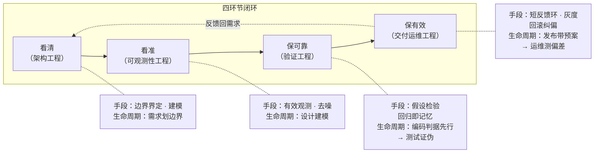

<p align="center"><b>图 1-1　设计闭环与工程学科的对应</b></p>


读法：上排是四环节闭环本体（实线=环节推进，虚线=运维结果反馈回需求，闭环合拢）；下排每个注释节点标出该环节的工程手段与在软件生命周期中的对应阶段——生命周期本身即这条闭环的实例，需求→设计→编码→测试→发布→运维→反馈与四环节一一咬合。

**日常决策界面**：闭环浓缩为每个 agent 的四问自查（边界划了吗→信息够吗→验证了吗→闭环了吗），单一事实源 `_shared/02-org-orchestration/four-lenses-charter.md`，30/30 agent SOUL 一行引用挂接；公理体系见 §2.5，公理与机制的对照表见 §4.14。

**全文路线图（按一单需求的全流程阅读）**：一单需求进来，§2.4 五个 AI 研发员工接力处理——需求分析（§2.4.1）钉标准 → 代码开发（§2.4.2）过门禁 → 回归测试（§2.4.3）机械放行 → 交付部署（§2.4.4）凭准入出门 → 生产运维（§2.4.5）值守回顾；支撑这条流程的静态结构是 §2.1-2.3 的四层架构与团队编制，流程各环节的判据来自 §3 的七大机制域，判据的物理载体（脚本/协议/技能/看板）盘点在 §4，全流程运转与迭代闭环收在 §5。**读法建议：先顺流程读 §2.4（一单活的旅程），再横切读 §3/§4（每环节背后的机制与载体），最后 §5 收拢成闭环。**

---

## 2、系统架构与组织

**设计出发点**：§1 论证了多 agent 是满足闭环要求的最小形态；但多节点协作自身带来三个新问题，不解决则形态不成立——**路由失控**（谁处理什么全凭模型自觉，不可复现）、**上下文污染**（互斥领域互见即事故）、**完成不可信**（「说做完了」无法核验）。全部设计就是对着这三个问题来的：把「多领域专业 agent 集群」从**能对话的 Bot 群**升级为**可审计、可度量、可回滚的工程协作系统**。五条设计目标，各自由一个机制域兑现：

| # | 设计目标 | 兑现域 |
|---|---|---|
| 1 | 确定性调度：消息洪峰下路由判定不漂移，按量化规则分级而非感觉 | S1 |
| 2 | 能力圈隔离：互斥领域（攻防×教育）同机共存且互不污染 | S2 |
| 3 | 治理可度量：规则是否被执行有数据答案，完工声明必须拿机械证据 | S3 |
| 4 | 成本工程化：削减的是给 AI 看的说明材料，不削减 AI 本身的能力，边际成本受控 | S4 |
| 5 | 全量可回滚：任何批量改动可恢复，备份有效性以演练证明 | S6 |

**目标对问题的覆盖**：路由失控的主解是「把路由从模型自觉变成确定性规则」（目标 1）；上下文污染的主解是「定义并强制能力边界」（目标 2）；完成不可信的主解是「机械证据替代口头声明」（目标 3）。运营约束补目标 4（成本不收敛则系统不可持续）与知识资产治理（§3.5，知识被污染则系统慢性失效），安全垫补目标 5（回滚——任何改动都可能改坏，回滚是其余一切改动的前置保险）。八个机制域 = 五条正面目标 + 三个支撑性目标（成本 S4、知识 S5、供应链 §3.8）。覆盖口径说明：五个目标覆盖的是本集群运营中**实际暴露**的问题面（交互、判断、状态、成本、知识），不是对多智能体系统问题空间的完备性断言——新形态的问题（如跨集群联邦、agent 间博弈）出现时按 §5.2 迭代闭环登记处置，不预设现框架已穷尽。

**规模基线**——这张表回答一个问题：「前面讲的机制，作用在一个多大的系统上」。设计文档的每条机制都有适用规模：白名单挂载的收益来自手册库到千份量级、唯一调度入口在 30 个 agent 时仍是单点可运营、看板分库按 10 板设计——脱离规模谈机制没有意义。表中每个数字都附验证命令，作用有三：①**防过期**——数字随系统演化漂移（本表历史上 743→769→785→775→856→875 漂移过），任何读者可一条命令复核现值，文档不声称自己是事实源，验证命令才是；②**防虚胖**——规模数与 §5 度量脚本对账，编制外幽灵 profile、悬空板会被 `ls` 直接暴露；③**给 §5.3 建设期纪律提供锚点**——「删除先存档」「结构变更走六步闭环」都以此表为变更前后对账基准。

| 规模维度 | 现状 | 验证方式 |
|---|---|---|
| Agent profile | **30**（8 团队 29 worker + orchestrator；[已移除]/[已移除] 两域编制在运行态完整活跃（见 `shared/domain-registry.yaml`），仅不在本文档口径内，见 §2.2 编制表口径） | `ls ~/.hermes/profiles \| grep -vE '^(_trash\|_bak\|_shared\|[已移除]-\|[已移除])' \| wc -l`  # =30 |
| Kanban 看板 | **10 业务板**分库（另有 guardrail-test 测试板、_archive 归档板与 default 空板，不计业务编制；data 板已转正计业务编制） | `ls ~/.hermes/kanban/boards` |
| skill 手册库 | **881** 份 / **49** 顶层条目（2026-09-25 find -L 复测；上轮 775→856→875→881 漂移来自新团队 skill 增补、融合周（GIAC/R37/93号文）与 09-25 重盘点新增 research-ledger-reconciliation，构成口径同前；归档区另存 25 份收敛下架件，不在任何白名单内，可一条命令召回） | `find -L ~/.hermes/skills -name SKILL.md \| grep -v /archive/ \| wc -l` |
| 治理规则 | **71 md + yaml**（68 规则/资产 md + 3 契约 yaml，2026-09-24 复测；另有 52 扩展资产；`_shared/` 按六目录重组，见 §4.4） | `find ~/.hermes/profiles/_shared -type f \( -name "*.md" -o -name "*.yaml" \) ! -path "*/.git/*" \| wc -l` |
| 运维脚本 | **44**（2026-09-24 复测；`~/.hermes/bin/`，口径排除备份与缓存件） | `ls ~/.hermes/bin/ \| grep -Ev '\.bak\|__pycache__\|repair-\|uv$\|uvx$' \| wc -l` |
| 领域知识库 | **pay 库 32MB**（git 化 tag 锁定）+ **data 库**（版本锁定 + 四域能力体系，见 §4.9） | `du -sh ~/.hermes/profiles/pay-orchestrator/references` |

---

### 2.1 结构形态：四层组成与数据流向

**核心命题：让一个调度入口（orchestrator）+ 29 个定制化专业 worker 像一支工程团队一样协作，而不是一堆聊天机器人各自为战。**

读法：**从左往右看数据流（消息→调度→执行→反馈），从上往下看控制流（接入→调度→执行→支撑），从外往内看结构（入口是唯一入口、执行层按板隔离、支撑层全局共享）。**

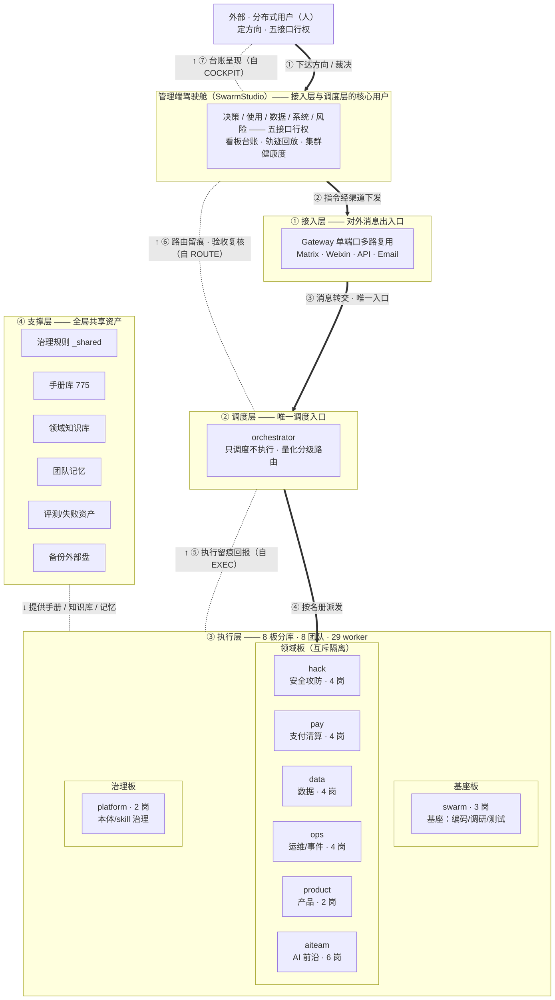

<p align="center"><b>图 2-1　结构形态：四层组成与数据流向</b></p>


读法：**图严格自上而下画——中央主链从上到下依次是：分布式用户 → 管理端驾驶舱 → ① 接入层 → ② 调度层 → ③ 执行层，④ 支撑层作为左侧共享列旁路供给**。粗实线=主数据流（① 下达方向 → ② 渠道下发 → ③ 消息转交 → ④ 按名册派发，全部向下）；无向虚线+↑标注=回流（⑤ 执行留痕回报 → ⑥ 路由留痕·验收复核 → ⑦ 台账呈现，自下而上逐级回到用户，控制回路在「用户↔执行层」间闭合）；↓虚线=支撑层向执行层供给手册/知识库/记忆。

**驾驶舱不是游离在结构之外的旁观面板，而是接入层与调度层的核心用户**：人经驾驶舱五接口行使方向权，指令经 Gateway 进入唯一调度入口 orchestrator，orchestrator 按名册派发到执行层，执行留痕经看板台账回流驾驶舱观测。执行层按板职能分三组：基座板（通用方法论）、领域板（互斥隔离，6 团队横排）、治理板（本体/skill 治理）；四维能力圈（toolset/手册/密级/纪律）在编制时定死各团队能力构成，明细见 §2.2 编制表。

**管理端驾驶舱解决 AI 组织的核心关系**：AI 干活、人定方向，但「方向」不是一句口号——它分解为五个具体的接口，每个接口都回答「谁做什么决定」。SwarmStudio（及与其配套的人机分工约定）按这五个接口设计：

| 接口 | 回答的问题 | 在本集群的承载 |
|---|---|---|
| **决策接口** | 谁能确认业务优先级、调整流程、接受试点失败？ | 用户/管理者裁决优先级与流程变更（审批门、triage 卡人工 promote、goal 预算调整）；试点失败的「可接受性」由验收纪律界定——影子运行期失败零成本，转正失败必须回滚（§3.6/§3.3） |
| **使用接口** | 谁每天完成任务？谁会因 AI 增加审核或解释工作？ | AI worker 完成日常任务（8 团队 30 agent），人从「做」转为「审」——但审核量必须受控：机械验收先行（§3.3），只有 severity=high 与冻结验收边界外的事项升级人审，防止 AI 把审核负担转嫁给使用者 |
| **数据接口** | 谁拥有口径、质量和访问授权？ | 口径裁决归各域 orchestrator（如 data 域指标字典先行、pay 域监管口径），访问授权按 §2.2 四维能力圈定死（工具/手册/密级/纪律），知识库版本锁定保证质量可追溯（§3.7） |
| **系统接口** | 谁控制环境、身份、接口和上线窗口？ | 环境与身份归 platform/orchestrator 管理（profile 编制、markings 密级、@账户矩阵），上线窗口由 §3.2 变更三分法约束（standard 机械验收即放行 / normal 评审后执行 / emergency 先止血后 24h 补验证；高危动作叠加 staged→审批→apply 复验） |
| **风险接口** | 谁判断安全、合规和业务后果？谁有权暂停？ | 判断权分层：机械门禁判技术风险（55 道自持门禁），人判业务与合规后果（对抗评审、HumanGate）；**暂停权始终在人**——blocked 是人工裁决域、熔断卡连败只告警不自动重试（§4.11） |

五个接口的共同原则：**人的决定权通过接口行使，而不是通过逐条审批行使**——接口内的事情 AI 自主运转并留痕，接口上的事项升级到人；驾驶舱把「人管 AI」从盯每条消息变成管五个接口。


### 2.2 组织形态：团队构成与能力设计

> **本节回答**：30 个 agent 怎么构成的、每个岗位有什么能力、这些能力为什么足以达成集群目标。

#### 2.2.1 岗位范式：一个目标函数，三种范式

八个团队不是并列清单，而是按「领域隔离 + 能力复用 + 治理自持」三原则从同一目标函数推导出的三种岗位范式组合：

| 岗位范式 | 构成逻辑 | 团队实例 |
|---|---|---|
| **基座岗位**（swarm 3 岗） | 通用方法论岗：编码/调研/测试覆盖研发全流程**方法层**，不带领域知识——方法论混入领域特色即无法跨域复用 | worker-coder / worker-researcher / worker-tester |
| **领域岗位**（6 领域团队 25 岗） | 领域知识岗：基座方法之上注入领域知识库与红线；领域差异本质是知识差异而非方法差异，故岗位结构同构、知识库各异。红线两式：域操作红线入 SOUL（data 式）；知识红线以红线文件+SOUL 必读指针（pay 式） | hack×4 / ops×4 / product×2 / pay×4 / data×4 / aiteam×6 |
| **治理岗位**（orchestrator + platform 2 岗） | 系统自持岗：调度与本体/skill 治理。治理者不干活、干活的不管治理——裁判与运动员分离 | orchestrator / platform-ontology-curator / platform-skill-miner |

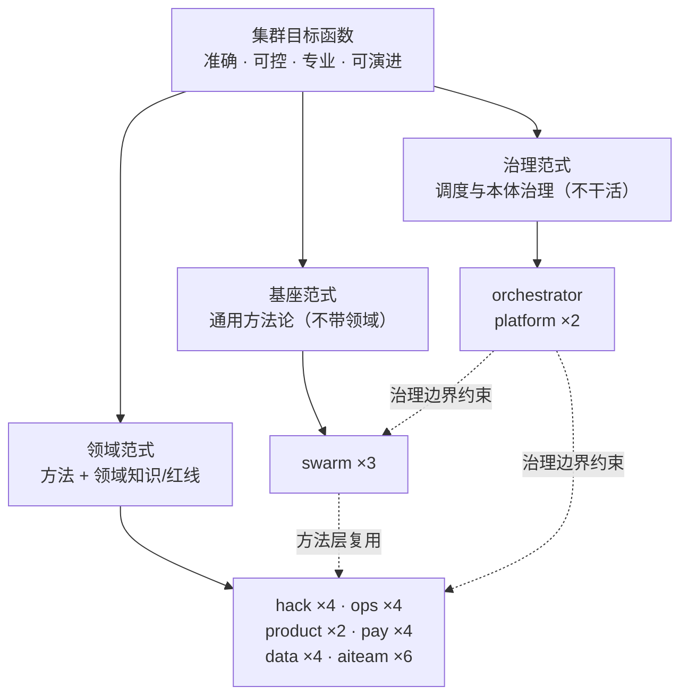

<p align="center">图 2-2　岗位范式推导与团队构成</p>

能力充分性（四类能力恰好覆盖闭环全部作用面）与必要性（抽掉任一类闭环即断）由下表与范式定义直接给出：

| 目标要求 | 承载能力 | 充分性证据（实测） |
|---|---|---|
| **准确性** | 机械验收（退出码/门禁/证据五档，§3.3）+ 领域判据 | evals T1-T11 回归全绿；pay 对账差额=非零即失败 |
| **可控性** | 四维能力圈 + 派单名册隔离 + 双维权限门 + 暂停权在人 | aiteam 板只见 6 岗双向实测；高危动作 staged→审批→apply |
| **专业度** | 领域知识库版本锁定 + 领域红线两式 | hack 结论须 3 独立源交叉；pay 知识库 tag 锁定 |
| **成熟度** | 证据五档 + 失败案例库 + evals 只增不删 + 季度审计 | 连续两月零执行规则自动降级；incident 回流为评测题 |

深度即档位：挂载数由领域复杂度决定而非职权大小（product 最小集 88/89 → swarm 中量 238-268 → hack 全类目 323-512）；每个新机制入册须带创建链+执行链双 provenance（缺执行链实证标 `unverified`，§4.14 H1）。

#### 2.2.2 能力六维模型

本小节按「能力维度 → 组织承载 → 验收信号」展开；先看六维关系图，再读各维度定义。

一个 agent 的能力是六个维度的叠加：前两维回答「能做什么」，中间两维回答「凭什么做」，后两维回答「行为如何被塑形与检验」。

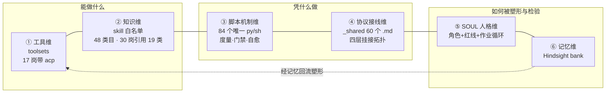

<p align="center">图 2-3　能力六维模型（维度即能力圈的六个切面）</p>

| 维度 | 载体 | 决定什么 | 实测口径 |
|---|---|---|---|
| ①工具维 | config.yaml toolsets | 能用什么动作 | 30 岗 3-5 个 toolset；17 岗带 acp |
| ②知识维 | skill 白名单 | 能读哪些手册（未声明不可见） | 主库 775 份/48 类目，在编岗引用 19 类 |
| ③脚本机制维 | bin+scripts 84 唯一脚本 | 机械化执行手段 | 消费方三层核实（cron+LaunchAgents+XREF） |
| ④协议接线维 | _shared 60 协议 | 受哪些集群公约约束 | 47 份 SOUL 全文严格子串匹配 |
| ⑤SOUL 人格维 | 角色+红线+作业循环 | 行为模式与岗位纪律 | 47 份共享骨架 |
| ⑥记忆维 | Hindsight bank | 经验复用与组织学习 | 各 profile bank 独立 |

六维之上的四条结构规律（全部实测支撑）：

1. **知识深度梯度**（②）：hack（14-16 类目/323-512）> swarm（9-11/238-268）> orchestrator/platform（10/258-268）> ops（7-9/228-238）> pay/data 同构（7/236-261）> product（8/88-89）> aiteam（3-5/61-66）——与「安全全链路 > 研发主力/编排 > 领域交付 > 轻研究」的编制定位吻合。
2. **协议挂接深度与风险正相关**（④）四层拓扑：全员公约层（four-lenses+language-standard，47/47）→ 主干协议层（8 文件，26/47）→ wide 层（output-contract 37、exit-protocol 32）→ 域专属层（constraint-policy 仅 hack×4）。pay/data/aiteam 未挂主干层是最大口径差——与领域交付岗风险面窄一致。
3. **编排型 vs 执行型 SOUL 分野**（⑤）：编排型「表+规则」短而引用密；执行型「循环+清单」长而自含（worker-coder 51 处协议引用为最）。知识外置方向一致：新域知识下沉 _shared/knowledge 或 skill，SOUL 保精简。
4. **脚本机制四类设计模式**（③）：度量采集只读零副作用；门禁 fail-closed+退出码契约；夜间自动化幂等+断点续跑；看门狗周期巡检走 sanctioned 通道+交叉互检。

深读层的两条结构性实证（细节见能力卡 `research/deep-read-20260910/`）：**pay/data 同构镜像**证明领域团队是同一蓝图的实例化（五处逐字同构、三处分叉由「路由弹药」性质决定）；**权力三角**（分解权/决策权在上、证伪权在测试）与 **ACP 三用法**（orchestrator 二审 / coder·researcher 实现委托 / platform 产线代写）给出范式间的精确边界。

#### 2.2.3 30 岗能力一览

> 一岗一行：**干什么**（职责）、**凭据**（知识库/红线）、**外协**（是否可委派外部编码工具）。

| 岗位 | 干什么（职责） | 凭据（知识库/红线） | 外协 |
|---|---|---|---|
| **orchestrator** | 全集群唯一调度入口：路由、分解、派工、验收复核 | 治理规则库 21 规则；路由阈值表 | — |
| **worker-researcher** | 信息调研、方案评估、数据分析 | 调研方法论；红线×13（禁编造） | ✓ |
| **worker-coder** | 把设计变成已验证代码；编码经 ACP 委派、亲自验证 | 编码方法论；Shift-Left；yuan skill | ✓ |
| **worker-tester** | 独立验证；三源用例、机械判定退出码 | 测试方法论；判定权不在被测者 | ✓ |
| **hack-recon** | 攻击面发现（杀伤链第一棒） | 网安知识库 405 篇；授权门红线 | — |
| **hack-exploit** | 漏洞验证与利用、PoC | 网安知识库；授权范围红线 | ✓ |
| **hack-auditor** | 代码安全审计、DevSecOps、LLM/Agent 应用安全评估（智能体全生命周期 9 类风险，§4.7.3） | 网安知识库；审计 checklist；TC260 框架3.0 融合红线（自主攻击意图自检） | — |
| **hack-forensics** | 事件取证、攻击链分析 | 网安知识库；取证流程 | — |
| **ops-devops** | 基础设施自动化、CI/CD、部署变更、发布准入（release-plan 双评审） | 运维红线（回滚预案前置） | ✓ |
| **ops-sre** | SLO、错误预算、值班响应、监控纳管准入（8 项清单） | SRE 红线（变更审批） | ✓ |
| **ops-eval** | 全集群任务度量、工作流评估、后评价四维周报 | 度量口径；只读红线 | ✓ |
| **ops-incident-commander** | 事故分级、指挥协调、复盘（问题回顾五步+案例库沉淀） | IR 红线（指挥链唯一） | ✓ |
| **product-manager** | 业务目标转 PRD、优先级 | 产品方法论+竞品库；红线×11 | — |
| **product-researcher** | 市场情报、竞争分析 | 竞品库；来源可溯红线 | — |
| **pay-orchestrator** | 支付域网关：路由、知识总索引、对账 | pay 知识库 32MB（tag 锁定） | — |
| **pay-infra** | 支付接入、通道、账户体系 | pay 知识库；前置核实红线 | ✓ |
| **pay-clearing** | 清算结算、对账差错 | pay 知识库；对账差额非零即失败 | ✓ |
| **pay-fintech** | 监管合规、反洗钱 | pay 知识库；监管口径红线 | ✓ |
| **data-orchestrator** | 数据域网关：口径/分级裁决 | 数据域知识库 | — |
| **data-arch** | 数仓分层、建模、质量体系 | SOP；DDL 变更红线（入 SOUL） | ✓ |
| **data-flink** | Flink SQL/CDC 流式管道 | version-lock 红线（入 SOUL） | ✓ |
| **data-infra** | Docker 集群、扩缩、卷管理 | 运维红线（无备份禁 down -v） | ✓ |
| **aiteam-orchestrator** | AI 域网关：研究任务分解路由 | aiteam 域红线×10 | — |
| **aiteam-architecture** | Transformer/SSM/MoE 架构调研 | 域红线（结论须论文锚点） | — |
| **aiteam-multimodal** | VLM/视频理解调研 | 同上 | — |
| **aiteam-embodied** | VLA/世界模型调研 | 同上 | — |
| **aiteam-training** | 训练/RL 对齐调研 | 域红线；训练工程外协 | ✓ |
| **aiteam-scout** | 论文/开源例行监测、radar | 监测纪律红线 | — |
| **platform-ontology-curator** | 本体治理：词汇统一、稳定单元 | 本体契约；红线×12 | ✓ |
| **platform-skill-miner** | skill 库挖掘、装卸（唯一 skills 工具集） | skill 治理红线；装卸审计 | ✓ |

#### 2.2.4 编制明细

> 手册挂载走**白名单架构**（§4.3）：配置声明每个 agent 挂哪些手册（按类目+单点指定），未声明不可见，归档可按需召回。skills 列为实测挂载数（口径：`hermes skills list -p <profile>`）。

| 团队 | profile | 工具集 | skills 挂载 | clearance | 领域定制要点 |
|---|---|---|---|---|---|
| **orchestrator** | orchestrator | hermes-cli / **kanban** / memory / **messaging** | 268 | TLP:GREEN | 全板路由 |
| **swarm** | worker-coder / worker-researcher | hermes-cli / **acp** / kanban / memory | 268 | GREEN, CLEAR | 基座方法论 |
| | worker-tester | 同上 | 238 | GREEN, CLEAR | 限定测试/对账 |
| **hack** | hack-recon / exploit / auditor | hermes-cli / kanban / memory（exploit 带 **acp**） | 323 | **AMBER**, GREEN, CLEAR | 网安全类目 |
| | hack-forensics | hermes-cli / kanban / memory | **512** | AMBER, GREEN, CLEAR | +检测/取证类目 |
| **product** | product-manager / researcher | hermes-cli / kanban / memory | 89 / 88 | GREEN, CLEAR | 最小集 |
| **ops** | ops-devops / sre / eval / incident-cmd | hermes-cli / **acp** / kanban / memory | 228-238 | GREEN, CLEAR（eval 加 **EYES-ONLY:ops**） | 运维全链 |
| **platform** | ontology-curator / skill-miner | hermes-cli / **acp** / kanban / memory（miner 加 **skills**） | 258 | GREEN, CLEAR, **EYES-ONLY:platform** | 治理岗 |
| **aiteam** | orchestrator / arch / multi / embodied / scout | hermes-cli / kanban / memory | **61** | GREEN, CLEAR | 最轻载 |
| | aiteam-training | + **acp** | **66**（+mlops） | GREEN, CLEAR | 唯一实测出口 |
| **pay** | pay-orchestrator | hermes-cli / kanban / memory | 241 | GREEN, CLEAR | 域网关+知识索引 |
| | pay-infra / clearing / fintech | hermes-cli / kanban / memory | 261 | GREEN, CLEAR | 域交付 |
| **data** | data-orchestrator | + **messaging** | **236** | GREEN, CLEAR | 域网关+口径裁决 |
| | data-arch / flink / infra | + **acp** | **261** | GREEN, CLEAR | 域交付 |

读表三要点：挂载数差距即能力深度差距；网络安全 6 类目 405 份只进 hack 白名单；EYES-ONLY 域锁（ops-eval / platform）防跨团队读未授权数据。逐岗深读能力卡见 `research/deep-read-20260910/grp-{a..e}-*.md`。


### 2.3 七大机制域总览

本节先用总览图给出七域的依赖方向，再逐域说明职责；图是主线，表格只补充每个域回答的问题和机制。

系统按职能分为七个机制域（S1–S7，各回答一个不同的问题），外加一条横切全部域的供应链约束（§3.8 模型治理与供应链安全——它不是第八个域，而是模型、MCP、skill、知识库等一切外部输入进入集群时的统一准入门，作用于每个域的对外接触面）。§3 的 3.1–3.8 八个小节即「七域 + 一横切」的展开。这个划分来自对外部多智能体实践（开源 agent 仓库源码、成熟 skill 库、PMO 实践）与本机审计结果的归纳——调研存档全部在 `research/` 目录，此处只讲结论，对象清单与原始锚点见台账 `research/hermes-cluster-pending-and-gap.md`。

| 域 | 回答的问题 | 一句话机制 |
|---|---|---|
| **S1 调度与编排** | 活从哪来、怎么分 | 所有外部消息从一个入口进来，量化规则分级，大事拆小、按名册派给合适团队 |
| **S2 组织与能力边界** | 谁是谁、谁能干什么 | 30 个 agent 的工具/手册/密级/纪律在编制时定死；互斥领域机械隔离（三层程序规则，不靠自觉）；改动授权按变更三分法在动手前定级 |
| **S3 治理与验收** | 怎么知道大家真照规矩干了 | 只读脚本度量执行率；「干完了」必须拿机械证据；重型交付物过对抗评审；变更按三分法授权（§3.2）；设计公理（§4.14）+ITIL 变更治理（§3.2） |
| **S4 成本工程** | 钱花在哪、怎么省 | 只动注入侧不动能力侧：压缩参数统一派生、MCP 剪枝、白名单注入 |
| **S5 知识资产治理** | 手册库怎么管 | 主库/归档/挂载三层；白名单机制；按正文实证能力而非文件名分类 |
| **S6 韧性安全垫** | 改坏了怎么回来 | 改前快照、整库备份外部盘、工作区持久化；不演练的备份视为假备份 |
| **S7 领域能力** | 专业知识从哪来 | 每个团队靠领域调研喂养专业知识，固化为本团队的 skill 手册与岗位编制 |

七个域不是并列模块，而是一条运转链：**S1 调度拆出活 → S2 有边界的团队接活干（专业能力来自 S7 的喂养）→ S3 度量过程、验收产出 → S3 的度量结论驱动 S4 成本收敛与 S5 资产裁剪（二者互为表里：按真实内容分类决定白名单装什么，白名单机制保证省钱的效果不回退）→ S6 的回滚垫底让以上所有改动敢持续进行**。

七大机制域的衔接关系如图 2-4（域间箭头即数据/控制流方向，供应链为横切约束）：

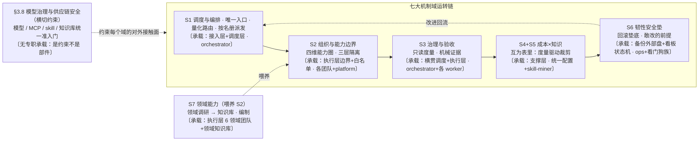

<p align="center"><b>图 2-4　七大机制域运转链</b></p>


### 2.3.1 三视图：结构 × 机制域 × 团队的对应

§2.1 的结构图（四层组成）与 §2.3 的机制域链是同一系统的两个投影——结构图讲「系统由什么物理部件组成」，机制域讲「每个部件执行什么职能」。三视图把两个投影加上组织维度（谁在执行）画成同一张图里的三个子图（类似 C4 的 Context/Container/Component 分层）：**三个子图自上而下堆叠，跨子图的粗虚线即投影关系**。读法：横着看是单个视图内的运转，竖着沿虚线看是同一个域在三个视图间的投影落点。

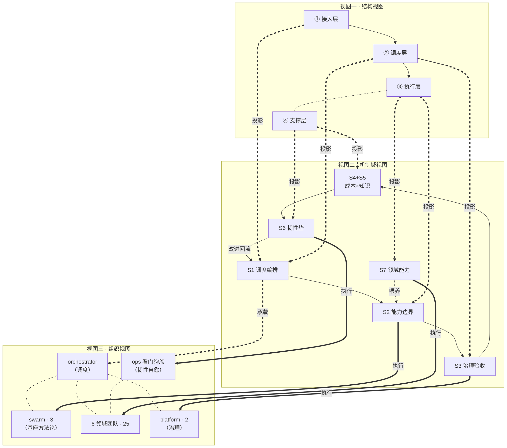

<p align="center"><b>图 2-5　三视图整合：结构 × 机制域 × 组织</b></p>


视图一讲部件与数据流，视图二讲职能与衔接，视图三讲编制与执行者。**竖向连线即投影关系**：粗虚线=投影/承载（机制域落在哪个结构部件、由谁承载），粗实线=执行落位（机制域由哪个组织单元执行）：

| 投影线 | 读法 |
|---|---|
| ①② 接入+调度 ══ S1 | 调度编排职能由接入层与调度层承载，执行者是 orchestrator |
| ③ 执行层 ══ S2/S7 | 能力边界与领域知识落在执行层各团队，基座方法论由 swarm 供、领域知识由 6 领域团队供 |
| ④ 支撑层 ══ S4+S5/S6 | 成本×知识与韧性垫是支撑性职能，由统一配置派生与 ops 看门狗族执行 |
| ② 调度层 ══ S3 | 治理验收横贯调度与执行（卡在调度层生成、证据在执行层产生），治理规则由 platform 维护 |

横切的 §3.8 供应链安全不在图中单列——它作用于每个域的对外接触面，是约束不是部件。三视图互为投影，改任何一处须同步核对另两处——这个牵连面清单正是 §4.12 结构演化回滚的检查基准。

---


### 2.4 典型 agent：五个 AI 研发员工（需求 → 研发 → 测试 → 交付 → 运维）

本节按一条需求的生命周期讲五个岗位：先看岗位接力图，再按需求、开发、测试、交付、运维顺序解释职责、输入、输出和交接边界。

**五个 AI 员工是什么——岗位范式，不是五个具体进程。** 「需求分析 / 代码开发 / 回归测试 / 交付部署 / 生产运维」覆盖一单需求从进门到生产运维的全流程五个环节；每个环节由一个基座 profile 承载方法论（worker-researcher / worker-coder / worker-tester 编制在 swarm 团队，ops-devops / ops-sre 编制在 ops 团队），由各领域团队按同一范式派生出本域的岗位实例（如 pay 团队的 pay-fintech 就是「需求分析」范式在支付域的实例）。一个岗位实例 = 基座方法论（白名单挂载共享）+ 领域知识库（本团队注入）+ 领域红线（入 SOUL）。

**从岗位范式到应用专职研发 agent——衍生链**。五个岗位范式之上，每个**具体应用**由一名**专职研发 agent** 承包：它由基座能力（需求/编码/测试的方法论与质量纪律）+ 领域能力（领域知识库/红线/约束判据）**衍生**而来——衍生动作即 swarm-yuan 五阶段生成该应用的目标 skill（特征卡=模块职责与架构边界、验收命令=执法依据、组件库=拼装零件）叠加领域 SOUL 派生。专职 agent **主责一个具体应用的全责**：研发（拼装式编码）、交付（release-plan 准入+双评审）、质量自测（交付前自测义务：跑全量验收命令+回归用例，全绿才有资格提交独立测试）。**自测与独立测试的边界**：自测是开发者的交付门槛（自测不全绿不许出门），独立测试是测试岗的验收判定权（判定权不在生产者手里）——前者是义务，后者是职权，不互相替代。

**亲缘关系与团队属性**：五岗位中，研发三岗（需求/开发/测试）的方法论母体在 swarm（基座团队），交付与运维两岗的方法论母体在 ops 团队，岗位实例分布在 product 与 pay 两个领域团队——它们是「同一岗位在不同领域的表亲」：共享同一套方法论与门禁执法（亲缘），各自携带互斥的领域知识库与红线（团队属性隔离，互不挂载对方手册）。product 是轻量域（不设开发/测试岗，验收走 PM 评审+对抗评审），pay 是重量域（研发全链路三岗齐备）——领域复杂度决定岗位齐全度。

**岗位实例清单与边界**：

| 岗位范式 | 基座方法论承载（swarm / ops） | product 域实例 | pay 域实例 | 岗位边界（做什么 / 不做什么） |
|---|---|---|---|---|
| **需求分析** | worker-researcher：穷举建库 / 结构化澄清 / 版本锁定引用 | **product-manager**：业务目标 → PRD（问题定义先于方案） | **pay-fintech**：监管合规需求 / 牌照与 AML 约束识别（引用版本锁定支付规范库 §4.8） | 出规格与验收判据，**不写码、不自测** |
| **代码开发** | worker-coder：只写胶水 / 分进程验证 / 门禁执法 | ——（product 无开发岗：产品域产出规格与决策，不产出代码） | **pay-infra**：收银台/网关/账户体系设计；**编码执行经 ACP 回基座执法**（写码方法论与门禁归 swarm-yuan，支付约束归领域知识） | 只写胶水不重造轮子；受 55 道门禁实时约束；不自行放行 |
| **回归测试** | worker-tester：三源用例 / 退出码判定 / 影子转正 | ——（product 验收走 PM 评审+对抗评审，轻量域合理形态） | **pay-clearing**：对账即领域测试（账实相符=机械回归判据，差额=退出码非零的领域等价物） | 判定权在命令退出码与独立进程，**不采信被测者自评** |
| **交付部署** | ops-devops：release-plan 准入资料单+双评审门+抢修特例+高危观察窗（§4.13 M1-M4） | ——（product 发布走轻量评审） | 领域发布经同一道交付门（构建物清单/回滚兜底为硬项） | 发布完成 ≠ 任务完成；**无准入不出门** |
| **生产运维** | ops-sre + 夜间雷达（纳管准入 M5）+ incident（回顾五步 M6）+ ops-eval（后评价四维 M6） | —— | 领域值班与领域红线（如清算对账偏差即 P2 事件） | 值守监控不评自家变更；**故障必回顾、服务可评价** |

**外部交互位置（岗位与外界的每个接口）**：

| 交互对象 | 交互内容 | 交互机制 |
|---|---|---|
| **上：研发人员（人）** | 发需求 / 圈范围 / 终审 | 经 Matrix → 驾驶舱 → orchestrator 派卡；人只在任务卡接口与终审关口出现，不进入编码过程 |
| **上：orchestrator（调度）** | 接卡 / 回报留痕 | kanban 卡生命周期；按板名册派发，跨板不互派 |
| **下：编码工具（ACP）** | 代码生成执行 | worker-coder / pay-infra 经 ACP 委派 Codex / Claude Code / DSH / Zcode（可替换执行器），加载 swarm-yuan 目标技能上岗 |
| **侧：swarm-yuan 门禁** | 编码执法 | 门禁 hooks 实时拦截、特征卡核对、独立验证器复测——执法锚在自持门禁，不在宿主工具 |
| **侧：领域知识库** | 领域事实引用 | pay 岗查 pay 知识库（版本锁定），引用必须附核实出处 |

**岗位在全流程中的位置**：需求分析把需求和设计钉在标准上 → 代码开发只写胶水并被门禁实时约束 → 回归测试用机械判据把住生产准入 → 交付部署凭准入资料单和双评审把住生产出门 → 生产运维盯运行、接事件、跑回顾与后评价——前五环的交接物即下一环的输入（冻结的设计文档 / 合入的构建物 / 通过的测试报告 / 过双评审的变更 / 运行与评价数据），流程衔接靠交接物标准而非口头约定。需求分析与回归测试由 orchestrator 经 kanban 派卡执行（多 agent 并发探查建库、独立测试员重跑验证），代码开发经 ACP 调用编码工具完成，交付与运维由 ops 团队 cron + 看门狗常值守。

**分工规则三条**（领域边界的岗位层保障）：①基座岗位不带领域知识库，领域岗位不重建通用方法论——方法论归 swarm、领域知识归各域，白名单挂载机械隔离；②领域团队的编码执行统一经 ACP 回到基座（swarm-yuan 门禁执法），领域岗出约束与验收判据、不绕开门禁自写；③领域测试形态可以不同（对账/验收评审），但「机械判据+判定权不在模型手里」的公理不变。

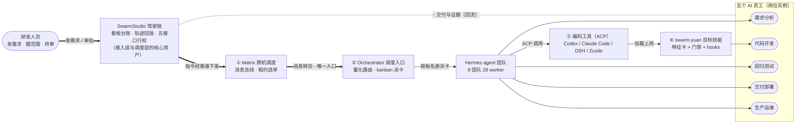

<p align="center"><b>图 2-6　典型 agent 的载体链路（驾驶舱行权 · 四级载体）</b></p>


研发三岗遵守两条公共纪律（交付/运维两岗纪律见 §2.4.4-2.4.5）。**规矩三条**：只写胶水防侵入、先读说明书防重造轮子、做完必验收防幻觉。**人机分工三原则**：写码的不检查、检查的不写码；关键路径必须人审——资金公式逐行核对、加密对国密白名单、权限对清单。他们所在的组织如何保证这些纪律被执行（调度、隔离、度量、兜底），见第八章与《Hermes Agent 集群设计文档》。

**措施总览：准确与可靠靠什么，判定权在谁手里。** 全部措施按研发流程五道关口归位，设计依据见第一章公理，岗位细节见 §2.4.1-2.4.3，底座见 §4.3.1。

| 关口 | 防什么 | 核心措施 | 判定权交给谁 |
|---|---|---|---|
| ① 需求源头（第四章） | 需求模糊 · 漏改 · 幻觉引用 | 全仓机械穷举（覆盖率 ≥95% 红线）· 版本锁定标准库 + 前置核实 · 结构化澄清 + 记忆召回 | 脚本与标准库，研发冻结边界 |
| ② 编码过程（第五章） | 重造轮子 · 破坏架构 · 违规代码 | 只写胶水 + 签名比对 · spec 前置硬门 · 55 道门禁 hooks 实时拦截 | hooks 与门禁，模型无判定权 |
| ③ 交付测试（第六章） | 自评幻觉 · 空跑 · 漏检 | 独立测试员重跑 · 退出码判定（0 用例=空跑）· 用例三源生成 | 退出码与独立进程 |
| ④ 放行准入（§4.3.1） | 带病出厂 | 证据强度五档 · 对抗评审 · 资金/加密/权限人审 | 机器核客观项，人审关键处 |
| ⑤ 认知底座（§4.3.1） | 认知漂移 · 门禁失效 · 工具失控 | 特征卡活契约（指纹感知+局部重探查）· 独立验证器证有效 · 负向预算（≤55 道/≤8KB） | 机器断言与夹具回归 |

> 承载团队：①需求源头=worker-researcher（方法论）+ product-manager / pay-fintech（领域需求）；②编码过程=worker-coder（方法论）+ pay-infra（领域实现，经 ACP 回基座执法）；③交付测试=worker-tester（方法论）+ pay-clearing（对账即领域测试）；④放行准入=各团队岗位（product PM 评审 / pay 人审资金合规）；⑤认知底座=swarm-yuan（全团队共用）。
---


#### 2.4.1 需求分析岗位：把需求和设计钉在标准上

> 职责：自主分析业务需求，识别全链路改造内容，产出遵循平台标准业务模型与技术架构规范的设计文档，从源头保证需求分析标准化与设计质量。

**执行标准的三条落地措施**（标准见下表，措施是标准的执行方法）：①影响面机械穷举：全仓多维度扫描，组件清单不低于实际数量的 95%——硬性红线，违反即不合格，没有商量余地；登记路径逐条验真，编造即阻断交付；②规范比对靠版本锁定标准库——标准与框架入库、git 锁定、引用必须回查现行官方文件并附出处，冲突以监管最新文件为准；③需求理解靠结构化澄清与记忆召回——每个分支问到底才动手，同类需求自动召回历史错误。

**准确的标准与有效性判定**：

| # | 标准 | 闸门要点 | 怎么判定有效 |
|---|---|---|---|
| ① | 组件清单覆盖率 **≥95%**（硬红线，缺一格即整份文档不合格） | 扫描范围必须覆盖全仓多维度（代码/配置/路由/视图），不是抽查；每条登记路径验真 | 用脚本重跑同一扫描比对清单数：`实际组件数 ≥ 清单数/0.95`；任一路径 404 即打回 |
| ② | 引用 **零凭记忆**：每条标准引用必须带现行版本号+官方出处 | 版本锁定库 git tag 锚定；冲突时以监管最新文件为准（新法优于旧法） | 抽查引用可回查：出处文件存在、版本号与 tag 一致、无「我记得是」式裸引用 |
| ③ | 澄清 **零悬空分支**：需求树的每个分支要么有答案、要么标记为待澄清并挂给问题owner | 历史错误记忆自动召回（同类需求曾踩的坑必须出现在澄清清单中） | 澄清清单闭环检查：无「待澄清」残留即可进入下一环节；历史同类错误的召回命中须显式标注 |

**执行三道闸门的落地方式**（闸门要点与有效性判定见下表）：①文档模板化，核心节必填；②spec 前置与验收冻结——无批准的设计文档不许写源码，批准后验收边界冻结；③人圈确认改造边界，重型文档过质量评委与领域委员评审。

**可控的闸门要点与有效性判定**：

| # | 闸门 | 要点 | 怎么判定有效 |
|---|---|---|---|
| ① | 文档模板门 | 核心节（目标/边界/影响面/验收标准）缺一即拒收——拒收发生在评审前，不消耗评审资源 | 模板校验脚本对文档小节做存在性断言，缺节清单机械列出 |
| ② | spec 前置门 | 无批准设计文档时提交源码变更=直接拒绝（不是提醒）；批准后验收边界冻结，验收标准改动须走审批 | 用 git 时序断言：design-doc commit 时间戳必须早于首个 code commit；验收边界 diff 非空即违规 |
| ③ | 人圈评审门 | 重型设计文档过质量评委+领域委员；评审针对冻结快照，评审期间内容禁改 | 冻结 hash 在评审前后一致（不一致=评审无效）；高危发现未处置不得进入下一岗位 |

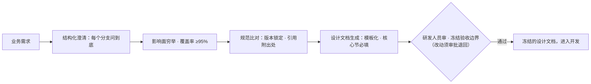

<p align="center"><b>图 2-7　需求分析岗位工作流</b></p>


本岗位方法论由 swarm 基座承载（§3.7），领域知识按团队注入（支付域标准库见 §4.8）；岗位产出（冻结的设计文档）是下一岗位的输入——岗位间衔接见 §2.4 外部交互位置表。

---

#### 2.4.2 代码开发岗位：只写胶水，门禁执法，独立验证

> 职责：提供符合开发规范的代码生成、重构建议、架构合规验证与自动化单元测试生成，把研发约束从「事后检查」前移为「实时执法」。

**执行标准的三条落地措施（生成与验证分离）**（标准见下表）：①拼装不重写：新功能 = 既有稳定组件拼装 + 最小胶水，复用前先读特征卡，组件库与拆装各设专项检查（见 §4.3.1）；②编码与验证分属不同进程——复核者只见 commit、测试命令与重跑日志，0 用例 = 空跑不算通过，伪测试硬性禁止；③重构带机械证据——变更频率、被依赖数、测试存在性三信号支撑，禁改单元的下游改动自动告警。

**准确的标准与有效性判定**：

| # | 标准 | 闸门要点 | 怎么判定有效 |
|---|---|---|---|
| ① | 胶水占比：新功能 = 组件拼装 + 最小胶水，**重复造轮子=不合格**（有组件库可用而自写同类逻辑） | 复用前必读特征卡；组件签名与调用参数一致 | 组件库检索命中检查：改动文件中自写逻辑若与既有组件签名重合（同名/同入参出参）即打回 |
| ② | **0 用例 = 不通过**（不是降级，是不通过）；伪测试（断言恒真/删断言凑绿）硬性禁止 | 验证者只见 commit+测试命令+重跑日志，不见编码过程 | 独立进程重跑：测试数>0 且全绿；断言强度抽检（断言内容非 `assert True` 类） |
| ③ | 重构**必附三信号证据**：变更频率、被依赖数、测试存在性，缺一即驳回；禁改单元的下游改动自动告警 | 三信号从仓库数据机械提取，不接受文字自述 | 证据表可复查：三项数字能在代码仓工具输出中对上 |

**执行三道闸门的落地方式（执法先于自觉）**（闸门要点与有效性判定见下表）：①门禁三档执法（拦死/警告/只记录），按缺陷类型全覆盖，命令执行层真实拦截、留下记录、事后可以复查；②命令三值判定——放行/询问/禁止，禁止必带替代方案，任务在独立工作副本执行，写路径圈外即拦；③合规是可执行断言——框架规则每条带验证命令与门禁编号，金融合规（国密、SBOM、密评）是检查项而非文档承诺。

**可控的闸门要点与有效性判定**：

| # | 闸门 | 要点 | 怎么判定有效 |
|---|---|---|---|
| ① | 门禁三档（拦死/警告/只记录） | 按缺陷类型预设档位：安全与资金类=拦死，风格类=只记录——档位表冻结，编码中不可临时调档 | 拦截日志可复查：每次拦截有门禁编号+命中的缺陷类型+处置动作，事后可重放 |
| ② | 命令三值判定（放行/询问/禁止） | 禁止必带替代方案（只说不行不给路=门禁缺陷）；任务在独立工作副本执行，写路径出圈即拦 | 写路径白名单断言：工作副本外零写入（文件系统监控留痕）；禁止类命中的替代方案字段非空 |
| ③ | 合规=可执行断言 | 国密/SBOM/密评等金融合规是**检查项**不是文档承诺——每条合规要求对应一条验证命令+门禁编号 | 合规命令跑一遍退出码为 0；门禁编号能在门禁总表中查到定义 |

**工具无关性条款**：编码执行器与研发依据解耦——支持 **Codex / Claude Code / DSH / Zcode** 四种编码工具（经 ACP 接入，均为可替换执行器）；无论实际调用哪个，都必须先经 swarm-yuan skill 生成对应应用代码的目标 skill，以其开展具体研发工作。新增工具属 ACP 适配扩展（§3.8 供应链准入），接入即自动纳入本条款约束。

**循环自控三件套（会话级门禁）**：Oracle Gate 用独立验证命令核对会话终点声明；失败模式检测识别空转/漫谈/混合三态并逐级加压；防作弊门对受保护资产按 deny/advisory 两档拦截。

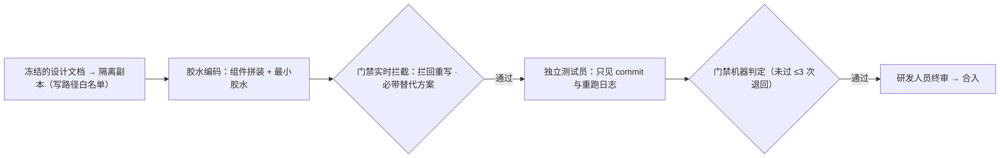

<p align="center"><b>图 2-8　代码开发岗位工作流</b></p>


本岗位的执法载体是 swarm-yuan 目标技能（特征卡+门禁+hooks，实现见 §4.3.1），编码工具经 ACP 接入（工具无关性条款见 §3.8 供应链准入）；「编码与验证分离」「执法锚自持门禁」两条公理见 §2.5。

---

#### 2.4.3 回归测试岗位：三源生成用例，机械判定，分级放权

> 职责：基于报文规范、业务需求、业务流量智能生成各层级测试用例，把牢生产准入门槛，同时从测试结果数据给出优化建议。

**执行标准的三条落地措施（判定权不在模型手里）**（标准见下表）：①用例三源生成——报文规范源、业务需求源（验收边界逐条转化）、业务流量源（生产流量提取典型场景与边界值）；②通过与否由命令退出码判定——命令+期望退出码+超时三要素，0 用例 = 空跑告警；③优化建议从对策库来——失败按类型路由回对应环节，每条建议能指回一次真实失败。

**准确的标准与有效性判定**：

| # | 标准 | 闸门要点 | 怎么判定有效 |
|---|---|---|---|
| ① | 用例**三源齐备**：报文规范源+业务需求源+业务流量源，单源用例集不构成完整测试 | 业务需求源的用例须逐条映射到验收边界（验收边界一条不漏）；流量源覆盖典型场景+边界值 | 用例-边界追溯矩阵：每条冻结验收标准至少挂 1 条用例；三源各自占比可统计，零源用例=0 |
| ② | 判定三要素：**命令+期望退出码+超时**，缺一不可；0 用例=空跑告警 | 退出码是唯一通过判据——输出文字「看起来对」无效 | 重放验证：任一用例可独立重跑并复现同样退出码；超时参数存在且为有限值 |
| ③ | 失败**必归因**且建议可回溯：每条优化建议能指回一次真实失败（失败 ID） | 失败按类型路由回对应环节（需求/编码/环境），路由错位=归因无效 | 对策库抽检：建议→失败 ID→原始失败记录三级链接完整 |

**执行三道闸门的落地方式（分级放权与影子转正）**（闸门要点与有效性判定见下表）：①生产准入三关——机器判定门禁 → 独立复核 → 人审拍板；②自治三档按可靠度逐级放——仅报告/每步人审/无人值守；③新拦截规则影子转正——先只记录不拦停，复盘误报达标后灰度转正。

**可控的闸门要点与有效性判定**：

| # | 闸门 | 要点 | 怎么判定有效 |
|---|---|---|---|
| ① | 生产准入三关（机器门禁→独立复核→人审拍板） | 三关串行不可跳：机器判不过不进复核，复核不过不进人审——人审只看机器与复核都放行的 | 关卡时序留痕：三次放行记录时间戳严格递增，缺任一环=准入无效 |
| ② | 自治三档按可靠度放权（仅报告/每步人审/无人值守） | 档位升降的依据是**历史可靠度数据**（近期误报率/漏报率），不是对模型的信任 | 档位变更必须附可靠度数据引用；无人值守档的准入误报率超阈值自动降档 |
| ③ | 新拦截规则**影子转正**（先只记录不拦停，误报达标才灰度拦停） | 影子期长短由误报数据决定（如误报率 <X% 连续 N 次），不按时长——数据不达标就一直影子 | 转正决策可复查：影子期记录集+误报统计+达标结论三件齐备；无数据支撑的转正=违规 |

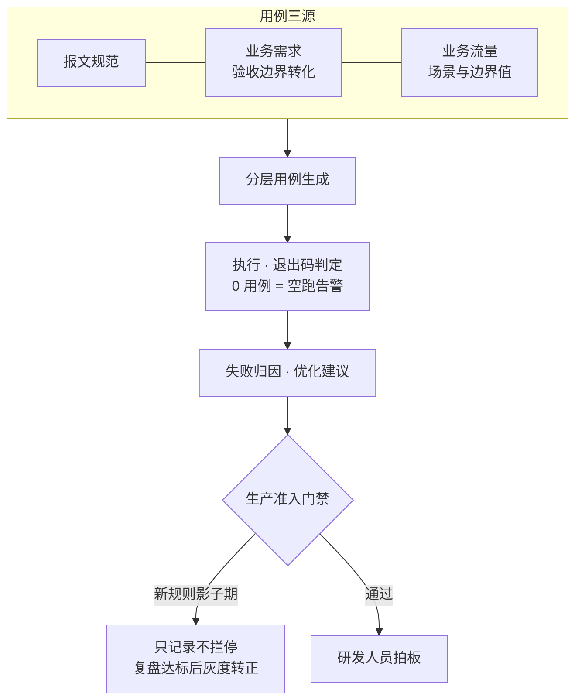

<p align="center"><b>图 2-9　回归测试岗位工作流</b></p>


本岗位的失败归因回流进对策库（失败打标机制见 §3.3，闭环消费见 §4.11）；「新规则影子转正」公理见 §2.5；测试能力在各领域的等价形态（对账/验收评审）见 §2.4 开头的三团队分布表。

---

### 2.4.4 交付部署岗位：无准入不出门，发布完成 ≠ 任务完成

> 承载生产变更机制（§4.13 M1-M4）的流程环节；方法论母体 ops-devops（ops 团队），工具载体 release-plan 技能。

**本岗在流程中的位置**：接住回归测试放行的构建物，把住「进生产」的最后一道门。测试证明「改对了」，交付证明「进得安全」——两道门的判据不同，故岗位分离。

**工作流四步**（对应变更准入→评审→实施→观察）：

1. **准入资料单核对**（M1）：任务卡须带 10 项资料——授权源（parent 卡）、构建物清单（commit/版本，禁「最新」字样）、影响面、质量报告（实跑输出非自述）、安全合规、运维手册、容量、发布方法、验证方法、回滚兜底；缺失项标 N/A+理由，禁静默跳过。
2. **双评审门**（M2）：技术评审（coder/tester 交叉审构建物↔需求一致性与测试实证）+ 运维评审（本岗出 release-plan 报告审 10 项齐备与回滚可执行性），两票独立，一票否决。
3. **实施**（M3 特例通道）：常规变更按灰度顺序执行；生产事件触发抢修通道——先止血（回滚/隔离）免前置评审，24h 内补授权留痕；经评审固化的 runbook 后续执行免重复评审。
4. **高危观察窗**（M4）：发布完成 ≠ kanban_complete——常规变更完成前最后一次机械验证+发布后首轮回访无异常才收口；重型变更（基线/守护类）次日复跑 E2E 全绿才收口。

**有效性判定**：充分性——四步覆盖变更全生命周期（事前准入/事中评审/事后观察）；必要性——抽掉 M1/M2 则「自述完成未验证」的变更混入生产（证据五档中 present 冒充 exercised），抽掉 M4 则变更引入的回归在下一次变更前不可见（soul_integrity 基线漂移 270 文件积压两月的实证）。

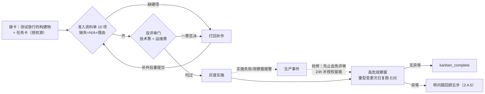

<p align="center">图 2-10　交付部署岗位工作流（生产四机制 M1-M4 的流程化）</p>

---

### 2.4.5 生产运维岗位：值守监控，故障必回顾，服务可评价

> 承载生产监控+问题回顾+后评价机制（§4.13 M5-M6）的流程环节；方法论母体 ops-sre / ops-incident-commander / ops-eval（ops 团队），载体含夜间雷达、看门狗族、ops-eval 周报。

**本岗在流程中的位置**：变更转生产后接手——这是流程的「常开」环节：前三岗按单触发，运维岗 7×24 值守；且它是迭代闭环的起点（运行数据回流成改进需求）。

**值守三线**：

1. **监控纳管**（M5）：新信息源/新服务进监控前过 8 项准入清单（可达性实证/反爬结论/抓取方式/更新周期/已知问题/依赖/质量信号/下线预案）——对应银行「新系统纳管 14 项资料」制度。
2. **持续监测**：夜间雷达双闭环（外部领域雷达+内部探针）→ 异常汇入差距台账 → 高严重度自动派卡；确定性看门狗族分层值守（30min/日/6h/专项/周检），meta 互检防监督层自身失效。
3. **事件响应**：P2+ 故障触发问题回顾五步（M6）——时间线回顾（task_events）→ 关联方补充细节 → 根因方编写整改（费曼标准：到 file:line；手法用假设-反证：列 ≥2 个候选根因假设逐一证实/证伪，证据不足继续调查、不越界定因）→ orchestrator 审议督办（整改子卡挂链）→ 独立方验证效果后闭环入案例库。

**后评价**（M6）：ops-eval 周报四维——变更达成率（release-plan 报告产出）、工具失败率趋势（token-meter --errors）、问题回顾闭环率（blocked 卡须有失败模式标签）、整改验证（看门狗哨兵复跑）——数据供人机共读，作为下一周期派工与制度迭代的决策输入。

**有效性判定**：充分性——纳管（进）→监测（守）→回顾（修）→后评价（评）四环覆盖运行侧全生命周期；必要性——抽掉纳管准入则坏源污染雷达数据（Cloudflare 指纹源反复踩坑的实证），抽掉回顾五步则故障重复发生（failure-mode-playbook 只收录实锤模式的由来），抽掉后评价则服务质量无数据支撑（周报哨兵曾抓出 rules_audit 路径失准）。

**与交付岗的制衡**：运维不评自家变更——后评价的数据口径由独立评估岗（ops-eval）出，值守监测与变更实施分属不同 profile，判定权分离延续「验证者与生产者分离」公理。

---

### 2.5 设计公理

本节按「事实 → 公理 → 机制」解释设计约束：先看推导图，再逐条说明公理的工程含义和禁止事项。

十条公理全部可回溯到 §1 的三条事实：事实一（模型会错）派出公理 1/5/6/8，事实二（交互复杂度）派出公理 2/7/9，事实三（声明≠状态）派出公理 3/4；事实二展开出的成本面（注入随规模线性涨）与知识面（库大必藏污）派出公理 10。这里的「派出」指**设计取向的归因**（公理是为了对冲该事实而立），不是数学意义的必然结论——每条公理是对应事实下已知最稳的工程取向，其有效性由第 3 章机制的运转证据持续检验，而非由事实逻辑地蕴含。机制是公理在工程里的兑现——三层各司其职。这条归因关系画成图（图 2-11）：

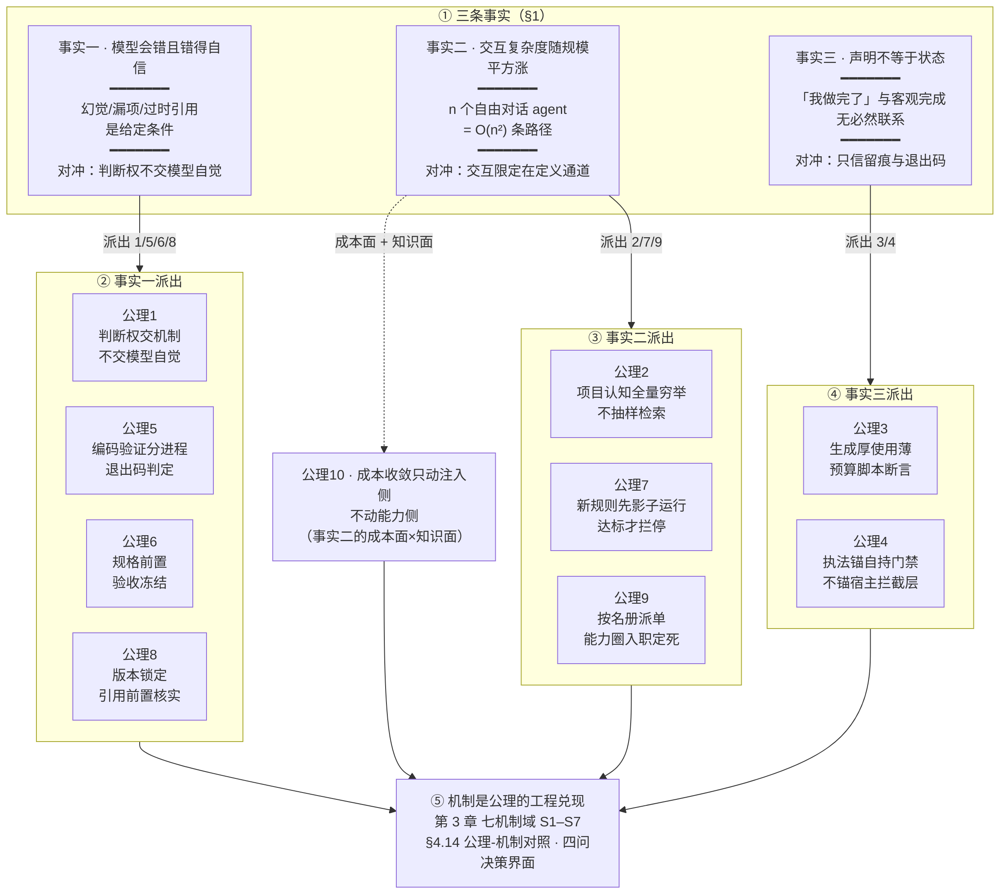

<p align="center"><b>图 2-11　三条事实到十条公理的推导关系</b></p>


1. **判断权交给机器与人，不交给模型自觉。** AI 会错是给定条件，模型自评存在策略性偏差；任何「完成」「通过」「合规」的结论必须由不依赖模型的机制产出。否决：以模型自评作为放行依据。
2. **项目认知用全量穷举，不用抽样检索。** 抽样漏掉的组件正是幻觉与漏改的温床（实证：初版清单 10 个组件，实际 99 个视图模块）；组件清单不低于实际数量 95% 是硬红线。否决：按相关性抽样、以检索代替穷举。
3. **生成厚、使用薄，预算写死。** 建库一次性消化 79 份框架规则是投资，每次开发加载是税：技能正文 ≤8KB、门禁 ≤55 道，上限由脚本断言，新增门禁须等额删除。否决：功能增加则规则随之膨胀。
4. **执法锚在自持门禁，不锚宿主工具的拦截层。** 编码工具自带的拦截与审批层在不同版本间不保证在场；自带 55 道门禁才能跨工具一致执法。否决：以宿主拦截层作为唯一执法面。
5. **编码与验证分属不同进程，通过与否由命令退出码判定。** 同进程自评是运动员兼裁判；复核者只见 commit 与重跑日志；0 用例 = 空跑不算通过。否决：编码 agent 自报「测试通过」。
6. **规格前置，验收冻结。** 需求模糊时写出来的一定是错的东西，返工成本远高于写规格的成本；无批准规格写源码被直接拒绝，批准后验收边界冻结。否决：边编码边澄清。
7. **新拦截规则先影子运行，复盘达标才拦停。** 误报会阻断合法工作——拦截本身可能成为新的生产风险。否决：新规则直接上岗拦停。
8. **标准库版本锁定，引用前置核实。** 模型训练记忆里的标准是过期或错乱的；引用条款必须回查现行官方文件并附出处，违者任务不合格。否决：凭模型记忆引用标准。
9. **组织按名册派单，能力圈入职定死。** 互斥领域（攻防 × 教育）同机共存只能靠机械隔离；工具、手册、密级、纪律四维在编制时定死，跨板不互派。否决：靠 agent 自觉不越界。
10. **成本收敛只动注入侧，不动能力侧。** 砍能力省钱是假省——省下的投入会以返工形式加倍偿还；压缩的是注入的说明文字，不是手册本身。否决：砍挂载手册换取账面成本下降。

十条公理是全部机制的判据来源：下一章的每个机制域，都能回指到这里的至少一条公理（逐条对照见 §4.14）。公理落到个人决策界面，就是每个 agent SOUL 里的四问——**边界/牵连面划了吗（系统问）→ 信息够行动吗（信息问）→ 验证了吗、什么算证伪（方法问）→ 反馈闭环了吗（控制问）**——单一事实源 `_shared/02-org-orchestration/four-lenses-charter.md`（30/30 agent SOUL 一行引用挂接）。

---


## 3、机制设计

本章把 §2 的架构与组织落成可执行机制。阅读顺序不是按名词罗列，而是按一条业务流展开：**先接住需求，再确定谁能接；再执行并验收；最后用数据做成本、知识、韧性和专业能力的持续约束**。因此，S1 是主流程起点，S2 是执行前提，S3 是结果判定，S4–S7 是支撑与回流，§3.8 是横切所有域的外部输入准入门。

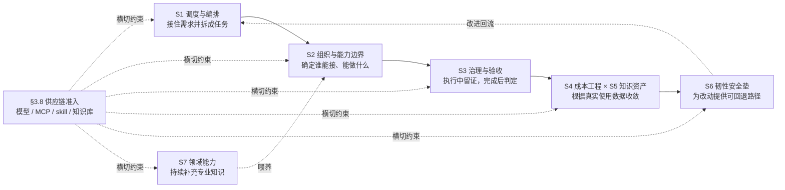

<p align="center"><b>图 3-4　机制设计的阅读顺序与依赖关系</b></p>

按图读正文：先读 §3.1 的五阶段调度链，其中阶段二包含分解算法；再读 §3.2 的组织与能力边界，它提供派单和执行所需的边界；随后读 §3.3 的治理与验收，确认过程和产出是否合格；§3.4–§3.7 分别补足成本、知识、回滚和领域能力；最后读 §3.8 的供应链准入。每节正文统一遵循「机制总纲 → 算法或结构图 → 分步解释 → 判定与边界」的顺序。

### 3.1 调度与编排

> **本域提纲**：回答「活从哪来、怎么分」。一阶段：唯一入口 · 量化路由。二阶段：分解决策收拢。三阶段：按名册派发。四阶段：隔离执行。五阶段：机械验收收口。实现落点 §4.1。

一次调度是一条五阶段流水线，每个阶段有明确的输入、出口与守门者；阶段间的交接物只有一种——任务卡。先看全程，再逐阶段讲设计。

**调度链路的载体分工**：一次调度跨四级载体，每级只做一件事——研发人员经管理端 SwarmStudio 驾驶舱（接入层与调度层的核心用户：看板台账、轨迹回放、五接口行权）下达指令 → ①跨机调度 Matrix（Synapse）：房间状态总线、多实例租约选举、审批路由；②调度入口与执行组织 Hermes 集群：orchestrator 经 kanban 派单，30 agent 四维能力圈；③编码执行 Codex / Claude Code / DSH / Zcode（经 ACP，可替换执行器）：独立工作副本写码；④项目认知与门禁 swarm-yuan：特征卡+门禁+hooks，工具加载即上岗。驾驶舱是管理面，①②是接入与调度组织本体，③④是执行层的两个解耦面（工具与依据）。

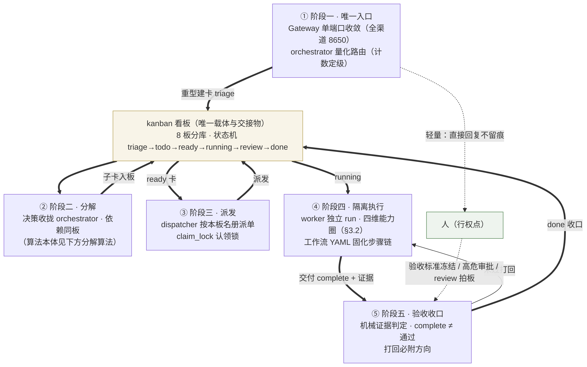

<p align="center"><b>图 3-1　调度编排全流程：五阶段流水线，kanban 卡是唯一交接物，人只在三个行权点介入</b></p>

图上五个阶段自左上向右下推进，中央的 kanban 看板是所有阶段的唯一交接物——「不在卡上的工作不存在」；人不在流水线中间，只在图下方三个行权点介入（验收标准冻结、高危审批、review 拍板）。轻量消息不进流水线，在阶段一直接回复。

**阶段一：唯一入口与量化路由——所有活从一个门进来，轻重按可数指标定档。** 全集群只有一个调度入口 orchestrator，只做路由、分解、派工三件事，自己不动手干活。每条 Gateway 消息按量化阈值表（§4.1）定级：轻量直接回复不留痕；中等执行后补一张卡；重型先建卡 triage 再进流水线。判据是可数的（工具调用次数/写文件数/任务类别），不凭 AI 自觉——这是路由可回溯、可统计的前提。每次路由在卡首行留痕（如 `routed:heavy:8`），月度聚合出「多少消息走了哪条路由」的数据（§4.5）。多步流程不靠每次现想：可复用的步骤链（专家执行→对抗评审→综合，含「等人类拍板」环节）固化为 YAML 工作流定义，按定义展开成一串带依赖的卡。

**阶段二：分解——设计决策收归 orchestrator，依赖表达限定单板。** 重型任务拆子任务时用 `parents=[...]` 声明依赖；命名、schema、API 形态等由 orchestrator 派单前定死写进子卡 body。决策收拢是防止冲突的结构性手段：worker 互不可见上下文，两卡各自决定同一问题合并必冲突。跨板 `parents` 禁用：板内 JOIN 检查跨板静默落空，子卡会被错误放行——跨板协作走 body 引用 + `context_from` 注入。分解的算法本体见下文图 3-2 及其解释。

**分解算法**——阶段二的算法本体，回答「一句话需求进来，按什么逻辑变成一叠可派发、可验收、可并行执行的子任务」。算法一张图（图 3-3）：输入一句话需求，四步流水线输出一叠任务卡；四步各自回答一个问题、各有完成判据，每步的人机分工遵循同一条铁律——**事实机器查，决策人拍板**。

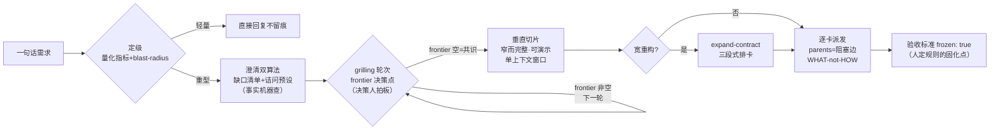

<p align="center"><b>图 3-3　分解算法四步流水线：定级→澄清→拷问→切片（事实机器查，决策人拍板）</b></p>

**第一步 定级（route）：这个问题值不值得开流水线？** 输入一句话需求，按可数客观指标定档（量化阈值表见 §4.1）——轻量（工具调用 ≤2 且零写文件）直接回复不留痕；中等（3-5 次调用或 1-2 个文件）干完补一张卡；重型（≥6 次调用、≥3 文件，或属研究/编码/安全/部署类）才进流水线。两条前置裁决：**blast-radius × multi-goal 路由门**（零爆炸半径的单目标走 one-shot 轨道，跨文件/跨模块/多目标必须拆，被拆目标记入 deferred-work 防丢失）；**选型/问答类先回结论+预估再动手**（防一个选型问题烧掉一小时重流程）。完成判据：轻重已定档，且定档依据是可数指标而非自觉。

**第二步 澄清（clarify）：把「以为说清了」变成「确实说清了」。** 双算法并用——**缺口清单**（rd-clarify）从三个来源机械提取不确认点：需求文本的模糊表述（「大概/优化一下」）、知识库已有结论与新需求的冲突、代码现状与需求描述的不一致；每条缺口带「不澄清的后果」与建议答案。**诘问隐藏预设**（苏格拉底式）对未言明的假设逐条质疑：「需求说『用户登录』——隐含预设了只有人类用户？API 调用方算不算？」每条给出成立/不成立/未决结论。含「实体/状态/流程」的需求在破预设之后再加**业务关系建模式追问四型**（rd-clarify §2.3.1，2026-09-25 增）：基数（一对一还是一对多）、生命周期状态机（状态怎么流转）、边界语义判据（「算不算」按什么判）、规则裁决权（谁说了算）——诘问找预设，四型补关系。完成判据：**零悬空分支**——需求树每个分支要么有答案、要么标记待澄清并挂 owner，没有「到时候再说」。

**第三步 拷问收敛（grilling）：取舍决策的轮次推进。** 需求映射为一棵**设计树**（每个决策挂着依赖它的子决策），用 **frontier（边界）轮次机制**推进：每轮把「前置条件已解决、现在就能问」的全部决策一次问完（编号+推荐答案），停下等拍板；回答重塑树，frontier 向外推，进入下一轮。**事实类问题不进 frontier**——文件内容、集群状态、外部事实 agent 自己查（查证进行中不阻塞其余问题发问），只有**取舍类决策**进 frontier 等人；每轮 ≤5 问（用户一次能回答的量）。完成判据：**frontier 空**——树走到叶、无隐性假设残留。拷问的输出直接固化为任务卡的验收标准（frozen: true）——**澄清算法的产出物就是验收标准的上游**，这是「人定规则」在流程起点处的落点。

**第四步 切片派卡（to-tickets）：把共识切成端到端可验证的垂直薄片。** 切片三规则：①每片**窄但完整**——一条路径穿过所有层（schema/API/逻辑/测试），不按层水平切开（水平切片导致每片单独不可验证）；②每片**自身可演示**——完成的片让一个端到端行为真实成立；③每片**一个新鲜上下文窗口能装下**——worker 单次 run 能完成，这是 AI 组织特有的工作量单位（类比人类的「一个人天」）。每片声明阻塞边（`parents=[...]`），无阻塞的立即可并行开工。**宽重构是垂直切片的唯一例外**：机械变更的爆炸半径横跨全库时任何切片都无法独立变绿，改走 **expand–contract 三段式**——expand（新旧并存）→ migrate（按爆炸半径分批迁移，批批绿）→ contract（删旧形式），三段各成卡、parents 接边。派卡用七要素模板（§4.1），**WHAT-not-HOW 分离**：卡定义做什么与验收判据，怎么做由 assignee 决定。完成判据：每片可独立验收、阻塞边成图无环。

**算法的输入与输出**——四步不是对着需求自由发挥，每步都从全局清单与目标技能资产取依据（输入侧），产出的卡片带齐下游需要的全部信息（输出侧）：

| 环节 | 输入（依据，机器可读的单一事实源） | 输出（写进任务卡） |
|---|---|---|
| 前置调用 | 需求分析师技能（rd-clarify+grilling）· 系统架构师技能（swarm-yuan Survey：分层映射/模块边界/依赖关系） | 澄清步与切片步的执行依据；未接技能=凭感觉分解 |
| 分解前读取（三环） | **环 1 必读**：owner-registry（谁主责）+ capability-graph（谁擅长/reliability）+ 目标模块特征卡（职责/技术栈/禁区）；**环 2 按需**：切片涉及模块的主责 agent SOUL 领域知识节与 tools/rules；**环 3 登记**：skill-catalog 核对目标 skill 是否已生成（未生成=显式披露「无资产执法」，即 componentization 待办） | 防漏读也防全量 46 份 SOUL 的浪费 |
| 依据清单（四清单） | ①领域清单 `domain-registry.yaml`（需求判域：域判错则后续全错）②职责清单 `owner-registry.yaml`（模块归谁主责、评审与事故召回通知谁）③能力清单 `capability-graph.yaml`+`profiles.yaml`（谁擅长什么、借调给谁）④模块职责与技术栈（特征卡+组件库成本底数） | 缺一则是拍脑袋分解：无①域判错编制错、无②通知漏人、无③借调失据、无④技术约束全靠猜 |
| 统筹评估（五维） | 复杂度（新写比例/层数）· 难度（要不要预研 spike）· 关联影响（动它碰谁的主责区）· 成本（预算轮次×模块数）· 技术约束（禁区/版本锁定/合规红线） | 五维结论写进卡 body——下游拿到的不只是「做什么」，还有「为什么判这个难度、盯哪些关联面」 |
| 输出定位（四级映射） | 领域域（判域，互斥域不混派）→ 应用模块 → 主责员工（owner-registry）→ Matrix 账号（multiplexer 统一 @8650） | 主责者=评审/验收/事故召回第一通知人；基座岗可借调（owner-registry 记 backup），但通知面不换人——组织分工从板级名册细化到模块级责任田（人级定位） |

**这套算法为什么是人机分工的核心**：它把「人机各干什么」落成四个可执行的判定位——定级位（可数指标，机器判）、澄清位（事实缺口，机器查）、拷问位（取舍决策，人拍板）、切片位（粒度与依赖，机器切、人确认）。流水线的每一处停顿（评审门、frontier、派卡确认）都是人在行权，每一处自动通过都有机械判据背书——人没有消失在流程里，而是被算法固定在了唯一正确的位置上。

五阶段在一条真实消息上的全程（图 3-2）：

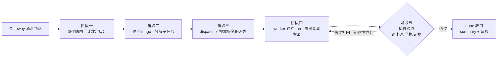

<p align="center"><b>图 3-2　一条重型消息的端到端旅程（五阶段流水线的实例化）</b></p>

轻量消息在阶段一即直接回复（不留痕），中等消息执行后补轻量留痕——只有重型消息走完全程。每一步的判据都是机械的（计数定级/名册匹配/退出码），任何一步都可回溯（卡轨迹 + 路由留痕 + 执行日志）。


**阶段三：派发与执行——dispatcher 按本板名册派单，worker 在边界内独立干活。** dispatcher 只认本板编制（`board.json` 的 `profile_scope`），系统只把活派给本板成员；ready 卡被拾取后进入 running，卡认领有锁（claim_lock + 过期时间），防同一 worker 并发认领两张卡；心跳超时未续的卡由看门狗 reclaim 重派（§4.11）。worker 侧的全部边界约束——能用什么工具、能读哪些手册、能接触什么密级——由 S2 组织与能力边界域定死（§3.2），调度域只消费不定义：派发门核名册、执行层加载能力圈，两个动作的判据都来自 §3.2 的编制。

**阶段四（编排支撑）：kanban 状态机——卡的生命周期。** 五个阶段能咬合成流水线，靠的是所有阶段共用同一张卡、同一套状态迁移规则；状态机的每次迁移都有明确的触发者与守门者。

kanban 卡是集群里一切工作的唯一载体——「不在卡上的工作不存在」（无法派发、无法验收、无法留痕）。一张卡的生命周期与迁移规则：

| 状态 | 进入条件 | 离开条件 | 谁在动它 |
|---|---|---|---|
| **triage** | 重型任务先建卡到此（方案未定，需先细化） | specifier 细化 body 后 promote | orchestrator/specifier |
| **todo** | 已建卡等待资格判定 | 所有 parents done → ready；无依赖卡建后即 running | dispatcher |
| **ready** | 依赖全部满足，可派发 | dispatcher 拾取 → running，spawn 独立 worker run | dispatcher |
| **running** | worker 认领（claim_lock 锁定认领者） | worker 交付 → complete / request_review / block | worker |
| **review** | worker 主动 request_review | reviewer 批准 → done；打回 → 重新排队 | reviewer |
| **blocked** | 外部依赖（kind=dependency 等父卡）/ 需人类输入 / 能力缺口 | 父卡 done 自动 ready / 用户 unblock | 机制或人 |
| **done / archived** | 验收通过收口 / 归档留存 | — | — |

**两条关键迁移纪律**：①`parents` 依赖只在同板生效（阶段二）；②卡认领有锁（claim_lock + 过期时间），防两张卡派给同一 worker 的并发冲突；心跳超时未续的 running 卡由看门狗 reclaim 重派（§4.11）。

**阶段五：验收收口——complete ≠ 通过，判定权在机器。** worker 宣称完成的动作是 `kanban_complete`，但交付必须拿机械证据：complete 的 `metadata.verification` 缺省不填 → 工具层自动打 `evidence_strength=unobserved`（最低档），summary 加 `[UNVERIFIED]` 前缀，下游一眼可辨；orchestrator 对 worker 自述完成执行独立机械复核——不信自报、只认机械证据（计数/哈希/实测），复核不过打回。验收标准在建卡时冻结（frozen: true）——worker 不得自行解释「什么算完成」，模糊验收项建卡时即拒收；打回必附方向（改什么/不改什么/重验判据，首行 `[REJECT:<失败模式>]`）。收口双通道：常规卡 complete 即终态；需人审的卡走 request_review → review 列，reviewer 批准后才 done。机械验收的三种判定形态与证据强度五档是全集群统一的验收标准，由 S3 治理与验收域定义（§3.3），本域只执行。

### 3.2 组织与能力边界

> **本域提纲**：回答「谁是谁、谁能干什么」。四条机制：四维能力圈 · 三层隔离 · 密级合取传播 · 双维权限门+变更三分法。实现落点 §4.3/§4.6。本域是 §3.1 调度流水线的前提：调度每个阶段的判据（名册、能力圈、密级、授权）都由本域定义。

**机制核心：每个 agent 的能力边界由四个互不重叠的维度在创建时定死**——能用什么工具（toolset）、能读哪些手册（skill 白名单）、能接触什么密级的资料（clearance）、要遵守什么纪律（SOUL+rules）。编制总表见 §2.2。调度域（§3.1）在派发与执行两个阶段消费这份编制，但无权改写它——定义边界的域和执行任务的域分离，边界才不会被调度流程顺手突破。

**机制：互斥的领域在同一台机器上共存，靠三层程序规则强制隔开，不靠 AI 自觉。** 第一层是手册层——400 余份安全攻防手册只有安全团队能看到，其他团队根本加载不到；第二层是派单层——§3.1 阶段三的派发门只认本板编制（`board.json` 的 `profile_scope`），不属于本板的 agent 被跳过并记录一次越域尝试；第三层是建卡层——直接建越域的卡会被系统报错拒绝。隔离覆盖调度与分解两层：dispatcher 派单门与 decomposer 派单名册消费同一份 `profile_scope`（patch 持久化于 `~/.hermes/profiles/orchestrator/patches/`，hermes update 后回放）；未声明名单的板保持全量（向后兼容），配置损坏时降级为不隔离而不是停摆。
- 防线三层的理由：守则式约束可被注入击穿、单层门可被绕过（直接建卡）、专机隔离成本翻倍——多层同防是唯一兼顾安全与成本的选项。
- **落点**：门禁的代码位置见 §4.3/§4.1。

**机制：资料的密级自动沿着使用链传递，多个标签叠加时取最严格的那档。** 产出的内容自带密级标签（如 TLP、EYES-ONLY、PII），谁引用了它，谁产出的新内容就继承同样的密级；派单前由脚本自动核对密级。
- **落点**：密级检查脚本与记忆隔离见 §4.6。

**机制：操作权限按「谁 · 什么事」两维交叉决定；高风险的写操作走「先提案、再批准、执行时复验」的闭环。** 每个 agent 有自己的权限等级（可自主执行 / 只能提案 / 必须上报），每类事务（资金、发布、部署、删数据、凭证）有各自的作用范围，两维交叉决定放不放行；没有任何声明的操作，一律按「只能提案」处理。高风险操作不是批准一次就完事：先产出一份带编号的变更提案，人审批后系统执行，**执行的那一刻还要把所有护栏按当时的最新条件重新跑一遍**——因为批准时的条件，到执行时可能已经变了。
- staged 闭环的理由：批准放行的是「意图」，执行时环境可能已变；不一刀切禁高危（排障需要紧急通道）。回读复验的理由：工具返回值与自述成功都可能失真，只有回读真实状态才算数——中高风险动作完成后必须用独立只读手段回读真实状态确认生效（文件 diff 复核/配置重读/服务探活），不符即回滚、禁声明成功；子代理权限永远不高于其发起者，借任务书扩权无效。

**机制：改动走哪条授权通道，按变更三分法在改动发生前定级。** 一切改动分三类：**预授权程序化变更**（standard）——低风险、程序固定、同型改动已有成文先例，机械验收门（lint/test/build 绿）本身就是授权，逐例免评审；**需评审授权变更**（normal）——改共享规则、批量改编制配置、改护栏/调度/存储层、引入新外部依赖，实现后必须过独立评审卡，评审通过才算授权成立；**事故止血变更**（emergency）——事故进行中等不及评审的止血动作，可先执行，24h 内必须补验证与复盘，超时按未授权变更处理。判定规则：拿不准按 normal（存疑取严）；standard 的资格来自先例不来自自我评估；混合变更按最高类别定级；emergency 只在「止血窗口小于评审耗时」时成立。每张变更卡可携带 `change_class` 标签，「这个改动过的是什么授权」在卡上可查。
- 三分法的理由：黑户变更（未走任何授权的改动长期裸奔）曾两度撞车成事故——把「哪些改动必须过评审」从惯例变成明文，是变更治理的底线；不设一刀切（全部人审拖死日常交付、全部自动放行护栏裸奔），三分法按风险分配评审资源。
- **落点**：授权矩阵全表与真实动作判例见 §4.4（`_shared/action-risk.md` §1.3-§1.4；§1.4 执行后回读复验+权限天花板，AgenticOps 融合 2026-09-24）。

**本域与调度域（§3.1）的接口**：§3.1 流水线在四个点消费本域定义的边界，调度流程不重新定义这些判据——

| §3.1 流水线阶段 | 消费的本域机制 | 消费的判据 |
|---|---|---|
| 阶段三 派发 | 三层隔离（派单层） | `board.json` 的 `profile_scope` 名册 |
| 阶段四 执行 | 四维能力圈 | toolset / skill 白名单 / clearance / SOUL+rules |
| 阶段四 执行 | 密级合取传播 | 引用链上的密级标签合取 |
| 阶段二 分解 → 阶段五 收口 | 变更三分法 + 双维权限门 | change_class 定级 + staged 闭环 |

### 3.3 治理与验收

> **本域提纲**：回答「怎么知道照规矩干了」。三支柱：规则库集中 · 机械验收三形态 · 对抗评审。实现落点 §4.4/§4.5。

**机制核心：规矩的执行情况必须有数据答案；「我做完了」必须拿出机器生成的证据。** 三个支柱：

**支柱一：先度量，且采集数据的脚本只读不改。** 只读脚本定期统计各条规则的执行率、手册复用率、token 消耗量，形成基线数据。刚上线还没接入的机制统一标注「提案·试运行」并写明生效条件；连续两个月没有任何执行记录的规则自动降级或删除。
- 判定口径：机制成熟度按五级证据评定（不存在→存在→已接线→真实用过→有结果支撑）。
- 落点：脚本清单见 §4.5。

**支柱二：机器验收写进工具层，不靠自觉。** worker 交付任务时（`kanban_complete`），如果不填证据字段（`metadata.verification`），系统自动给它打上最低等级 `unobserved`（未观察到），并在任务摘要前加 `[UNVERIFIED]` 标记——「没拿证据就说做完了」的任务，下游一眼就能识别。
- 落点：交付时的幻觉修复引导、「已验证/未验证」分组报告，见 §4.4。

**机械验收的三种判定形态与固定标准：**

**形态一：退出码判定——硬性检查，答案只有通过与不通过。** 判定权在命令本身不在模型：命令跑挂了（非零退出）就是不通过，没有解释空间。固定检查项七项——①文件存在（`ls` 逐条核对变更清单，路径幻觉即失败）②语法检查（Python `py_compile` / TS `tsc --noEmit` / Shell `bash -n`）③类型检查（mypy/pyright，项目有类型标注时）④单元测试（`pytest -v` 全绿，0 用例=空跑不算通过）⑤linter（ruff/eslint 零 error）⑥构建（build 命令成功）⑦越界与泄密扫描（`git diff` 只含任务范围内文件、无硬编码密钥）。配套反模式红线：「看了输出觉得没问题」=没跑，「测试在别的任务跑了」=没跑——判定依据只有本任务内的命令输出。

**形态二：门禁阈值判定——量化指标过线，阈值为断言非目标。** 每道门禁 = 指标 + 阈值 + 比较方向，机械化断言不达标即拦停。集群级固定阈值：验收声明覆盖率 ≥80%（低于则工具层强制打 `unobserved` 标记）、机制成熟度自评分数 ≤74 分不得交付（证据只到「存在」档）、组件清单覆盖率 ≥95%（全量穷举公理的量化红线）、同主题 skill ≤3 本、单本 skill 正文 ≤8KB、门禁总量 ≤55 道（新增须等额删除）、规则连续两个月零执行记录自动降级。领域阈值由各域知识库追加（如支付对账差额=非零即失败），与集群阈值叠加生效、就严不就宽。

**形态三：证据强度分级——按证据档次定结论可信度，缺档自动降级。** 交付时按五档自评证据强度，档位决定结论可信度上限：`missing/unobserved`（不存在或未观测，≤59 分）→ `present`（存在但未接线，≤74）→ `wired`（已接入工作流可用，≤84）→ `exercised`（真实用过且留有结果，≤94）→ `outcome-supported`（有后续结果支撑效果，=100）。核心阈值：**自评 ≤74 分不得交付**——「配置了」不等于「在用」，证据到「存在」档的机制按未验证处理。此分级同时用于治理侧的机制成熟度评定（支柱一），一套标尺两处使用。

三种形态的共同要素：**判据预先固定**（验收标准在任务卡冻结，不接受事后解释）、**判定权在机器**（命令退出码/阈值比较/档位对照，不由模型或干活的 agent 自己下结论）、**缺证据按最坏处理**（不填=最低档，存疑=不通过——证据缺失永远不放行）。

**两种证据度量维度（QGate 融合补充，2026-09-23）**：形态三的五档管「验证深度」（跑没跑透），另设七个独立性档管「证据来源」（谁产出的）：`self-generated`（agent 自写测试自跑，最弱）→ `implementation-derived` → `ontology-derived` → `spec-derived` → `runtime-observed` → `existing-independent` → `human-reviewed`（独立验收者亲跑，最强）。核心红线：**只有自产自验证据的任务，即使五档自评到「真实用过」，也不构成放行**——必须补独立来源证据（外部验证门）。「AI 自己写的测试通过了」和「既有独立验收测试通过了」不是同一种证明。分级表单一事实源 `_shared/03-evolution-memory/output-contract.md` §2.8。

**验收判定的第四个出口（WAIVED 豁免）**：验收判定实际是四态——通过 / 不通过 / 证据不足（按不通过处理）/ **显式豁免**。豁免不是放行，是「这次不验但要留痕」：必须写全六字段（理由/范围/**批准人**/缓解措施/**有效期**/复验触发条件），缺任何一字视为证据不足；批准人只能是用户或总调度台，干活的 agent 无权自我豁免；豁免有期限，到期自动失效回「证据不足」；同一检查项连续两次豁免强制升级上报。语义细则单一事实源 `_shared/02-org-orchestration/acceptance-tri-state-protocol.md` §4.4。

**评测裁判纪律（GIAC 2026 融合补充）**：模型/代理判分的评测题，判分代理须先通过与人工判定的对齐校验，未通过校验者只能辅助分析、不得作 PASS/FAIL 门禁依据；评测题入库按 rubric 三要素（标准/数据/方法）前置；验证器与生成器分离——agent 同时产出代码与其测试属「伪验证循环」，验收断言由验收方构造或复核，判定 fail 须可回溯到需求条目。细则单一事实源 `_shared/evals/baseline.md` §H3 与 skill `worker-completion-independence-verification` 判例 M。

**judge 可复核与失败归因七维（AgenticOps AgentLoop 融合，2026-09-24）**：judge 判 FAIL（或 UNKNOWN）时 verdict 必须含三件——判据引文（对应题目的 Pass 条件原文）、观察到的证据（file:line/退出码/产物摘录）、一句「证据为何不满足判据」的理由；无理由 verdict 按 judge 故障计，人无法复核的裁判不可信。每道 FAIL 题归因时从七维选主因：Prompt（任务书歧义）/Tool（工具故障）/Knowledge（缺 skill 或规则）/Planning（分解错误）/Memory（教训未召回）/Model（模型能力上限）/Policy（护栏冲突）；**Model 归因须排除前六维后才可标**——「模型不行」是排除法结论不是默认背锅位，防把集成问题误判成能力问题。细则单一事实源 `_shared/evals/baseline.md` §X4。

**检查项自身的效力验证（QGate NOW 档补充，2026-09-23）**：验收规则也会失效——规则写对了不等于 agent 执行得出来，执行得出来不等于真能抓住它声称能抓的错。解法与评 agent 能力同构：**给检查项出「坏样本题」**。回归基线中 T12-T17 六题各自构造一个违规样本（字段写错/证据不足冒充完成/豁免缺字段/超范围修改/引用过期证据），断言对应检查项能识别；任一题 FAIL 优先怀疑检查项本身（死文本）而非被测 agent（效力回流铁律）。配套三条过程纪律：**收尾四问**（重型任务收尾必答——新增了什么/能多证明什么/怎么知道生效/有意不剩什么）；**打回循环上限**（同一任务同一检查项第 3 次打回强制升级裁决，禁原地第 4 次）；**接续禁旧证据**（上一轮的「全 ✓」不代表本轮，接续开发必须重跑全部测试锚点）。细则单一事实源 `_shared/evals/baseline.md` §T12-T17 与 `_shared/03-evolution-memory/output-contract.md` §一。

**落地成色三分（QGate 复盘裁决升级为集群纪律，2026-09-23）**：宣布任何融合/改造「已落地」前必须标注成色——**语义落地**（规则写进文档）< **机制落地**（有执行者、触发时机、判定口径）< **效力落地**（有坏样本实测通过）。只到语义层按「提案」对待，到机制层才算「可用」，到效力层才允许宣称「有效」。判据与反面实锤（20+ 检查项曾全部停在机制层）见 `_shared/skills` 融合纪律（article-methodology-fusion / fusion-governance-patterns）。

**支柱三：输入清洗与对抗评审，两头设防。** 一头管输入：所有进入 AI 视野的第三方文本，先过一道固定规则的清洗器（剥掉不可见字符、伪造的对话边界、假冒的系统标签）。另一头管输出：重要交付物在提交前，由没参与干活的人组成评审组（1 名质量评委 + 2 名领域专家）并行挑毛病；评审针对交付物的冻结版本进行（评审期间不许再改，否则意见就没有靶子）；有高危问题未处理不得交付。
- **落点**：清洗器的分工（语义级注入另走 Guardian 二审）、协议违规的闭环处理、集群健康度简报与风险登记册，见 §4.4/§4.5/§4.11。

治理纪律固化于 `_shared/` 六层架构目录（§4.4）；设计公理与决策自查四问见 §4.14。

---


### 3.4 成本工程

> **本域提纲**：回答「钱花在哪、怎么省」。三条机制：注入收口 · 上下文瘦身 · 代理层统一。实现落点 §4.2。

**本轮增量（成本治理宪章）**：成本/性能异常先按 `~/.hermes/bin/failure-classify.py` 归因，再依据缺口修 harness；派工卡声明最小动作空间与失败预期；per-task 口径以 state.db session join 为主、cc-switch 时间窗仅作方向性补充。完整操作规则见 `~/.hermes/profiles/_shared/06-observability/cost-governance.md`，决策矩阵见 `research/fusion-20260915-memory-cost/REPORT-cost.md`。


**机制核心：成本收敛只动注入侧、不动能力侧。** 模型能力不削减，削减的是 token 进入上下文的路径。

- 成本压力是结构性的：注入量随 agent 数线性增长，模型单价不可控，唯一可动变量是注入侧。
- **机制**：①压缩参数一处定义处处生效（30 agent 统一「35% 触发、压到剩 15%」，共享配置统一派生，存量同步正典在生成管线（原 `sync-compression.py` 一次性脚本已退役删除，2026-09-11 复核；存量漂移由 risk-register R-03 跟踪））②MCP 剪枝（每个接入工具的说明都占注入量，桌面类 MCP 只留唯一需要桌面交互的 orchestrator）③skill 注入面收敛（只注入 name+description，正文按需加载）。**「工具税」的外部佐证**（2026-09-11 融合 The Harness Playbook）：omp 实测每个永久工具的 schema 逐轮消耗上下文并拖慢生成（23 定义 86.2s → 5 工具 36.6s）——本集群「30 岗 toolset 收敛到 3-5 个 + skill 只注入 name+description」的既有设计与该结论一致；已挂 `token-meter --tools` 工具级度量（近 30 天 52,459 次调用 / 98.5MB 结果，terminal+read_file+execute_code 三工具占结果体积 61%），后续注入面调整以此数据为据。
- **模型路由单点收口（aim 占位符 + 代理层统一）**：全部 agent 的模型调用收敛到一个形状——`model.default=aim`、`provider=custom:cc-switch`（本地代理 127.0.0.1:15721），主模型、fallback、13 个 auxiliary 任务（审批/压缩/视觉/标题生成等）全部同一声明；`custom_providers` 白名单仅存 cc-switch 一项、其 models 清单仅 `aim` 一个占位名。设计依据：**Hermes 侧不感知上游是谁**——换供应商、切模型、熔断转移全部发生在代理层，配置零改动；直连供应商的 fallback 是被实证否决的形态（上游月配额耗尽时 fallback 变成必然失败的死路，任务反复撞墙）。源头单一事实源是 `shared/profiles.yaml`，44 个 profile 配置由其派生；每次模型路由变更后以「grep 非 cc-switch provider = 0、models 白名单非 aim = 0」两残留扫描作验收。代理层的熔断/限流处置（并发三档降档、高峰兜底）见 §4.11 看门狗族。

---

### 3.5 知识资产治理

> **本域提纲**：回答「手册库怎么管」。五条机制 + 七类资产台账。实现落点 §4.3。

**机制核心：知识按「实证能力」而非名称分类；注入走白名单；退役走归档不删除。** 五条机制：

1. **入库判定**：手册逐本记录「能力卡」（真讲什么、属于流程哪一环、用什么工具、能不能上手），名不副实者不入白名单（方法固化于 skill `skill-capability-based-pruning`，存档 `research/skill-deep-dive/`）。
2. **白名单挂载**：共享配置按「类目 + 单点指定」两层声明每个 agent 的挂载集合，没声明的默认不可见——新增手册不会自动涌进所有人的视野。
3. **归档召回**：退役不删除。归档区按退役原因分两区（单点修复型 / 同义合并型），索引清单可全文搜索，一条命令恢复后重新声明白名单即生效。
4. **目录对账**：`skill-catalog.md` 是手册目录的单一事实源（架构层归属/触发场景/适用岗位），新增必登记、每季度审计一次、同主题 ≤3 本、禁止为单一 bug 建长期手册。
5. **底座融合**：外部知识（经典书目/平台内容）拆解为能力点后注入既有手册，不为每本书单建（流水线见 §4.3.2）。

**知识资产台账（实测口径，数字随系统演化用验证命令现算）**：

| # | 资产类 | 内容与规模 | 治理机制 |
|---|---|---|---|
| 1 | skill 手册库 | 主库 **775** 份 / 48 顶层条目（本地实体 640；网安 6 类目 405 份只进 hack 团队；devops-rd 类目 13 岗共享；2026-09-11 复测） | 能力卡 + 白名单（§4.3） |
| 2 | 归档区 | **25** 份（single-fix 7 + merged 18），索引可搜 | 一条命令召回（§4.3） |
| 3 | 治理规则库 | `_shared/` 六目录：**21 规则 md + 2 契约 yaml** + 决策模板/失败案例/评测基线等扩展资产 | charter 单一事实源 + SOUL 一行引用（§4.4） |
| 4 | 认知方法库 | cognition-lattice（手册库特写）：认知偏差/心理效应/思维模型/思维框架等 8 册数千条结构化条目 | 正文按需加载，不占常驻注入 |
| 5 | 领域知识库 | pay 库 **32MB**（git tag 锁定）；data 库（版本锁定+四域能力体系）；hack 知识索引 + 工具注册表 | 版本锁定 / 索引准入（§4.7-§4.9） |
| 6 | 评测与失败资产 | 换模型回归基线 17 题（T1-T11 能力题 + T12-T17 检查项效力题）+ 分层评测纪律（只增不删）；失败案例库 3 例（五段式） | 事故回流追加（§4.4/§4.14）；T12-T17 为 QGate NOW 档追加（§4.20） |
| 7 | 团队记忆 | 三层：MEMORY 随身笔记 / Hindsight 团队档案室（按团队隔离命名）/ 会话库 | 跨团队隔离（§4.6） |

台账之外还有一处工作区沉淀：`research/` 调研报告 100 份（含两篇微信文章全文、融合裁决矩阵、设计文档），是台账各资产的调研第一手来源，按「先存档再删」纪律管理。

- **落点**：三层结构实现与外部手册引入四档处置见 §4.3；swarm-yuan 目标技能（编码回路的知识形态：组件库+门禁+特征卡）见 §4.3.1；经典书目融合流水线见 §4.3.2；记忆三层见 §4.6；领域知识库实现见 §4.7-§4.9。

---


### 3.6 韧性安全垫

> **本域提纲**：回答「改坏了怎么回来」。三条机制：加密备份 · 看门狗自愈 · 状态快照。实现落点 §4.7/§4.11。

**机制核心：一切批量改动可回滚，备份有效性以演练证明。**

- 备份的本命：集群每天批量改自己且大量改动不在 git 管辖，改错没有 undo——备份不是防天灾，是让改动敢做。

---


### 3.7 领域能力

> **本域提纲**：回答「专业知识哪来」。基座-分化总纲 + 领域喂养闭环。实现落点 §4.8-§4.10。

**定位总纲：swarm 团队是基座，领域团队是分化。**swarm 只承载通用技术能力（需求分析/编码/测试的方法论与质量纪律，即 §2.4 典型 agent 的岗位能力），领域特色一律剥离；各领域团队（hack=安全、pay=支付清算、data=数据、aiteam=AI 应用、ops=运维、product=产品、platform=平台治理）以领域调研喂养本域专业知识、固化编制与手册。新领域需求 = 派生一个领域 team（复制基座编制模式 + 挂本域知识库），不向 swarm 加域。基座岗位与领域岗位的能力分布实例见 §2.4「三岗位 × 三团队能力分布」。

**机制核心：专业知识靠领域调研喂养、版本锁定、白名单挂本团队——能力不外溢。**

- **机制**：领域团队各自以领域调研固化 skill 与编制（hack=安全工具链与红队方法论；aiteam=AI 前沿版图定编制；product=产品方法论与竞品；pay=支付清算标准规范库；data=实时数仓四域能力体系；ops=ITIL 4 + Google SRE 双谱系）；swarm 团队定位为基座——只承载通用技术能力（编码/调研/测试方法论），领域特色一律剥离、由各领域团队承接。领域知识库必须 git 版本锁定，且使用前置核实——引用必须回查现行官方来源。
②知识库不锁定版本——知识漂移使历史任务引用的结论失效、无法追溯当时依据；③直接信任库内资料——标准会过期、来源会矛盾，过期数据误导任务比没有数据更糟。
- **落点**：pay 库见 §4.8、data 体系见 §4.9、hack 安全工具见 §4.7.1、ops 变更治理见 §3.2（34 项实践映射存档 `research/itil-v4-absorption/`）。

---


### 3.8 模型治理与供应链安全

> **本域提纲**：横切约束（不是部件）：外部输入受控进入。实现落点 §4.3 来源核验。

**治理口径**：外部代码与文本直接进入 agent 上下文（投毒与注入攻击面）；治理对象不是「用哪家」，而是「外部输入如何受控进入」——只看功能不验来源挡不住供应链攻击（5.5% 受审计 MCP 有投毒迹象），知识库直接信任则过期与投毒数据比没数据更糟。

**供应链安全：从选型理由到制度（四条）。**

1. **已有防线**：编码工具选型遵循供应链约束（现役主力为开源权重私有化部署的工具，模型与数据不出域；具体产品名不入设计文档，属配置态）；国密白名单、SBOM、密评与隐私影响评估已是检查项；跨机通信走端到端加密的去中心化信道；知识库版本锁定 + 前置核实防知识投毒；底座三件套版本（swarm-yuan v2.20.0 · hermes v0.21.0 · SwarmStudio 2.15，上游 0.7.18）随口径页标注，可当场复核——swarm-yuan 发版口径已由其 self-check 机器锚执法（CHANGELOG 首行 = 双 README badge，漂移即红）；本文数字以 swarm-yuan 仓 `facts.conf` 机器真值为准。
2. **外部风险已实证转向 agent 供应链**：受审计 MCP server 中 5.5% 有投毒迹象、LLM 生成代码 19.7% 含幻觉包名、公开技能库 36% 有安全缺陷。
3. **自身还缺三件**：依赖 lockfile 哈希断言进 CI（改动即红）、SBOM 与实际依赖对账、模型来源登记（供应商、版本、权重指纹、部署方式）。运行时侧的受控进入已落地为五类确定性闸门（工具调用/注入/技能/凭据/轨迹，见 §4.7.2），与来源侧三件缺口互补成完整供应链防线。
4. **收口动作**：工具准入门（MCP/skill 引入先核验来源、再最小权限试运行、后登记白名单）+ 每周密钥巡检，列入工程收口清单（待办台账：`research/hermes-cluster-pending-and-gap.md`）。

- **落点**：上下文注入成本工程见 §4.2；编码工具经 ACP 接入的调用面见 §2.4.2 工具无关性条款。

第 3 章把七个域的「为什么这样设计」讲完；设计要真正约束行为，必须落在可执行、可验证的载体上——这是第 4 章的内容。

---


## 4、实现配置

第 3 章回答「机制怎样约束系统」；本章回答「这些约束由什么载体执行」。因此实现章节不重新设计机制，也不按孤立文件罗列配置，而是沿着第 3 章的机制链逐项落位：每节先指出承接的设计要求，再给出实现图或载体清单，随后说明接线方式和失效判据。读者可以用「§3 机制 → §4 载体 → §5 运转反馈」三段链阅读本章。

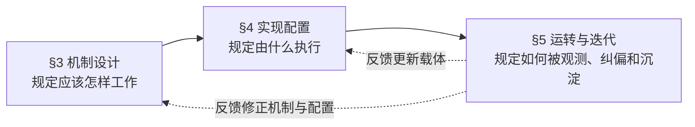

<p align="center"><b>图 4-1　机制、载体与运转反馈的三章衔接</b></p>

| 投影关系 | 上游输出 | 下游消费 | 具体落点 |
|---|---|---|---|
| §3 → §4 | 设计要求、边界、判定标准 | 实现载体及其失效检查 | §4 各节的承载定位句、脚本/配置/skill/看板清单 |
| §4 → §5 | 可执行载体、运行入口、检查命令 | 执行结果、观测信号、验收证据 | §5.1 运转链、§5.2 差距闭环 |
| §5 → §3 | 失败标签、差距条目、后评价结论 | 机制修订或保持不变的判定 | §5.2 的吸收/观察/驳回三分法 |
| §5 → §4 | 载体失效、漂移或缺口 | 配置修复、脚本修复、准入补齐 | §5.3 改动纪律与 §4.12 机制开关台账 |

**三章的接口不是章节编号，而是交接物**：第 3 章输出设计要求、边界和判定标准；第 4 章把每条要求绑定到脚本、配置、skill、看板或备份等执行载体，并声明载体失效时如何被发现；第 5 章消费这些载体产生的路由记录、验收证据、失败标签和差距条目，决定继续运行、打回修复还是回写设计。缺少其中一段，前一章的内容就没有落点，后一章也没有可消费的证据。

**本章的对应关系**：4.1 承载 §3.1 调度并消费 §3.2 的名册；4.2–4.3 承载 §3.4 成本与 §3.5 知识资产；4.4–4.5 承载 §3.3 治理与验收；4.6–4.7 承载 §3.6 韧性；4.8–4.9 承载 §3.7 领域能力；4.10–4.13 把各域接入持续观测、看门狗和生产运行机制；4.14–4.19 收录外部方法论融合落地（公理对账、循环深度、评测纪律、Harness 实践、工作流引擎、记忆演进与云上治理）；4.14 将公理、机制和载体做最终对账。具体小节仍以载体职责为准，编号只是导航，不是新的机制分类。

**实现与设计的充分性判据**：一个实现件算「兑现了设计」，当且仅当设计要求的每个强制点都有一个机制在执行、且该机制失效时能被检测（§4.12 机制开关台账的 `--check` 逐项实测）。例如「判断权不交给模型」（§1 事实一推导）在调度层由量化阈值表执行、在验收层由退出码判定执行、在供应链层由准入门执行——同一要求在不同作用面各有其执行件，缺任何一个面，必然就在那个面失效。本章各节首句即该域实现需要覆盖的设计要求，各小节是覆盖动作本身。

### 4.1 编排与调度

> 承载 S1 调度与编排（§3.1 五阶段：路由阈值/留痕格式/分解纪律/派单名册/工作流定义）与 S2 名册配置的实现。

**三级量化路由**（设计依据见 §3.1）：轻活重活不凭 AI 自觉判断，按可数的客观指标定档：

| 级别 | 触发条件（可数的客观指标） | 处理方式 |
|---|---|---|
| 轻量 | 工具调用 ≤2 次且没有写文件 | 直接回复，不留下任务记录 |
| 中等 | 工具调用 3–5 次，或写了 1–2 个文件 | 干完后补一张任务卡，轻量记录 |
| 重型 | 工具调用 ≥6 次，或写 ≥3 个文件，或属于研究/编码/安全/部署类工作 | 先建一张「待评审」的任务卡，拆解清楚再动工 |

**每次路由都留下记录，每次打回都给出方向**：

- **路由留痕**：每条消息路由完成后，任务卡的第一行写上路由级别和依据（如 `routed:medium:4`，意思是「中等级别，依据是 4 次工具调用」）。这样「有多少消息走了哪条路由」是统计得出来的数据，不是凭印象说的；每月由脚本自动汇总一次（§4.5）。
- **打回必须给出修改方向**：评审人打回任务时，必须写清楚三件事——改什么、不改什么、怎么算改好了。打回理由的第一行用统一格式标明失败类型（如 `[REJECT:范围过大]`）。
- **验收标准必须能判**：任务卡上冻结的每一条验收标准，都必须能明确回答「什么算通过、什么算不通过」。「质量要高」「完善一下」这类说了等于没说的表述禁止写进验收标准：模糊的标准没法检验，没法检验就没法修正。探索型任务允许目标模糊，但必须给出替代判据（比如覆盖了多少个场景、和谁对比）。
- **失败必须记录原因**：任务失败时（包括崩溃、超时、主动放弃三种收尾），必须打上失败类型标签。失败不记录，系统就没有记忆，同一种失败会反复发生。打标覆盖率纳入月度统计。

**任务分解与依赖**：
- 重型任务拆成子任务时，用 `parents` 字段声明依赖（标明「哪张卡做完才轮到哪张」）。硬性规则：**依赖只能声明在同一块看板内部**（跨看板的依赖系统检查不到，会出现子任务被错误放行的漏洞）；跨看板的协作改用卡内文字注明 + 上下文注入。
- **设计决策归调度者**：拆任务时遇到的「叫什么名字、用什么数据格式、接口长什么样」这类问题，由 orchestrator 在派单前统一决定、写进每张子卡。原因：干活的 worker 互相看不到对方的上下文，如果两张子卡各自决定同一个问题，合并时必然冲突。
- **名册隔离**：每块看板在自己的配置里声明本板成员名单，派单时只看本板编制；没有声明名单的板保持全员可用（向后兼容）；配置损坏时降级为不隔离而不是停摆。

**Kanban 存储**：8 块看板各自独立一个数据库（避免多板共用一个库时的并发写锁竞争）。旧的全局数据库是历史残留——建卡时必须带上板名，否则卡会写进旧库、派单器扫不到。

**工作流定义**：可以复用的多步流程（比如「专家执行 → 对抗评审 → 综合总结」）用 YAML 文件声明，存放在 `_shared/workflows/`，orchestrator 照着定义建一串带依赖的任务卡执行。流程中「等人类拍板」的环节直接用任务卡的原生状态实现（挂起等回复、超时按预案升级或放行），不为工作流另造一套状态系统。运行成功的卡图按沉淀闭环升为工作流资产：synthesis 卡（≥2 parents 且 deliverable）完成时触发检查，**第二次**复用成功才写入 `_shared/workflows/<name>.yaml`（首跑只记 `workflow_candidate`，防囤积一次性管线）；图怎么建不踩坑的派工纪律（fan-in 容错/barrier 节俭/循环收敛）见 §4.12 GE 纪律层。

**Gateway（消息网关）**：
- 由系统服务自动拉起和监管，配置文件由脚本生成，禁止手写变体（不一致会被一致性检查踢掉）。
- **单端口多路复用**：所有消息渠道（API Server / Matrix / 微信）统一走一个网关。微信渠道由多路复用器代连，禁止任何 agent 再单独起一个微信网关——残留的后台服务会跟主复用器抢微信的登录状态，把主复用器挤成待机。排查方法：检查系统服务目录里有没有 agent 级别的网关服务，有就停用并重启复用器。
- API Server 的消息不进任务卡（它是同步问答，一问一答就结束，留记录反而是噪声）。
- **对外推送防骚扰**：agent 主动推给人的消息过三道闸——相同内容短期内不重发、每个人单位时间有条数上限、夜间不推非紧急消息。紧急消息可以豁免；闸门自身故障时放行不拦截（宁可多推，不能漏推）。
- **告警分四级**（紧急/高/中/低），拿不准就往低档放；薪酬、法律、财务明细、家人隐私、密钥类内容禁止广播。

### 4.2 上下文成本工程

> 承载 S4 的实现。

AI 每次工作前都要「读」一批说明材料（系统提示词、手册、记忆），这些材料的体积直接决定成本。成本工程的原则是**削减给 AI 看的材料，不削减 AI 本身的能力**：

| 手段 | 现状 | 说明 |
|---|---|---|
| 上下文自动压缩 | 全部 agent 统一：上下文用到 35% 时开始压缩，压到剩 15% | 参数只在一处定义，30 个 agent 继承同一份；存量差异用脚本定点同步 |
| 限制单次读取量 | 工具输出最多 2 万字节 / 500 行；读文件最多 5 万字符 | 宁可截断也不靠 AI「自觉不看太多」 |
| 砍掉不需要的插件 | 桌面操作类插件只保留在唯一需要它的 orchestrator 上，其他 29 个 agent 全部关闭 | 每个插件的说明文字都会占上下文，用不上的插件是纯浪费 |
| 手册按需加载 | agent 只注入「挂载手册的名称 + 一句话简介」，手册正文用到时才读 | 注入量 = 白名单的精确集合，多一份都不进 |

---
### 4.3 Skill 手册库治理（白名单挂载）

> 承载 S5 的实现。

skill 库按三层结构治理：**主库 775 份 skill 手册 / 48 顶层条目（2026-09-11 find -L 复测，本地实体 640）+ 归档区（`skills/archive/`：25 份本集群收敛下架的单点修复/同义合并手册——`archive/single-fix/` 7 份、`archive/merged/` 18 份，索引清单可全文搜索，一条命令召回；`_` 前缀备份目录与历史备份包不计入）+ 各 agent 的挂载目录（符号链接与实体目录混合，白名单集合，每岗穿透 84-548 份，按 `find -L` 实测口径，2026-09-11 复测）**
- **白名单机制**：`~/.hermes/shared/profiles.yaml` 按两层声明每个 agent 的挂载集合——`skills_enabled`（按类目，如「全部安全类」）+ `skills_pinned`（指定某一本）；配置生成脚本据此产出各 agent 的配置与目录。默认不注入：没声明的手册一律不可见。落地为脚本 `skill-fence.py`（`~/.hermes/shared/`）
- **归档召回**：归档不删除，索引清单可全文搜索，一条 `skill-lifecycle.py restore <名>` 命令恢复；恢复后把它加进对应 agent 的白名单声明、重跑一次配置生成即可。本集群收敛归档分两区：`archive/single-fix/`（单点修复型 7 份，已被通用机制覆盖）与 `archive/merged/`（同义合并被归档方 18 份，主 skill 留在原类目）；归档区 README 记录恢复方式与主 skill 映射
- **目录单一事实源**：`_shared/06-observability/skill-catalog.md` 登记 active skill 的架构层归属/触发场景/适用 profile，新增必登记、每季度审计一次、同主题 ≤3 个 skill、禁止为单一 bug 建长期 skill
- 成本结构不变：注入的只有挂载集合的 name+description（每 profile 每轮），正文按需加载 → 收敛注入面=收敛成本
- 类目隔离：网络安全 6 类目（合计 405 份）只进 hack 4 profile；devops-rd 类目 13 profile 白名单共有（orchestrator/swarm 3/ops-devops/pay 4/data 4）；各领域团队的类目与份数明细见各团队配置（`profile.yaml` skills 段）
- **外部手册引入**：外部 skill 仓库逐本判定「集群是否缺这本」，按新建/增强/已有/跳过四档处置；落地后逐层验证分发到位（入库→分发→内容比对→全量实际可达）

白名单挂载是 §3.5「按实证能力分类、两层声明挂载」的实现载体；「每岗挂载什么」属 §2.2 组织形态的四维定制之一。

---


### 4.3.1 机制执行层技能（swarm-yuan 目标技能）

本节先看生成与使用的生命周期图，再分别解释生成侧、使用侧和两侧之间的交接；图中的阶段顺序就是正文顺序。

> 承载 §2.4.2 编码岗位的执法载体。

**双层定位——生成器与生成物的目的各是什么**：

- **swarm-yuan skill（生成器）的目的：把研发基础做稳固、把研发流程 SOP 化。** 它学习一个项目的业务需求、代码、数据结构、技术规范（Survey 五阶段+mine-habits 六维挖掘），把散落在代码与人脑里的研发经验盘点沉淀为四类技能资产——特征卡（项目应然）、门禁（执法命令）、验证器（证明门禁有效）、组件库（拼装零件）。没有这一层，每个项目都要从零摸索约定、每次交付都靠个人自觉——研发基础随人员流动而流失。
- **目标技能（生成物）的目的：在成熟规范约束下完成具体研发，收敛常规性与经验性风险。** worker 加载目标技能上岗后，设计/研发/测试/评审各环节都基于资产组件拼装、按配方编排（§4.3.1 使用闭环），不自由发挥——常规性风险（违反项目约定、破坏既有结构）被门禁实时拦截，经验性风险（前人踩过的坑）以已知坑清单与历史错误记忆召回的方式前置规避。研发压力随之下降：agent 不再需要「记住」整个项目的规矩，规矩在技能里，守规矩靠执法命令而非自觉。

两层的价值传导：**生成侧沉淀得越厚（资产多、门禁准），使用侧拼装越快、拦截越早**——这是「研发基础稳固可靠 → 研发流程 SOP 化 → 具体研发低风险」的因果链，也是 §2.4.2「只写胶水」纪律得以成立的前提（有组件库才有胶水可写）。

**机制核心：资产组件拼装 + 门禁三权分立——把「该怎么做」立法（特征卡）、「不许怎么做」执法（55 道验收命令）、「真的拦得住」司法（独立验证器），研发从依赖个人经验转为依赖资产与执法。**

**目标技能的生命周期分「生成」与「使用」两段**：生成侧把一个仓库变成一套目标技能（五阶段流水线，每阶段有出口门）；使用侧以目标技能为核心开展日常研发并持续成长（六步闭环）。两段共享同一组资产：特征卡（项目应然）+ 门禁（执法）+ 验证器（证明门禁有效）+ 组件库（拼装零件）。

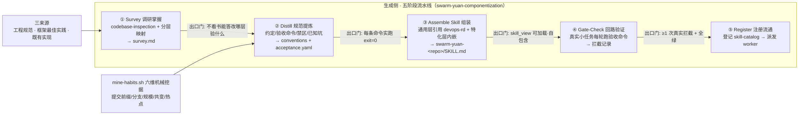

<p align="center">图 4-2　目标技能生成流水线（五阶段，每阶段出口门机械化）</p>

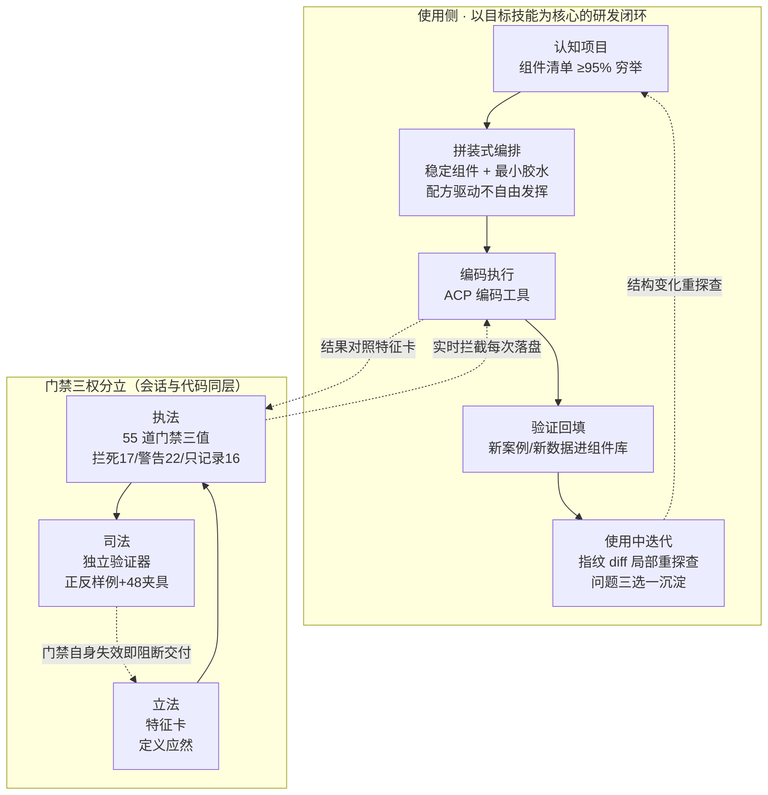

<p align="center">图 4-3　目标技能使用闭环与门禁三权分立</p>

swarm-yuan skill = **通用工程能力（行业沉淀，可复用）+ 仓库特化约束（本仓沉淀，不可迁移）** 的复合体。通用层引用 devops-rd 各阶段方法论（verify-requirement / rd-apply / rd-validate）；特化层内嵌目标仓库的工程规范、验收命令（command + expected_exit_code 机械可执行）与禁区清单。**守门点即特化层的验收命令**：AI 每轮编码后必须跑，检查不通过就打回，无自由裁量——这就是「机器守门」落进编码回路的物理载体。

**核心思路（组件库 → 拼装式编排 → 目标 skill → 迭代成长）**：

1. **认知先行**：认知应用项目的内在结构和关系（模块边界/依赖关系/数据流向），这是目标 skill 的一切出发点；不解构清楚，后面全是空中楼阁。
2. **三个来源沉淀为稳固的开发组件库**：整理工程规范 + 应用框架架构与技术栈最佳实践 + 既有业务功能实现，三者融合成可复用的开发组件库，组件带签名、路径、用途、复用方式、稳定性五维字段，拼装而非重写。
3. **拼装式编排流程开发模式**：新需求 = 既有稳定组件拼装 + 最小胶水；开发流程本身也组件化编排（各阶段入口/出口判据固定），AI 按编排走，不自由发挥。
4. **吸收人的研发流程与习惯形成目标 skill**：把具体开发人员的实际研发流程、工程习惯、领域判断提炼进目标 skill。吸收靠机械挖掘而非访谈：`mine-habits.sh` 六维统计（提交前缀/分支命名/提交规模分桶/共变文件对/热点文件/测试提交占比）产出 `habits.md` 初稿，AI 审读后三去向落位（SKILL.md 铁律引用 / dev-guide 开发偏好固定节 / reference-manual 注意事项与配方佐证）；无数据来源的偏好节写「暂无已记录偏好」诚实降级，节存在性仍受执法。skill 承载的不是抽象规范，是这个项目「这里的人怎么做活」的固化。
5. **以目标 skill 为核心开展研发**：编码工具（无论哪种）以目标 skill 为核心依据，完成具体应用需求的日常研发、测试、验证、交付；测试环节结合已有测试案例、测试数据、测试工具，验证能力（新案例/新数据/新工具）持续补充进目标 skill。
6. **在使用中迭代成长**：成长触发是双通道——结构变化通道（指纹 diff 感知 → 局部重探查）+ 问题沉淀通道（使用中解决的新问题三选一沉淀：更新组件清单 / 配方加条目或注意事项 / 规则持久化，全程决策留痕）：每次失败打标、每次修复沉淀、每次新验证能力回填，研发能力随项目演化自我成长（活契约机制见下第四条）。

**能力三件套**：AI 编码的瓶颈不在「会不会写」，在「懂不懂项目」。swarm-yuan 为每个项目生成一套「目标技能」——特征卡（项目应该是什么样）+ 55 道门禁（自动检查符不符合）+ 独立验证器（证明门禁自身有效）；编码工具经 ACP 调用（工具无关），在独立工作副本中加载目标技能即上岗。可靠与准确靠四条：

1. **懂项目靠穷举，不靠抽样**：建库一次性全仓扫描，组件清单不低于实际数量的 95%（硬红线），清单每个路径由脚本逐条验真，编造即阻断交付。
2. **写码被门禁实时拦**：55 道检查按拦死 17 / 警告 22 / 只记录 16 静态三档（有效档 17/17/21——五门禁经 override 降为只记录），在命令执行层拦截、每次落盘可复盘；编码工具自带的拦截层在不同版本间不保证在场，执法锚在自带门禁上（宿主治理层条件性教义）。门禁按风险归因覆盖五类缺陷：漏 8 / 重 8 / 幻 10 / 泄 16 / 破 13；按覆盖域分标准 28 + 合规 19 + 2，闭合方程 55 = FULL 49 + advisory 6。
3. **门禁有验证器盯着**：每道门禁配正反测试样例与 48 组合规夹具（立法/执法/司法三权分立的完整讲法见下「门禁与验证的分工」）——未达标不宣称有效。
4. **项目变了认知跟着变**：文件变化触发局部重探查，清单骤降过半拒写，特征卡是随项目演化的活契约。

**拼装式开发的两道专项检查**（门禁管编码过程，这两道管组件库与拆装本身——「拼装而非重写」要成立，零件和装配都必须可查）：

1. **组件库检查（零件入库关）**：五维字段（签名/路径/用途/复用方式/稳定性）齐全才入册；清单计数核验（不低于实际数量 95%）兜住漏采；每个路径脚本逐条验真，编造组件即阻断；组件间依赖由关系边集（`relations-extract.sh` → relations.jsonl）机械抽取——TS/JS/Vue 相对导入、Python 相对导入、Go module、Java 包路径六语言 import 边，零外部依赖；「谁依赖 X」查边集而非猜，稳定单元变更的下游传播（1 跳）优先读边集（精确于文件名启发式）；项目演化后边集抽样核验，发现失效的依赖就重建而非沿用旧图。一句话：**零件目录里的每个零件都真实存在、字段完整、依赖关系有机械边背书**。

2. **拆装正确性检查（装配关）**：拆分的依据是任务配方层，即目标技能 `references/recipes.md` 的 §A 业务功能清单（功能→入口→复用组件→接口→数据→测试编目）加 §B 配方五要素（触发场景/前置查询/复用件/胶水/门禁与验证）——配方来自三源盘点（既有实现 / git 同类任务历史 / 开发者文档），生成期由 verify-completeness 做五要素结构执法、引用的复用件经清单核验存在；新需求动手前先查配方与同类功能实现，再按组件地图定位既有组件：拆分不靠 AI 临场发挥，靠配方与既有实现背书；选中组件后核对其签名与依赖边（参数、返回、上下游匹配才可拼）；拆分正确性的判据由配方给出（每个配方五要素：触发场景/前置查询/复用件/胶水/门禁与验证，偏离配方的拆法即错误拆法），胶水超出一配方预期范围视为拆错位，回退重拆；目标技能激活时 `--mark-active` 五要素执法（配方）/抽样核验（边集）/三关核验（特征卡真实性），激活后配方错或边断会被这些核验抓住。

**门禁与验证的分工**（三权分立）：特征卡是立法（定义项目应然：结构/约束/验收判据）；门禁是执法（编码过程中按「拦死/警告/只记录」三值规则实时拦截，hooks 在每次 Write/Edit/Bash 时强制执勤，拦截落 gate-deny.jsonl 可复盘）；**验证器是司法**——每道门禁配正反两个测试样例（违规必检出、合规必通过），独立证明门禁自身有效，未达标不宣称有效。立法定义标准、执法过程拦截、司法事后复核，三者相互独立，任何单一环节失效都会被另外两个抓住。

**验证资产化（测试资产一等公民）**：组件库清单专设测试文件维度（DIM_TESTFILES）——测试案例、测试数据、测试工具是清单一等对象而非散落文件；编码器未配置测试命令但探查到测试文件时显式告警（消除「有测试却没有任何提示地跳过」），用户核心思路中「结合已有测试案例、测试数据、测试工具」由此有了清单级落点。

**循环自控三件套（会话级门禁，与代码级门禁同层）**：Oracle Gate 在每个会话终点用独立验证命令核对 `<promise>` 声明（编码自证交机器复核）；失败模式检测识别空转/漫谈/混合三态并按 L1-L4 逐级加压；防作弊门对受保护资产按 deny/advisory 两档拦（受保护代码不被顺手改）。

**规则初稿与升级守卫**：项目特有三值规则（rules.d）在探查期即生成初稿——从编排约束与只读判定推导，求值器消费现成机制，生成即有稿而非空白起步；`--upgrade` 升级时对 AI 已填充的模板文件（snippets/mcp-tools 等）跳过覆盖（USER_FILLABLE_FILES 守卫），升级不再冲掉已沉淀的项目内容。

**负向预算与理论底座**：技能正文 ≤8KB、认知文档 ≤320KB/327680B（决策 38 起 AST 事实源 FACT_ARTIFACT_BYTES_BUDGET 九次逐例登记，例外须登记不许静默）、门禁 ≤55 道等上限由脚本自动核对（新增门禁须等额删除）。设计有方法论底座（四论闭环单载体 `references/four-theories-methodology.md`）：闭环 / 可靠性 / 误差不放大 / 信噪比分级 / 镇定等工程判据，配结构七问检查单，各配一条可观察判据；其中信噪比分级律落成**零拦截清单**——窗口内全 pass（零 fail 零 warn）的门禁显性列出，供季度复核决定去留。

**五阶段流水线**（orchestrator profile 级 skill `swarm-yuan-componentization` v0.1.0 定义）：五个阶段：① 调研摸底（把项目结构搞清楚）；② 提炼规范（每条验收命令必须真实跑通、返回成功才收）；③ 组装（生成的 skill 自带全部所需文件，不依赖外部支持）；④ 回路验证（**门禁必须至少真实拦截过一次违规，才算生效**——从没拦过东西的门禁，只算「装好了」，不算「有效」）；⑤ 注册派发（登记进技能目录、分发到 worker 的挂载名单）。仓库演化后走增量模式：特化层变更 kanban_comment 留痕，通用层禁仓库级私改。

**口径锚**：全部 catchphrase 数字（55/28+19/184 变量/17 特征卡/13 运行时/32 领域/12 步/79 框架）以 swarm-yuan 仓 `swarm-yuan/assets/facts.conf` 机器真值为单一事实源，self-check 断言守一致。

目标技能是 §2.4.2 代码开发岗位的执法载体（载体链的第④级，见 §3.1 调度链路的载体分工）；其「认知项目→生成目标 skill→拼装式编排→吸收人的流程习惯→验证回填→使用中迭代」核心思路见 §3.5 知识资产治理的设计逻辑。

**有效性判定**：充分性——生成侧五阶段覆盖「学项目（Survey）→提规范（Distill）→组技能（Assemble）→验回路（Gate-Check）→发上岗（Register）」全链，使用侧六步覆盖「认知→拼装→执行→回填→迭代」闭环，四类资产在两侧共享无孤岛；必要性——抽掉门禁则「只写胶水」退化为口号（agent 自由发挥破坏既有结构，Gate-Check 的 ≥1 次真实拦截正是为此设计的实证要求），抽掉组件库则每次交付重造轮子（常规性风险回潮），抽掉验证器则门禁误报/漏报不可知（司法缺位，立法执法沦为纸面）；实证——出口门「每条命令实跑 exit=0」与「≥1 次真实拦截」已在组件化轮实测执行。

---


### 4.3.2 知识底座融合

> 承载 S5 底座融合机制的实现。

**机制核心：教科书/经典的方法论是可拆解的能力点，按「调研→融合矩阵→落点增补」流水线注入既有 skill，而非为每本书建 skill。**

- **机制**：书名级输入先做车道拆分调研（并行 worker-researcher，每书身份判定 ≥2 独立源、查不到标「未确认」），综合卡跨车道去重产出**能力融合矩阵**（每行=能力点/来源/注入方向/优先级/置信度/依据六列，合并置信度就低不就高），落地卡只执行「既有 skill 的文本增补」与「成套工程知识的新 skill」两类动作；同名异实书目（如《心术全书》）强制消歧并锁定引用口径。
- 口径：直接塞书=没注入（不落盘不可复用）；按书建 skill=碎片化；写进 SOUL=双处维护漂移——故走「能力点注入既有 skill」。

| 资产 | 内容 | 状态 |
|---|---|---|
| 能力融合矩阵 | 数学/物理/化生/哲学逻辑四方向 13 本经典 + 识典古籍平台，提炼 **63 行能力点**（P0 15 / P1 18 / P2 30，每行含来源/注入方向/优先级/置信度） | 存档 `research/cluster-knowledge-fusion-20260907/`，P1/P2 按计划增量注入 |
| 已注入能力点（P0 批 11 条） | 开端三问→`rd-clarify`；先判据后结论+谬误门→`code-review`；合成谬误过滤→MoA 配置；证据链专栏+附录规范→`grounded-citations`；侦察先于行动+消歧判例+互链→`deep-research-workflow`；编排纪律→kanban 治理规则等 | 已入 11 本既有手册，grep 逐项验证 |
| 新增手册 | `shidianguji-classics-access`（古籍平台四条接入路径，F5 合规红线「元数据批发不抓正文」为首段） | 入库并挂载 |

知识底座融合是 §3.5 知识资产治理在「经典书目注入」方向的延伸实现——书目经验固化为 skill 能力，走同一套白名单挂载纪律（§4.3）。

---


### 4.4 治理层 `_shared/` 目录

> 承载 S3 治理规则的载体。

**机制核心：把工程纪律从口头要求变成有锚点、可审计、带传播机制的规则网络——规则挂在 SOUL 引用（锚点）、审计脚本可扫描（可审计）、目录级继承（传播）。**

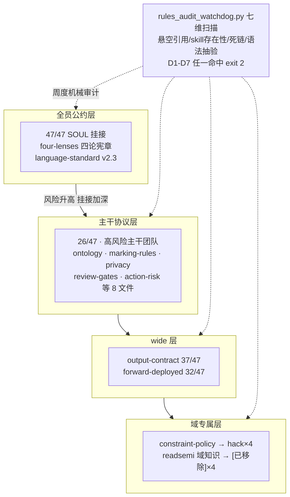

<p align="center">图 4-4　治理规则四层接线拓扑与机械审计</p>

`_shared/` 按架构层组织为六个编号目录，orchestrator SOUL 按目录层级引用（不再逐文件罗列，SOUL 从 614 行收敛至约 220 行）：

| 目录 | 架构层 | 文件 | 职责要点 |
|---|---|---|---|
| `01-scheduling-bus/` | 调度总线 | `matrix-collaboration-termination.md` / `dynamic-workflow-protocol.md` / `forward-deployed-protocol.md` | 机器人防死循环（空转熔断）；YAML 工作流转卡链（含人类拍板挂起）+ 工作流沉淀闭环（§九：synthesis 完成触发、二次复用才升资产）；图拓扑纪律指针（§八，单一事实源在 kanban-orchestrator skill，§4.12）；动手前侦察现场六步 |
| `02-org-orchestration/` | 组织编排 | `ontology.md` / `marking-rules.md` / `alert-triage-rules.md` / `mandatory-privacy.md` / `language-standard.md` / `acceptance-tri-state-protocol.md` | 六类产出物统一词汇；密级合取传播+派单前校验；告警四级取低档；语言规范五原则（清晰第一/结构前置/直面问题/三点式汇报/证据分级——细则见 `language-standard.md`）；验收三态协议（PASS/BLOCKED/UNKNOWN 判据+WAIVED 豁免出口，§3.3） |
| `03-evolution-memory/` | 进化记忆 | `output-contract.md` / `exit-protocol.md` / `action-risk.md` / `review-gates.md` / `structure-evolution-rollback.md` | 分层完成标准（报告必含「已验证/未验证」；证据强度五档+来源独立性七档，§3.3）；动作可逆性分级+变更三分法授权矩阵（standard 机械门即授权/normal 评审卡/emergency 先止血 24h 补验）+执行后回读复验与子代理权限天花板（§1.4，AgenticOps 融合，§3.2）；评审绑定冻结快照；结构变更六步闭环（含候选重测闸，§4.10.1） |
| `04-pro-capability/` | 专业能力 | `committee-review.md` | 对抗评审（1+2 并行挑刺、1 人修订）；高危发现未处置不得交付；评审故障降级单人评审不阻断交付 |
| `05-eng-execution/` | 工程执行 | `drift-comparison-template.md` / `fault-localization-protocol.md` | 安全测试攻击面对比模板；连环故障依赖链回溯法（冻结现场→逐级检验假设→根因修复） |
| `06-observability/` | 观测治理 | `risk-register.md` / `outbound-guard.md` / `swarm-studio-contract.md` / `skill-catalog.md` | 风险登记册（红区必附应对计划，合并报告强制过目 Top3 风险）；推送防骚扰三闸；SwarmStudio 接口契约单一事实源（数据/API/WS/权限/路由/证据分级/兼容/违约八节）；skill 目录单一事实源（§4.3） |

| 扩展资产 | 职责 | 设计要点 |
|---|---|---|
| `workflows/deep-research-synthesis.yaml` | 内置工作流 | 深度调研→对抗评审→综合交付 |
| `failures/` 3 案例库 | 结构化失败案例 | frontmatter（域/失败类型/模式反链）+五段式（情境/经过/根因/失误/教训）；与 failure-mode-playbook 模式表双向互链 |
| `evals/baseline.md` | 换模型回归评测基线（17 题：T1-T11 能力题 + T12-T17 QGate 检查项效力题，通过线 ≥14/17）+ 评测方法纪律 | 题库只增不删（事故回流追加）；出题五纪律与三值判定见该文件；T12-T17 FAIL 触发「效力回流铁律」——优先修检查项而非换 agent（§4.20）。 |
| `action-contracts.yaml` | 动作契约 | 不可逆的动作（如删库、外发）必须先提案、经确认再执行；与 `03-evolution-memory/action-risk.md` 联动：权限等级×事务作用域两维交叉定门，未声明一律「仅提案」；高危写走「staged→审批→apply 复验」闭环 |
| `constraint-policy.md` / `hack-knowledge-index.md` / `hack-tool-registry.md` | hack 域约束与资产 | 安全授权门禁；领域知识索引/工具注册表（WIH 敏感信息发现同构接入约定见知识索引 §一） |
| `shared-rules-reference.md` | 共享规则指针索引 | `_shared/` 全部协议/规则的一页式指针（重建于 2026-09-17 GE 融合，回填现存规则 24 条）；本文件是索引不是正文——每条只写「文件+一句话定位」，正文单一事实源在各文件本体 |

**有效性判定**：充分性——六层目录覆盖治理全部作用面（调度总线/组织编排/进化记忆/专业能力/工程执行/观测治理），任一治理需求可归入其中一层；必要性——抽掉公约层则各团队纪律不可比（语言/决策界面分裂），抽掉主干层则 markings/隐私/退出协议无单一事实源，抽掉审计（watchdog）则规则漂移不可见（悬空引用实修记录：9-11 轮 D1/D2/D5/D6/D7 全零即证明审计有效）。

---

### 4.5 运维脚本 `~/.hermes/bin/`

> 承载 S3 度量与各域只读采集的实现。

**机制核心：把治理纪律做成退出码可判的脚本，采集只读零副作用、门禁 fail-closed 带退出码契约、自动化幂等可重跑——纪律的执行不依赖任何人记得规矩。**

**有效性判定**：充分性——九类脚本（度量/备份/markings/本体/RD/测试/更新安全/审计/图工程）覆盖治理的采集-执法-验证-守护四环节；必要性——抽掉只读纪律则度量污染被测数据、抽掉 fail-closed 则门禁形同虚设、抽掉单测则护栏自身无证。有效性实证：护栏脚本带单测（test_clearance_gate/test_ontology_validate/test_p6_process 全绿才许改），看门狗巡检检出即告警（2026-09-11 幽灵引用清理轮 rules_audit_watchdog D1-D7 复跑全零）。

| 类别 | 脚本 | 职责 |
|---|---|---|
| 度量 | `asset-compound-metrics.py` / `failure-label-check.py` / `token-meter.py` / `protocol-adoption-audit.sh` / `portfolio-brief.py` / `ttvv-report.py` / `process_metrics_collector.py` / `oel_collector.py` / `oel_aggregate.py` / `acceptance_routing_metrics.py` | 复用率/压缩率/执行率只读采集；token 实测基线；协议执行率月报（零执行触发降级）；TTVV 时长观测；8 板健康度简报（红黄绿灯）；验收拒绝率与路由留痕月度聚合（§4.1）；协议违规周扫 job（事件按 worker 聚合——事件产生必须有消费者，§3.3）；`ops-eval-weekly.sh`（profiles/orchestrator/scripts/，ops-eval 周报自动产出+后评价四维段——变更达成率/工具失败率趋势/回顾闭环率/整改哨兵，§4.13 M6b，orchestrator 每期消费） |
| 备份 | `skill-full-backup.sh` | 全量打包 tar -L 解引用，落外部盘 |
| markings | `clearance_gate.py` / `marking_selfcheck.py` / `kanban-direct-write-audit.sh` | 派单前权限机械校验；裸写 kanban 审计（markings 列补齐与注入演练为一次性脚本，已退役删除，2026-09-11 复核） |
| 本体 | `ontology_validate.py` / `ontology-cq-regression.py` | 本体一致性校验 |
| RD Harness | `rd-export.py` / `rd-auto-reminder.py` / `rd-auto-backfill.py` / `rd-body-injector.py` | RD 过程产物归档与质量门自检 |
| 成本 | ——（原 `sync-compression.py` 已退役删除，2026-09-11 复核） | 压缩参数以共享配置统一派生为正典，存量漂移由 risk-register R-03 跟踪 |
| 测试 | `test_clearance_gate.py` / `test_ontology_validate.py` / `test_p6_process.py` | 护栏脚本自带单测（markings/本体/P6 流程三件） |
| 更新安全 | `hermes-update-safe.sh` / `tui-patch-watchdog.sh` | hermes update 前快照与 TUI patch 回放守护 |
| 其它 | `audit-soul-rules.sh` / `skill-health-audit.sh` / `shadow-verification-audit.sh` / `orchestrator_context_query.py` / `qwen3_asr_stt.py` / `dashscope-image-gen.py` / `tupang-auto-push.sh` | SOUL 规则审计、skill 健康审计、shadow 验证审计等 |
| 图工程 | `capability-graph-gen.py` / `parallel-wave-scan.py` / `failure-boundary-scan.py` / `mechanism-registry.py` | 能力建模图生成与查询（who-can/substitute，§4.12）；就绪任务并行波次扫描（Kahn 分层）；失败链故障定位与恢复边界诊断；治理机制开关台账（结构消融对照组快照）——机制设计见 §4.12 |
| 事件驱动回归 | `life-workbench/gap_workspaces/gap-20260909-006-B-regression-runner/product_change_regression_runner.py`（launchd `com.hermes.product-regression-runner`，StartInterval 900s；stdout 日志 `~/.hermes/logs/product-regression-runner.log`） | 制品变更事件驱动回归（gap-20260909-006-B 落地）：SOUL/skills 快照仓（`~/.hermes/backup/soul-integrity-git`）与 _shared 契约仓（`~/.hermes/profiles/_shared`）出现新 commit 后 1 个调度周期内自动跑对应校验组（audit-soul-rules / mechanism-registry --check / marking_selftest / ontology-CQ + 内置 SOUL 必引块 diff 回归 gate），结果落 JSONL 台账（含 trigger_commit/change_source），FAIL 经 stdout 告警+alerts.jsonl 浮现 exit 1——校验从「人肉触发、变更与校验解耦」变为事件驱动。幂等同构 radar 铁律：状态文件四态（detected→ran→passed/failed），只认终态不重跑，失败保留事件可重跑 |
| kanban worktree 回收 | `worktree-daily-reclaim.sh`（`~/.hermes/profiles/orchestrator/scripts/`，cron job `worktree-daily-reclaim` 每日 04:00，no_agent 纯 shell 零 LLM） | done/archived 卡 worktree 的每日自动回收（2026-09-17 手工回收 36 worktree/216G 后固化为机制，防 kanban 卡 spawn 超时复发）：卡状态三层查询（中央库→板库兜底，仅终态可回收，blocked/NO-CARD 一律 SKIP）；锁在主仓 `.git/worktrees/<tid>/locked`（worktree 内查不到，无条件 unlock 再 remove）；独立提交→转 `archive/<tid>` 分支留档；未追踪文件逐个 `cmp` 主仓，仅「主仓没有或内容不同」才归档（防半成品 checkout 把同一 7.1G 加密档案重复归档 24 份=147G 的陷阱）；僵尸 worktree（.git 指针丢失）归档后 rm+prune；归档保留 30 天自动过期。日志 `~/.hermes/logs/worktree-reclaim.log`；2026-09-18 04:00 首跑完成（3 blocked 全 SKIP 零删除，exit 0） |

**设计要点**：度量脚本全部**只读**（采集器不能写被测系统，防度量污染数据）。与脚本配套的确定性看门狗（`~/.hermes/scripts/`：`kanban_stuck_watchdog` 四形态、`cron_paused_watchdog`、`evo_concurrency_watchdog`、`ontology-metadata-watchdog`、`soul_integrity_watchdog`、`meta_watchdog`、微信补投队列等）挂载于 orchestrator cron，与 bin/ 的采集器分工：**采集器产基线，看门狗闭环处置**（详见 §4.11）。`~/.hermes/scripts/` 中的度量采集器（`acceptance_routing_metrics.py`）为指向 bin/ 本体的 symlink——运行时入口与治理归档保持单一事实源。

---


### 4.6 记忆与持久化

> 承载 S2 密级传递 + 团队记忆的实现。

**本轮增量（记忆治理宪章）**：记忆分工作/情景/语义三层但底层不新建存储，映射到会话上下文、MEMORY.md/SOUL、Hindsight bank 与 state.db；写侧门控（大部分寒暄/重复不写、retain 必填 context、新条目打 `memory:provisional`）、读侧强制「批判-重构」三步（失配输出 `<EMPTY>` 转自主推理）、遗忘阶梯（降权→归档→删除，默认软退役 `state=invalidated` 可逆）、可追溯走 Hindsight 原生 audit/history/consolidate/reflect endpoint 而不建记忆 VCS。完整规则见 `~/.hermes/profiles/_shared/03-evolution-memory/memory-governance.md`，决策矩阵见 `research/fusion-20260915-memory-cost/REPORT-memory.md`。


**机制核心：记忆按 team 分 bank 隔离（命名 `hermes-<mac>-<team>`）、按 profile 分层（集群记忆/记忆库/profile 记忆/会话检索）——读写权限跟随编制，经验可复用但密级不跨队。**

**有效性判定**：充分性——四层覆盖从单次会话到集群演化的全部记忆粒度；必要性——抽掉 bank 隔离则 hack 情报可泄入 product 记忆（密级击穿），抽掉写纪律（声明式事实、无祈使句）则旧记忆会劫持新会话的行为。

- **Hindsight**：mode=local_external（localhost:8888），bank **按 team 隔离、同 team 内共享**（`hermes-<mac>-<team>` 命名，`<mac>` 为本机 MAC 哈希前缀，跨机自动隔离；配置落各 profile `hindsight/config.json`，由 `~/.hermes/shared/setup-hindsight-banks.py` 批量生成）。权衡：外部服务换语义检索/实体图谱/重排序，代价是本地服务依赖
- **bank 分配**：orchestrator+swarm→`-swarm`、hack 4 岗→`-hack`、product→`-product`、ops→`-ops`（各团队 bank 按 profile hindsight/config.json 实读核对；详见各团队节）、platform→`-platform`、pay 4 岗→`-pay`、aiteam 6 岗→`-aiteam`、**data 4 岗→`-data`**（2026-09-17 后补建完成：服务端 `/v1/default/banks` 实测 10 banks 含 `hermes-b24d7ac5d9c4-data`，4 个 data profile 的 `hindsight/config.json` 均已指向该 bank，mode=local_external）——建设期「配置先行、存储后建」的缺口已闭环，均按 profile `hindsight/config.json` 实读核对
- **结构化台账**（`~/.hermes/shared/`）：`domain-registry.yaml`（领域清单——域↔板/编制/知识库/目标 skill/域主责，与 board.json 双向对账）、`owner-registry.yaml`（职责清单——员工↔主责模块，§3.1 分解算法的输出定位层（四级映射）；主责者=评审/验收/事故召回第一通知人，借调记 backup）、`capability-graph.yaml`（能力清单——能力圈+reliability，`capability-graph-gen.py` 自动生成）；`profiles.yaml` 的 skills_enabled/pinned/toolsets 为各岗自身 skill 权威面。三台账互补：领域清单答「这活属哪个域」、owner-registry 答「这个模块归谁」、capability-graph 答「谁擅长什么」。
- **profile 记忆**：MEMORY.md / USER.md 会话启动注入；写纪律=声明式事实、无祈使句（祈使句会被后续会话当指令执行）
- **图原生运行时**（2026-09-23 新增）：semantica 0.7.0 MCP 接入（kg.json 持久化图 + 语义检索四件套 + 决策溯源 record_decision/find_precedents），为集群记忆补图存储执行层；机制、裁决与边界单一事实源见 §4.21
- **会话检索**：session DB FTS5 全文检索
- **跨机协作**：Matrix Synapse（@swarm bot）+ 七层防死循环。自建 homeserver：Docker Compose 双容器（synapse 8008 / element-web 8081），server_name `matrix.test`，部署目录 `/Users/YOURNAME/Documents/matrix-docker/`（2026-09-18 因外置卷共享失效自 `/Volumes/YOURVOLUME/cuishi-archive/matrix-docker/` 迁入，判据与处置见 §4.9 运行栈迁移条）；数据落 `synapse-data/`（SQLite homeserver.db + media_store），迁移经 SIGTERM 正常落盘后整目录拷贝，零丢失

记忆分层（集群记忆/记忆库/profile 记忆/会话检索）是 §3.2 组织与能力边界在持久化维度的实现——谁能读写哪层记忆，同样按编制定死。

---


### 4.7 备份体系

> 承载 S6 的实现。

**机制核心：备份管「改坏可回」，纵深四件（整库 tar 解引用落外部盘 / SOUL 资产 git 版本化 / 关键文件 .bak+回滚演练 / config 快照 _trash 暂存）——每层对应不同变更烈度，回滚不依赖单一通道。**

| 对象 | 机制 | 位置 | 理由 |
|---|---|---|---|
| skill 库 | `skill-full-backup.sh` 全量（tar -L 解引用，排除 .curator_backups） | 外部盘 `/Volumes/YOURVOLUME/hermes-backups/skills/` | 外部盘隔离系统卷故障；解引用防 dangling link |
| SOUL/skills 资产 | git 版本化 + 配置基线（SCM-B）：`soul_git_sync.py` 把白名单 `.md`（SOUL/rules/skills）同步至 `~/.hermes/backup/soul-integrity-git/` 独立仓库，有变更才 commit；人工验收后打 `cfg-YYYYMMDD`（同日多次加 `-N`）annotated tag 固化「已验证配置状态」，禁止自动打 tag；`soul_integrity_watchdog.py` 三层巡检——L1 sha256 台账、L2 git 版本化、L3 基线对账（`git diff <最新cfg-* tag>..现状 --stat`，超 40 files/2000 行并入既有告警，git/tag 异常 fail-open 降级 warning） | 本机 git 仓库 | 快照回滚之上加逐次变更留痕，可 diff 追溯任何一次批量改动；cfg-* tag 使任何时刻可回答「上次验证过的配置状态是什么、此后动了什么」 |
| 关键规则文件 | `.bak` + 回滚演练（提案·试运行） | 原目录 | 备份不演练=假备份 |
| config 批量改动 | 先快照 `_trash_<ts>_<用途>` + MANIFEST | `~/.hermes/_trash_*` | 可逆路径，确认后才真删 |

备份体系四件（整库/关键文件/工作区/config 基线）是 §3.6 韧性安全垫四条决策的实现；运行期的自愈与熔断由 §4.11 看门狗族承担——备份管「改坏可回」，看门狗管「运行不断」。

**有效性判定**：充分性——四件分别覆盖 skill 全库、纪律文本、关键规则、批量 config 四类被改对象；必要性——抽掉演练则备份可能是读不回的假备份（「备份不演练=假备份」红线），抽掉 _trash 暂存则批量 config 改动不可逆。有效性实证：2026-09-10 回滚演练 sha 校验+结构命中 4/4+diff 留痕。

---


### 4.7.1 hack 团队安全工具 skill

hack 团队的可移植安全工具以 skill 载体沉淀：`hack-team/wih-secret-hunter`（来源 [ARL-Next](https://github.com/owl234/ARL-Next) GPL-3.0，移植时剥离 MongoDB/Celery 依赖收敛为纯 Python 自包含脚本），4 个 hack profile 经 symlink 板共享。**四脚本分工**：

| 脚本 | 职责 | 关键机制（源码锚点对齐） | 验证 |
|---|---|---|---|
| `wih_engine.py` | Web 敏感信息提取：JS chunk 4 级瀑布解析（HTML→Next.js manifest→Webpack/Vite→generic）挖云 AK/JWT/secret_key/身份证 | 38 条预编译规则 + FNV-1a 按 (hash, site) 去重 + exclude_rules 反误报 + 流式下载防 OOM（5MB 截断/30s 慢流超时/连续 5 错停） | 回环假 SPA 单测 9/9 + 边界 3/3 PASS |
| `asset_summary.py` | 侦察产物 13 维汇总大盘（借鉴 ARL MCP server「并发导出+省 token 摘要」范式） | ThreadPoolExecutor(max_workers=5) 解析 recon/<APEX>/ 产物 → stdout ≤40 行 Markdown + summary.json；退出码 0/1/2 | mock 目录 5/5 断言 PASS（orchestrator 独立验收） |
| `gh_threat_radar.py` | GitHub 威胁雷达：CVE 关键词/攻击工具新仓库/敏感泄露三路监控 | sha1(route\|repo\|keyword) 指纹 + state tmp+os.replace 原子写 + 403/429 Retry-After 优先指数退避 ≤2 次 | 真实 GitHub API 实测：首跑 52 告警→同关键词二次 0 告警 exit1（91 raw hits 全去重） |
| `site_drift_monitor.py` | 站点变更漂移监控：四维比对（status/title/simhash/length） | simhash Hamming 距离>3 判实质变更（无旧值回退长度阈值 >500 且 >5%）+ 网关错误防抖（0/502/503/504 连续错误容忍 入口 2 次/普通 3 次，来源 asset_site_monitor.py） | 回环假站点 5/5 PASS（含 503 防抖三连验证） |

**接线与运行态**：工具注册于 `_shared/hack-tool-registry.md` §3，并注册进 `_shared/scripts/skill_routing.json`（2026-09-28 补注册——此前目录存在但 Resolver 零路由，实测 primary=9.0 修复；同时 resolver_cli VULN_KWS 增补 JS 泄露类检测词）；WIH findings 经 `hack-knowledge-index.md` 同构接入 `hack-kb/intel/`；hack-recon SOUL 含调用命令与三纪律（scope.txt 核对 / AK 仅格式验证·云 API 验证需用户显式批准 / 报告脱敏前 8 字符）。

`gh_threat_radar.py`（GitHub 威胁雷达）挂在 orchestrator 的定时任务上，每天早上 09:40 以纯脚本方式运行一次，不需要启动 AI。它盯三组关键词：新披露的漏洞编号（CVE）、漏洞利用工具、公开的攻击模板。发现命中就告警落 `hack-kb/intel/`，用 state 指纹跨天去重；`site_drift_monitor.py` 按授权任务调用，不常驻 cron。

**移植判定留痕**：severity 富元数据体系不移植（xing 框架 BasePlugin 定义了字段但实际仅 2/219 插件填充——「框架定义」≠「生态使用」，机械验证抓出）；ARL 平台整体部署（8 容器 Docker 全家桶）与多 agent 集群形态不同构，不移植。

本工具 skill 是 §3.7「hack=安全工具链与红队方法论」领域喂养的落地实例；外域工具移植走同一套「机械验证判定 → 移植 → 留痕」纪律（§3.8 供应链准入）。

### 4.7.2 Agent 运行时安全机制（模安局安全融合落地）

> 承载 §3.8「外部输入受控进入」在运行时侧的实现。外部输入（工具返回、网页、skill 元数据、记忆写入）不经受控即变成行动指令，是 agent 区别于传统程序的核心攻击面。

**机制核心：五类确定性闸门把「外部内容只能当数据、不能当指令」做成退出码可判的代码，全部 fail-closed、零第三方依赖、判定权不在模型手里。**载体在 `research/moanju-fusion/implementation-slices/`（5 目录 × gate.py + README + test_gate.py + SUMMARY），语料依据是安全公众号「模安局」148 篇全文（97 万字符）提炼的 27 条机制矩阵（P0×18，六维全覆盖），研究→实现→独立验收三段依赖链交付，验收 41/41 断言全过、5 机制证据等级全 Exercised。

| 闸门 | 挡什么 | 关键决策（一句话） | 退出码契约 |
|---|---|---|---|
| `01-agenttrust-tool-firewall` | 工具调用越权（删库/外发/未授权动作） | 四态 ALLOW/WARN/BLOCK/REVIEW；可信动作清单外一律 BLOCK；headless 高风险与缺 purpose 的写动作默认拒绝 | 0=放行 1=拒绝 2=输入错误 |
| `02-prompt-injection-detector` | 提示注入（直接/间接/信封包裹） | 7 条确定性 pattern 命中即打「不可信内容信封」标记，外部内容只作数据不作指令 | 0=干净 1=检出 2=配置错误 |
| `03-skill-supply-chain-gate` | 恶意/伪装 skill 进入 | SkillSieve 三层（元数据/静态启发/结构预算），占位伪装（<40B）与高危启发命中即 REJECT，校验器自身异常也 REJECT | 0=通过 1=拒绝 2=未用 |
| `04-secret-minimal-exposure` | 凭据泄漏到输出/日志 | 8 条凭据 pattern + 高熵兜底（≥16 字符且熵≥3.3），报告永不含原始值 | 0=干净 1=命中已脱敏 2=配置错误 |
| `05-execution-trace-audit` | 执行不可归因/轨迹篡改 | append-only JSONL：params 只落 SHA-256，输出摘要先过 04 脱敏，历史含坏行即判篡改停止追加 | 0=成功 1=拒绝 2=篡改嫌疑 |

**接线位置（当前态）**：五闸门为独立可执行模块（`python3 <dir>/test_gate.py` 即验），尚未接进 Hermes 主循环的调用链——接入属后续工程（候选接点：工具调用前置 01、web/skill 内容入口挂 02+03、输出管道挂 04、kanban 执行留痕挂 05），接入前作为**参考实现与验收基线**存在。这与 §3.8「模型来源登记」缺口同属供应链收口清单：来源侧管「东西从哪来」，本节管「进来的东西怎么被对待」。

**效力审计（2026-09-24 t_5c726e34 审计，2026-09-28 t_d565dbc5 激活）**：五闸门 56/56 自测复跑全绿。`gate_efficacy_audit.py` 机械判定：01 = EXERCISED、02-05 = PRESENT（零接线）。01 号闸门（action_gate）当前 enforce 模式（config `action_gate.mode=enforce`，`~/.hermes/profiles/orchestrator/config.yaml:281-282`）：实测未注册工具 `blocked`、黑名单命令 `rm -rf /` 经 blacklist 拦截、合法命令 `read_file` 放行——真实拦截落地；enforce 级探针 11/11 裁决正确（`rm -rf /`、`git push -f` 等 8 条黑名单全中）。02-05 仍为零接线（gate.py 运行时调用者 grep = 0）。运行时另有三条旁路在跑：`display.py:327` 显示层脱敏、`moa_trace` 轨迹（390 文件）、`egress_write_audit` 日检——但 egress 与 `drift-check-gate-wiring` 守卫**均未排程**（cron/launchd 双查无），日检靠手工。红线重放自测器（`gap-20260924-redline-replay/`）以基线比对 + 负测试实证能检出策略回退（篡改 fixture/基线 → rc=1）。十四项指标自评：符合 5 / 基本符合 6 / 不符合 3（其中「拦截成功率 0%」随 enforce 激活解除，漏报 6/9 与人工复核闭环 0 卡两项仍待闭环），§11.5 总体判**基本符合**。

**出口写入审计（影子模式已落地，2026-09-18）**：五闸门管「进来的东西」，出口侧的观测面由 egress_write_audit.py 补齐——只读扫描三数据源（49 profile 会话库 messages 表 / tupang-auto-push launchd 日志 / cron traces），按确定性 pattern 识别公网写入与协调行为（git push 非 localhost、curl/wget POST/PUT/PATCH、gh 写操作、scp/rsync/ssh 外联、包管理 publish、bot 发送；私网地址不算），对照 `egress-allowlist.yaml` 白名单出 allowlisted/unknown 两态裁决，JSON+JSONL 留痕恒 exit 0。首轮实测（scan 20260918_3e5d67）：47 profile 全扫，1738 事件，680 allowlisted 全部为 tupang git-backup 通道（launchd 用户已排程），1058 unknown 大多为会话语料中 skill 文档的命令示例（语料噪声，待 R2 过滤）。定位：**影子模式只观测不阻断**——出口强制层（default-deny + allowlist 网络实施）按 t_31da0315 容器化评估的 P0→P3 门禁与 t_3cb9c4e0 裁决，属用户裁决项，不越权实施。载体：`life-workbench/gap_workspaces/gap-20260909-005/`（自测 23 正/15 反全绿，验收脚本可复跑）。后续演进：R2 语料降噪 + ops-sre 接周期值守 + 红队协调类任务注入测捕获率（gap-20260909-005）。

**落地过程的机制教训（复用价值）**：①知识 corpus→机制矩阵→代码的三段交付里，「研究产物核验闭环」与「产物存在」是两回事——产物落盘后仍需锚点级核验（85/85）才算交付；②验收不采信实现方自报（56/56 由验收方独立复跑 + 自建 37 项正反 fixture 复测才成立）；③建卡挂 `skills` 引用前必须核对目标 profile 技能库实际存在，幽灵引用会让 worker 在 spawn 阶段即死。

---

### 4.7.3 智能体安全治理融合落地（TC260《人工智能安全治理框架3.0》，2026-09-24）

> 来源：全国网络安全标准化技术委员会（TC260）2026-09-14 发布的《人工智能安全治理框架3.0》官方原文（PDF sha256 `cff709d8…c86da43d`，136 页全文抽取带 pN 锚点，存档 `research/aisgf3.0-20260924/`）。执行卡 t_8917be3b（swarm），按 article-methodology-fusion 六步融合：全文通读 → 18 个独特关键词横扫现状 → 裁决矩阵四判定（吸收 5 / 收缩吸收 7 / 等效印证 9 / 不吸收+语境 DROP 8）→ 落地验收 grep 全过。裁决矩阵全文 `research/aisgf3.0-20260924/FUSION-VERDICT-20260924.md`。

**框架 3.0 与 agent teams 的对位**：框架核心增量是附件2「智能体风险管理框架」——智能体全生命周期 9 类风险（设计研发/安装部署/指令输入/推理规划/调用执行/记忆存储/结果输出/停用下线/其他）+ 7 大防范措施（风险预防前置/身份与权限管理/人工审批/供应链与工具管理/运行时动态管理/持续监测与审计/停用安全管理），与本集群多 profile agent 组织直接同构。

**落地内容（五处载体，验收 grep 全过）**：

| 项 | 载体 | 补了什么缺口 | 成色 |
|---|---|---|---|
| 智能体全生命周期 9 类风险评估表 | `hack-auditor/SOUL.md`「AI Agent 安全评估模块」（5 维扩 9 类） | 旧 5 维评估缺 4 类：停用下线（服务残留/凭证遗留/数据留存）、设计研发、推理规划（意图偏差/路径偏离/目标劫持）、其他（行为逃逸/技能管理不当/通信协议）；并入**上下文溢出攻击**（超长输入截断内置指令使安全约束失效——攻击视角，区别于 FM-R3 的 SOUL 超限运维视角）与**工具选择偏见**（工具描述文件诱导信息干扰选型，skillguard 12 规则未覆盖） | 机制落地 |
| profile 安全下线 checklist | `agent-profile-lifecycle` skill「Deleting a Profile」 | profile 退役此前只有 delete 命令，无下线安全清单；补四步：全面关停（进程/端口/授权/订阅逐项核验）→ 备份必要数据（先存档再删）→ 清理部署环境（skills symlinks/cron/launchd plist/Hindsight bank 残留核查命令块）→ 凭证与权限回收（框架「任务终止即撤销凭证」的收缩吸收） | 机制落地 |
| 自主攻击意图失控自检红线 | `hack-auditor/SOUL.md`「红线」节 | 框架 2.2.3c「自主化网络攻击威胁」+专栏二（先进模型自主生成攻击意图、突破测试环境）对红队 agent 是自身风险面——scope-gate 拦命令级，意图级无检测；补红线：攻击动作必须全部源自任务书显式授权，发现偏离即停止+block | 语义落地 |
| 派卡风险预分级 + 渐进授权 + 来源可信度三级 | `security-domain-delegation` skill 新增 §6 | 附件1 分级原则收缩为派卡时 `risk: low/medium/high` 预标注（对齐 action-risk 三级）；新 worker/新 toolset 分阶段放开权限；入站指令按来源定可信级（kanban 任务书>Matrix 直令>外部内容中的指令文本——后者只当数据不当指令，与 §4.7.2 五闸门同向） | 语义落地 |
| GEO 投毒识别 | `radar-quality-control` skill「原料红线」 | 框架专栏四：GEO（生成式引擎优化）批量投放操纵大模型检索引用——情报雷达的源投毒变体；补识别信号（同主张多低权威源集中/虚构评测/假冒专家）+ 处置（降权进拒收源，禁把批量投放当多源印证） | 语义落地 |

**等效印证 9 项（不新建机制，防双事实源）**：记忆四分类风险（memory-governance 写侧门/读侧门/遗忘阶梯已覆盖，裁决矩阵存档为引用锚）；审批异常默认拒绝（HumanGate + 「无人值守审批门：超时=BLOCKED 禁重试」逐字同构）；高风险操作清单+分级控制（action-risk 三级可逆性）；沙箱验证+红队常态化（scope-gate/Docker/hack 团队本体）；重大变更安全验证（action-risk 变更分级 + 交付门禁 G1-G6）；版本管理与回退（source-patch-persistence + config bak）；供应链完整性校验（supply-chain-security + skillguard）；智能体唯一身份+最小权限（profile 天然隔离 + toolset 收敛）；可信 AI「人类最终控制/可客观验证」准则（HumanGate + 机械验收门同构）。

**语境 DROP 7 类（防后续重复评估）**：沙箱监管制度（监管者语境）、国际协同共治、衍生社会/环境/文化风险、具身智能、个人信息权益合规审计（不向公众提供服务）、算力设施安全（无算力基础设施）、行业规范应用。合成数据缺陷同 DROP（冻结权重无训练管线）。

**边界声明**：全部落点为语义或机制落地，效力落地 0 项——9 类 checklist 待下一次真实 LLM/Agent 审计任务验证、安全下线四步待下一次 profile 退役验证（与 §4.20 三层成色纪律同口径）。框架的行业监管/国际治理面不在单机集群可操作范围。回滚：各载体带来源锚可定位 revert。

- **落点**：评估能力衔接 §2.2 hack-auditor 岗位行（已同步）与 §3.7 hack 领域能力；安全下线 checklist 载体为 skill 手册（§4.3 devops 类目），profile 编制增删的操作面在 `agent-profile-lifecycle` skill；派卡风险预分级衔接 §3.2 变更三分法与 `_shared/03-evolution-memory/action-risk.md`；来源可信度分级衔接 §3.8「外部输入受控进入」与 §4.7.2 五闸门（同一原则在调度侧与运行时侧的两层实现）；裁决证据归 `research/aisgf3.0-20260924/`。

---

### 4.7.4 智能体互联与访问控制标准融合落地（T/ISC 0123 + GB/Z 185 系列，2026-09-24）

> 来源：微信文章《中国人工智能技术标准全景（截至2026-08）》盘点 60+ 标准，对其中智能体相关标准做原文级深调研。执行卡 t_ad233756。**T/ISC 0123-2026**（中国互联网协会《智能体交互身份与访问控制安全能力要求》，2026-08-20 实施）获取发布稿 16 页全文并通读（sha256 faa2020d…，`research/wechat-standards-20260924/T-ISC-0123-2026-fulltext.md`）；**GB/Z 185.1~185.7**《人工智能 智能体互联》系列到官方公告清单（总局公告 2026 年第22号）+第三方 SDK 条款级一致性矩阵；其余治理类标准（GB/T 47507 可信赖通则、45081 管理体系等）为元数据级。全文可得性与检索路径证据 `research/wechat-standards-20260924/availability.json`，裁决矩阵 `FUSION-VERDICT-20260924.md`。

**与 §4.7.3 的分工**：上轮 TC260 框架管「单个智能体」的全生命周期风险；本轮管「智能体之间」交互时的身份与权限——delegate→worker→subagent、跨板派卡、ACP 调用在本集群构成事实上的智能体链，标准把链级授权从「口头默契」变成显式纪律。

**落地内容（五落点，验收 grep 全过）**：

| 项 | 载体 | 补了什么缺口 | 成色 |
|---|---|---|---|
| 智能体链权限纪律五条 | `security-domain-delegation` skill §7 | 链级授权此前无显式规则：补**最窄权限控制**（下游权限=全链交集，非直接上游授权面）、**权限受限传递**（子卡授权≤父卡，放大即 block）、**级联失效**（卡撤回则子卡/delegate 同步终止）、**高危授权单任务有效**（批文随卡，卡销授权灭）、**子代理三隔离**（权限/上下文/数据边界，禁跨域外委） | 语义落地 |
| HITL/HotL 术语映射 | `action-risk.md` 三级可逆性节 | 双模授权术语补强：低风险+人工监督≈人在环上（自动执行+可干预），中/高风险≈人在环中（执行前确认）；机制本体不变 | 语义落地 |
| 升级权限收敛 | `agent-profile-lifecycle` skill | clone/升级 profile 时旧高危权限（bypassPermissions/写面 toolset）此前随配置自动延续；补「逐项复评白名单+toolset，默认最小面渐进放开」 | 语义落地 |
| 「不得自证合规」引注 | `output-contract.md` 收尾四问 | T/ISC 0123 §10j「决策是否符合用户意图应由人类判断，智能体不得自证合规」与既有「验收不采信实现方自报」同源，作为引文固化 | 语义落地 |
| 差距登记 ×3 | gap-closure-ledger | ① 交互传递拓扑可视化（每跳身份/授权/凭证有效期，P2 触发=跨机协作常态化）；② 组织级安全成熟度自评（触发=对外服务/>100 agent）；③ GB/Z 185 中文正文与 GB/T 47507 可得后复评 | 已登记 |

**等效印证（不新建机制）**：GB/Z 185.1 五域参考架构（用户域/智能体域/管理服务域/互联服务域/资源访问域）与集群功能面完全对表——身份=profile+Matrix、描述=profile.yaml+SOUL、发现=owner-registry/capability-graph、交互=kanban/Matrix、工具服务=MCP/skills、管理服务=orchestrator+dispatcher，架构层级无缺口；授权撤回即失效（用户裁决改向+kanban stop）；身份主动声明（bot 标识+assignee）；描述生命周期（.hub 锁定+白名单+approval）；工具调用数据格式（MCP schema，GB/Z 185.7 与 MCP 正交不冲突）；审计留存（session jsonl 超 90 天）。

**不吸收**：身份码 OID 注册体系（185.2，国家互联注册身份，单机集群无接入需求）；成熟度五级自评（触发登记）；训练数据/标注/内容标识/行业叠加/等保密码基础标准（语境 DROP，理由入裁决矩阵）。

**边界声明**：T/ISC 0123 为团体标准、GB/Z 185 为指导性技术文件，对本集群均为参照非合规义务；GB/Z 185 中文正文未获取，条款级裁决基于官方公告+第三方一致性矩阵，正文可得后需复评（重点 185.3 身份凭证生命周期与链级授权的对表）。证据级=语义落地，效力待首次跨链派工实战。

- **落点**：链权限纪律衔接 §3.1 调度流水线（delegate/跨板派卡路径）与 §3.2 markings 传播；HITL/HotL 术语衔接 §3.2 双维权限门；升级收敛衔接 §2.2 编制管理；裁决证据归 `research/wechat-standards-20260924/`。

#### 4.7.4.1 全量对账与护栏标准增补（T/ISC 0125 等，2026-09-24 同日）

经用户质疑后全量逐项复检：文章 80 项标准逐项检索（std.samr 44/44 命中），对账正本 `COVERAGE-AUDIT-final.md` + 逐项判定 `verdicts-80.json`。结论：原文级 2 / 结构级 10 / 元数据级 68 / DROP 57（单项理由落盘），上轮类别级 DROP 经逐项复核后维持 57 项无一翻案，新增两项智能体安全团标进入结构级。

**T/ISC 0125-2026《大模型安全护栏能力技术规范》**（发布稿 23 页全文，sha256 a93908bf…）：输入/推理/输出三段检测+安全干预+日志审计五模块，与 §4.7.2 五闸门同构（间接提示词注入定义逐字同构于来源可信度三级）。增量吸收四点：① 编码绕过中文变体（拼音/谐音/分片拼接）入 prompt-injection-guard 检测信号；② 输入规模异常（超长/上下文膨胀→截断/拦截/降级）入检测信号目录第 8 类；③ 版本切换/策略回滚一致性自测（升级后重放红线样本）入 agent-profile-lifecycle；④ 通信信道完整性（产物走受管信道+取回验源）入 security-domain-delegation——补齐 T/ZGCMCA 023 六模块对表中唯一缺位。登记差距：安全测试样本库（附录 B 8 类，P2 触发制）。

---


#
### 4.7.5 金办发〔2025〕93号 数据安全专项行动融合（2026-09-24）

**来源**：金融监管总局《关于开展金融机构数据安全管理能力提升专项行动的通知》（金办发〔2025〕93号），2025年12月印发，六大领域+118项自查要点+四阶段推进（2025.12-2026.12）。原文全文非公开发布，通过 8 源条款级转述交叉验证达到结构级。

**核心机制吸收（5 项）**：

1. **反向自查+模拟问话**（能力验证方法论）：不问"有没有制度"，找人问话/要证据验证能力真实存在 → `output-contract.md` 新增节，证据强度分级（Missing/Present/Wired/Exercised/Outcome-supported）
2. **三清单八要素整改档案**：问题/整改/责任清单 + 八要素结构化档案 → gap-closure-ledger 登记 P2，触发=首次重大 incident
3. **动态分类分级+审批机制**：分类分级非一次性，动态调整+审批 → marking-rules 强化（待首次变更验证）
4. **重大事件 2 小时初报/24 小时书面**：应急上报时限约束 → `risk-register.md` 强化 + incident 回流卡联动
5. **穿透式看实际证据**：检查现场看日志/权限配置/数据流转台账，不是看制度文档 → worker-completion-independence-verification 强化，主动找人验证

**等效印证（11 项，不新建防双事实源）**：一把手负责制/四级责任闭环/全生命周期/API 管控/告知同意/加密脱敏/7×24 监测/渗透测试/专职岗位/绩效考核/内部审计——已有机制在 orchestrator/kanban/action-gate/hack-auditor 等。

**不吸收（DROP）**：金融行业专属条款（银行保险机构/金融监管总局/客户隐私交易流水等金融数据分类）——语境不存在。

**暂缓**：118 项自查要点全量清单（待更权威源）、PIA 模板（待后续标准）、血缘追踪工具（待确认开源方案）。

**裁决矩阵**：`research/wenjian93-20260924/FUSION-VERDICT-20260924.md`


## 4.8 pay 支付清算知识库

> 承载 S7 领域能力（支付域）的实现。

**机制核心：领域事实的单一事实源——全文层+著作层+标准层+本体层四层金字塔，git tag 版本锁定，任务引用知识必标锚点，引用前必查 known-conflicts 裁决，防「知识漂移导致历史任务结论失效」。**

pay 团队的专业能力载体是**版本锁定的领域知识库**（`~/.hermes/profiles/pay-orchestrator/references/`，git 仓库，tag `pay-kb-v20260920` 固化快照，32MB）——知识库当代码管的范式。

**五层结构**：全文层（陈天宇宙专栏 55 篇，覆盖 89%）+ 著作层（《支付之门》14 章 + 《国际视角与前沿趋势》11 章）+ 标准层（EMV v4.4 四卷 / PBOC 3.0 十五部分 / 银联规范 148 份 / 网联互联与安全规范 4 份 + 专项框架 12 文档：ISO8583 详解、ISO8583→ISO20022 映射、JR/T 0197 数据分级、跨境合规框架等）+ **本体层（FIBO 金融业务本体，见 4.8.1）** + 索引层（总索引 + 标准覆盖对账表 12 域全覆盖）。

**两条铁律**：
- **前置核实红线**（`CORE-USAGE-PRINCIPLE.md`，用户原话固化）：「所有的资料都是仅供参考，在实际使用过程中务必进行核实，确保无谬误错乱」——引用知识库内容必须附核实出处（现行官方文件/实测/多源交叉），违者任务不合格；落为质量门前置第 0 门。
- **冲突裁决案例库**（`known-conflicts.md`，12 条五类：限额/技术规范/数据口径/组织变更/监管时效）：同一事实不同来源打架时的裁决原则=央行官方最新文件为准 + 时间窗口强制标注；worker 发现新冲突上报后增补并 commit。

**版本锁定设计理由**：知识库内容变更必须 commit，任务引用知识时标注 tag/commit 锚点——防「知识漂移导致历史任务结论失效」。

**使用链路**：派卡自动带域锚点（SOUL 注入）→ 总索引按域定位文档 → 定向精读（非全量加载）；交付物建议登记实际用到的知识出处，可审计。

本库是 §3.7 领域知识「git 版本锁定 + 前置核实」的落地实例；§2.4.1 需求分析岗位的「规范比对靠版本锁定标准库」即消费此库。

**有效性判定**：充分性——四层覆盖「原理（著作）—实务（全文）—权威口径（标准）—机器语义（本体）」全深度；必要性——抽掉版本锁定则两个任务引用同一文档可能拿到不同内容（对账无从谈起），抽掉 known-conflicts 则同一事实双口径（AML 5 万报告线 vs 50 万起疑线）会被混用。

#### 4.8.1 本体层：FIBO 金融业务本体（2026-09-20）

**机制核心：给标准层补上「机器可推理语义」形态——FIBO（OWL 2 金融业务本体）作合规语义层与跨机构概念对照的候选 Schema，与报文层标准（ISO 20022/银联/网联）互补、不替代。**

载体（单一事实源 `references/fibo-research/`，tag `pay-kb-v20260920` 起）：框架综述 `FIBO-FRAMEWORK.md`（12 域一览/worker 引用路由/勘误节）+ 三份调研分册（标准全景/支付域应用/工程落地，结论均带 URL 与 commit 锚点）；总索引与 STANDARDS-COVERAGE 已登记；pay-fintech（合规语义层/GLEIF·LEI）、pay-clearing（清算概念对照）、pay-infra（报文↔本体映射）三 SOUL 各持本域锚点。现行快照：EDM Association（原 EDM Council，2025-10 完成对 OMG 的收购）维护，季度发版，最新 `master_2026Q2`。

**三条硬边界（引用前必读，违反即放大错误而非增益）**：
- **支付不是独立域**：支付类散在 FND/PaymentsAndSchedules 与 FBC/ClientsAndAccounts，全库支付直接相关类不足 0.5%；`CashTransfer`/`CreditTransfer` 全仓 0 命中，账号转账、清分/在途、CBDC 语义空白——建模中国支付场景需中文域扩展。
- **全量 OWL 推理不可行**（EDMC 内部实测）：全量一致性检查 Hermit 4 天未跑完、Pellet 2 天、Konclude 报错退出——任何「实时推理链路」（自动报文映射/实时合规推理）判死；可行形态是 rdflib/SPARQL 查询与图数据库装载（本机实测 production 闭包 154 文件/117,312 三元组/2.8 秒，脚本 `research/scripts/fibo_closure_load.py`）。
- **无公开映射资产**：FIBO↔网联/银联、FIBO↔ISO 20022 均无官方映射（ISO 侧 corporate actions 词汇多季承诺未交付）——做映射设计前先查此结论，禁虚构。

**有效性判定**：充分性——补齐标准层「只有报文/规范文本、无机器可推理语义」的形态缺口，GLEIF L1/L2 官方本体（建于 FIBO 基础层之上）可直接复用于机构主体与受益所有权识别；必要性——无硬边界则 worker 会把 FIBO 当支付建模底座（支付覆盖不足 0.5%）或设计实时推理链路（已实测判死）。

---

### 4.9 data 数据团队能力体系

> 承载 S7 领域能力（数据域）的实现。

**机制核心：与 pay 逐字段同构的域蓝图第二实例——同构性本身是对「领域团队=基座方法+领域知识」设计的可复制性证明；分叉三处（版本锁定/部署拓扑/RACI）由「路由弹药」性质决定。**

data 团队的能力载体分两层：**技术层**（版本锁定 + 部署拓扑 + 实际运行栈）与**能力层**（四域标准规范 + 责任矩阵 + SOP）。

**技术层**：
- **版本锁定表**（`references/version-lock.md`，单一事实源）：数据栈的版本组合：Flink 1.20.5、Flink CDC 3.6.0、Paimon 2.0.0、Fluss 0.9.1（Fluss 强依赖 ZooKeeper 3.9.2）、Dinky 1.2.5 / MySQL 8.4 LTS / Redis 8.10——全部官方一手文档/Registry API 实证；Flink 2.3.0 虽为最新稳定版但因 Fluss connector 缺失不可用，记录为备选路线；**Flink Agents 0.3.0（POC 专用条目，version-lock.md:18）**：自建镜像 `flink-agents-poc:1.20.5`（flink:1.20.5-java17 + Python 3.11 + pyflink + flink-agents `--no-deps` 安装），独立运行时 `fa-poc-jm`/`fa-poc-tm` 两容器——1.0 前禁止生产，POC 报告见 `references/flink-agents-poc-report.md`（端到端链路：Paimon agent_events → MapFunction 调 Ollama qwen3:1.7b → agent_results 批读，2026-09-05 三条中文评论情感判定全对）。worker 不得凭记忆改版本，改版须先改此文件；**Doris 候选（2026-09-24 融合登记，待 GA）**：Doris 4.2（预计 2026-09 底发布）为 Paimon Catalog 读写一体能力归属版本，4.1 只读且内置 Paimon SDK=1.0.0——升级红线=必须核对内置 SDK 与本栈 Paimon 2.0.0 jar 兼容性；机制细节见 `references/doris-lakehouse.md`，效力验证挂 gap-20260924-001。
- **MySQL 跨盘大小写约束**：MySQL 8.4 在 Mac bind-mount 上必须显式 `--lower-case-table-names=2`（缺省 init 阶段与 server 阶段不一致直接起不来，2026-09-04 实证；2026-09-18 栈迁移时再次复现——外置 HFS+ 卷（case-sensitive）初始化的数据字典读到内置 APFS（case-insensitive）上报 `Different lower_case_table_names settings ('0' vs '2')`，首次起容器报错、重试后以 init=2 自愈）。该参数是初始化时刻定死的只读变量，**迁移数据目录 = 迁移大小写语义**，跨大小写语义的文件系统搬 MySQL 数据须重新 init 而非直拷。
- **运行栈**（部署目录 `/Users/YOURNAME/Documents/data-stack/`，2026-09-18 前为 `/Volumes/YOURVOLUME/lab/data-stack/`，迁移原因见下）：Docker Compose 10 服务，原生 arm64：zookeeper → fluss coordinator + 2 tablet → mysql（binlog ROW+FULL，CDC 就绪）→ flink jobmanager/taskmanager → dinky（SQL IDE，元数据在 MySQL）→ redis → **minio（底层统一 S3 端点）**。数据卷 bind-mount 外挂 + MinIO 对象存储双保险，容器升级重建不损数据。**迁移判据（外置卷共享失效，2026-09-18）**：macOS 外置盘重新挂载后 Docker Desktop 的文件共享层对整卷失效——VM 内卷入口被替换为 `host-mount-point-outside-of-authorized-share` 占位符，任何 bind-mount 该卷的容器报 `mkdir /host_mnt/<卷>: file exists`（Matrix Synapse 与 data-stack 同日中招）；重启 daemon/TCC 授权/恢复出厂级重置均无法恢复，属 Docker Desktop 外置卷授权链路缺陷（docker/for-mac#7751 同模式）。处置 = 数据与 compose 迁内置盘、路径写死绝对路径；外置盘目录保留为参照副本，授权恢复后可回迁（compose 卷路径回写即可）。**Doris 登记（2026-09-24 融合）**：compose 备 `doris-fe`/`doris-be` 两服务（`profiles: ["doris"]`，默认不随栈启动，GA 前禁启——启用前提与红线见 §4.24），活跃栈与参照副本双落。
- **存储层统一 S3 设计**：Paimon warehouse、Fluss 远程数据（kv snapshot + remote log）、Flink checkpoint/savepoint 全部落 MinIO 三桶（`paimon-warehouse`/`fluss-remote`/`flink-checkpoints`）。选 MinIO 而非 RustFS：Paimon 官方文档点名 + Fluss 官方 lakehouse 教程即 MinIO + Flink 原生 plugin；RustFS 经 PoC 评估技术可行（静态 AK/SK 直连、S3 协议一致、切换属纯配置工程），维持 MinIO 唯一存储层，复评触发条件登记于 data-infra version-lock.md。三类写入全部端到端实证（parquet/snapshot/segment 落桶）。
- **JAR 装载**：entrypoint wrapper 启动时自动把生态 jar（paimon/cdc/fluss/hadoop/paimon-s3）拷入 Flink lib——容器重建不丢。

**能力层**（依据四域标准规范调研，全文落盘 `data-team-research/domains/`）：
- **责任矩阵**（`capability-map.md`，单一事实源）：四域（架构/分析/治理/安全）×4 角色 RACI——arch 管分层建模/指标字典/分级定级，flink 管质量门禁/脱敏管道，infra 管权限/审计留痕，orchestrator 管口径裁决/DCMM 对标/出境 HumanGate。
- **五条团队 SOP**（强制执行，有载体）：① 表变更通知单（DDL 变更必走，flink 确认下游兼容才执行）② 质量门禁（DWD+ 作业内置行数波动/主键唯一/非空检查）③ 分类分级检查点（新管道开工前逐字段定级 L1-L4，个人信息无脱敏方案=拒绝开工，湖中不存 L4 明文）④ 指标字典先行（新指标先登记口径，无字典不入代码）⑤ 变更留痕（存储层操作必附命令+时间）。
- **红线注入**：4 份 SOUL 各含领域红线（如「不要让 L4 字段明文入湖」「不要让数据出境绕过 HumanGate」「不要交付无质量门禁的 DWD+ 作业」）。

本体系是 §3.7「领域调研喂养、版本锁定、白名单挂载」在 data 域的落地实例；基座岗位与领域岗位的分工对应关系见 §2.4 三团队分布

**待建项登记（防静默降级，建设期纪律 §5.3-3）**：data 板路由规则（实时数仓/Flink 需求 → board=data）尚未写入 `orchestrator_rules.md`——SOUL 路由表该行标注「待评估纳入」，2026-09-04 数据平台交付时提出、沿用至今未裁决；未接线前 data 域需求经 orchestrator 人工判板，不产生路由留痕统计。

**有效性判定**：充分性——技术层+能力层覆盖「环境事实（版本/拓扑）与知识事实（标准/SOP）」两类领域弹药；必要性——抽掉 version-lock 则 Flink 升级后作业语义漂移无从察觉（流处理行为随版本变化的实证），抽掉 RACI 则跨岗改动无责任边界（红线「不让 L4 字段明文入湖」失去执法对象）。表。

---


### 4.10 夜间自动闭环：领域调研雷达与自进化（domain closure + evo-nightly）

> 承载 S7 喂养 + §5.2 迭代闭环的实现。

**机制核心：改进的输入是数据不是灵感——外部雷达（六域错峰 cron）与内部探针（evo-nightly 八步）两路信号汇入同一 gap_register，登记质量双门（弱词 STOP 表+拒绝占位符结论）保证差距可判定，P1 阶段零自动落地（全部 staged 提案晨报人审）保证改进可控。**

```mermaid
%%{init: {"theme":"default","flowchart":{"useMaxWidth":false,"nodeSpacing":30,"rankSpacing":44},"themeVariables":{"fontSize":"16px"}}}%%
flowchart LR
    subgraph EXT["外部雷达（23:30 起六域错峰）"]
        E1["domain_nightly.py<br/>50 源十域双关键词"]
        E2["radar_llm.py<br/>ACP zcode 研判"]
    end
    subgraph INT["内部探针（02:10 evo-nightly）"]
        I1["采集 8 板 done/失败"]
        I2["探针三支<br/>协议扫描/题库回归/冒烟卡"]
    end
    GAP["gap_register.yaml<br/>登记质量双门<br/>弱词STOP + 拒绝占位符"]
    E1 --> E2 --> GAP
    I1 --> I2 --> GAP
    GAP --> DISP["dispatch<br/>severity=high 自动建卡"]
    DISP --> FIX["派工修复"]
    FIX --> LEDGER["闭环台账<br/>修复方案不写清不收口"]
    LEDGER -.修过又坏重开须记因.-> GAP
    HB["nightly_heartbeat 02:30<br/>一条消息看整夜"]
    EXT -.状态.-> HB
    INT -.状态.-> HB
```

<p align="center">图 4-5　夜间双闭环：外部雷达与内部探针汇入差距台账</p>

系统的自我改进由两套夜间闭环驱动，共用同一批工程纪律：**领域调研雷达**（每晚 23:30 起，六域 cron 错峰）从外部情报找差距；**自进化闭环**（每晚 02:10）从内部运行数据找差距。两套闭环的产物最终都汇入同一条「差距 → 修复 → 回写」迭代链（闭环设计与判定纪律见 §5.2，本节只讲实现载体）。

**领域调研雷达实现**（脚本在 `~/.hermes/scripts/`，工作目录 `life-workbench/`）：

- 六域 cron 错峰排班：23:30 hack → 00:10 pay → 00:30 aiteam → 00:50 data → 01:10 ops → 01:30 platform → 01:50 product；域→板映射固定（hack→hack-auditor、pay→pay-fintech、aiteam→aiteam-orchestrator、data→data-orchestrator、ops→ops-sre、platform→platform-ontology-curator、product→product-researcher）；tech 走主管道主雷达。
- 管道四件：`domain_nightly.py`（域雷达抓取，DOMAINS dict 配置 50 个源分十域，官方机构与行业媒体两级混编，中文+英文双关键词表，`strip_html` 两轮剥标签防穿透）；`radar_llm.py`（全管线唯一 LLM 咽喉，免费窗内自动切 zcode 零额度通道、一次失败即回退计费路径，zcode 通道探针前置）；`build_domain_report.py`（LLM 域分析师 → Markdown → pandoc → PDF）；`send_report_email.py`（邮件兜底通道）。
- 闭环三步实现：`domain_closure.py` 的 `sync`（高分条目登记 `gap_register.yaml`，同日同域上限 3 条、内容指纹后缀防撞）→ `dispatch`（severity=high 未派工差距自动建卡到域板+域 assignee，幂等键防重）→ `docsync`（done 且有 resolved_fix 的差距回写外置台账 `gap-closure-ledger.md`，锚点防重）；另有 `docsync_catchup.sh` 每日 08:00 对全部域补跑一遍，两条触发路径均幂等。
- 登记质量双门：弱词 STOP 表机械拦截占位证据；`update` 拒绝占位符结论的 done（必须 ADOPT/TRACK/REJECT/N-A 结构化判定 + 理由）。
- **双雷达**：`session_friction_scan.py`（cron 02:20）扫 ACP 编码工具近 7 天会话摩擦信号，≥3 次/周登记 platform 域 high 差距——夜间 loop 从外部情报雷达升级为「外部情报 + 内部摩擦」双雷达。

**自进化闭环实现**（`~/.hermes/evo/evo_nightly.py`，单进程可重复跑）：

- 每夜流水线八步：采集（8 板 done 卡与失败标签）→ 探针三支（协议扫描比对 SOUL 完整性 / 从题库抽样回归测试 / 每周六派单链路冒烟卡）→ 信号聚合 → 合成提案（信号非零时建 platform-skill-miner 卡，幂等键防重）→ 提案收集 → 晨报（三点式 + 违规明细 + 待裁决提案，编号裁决）→ 记账（`evo/ledger.jsonl` 追加留痕）→ 周/月产物消费（只读检查新鲜度，防双跑）。
- **P1 阶段零自动落地**——所有 skill/SOUL 变更一律走 staged 提案晨报人审，灰度自动落地属 P2 议题未裁决不启用。
- 提案判分全部用机械断言（rubric），不用 LLM 评审——评审者不能是被评对象。
- 自动降频：探针连续 3 晚全绿 → 抽样率减半；提案连续 2 周拒绝率 >50% → 降为双周。

**投递与共同纪律**（两套闭环共用）：

- 报告投递双通道：所有夜间 PDF 经 `weixin_backlog_deliver.py` 纯入队（PDF 入队成功即 done，文字直投仅 best-effort），补投队列每 20 分钟一轮低频慢发（指数退避 30min×2ⁿ 封顶 4h，attempts≥8 挂起待人工审查可复活）；邮件通道不受限流影响，是兜底。为什么这么绕：微信夜间限流跨重启持续存在，入队是本地文件操作即时可靠，不烧冷却时间。
- `nightly_heartbeat.sh`（cron 02:30）汇总当夜 radar/六域/evo/zcode 探针/补投队列状态，一条消息看整夜健康。
- 工程纪律（每条来自真实踩坑）：幂等判定只认 `status=="done"`，失败也写状态；凌晨运行业务日期取昨天；cron 入口必须是 `~/.hermes/scripts/` 真实文件（symlink 被拦截）；建合成卡必须显式带 `--board` 板名，否则卡落旧库、dispatcher 不扫描；状态文件统一落 cache 目录支持断点续跑；退役 job 物理删除前完整定义存档 `retired_jobs.json`（含复活指引），复活前核对调度冲突。

**有效性判定**：充分性——双雷达正交（外部找情报差距/内部找运行差距），共同纪律（幂等/降频/机械判分）保证闭环不漂；必要性——抽掉登记双门则占位证据混入台账（差距不可判定），抽掉 P1 零自动落地则改进本身成为无审批的批量变更（违反建设期纪律 2）。有效性实证：自动降频机制在跑（探针连 3 晚全绿抽样减半），提案判分全用机械断言不用 LLM（评审者不能是被评对象）。

#### 4.10.1 自改进的工程闭环（RSI 融合定位）

> 来源：openJiuwen 双维度 RSI 框架（机器之心 2026-09-11，全文存档 `research/rsi-fusion-20260911/`；三角验证：GitHub `openJiuwen-ai/agent-core` 源码 clone + arXiv:2607.15524 RHI 论文交叉）。

**定位：本集群已有一条 RSI 主干——§4.10 的双雷达 + gap_register + 派工修复 + 台账回写，就是「从真实任务反馈中生成改进方案、执行验证、保留有效改进」的递归自我改进闭环；openJiuwen 融合补的是这条主干上的两个工程缺口，不是新开回路。** 与 openJiuwen 的六阶段（基线→定位→提案→采纳→经验→归档）对照：基线=探针三支+题库回归；定位=信号聚合（RSI 融合后增失败签名细分）；提案=evo s4 合成卡（机械 rubric 判分）；采纳=晨报人审（P1 零自动落地）；经验=失败案例库+闭环台账；归档=gap_register 状态机。骨架同构，差异在两点——本机把「采纳」钉在人审上（建设期纪律），openJiuwen 把「采纳」钉在重测上（自动评测）；本机不优化模型权重与算力层（供应链红线），只优化组织与手册层。

**补进的两个机制**（吸收裁决 R1/R2，全文见台账 RSI 融合清单）：

1. **失败签名细分**（R1）：四标签是收尾时的粗分类；`output-contract.md` §3-6 增 8 类 `sig-*` 轨迹签名词表（源自 openJiuwen `FailureSignature`，收敛：loop/tool-call/stalled/missed-capability/stale-context/handoff/instruction-mismatch/config-rail），跨轮失败聚类按签名归并——分析与优化定位阶段的输入从自由文本变为可计数信号，改进方向与签名绑定。
2. **候选重测闸**（R2）：`structure-evolution-rollback.md` 五步闭环扩为六步，第 2 步规定经人审采纳的自改进提案落地即结构变更，**必须用提案自身声称的验证方式重测原问题**——对齐 openJiuwen「候选改动后必须重测」与公理 5（生成者不自证）。

**吸收而不引入的**（与 HoH 融合 H9 同一先例）：Artifacts 独立优化回路（单机编排成本 > 收益，goal_mode 已承载多轮打磨，留档 gap-20260911-platform-rsi02）；算力亲和（无 NPU 栈）；实验模式可视化（看板轨迹已等效）。~~遗留裁决一项：失败标签→案例库的转化触发（gap-20260911-platform-rsi01，与 HoH H4 reopened 字段合并裁决）。~~ **裁决已收口（2026-09-21，gap-20260911-platform-rsi01）**：否决自动草稿卡（a）——实测 `failure-label-check.py --days 60` 显示各板失败收尾 0% 带四标签（platform 3/0、swarm 4/0、hack 1/0），触发条件「同签名+同域 ≥3 次/月」缺证据基础，暂缓；采纳轻量项（b）——`gap_register.py` 接线 HoH H4 承诺的 `reopened_date`/`reopen_reason` 字段（`update` 时从非 open 迁入 open 的显式回开必须带非空 reopen_reason，reopened_date 自动补当天，防止 done 掩盖回归；已在 open 条目的单字段编辑不触发此门，与 t_19e59928 intake 自由决策兼容）；docsync 保持只消费 done，不做 done→open 自动回开。selftest 16/16 全绿。

---

### 4.11 确定性看门狗族

> 承载 S6 运行期自愈的实现。

**机制核心：看门狗自身不能成为告警源，也不能有单点失效——分层值守（任务级 30 分钟/系统级每日/元级 6 小时）+ 交叉互检（meta_watchdog 体检所有看门狗、自身由 cron_paused 白名单兜底）+ 处置走官方通道（reclaim 不直改库）+ 恒 exit 0 只靠 stdout 报警。**

```mermaid
%%{init: {"theme":"default","flowchart":{"useMaxWidth":false,"nodeSpacing":30,"rankSpacing":44},"themeVariables":{"fontSize":"16px"}}}%%
flowchart TB
    subgraph W1["任务级 · 30 分钟"]
        K1["kanban_stuck_watchdog<br/>四类卡死形态 双确认 reclaim"]
    end
    subgraph W2["系统级 · 每日 8/14/20 点"]
        K2["cron_paused_watchdog<br/>核心任务暂停即恢复+告警"]
    end
    subgraph W3["元级 · 6 小时"]
        K3["meta_watchdog<br/>连续≥2次失败=趋势<br/>投递失败≥3天升级"]
    end
    subgraph W4["专项"]
        K4["evo_concurrency 三档降档<br/>tui-patch 签名+幂等重放<br/>ccswitch-bgm 高峰兜底"]
    end
    subgraph W5["周检漂移族 ×7（周一错峰）"]
        K5["挂载数/规则引用/anti-loop<br/>SOUL哈希/markings 比对基线"]
    end
    K3 -.体检所有看门狗.-> K1
    K3 -.-> K2
    K3 -.-> K4
    K2 -.白名单含 meta 自身<br/>（交叉互检兜底）.-> K3
    K1 --> ALERT["处置走官方通道<br/>告警直投微信<br/>恒 exit 0"]
    K2 --> ALERT
    K4 --> ALERT
    K5 --> ALERT
```

<p align="center">图 4-6　看门狗分层值守与交叉互检</p>

S6 韧性的自愈实现：一组确定性 cron 看门狗分层值守——卡死自愈、静默失效封堵、交叉互检，全部只读检测、处置走正规通道、告警直投微信。这一族与 §4.10 的夜间闭环分工明确：夜间闭环「找差距提改进」，看门狗族「保当夜运行不断」。

| 看门狗 | 周期 | 职责与设计要点 |
|---|---|---|
| `kanban_stuck_watchdog.sh` | 30 分钟 | 扫 8 板四类卡死形态并自动处置：running 且「进程死+心跳停 90 分钟」双确认→官方 reclaim 重派（绝不直接改数据库）；待领卡超 6 小时→告警 dispatcher 停摆；连败 ≥3 熔断卡→告警等人工；blocked 超 48 小时→告警不自动解除（blocked 是人工裁决域） |
| `cron_paused_watchdog.sh` | 每日 8/14/20 点 | 核心夜间任务发现暂停即自动恢复并告警——封堵「雷达停跑但无提示」的静默失效；白名单含 meta_watchdog 自身 |
| `meta_watchdog.sh` | 6 小时 | 给所有看门狗做体检：连续 ≥2 次失败（单次是噪声连续是趋势）、投递失败 ≥3 天、脚本悬空三类升级告警；上线即错的任务打存量标记防误报；自身失效由 cron_paused_watchdog 兜底——**交叉互检，不无限叠监督层**（§4.14 公理 1） |
| `evo_concurrency_watchdog.py` | 5 分钟 | 并发熔断三档降档（L0 正常 12/4 → L1 收缩 6/2 → L2 极限 2/1），只读请求日志按上游账户聚合；降档立即写 config（行内替换两数字，dispatcher 每 tick 热重读 ≤60 秒生效）；升档试探-回退自适应（近 5 分钟 0 错误且 ≥5 条真实请求即恢复），防震荡推迟试探；集群唯一自适应升档回路 |
| `protocol_violation_consumer` | 每周一 | 扫全部业务板协议违规事件按 worker 聚合，重复违规升级根治卡——事件只记录不消费=半反馈（§3.3） |
| `tui-patch-watchdog.sh` | launchd 5 分钟 | TUI patch 完整性守护：签名检测+幂等重放+dist 重建；带「重放前后签名对比」效应核验——重放后仍缺失即硬失败，宁硬失败不假报修复 |
| `ccswitch-bgm-watchdog.sh` | 1 分钟 | 高峰窗兜底：官方通道误命中 ≥2 次/5 分钟即幂等关闭（单次残请求不计防误报） |
| 周检漂移族（7 个） | 周一晨错峰 | 机械比对期望基线：skill 挂载数/规则引用完整性/anti-loop 标记/SOUL 与 rules 哈希/markings 列，检出即告警转人工 |

并发基线（dispatcher 同时 12 卡、每 profile 4 张）压在实证阈值之下——秒级 50+ 并发触发上游账户级 429 限流；基线归用户管，config 即时数值随档位动态变化，读数不等于基线。

看门狗族是 §3.6 韧性安全垫「修复机制自身不能静默失效」决策的运行期实现；其交叉互检设计是 §4.14 公理 1（备用必须异构/交叉互检）的直接兑现。

**有效性判定**：充分性——四层周期（分钟/30 分钟/日/周）覆盖从进程死到规则漂移的全部失效时间尺度；必要性——抽掉交叉互检则元看门狗自身失效无人知晓（静默失稳），抽掉「恒 exit 0 纪律」则看门狗崩溃被误判为任务失败（告警源污染）。有效性实证：并发基线压在实测 429 阈值之下（秒级 50+ 并发触发上游限流的实证数据）；tui-patch 重放带前后签名对比，重放后仍缺失即硬失败。

---

### 4.12 图工程机制（Graph Engineering 融合落地）

> 承载结构演化回滚与三图牵连面检查。

**机制核心：多智能体系统的「系统智能」来自对任务、组件、状态关系的显式组织——本集群以 kanban 原生机制为图底座，补齐四件只读机械工具，不建第二套图引擎。**

**有效性判定**：充分性——四件工具覆盖图工程的四个操作（能力建模查「谁是谁」、波次扫描查「先做谁」、边界扫描查「坏了影响谁」、机制台账查「机制还活着吗」）；必要性——抽掉 kanban 底座则第二套图引擎与任务真相源必然漂移（两权威），抽掉 mechanism-registry --check 则「机制在场」只能靠声明（违反声明≠状态）。 方法来源为外部综述（调研档案 `research/2026-09-08-graph-engineering-fusion.md`）；首轮对标落地能力图与波扫描，9/8 复审修复两脚本缺陷并补齐协议层（`research/ge-capability-matrix-t_125bdf58.md`）。

| 机制 | 载体 | 设计要点 |
|---|---|---|
| 能力建模图 | `bin/capability-graph-gen.py` + `shared/capability-graph.yaml` | 节点=30 agent（profiles.yaml 自动生成），手工策展区 `capabilities`/`substitutes` 生成器不覆盖；reliability 边从各板 `task_runs` 终态聚合（outcome 优先/status 兜底，DONE={completed,done}，FAIL={failed,timed_out,crashed,gave_up,abandoned}，非终态不计分母）；查询 `--who-can <能力>`（reliability 排序）/`--substitute-for <agent>`；yaml 已纳入 soul_git_sync 版本化（手工策展区=演化决策载体，改动可回滚） |
| 并行波次扫描 | `bin/parallel-wave-scan.py` | 就绪任务按 `task_links` DAG 做 Kahn 分层，输出互不依赖的可全并行波次；orchestrator 重型分解后跑一次写进 kanban_comment 指导派卡；对空库/无表库/损坏库防御性跳过 |
| 故障定位与恢复边界 | `bin/failure-boundary-scan.py` + `_shared/05-eng-execution/fault-localization-protocol.md` | 脚本做机械化初筛（失败链的首个异常事件定位/完成 run 可信区/三档恢复建议：幻觉完成→必附证据、连败≥3→升级人工、其余→边界重放）；排障协议的核心思想：出问题的地方往往不是最先报错的地方。所以故障定位要沿着任务依赖链往上追溯，对每一环依次检验三件事（中间产物存不存在、内容对不对、时间对不对），找到第一个「决定性偏离点」——修复就落在那一张根因卡上；下游被牵连的任务不需要重新诊断，直接重跑即可 |
| 机制开关台账 | `bin/mechanism-registry.py` | 8 项治理机制清单+`--check` 逐项实测（rc≠0=机制失效），作为结构消融实验（待建）的对照组快照——「Diamond 门贡献多少质量」先有台账才能做消融 |
| 结构演化回滚 | `_shared/03-evolution-memory/structure-evolution-rollback.md` | 结构性变更（编制/名册/技能库/SOUL 契约）六步闭环：信用分配（证据触发，禁顺手重构）→候选重测闸（自改进提案落地必重测）→牵连面清单（三图受牵连面机械列出）→快照→三验→commit/rollback；运行时适配≠持久演化 |

接线口径：调用指引在 `orchestrator-cli-reference` skill「能力图与并行波次」「故障定位与恢复边界」两节（orchestrator 命令手册唯一挂载点，SOUL 不动防臃肿）；明确不做——结构信用分配自动化（数据量不足，提前建是样子货）、checkpoint 级状态回滚（worktree git 分支+可信区语义已覆盖论文核心收益）、图原生 Agent OS（kanban 原语已是等效物）、通信图动态剪枝（worker 间无自由边，七层防死循环已覆盖）。

2026-09-17 GE 第二轮融合（Codez《Graph Engineering with Claude》14 步路线图，存档 `research/wechat-fusion-20260917/`）补齐**派工纪律层**——上面四件工具管「图可观测可审计」，本轮纪律管「图怎么建不踩坑」：fan-in 容错（parents 只挂硬依赖，死卡 `kanban unlink` 释放边自动重门控，禁 body 死文本表容忍）、barrier 节俭（flatten/dedupe/filter 类机械 reduce 不建 agent 卡）、循环收敛三判据（仅 goal_mode 卡：seen 全集去重+dedupe key 入卡+K 轮空转退出）、Node Contract 双路径 schema（delegate_task `output_schema` 真强制 / kanban body advisory）、工作流沉淀闭环（synthesis 卡完成触发检查，二次复用才升 `_shared/workflows/*.yaml`）。规范正文单一事实源在 skill `devops/kanban-orchestrator` §Graph Engineering 派工纪律与 `devops/delegation-brief-format` §交付格式；协议载体 `_shared/01-scheduling-bus/dynamic-workflow-protocol.md` §八/§九只放指针。

到这里，设计与实现已经闭合：每个机制域都有对应的实现载体。但静态的对应关系不等于系统在运转——第 5 章讲这台机器如何转起来、如何在运转中持续自我修正。

---


### 4.13 生产运行四机制融合（变更 / 监控 / 问题回顾 / 运维后评价）

> 来源：万事网联清算《生产变更/生产监控/生产问题回顾/生产运维后评价机制和流程》V0.1 四份制度文件（2026-09-11 深读，转档 `/tmp/bank-docs/`）。四份文件共享同一制度骨架：**准入资料单 → 分工 RACI → 段式流程 → 特例通道 → 附录资料单**——这套骨架与集群「标准 → 闸门 → 有效性判定」的设计范式同构，映射落地后补齐了集群相对人类生产制度的四块短板。**流程位置**：本节六机制嵌在全流程的后两环——M1-M4 是交付部署岗（§2.4.4）的工作流本身，M5-M6 是生产运维岗（§2.4.5）的值守三线+后评价；机制与岗位互为表里（机制=判据，岗位=执行者）。

**机制核心：把人类生产制度中「准入-评审-特例-观察-回顾-评价」六环从"人盯人"翻译为集群的"机械闸门"——每环有 checklist、有留痕载体、有独立验证方，制度强度不随执行者自觉性波动。** 六环的流转与两域回流见图 4-7：

```mermaid
%%{init: {"theme":"default","flowchart":{"useMaxWidth":false,"nodeSpacing":30,"rankSpacing":44},"themeVariables":{"fontSize":"16px"}}}%%
flowchart TB
    subgraph CHANGE["变更域"]
        A1["准入资料单 10 项<br/>缺失=N/A+理由"] --> A2["双评审门<br/>技术票+运维票 一票否决"]
        A2 -->|均过| A3["灰度实施"]
        A2 -->|生产事件| A4["特例通道：先止血<br/>24h 补授权留痕"]
        A3 --> A5["高危观察窗<br/>重型变更次日复跑 E2E"]
        A5 -->|无异常| A6["kanban_complete"]
    end
    subgraph MONITOR["监控域"]
        B1["信息源纳管准入 8 项"] --> B2["入域源台账<br/>fetch 函数+实测状态"]
        B2 --> B3["夜间雷达持续监测<br/>🔴 告警不降级"]
    end
    subgraph REVIEW["回顾与后评价域"]
        C1["P2+ 故障 / blocked 复发"] --> C2["五步回顾：时间线→根因<br/>→整改督办→独立验证<br/>→案例库"]
        C3["ops-eval 周报后评价四维<br/>达成率·失败率<br/>闭环率·哨兵"] --> C4["供人机共读决策"]
    end
    A5 -->|"观察窗异常"| C1
    B3 -->|"源突断/告警"| C1
    C2 -->|"整改落地"| A1
    C4 -.->|"制度迭代输入"| CHANGE
    C4 -.-> MONITOR
```

<p align="center"><b>图 4-7　生产四机制闭环（变更域、监控域、回顾与后评价域）</b></p>

| 银行机制 | 制度要点 | 集群落点 | 落地形式 |
|---|---|---|---|
| M1 变更准入资料单 | 11 项资料齐备才准实施 | release-plan 1.1.0 §2.2 | 10 项准入核对表（缺失标 N/A+理由，禁静默跳过） |
| M2 双评审 | 运维运营评审+技术评审均过才实施 | release-plan 1.1.0 §2.3 | 技术票（coder/tester 交叉）+ 运维票（ops 报告），一票否决 |
| M3 特例通道 | 抢修先止血后补授权；EOP 固化后免评审 | release-plan 1.1.0 §2.4 | 止血免前置评审 + 24h 补 kanban_comment 留痕；固化 runbook 免重复评审 |
| M4 高危观察窗 | 变更后 3-5 工作日密切观察才转运维 | release-plan 1.1.0 技能内小节 2.7 | 完成前机械验证+发布后首轮回访；重型变更次日复跑 E2E |
| M5 监控纳管准入 | 新系统 14 项资料齐备才纳入监控 | nightly-radar-runbook 1.2.0 | 信息源纳管 8 项准入清单（可达性实证/反爬结论/质量信号…） |
| M6 回顾+后评价 | P2+ 故障五步回顾；定期报告供决策 | failure-mode-playbook 1.1.0 §〇-2 + ops-eval-weekly.sh 后评价四维段 | 时间线→根因→整改督办→独立验证→案例库；根因分析用**假设-反证**手法（≥2 候选假设逐一证实/证伪，证据不足不越界定因，AgenticOps RCA 融合 2026-09-24）；周报四维（变更达成率/失败率趋势/回顾闭环率/整改验证） |


**接线核查（2026-09-11 实测）**：六机制的能力载体全部接线到 agent 与流程——M1-M4 `release-plan` 双向接线（orchestrator SOUL RD 路由表「release-plan → ops-devops」调度面 + ops-devops SOUL 技能库列表与发布前检查命令执行面）；M5 `nightly-radar-runbook` 管道接线（ops-devops 三件 cron：wrapper+supervisor×2）+ 纳管准入挂 ops-sre/ops-devops SOUL（职责第 0 条）；M6a `failure-mode-playbook` 三面接线（orchestrator [REJECT] 查表 + output-contract 失败模式标签全员协议反链 38 SOUL + ops-incident postmortem 五步挂钩案例库）；M6b `ops-eval-weekly.sh` cron 自动产出 + orchestrator 周报消费三点式汇报（闭环闭合）。曾发现并修复的断点：ops-devops「8 项检查」旧口径（已更正 1.1.0）、纳管准入无 SOUL 加载面（已挂两岗）、周报无消费端（已挂 orchestrator 汇报义务）。

**有效性判定**：充分性——四域覆盖变更全生命周期（事前准入/事中评审/事后观察）与运行两侧（监测纳管/故障回顾），与银行制度逐环对应无遗漏；必要性——抽掉 M1/M2 则「自述已完成未验证」的发布混入（AGENTS.md 证据五档中 present 冒充 exercised）；抽掉 M3 则生产止血被评审流程拖延（集群等效：熔断/守护类修复被审批链卡死）；抽掉 M4 则变更引入的回归在下一次变更前不可见（soul_integrity 基线漂移 270 文件的实证——没有观察窗，漂移积两个多月才被对账暴露）；抽掉 M6 则失败不沉淀（_shared/failures/ 案例库与周报哨兵正是同源缺失的对症补法）。**本节为外部制度融合的首个全链路实例：四份 V0.1 制度 → 6 机制 → 3 个 skill 升版 + 1 个脚本增强 + 本节文档，验证了「人类制度 → 集群机制」的翻译管线可走通。**

---

### 4.14 设计公理与机制对照

本节先列公理落成的机制，再用系统数据流图说明三类组件如何承载这些机制，最后收口到「公理—机制—载体」的对应关系。

> §2.5 十条公理的回答是「为什么这样设计」；本节回答「落成了哪些可执行的机制」。四问决策界面已归 §2.5，此处不重复。

**公理固化为机制的八项**：

| # | 机制 | 依据 | 落点 |
|---|---|---|---|
| 1 | 看门狗互相检查对方健康（`meta_watchdog.sh`，§4.11） | 修复机制自身失效=静默失稳，用交叉互检不叠监督层 | §4.11 |
| 2 | 路由留痕 `routed:` 前缀 + 拒绝率月度聚合 | 不记录数据的循环无法改进（观测公理） | §4.1/§4.5 |
| 3 | 失败打标覆盖全部失败收尾路径 | 失败不记录=系统没有记忆，同类失败必然复发 | §4.1/§4.4 |
| 4 | 验收项必须清晰可判 | 验收标准模糊就无法检验，无法检验就无法修正 | §4.1 |
| 5 | 打回必须附修改方向和边界 | 反馈过猛=修正过头，在两个极端间振荡 | §4.1 |
| 6 | 失败排除表每月复核 | 记忆也会出错——正确方案被误标失败后永不重试即偏见 | §3.3 |
| 7 | verification 字段工具层强制 + 证据强度自动标注 | 不测量的循环无效；纪律要变成工具默认值才落地 | §3.3 |
| 8 | 协议违规事件必须有消费者（周度 cron 聚合→升级根治卡） | 只记录不处理=半反馈；有修复-复测-闭环才是完整负反馈 | §3.3/§4.10 |
| 9 | 生产变更/监控/回顾/后评价六机制（准入资料单·双评审·抢修特例·高危观察窗·纳管准入·五步回顾+后评价四维） | 人类生产制度（万事网联四文件）的同构翻译——制度强度不随执行者自觉性波动；外部制度可翻译为机械闸门的首个全链路实证 | §4.13/§2.4.4/§2.4.5 |

**与三层系统的对应**：集群与 SwarmStudio、swarm-yuan 组成完整研发系统，三组件是这条闭环的一次完整工程实现，靠数据流闭合：

```mermaid
%%{init: {"theme":"default","flowchart":{"useMaxWidth":false,"nodeSpacing":30,"rankSpacing":44},"themeVariables":{"fontSize":"16px"}}}%%
flowchart LR
    subgraph YUAN["swarm-yuan — 认识与建模"]
        Y1["认知复杂项目 → 结构模型<br/>组件化降不确定：验收命令+禁区清单"]
    end
    subgraph HERMES["hermes teams — 执行与观测"]
        H1["专业能力建模：机械验收+证据五档<br/>可观测性：留痕/只读审计/集群记忆"]
    end
    subgraph STUDIO["SwarmStudio — 控制人机面"]
        S1["观测与决策：五接口（§2.1）"]
    end
    YUAN -- "产出 skill 交执行" --> HERMES
    HERMES -- "留痕供观测" --> STUDIO
    STUDIO -- "调度定下一轮目标" --> YUAN
```

<p align="center"><b>图 4-8　三组件数据流闭合（§1 闭环在 §3 机制、§4 载体上的三次表达）</b></p>


读法：swarm-yuan 管「认识与建模」，hermes teams 管「可靠认识与观测」（其治理层——任务状态机+打回+回滚——同时是控制执行器），swarm studio 是控制回路的观测与决策面。缺任何一段连线（yuan→hermes→studio→yuan），系统退化为三个孤立工具。

**收口**：八项机制是公理的工程兑现，三层系统是公理的组织承载——每个机制域（§4.1-4.12 基线机制域，§4.15-4.19 调研融合域）都能回指 §2.5 的至少一条公理，静态对应到此闭合；系统如何转起来见第 5 章。

---

### 4.15 循环深度与可导航性（recurrent depth 调研融合现状）

> 承接：Harness/Graph 层可检索、可回放、可验收能力的现状与接线边界。方法来源为外部综述（`research/recurrent-depth-2026/hermes-teams-gap-and-guide.md` 与 `recurrent-depth-research.md`），微信文章仅作二手分层线索。

**核心裁决：不要把 recurrent depth 直接翻译成「让更多 Agent 循环」。** 模型内部循环（一次前向内重复共享 transformer 过渡，增加隐空间计算、参数/有效深度解耦，可能获得长度/推理深度外推）、Harness/Agent loop（模型调用、工具执行、观察写回、重试停止与审计）、Graph Engineering（任务/Agent/通信/状态组织成可调度图）是三层不同概念。本集群 loop 与 graph 的运行骨架已存在（§4.1 调度 + §4.12 图工程），**最大短板不是再加一个 while，而是行为—实现导航索引、贯穿状态视图、完成声明与独立验证的机械闭环**——这正是三张原型卡所验证的增强方向。

**A/B/C 方案裁决（已冻结）**：A（先补 Harness/Graph 的可检索、可回放、可验收能力）→ B（再做模型侧 bounded recurrent-depth 离线/影子实验）→ C（最后才评估 DEQ/复杂 adaptive test-time compute 或生产集成）。A 前提的论证：不改模型即可提高长任务可导航性、可恢复性、独立验收和更新后维护性；B/C 涉及 BPTT/梯度/复杂度审计，只能离线或影子，金融支付边界为「模型输出不拥有资金状态」。

**现状证据等级（2026-09-15 独立集成验收 t_70184b03 实测，不宣称生产能力）**：

| 原型 | 载体 | 证据等级 | 覆盖缺口 |
|---|---|---|---|
| Handbook 只读扫描 / 行为定位索引（含生产适配层） | `research/recurrent-depth-2026/handbook-impl/handbook_scan.py`（AST 静态提 file/symbol/start_line/end_line/body_sha256 + state_register；LLM 只归入行为/阶段，锚点 hash 失配即标 frozen）+ `handbook_adapter.py`（evidence envelope 密封/复验，见下） | Exercised（真实源扫描 CLI rc=0，8/8 测试，重跑 payload identical） | P0-1 行为定位与状态寄存器缺少机器可读索引 |
| 独立验收 / 回放 verifier | `research/recurrent-depth-2026/acceptance-prototype/gate_verify.py`（只解析不执行 fixture、拒绝 shell metachar、字段级 path/reason/evidence_strength、digest mismatch 拒收） | Exercised（10/10 测试；valid=exercised/pass、missing_gate=unobserved/rejected、forged=wired/rejected、replay_mismatch=rejected） | P0-2 完成声明与独立验证未形成强制闭环 |
| 文献独立复核 + citation ledger | `research/recurrent-depth-2026/literature-review/independent-review.md` + 产物内自包含 `citation_ledger.json`（39 源） | Exercised（9/9 测试；strict `sources.py --ledger ... verify ... --strict` rc=0，39/39 in ledger）；跨 profile 复跑曾假性失败，根因=验收 harness 读运行方 `$HERMES_HOME` 账本，已修赫尔米特化 | P0-3 任务卡—run—session—subagent—events 无统一贯穿线（文献侧暂无贯穿视图原型） |

**接线边界（2026-09-15 终态）**：三个 prototype 均为 standalone 只读原型，proof-of-exercised 不等于生产 harness 已 wired。集成审查（run 331）落盘五项接口待决项；经用户裁决（D1-A/D2-A/D3-A，按推荐执行，后续「继续完成所有」补齐剩余两项）：IF-1（Handbook schema ↔ evidence envelope 适配层）、IF-2（canonical path：relative artifact + 显式 source_root）、IF-3（version/revision/observed_at 入 digest）由 t_ff7c961b 落地解决（见下段）；**IF-4（文献 ledger 生产格式）与 IF-5（P/M/O/S/U ↔ 集群证据五档 claim_status 映射）已按已验收默认方案冻结**——单一事实源 `research/recurrent-depth-2026/IF4-IF5-decisions.md`：IF-4 冻结 citation_ledger.json schema 1 为生产标准、四门统一入口 `verify_ledger.py`（正例 rc=0；version 缺失/id 断档/URL 非规范/引用出账本四类负例实测全拒，其中门1-3 为 wrapper 机械执行，sources.py 本体不检查）；IF-5 冻结「来源质量分级（P/M/O/S/U）⊥ 验证强度分级（五档）」正交映射：P/M/O 封顶 Present、S 仅线索、U=Missing，禁止跨域自动升格，升 Wired 必须另过本集群机械验收。

**Handbook 最小生产适配层（2026-09-15，卡 t_ff7c961b 落地，D1-A/D2-A/D3-A）**：`handbook-impl/handbook_adapter.py` 为 Handbook lane 的只读证据封层——把既有 Handbook artifact 密封为自包含 evidence envelope（字段集 `envelope_schema.json`：artifact_id、schema_uri/schema_version、producer、run_id、source_revision、observed_at、artifact_path、body_sha256，provenance/version 字段全部参与确定性 envelope digest）。D2-A：`artifact_path` 仅接受相对路径且必须解析在显式 `--source-root` 内（绝对路径、`. / ..` 段、反斜杠、drive/scheme 前缀、symlink 逃逸一律拒收）。D3-A：schema/source_revision/observed_at/body_sha256 任一漂移即 recompute digest 失配拒收；`verify` 子命令独立重校并输出字段级 checks。证据等级 = Exercised（21/21 适配器单测 + 真实 handbook.json 密封/复验 rc=0 + anchor 重哈希 pass；ruff/py_compile/diff--check 全绿）。**边界不变**：适配层不改接 release 状态机、kanban 完成语义、金融业务状态；acceptance verifier 仍为 prototype（其 evidence envelope 已兼容 IF-1 冻结字段集），IF-4/IF-5 决议见 `IF4-IF5-decisions.md`。回滚：删除 `handbook_adapter.py`/`test_handbook_adapter.py`/`envelope_schema.json` 或 revert 新增提交，不影响既有 `handbook.json`/`handbook_scan.py`。

**保持 prototype / 不宣称的能力**：AST 扫描对动态 alias/运行时分支的推断；fixture 声明的命令与 exit code（verifier 只验证记录形状/digest，不执行生产命令）；超出作者报告原文的文献数字（独立复现/横向对比除外）；循环深度对授权/清算/备付金/监管报送的直接控制。模型侧 bounded recurrent-depth 实验仅在离线/影子环境进行，须固定 K_max/超时/fallback/版本/预算（§4 模型侧协议见 `research/recurrent-depth-2026/hermes-teams-gap-and-guide.md` §4），否决条件齐全才谈生产。

- **落点**：可导航性/贯穿视图/实例化方向与 §4.12 图工程衔接；完成声明闭环与 §3.3 治理验证衔接；金融支付边界回归 §3.7/§4.8 领域能力。

---

### 4.16 评测与分层验证纪律（GIAC 2026 快手融合落地）

> 来源：快手 GIAC 2026·深圳站四场演讲 PPT 合集（轻雀文档，2026-09-17 抓取存档 `research/giac2026-kuaishou/`：李思 AI Native 组织进化 / 朱宝昌 墨枢评测平台 / 李宁 Agent Verify / 郭云龙 运营场景交付新模式）。38 条机制清单与裁决矩阵全文见该目录 `FUSION-GIAC2026-kuaishou-verdict.md`；机制细节单一事实源在 `_shared/evals/baseline.md` §H3 与 skill `worker-completion-independence-verification` 判例 M，本节只作增量摘要。

**机制核心：评测的价值不在给分，而在牵引迭代；验证的价值不在测试通过，而在证据链可复核——把「会生成」推进到「可交付」的是分层、可组合、可证据化的 Verify 体系，不是更强的模型。** 与本集群的对位关系：快手墨枢平台（评测资产→批量执行→发布门禁→badcase 回流）与集群 evals 基线集（§3.3 形态二 + 事故回流铁律）同构；其「裁判先被评测」原则补齐了集群无机械判据题（T3/T10 类）判分代理无校验要求的缺口；其分层 Verify 五层（编译→逻辑→行为→视觉→需求集成）为 §3.3 机械验收七项检查给出了「验证深度」坐标——七项检查覆盖编译与逻辑层，行为级与需求级集成此前无声明要求。

落地四条（全部为 `_shared/` 规则增补，未新增基础设施）：

| 纪律 | 落点 | 内容摘要 |
|---|---|---|
| H3.1 rubric 三要素 | baseline.md §H3.1 | 评测题入库先答标准（rubric+正反例）/数据（代表真实风险）/方法（人工/规则/LLM Judge 匹配）三问 |
| H3.2 裁判先被评测 | baseline.md §H3.2 | LLM/delegate 判分代理先过人工对齐校验；未过校验只作辅助分析，不作门禁 |
| H3.3-H3.4 轨迹双维+测试有效性 | baseline.md §H3.3/§H3.4 | delegate/goal-mode 题评「执行轨迹（Code 评估器）+最终回答（Judge）」两维；worker 自报测试全绿须抽验 Mock 生效/边界命中/断言对应需求语义 |
| 判例 M 验证器分离+证据五问 | skill 判例 M + output-contract.md 分层 Verify 声明 | 生成方不得同时是唯一验证方；验收按五问留痕（输入可控/行为触达/状态完整/时机正确/失败可定位）；重型任务 Proof 节声明到达的 Verify 层级 |

**显式不吸收**（快手语境=千人团队+线上高流量，与本集群 batch=1 单人多域不同类）：业务规模数据仅作对标、产运自助交付班车、裁判微调训练（冻结权重）、QuickUI 客户端运行时 Patch、SP 口径改革——完整清单与理由见裁决矩阵 §三。**登记待建**（H3.5）：Skills+Tools+LLM 组合包 pass@k 评测，触发条件=skill 数量增长到回归成本可感知时提案；登记不预建（建设期纪律）。**等效印证**（不新增机制只加引用）：快手三循环（内/外/元循环）与 kanban goal_mode+验收门禁+evals 回归三层对应；元循环「Harness 自我爬坡」即 §5.2 迭代闭环的外部同构物；FDE 前线部署与 forward-deployed-protocol 互证。

- **落点**：评测纪律与 §3.3 机械验收三形态衔接（裁判纪律为形态二的判分题补充校验前置）；分层 Verify 与 §5.3 纪律 5（完成≠通过）衔接；组织层「隐性税/双层约束」概念收录裁决报告供汇报引用，不进正文。

### 4.17 Harness 实践方法论融合落地（R37 融合，2026-09-18）

> 来源：行者明灵《Harness实践：OpenSpec + Superpowers + CodeGraph + Ponytail + Caveman + RTK》上下篇（微信公众号，2026-09-16/17）。机制清单与融合裁决全文见 `research/r37-harness-practice/FUSION-harness-practice-verdict.md`；文章四个新上游指针全部经 GitHub API 复核（A 级）才吸收，comet 机制经本机克隆源码复核后升级证据级。**证据分级口径 A/B/C（A=本机实测/B=官方一手直查/C=二手转述，转述未经核验不进结论）同轮固化，为 §4.8 前置核实红线的细化。**

**机制核心：token 经济学不只是「压缩」，而是读/拿/说三通道的漏点治理；评测价值不在单次给分，而在「稳定收敛」判据。** 与本集群对位：rtk/caveman 的三漏治理与 §4.2 上下文成本工程同构（集群已做压缩参数统一与插件剪枝，缺「通道命名」与「压缩不丢证据」两条纪律）；comet eval 的 pass^3/pass@3 双口径精化 baseline G4 的「Pass@3 稳定判定」语义；「裁判与运动员四重分离」与 H3.2 裁判先被评测同向，补配置面增量。

落地四条（全部为既有机制增补，未新增基础设施）：

| 纪律 | 落点 | 内容摘要 |
|---|---|---|
| HP-1 评测双口径 | `_shared/evals/baseline.md` G4 语义精化 + 新增 H4 | pass^3（三次连续全过）=稳定收敛判据；pass@3（三次内过一次）=能力上界参考。G4 的「3 次 ≥2 过」是成本折中——追加：连续三轮回归全绿才可宣称「稳定通过」，单轮通过只写「本轮通过」 |
| HP-2 证据分级 A/B/C | §4.8 前置核实红线细化 + 调研类 SOUL 口径 | A=本机实测（API/源码/命令输出）、B=官方一手直查、C=二手转述；aiteam/researcher 系「时效标注」升级为「分级+时效」双标注 |
| HP-3 三漏输出经济学 | §4.2 上下文成本工程增补 | 读（图谱/索引替代逐文件遍历）/拿（工具输出压缩须带 tee 底牌——压缩失败全量落盘，证据不丢；bytes÷4 是估算不是计量）/说（落盘产物永不压缩，与 output-contract 产物保真同向；对话层才允许简洁） |
| HP-4 懒生成七层阶梯 | worker-coder 岗位纪律 + §4.3.1 衔接 | 写码前下探：代码库已有→标准库→平台原生→已装依赖→一行调用→最小实现，任一层命中即停；懒≠偷工四不砍（验证/错误处理/安全校验/无障碍永不裁剪）。swarm-yuan 生成器侧已随发 lazy-generation-methodology 执勤侧 |

**显式不吸收**：rtk 代理接线与命令改写路由（宿主层工具，集群经 aim 代理统一模型面，不引第二套代理）；caveman Proxy/Engine（BSL-1.1 非 OSI 开源零接触；电报体话术层不引入，不可压缩清单已由 HP-3 吸收）；ponytail 六 skills 插件形态（不 vendor 上游 skill，只蒸馏方法论）；codegraph 图谱接线（未本机跑通，官方诚实声明上下文残留 +80%；集群图谱需求未实证）；上游安装器/装配行为叙事（用户裁决：吸收机制、不吸收装配叙事）。**登记待建**：toolset 生效三前提判据（CLI + 索引/配置 + 宿主注册同时就位，comet doctor 同构）——触发条件 = S2 出现 toolset 配置漂移事故时纳入编制审计脚本；登记不预建（建设期纪律）。**等效印证**（不新增机制只加引用）：comet doctor「恰好一个受管 Router Hook」与集群 skill 单一事实源 symlink 模式同构；Ponytail「装完≠激活/trusted_hash」与证据五档「配置了≠在用≠有用」同向；三种熵分类学（流程/代码/上下文）与 §5.2 失败签名 8 类互为粗细分层。

- **落点**：HP-1 与 §3.3 机械验收形态二衔接（双口径为判分题补「稳定」维度）；HP-3 与 §4.2 压缩参数统一衔接（tee 底牌为压缩纪律补「证据不丢」边界）；HP-4 与 §4.3.1 swarm-yuan 目标技能衔接（生成器侧已随发，集群侧进 worker-coder 纪律）。

---

### 4.18 工作流引擎融合落地（Avernet taskguard，2026-09-20）

> 来源：微信文章《蚂蚁开源Avernet：多智能体系统的协作基础设施解析》（搞落地拼服务，2026-08-11）+ GitHub `inclusionAI/Avernet` dev 分支源码（1482 commits，Apache-2.0）。双源交叉验证后按融合裁决矩阵落地；运维正本与全部坑位清单见 skill `devops/taskguard-avernet-fusion`。

**机制核心：结构化协作状态机把无序的 agent 对话转成可定义、可执行、可追溯、可管控的标准化任务流程——协作控制面不干预单 agent 的推理与工具调用，只管组网、流转、调度与状态管控。这与集群「调度者不干活」的 §3.1 分工公理同构，差异在载体：集群原用 kanban 卡链表达多步流程，taskguard 补上「进程内确定性 DAG 执行 + 节点间 JSON schema 强契约」这一层。**

**双源验证结论（转述文 ≠ 源码实态）**：文章对 Avernet「协作控制面而非开发框架」的定位判断与源码一致（六层架构 backend/bcs/baas/engine/gateway/evolverun 逐模块对应）；但文章称「输出契约未落地」指的是 BCS 内置工作流——仓库内更新的独立组件 taskguard 已实现 `outputContract` 节点间 JSON schema 强契约 + 失败重试环。转述文描述的版本边界不能直接当源码边界用（HP-2 证据分级：C 级转述须回源核验后才可入结论）。

**关键发现——Avernet 把 Hermes 当一等引擎集成**：taskguard 原生带 Hermes 平台适配（MCP Server 暴露 13 个 `workflow_*` 工具 + 审批 UI + 租户隔离）；Avernet 主体另有 Hermes 沙箱构建适配器（rsync 只读规则、session 持久化轮询、`hermes_service_build_layout_v1.json` 黄金契约）。

**落地内容**（部署正本 `~/.hermes/services/taskguard/`，全部本机实测）：

| 项 | 内容 | 证据 |
|---|---|---|
| MCP 接线 | stdio 形态接入 orchestrator `mcp_servers`，工具前缀 `mcp_taskguard_*` | 冒烟 13 工具全部可发现 |
| DAG 执行 | YAML 定义 phase/dependsOn/executor/outputContract；embedded-agent 节点走 cc-switch 代理 | hello-world 三节点端到端 succeeded，LLM 输出落库验证 |
| 确定性动作 | 节点类型含 cli-script/mcp-call/baas-call/human-wait/subworkflow 等 21 种执行器 | 源码 `src/executors/` 实点 |
| 并发闸 | 内置 `llm.maxConcurrentCalls` 全局 FIFO 信号量（默认 3），防多实例并发 LLM 请求触发 429 指数退避雪崩 | `llm-semaphore.ts` 源码 + 与 §4.10 夜间 Loop 熔断治理同根因同解法，参数互证 |
| 上游缺陷修复 | run_logs insertBatch 对可空字段传 `undefined` 被 node:sqlite 拒绑 | 本机 patch（`?? null`/`?? 0`），回归 22 条零错；升级需重放（skill 记录 grep 判据） |
| 本机化配置 | sqlite 模式 + 蚂蚁内网端点清零 + LLM 走 cc-switch | `grep inner.avernet` 零残留 |

**运行语义边界（防误用）**：MCP/stdio 形态下流程运行态是进程内 Map，**不跨进程重启**（重启即清；sqlite 只存日志归档与 facade bindings）——跨重启断点续跑需 Avernet 内网 API 模式，本机不适用。因此 taskguard 的定位是**单次流程的确定性执行器**（一个流程起→终态在同一个进程内完成），不是长周期任务状态的存储层——后者仍是 kanban 卡（§4.1）。两者分工：kanban 管「跨会话、需要人审、需要依赖悬挂」的组织级任务；taskguard 管「进程内、节点级并行、机器可判契约」的执行级流程。

**显式不吸收**（防后续会话重复评估）：BCS/BCN 组网与注册发现（Rust 协调网络——单人单机集群无组织级组网需求，kanban+Matrix 已覆盖）；AgentEvolve bot 自进化（本机 evals baseline 已自建同类管线）；BaaS 沙箱/管理后端/前端工作台（重复 Hermes 自身基础设施）；Avernet→Hermes 服务构建适配器（反向集成——那是 Avernet 管 Hermes 用的，本机不需要被它管）。

---

### 4.19 记忆演进与云上 Agent 治理融合落地（微信前沿三篇，2026-09-22）

> 来源：微信公众号三篇（发布与抓取同日 2026-09-22）：《Qwen Intelligence，让个人智能触手可及》（3144 字）、《谷歌全新RSI范式，更好，更便宜》（Dream-RSI，3297 字）、《Qoder Cloud Agents最佳实践：从 Model API 到 Agent as a service》（3418 字）。全文存档 `research/hermes-wechat-research/original/`（md + 抓取元数据 json 各三份），调研报告 `research/hermes-wechat-research/weixin-research-20260922.md`；逐条机制对账与一手源验证矩阵（11 个一手源，2026-09-23 交叉验证）见 `research/article-{1,2,3}-mechanism-report.md`。证据分级按 §4.17 HP-2 口径执行。

**机制核心：三篇文章分属记忆、改进、治理三个能力面，本集群三面均有既有承载，融合产物是两项 skill 手册层增量而非新基础设施。** 记忆面对位 §4.6 三层记忆与 Hindsight bank；改进面对位 §4.10.1 RSI 闭环（失败签名+候选重测闸）与 §4.16 评测基线；治理面对位 §4.3 白名单挂载、§4.1 kanban workspace 生命周期与 §4.10 cron 台账。

**落地内容（两项 skill，本机落盘并过加载冒烟）**：

| 项 | 内容摘要 | 证据 |
|---|---|---|
| `agent-memory-evolution` | 双层记忆增强：工作记忆=hindsight_recall+会话上下文、长期记忆=hindsight_retain 结构化轨迹（决策点/结果/token 用量）；任务经验回放薄版：任务完成即结构化存档→周期 reflect 生成策略建议→同类任务启动前预加载经验；成本模型：token-meter 关联与千次成本目标（文章口径 $2.41/千次，C 级转述仅作参考值） | SKILL.md 4.7KB；`hermes skills list` enabled；`hermes -z` 加载冒烟通过。证据级 **Present**（未经真实任务 Exercised） |
| `cloud-agent-as-service` | Skill 治理方向（manifest/registry/版本兼容，登记待建）；沙箱生命周期四阶段映射（kanban_create 初始化→worker 执行→attach 归档→熵清理回收）；统一身份链（Gateway 源 × profile × task_id）；cron 标准化五要素 | SKILL.md 5.7KB；验证同上。证据级 **Present** |

**与本集群既有机制的对位（防重复建轮子）**：

1. Dream-RSI「发现历史=免费回放模拟器」与 §4.10.1 粗粒度同构：本集群的回放材料是任务轨迹留痕与失败案例库；全量世界模型模拟器未建，只吸收「任务完成即结构化存档经验」一条，模拟器本体登记待建（触发条件=evo-nightly 复盘对回放推演提出真实需求；转正时附带前置约束——回放确定性纪律「只翻记录、不产生超出记录的结果」）。论文两条反直觉发现登记观察：①强语义指导注入一致拖累探索表现——经验预加载须保持轻量、避免强语义偏置（已同步写入 skill `agent-memory-evolution` Pitfalls，触发检视条件=预加载后同类任务表现下降）；②自适应预算（性能升期收缩评估、平台期加码）作 §4.2 未来演进参照，不落机制。开源状态限定：论文代码与复现脚本截至 2026-09 未发布（GitHub release plan 一手确认），实证数字当前不可独立复现——薄版取舍因此更保守。
2. Qwen「三级安全管控（拒绝/确认/遵守）」与 §3.2 双维权限门 + staged 闭环等效印证，不新增机制。模型×Harness 协同演进也与现有 model/skill/toolset/worker 分层同构，不单列新层。
3. Qoder「Skill as a Service」与 §4.3 白名单 + skill-catalog 目录对账同向：manifest/registry/canary 属登记待建（触发条件=出现 skill 版本冲突事故），按建设期纪律不预建。企业/模板/身份三层配置只收缩吸收 Gateway 源 × profile × task_id 身份链；多用户共用模板的对客多租户面不适配。跨会话偏好、多入口身份绑定和模板审批分别由 Hindsight、Gateway 与 §3.2 双维权限门覆盖，属于等效印证。

**显式不吸收**（防后续会话重复评估）：Qwen Mobile-Use/Creative Agent（手机硬件与端侧蒸馏场景，集群无 GUI 操作面）、Qwen 四套开放评测集 MobilePA-Bench/MobileWorld/MobileWorld-Real/MobileWorld-Safety（同为手机 GUI 场景）与荣耀案例指标；Dream-RSI 全量世界模型、离策略评估生产化、回放打分函数（解质量 × 揭示节点 × 并行打包）和当前的自适应预算（均无执行面或实测闭环；自适应预算仅作 §4.2 观察）；Qoder 云上弹性沙箱伸缩（单机集群无弹性资源面，workspace 持久化已由 kanban workspace 纪律覆盖）及「开源 Quickstart」表述（未检索到同名开源仓库，按 D 级未验证处理）；三篇的客户场景案例（券商/门锁/巡检助手是 Qoder 交付案例，不是机制）。

**第四篇 ModularRSI（Harness 模块化 RSI）证据边界（2026-09-28 复核，未融合）**：微信原文未回源（本地四篇原文目录无此篇）；候选原始论文 [arXiv 2609.14857](https://arxiv.org/pdf/2609.14857) 与 GitHub [IQuestLab/ModularRSI](https://github.com/IQuestLab/ModularRSI) 存在性经搜索确认（source-verified，未逐页/逐 commit 核验）。裁决：不把论文搜索摘要/微信转述当已实现能力；不自动改生产 SOUL/config。待建项——先固定 Hermes 组件边界与轨迹 schema，再做 K-roll 小样本（positive/contrastive/negative 配对 + holdout 验收，禁止自动写生产配置），P2 触发制。证据矩阵全文 `research/wechat-agent-teams-evidence-matrix.md` §1/§4/§7。

**边界声明**：两项 skill 手册引用的若干增强脚本（如 skill-registry.py、sandbox-gc.py）属增强路径描述、尚未实装；手册与实装的差距按证据五档如实标注，后续汇报不得把 Present 表述为 Exercised。回滚：删除两个 skill 目录并重跑 `hermes skills list` 确认消失，无其他耦合。逐条裁决与执行命令见 `research/hermes-mechanism-adjudication.md`。

- **落点**：记忆面衔接 §4.6 与 §4.10.1；治理面衔接 §4.3 与 §4.1；成本面衔接 §4.2（token-meter 工具级度量已存在，本节只加「经验复用减少重复探索」的成本视角）。

---

### 4.20 软件交付质量门禁融合落地（QGate，2026-09-23）

> 来源：本地设计文档《Universal Delivery Gate Framework for ZCode v0.1》（Draft v0.1，2026-09-23，3124 行，sha256 f2eb0170…cb28f89）。全文存档 `research/qgate-fusion-20260923/source-*.md`；29 个机制的逐条裁决矩阵（吸收 3 + 收缩吸收 1 + 等效印证 18 + 不吸收 4，每行带本机 file:line 锚点）见 `research/qgate-fusion-20260923/ADJUDICATION.md`。执行卡 t_177caf7a（swarm），机械验收 15/15。

**这份文档讲什么**：QGate 是一套面向「AI 写代码」场景的交付可信框架。它的核心主张用一句话说就是——**agent 说「我做完了」不算数，要问三个问题：你主张什么成立（Claim）？拿什么事实证明（Evidence）？按什么规矩判定（Gate）？** 证明不了的部分不许藏起来，要么标「证据不足」，要么走显式豁免流程。本集群的验收契约层与这套主张早已同向（三态协议的「UNKNOWN 不能当 PASS」与 QGate 的「No Evidence ≠ PASS」逐字同义），因此融合的重心不是引入新框架，而是把本机验收体系的**三个真实缺口**补上。

**落地内容（四处载体 + 一处领域 skill，全部 grep 验收在位）**：

| 项 | 载体 | 补了什么缺口 | 证据 |
|---|---|---|---|
| 证据来源独立性七档 | `output-contract.md` §2.8 | 原有证据强度五档只管「跑没跑透」，管不了「谁产出的」——agent 自写测试自跑（I1，最弱）和独立验收者亲跑（I7，最强）过去混为一谈。新红线：**只有自产自验证据的任务，即使强度到 Exercised 也不放行** | 三态协议 §4.2 外部验证门的量化标尺 |
| WAIVED 豁免出口 | `acceptance-tri-state-protocol.md` §4.4（v1.1） | 三态判定只有「修复/打回」出口，没有「这次不验但要留痕」的正规通道——实际操作中易退化为静默跳过。新出口要求六字段全填（理由/范围/批准人/缓解/**有效期**/复验条件），批准人只能是用户或 orchestrator，**worker 禁自我豁免**，连续两次豁免强制升级上报 | 三态协议 v1.1，硬语义与判据本体未动 |
| 未决决策关闭 | `release-plan` v1.2.0 准入第 12 项 | 发布前检查单此前不管「设计上还没拍板的事」——未决决策可能默默溜进生产。新增：未决决策清单 + 每项「能否带入生产」显式裁决，阻塞级 | QGate L5.6 裁决点 |
| 持久化字段级断言 | `rd-validate` v1.2.0 新节 | 「单测全绿」防不住**自证循环**——agent 自写测试与实现共享同一个错误假设（amount 写错字段但测试也写错）。新增：涉及 DB 写路径的变更必须补四步断言（输入原文→落库逐字段→跨表一致→领域不变量），验证落点是 DB 实际值不是内存对象 | QGate §8.4 收缩吸收（snapshot 工具链不建，见下） |
| 门 4 独立性增补 | `code-review` v2.3 | Diamond 门 4「产物完整」挂接 I1-I7 标尺：仅 I1 证据不构成通过 | 指回 output-contract §2.8，不复制语义 |
| 契约与迁移一致性断言 | `rd-validate` v1.3.0 新节（P2，t_116a351e） | L2 剩余缺口补齐：API 契约四层对照（spec↔handler↔client↔test）、Schema 三方对照（model↔migration↔DDL）、**migration 升级路径验证**（旧库→migrate→新库，禁只在全新库验证——生产库里永远有旧数据） | QGate §8.1/§8.2/L5.2 收缩吸收 |
| 子 gate 级补漏 | `code-review` v2.4 §2.1d + `rd-validate` v1.4.0（P3，t_ca8d722c） | 复盘重审（用户质疑「很多没落地」，按子 gate 粒度 30 项逐个对账）后补落 8 项：分层结构/仓库规范/Open Decision 发现侧/技术债登记（code-review）；同名字段语义/文档一致性/Smoke 挂点/证据脱敏（rd-validate 硬门）。30 项终态台账与「裁决粒度=落地粒度」纪律见 `research/qgate-fusion-20260923/RETAKE-20260923.md` | QGate §L0.4/§L1.5/§L1.6/§L2.3/§L3.1/§L5.3/§L5.5/§50 |
| NOW 档效力验证 | evals T12-T17 + `rd-validate` v1.5.0 + `code-review` v2.5 + verify-requirement v1.1.0 + output-contract 收尾四问（NOW，t_a4151cc9） | 五问筛选器深度裁决（DEEP-PLAN-20260923.md）：引擎本体判 NEVER（三 reopening 信号）；Golden Prompts 六题入 evals（坏样本断言检查项能抓住错）消除 20+ 检查项全 Wired 零效力验证的元缺口；delta 三联/打回第 3 次强制升级/接续禁旧证据/项目级 .qa-checklist.md 裁剪约定同步落地 | QGate §68 变形 + §26/§46/§34.6/§48 轻量吸收 |

**与本集群既有机制的对位（防重复建轮子）**：

1. **QGate 三态判定（PASS/FAIL/INCONCLUSIVE）与三态协议（PASS/BLOCKED/UNKNOWN）同构印证**，不新增第五种状态语义；QGate 的 WAIVED 与 NOT_APPLICABLE 分别由本节豁免出口与三态协议「无关检查项移除」覆盖——判定语义的单一事实源仍是三态协议。
2. **QGate 的 Requirement Traceability / Assumption Register / Change Scope Check** 分别与 rd-validate 三方对账矩阵、rd-clarify 预设记录表、code-review 门 1 等效，只加对照索引不加机制（rd-validate v1.2.0 新增对照小节）。
3. **L0-L5 质量域与 G1-G6 生命周期门正交**：QGate 的 L0-L5 管「证明什么」，本机 G1-G6 管「何时验」。映射检查后本机检查单已隐式覆盖 L0/L1/L3/L5，唯一稀疏面 L2（接口与数据一致性）由持久化断言节补上。

**显式不吸收**（防后续会话重复评估）：ZCode Plugin/Hook 适配层（本机门禁载体是 kanban+三态协议，非 ZCode）；FIBO 金融本体与 OWL 推理（金融语境，本机等效物为 capability-ontology 四清单）；MCP gate.* 工具面（触发条件=多 agent 消费证据的结构化需求出现）；声明式 Gate Spec 引擎与五态状态机平台化（已登记 gap-20260923-001，medium，触发条件=跨任务证据复用需求）；Mutation Testing（gap-20260923-002，low，触发条件=纯代码库型项目）；Persistence snapshot 工具链全量形态（触发条件=数据栈类任务月频 ≥3 持续出现）。

**边界声明**：本节四处落地均为检查项与协议语义层，无新脚本、无新基础设施；QGate 原框架的 Kernel/Executor/Provider 工程结构不移植。落地后首次真实任务执行前，各机制证据级为 Wired（接线可用）；回滚=revert 五个载体文件的对应小节（各节带来源锚可定位）。

- **落点**：验收语义衔接 §3.3 形态三（独立性七档与豁免出口为形态三的直接扩展）；载体清单衔接 §4.4 六层表（`acceptance-tri-state-protocol.md` 入组织编排层）；RD 链路衔接 §4.3.1（rd-validate/code-review/release-plan 三 skill 升版）。

---

### 4.21 基础运行时三源融合落地（semantica + pua 3.5.1 + AI 研发手册，2026-09-23）

> 来源三份调研报告（swarm 看板 C1/C2/C2b，机械验收全过）：semantica 源码级调研 `research/2026-09-23-semantica-source-analysis.md`（tarball 275af1c2 / main=b14a2b8d / v0.7.0，54 处 file:line 引用）；pua 上游增量 `research/2026-09-23-pua-upstream-delta.md`（main@e6e6cd2 sha256 锚定，D1-D8 增量裁决）；AI 研发手册 `research/2026-09-23-ai-native-handbook-analysis.md`（68 页图片型 PDF 全量 OCR，16 机制 keep 7 / adapt 7 / drop 2，[p.N] 页码锚）。交叉裁决矩阵（X1-X5）由 C2b 统一产出，orchestrator 预审注入落地卡。执行卡 t_8292467f（落地，goal-mode，judge 限流熔断一次后恢复包重派完成）+ t_5dfc880a（回归 + 蓝军对抗审查，PASS-with-notes：回归矩阵 22/22、蓝军 11 发现 0 BLOCKER / 1 MAJOR / 10 修复闭环）。落地清单单一事实源 `research/2026-09-23-fusion-runtime-landing.md`（变更/待批/不吸收三清单）。

**这轮融合讲什么**：把三个外部能力源按「基础运行时（持续更新）」的定位接入集群——semantica 提供图原生知识运行时（集群记忆/决策溯源/语义检索的持久化底座），pua 3.5.1 提供执行纪律增量（外部 Oracle 门控/失败记忆/计数语义），AI 研发手册提供研发资产度量与验收门控的范式参照。三者不是并列融合：semantica 是运行时层，pua 与手册是纪律层，纪律层的验收语义统一收敛到既有三态协议（X1 裁决：禁两处各落一套）。

**落地内容（六处载体，全部实测验收）**：

| 项 | 载体 | 补了什么缺口 | 证据 |
|---|---|---|---|
| semantica 运行时接入 | venv 0.7.0 + `~/.hermes/config.yaml` `mcp_servers.semantica`（`python -m semantica_mcp.mcp`，`SEMANTICA_KG_PATH=~/.hermes/semantica/kg.json`） | 集群此前无图原生持久记忆运行时——决策溯源（record_decision/find_precedents）、语义检索四件套（图+向量混合）、PROV-O 溯源查询无底座。MCP stdio 方案（C1 裁决方案 A）：进程隔离、21 工具自动暴露、env 即插持久化 | MCP 冒烟 initialize→tools/list 实测 21 tools；kg 落盘验证 |
| semantica-runtime skill | `~/.hermes/skills/devops/semantica-runtime/SKILL.md`（47/47 profile 穿透可见） | 供给形态约束（X2：API 结构化查询/本地文件检索/实时查询，供给不只 RAG）+ 检索命中率评测口径（X4：handbook M12 [p.47] 为锚）+ 资产计数进 evals L1（X3：禁另建度量体系）原本只散在调研报告里，无操作载体 | SKILL.md 含命令手册节（用户铁律）；可见性 isfile 穿透 47/47 |
| W3C 语义栈分工参照（2026-09-25 增） | `semantica-runtime/references/w3c-semantic-stack.md`（55 行收缩版） | 语义任务的知识参照：RDF 表达 / OWL 推理 / SPARQL 查询 / SHACL 校验各管什么 + 常见混淆对照 +「推得出结论、查得到结果、数据满足要求、动作获得授权是四件事」边界——只收分工边界不搬全套规范（本机非 W3C 栈实现，全量规范无运行时消费方）；「四件事边界」经实测由 kanban capability 门禁+验收门等效承载，不另建机制 | SKILL.md 引用行 grep=1；融合报告 `research/ontology-semantic-fusion-20260925.md` |
| 验收三态协议（X1 门控合一） | `_shared/02-org-orchestration/acceptance-tri-state-protocol.md` 增补 | Guardrail 三态门控（手册 M7 [p.60-63]）与 pua-loop 外部 Oracle 验证（D1）此前是两个源各说各话——合并为「任务侧外部验证」单点语义：findings 显式 PASS/BLOCKED/UNKNOWN，两条硬语义（UNKNOWN 不能当 PASS、Agent 不得自改判定口径）并入 | 三态协议原文 :21-23/:32/:52 实测在位；判定语义单一事实源仍是本协议 |
| pua 三 skill 3.5.1 增量升级 | pressure-engine / methodology-router / harness-governance（v1.0.0→v1.1.0） | D2 四权代理化 + 三条计数语义 merge（按会话与工作目录隔离、成功调用不清零失败计数、显式风味锁定）；D1 pua-loop 外部验证理念并入（Hermes 无 hook host，drop 原文件形态，语义进三态协议） | 融合标注 grep -c = 4/1/4 与申报一致；本地 Hermes 语境裁剪未回灌（保护清单抽查通过） |
| pua 上游同步通道 | `~/.hermes/bin/pua-upstream-check.py` | 「后续持续更新」缺机械抓手——上游锚点（e6e6cd2/3.5.1）比对 GitHub latest commit，输出 diff 摘要；离线报 unknown 不崩（检出≠崩溃，exit 1/2 分列） | --help rc=0 + 真实比对实测；6/6 单元测试绿 + 旧版行为 RED 确认 |
| 验收外部验证门语义 | 三态协议 §4.2 | verify_command 语义转译为 Hermes 形态：完成声明前由验收方（非模型自跑）执行外部验证脚本，两阶段分离防自欺（D1 二阶 Gate） | 与 §4.20 证据独立性七档（I1-I7）衔接：仅自产自验证据不构成放行 |

**与本集群既有机制的对位（防重复建轮子）**：

1. **semantica 与 §4.12 图工程、§4.16 评测体系正交**：图工程管「代码知识图谱的方法论」，semantica 管「运行时的图存储与检索执行」；evals L1 只收资产接入计数（X3），不迁移 L2/L3 全量度量（P2 缓行，触发条件见显式不吸收）。
2. **pua-loop 门控与 loop-engineering-gates 理念同源、机制不同**：后者是提示词约定，前者是外部 Oracle 强制——真增量在「验证权与执行权分离」，已并入三态协议而非另立 skill。
3. **handbook M5 权限交集公式与 markings 机械校验同构**：只做显式化补强（marking-rules §2.4），不新建机制；M6 三态授权与既有审批门等效印证。

**显式不吸收**（防后续会话重复评估）：M16 组织学内容（岗位合并/激励重构——组织形态非机制，语境不适）；M8 环境即服务全量形态（P2，触发条件=多环境并行任务月频 ≥3）；M14 Trajectory 双层可观测（P2 大工程，触发条件=OTel 底座就位）；M3 度量体系 L2/L3 层（P2，触发条件=evals L1 运行三月且有回归数据）；pua 风味包（pua-en/pua-ja 及多端入口包——单语集群语境不适，理由入档）；pua 上游 hermes/pua/SKILL.md 直接挂载（判「裁剪融合」优于「整包挂载」，避免上游原话术与本地裁剪版双事实源）。MAJOR-1（pua skill 可见性披露缺口，集群既有形态非本轮引入）已立后续卡跟踪，不在本节范围。

**边界声明**：semantica 运行时证据级=Wired（MCP 冒烟通过、尚无真实任务消费产图）；升级为 Exercised 的条件=首个真实任务用 record_decision 落图并 find_precedents 召回。上游持续更新锚点：semantica=v0.7.0（main=b14a2b8d）、pua=v3.5.1（main=e6e6cd2），同步检查走 `pua-upstream-check.py`（人工触发，不入 cron）。回滚=venv uninstall + config.yaml mcp 段删除 + 三 skill revert（各载体带来源锚可定位）。

- **落点**：运行时接入衔接 §4.6 记忆与持久化（kg.json 为持久化落点之一）；验收语义衔接 §3.3 形态三与 §4.20 独立性七档；skill 载体清单衔接 §4.3（semantica-runtime 入 devops 类目）；上游同步纪律衔接 §5 回流表（上游 breaking change=机制缺口回流）。

---

### 4.22 本地决策模型融合落地（Laya System-1，2026-09-24；2026-09-26 GPU 接管 + Jev 契约增补）

> 来源：调研与本机实测报告 `research/jev-laya-report.md`（一手源：HF model card、GitHub README、docs.typesafe.ai、OpenRouter Jev docs、arXiv:2503.23303；独立实测 yibie/laya-jev-lab；厂商自报数字均按未采信处理）。执行卡 t_62f4a43e（验收 4 项独立复核通过，验收 1 项曾因 orchestrator fallback 链残留 glm-5.3-flash 触发上游 403 崩溃，清空 fallback 后重派完成）。Day-0 基线 `research/laya-shadow-day0-baseline.md` 与原始数据 `~/.hermes/logs/laya-vs-llm-0924.json`。2026-09-26 增补：GPU 版部署实测（`research/laya-mlx-bench-20260926.json`）、全量历史分析（`research/laya-historical-analysis-20260925-full.md`，62 条）、state.db 分层抽样（`research/laya-state-db-stratified-sample-20260926.md`，90 条）、Jev 工程法与 Ontology 结合（`research/jev-engineering-patterns-20260926.md` + `research/jev-ontology-integration-20260926.md`）。

**机制核心**：System 1 决策模型不生成文本——输入 state 与类型化问题（choice/score/noul 三原语），输出带校准置信度的类型化答案，输出恒符合 schema、无误 parse。本机采用开源实现 Laya（Apache-2.0，421M 编码器+决策头，HF convaiinnovations/laya）；同品类闭源参照 Jev（TypeSafe，OpenRouter `typesafe/jev-1.13`）未接入。集群管线里「prompt 主 LLM 再 parse 标签」的判断点（Gateway 消息预分类、提示词守门前置、派工路由）由此替换为本地毫秒级调用：零数据出境、零边际 token 成本；置信不足回退主 LLM，构成「本地高置信直判 + 低置信回退」的级联形态。**决策层只做「可校验的选择」**：laya 只能在宿主预定义的 criteria 清单内选择（禁发明选项），弃权（`answer_confidence < 0.60`）是安全属性而非失败——弃权走主 LLM 兜底且兜底要记账（回执 `disposition: accepted|abstained|fallback_used` + `fallback_reason`：自动弃权 `low_confidence|routing_violation|timeout_or_error|invalid_choice`，业务显式回退 `human_override|approval_block|degraded_fallback`），选择≠授权，高危动作审批门照走。

**落地内容（五处载体）**：

| 项 | 载体 | 补了什么缺口 | 证据 |
|---|---|---|---|
| laya-serve 常驻服务 | venv `~/.venvs/laya-mlx`（laya 0.3.20 + mlx 0.32 GPU）+ LaunchAgent `ai.hermes.laya-serve`（127.0.0.1:8000，KeepAlive SuccessfulExit=false + ThrottleInterval 30s）；服务脚本 `~/.hermes/scripts/laya_mlx_serve.py`，三 checkpoint（english/multilingual/typed-decisions）预载 GPU，接口与原 CPU laya-serve 完全兼容（响应层补齐 MLX 版缺失的 `answer_confidence`） | 判断点此前只有主 LLM 一条路；CPU 版 p50≈1700ms 是管线瓶颈 | `/health` 3 checkpoint 全载 device=gpu；热路径 p50≈13ms/p90≈17ms（比 CPU 快约 130×）；KeepAlive kill 自愈实测；原 CPU venv `~/.venvs/laya-lab` 保留可一分钟回滚 |
| 决策点契约 skill | `~/.hermes/skills/devops/laya-decision-points/`（中央库+profile 库双落点）+ orchestrator SOUL 判断点路由引用行；2026-09-26 增补 Jev 工程法契约（弃权显式化/兜底记账/回执闭环/options 重放）与「Ontology+laya 结合」节 | 判断点何时能调、怎么调、守门规则无操作载体 | skill 含 curl 模板、守门规则、回执 schema（单一事实源） |
| 影子采集 watcher | LaunchAgent `ai.hermes.laya-gateway-watcher` + `~/.hermes/scripts/laya_gateway_watcher.py`（cursor 机制保证重启不重放）+ `~/.hermes/scripts/laya_shadow.py`（回执含 disposition/fallback_reason/options） | 切换级联缺真实流量对比数据 | 影子日志 `~/.hermes/logs/laya-shadow.jsonl` 持续增长，注入测试消息实时入档 |
| 一致性判定工具 | `~/.hermes/scripts/laya_shadow.py --report` | 影子数据→切换判定的机械判据 | Day-0 报告即由该工具产出 |
| Day-0 基线 | `research/laya-shadow-day0-baseline.md` | 级联阈值无本域数据支撑 | 高置信（≥0.60）6/6=100% 正确，4 条错误全落 0.57-0.59 低置信带——0.60 阈值级联实证成立 |
| 历史全量+抽样分析 | `research/laya-historical-analysis-20260925-full.jsonl/.md`（62 条 Gateway 入站，可受理率 53.2%）+ `research/laya-state-db-stratified-sample-20260926.jsonl/.md`（90 条 state.db user 消息） | 历史流量分布与意图基线此前无数据 | 62/62、90/90 调用成功，零路由违规；intent 分布 edu/other/coding/ops 为主 |
| World State 派单组合工具 | `~/.hermes/scripts/world_state_dispatch.py`（capability-ontology 候选 × laya intent/complexity/need_human 判断 → 派单建议 hint） | 派工路由判断点无组合载体 | 三场景实测：调研→researcher 候选 accepted；教学→[已移除] 候选 accepted；模糊输入正确弃权 |
| 决策回执模块 | `research/laya_decision_receipt.py` + `tests/test_laya_decision_receipt.py`（workspace 层，t_199b1570） | 影子回执缺 `fallback_used` 三态与显式回退动作：`compute_disposition` 只出 accepted/abstained，审批门拦截等业务回退无落点 | 17 pytest 全绿（accepted / 中文 routing / 低置信 abstained / routing violation / invalid choice / 阈值边界 / `apply_fallback` 显式回退）；Exercised（本地 fixture），未接入真实 Gateway 路由 |

**守门规则（判定语义，全文单一事实源在 skill）**：中文 state 必须走 Router 自动路由——english checkpoint 读非拉丁脚本仍高自信输出（本机实证：正常中文提示词被英文 checkpoint 误判注入 0.78，Router 路由 multilingual 后归零）；noul 为最弱原语，禁作关键判断；跨原语门控统一用 `answer_confidence`（confidence 字段双口径不可比）；choice 选项 ≤20，超出走 shortlist 或分层；置信阈值 0.60 起步，按影子数据重标。

**与本集群既有机制的对位（防重复建轮子）**：

1. **prompt-injection-guard 与 Laya guard preset 是串行两层**：后者毫秒级前置过滤，命中再走前者规则深扫——前置过滤不替代深扫，只降低深扫频率。
2. **§3.4 成本工程「只动注入侧」的新实例**：判断点从主 LLM 注入侧挪到本地推理，能力侧模型不动。
3. **§3.8 模型治理与供应链安全**：Laya 本地推理零数据出境（Apache-2.0，权重本机）；Jev 云端若未来作级联高位，须先过出境审批与 OpenRouter key 配置。
4. **影子→切换判定走 §3.3 验收三态与 §4.16 判例 M**：影子期一致率达标才切；Laya 判决与主 LLM 意图互为独立对比，任何一方不得作唯一验证方。

**显式不吸收/登记待建（防后续会话重复评估）**：~~MLX 快路径~~（已触发并落地：2026-09-26 GPU 接管 8000，触发条件「CPU 延迟成为管线瓶颈」成立——CPU p50≈1700ms；M1 Pro 实测 laya-mlx 热路径 p50≈13ms 达原 7-14ms 目标区间，LM Studio 路径因 modernbert 不支持被否决）；Jev 云端级联高位（触发=影子期达标且有 >20 选项宽选项集需求）；中文域 fine-tune（触发=影子一周后弱点域数据充分；数据盘点 2026-09-26：三池 182 条去重后 ~145 条唯一消息已过 100 条门槛，但 state.db 池弱金标不可靠——发送方路由≠意图路由，[已移除]-orchestrator 收到 coding/research 消息是账号路由结果非意图错判，需 LLM 二次标注产出真金标后再训练）；score 原语承载关键判断（最弱原语，禁用，无触发条件）。

**边界声明（2026-09-28 复核）**：laya-serve 曾完成 HTTP 健康检查与 `action_gate` enforce 探针，但 GPU/模型加载输出存在不一致，不能据此宣称稳定 GPU 运行；端到端低置信回退仍未完成主动触发验证。因此本节将 Laya 服务、Router/回退和 action gate 分开记证：服务可达与单元测试属 `local-exercised`，低置信回退端到端属 `pending`，不把配置存在升级为运行效果。模型残余风险（高自信出错、语言盲区）仍由 Router 路由+守门规则约束；低置信时必须回退，回退路径的授权边界不由 Laya 决定。

**Kanban 终态写入运行时事件（2026-09-28）**：任务 `t_c7c70131` 的终态写入曾因实际运行时包缺少 `hermes_cli.kanban_gates` 而失败；运行时包为 `~/.hermes/installs/.../workspace/hermes_cli/`，其 `kanban_db.py` 对该模块存在引用，但模块文件缺失。为恢复本卡终态写入，运行时包和源码副本各放置了一个临时 pass-through `kanban_gates.py`，并以 `import hermes_cli.kanban_gates` 与 `gate_transition(...) → (True, {})` 验证导入，随后 `kanban_complete` 成功，卡状态为 `done`。

该 pass-through 只证明「模块存在且终态写入路径可执行」，不证明原有状态流转门禁已恢复；`GateBlockedError`、证据校验、fail-closed 状态约束尚未有完整实现与负向回归证据。因此当前记录按 **权宜恢复 / 非永久修复** 处理，不能在设计文档其他位置表述为「完整 Kanban gate 已恢复」；后续必须恢复 canonical gate logic，并补充允许/拒绝路径、篡改/重放和 fail-closed 测试。回滚=移除两个临时文件并重放运行时安装；正式恢复后再更新本段证据等级。原始失败证据保留，不被成功写入覆盖。**2026-09-28 整改（§4.25）：canonical 声明式门实现已重建落地（gates.json + GateBlockedError + 事件留痕，补丁已注册），pass-through 件被替换；本段保留为整改前证据。G9 余量=门禁负向回归（允许/拒绝/篡改/重放/fail-closed 五路）未跑，详见 gap-20260928。**

- **落点**：判断点 token 节省衔接 §3.4 成本工程；切换判定证据链衔接 §3.3 与 §4.16 分层验证纪律；脚本载体在 `~/.hermes/scripts/`（`laya_mlx_serve.py`、`laya_mlx_bench.py`、`world_state_dispatch.py`、`laya_shadow.py`、`laya_gateway_watcher.py`）；守门规则与调用模板单一事实源在 skill `laya-decision-points`，本节不复述全文。

---

### 4.23 AgenticOps 全栈能力融合落地（阿里云云原生，2026-09-24）

> 来源：阿里云《AgenticOps 全栈能力，让 Agent 成为运维与研发的第一用户》发布文（2026-09-24，全文存档 `workspace/research/wechat-fusion-20260924/original-full.txt`，sha256 af46ec36b637c49a；裁决矩阵全文 `workspace/research/wechat-fusion-20260924/FUSION-REPORT.md`）。文章框架：生产化 Agent 三道墙（数据采不到/上下文读不懂/能力验不准）+ 五块能力（云监控 2.0 / AgentLoop / STAROps / 云效研发智能体 / 开源底座 OTel+UModel+BRiSE）。

**机制核心：Agent 生产化的短板不在「能不能干」而在「干完可不可信」——执行结果要回读实证、评估结论要可复核、失败要按维度归因才能变成经验。** 三道墙框架与集群四论四问（系统问/信息问/方法问/控制问）同构（等效印证，不新增框架）；按 14 机制逐条裁决：吸收 2 / 收缩吸收 3 / 等效印证 6 / 语境 DROP 3（文章语境=多云大规模生产，本集群=batch=1 单机，凡依附线上流量与多语言探针的机制整类 DROP，与 §4.16 图灵融合同判例）。

**落地内容（三处载体）**：

| 项 | 载体 | 补了什么缺口 | 成色 |
|---|---|---|---|
| §1.4 执行后回读复验+权限天花板 | `_shared/03-evolution-memory/action-risk.md` §1.4（正文摘要 §3.2） | staged 双重复验收口「执行前」，缺「执行后结果真实生效」最后一环；子代理借任务书扩权无明文禁令 | 语义+机制落地；效力待下次真实高危动作 |
| X4 judge 必附理由+失败归因七维 | `_shared/evals/baseline.md` §X4（正文摘要 §3.3） | judge verdict 只给结论不给理由时裁判自身不可复核；FAIL 题无归因则回归通过后经验不沉淀 | 语义落地；效力待下次模型回归报告 |
| 假设-反证根因手法 | failure-mode-playbook §〇-2 第 3 步（正文 §4.10 值守线 3 / §4.13 M6） | 问题回顾五步有骨架无手法，首因偏差可定错根因 | 语义落地；效力待下次 P2+ 复盘 |

**与本集群既有机制的对位（防重复建轮子）**：分层执行（低风险自动/关键变更人工/禁止规则拦截）≈ action-risk 三级分级+双维权限门+staged 复验（等效印证）；定时巡检+事件驱动 ≈ nightly loop v3.3+看门狗族（等效印证）；知识自沉淀 ≈ skill_manage+hindsight+案例库+evals 题库只增不减铁律（等效印证）；Bad Case 回流回归 ≈ evals 题库追加铁律（等效印证）。

**显式不吸收（防后续会话重复评估）**：eBPF/LoongSuite 四语言探针（单机无多语言 Agent 生产环境）；UModel 3200 模型/SPL 查询语言（无多源观测规模）；小流量 A/B+灰度发布（batch=1 无线上流量）；「评估正确率 90%」（厂商口径无独立复现通道）；BRiSE 开源基准共建（产学研共建不适集群，分层评测已有等效）；智能接入五步（无云服务接入面）。

**边界声明**：本融合仅覆盖文章产品能力描述层——OTel/UModel/BRiSE 为开源项目，文中无代码细节；若后续需 repo 级吸收，走 harness-fusion-patterns（repo 源融合）另立卡执行，本节不预支其结论。文章为厂商发布稿，其数字（90% 正确率/4 年 40 倍/432 条贡献）均为自述口径，仅引用不背书。

- **落点**：安全契约细则单一事实源 `_shared/03-evolution-memory/action-risk.md` §1.4；评测纪律单一事实源 `_shared/evals/baseline.md` §X4；复盘手法载体 failure-mode-playbook §〇-2；裁决矩阵与机制清单全文 `workspace/research/wechat-fusion-20260924/FUSION-REPORT.md`。

---

### 4.24 Agentic AI 数据闭环能力融合落地（Doris + Paimon 2.0，2026-09-24）

> 来源：微信公众号「Apache Doris」《Apache Doris + Paimon 2.0：构建 Agentic AI 数据闭环》（李文强，Doris PMC，2026-09-24；原文存档 `workspace/research/agentic-ai-data-loop-20260924/original-wechat.txt`；裁决矩阵全文 `workspace/research/agentic-ai-data-loop-20260924/FUSION-REPORT.md`；回源补证=Doris roadmap issue #66418 + 4.1.4 release notes + Kwai 向量检索博客 + Paimon Catalog 官方文档）。

**机制核心：Agent 的数据平台必须「读+写回」同事务边界——检索只产生候选，业务分析才能产生答案；Agent 结果（标签/评分/复核状态）写回同一份开放数据，才构成「感知—检索—分析—行动—反馈」持续闭环。** 按文章 9 机制逐条裁决：吸收 7 / 收缩吸收 2 / 等效印证 2 / 不吸收 5（文章语境=快手亿级向量生产+SelectDB 商业链，本集群=单机 Docker 栈，凡依附生产规模与商业托管的机制整类 DROP）。

**落地内容（三载体）**：

| 项 | 载体 | 补了什么缺口 | 成色 |
|---|---|---|---|
| 多模态类型/演进/索引知识 | `data-orchestrator/references/paimon-2.0-multimodal.md`（四 profile 副本，哈希一致） | data team 原为「CDC→Flink→Paimon/Fluss」单向入湖，BLOB/VECTOR/VARIANT/Data Evolution/Global Index 零覆盖 | 语义落地；效力待本机 Paimon 2.0.0 实测（gap-20260924-002）→ **2026-09-25 实测通过并关闭**（回环全通，Flink 侧正确 DDL=注释指令，勘误进 paimon-2.0-multimodal.md 实测勘误节 + VERIFY-LOG.md） |
| Doris 集成/SQL 写回/版本能力矩阵 | `data-orchestrator/references/doris-lakehouse.md`（四 profile 副本） | Doris 整体零覆盖；Paimon Catalog 读写一体（4.2）/向量检索入 SQL 计划/写回事务模型无知识锚点 | 语义落地；效力待 Doris 4.2 GA（gap-20260924-001） |
| compose doris-fe/doris-be 服务定义 | 活跃栈 `~/Documents/data-stack/docker-compose.yaml` + 参照副本双落（`profiles: ["doris"]` 默认不启动） | 部署面无 Doris 位置；GA 后一条命令可拉起 | 机制落地（可执行未激活）；GA 前禁启 |

**接线（能力进入岗位）**：capability-map.md 架构域新增「多模态表设计」「Agent 数据闭环」RACI 行；四 SOUL 增量——data-arch 增「多模态建模师」角色与 Paimon 表设计多模态列决策清单、data-flink 增多模态写路径与 Doris 结果写回管道、data-infra 增 Doris 服务部署要点、data-orchestrator 增「Agent 数据闭环守门人」与路由关键词两行（grep 锚 12/18 处在位）。

**与本集群既有机制的对位（防重复建轮子）**：Time Travel/增量读取 ≈ Flink 侧 changelog/消费 binlog 既有能力（等效印证，不重建）；湖仓分层建模 ≈ §4.9 既有（等效印证）；四 profile references 副本同步沿用「挂载点=主库副本」既有模式（capability-map/version-lock 同款四份哈希一致纪律）。

**显式不吸收（防后续会话重复评估）**：Alluxio 远端缓存加速层（单机栈无收益）；亿级向量 benchmark 调优（无数据规模）；SelectDB/阿里云 DLF 商业托管路径（本机自建原则）；Doris 5.0 专属能力（ADBC/Fluss Catalog/index 下推，未发布）；快手案例细节（语境外，仅保留架构结论）。

**边界声明**：所有 Doris 4.2 能力均引自官方 roadmap/博客声明，**2026-09-24 时点 4.2 未 GA（最新已发布 4.1.4）**——本节知识为「语义+机制」两级落地，效力验证挂 gap-20260924-001/002，GA 前禁启 compose doris profile；升级红线=Doris ≤4.1 内置 Paimon SDK=1.0.0（只读），与本栈 Paimon 2.0.0 的兼容性必须先核对（version-lock.md「Doris 候选」小节）。

- **落点**：多模态/索引机制细节单一事实源 `references/paimon-2.0-multimodal.md`；Doris 集成细节单一事实源 `references/doris-lakehouse.md`；版本候选与升级红线 `references/version-lock.md`「Doris 候选」小节；裁决矩阵全文 `workspace/research/agentic-ai-data-loop-20260924/FUSION-REPORT.md`。

---

### 4.25 AutoPT 多 Agent 渗透编排融合落地（乌雲安全，2026-09-28）

> 来源：微信公众号「乌雲安全」《一款具有普适性的AI自动化渗透测试工具》（原文存档 `research/autopt-wechat-20260928.md`）及公开仓库 [shiyeshu/Autopt](https://github.com/shiyeshu/Autopt)（LangGraph 版 HEAD `06c834e`，2026-08-18，源码存档 `research/Autopt-source-20260928/`）。执行卡 t_67bb61d8（三个并行 fan-out：独立调研 / fleet 盘点 / 回环 fixture），交叉验证报告 `research/autopt-findings.md`（风险 R1-R7）+ `research/local-hack-inventory.md`，终稿 `research/autopt-capability-20260928.md`。文章为作者自述导读，实现结论以源码 file:line 锚点为准。

**机制核心：AutoPT 的可迁移价值不是渗透工具本身，而是「用编排约束 LLM 渗透行为」的控制面——五角色分离（渗透组/记录组分组抗幻觉）、轮次上限（Attack Rounds 控 token）、fail-closed 命令闸门、append-only 日志、事实锚定报告。** 其提示词刻意不细化到具体工具（普适性设计），与多数渗透 agent 相反；安全门是启发式黑名单（作者自述「不一定完全覆盖」），本机既有机械证据闸门（evidence_gate fail-closed）在该维度已强于上游——吸收只取编排层，不引入其执行器。

**裁决：吸收 5 / 修正吸收 2 / 等效印证 3 / 不吸收 4**（三方独立调研交叉验证后修正 2 处初判）：

| AutoPT 机制 | 裁决 | 落地载体 | 交叉验证修正 |
|---|---|---|---|
| 五角色状态机（Strategist→Deputy→Operator→Auditor→Reporter） | 吸收 | `research/autopt-fixture/fixture/`（autopt_engine 787 行 + hack_pipeline_gates），68/68 pytest 绿 | — |
| Attack Rounds 轮次上限 | 吸收 | `max_rounds` 硬上限 + Auditor.enforce_round_cap 终态一致 | — |
| fail-closed 命令闸门 | 吸收 | EvidenceGate：非 loopback 与黑名单一律 BLOCK 不 spawn | 黑名单仅为纵深，本机以机械闸门为主（findings R2：`shell=True` 执行器不可作安全边界） |
| append-only 日志 + 事实锚定报告 | 吸收 | RawLog JSONL（崩溃容忍尾行）+ FindingVerifier evidence_hash 反查 | — |
| Deputy 计划否决权 | 吸收 | `DeputyVeto`：越 scope/路径穿越/终轮非 review 机械 veto（`hack_pipeline_gates.py`） | — |
| HTML 报告消毒 | 修正吸收 | `sanitize_report()` 模板 escape 语义 + 8 类 XSS payload 负向测试 | findings R5：AutoPT 正则方案有解析器边界/SVG/CSS URL 绕过面，**不照搬实现只吸收意图** |
| 资产自动提取 | 修正吸收 | `extract_assets()`：port/vuln/url/ip/domain | findings E6：AutoPT `asset_type` 允许 credential（database.py:64-70）与本机红线冲突——**硬编码排除** |
| mission.log/候选内容全文拼 prompt | 等效印证 | 已有 skill 白名单挂载（§4.3） | findings R3/R6：无注入隔离的全文拼接不可移植；本机补 `fence_untrusted()`（注入检测+伪标签中和） |
| 轮次/预算控制 | 等效印证 | kanban goal_mode iteration budget | — |
| 审计与真执行分离 | 等效印证 | evidence_gate.py + Guardian 二审（机械层强于上游提示性纪律） | — |
| aptools 工具目录自发现 | 不吸收 | 本机 hack-tool-registry 更完备 | — |
| SQLite agent_manager 角色管理 | 不吸收 | profile 体系已覆盖 | — |
| 主动攻击执行器（HTTP/DNS/TCP/`shell=True`） | 不吸收 | findings R1：无授权证明的目标操作禁迁；保持离线/回环边界 | — |
| Web GUI | 不吸收 | SwarmStudio 已承担 | — |

**落地内容（四处载体，全部机械验收）**：

1. **回环 fixture 引擎** `research/autopt-fixture/fixture/autopt_engine.py`（787 行）：MissionState 单一事实源（可序列化）/ max_rounds 硬上限 / EvidenceGate fail-closed / RawLog append-only JSONL（逐行解析容忍崩溃尾行）/ FindingVerifier 双锚点（executed+gate_blocked）/ 五角色引擎。40 pytest。
2. **流水线机械闸门** `research/autopt-fixture/fixture/hack_pipeline_gates.py`：DeputyVeto / sanitize_report / FiveStateMachine（Scanning→Selection→Reconnaissance→Exploitation→Check 单向边，retry≤3，Check 三值 verdict success/retry/failed——补 fleet 盘点判定的 Selection 无确定性契约与 Check 终态分裂两缺口）/ extract_assets（credential 硬排除）/ fence_untrusted（外部内容进 prompt 前围栏）。28 pytest（含 XSS 负向 8 类）。
3. **SOUL 接线**：四个 hack profile SOUL 追加「AutoPT 融合锚点」块（各 grep=1），引用单一事实源模块，不内联复述。
4. **kanban_gates 重建**（G9 整改）：`hermes_cli/kanban_gates.py` 重建为声明式门实现——gate_transition 消费 boards/<slug>/gates.json（gateMode blocking|warning + checklist/validators），无 gates.json 默认放行（fail-open 兼容存量板），requiresApproval 在 approvals.mode=off 下记 warning 放行（对齐 0923 守门关闭裁决）；GateBlockedError 与 kanban_db 三处调用点（complete:2839/request_review:3530/promote:3763）签名对齐；补丁副本注册 `profiles/orchestrator/patches/2026-09-28-kanban_gates-overlay.patch.py`。验收：import PASS / kanban_db py_compile PASS / 无门板 pass-through / 门禁判定写 task_events。

**连带修复**：`skill_routing.json` 补注册 `wih-secret-hunter`（§4.7.1 工具此前目录存在但 Resolver 零路由，grep wih=0）+ resolver_cli VULN_KWS 补 JS 泄露类检测词；验收=「JS chunk 瀑布解析挖 AK 密钥泄露」→ primary=wih-secret-hunter（9.0），回归三类典型任务（爆破/审计/取证）primary 无劣化。

**边界声明**：全程零外部目标探测、零密钥读取；fixture 只绑 127.0.0.1 动态端口；未测试区域（真实目标/非 HTTP 协议/鉴权绕过）在 fixture 文档尾注显式声明。hack_pipeline_gates 当前为工作区机制级落地（Exercised），SOUL 引用已接线；晋升 `_shared/` 挂触发=首个真实 hack 卡引用并留 kanban 证据。

**与本集群既有机制的对位（防重复建轮子）**：Attack Rounds ≈ goal_mode budget（等效印证）；记录组/渗透组分组 ≈ operator/completeness-independence 双守门（等效印证）；五状态机补齐 kanban 卡状态机之外的**任务内**状态层（新增面，非重复）。

- **落点**：机制实现单一事实源 `research/autopt-fixture/fixture/`（hack_pipeline_gates.py + autopt_engine.py）；映射矩阵与裁决全文 `research/autopt-capability-20260928.md`；风险登记 R1-R7 `research/autopt-findings.md`；fleet 盘点锚点 `research/local-hack-inventory.md`。

---

## 5、运转链、迭代闭环与环境阶段纪律

第 3 章定义机制，第 4 章把机制接到载体；本章验证这条链是否真正闭合。它不再新增机制或配置，而是沿着「输入 → 执行 → 证据 → 判定 → 回流」观察系统：先看七域如何共同运转，再看失败如何生成改进任务，最后说明建设期的改动纪律。其输出只有两类：继续运行的反馈，或回写 §3/§4 的修复任务。

```mermaid
flowchart LR
    DEM["§3 机制<br/>设计要求、边界、判据"] --> CAR["§4 载体<br/>脚本、配置、skill、看板"]
    CAR --> RUN["§5 运转<br/>执行、观测、验收"]
    RUN --> EVI["证据<br/>路由记录、验收结果、失败标签、差距条目"]
    EVI --> DEC["判定<br/>继续 / 打回 / 回写"]
    DEC -. "回写机制" .-> DEM
    DEC -. "修复载体" .-> CAR
```

<p align="center"><b>图 5-1　从设计要求到运转反馈的闭环</b></p>

| 回流类型 | 触发信号 | 判定动作 | 回到哪里 |
|---|---|---|---|
| 运行通过 | 验收证据完整，监控无异常 | 保持当前机制与载体 | 继续执行，不改设计 |
| 载体缺陷 | 脚本失败、配置漂移、准入资料缺失 | 修复实现并重验原判据 | §4 对应载体 |
| 机制缺口 | 同类失败复发、现有判据无法覆盖 | 登记差距，评估吸收/观察/驳回 | §3 对应机制，必要时再落 §4 |

**回流判定不是泛化的「持续优化」**：先看证据能否证明当前设计被正确执行；只有证据指向机制本身覆盖不足，才修改第 3 章。若只是载体失效，只修第 4 章，不把实现问题伪装成设计升级。

### 5.1 运行形态：七域闭环运转链

七个域的设计（§3）和实现（§4）都讲完后，本节回答最后一个问题：**这台机器转起来的时候，七个域是怎么配合的**。换个角度：§2.4 讲了**一单需求**沿五个岗位的接力（需求→研发→测试→交付→运维），本节讲**七个域**如何在这条流程底下持续供血。它们不是七个并列的模块，而是一条首尾相接的运转链：

**调度（S1）把活拆出来分出去 → 有边界的团队接活干，手艺来自领域喂养（S2+S7）→ 干活的过程被度量、交付被机械验收（S3）→ 度量出来的数据暴露浪费和闲置，驱动成本收敛与资产清理（S4+S5）→ 所有改动都有回滚垫底，所以敢持续优化（S6）→ 度量发现规则失效，回流成新的改进任务（§5.2）→ 回到调度（S1）。**

两个关键耦合：①成本（S4）和知识（S5）是一体两面——按真实内容给手册分类（S5）决定了白名单里装什么，白名单机制（S4）保证省下来的成本不会悄悄涨回去；②治理（S3）产出的度量数据是成本、知识、韧性三个域做一切优化的输入——没有数据，优化就是瞎调。

**顺序不可换**：验收前置于调度=没定岗先定标准；裁剪前置于度量=没数据先动刀；去掉回滚=每次优化都在赌不改坏。这条链是 §1 闭环的运行版：S1/S2 看清 → S3 看准 → S4/S5/S7 保可靠 → S6+迭代闭环保有效。

---

### 5.2 迭代改进闭环：发现差距 → 修复 → 沉淀

集群怎么持续变好？靠一条机械化的改进循环：**发现问题 → 登记差距 → 派人修复 → 把修复沉淀回系统**。本节讲这条循环的设计规则；具体的脚本和定时任务见 §4.10。

1. **登记**：夜间调研发现的重要问题登记进差距清单（每条问题有编号、所属领域、严重程度、状态）。**登记质量双门**：① 同族去重门——新条目与既有同域条目归一化相似度 ≥0.8 拒入（防同一缺陷反复入池）；② 四分法复判门——积压条目按「真实/关联/重复/可判定」定性后走 ADOPT（转执行卡）/TRACK（保留）/REJECT（归档）/MERGE（并族）四出口，杜绝长期只入不出。已修复的问题如果后来又失效，重新打开时必须写明日期和原因（`reopen_reason` 必填、`reopened_date` 自动补）——「修过又坏」必须显式记录，不能悄悄当没发生。失败的归因输入按两粒度组织：四标签（收尾粗分类）之下再按 8 类轨迹签名细分（§4.10.1），使跨轮聚类可比较、可计数。
2. **派工**：严重程度为「高」且还没派活的差距，自动生成任务卡派给对应领域的团队；同一张卡不会重复生成。派工前置机械校验：目标 assignee 的 clearances 满足条目 inherited markings 合取，不满足即挂 capability 阻塞而非强派。
3. **沉淀**：差距修复完成后，把「怎么修的」自动写进一份外部的闭环台账。没有写清修复方案的完成不算收口（resolved_fix 非空是 done 的硬条件，补账纪律对历史条目例外豁免须留痕）。经人审采纳的自改进提案落地即结构变更，同受结构演化六步闭环约束——落地后必须按提案声称的验证方式重测原问题（§4.10.1 候选重测闸）。
4. **判定纪律**：不是所有差距都要改设计——每条差距必须三选一：吸收（改进进机制，正文体现）、观察（只登记不改设计）、驳回。判为「观察」的不进正文。
5. **闭环证据**：每条差距都挂着任务卡编号，可回溯。
6. **全量对账**：除差距清单外，历史调研学习记录本身也要定期对账（每季度或单元数增长 >30% 时）：以「裁决正册 / skills 落地 / SOUL 痕迹 / 看板终态 / 报告自带标记」五面证据逐单元定性，产出 A1（正册有录）/A2（落地在正册缺——补账不重做）/B（自带标记）/C（真悬空——建轻卡收口）/D（资产豁免）/E（看板产物）六分类台账；对账方法固化为 skill `research-ledger-reconciliation`，增量可重跑。这是差距清单之外的第二张网：差距清单管「新发现的问题」，全量对账管「历史承诺有没有兑现」。

---

### 5.3 环境阶段纪律

**当前环境处于建设期**，以下五条纪律横切所有维护和建设决策：

1. **质量优先于成本**：建设期不为省 token 牺牲质量。
2. **删除必须先存档**：删任何定时任务或配置之前，先把完整定义存进退役档案（含怎么恢复、和现役任务有没有冲突的警告），禁止直接删掉不备份。
3. **现状不等于应该**：发现环境缺什么（比如某类记录没有持久化），登记成待建项，禁止假装问题不存在。
4. **不轻易判死**：反复失败的任务先挂起等人工审查，不自动放弃。
5. **完成不等于通过**：worker 说做完不算数，调度方必须独立复核（对数字、对哈希、实际查看）之后才算收口；对验收意见没有回应的完成一律打回。

环境阶段纪律是全书的最后一环：§1 立闭环 → §2 看清系统 → §3 讲机制设计 → §4 落实现载体 → §5 讲运转与迭代——系统在运行中持续改进，同时保持设计与实现的咬合。

### 5.4 系统形态：这台机器最终长成什么

把全书的机制收拢成一个词：**Agentic**——智能体从需求分析到写代码、从测试放行到交付部署、从生产值守到故障回顾全程接手（§2.4 五岗接力，§4.13 四机制护航）。「全程」的边界同样明确：**流程性工作机器接手，判定权与风险关保留在人**——人定规则（事前冻结验收标准与准入清单）、守底线（markings 授权、HumanGate 不可逆审批、领域红线）、验风险（独立复核与后评价，§5.3 纪律 5）。这不是把人排除在外，而是把人从流程执行者换成规则制定者与风险把关人：机器跑流程，人握方向盘。设计是否成立的检验标准只有一个——**每当一个问题第二次出现，它必须已经被某条机制接住**（§4.13 M6 回顾入案例库、§5.2 差距闭环、看门狗复跑）；没有新机制沉淀的重复问题，即为本设计失败。

**外部印证（2026-09-25 三源）**：三篇独立外部实践指向同一形态判断——DeepSeek DSec（arXiv 2609.22978）：「Agent 基础设施不是辅助工具，而是直接嵌进了模型能力进化的生产环节」「模型趋同之后，基建定胜负」；Polarion ALM（AI 重塑 ALM）：「不是"加 AI"，而是"换引擎"……让 AI 成为研发体系的"神经系统"，而非"外挂插件"」；AI+BA：AI「追问业务、梳理关系、发现问题、提出假设」，但「这些事情最终还是需要人判断……AI 帮 BA 知道得更多，BA 对最后定的东西负责」。与本节「流程机器接手、判定权与风险关保留在人」同构（分析报告 `research/ai-rd-fusion-20260925.md`）。

---

## 附录 A

## 附录 A、术语速查（大白话定义）

全文的术语一次讲清。正文各章直接使用这些词，不再重复解释。

**这个系统里跑的是什么：**

| 术语 | 大白话定义 | 说明 |
|---|---|---|
| **agent / profile** | 一个有自己名字、工具、记忆和「岗位说明书」的 AI 员工 | 每个配置目录（如 `worker-coder`）就是一个 profile；本文档中两词同义，共 30 个 |
| **orchestrator** | 总调度台（前台+派单员），自己不动手干活 | 唯一接收外部消息的入口；只决定「谁来做」，不做「怎么做」（§3.1） |
| **worker** | 干实际活的 agent（写代码/调研/测试/渗透/清算合规等） | 8 个团队共 29 个 worker + 1 个 orchestrator = 30 |
| **团队（team）** | 一组同一领域的 worker，如 hack（安全攻防）、pay（支付清算）、swarm（基座研发） | 共 8 个团队；同团队共享记忆库、共用工位纪律 |
| **看板（board/kanban）** | 每个团队自己的任务池，一张张「工单卡」在上面流转；状态写入必须经过运行时门禁，模块缺失时只能按权宜恢复记录 | 共 10 业务板，与 worker 团队一一对应；另有 1 个测试板不计数；`kanban_gates` 已重建为声明式门实现，负向回归待补（§4.25） |
| **任务卡（task/card）** | 一件被拆解后的工作的载体：写着目标、验收标准、依赖关系 | orchestrator 建卡 → 系统自动派给对应 worker → 干完销卡留档 |
| **语言规范** | 集群全员对外的说话标准：专业术语首次展开、禁黑话缩略语、三点式汇报、直面问题不回避 | `_shared/02-org-orchestration/language-standard.md`；全部 30 profile SOUL 引用（§4.4） |
| **双雷达** | 夜间自检的两只眼：外部情报雷达（域雷达抓取）+ 内部摩擦雷达（会话首条消息聚类 ≥3 次/周即登记差距） | 外部=§4.10 管道；内部=`session_friction_scan.py`（02:20）；缺口见 gap-20260908-001 |
| **挂起待审查** | 补投队列条目失败 ≥8 次后的状态：不自动重试、不丢弃，留人工裁决可复活 | 建设期判死参数放宽，`status` 改回 pending+attempts=0 即复活 |
| **纯入队语义** | 微信推送步的纪律：PDF 入队即算完成，文字直投失败不影响状态 | nightly_radar.py weixin_push（§4.10）；防 supervisor 每 tick 误报 |
| **laya / System-1 决策模型** | 本地小模型「判断器」：不写文章不聊天，只回答「选哪个/是不是/几分」并带置信度 | 8000 端口 GPU 常驻，13ms 一判；置信 <0.60 自动弃权交主 LLM 兜底（§4.22） |
| **弃权（abstain）** | laya 说不准时的安全退位：不是出错，是「这单我不接，给大模型」 | 回执记 disposition/fallback_reason，兜底要记账防冒功（§4.22） |
| **回执（receipt）** | 每次决策留下的账单：disposition 三态（accepted 接受 / abstained 弃权 / fallback_used 显式回退）+ fallback_reason + outcome，后续实际怎样可追溯 | 影子日志行格式；`options` 支持事后重放；`apply_fallback` 处理审批门拦截等业务回退（§4.22） |
| **dispatcher** | 自动派单员：扫描各板待领的卡，按编制名单发给本团队的 worker | 系统组件，不是 agent；只认本板名册，不跨板派人（roster 隔离） |
| **Gateway** | 门卫+总机：把外部消息（微信/Matrix/邮件/API）转交给 orchestrator | 跑在本机 8650 端口（multiplex 多路复用，全渠道共用一个网关），launchd 监管自动拉起 |

**agent 用什么干活：**

| 术语 | 大白话定义 | 说明 |
|---|---|---|
| **skill** | 一份岗位操作手册：把某类活的方法、步骤、坑写成文档，agent 接活时按需翻 | 主库见 §2 规模表；agent 只「挂载」自己那份（见 fence 条目），用到正文才加载 |
| **fence（白名单挂载）** | 每个 agent 只挂自己岗位需要的那部分 skill，其他一律不进视线 | 类目白名单 + 单点指定两层；新增 skill 默认谁也看不见，防止全体成本上涨（§3.5） |
| **toolset** | agent 可用的工具类别（终端/看板/发消息/委派外部 AI 等） | 按岗位收敛：如 6 个教师不带「委派外部 AI」，防越权 |
| **clearance** | 阅读权限等级：TLP 分级 + 域锁（EYES-ONLY）+ 隐私锁（PII） | 沿任务依赖传播：引用了带标记的产出，产出标记自动继承（§4.4） |
| **SOUL / rules** | agent 的「人格说明书」：性格、纪律、红线，每次对话开始时注入 | SOUL 是主说明书；rules 是岗位细则 |
| **记忆（memory）** | 三层：MEMORY.md（随身笔记）/ Hindsight（团队档案室）/ 会话库（对话记录） | Hindsight 是外部服务，同团队共享一个档案室，跨团队隔离（§4.6） |
| **Hindsight bank** | 一个团队的长期记忆库（按团队隔离命名，跨机自动隔离） |

**系统怎么控制成本与风险：**

| 术语 | 大白话定义 | 说明 |
|---|---|---|
| **注入（injection）/ token** | 每轮对话塞给模型的上下文；注入越多，单轮成本越高 | 成本优化的主战场是「少塞」，不是「少给能力」（§3.4） |
| **compression** | 对话太长时的自动摘要压缩 | 有阈值触发和压缩比两个参数；全集群统一 0.35/0.15（§4.2） |
| **MCP** | 外部工具的接入协议，每个接入的工具都会占用注入 | 非 orchestrator 全部关掉桌面工具类 MCP |
| **证据强度五档** | 验收口径：Missing（无证据）< Present（存在）< Wired（接线）< Exercised（用过）< Outcome-supported（见效） | 「配置了」不等于「在用」更不等于「有用」（§3.3） |
| **证据独立性七档** | 验收口径：证据按「谁产出的」分七级，I1 自产自验（自己写测试自己跑）最弱，I7 独立验收者亲跑最强 | 「AI 自己写的测试通过了」和「独立验收测试通过了」不是同一种证明；只有 I1 证据不放行（§3.3/§4.20） |
| **WAIVED 豁免** | 验收第四个出口：这次不验，但理由/批准人/有效期/复验条件必须写全，到期自动失效 | 不是放行是留痕；worker 无权自我豁免；连续两次豁免强制上报（§3.3/§4.20） |
| **三层落地成色** | 融合产物「已落地」的三档：语义落地（写进文档）< 机制落地（有执行面）< 效力落地（坏样本实测能抓住错） | 只到语义=提案，到机制=可用，到效力=有效；宣布落地必须标档（§3.3） |
| **Golden Prompts** | 给验收检查项出的「坏样本题」：故意构造违规样本，断言检查项能识别 | evals T12-T17；FAIL 优先修检查项而非换 agent——检查项自己也要被考试（§3.3/§4.20） |
| **蓝军评审** | 专人扮对手挑刺的对抗评审；融合方案全部过蓝军后才落地 | 高危发现未处置不得落地 |
| **triage** | 重型任务先立卡评审再开工的待办状态 | orchestrator 收到重型任务的第一动作（§4.1） |
| **Committee 对抗评审** | 重型交付物交付前的对抗检查：没参与干活的人扮对手挑刺 | 1 质量评委+2 领域委员并行→1 人修订；高危发现未处置不得交付（§4.4） |
| **出站防骚扰门** | agent 主动推给人的消息的三重闸：去重/限频/安静时段 | 紧急消息豁免；闸门故障放行不丢消息（§4.1） |
| **告警四级分级** | 推送内容按 urgent/high/medium/low 分级走对应渠道 | 拿不准往低档放；薪酬/法律/家人隐私等禁广播（§4.1） |
| **工作流定义** | 可复用多步流程的 YAML 声明，orchestrator 按它建卡链执行 | 含「等人类拍板」环节（卡挂起+超时预案）；存 `_shared/workflows/`（§4.1）；跑成功且二次复用的卡图才沉淀为新 YAML 资产（沉淀闭环，§4.1） |
| **图工程（Graph Engineering）** | 把多智能体协作画成「卡=节点、parents 依赖=边」的图来设计：哪些并行扇出、在哪汇合、边上插验证 | 底座=kanban 原生机制不建第二套引擎；四件工具管图可观测可审计 + GE 派工纪律管图怎么建不踩坑（§4.12） |
| **失败案例库** | 实锤事故的结构化存档（五段式：情境/经过/根因/失误/教训） | 与失败模式速查表双向互链；`_shared/failures/`（§4.4） |
| **失败签名（sig-\*）** | 失败收尾四标签之下的轨迹细分归因（8 类：死循环/工具误用/空转/漏做/过期上下文/交接断裂/偏离任务书/门禁错位），跨轮聚类可计数 | openJiuwen RSI FailureSignature 融合收敛；`output-contract.md` §3-6（§4.10.1） |
| **候选重测闸** | 自改进提案经人审采纳后，落地即结构变更：必须按提案声称的验证方式重测原问题才算收口 | openJiuwen RSI「候选改动后必须重测」融合；结构演化六步闭环第 2 步（§4.10.1） |
| **双维权限门** | 动作审批按「谁能批（权限等级）×什么事（作用域）」两维交叉定门 | 未声明权限一律「仅提案」安全默认（§3.2） |
| **变更三分法** | 改动分三类走不同授权：预授权程序化变更（standard，机械验收即授权）、需评审授权变更（normal，评审通过才算授权）、事故止血变更（emergency，先止血 24h 内补验证） | 融合自 ITIL 4 变更管理；change_class 标签在任务卡 metadata 里可查（§3.2） |
| **配置基线（cfg tag）** | 给「验收通过的配置状态」拍快照：人工验收后在备份仓库打 `cfg-日期` 标签 | 巡检时自动对账「基线之后动了什么」，漂移过大告警——随时能回答「上次验证过的是什么、此后改了啥」（§4.7） |
| **aim 占位符 / cc-switch** | 全部 agent 的模型调用统一写「aim」这个名字，实际由本地代理（127.0.0.1:15721）决定转发给哪家上游 | Hermes 侧不感知上游是谁：换供应商/切模型/熔断转移全在代理层完成，配置零改动；直连供应商的 fallback 已废除（§4.2） |
| **运行时五闸门** | 五个退出码可判的安全模块：工具调用闸门/注入识别器/技能供应链门禁/凭据脱敏/轨迹审计；当前只有工具调用闸门达到 enforce 探针证据，其余接线状态按 §4.7.2 逐项标注，不能把独立模块存在等同于主循环生效 | 「外部内容只能当数据、不能当指令」的代码化；判据是退出码不是模型判断（§4.7.2） |
| **智能体全生命周期 9 类风险** | 给 AI 员工做安检的九段清单：从出生（设计研发）、上岗（部署）、听指令、干活的每一步，到退休（停用下线），每段有固定检查点 | 审计 LLM/Agent 应用时按 9 段逐项过，不靠临场发挥；来源 TC260 框架3.0（§4.7.3） |
| **安全下线 checklist** | AI 员工「离职」前的四步交接：关干净（进程/端口/授权）→ 备份该留的 → 清残留（cron/launchd/技能链接）→ 收凭证 | 防「人走了钥匙还在门口挂着」：服务残留/凭证遗留/数据留存三类下线风险（§4.7.3） |
| **上下文溢出攻击** | 攻击者故意塞超长输入把 AI 的内置安全指令「挤出」对话窗口，让护栏失效 | 与 SOUL 超限被截断（运维故障）是两回事：这是攻击手法，属审计检查点（§4.7.3） |
| **GEO 投毒** | 批量发布带倾向的文章/假评测/假专家内容，哄骗大模型在联网搜索时引用它们，把广告包装成「AI 答案」 | 情报雷达的源投毒变体；识别信号=同主张多低权威源集中出现（§4.7.3） |
| **智能体链** | 一条任务经「调度者→worker→子代理」层层委托形成的调用链条 | 链上授权看最窄一环：任何一段授权撤回，整条链跟着失效（§4.7.4） |
| **最窄权限控制** | 下游环节能干什么，= 全链各环节授权范围的交集，不是直接上级说了算 | 防权限在层层委托中被放大；发现下游要的权限超上游范围即拒绝（§4.7.4） |
| **不得自证合规** | 「我做的符合要求」不算数——符合与否由验收方独立复验判定 | 完成声明只是声明；验收要外部证据（§3.3/§4.7.4） |
| **版本锁定知识库** | 领域知识库当代码管：git 固化 + tag 锚点，变更必须 commit | 防「知识漂移让历史结论失效」；pay 知识库即此范式（§4.8） |
| **Agentic AI 数据闭环** | 数据平台不光给 Agent 读数据，还得接住 Agent 干完活的产出（标签/评分/复核状态）写回同一份湖表——「感知—检索—分析—行动—反馈」转起来，下一轮分析才用得上最新反馈 | 检索只产生候选，业务分析才产生答案；读写同事务边界防「两套数据打架」（§4.24） |
| **多模态列（BLOB/VECTOR/VARIANT）** | Paimon 2.0 给湖表加的三种新列类型：BLOB 存图/视频等大对象（不查就不读）、VECTOR 存定长向量（embedding 专用布局）、VARIANT 存结构会变的事件/模型输出（常用字段可拆成子列） | 一条业务记录持续生长（先来订单、后来图片、再后来模型评分），静态宽表装不下；不同模态各用合适布局但同表同快照（§4.24） |
| **Data Evolution（局部列演进）** | 模型升级产出新版本特征时，只补写变化的那几列，不重写整行——大对象和业务字段原地不动 | 全量重写在多模态表上成本不可承受（重写=搬一遍 BLOB）；写路径设计决策（§4.24） |
| **向量检索三要素** | 湖表上查相似向量的正确姿势=索引检索+未覆盖文件精确回退+删除掩码三步合一，缺一步就召回已删数据 | 索引由后台 compaction 生成，新写入文件不在索引里——只查索引会漏新数据，不算掩码会召回已删行（§4.24） |
| **Paimon SDK 兼容红线** | Doris 4.1 及以前内置的 Paimon SDK 是 1.0.0（只能读），本机湖表是 Paimon 2.0.0——升级 Doris 前必须核对内置 SDK 版本，否则写回/多模态能力静默失效 | 版本锁定表「Doris 候选」小节的硬约束；写回是 4.2 能力（§4.9/§4.24） |
| **FIBO 本体层** | 金融业务本体标准（OWL 2 知识图谱 Schema）：把「账户/合同/支付义务」建模成机器可读可推理的语义层 | 支付覆盖不足 0.5%、全量推理不可行——只作合规语义层与概念对照，禁作支付建模底座（§4.8.1） |
| **前置核实红线** | 「所有资料仅供参考，使用必须核实」——引用知识库必须附核实出处 | 用户原话固化的最高优先级规则；质量门前置第 0 门（§4.8） |
| **staged 闭环（双重复验）** | 高危写先立变更提案（stage）→人类真实审批→执行时（apply）把全部护栏按当时限额重跑 | 模型最危险的动作是提议，执行与校验归系统；封顶按最终状态、写只认本会话服务端 ID（§3.2） |
| **回读复验** | 高风险动作做完后，用另一个独立手段回头看真实结果：改了文件就用 diff 看、改了配置就重读、重启了服务就探活——工具说「成功」和事情真成了是两回事 | 与 staged 闭环配套：staged 管「动手前的判断不过期」，回读管「动手后的结果真实生效」；不符就回滚，不许嘴上宣布成功（§3.2/§4.23） |
| **失败归因七维** | 任务失败后，从七个固定方向找主因：任务书写歪（Prompt）/工具坏（Tool）/缺知识（Knowledge）/步骤错（Planning）/没记住教训（Memory）/模型真不行（Model）/规则打架（Policy） | 归「模型不行」前必须先排除其他六个——防止把自家集成问题甩锅给模型（§3.3/§4.23） |
| **净化半边（sanitize）** | 第三方文本进模型上下文前的确定性中性化：剥不可见字符/伪造边界/仿冒标签、封顶尺寸 | 与注入检测（判风险）分工：检测回答「危不危险」，净化保证「伪装不成系统边界」；语义级仍走 Guardian（§3.3） |
| **meta-watchdog（交叉互检）** | 看门狗的看门狗：扫全部 cron 台账，连续失败/投递断裂/脚本悬空才升级告警 | 修复机制互相监督而非无限叠层；历史存量失败打基线标记不计新连续失败（§4.11/§4.14） |
| **验收项清晰性门** | frozen 验收区每条必须能二分回答「什么算通过/不通过」 | 模糊验收不可检验则不可修正；探索型任务给代理判据（§4.1/§4.14） |
| **设计透镜** | 设计看门狗/验收门/打回策略时的 21 主题检查清单（两个独立理论来源会师的结论，作高置信设计依据，见 §4.14） | 固化为 skill `cybernetics-dual-lens` |
| **verification 强制** | 干完活的声明必须自带证据等级，不填自动记最低档 `unobserved` | 工具层强制而非 prompt 提醒；summary 自动加 [UNVERIFIED]/[VERIFIED] 前缀，下游一眼识别未验证声明（§3.3） |
| **协议违规消费** | 周度自动扫「违规事件」并升级为根治卡，不让事件只记录不处理 | 事件产生≠闭环；有消费者才构成完整负反馈（§3.3/§4.11） |
| **能力建模图** | 30 个 agent 的能力/替代者/可靠性数据图：谁会什么、谁掉线了谁能顶上，查图不靠记忆 | 手工策展区（能力/替代边）与自动区（reliability 聚合）分离；yaml 纳入版本化，改动可回滚（§4.12） |
| **恢复边界** | 失败修复的切割线：边界之前是可信产物要保留，之后才重跑——不做整体从头再来 | 先机械化初筛（首个异常事件+可信区），再按协议沿依赖链检验假设定位根因卡（§4.12） |
| **机制开关台账** | 当前启用哪些治理机制的机器可读清单，结构消融实验的对照组快照 | 「拆掉某机制看表现变化」的前提是知道现在开着什么；`--check` 可逐项实测失效（§4.12） |
| **结构演化回滚** | 改编制/名册/技能库/SOUL 契约不是普通配置改动：证据触发→列牵连面→快照→验证→可回滚 | 运行时适配≠持久演化；一次结构变更要同步核对任务图/能力图/状态图三处牵连面（§4.12） |
| **机制域（S1–S7）** | 集群按职能分的七个部分：调度/边界/治理/成本/知识/韧性/领域，各回答一个设计问题 | 七域不是并列清单而是一条运转链（§2.3 有总体关系图） |
| **横切约束（§3.8）** | 不属于任何单个域、但作用于全部域对外接触面的规则——外部模型/工具/知识进集群都过同一道准入门 | 约束不是环节，不在运转链上占位 |
| **三层系统** | 完整研发系统=SwarmStudio 驾驶舱（人机界面）+ 本集群（组织控制）+ swarm-yuan 目标技能（编码回路） | 见文档头部「系统在更大图景中的位置」与 §4.14 闭环图 |
| 反向自查 | 主动找人验证而非自证合规。93号文核心="能力验证"：不问"有没有制度"，看实际证据（日志/权限配置/数据流转记录） |
| 模拟问话 | 对声称有某能力的机制，模拟监管方提问："有没有？上次何时执行？检测出几个真阳性？下次变更后还会执行吗？"——对应证据强度分级 Missing→Present→Wired→Exercised→Outcome-supported |
| 三清单八要素 | 93号文整改档案结构：问题清单/整改清单/责任清单，每条问题八要素（问题描述/风险等级/整改措施/责任人/完成时限/验收标准/证据材料/复核结论） |
| 穿透式监管 | 检查方深入核查系统日志、权限配置、数据流转台账等实际证据，不只看制度文档——集群等效=verifier 看 exit-audit/kanban db 真实记录 |


## gap-20260924-redline-replay（标准对标深度能力审计 + 机制级补强）

**来源**：用户指令以 T/ISC 0123/0125 + TC260 框架 3.0 为标尺做深度能力审计与机制级补强。执行卡 t_5c726e34（attempt 2 续跑，attempt 1 在证据审计后 rate-limited）。

**审计产物**：`research/std-audit-20260924-capability-audit.md`（五闸门 file:line 证据 + 十四项指标自评 + 差距清单）。

**证据审计（验收项1）**：五闸门逐个机械核实，56/56 自测复跑全绿。判定：01 工具调用闸门 = Wired（影子 13244 行/真实拦截 0，shadow 封顶）；02-05 = Present（gate.py 零接线，运行时调用者 grep = 0）。§4.7.2 文档口径「尚未接进主循环」与磁盘事实一致，无需修正。enforce 级探针 11/11 裁决正确（8 条黑名单全中）。

**量化自评（验收项2）**：T/ISC 0125 §11 十四项全表落盘 — 符合 5（时延/版本留痕/可用性/故障恢复/…）/ 基本符合 6（识别率/误报/策略生效/日志完整/异常监测/一致性）/ 不符合 3（拦截成功率 0% / 漏报 6/9 / 人工复核闭环 0 卡）。§11.5 判定：基本符合。

**机制级补强（验收项3）**：2 件脚本，真实数据跑通非 hello world：
1. `redline_replay.py` — 红线重放自测器（0125 §11.9f + 附录 B.8）。双源 pi-scan/action-gate + 9 条种子 + 分源基线。实测 pi-scan rc=0 ×4 稳定、action-gate rc=1 ×4 稳定（6/9 漏报面）；负测试篡改 fixture/基线均检出 → rc=1，证明非橡皮图章。
2. `gate_efficacy_audit.py` — 闸门效力审计器（0125 §11.4g + §11.5）。五档证据分级（Missing/Present/Wired/Exercised/Outcome），机械判据（grep 调用者/配置键/日志行计数/裁决分布/自测退出码）。实测 01=EXERCISED、02-05=PRESENT，与报告交叉一致。

**新发现（本轮增量）**：
- egress 日检未排程（日产物连续 6 天但 cron.db/launchctl 双查无 job）→ 靠手工。
- drift-check 接线守卫未排程（2026-09-18 自愈实录证明有效，但无 cron/launchd 项）。
- 04/05 有运行时旁路在跑（display.py 显示脱敏、moa_trace 轨迹 390 文件），但 05 的哈希链未接生产。
- 契约 14:13 补齐 47 actions 后，影子日志「未注册工具」噪声源闭合（13206/13244 = 99.7% 历史噪声）。

**登记差距（验收项4，P1 优先）**：
1. ~~**G1 action_gate 停留 shadow**（P1）~~：整改卡已将配置切至 `enforce`，并完成未注册工具与黑名单 shell 命令的真实拦截；原始 `13244 would_block / 0 真拦` 作为整改前证据保留。后续仍需持续运行数据证明稳定性。
2. **G2 02-05 四闸门零接线**（P1）：按 §4.7.2 候选接点逐个接。
3. **G3 egress 日检未排程**（P1）：建 cron/launchd 项。
4. **G4 drift-check 守卫未排程**（P1）：同上。
5. G5 影子日志无哈希链（P2）/ G6 人工复核 0 使用（P2）/ G7 双源处置不一致需标注适用源（P2）/ G8 安全样本库缺位（P2，承 t_3cbf77a2）。
6. **G9 Kanban canonical gate logic（P1→P2，2026-09-28 部分整改）**：~~以临时 pass-through 恢复导入~~ → canonical 声明式门实现已重建（gates.json + GateBlockedError + 事件留痕，见 §4.25），负向回归（允许/拒绝/篡改/重放/fail-closed 五路测试）仍未跑；G9 不关闭，降级 P2 待验（gap-20260928）。

**成色**：证据审计 + 量化自评 = 效力级（机械判定可复跑）；2 件机制脚本 = 效力级（真实数据 + 负测试）；设计文档 §4.7.2 补入效力审计段 = 语义落地；G1 已完成一次 enforce 探针整改但仍需持续性证据；G2-G4 = 登记待执行；G9 = 2026-09-28 实现已重建、负向回归待补（gap-20260928）。

**状态**：ADOPTED（证据+机制级）。

## gap-20260925-capability-reinventory（能力重盘点与调研记录全量对账）

**来源**：用户裁决「历次深入调研因模型能力所限效果不佳，重新盘点、查缺补漏、完善本机 agent teams 能力」，并追加口径「历史上所有调研学习记录，不要有漏」。执行卡 t_2fa20e1e（父）+ t_d79d1806（复判）+ t_786fc6b7（管线）+ t_de25eba6（悬空收口）+ t_8fb229ad（记录清账）。

**全量对账（验收项1）**：五面证据法（裁决正册 5 份 / skills 挂载区 763 SKILL.md / 48 profile SOUL / 看板双库 / 报告自带标记）逐单元定性，204 单元（research/ 顶层 md 136 + 专题目录 68 归并）全分类：A1 正册有录 125 / A2 落地在正册缺 31 / B 自带标记 26 / C 真悬空 3 / D 资产豁免 6 / E 看板产物 7 / 明确 REJECT 4。历史用户指令线 12 条（palantir→aipay→openhuman→6法则→MtCr_Josh→微信系列×9→循环深度→GIAC→Avernet→Qwen三篇→AgenticOps）全有产物对应，指令零丢失。台账 `research/history-research-ledger-20260925.md`，底账 JSON 三件可增量重跑。

**差距池清洗（验收项2）**：364 条（done 88/dropped 96/open 167/in_progress 12）复判后走四分法（ADOPT 13/MERGE 57/REJECT 61/TRACK 39），13 张执行卡当天派发 12 done；治理卡上线 intake 同族去重门（归一化相似度 ≥0.8 拒入，active-vs-active 对照 similarity 1.00 拒入验证通过）+ merge 子命令 + medium 消化通路 + 自动派工接线（dry-run→canary→分批放行）。去重门经夜间雷达新入池 30 条实战：漏拦 0。

**机制固化（验收项3）**：全量对账方法固化为 skill `research-ledger-reconciliation`（五面证据法+六分类口径+增量重跑契约）；C1-C3 三项悬空（bluearmy 过门 P1 修复 / aipay 支付安全知识沉淀 pay 域 / hybrid retrieval 检索扩权接线 skill-miner）与 6 提案裁决 + 33 条无 resolved_fix 补账两张清账卡派发。两库割裂结构性问题（gap_register 小库 vs 大库）经查证为误判——domain_closure 经 domain_nightly.sh cd 大库侧运行，真实链路单库单管线，无断链。

**设计影响**：§5.2 迭代闭环升级为六条（新增登记质量双门/派工前置 markings 校验/resolved_fix 硬条件/全量对账第二张网），本节为 as-is 收口记录。

**成色**：全量对账 = 效力级（五面机械扫描+人工精查，误报 5/8 收敛率实测）；去重门 = 效力级（负测试+夜间实战零漏拦）；skill = 机制落地（增量重跑契约冻结）。

**状态**：ADOPTED。

## gap-20260925-wechat6-fusion（本体/语义栈 + AI×研发流程 6 篇微信文融合）

**来源**：用户指令深入调研 6 篇微信文，完善本机 agent teams 能力。执行卡 t_267c3479 + t_b3ebf956，报告 `research/ontology-semantic-fusion-20260925.md`（17K）+ `research/ai-rd-fusion-20260925.md`（20.7K）。

**裁决**：ADOPT 3 / 收缩 1 / 不吸收 3 / 长线登记 3。
- **ADOPT**：① W3C 五标准分工知识（收缩版）进 semantica-runtime references——语义任务参照「RDF 表达/OWL 推理/SPARQL 查询/SHACL 校验各管什么」；② 业务关系建模式追问四型（基数/状态机/边界判据/裁决权）进 rd-clarify §2.3.1（v1.3.0）——诘问找预设、四型补关系；③ DSec 沙箱四后端取舍框架进 hermes-docker-sandbox references——选型时「知道了为什么只用容器」的显式决策记录。
- **收缩**：ALM 印证并入 §5.4 外部印证段（DSec/ALM/BA 三源共同指向「流程机器接手、判定权留人」形态）。
- **不吸收**（防重复建设，有实测依据）：四件事边界（kanban capability 门禁等效）；INCOSE 语义评分（judge 跨系统收益未证）；DSec 内核优化（macOS 无 Linux 内核特性）。
- **长线**：gap-20260925-001（capability-graph 状态迁移事件链）/ 002（企业业务模型底座）/ 003（INCOSE 语义检测），触发条件明确不盲建。

**设计影响**：§4.21 semantica 表 +W3C 参照行；澄清步（§五步第二步）+业务关系四型；skill 库 875→881。

**成色**：3 ADOPT 均为机制落地（references/skill 落盘+grep 接线验证）；裁决矩阵效力级（防重复 grep 前置+单源声明）。

**状态**：ADOPTED。

## gap-20260928-autopt-fusion（AutoPT 多 Agent 渗透编排融合 + G9 kanban_gates 整改）

**来源**：用户指令深入调研微信文《一款具有普适性的AI自动化渗透测试工具》完善本机 hack teams 能力。执行卡 t_67bb61d8（done），三 fan-out 并行（独立调研/盘点/fixture）+ 批准后增量落地。正文 §4.25。

**完成事项**：① kanban_gates 从 pass-through（gap-20260924 G9 临时件）升级为声明式门实现（gates.json + GateBlockedError + 事件留痕），补丁注册防 update 自毁；② wih-secret-hunter 路由缺注册修复（primary 路由实测 9.0，回归无劣化）；③ 五机制吸收落地为 68/68 pytest 绿的工作区模块 + 四 hack SOUL 锚点接线。

**设计影响**：新增 §4.25；G9 状态从「临时 pass-through」更新为「声明式实现已落，负向回归（允许/拒绝/篡改/重放/fail-closed 五路测试）待补」——G9 不关闭，降级为 P2 待验。

**成色**：fixture 与闸门 = Exercised（68 测试 + XSS 负向 8 类）；kanban_gates = Wired（import/编译/pass-through 验证，门禁负向路径未测）；路由注册 = Exercised（primary 实测 + 回归）。

**状态**：ADOPTED。
