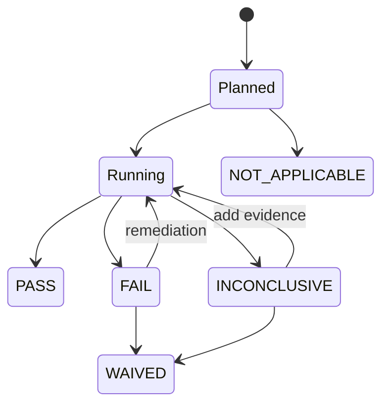
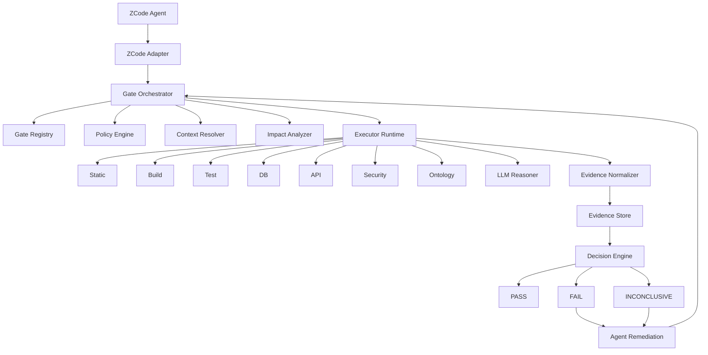

# Universal Delivery Gate Framework for ZCode
## 面向 Code Agent 的可裁剪软件交付质量门禁框架设计与研发指南

> 文档状态：Draft v0.1  
> 目标实现：ZCode Plugin 首发适配，核心保持 智能体平台无关（智能体平台无关）  
> 当前本体语义 Provider：FIBO（首版）  
> 设计原则：小步构建、小步验证、证据驱动、可裁剪、可替换、可演进  
> 日期：2026-09-23

---

## 0. 文档目的

本文档用于指导一套可真正部署并集成到 ZCode 等 Code Agent 中的通用质量门禁系统研发。

它不是一份传统 CI/CD checklist，也不是把 lint、unit test、security scan 简单串起来，而是要建立一套面向 Agentic Software Development 的“软件交付可信机制”：

- Code Agent 在开发闭环中持续触发质量验证；
- 每个 Gate 不仅“执行检查”，还必须知道“要证明什么”；
- 每个结论必须能够追溯到 Evidence；
- 没有证据不能等同于通过；
- 无法证明的问题必须显式暴露为 Risk；
- 必要时允许 Exception，但必须可追踪、可过期、可重新审查；
- Gate 可以根据项目类型、风险等级、开发阶段进行裁剪；
- Ontology 不是写死在框架中的业务知识，而是一个可配置、可扩展、可替换的语义 Provider；
- 首版本体语义以 FIBO 为实验和落地基础，后续可以替换为行业本体、企业本体或项目本体。

本文档既描述方法论，也定义工程结构、对象模型、执行协议、ZCode 集成策略、Gate Spec、分阶段计划及阶段性验证方式。

---

# 1. 背景与问题定义

## 1.1 Vibe Coding / Agentic Coding 的质量问题

Code Agent 显著提高了编码速度，但“代码生成速度”与“软件可交付性”并不是同一个问题。

Agent 很容易生成：

- 局部正确、整体错误的代码；
- 编译通过，但跨模块契约错误的代码；
- 单元测试通过，但测试与实现共享同一个错误假设的代码；
- API 正常返回，但持久化字段写错的代码；
- 功能主路径正确，但状态机、幂等、异常分支错误的代码；
- 业务概念映射错误，但所有传统测试仍通过的代码；
- 完成了代码，却遗漏 PRD 验收条件、Open Decision、技术债、迁移方案和运维资料。

传统质量流水线通常是：

```text
lint
  ↓
build
  ↓
unit test
  ↓
integration test
  ↓
security scan
  ↓
deploy
```

这套模型对 Agentic Coding 不够充分，因为它主要检查“实现制品”，而没有系统性回答以下问题：

1. Agent 是否完整理解了需求？
2. 是否存在未经确认的假设？
3. 代码、接口、Schema、SQL、持久化结果是否描述同一个业务事实？
4. 系统实际行为是否符合业务语义？
5. Agent 自己生成的测试是否形成“自证循环”？
6. 当前版本是否存在未暴露的不确定性？
7. 当前版本为什么可以被认为具备交付条件？

因此，本项目目标不是构建“更多测试”，而是构建：

> **Software Delivery Assurance System**

即一套软件交付可信证明系统。

---

# 2. 项目目标

## 2.1 最终目标

构建一个：

> **智能体平台无关、可声明、可组合、可裁剪、可追踪、可独立验证的软件交付质量门禁框架**

并首先实现为一个可部署、可实际使用的 ZCode Plugin。

未来同一个 Kernel 可以通过 Adapter 挂载到：

- ZCode
- Claude Code
- Codex 类 Agent
- IDE Agent
- CI/CD
- GitHub Actions / GitLab CI
- Jenkins
- 独立 CLI

---

## 2.2 首阶段目标

第一阶段不追求覆盖所有 Gate，而是证明整个架构能够闭环：

```text
Agent 修改代码
    ↓
自动触发 Gate
    ↓
Gate 产生 Evidence
    ↓
Gate 得出 PASS / FAIL / INCONCLUSIVE
    ↓
Agent 获得可操作反馈
    ↓
Agent 修复
    ↓
再次验证
```

首版 MVP 必须满足：

1. Plugin 可以在 ZCode 安装；
2. Plugin Hook 能被触发；
3. Gate Spec 可以声明一个最小 Gate；
4. Gate Kernel 可以解析 Gate Spec；
5. Executor 可以实际执行检查；
6. Evidence 被标准化存储；
7. Gate 可以得出结构化判定；
8. `Stop` 阶段能阻止 Agent 在必要证据缺失时直接结束；
9. Agent 能看到失败原因并继续修复；
10. 整个流程有自动化测试。

---

# 3. 非目标

首版明确不做以下事情：

- 不一次实现完整 L0–L5；
- 不实现通用形式化验证器；
- 不试图“证明软件绝对无 Bug”；
- 不宣称符合 ISO 26262；
- 不把 FIBO 写死在核心模型；
- 不让 LLM 自由决定所有 Gate 结论；
- 不以“LLM 说没问题”作为最终 PASS 证据；
- 不把所有 Gate 每次代码编辑都执行一遍；
- 不直接构建大型企业级 SaaS 平台；
- 不做复杂 Web 控制台作为首阶段目标。

---

# 4. 核心设计原则

## 4.1 Evidence First

Gate 的本质不是“运行命令”，而是：

> **为某个 Claim 收集足够 Evidence，并根据 Policy 作出准入判定。**

---

## 4.2 No Evidence ≠ PASS

以下情况不能记为 PASS：

- 检查未执行；
- 检查执行失败；
- 工具不存在；
- 测试环境不具备；
- 数据无法读取；
- LLM 无法判断；
- Ontology 未加载；
- 外部系统无法访问。

这些情况应该进入：

```text
INCONCLUSIVE
```

必要时进一步产生 Risk。

---

## 4.3 Deterministic First, LLM Second

优先级：

```text
确定性规则
  >
可执行测试
  >
结构化模型检查
  >
LLM 推理
```

LLM 更适合：

- 发现候选风险；
- 识别语义不一致；
- 解释失败；
- 生成测试建议；
- 建立 Requirement Mapping；
- 找出潜在 Assumption。

LLM 不应该单独决定：

```text
Release PASS
```

---

## 4.4 Incremental Verification

Agent 高频迭代时必须做到：

```text
只检查受影响的东西
```

而不是每次写一个文件都执行：

```text
full E2E + full security + full ontology
```

需要建立：

```text
Change
  ↓
Impact Analysis
  ↓
Applicable Gates
```

---

## 4.5 Independence of Evidence

应标注 Evidence 的来源和独立性。

例如：

```text
AI Generated Test PASS
```

不能与：

```text
Existing Independent Acceptance Test PASS
```

具有相同证明强度。

---

## 4.6 Ontology as Provider

Ontology 必须通过 Provider 接口提供。

核心框架只认识：

```text
Concept
Relation
Constraint
Invariant
Term
Semantic Finding
```

而不认识：

```text
FIBO-specific class
```

---

## 4.7 Agent Platform Independence

Kernel 不依赖 ZCode 内部模型。

ZCode 只是：

```text
Adapter
```

因此架构必须满足：

```text
Kernel
+
CLI Protocol
+
Adapter
```

---

## 4.8 Small Step, Verified Step

每增加一项能力，都必须定义：

- 要解决的问题；
- 最小实现；
- 可观察输出；
- 自动验证方式；
- 回归测试；
- 是否达到阶段准出条件。

---

# 5. 两个正交维度

整个系统必须同时考虑两个维度。

---

## 5.1 维度 A：Quality Domain

表示“我们要证明什么”。

```text
L0 范围、需求与生成完整性
L1 代码与工程正确性
L2 接口、数据与系统一致性
L3 功能与业务语义正确性
L4 架构、非功能与安全
L5 交付、运行与治理完整性
```

---

## 5.2 维度 B：Agent Lifecycle

表示“什么时候验证”。

```text
Task Start
Before Change
After Edit
Task Close
Commit / PR
Release
```

两者不应混淆。

例如：

```text
L4 Security
```

不代表它总是在 L4 时“第 4 步执行”。

它可能只在：

```text
PR
Release
```

阶段执行。

---

# 6. L0–L5 质量域

---

## 6.1 L0：范围、需求与生成完整性

核心问题：

> Agent 是否做了完整且正确范围内的事情？

### L0.1 Requirement Traceability

方法：

```text
Requirement Trace Matrix
```

关系：

```text
PRD
 ↓
Requirement
 ↓
Acceptance Criteria
 ↓
Design
 ↓
Code
 ↓
Test
```

### L0.2 Acceptance Criteria Coverage

验证：

- Feature 是否有实现；
- 每个 Acceptance Criteria 是否有 Evidence；
- 是否只实现主路径；
- 是否遗漏异常路径和边界条件。

### L0.3 Assumption Check

建立：

```text
Assumption Register
```

每项包含：

- assumption；
- evidence；
- source；
- impact；
- risk；
- resolution。

### L0.4 Open Decision Check

建立：

```text
Decision Register / ADR
```

发现：

- 尚未闭合的设计问题；
- 已经影响代码的未决策事项；
- Agent 擅自选择但没有依据的实现。

### L0.5 Change Scope Check

比较：

```text
Requested Scope
vs
Actual Diff
```

识别：

- 超范围修改；
- 意外公共接口修改；
- 意外 Schema 修改；
- 新依赖；
- 配置变更；
- 行为语义变化。

---

# 7. L1：代码与工程正确性

核心问题：

> 代码作为工程制品是否成立？

### L1.1 Syntax / Static Check

包括：

- syntax；
- lint；
- type；
- nullability；
- undefined symbol；
- dead code；
- code smell。

### L1.2 Compile / Link / Package

验证最终 Artifact 能被构建。

### L1.3 Unit Test

测试应覆盖：

- happy path；
- boundary；
- negative；
- exception；
- state transition。

### L1.4 Mutation Testing

用于判断测试是否真正有区分能力。

### L1.5 Code Structural Rules

例如：

```text
Controller
  ↓
Service
  ↓
Repository
```

禁止：

```text
Controller → DB
```

### L1.6 Repository Convention Alignment

验证：

- exception pattern；
- logging pattern；
- retry；
- timeout；
- transaction；
- naming；
- async pattern；
- error code。

---

# 8. L2：接口、数据与系统一致性

核心问题：

> 系统不同部分是否描述同一个事实？

---

## 8.1 API Contract Alignment

验证：

```text
OpenAPI
 ↕
Controller
 ↕
DTO
 ↕
Client
 ↕
Consumer
 ↕
Test
```

---

## 8.2 Schema Structural Alignment

验证：

```text
Entity
 ↕
ORM
 ↕
Migration
 ↕
Schema
 ↕
SQL
```

包括：

- type；
- nullable；
- precision；
- default；
- enum；
- key；
- constraint。

---

## 8.3 Schema Semantic Check

验证：

> 字段是否不仅结构一致，而且含义一致？

例如：

```text
amount
```

可能分别表示：

```text
order amount
authorized amount
captured amount
settled amount
```

---

## 8.4 Persistence Behavioral Verification

这是本框架的重要 Gate。

目标不是只验证：

```text
HTTP 200
```

而是：

> API / Use Case 实际执行后，持久化结果是否逐字段正确。

标准执行过程：

```text
Prepare Fixture
    ↓
DB Snapshot Before
    ↓
Execute API / Use Case
    ↓
Capture Response
    ↓
DB Snapshot After
    ↓
Field-level Assertion
    ↓
Cross-table Assertion
    ↓
Invariant Check
```

示例：

```text
POST /payments

request:
orderId = O1001
amount  = 100
currency = CNY
```

执行后验证：

| Field | Expected | Actual |
|---|---:|---:|
| payment.order_id | O1001 | O1001 |
| payment.amount | 100.00 | 100.00 |
| payment.currency | CNY | CNY |
| payment.status | CREATED | CREATED |
| payment.version | 1 | 1 |

并继续验证：

```text
payment.amount == ledger_entry.amount
```

以及金融领域可能存在的：

```text
SUM(debit) == SUM(credit)
```

Evidence 必须包含：

- request；
- response；
- DB before；
- DB after；
- field diff；
- invariant result。

---

## 8.5 Cross-table / Cross-service Invariant

例如：

```text
payment.status = SUCCESS
=> ledger.status = POSTED
```

或：

```text
refund.amount <= captured.amount
```

---

# 9. L3：功能与业务语义正确性

核心问题：

> 系统实际做的事情是否符合业务世界？

### L3.1 Smoke Test

验证核心链路可运行。

### L3.2 Integration Test

验证组件之间真实协作。

### L3.3 E2E

验证完整用户旅程。

### L3.4 Visual / UI Verification

优先：

```text
Visual Regression
```

人工目检作为补充。

### L3.5 PRD Behavioral Verification

L0 验证：

```text
有没有实现
```

L3 验证：

```text
实际行为是不是需求要求的行为
```

### L3.6 Domain Invariant Test

示例：

```text
capturedAmount <= authorizedAmount
refundAmount <= capturedAmount
settledAmount <= capturedAmount
```

方法：

- property-based testing；
- model-based testing；
- state machine；
- ontology constraint。

### L3.7 Ontology Semantic Gate

检查：

- Concept Alignment；
- Relation Alignment；
- State Alignment；
- Constraint Alignment；
- Terminology Ambiguity；
- Assumption；
- Semantic Conflict；
- Semantic Exposure。

---

# 10. L4：架构、非功能与安全

### L4.1 Architecture Fitness Functions

将架构原则转成机器可执行规则。

### L4.2 Non-functional Requirement

例如：

```text
TPS
P95 / P99
Concurrency
Memory
CPU
Availability assumption
```

### L4.3 Observability

关键业务必须具备：

```text
log
metric
trace
alert
```

### L4.4 SAST / Dependency / Secret / IaC

### L4.5 DAST / Penetration

### L4.6 Failure / Resilience

包括：

- DB down；
- Redis down；
- external timeout；
- duplicate message；
- retry storm；
- network fault。

---

# 11. L5：交付、运行与治理完整性

### L5.1 Configuration Change

### L5.2 Database Migration

必须验证：

```text
old version
  ↓
migration
  ↓
new version
```

而不仅验证全新数据库。

### L5.3 Document Consistency

包括：

```text
Code
 ↕
API Doc
 ↕
User Manual
 ↕
Operator Manual
```

### L5.4 Operational Readiness

至少包括：

- deploy；
- stop/start；
- upgrade；
- rollback；
- diagnosis；
- repair；
- alert handling；
- DR。

### L5.5 Technical Debt Register

不是简单禁止 TODO，而是要求显式治理。

### L5.6 Open Decision Closure

L0：

```text
发现
```

L5：

```text
是否允许带着这个 Decision 进入生产
```

### L5.7 Release Evidence Package

最终形成：

```text
Requirements
Traceability
Build
Tests
Contract
DB Validation
Security
Architecture
Ontology
Open Decisions
Technical Debt
Config
Migration
Runbook
Known Risks
Exceptions
```

---

# 12. 核心 Assurance Meta-model

框架的核心不是 Test，而是以下五个对象：

```text
Claim
Evidence
Gate
Risk
Exception
```

辅助对象：

```text
Artifact
Run
```

---

# 13. Claim

Claim 表示：

> **我们希望证明的可验证陈述。**

示例：

```yaml
id: PAY-DATA-001
statement: >
  每一个成功创建的支付请求必须产生与请求一致的
  payment 和 ledger 持久化记录。
domain: L2
criticality: high
source:
  - requirement: PAY-001
```

推荐字段：

```yaml
id:
statement:
domain:
category:
criticality:
scope:
source:
preconditions:
required_evidence_types:
owner:
tags:
```

---

# 14. Evidence

Evidence 表示：

> 支持或反驳 Claim 的可追溯事实。

示例：

```yaml
id: evidence-20260923-001
claim: PAY-DATA-001
type: persistence-verification
producer: executor.db-assert
result: pass
provenance:
  commit: abc123
  environment: test
  run_id: run-001
independence: spec-derived
artifacts:
  - request.json
  - response.json
  - db-before.json
  - db-after.json
  - field-diff.json
```

关键字段：

```text
producer
source
timestamp
environment
commit
independence
reproducibility
raw_artifact
normalized_result
```

---

# 15. Gate

Gate 表示：

> 根据一组 Claim、Evidence 要求和 Policy 作出的准入判定。

因此：

```text
Gate != shell command
```

一个 Gate 可以包含多个 Executor。

---

# 16. Risk

当 Claim 无法被充分证明，或出现潜在暴露时生成 Risk。

示例：

```yaml
id: RISK-127
source_claim: PAY-IDEMPOTENCY-003
severity: high
description: >
  当前测试环境无法模拟第三方通道超时，
  因此无法证明超时重试不会产生重复扣款。
status: open
```

---

# 17. Exception

Exception 是对某个风险或 Gate 失败的显式接受。

它必须包含：

```text
reason
scope
approver
mitigation
expiration
revalidation
```

Exception 不能永久隐藏 Risk。

---

# 18. Artifact

Artifact 可以是：

- PRD；
- ADR；
- source code；
- OpenAPI；
- SQL；
- migration；
- ontology；
- test；
- runbook；
- config；
- logs；
- screenshots。

---

# 19. Run

Run 表示一次 Gate 执行上下文。

推荐：

```yaml
id:
gate:
trigger:
commit:
workspace:
environment:
start_time:
end_time:
executors:
evidence:
decision:
```

---

# 20. Gate 判定状态

标准状态建议：

```text
PASS
FAIL
INCONCLUSIVE
WAIVED
NOT_APPLICABLE
```

解释：

### PASS

所需 Claim 有充分 Evidence。

### FAIL

Evidence 明确反驳 Claim。

### INCONCLUSIVE

证据不足，不能证明。

### WAIVED

存在有效 Exception。

### NOT_APPLICABLE

Gate 根据 Apply Rule 明确不适用。

---

# 21. Gate State Machine



---

# 22. Agent 生命周期映射

```text
Task Start
  ↓
Before Change
  ↓
After Edit
  ↓
Task Close
  ↓
Commit / PR
  ↓
Release
```

建议默认矩阵：

| Domain | Start | Before Change | After Edit | Task Close | PR | Release |
|---|---:|---:|---:|---:|---:|---:|
| L0 | ✓ | ✓ |  | ✓ | ✓ | ✓ |
| L1 |  |  | ✓ | ✓ | ✓ | ✓ |
| L2 |  |  | selective | ✓ | ✓ | ✓ |
| L3 |  |  | selective | ✓ | ✓ | ✓ |
| L4 |  | selective |  | selective | ✓ | ✓ |
| L5 |  |  |  |  | selective | ✓ |

---

# 23. 总体架构



---

# 24. 三层产品结构

整个项目建议分为：

```text
Kernel
Gate Packs
Agent Adapters
```

---

## 24.1 Kernel

负责：

- Gate Spec；
- Claim；
- Evidence；
- Risk；
- Exception；
- Run；
- Policy；
- Decision；
- Executor Protocol；
- Evidence Store；
- Impact Analysis。

Kernel 不知道 ZCode。

---

## 24.2 Gate Packs

Gate 是插件化能力包。

示例：

```text
gate-packs/
  engineering/
  api-contract/
  persistence/
  architecture/
  security/
  ontology/
```

---

## 24.3 Agent Adapters

示例：

```text
adapters/
  zcode/
  claude-code/
  ci/
```

---

# 25. 声明式 Gate Spec

Gate 必须尽量声明式，而不是写死 Workflow。

示例：

```yaml
apiVersion: qgate/v1alpha1
kind: Gate

metadata:
  id: data.persistence-integrity
  version: 0.1.0

spec:
  domain: L2
  description: >
    验证接口调用后关键持久化字段及领域不变量正确。

  appliesWhen:
    changed:
      any:
        - "src/**/controller/**"
        - "src/**/service/**"
        - "src/**/repository/**"
        - "db/**"
        - "**/*.sql"

  triggers:
    - task_close
    - pre_commit
    - release

  claims:
    - persistence.request-fields-correct
    - persistence.cross-table-consistent

  executors:
    - id: test.integration
    - id: db.snapshot
    - id: db.field-assert
    - id: invariant.check

  evidence:
    required:
      - integration-test-result
      - db-before
      - db-after
      - field-diff
      - invariant-result

  policy:
    failure: block
    inconclusive: block
```

---

# 26. Profile / Tailoring

通用并不意味着所有项目跑相同 Gate。

建议支持：

```text
vibe-fast
feature-close
frontend
backend-api
library
high-assurance
release
```

示例：

```yaml
apiVersion: qgate/v1alpha1
kind: Profile

metadata:
  id: backend-api

spec:
  enable:
    - L0.*
    - L1.*
    - L2.*
    - L3.functional.*
    - L4.architecture
    - L4.security.sast

  disable:
    - L3.visual
    - L4.dast

  overrides:
    data.persistence-integrity:
      policy:
        inconclusive: block
```

---

# 27. Impact Analysis

这是性能和体验的关键。

输入：

```text
git diff
changed files
changed symbols
dependency graph
schema diff
API diff
```

输出：

```text
Affected Claims
Applicable Gates
Recommended Execution Level
```

示例：

```text
Change:
PaymentEntity.java

Affected:
- schema.structural
- persistence.integrity
- payment.domain-invariant
- migration.compatibility
```

---

# 28. Executor Protocol

Executor 应该是可替换的。

统一接口概念：

```text
plan()
execute()
collect()
normalize()
```

输入：

```json
{
  "runId": "run-001",
  "gateId": "data.persistence-integrity",
  "workspace": "...",
  "context": {},
  "config": {}
}
```

输出：

```json
{
  "status": "completed",
  "evidence": [],
  "diagnostics": []
}
```

Executor 不直接决定 Release。

---

# 29. Executor 类型

首版预留：

```text
command
static-analysis
build
test
api
database
browser
security
ontology
llm
custom
```

---

# 30. Evidence Normalization

不同工具结果必须归一化。

例如 ESLint、pytest、mvn test 最终都转换为：

```yaml
evidenceType:
producer:
subject:
result:
observations:
rawArtifact:
provenance:
```

这样 Decision Engine 不依赖具体工具格式。

---

# 31. Evidence Independence

建议枚举：

```text
self-generated
implementation-derived
spec-derived
existing-independent
runtime-observed
ontology-derived
human-reviewed
```

未来可以引入 Evidence Strength。

例如：

```text
runtime-observed > self-generated-test
```

但首版不要过早设计复杂评分系统。

---

# 32. ZCode Plugin 集成设计

截至本文编写时，ZCode Plugin 可以打包：

- Skill；
- Command；
- Subagent；
- MCP Server；
- Hook。

Hook 当前支持主要生命周期：

```text
SessionStart
UserPromptSubmit
PreToolUse
PermissionRequest
PostToolUse
PostToolUseFailure
Stop
```

因此非常适合做第一版 Adapter。

---

# 33. ZCode Plugin 目录建议

```text
qgate-zcode/
├── .zcode-plugin/
│   └── plugin.json
│
├── hooks/
│   ├── hooks.json
│   ├── session-start.mjs
│   ├── pre-tool.mjs
│   ├── post-tool.mjs
│   └── stop.mjs
│
├── commands/
│   ├── qgate-status.md
│   ├── qgate-run.md
│   ├── qgate-explain.md
│   └── qgate-evidence.md
│
├── skills/
│   └── quality-gate/
│       └── SKILL.md
│
├── agents/
│   └── gate-reviewer.md
│
├── .mcp.json
│
├── dist/
│
└── package.json
```

注意：

Kernel 最终应独立仓库或独立 package。

---

# 34. Hook 职责

## 34.1 SessionStart

用途：

- 读取项目 Gate Profile；
- 加载最近 Gate 状态；
- 告知 Agent 当前质量约束；
- 不执行昂贵 Gate。

示例上下文：

```text
This project uses qgate profile backend-api.
Blocking gates must pass before task completion.
```

---

## 34.2 UserPromptSubmit

用途：

- 检测是否是开发任务；
- 初始化 Task Run；
- 建立 initial scope；
- 提示 Agent 记录需求/假设。

不建议首版强阻断普通 Prompt。

---

## 34.3 PreToolUse

重点处理：

```text
Write
Edit
Shell
```

首版仅做：

- scope guard；
- dangerous path guard；
- 受影响 Gate 标记。

不要每次写文件执行测试。

---

## 34.4 PostToolUse

用途：

- 收集变更；
- 更新 impact graph；
- 可触发快速 Gate。

快速 Gate 示例：

```text
lint
type check
affected unit tests
```

---

## 34.5 PostToolUseFailure

用途：

- 记录 tool failure；
- 给 Agent 提供修复上下文；
- 标记 Evidence 不完整。

---

## 34.6 Stop

这是首版最关键 Hook。

Agent 准备结束时：

```text
Stop
 ↓
qgate task-close
 ↓
required Gate complete?
```

若：

```text
FAIL / INCONCLUSIVE
```

则反馈 Agent：

```text
不可结束，仍缺少以下质量证据……
```

Agent 继续修复。

需要注意 ZCode 对 Stop 连续继续存在次数限制，因此框架不能无限循环。

---

# 35. Command 设计

建议提供：

```text
/qgate-status
/qgate-run
/qgate-explain
/qgate-evidence
/qgate-risk
```

### `/qgate-status`

查看：

- applicable gates；
- gate status；
- missing evidence；
- risks。

### `/qgate-run`

显式运行 Gate。

### `/qgate-explain`

解释失败：

```text
Why did this gate fail?
```

### `/qgate-evidence`

查看证据。

---

# 36. Skill 设计

Skill 负责告诉 Agent：

> 如何在本项目中按照 QGate 的方式完成开发闭环。

Skill 不应承担 Kernel 逻辑。

Skill 内容包括：

- 先识别需求；
- 显式记录假设；
- 修改后执行快速 Gate；
- 完成前检查 Gate；
- 对失败优先修复而不是绕过；
- 不把 skipped 当作 pass。

---

# 37. MCP 角色

MCP 可以提供结构化工具：

```text
gate.plan
gate.run
gate.status
gate.get_evidence
gate.get_failures
gate.get_risks
gate.explain
```

第一版可以暂缓 MCP，实现：

```text
Hook + CLI
```

验证成功后再加入 MCP。

理由：

> 先证明 Gate Kernel 有效，再增加 Agent Tool Surface。

---

# 38. CLI 是基础接口

即使最终用户主要使用 Plugin，也建议从一开始实现 CLI：

```text
qgate plan
qgate run
qgate status
qgate explain
qgate evidence
qgate risk
qgate validate-config
```

原因：

1. 便于调试；
2. 可接 CI；
3. 可独立测试；
4. Adapter 简单；
5. 不被 ZCode 生命周期绑死。

---

# 39. Ontology 架构

Ontology 不能成为 Kernel 的硬依赖。

建议：

```text
OntologyProvider
```

接口：

```text
load()
resolveConcept()
resolveRelation()
getConstraints()
validateMapping()
findAmbiguities()
evaluateInvariant()
```

---

# 40. Ontology Provider 统一输出

统一语义模型：

```yaml
Concept:
  id:
  label:
  aliases:
  definition:
  source:

Relation:
  source:
  predicate:
  target:

Constraint:
  id:
  expression:
  severity:

SemanticFinding:
  type:
  subject:
  evidence:
  confidence:
```

---

# 41. FIBO Provider

首版本体 Provider：

```text
FIBO
```

但设计上：

```text
Kernel
  ↓
Ontology Provider Interface
  ↓
FiboProvider
```

而不是：

```text
Kernel → FIBO
```

---

# 42. FIBO 首版使用范围

不要一开始加载全部 FIBO 做复杂推理。

建议从小范围开始：

```text
Payment
Account
Party
Transaction
Obligation
Identifier
Amount
Currency
Status
```

优先解决：

1. 术语定义；
2. 概念映射；
3. 字段语义歧义；
4. 基本关系检查；
5. 领域不变量辅助生成。

---

# 43. Ontology Mapping

项目层需要维护：

```yaml
ontology:
  provider: fibo
  mappings:
    Payment:
      code:
        - com.example.payment.Payment
      tables:
        - payment
    MonetaryAmount:
      fields:
        - payment.amount
```

后续 Provider 可替换为：

```text
enterprise-ontology
insurance-ontology
custom-rdf
owl-file
knowledge-graph
```

---

# 44. Ontology Gate 首版不要做什么

首版不要：

- 自动证明完整业务正确性；
- 依赖超大规模 OWL 推理；
- 用 LLM 猜全部代码到 FIBO 的映射；
- 让 Ontology Gate 成为所有项目强制依赖。

首版只做：

```text
可配置
可关闭
可解释
有证据
```

---

# 45. Persistence Verification 设计建议

这是最值得优先实现的 L2 Gate 之一。

建议定义：

```yaml
scenario:
  setup:
  execute:
  assert:
    response:
    persistence:
    invariants:
```

示例：

```yaml
scenario:
  id: payment-create

  execute:
    http:
      method: POST
      path: /payments
      body:
        orderId: O1001
        amount: 100
        currency: CNY

  assert:
    response:
      status: 200

    persistence:
      payment:
        where:
          order_id: O1001
        fields:
          amount: 100.00
          currency: CNY
          status: CREATED

    invariants:
      - "payment.amount == ledger.amount"
```

---

# 46. 数据 Snapshot

持久化验证推荐记录：

```text
Before Snapshot
After Snapshot
Delta
```

而不是只执行 SQL assert。

原因：

- 更容易解释；
- 可以生成 Evidence；
- 可以发现意外副作用；
- Agent 可以看到“多写了什么 / 少写了什么”。

---

# 47. Gate Policy

Policy 示例：

```yaml
policy:
  onFail: block
  onInconclusive: block
  allowWaiver: true
  maxAge: 24h
```

未来可增加：

```text
criticality
environment
branch
release type
```

---

# 48. Evidence 有效期

Evidence 不能永久有效。

例如：

```text
lint
```

修改代码后立即失效。

因此 Evidence 至少关联：

```text
commit
tree hash
affected paths
config hash
environment
```

---

# 49. 缓存与增量执行

缓存 Key 可以基于：

```text
gate version
executor version
input artifact hash
config hash
environment identity
```

避免重复运行。

---

# 50. 安全边界

Plugin 会执行本地代码，因此必须：

- 不自动执行未知脚本；
- 不直接执行未经审查的项目命令；
- Gate Spec 中 command executor 需要 allowlist；
- Secret 不进入 Evidence；
- stdout / logs 做脱敏；
- 数据库连接配置不写入 Evidence；
- FIBO / Ontology Provider 不应获得不必要的生产权限。

---

# 51. Evidence Store

首版建议本地：

```text
.qgate/
  runs/
  evidence/
  risks/
  cache/
```

但考虑 ZCode Plugin 的持久化边界，应支持：

```text
ZCODE_PLUGIN_DATA
```

用于 Plugin 自身长期状态。

项目级可提交的定义与运行时 Evidence 必须区分：

```text
repo config
vs
local execution data
```

---

# 52. 项目配置

建议：

```text
.qgate/
  qgate.yaml
  profiles/
  gates/
  ontology/
```

注意：

ZCode 当前项目级 Hook 本身不能直接作为团队共享 Hook 执行来源，因此真正的自动 Hook 应通过 Plugin 分发；项目目录只存 QGate 配置和 Gate 定义。

---

# 53. 推荐仓库结构

```text
universal-delivery-gate/
├── packages/
│   ├── core/
│   ├── cli/
│   ├── executor-command/
│   ├── executor-test/
│   ├── executor-db/
│   ├── ontology-core/
│   └── ontology-fibo/
│
├── adapters/
│   └── zcode/
│
├── gate-packs/
│   ├── engineering/
│   ├── persistence/
│   └── ontology/
│
├── examples/
│   ├── simple-node/
│   └── payment-demo/
│
├── schemas/
│   ├── gate.schema.json
│   └── profile.schema.json
│
└── docs/
```

---

# 54. 技术选择建议

首版建议 Node.js / TypeScript。

理由：

- ZCode Hook 示例天然支持 Node；
- JSON / YAML 处理方便；
- 跨平台；
- CLI 方便；
- MCP SDK 生态成熟；
- 适合作为 Plugin 工具链。

但 Kernel API 应避免绑定 Node 专属语义，以便未来出现 Python / Go Executor。

---

# 55. MVP 研发路线

核心要求：

> 每完成一点，就必须验证一点。

---

# 56. Phase 0：Spike — ZCode Hook 可行性

目标：

证明：

```text
ZCode Plugin
  ↓
Hook
  ↓
本地脚本
  ↓
结构化返回
```

实现：

- minimal plugin；
- SessionStart；
- Stop；
- 一个 hello checker。

验证：

1. Plugin 可安装；
2. Hook 出现在 ZCode；
3. 新 Session 可触发；
4. Stop 可向 Agent 注入反馈；
5. 日志可定位错误。

准出：

```text
5/5 PASS
```

---

# 57. Phase 1：最小 Gate Kernel

实现：

```text
Gate Spec
Gate Registry
Run
Evidence
Decision
```

只支持一个 Executor：

```text
command
```

Gate：

```text
engineering.basic-check
```

可以执行项目已有：

```text
lint
```

或：

```text
test
```

验证：

```text
故意制造 lint 错误
→ FAIL

修复
→ PASS
```

准出：

```text
同一 Gate 在 CLI 和 ZCode Stop Hook 均可工作
```

---

# 58. Phase 2：Agent Remediation Loop

目标：

证明：

```text
FAIL
 ↓
Stop block
 ↓
Agent 修复
 ↓
Re-run
 ↓
PASS
```

验证必须自动记录：

```text
Run 1 FAIL
Run 2 PASS
```

---

# 59. Phase 3：Profile + Impact

加入：

```text
vibe-fast
feature-close
```

支持：

```text
appliesWhen
```

验证：

- 改 README 不运行 build Gate；
- 改 source 运行；
- 修改相关测试只运行 affected Gate。

---

# 60. Phase 4：Persistence Behavioral Gate

做一个最小 Payment Demo：

```text
POST /payment
```

数据库：

```text
SQLite / Postgres Testcontainer
```

验证：

```text
request
response
DB before
DB after
field diff
```

故意制造：

```text
amount 写错字段
```

要求：

```text
unit test 可 PASS
persistence Gate FAIL
```

这是非常有价值的框架演示。

---

# 61. Phase 5：Claim / Risk / Exception

正式引入：

```text
Claim
Risk
Exception
```

场景：

某个 Evidence Producer 不可用。

期待：

```text
INCONCLUSIVE
```

而不是 PASS。

然后测试：

```text
Exception
```

是否可显式放行。

---

# 62. Phase 6：FIBO Provider Skeleton

目标不是做完整语义推理。

只实现：

```text
Provider Interface
FIBO Loader
Concept Lookup
Project Mapping
Semantic Finding
```

示例：

代码：

```text
capturedAmount
```

映射到领域概念。

验证：

- Provider 可以关闭；
- Provider 可以替换 Mock Provider；
- Kernel 不依赖 FIBO class；
- FIBO 失败时产生 INCONCLUSIVE，而不是 crash。

---

# 63. Phase 7：Ontology Semantic Gate v0

实现最小能力：

```text
Terminology Ambiguity
Concept Mismatch
Constraint Candidate
```

例如：

```text
Captured != Settled
```

当代码 / PRD 混用时生成 Finding。

首版可以：

```text
finding = warning
```

而非强 Blocking。

---

# 64. Phase 8：MCP

Kernel 稳定后再加入：

```text
gate.plan
gate.run
gate.status
gate.evidence
```

此时 Code Agent 可以主动询问 Gate。

---

# 65. Phase 9：扩展 Gate Pack

逐步加入：

```text
API Contract
Schema
Architecture
Security
E2E
Migration
Operational Readiness
```

---

# 66. 每阶段必须包含的验证

每一 Phase 必须回答：

```text
What did we add?
What can now be proven?
How do we know it works?
What intentionally remains unsupported?
```

---

# 67. 测试策略

框架自身需要至少四层测试。

### 67.1 Unit Test

验证：

- parser；
- policy；
- decision；
- state machine。

### 67.2 Contract Test

验证：

- Executor Protocol；
- Adapter Protocol；
- Evidence schema。

### 67.3 Integration Test

验证：

```text
Gate Spec → Executor → Evidence → Decision
```

### 67.4 End-to-End Plugin Test

验证：

```text
ZCode Hook → Kernel → Result → Hook Response
```

---

# 68. Golden Scenarios

建议维护少量固定 Demo：

```text
demo-clean
demo-lint-fail
demo-build-fail
demo-persistence-mismatch
demo-inconclusive
demo-ontology-mismatch
```

任何重大修改都跑这些 Scenario。

---

# 69. Failure Semantics

框架自身失败和 Gate FAIL 必须区分。

例如：

```text
Gate FAIL:
代码违反规则

Framework ERROR:
Executor crash
```

Framework ERROR 默认转：

```text
INCONCLUSIVE
```

不能转 PASS。

---

# 70. Explainability

每一个非 PASS 必须回答：

```text
What failed?
Which Claim?
What Evidence?
Why does it matter?
How can it be reproduced?
What is the likely remediation?
```

这对 Agent 尤其重要。

---

# 71. Release Evidence Package

最终版本可以输出：

```text
qgate release-report
```

生成：

```text
Gate Summary
Claim Coverage
Evidence Index
Open Risks
Exceptions
Unresolved Decisions
Ontology Findings
Config
Run Metadata
```

---

# 72. 与 ISO 26262 的关系

本框架可以借鉴以下思想：

- traceability；
- verification evidence；
- independence；
- tailoring；
- assurance argument；
- explicit residual risk。

但本文框架不是 ISO 26262 实现，也不宣称合规。

我们借鉴的是：

> **“关键结论必须有可追踪证据”**

而不是照搬汽车软件流程。

---

# 73. 设计权衡

## 73.1 为什么不从完整 Ontology 开始？

因为如果：

```text
Hook
Gate
Evidence
Decision
```

闭环都没有跑通，那么 Ontology 再高级也只是孤立能力。

正确顺序：

```text
Execution Loop
 ↓
Evidence Model
 ↓
Domain Gate
 ↓
Ontology
```

---

## 73.2 为什么不用 LLM 做所有检查？

因为：

- 难复现；
- 难保证稳定；
- 自证风险高；
- 成本高；
- 解释不等于证明。

---

## 73.3 为什么需要 Claim？

没有 Claim 时：

```text
100 tests passed
```

并不能回答：

```text
到底证明了什么？
```

---

## 73.4 为什么需要 Risk / Exception？

软件永远存在无法完全证明的部分。

真正成熟的门禁应该：

```text
暴露不确定性
```

而不是隐藏它。

---

# 74. 首版 Definition of Done

QGate ZCode Plugin v0.1 可认为达到首个可用版本，当：

- [ ] Plugin 可安装；
- [ ] SessionStart Hook 工作；
- [ ] Stop Hook 工作；
- [ ] CLI 可独立执行；
- [ ] Gate Spec 可加载；
- [ ] 至少一个实际工程 Gate 可 PASS/FAIL；
- [ ] Evidence 可持久化；
- [ ] FAIL 可阻止 Task Close；
- [ ] Agent 能获得修复信息；
- [ ] 修复后可重新 PASS；
- [ ] INCONCLUSIVE 不会被误判 PASS；
- [ ] 有一个端到端 Demo；
- [ ] 有自动测试；
- [ ] 文档说明安装和运行方式。

---

# 75. 第二个可用版本 Definition of Done

v0.2 目标：

- [ ] Profile；
- [ ] Impact Analysis；
- [ ] Persistence Behavioral Verification；
- [ ] Claim；
- [ ] Risk；
- [ ] Exception；
- [ ] Evidence provenance；
- [ ] Evidence independence 字段；
- [ ] Payment Demo。

---

# 76. FIBO 版本 Definition of Done

Ontology v0.1：

- [ ] Provider Interface；
- [ ] FIBO Provider；
- [ ] Configurable mapping；
- [ ] Concept lookup；
- [ ] Semantic finding；
- [ ] Provider 可关闭；
- [ ] Mock Provider 可替换；
- [ ] FIBO 不可用时 Kernel 仍可正常运行；
- [ ] 至少一个真实金融语义 mismatch Demo。

---

# 77. Open Decisions

当前需要后续研发过程中逐项闭合：

### OD-001
Gate Spec 使用 YAML 还是 JSON 主格式？

建议：

```text
YAML authoring
JSON Schema validation
```

### OD-002
Evidence Store 首版是否使用 SQLite？

建议：

```text
先 JSONL / JSON
```

等对象模型稳定再考虑 SQLite。

### OD-003
Kernel 使用 Node Monorepo 还是单 Package？

建议：

```text
monorepo
```

但 Phase 0 可先单 package。

### OD-004
FIBO 加载方式：

```text
local RDF/OWL
vs
preprocessed semantic index
```

建议首版做预处理索引，避免每次完整推理。

### OD-005
LLM Reasoner 是否在 Kernel 内置？

建议：

```text
Executor plugin
```

而非核心依赖。

---

# 78. 推荐第一步实施任务

真正开始开发时，不应先写全部目录。

第一步只创建：

```text
qgate-zcode/
├── .zcode-plugin/plugin.json
├── hooks/hooks.json
└── hooks/stop.mjs
```

目标只有一个：

> **证明 ZCode Stop → Process → JSON Response → Agent Continue 闭环可靠。**

通过后才进入 Kernel。

这是整个研发策略最重要的实践约束：

```text
先证明接口
再抽象核心
再增加能力
```

而不是：

```text
先设计完整平台
最后才第一次运行
```

---

# 79. 推荐的整体演进路线


---

# 80. 最终设计定位

这套系统最终不是：

```text
一组检查脚本
```

也不是：

```text
一个超级 Skill
```

更不是：

```text
LLM Code Review Prompt
```

它应该演变成：

> **Agentic Software Development 的 Verification & Assurance Subsystem**

其中：

```text
L0–L5
= What must be assured

Claim / Evidence / Gate / Risk / Exception
= How assurance is represented

Artifact / Run
= What assurance is based on

Gate Spec / Profile
= How assurance is configured

Executor
= How evidence is produced

Impact Analyzer
= What needs to run

Ontology Provider
= How domain semantics are supplied

FIBO Provider
= First domain semantics implementation

Hook / CLI / MCP / Skill
= How Code Agents interact with the framework

Release Evidence Package
= Why a version is considered releasable
```

---

# 81. 最重要的三条工程纪律

## 第一条

```text
没有 Evidence，不得 PASS。
```

## 第二条

```text
每增加一个 Gate，必须先说明它要证明哪个 Claim。
```

## 第三条

```text
每实现一个最小能力，立即做可重复验证，再进入下一阶段。
```

如果这三条能够始终保持，这个项目才不会从“可信交付框架”重新退化成“一堆越来越多但互相没有关系的检查脚本”。

---

# 82. 当前研发基线

从本文件开始，建议后续研发工作的基线顺序固定为：

1. ZCode Hook Spike；
2. Gate Spec v0.1；
3. Kernel 最小模型；
4. 单 Gate 闭环；
5. Agent Remediation Loop；
6. Profile / Impact；
7. Persistence Behavioral Verification；
8. Claim / Evidence / Risk / Exception 完整化；
9. Ontology Provider Interface；
10. FIBO Provider；
11. Ontology Gate；
12. 更多 Gate Pack；
13. MCP；
14. Claude Code / 其他 Agent Adapter；
15. Release Evidence Package。

任何新增需求都应先判断：

> 它属于当前 Phase，还是应该进入未来 Phase？

原则上不跨阶段“顺手实现”。

---

# 83. 参考实现事实说明

本文针对 ZCode 的集成设计基于 2026-09-23 时可见的 ZCode 官方文档能力：

- Plugin 可组合 Skill、Command、Subagent、MCP Server 与 Hook；
- 推荐 Plugin manifest 位于 `.zcode-plugin/plugin.json`；
- `hooks/hooks.json` 可随 Plugin 自动发现；
- Hook 支持 `SessionStart`、`UserPromptSubmit`、`PreToolUse`、`PermissionRequest`、`PostToolUse`、`PostToolUseFailure`、`Stop`；
- Hook 使用本地子进程协议，通过 stdin 接收 JSON，通过 stdout JSON 和 exit code 返回结果；
- `PreToolUse` 可以 allow / deny / 修改输入；
- `Stop` 可以阻止当前结束并让 Agent 继续一个回合；
- Plugin 可使用专属数据目录保存长期数据；
- ZCode Plugin 可以同时携带 MCP Server；
- Plugin 是当前更适合团队分发 Hook 的方式。

这些属于 ZCode Adapter 事实，而不是 Kernel 的永久假设。未来如果 ZCode 生命周期或协议变化，只调整 Adapter，不调整 Claim / Evidence / Gate 核心模型。

---

# 84. 结语

本项目真正要解决的问题，不是：

> “怎样让 AI 写出来的代码通过更多测试？”

而是：

> “怎样建立一套可以被机器执行、可以被 Agent 消费、可以逐步收集证据、可以暴露未知风险、最终能够解释为什么一个软件版本基本具备交付条件的机制？”

这也是本框架与传统 CI/CD 最大的区别。

传统 CI/CD 更接近：

```text
Did the commands succeed?
```

本框架最终要回答：

```text
What do we claim is true?

What evidence supports each claim?

Which claims remain uncertain?

What risks remain?

Which exceptions were accepted?

Why is this version allowed to proceed?
```

只有当这些问题能够被稳定、可重复、可追踪地回答时，Code Agent 才真正从“代码生成器”进入“可控的软件研发闭环”。

