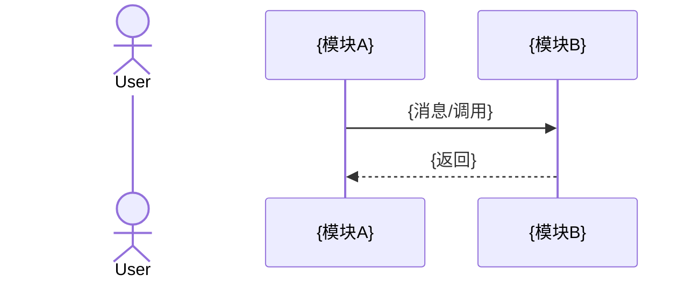
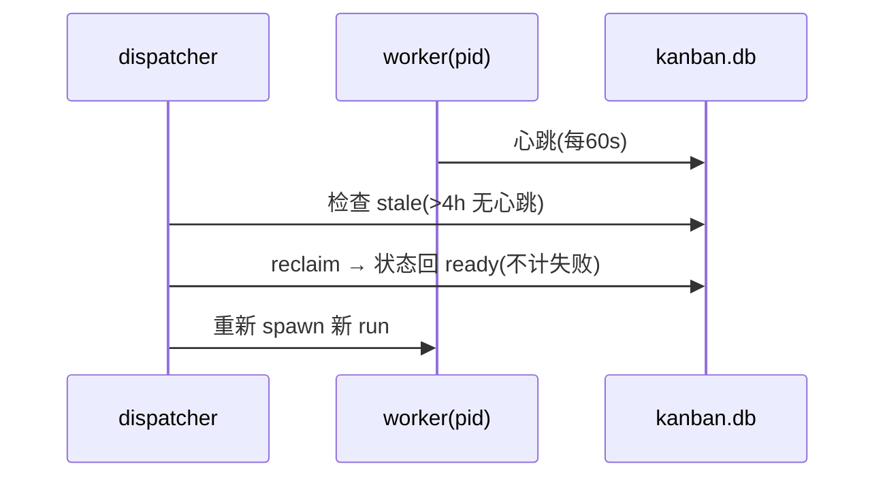

# G-doc 代码知识图谱模板（G1/G2/G5/G6）

> **何时产出**：对 10+ 仓库 / 微服务级代码调研（swarm-yuan 阶段 1 Survey 的超集场景）时，在 `survey.md` 之外补齐本模板族的标准化图谱文档。小型单仓调研不需要 G-doc，survey.md + file:line 锚点即可。
> **来源**：蒸馏自 Tencent/teamai-cli v0.22.0 源码快照（本地路径 `workspace/research/teamai-cli-src/`），转译而非照抄——teamai CLI 命令、`teamwiki/` 目录结构、Tree-sitter 提取运行时不适用于 Hermes 集群，已剥离。锚点行号以快照版本为准。
> **口径声明**：上游存在两套 G 编号且不一致——方法论（phase2 §Type-9）G6=知识图谱三元组、G3=数据流存储；引擎（deep-enrich.ts）G6=多跳传递依赖、G3=接口清单。**本文采用引擎口径**（与集群既有调研报告 §3.3 一致）：G1 组件关系 / G2 数据流 / G5 场景序列 / G6 多跳路径。引用外部 TeamAI 材料时注意核对口径。

---

## 〇、通用纪律（每份 G-doc 强制）

1. **Sources 锚点**：每条结论可回溯。格式 `来源: <repo>/<path>:<line>`；快照/文档级证据写快照路径。禁止无锚点断言，禁止凭记忆构造行号。
2. **置信度两档标注**：
   - `实测` —— 源码验证过（打开文件核对过内容，或脚本机械提取）。
   - `推断` —— 正则/文档/结构性证据推出，必须附一句依据说明（继承 TeamAI "禁默认分值"纪律：不许无依据的中间置信度）。
   - 映射自 TeamAI 三态：实测←EXTRACTED(1.0)；推断←INFERRED(0.6~0.9)+AMBIGUOUS(0.1~0.3) 合并。无法定档的内容宁标 `推断` 并写明不确定点，禁止升格为 `实测`。（依据: graph-rag-agent.md:37-45,332-337）
3. **search-anchor**：每份文档标题下一行 `<!-- search-anchor: 5~15 个中英文关键词/同义词 -->`。（依据: templates.ts:173、phase3-ai-enhancement.md:56-66）
4. **AI 快速理解要点表**：每份 G-doc 开头三行表——文档定位 / 核心价值 / 使用场景。（依据: graph-rag-agent.md:66-69、phase2 T9-R01）
5. **图谱不替代组件文档**：G-doc 只提供跨模块**关系视角**的结构化索引；单模块细节仍在各模块调研笔记。（依据: phase2 T9-R10）
6. **不虚构**：数据不足时写"（暂无数据）"并说明可能原因，禁止编造关系填充表格。（依据: deep-enrich.ts:246-252 空数据兜底模式）
7. **mermaid 规范**：时序图用 `sequenceDiagram`；状态机用 `stateDiagram-v2`；决策树用 `graph TD`。（依据: phase2 T9-R04/R05、graph-rag-agent.md:341-343）

---

## 一、G1 组件依赖关系矩阵

**适用问题**：「谁依赖 X？X 依赖谁？」——变更影响评估、服务依赖梳理、架构重构规划。
（路由锚点: templates.ts:42「谁依赖谁 / 模块关系 → G1」）

### 结构骨架

```markdown
# {项目} G1 组件依赖关系矩阵
<!-- search-anchor: 依赖, 关系, 上游, 下游, imports, 模块关系 -->

| 文档定位 | 解决"谁依赖 X / X 依赖谁"的关系检索 |
| 核心价值 | 依赖表 + 正向/反向依赖索引 |
| 使用场景 | 变更影响评估、依赖梳理、重构规划 |

## 依赖表（全量边）
| 来源组件 | 目标组件 | 关系类型 | 置信度 | 来源锚点 |

## 正向依赖索引（X 依赖 →）
- **{组件}** → {下游1}, {下游2}   （按依赖数降序，取 Top 20）

## 反向依赖索引（→ X 被谁依赖）
- **{组件}** ← {上游1}, {上游2}   （按被依赖数降序，取 Top 20）

## 置信度统计
| 档位 | 条数 | 说明 |
```

关系类型取值：`调用`(同步) / `消息`(异步) / `共享存储` / `配置` / `—`。对应 TeamAI 的 RPC/MQ/DB/—（依据: phase1-reverse-engineering.md:79-89）。

### 填写示例（Hermes 集群 kanban 域，示例性质·推断）

```markdown
# Hermes Kanban G1 组件依赖关系矩阵
<!-- search-anchor: kanban, 调度, dispatcher, 依赖, 任务卡 -->

## 依赖表
| 来源组件 | 目标组件 | 关系类型 | 置信度 | 来源锚点 |
|---------|---------|---------|--------|---------|
| kanban-dispatcher | kanban.db(SQLite) | 共享存储 | 实测 | kanban_* 工具直写 SQLite |
| kanban-dispatcher | worker profiles | 消息(spawn) | 实测 | dispatcher 拾取 ready 卡 spawn worker |
| worker-researcher | kanban.db(SQLite) | 共享存储 | 实测 | kanban_comment/complete 写事件 |
| worker | config.yaml | 配置 | 实测 | 模型/provider/clearances 读配置 |
| gateway | kanban.db(SQLite) | 共享存储 | 推断 | 依据: 看板消息路由与卡状态联动，未见直读代码 |

## 正向依赖索引
- **kanban-dispatcher** → kanban.db, worker profiles, config.yaml
## 反向依赖索引
- **kanban.db** ← kanban-dispatcher, worker-researcher, gateway
```

---

## 二、G2 数据流（调用链 / 请求路径）

**适用问题**：「请求/任务从入口到终点经过哪些模块？」——调用链追踪、路径断点定位。
（路由锚点: templates.ts:43「调用链 / 数据流 → G2」）

### 结构骨架

```markdown
# {项目} G2 数据流与调用链全景
<!-- search-anchor: 调用链, 数据流, 请求路径, entry, 链路 -->

| 文档定位 | 解决"请求经过哪些模块"的链路检索 |
| 核心价值 | 入口→终点的端到端调用链 + 文本链路格式 |

## 核心链路 N: {链路名}
入口: {入口点}
  → {步骤1模块}（{做什么}）
  → {步骤2模块}（{做什么}）
  → ...
  → {终点}（{结果/落点}）
置信度: {实测/推断+依据}

## mermaid 时序图（核心链路择要）
```

链路格式继承 TeamAI 调用链标准：每步标注执行模块与动作，锚点精确到文件/函数（依据: phase1-reverse-engineering.md:65-77）。纯库项目无多层调用链时直接写"（暂无调用链数据：单层架构/纯库项目）"，不硬造（依据: deep-enrich.ts:299-305 兜底）。

### 填写示例（Hermes kanban 任务生命周期，示例性质·推断）

```markdown
## 核心链路 1: 看板任务从创建到完成
入口: orchestrator 创建卡片 (kanban_create)
  → dispatcher 周期拾取 ready 卡（priority 排序 + assignee 匹配）
  → spawn worker 进程（profile 对应 SOUL.md 加载）
  → worker 执行（读卡 → 干活 → kanban_comment/complete 回写）
  → 看板状态迁移 done（通知 subscriber）
置信度: 推断（依据: kanban 生命周期事件流 created→claimed→spawned→completed 实测，
dispatcher 内部排序算法未见源码）
```

---

## 三、G5 场景序列（完整业务流程）

**适用问题**：「{完整业务流程}是怎么走完的？」——跨模块交互的时序视角，含异常分支。
（路由锚点: templates.ts:44「完整业务流程 → G5」）

### 结构骨架

```markdown
# {项目} G5 核心业务场景序列手册
<!-- search-anchor: 流程, 场景, 序列图, sequence, 业务流, 完整流程 -->

| 文档定位 | 解决"这个业务流程完整怎么走"的场景检索 |
| 核心价值 | Top-N 核心场景时序图 + 异常分支 |

## 场景 N: {场景名}

**正常流程**: {步骤描述}
**异常处理**: {各异常分支与归宿}
置信度: {实测/推断+依据}
```

规模基线：大项目 ≥10 场景、覆盖主要写操作与关键读操作；小项目按实际数量输出，**真实场景不足 3 个就只写实存场景，不凑数不虚构**（依据: graph-rag-agent.md:167、deep-enrich.ts buildG5Prompt 要求 1/5 条）。

### 填写示例（Hermes 看板 crash 恢复场景，示例性质·推断）

```markdown
## 场景 2: worker 崩溃后的任务恢复

**正常流程**: 心跳续期 → 正常执行 → complete
**异常处理**: 连续失败达上限 → gave_up（不自动重试）；provider 层故障 → 卡转 blocked
置信度: 推断（依据: 事件流 crashed/gave_up/unblocked 实测；reclaim 阈值 4h 为文档值）
```

---

## 四、G6 多跳路径（爆炸半径 / 传递依赖）

**适用问题**：「如果 X 挂了/改了会影响什么？A 间接依赖谁？」——多跳传递影响分析。
（路由锚点: templates.ts:45「传递依赖 / 爆炸半径 → G6」）

### 结构骨架

```markdown
# {项目} G6 多跳传递依赖分析
<!-- search-anchor: 传递依赖, 爆炸半径, 影响范围, blast radius, 级联 -->

| 文档定位 | 解决"X 的多跳影响面"查询 |
| 核心价值 | 高连接度节点 3-hop 反向 BFS + 爆炸半径量化 |

## {节点}（degree: N）
| Hop | 可达组件 | 数量 |
| 1-hop | ... | N |
| 2-hop | ... | N |
| 3-hop | ... | N |

**爆炸半径**: X 变更可能影响 {N} 个组件（{PCT}% 覆盖率）

## 分析方法说明
（数据来自 G1 依赖边；取 degree Top-5 节点做反向 3-hop BFS）
```

方法转译自 deep-enrich.ts buildG6Content（:550-620）：反向边 BFS（沿"谁依赖我"方向扩散）、hop 截断 3、节点取全图度数 Top-5、可达数换算覆盖率百分比。**Hermes 侧无需复刻其代码实现**——调研 agent 手工/脚本沿 G1 索引走 3 跳即可，表格形态保持一致。

### 填写示例（Hermes kanban.db 单点，示例性质·推断）

```markdown
## kanban.db（degree: 4）
| Hop | 可达组件 | 数量 |
| 1-hop | dispatcher, worker-*, gateway | 3 |
| 2-hop | 全部 worker profiles, 通知订阅者 | 5 |
| 3-hop | （终态：无人依赖通知订阅者） | 0 |

**爆炸半径**: kanban.db schema 变更可能影响 8 个组件（80% 覆盖率）→ 🔴 高风险区
```

---

## 五、图谱目录索引（README）

多份 G-doc 共存时必须有目录索引，含「按问题类型查找」路由表（依据: templates.ts:169-190 graphReadmeTemplate、phase2 T9-R03）：

```markdown
# {项目} 图谱文档集
<!-- search-anchor: 图谱, graph, G1, G2, G5, G6, 依赖, 调用链, 流程, 爆炸半径 -->

| 关键词 | 文档 | 说明 |
|--------|------|------|
| 依赖/上游/下游/imports | graph-g1-relations.md | 组件依赖矩阵 |
| 调用链/数据流/请求路径 | graph-g2-dataflow.md | 入口→数据层调用链 |
| 流程/场景/sequence | graph-g5-scenarios.md | 核心业务场景序列图 |
| 传递依赖/影响范围/blast | graph-g6-multihop.md | 多跳传递依赖分析 |
```

## 六、生成流程（三步法，转译自 TeamAI）

1. **关系抽取**：从既有模块调研笔记/源码扫描中提取——调用关系、数据依赖、消息拓扑、状态流转。以已归档调研笔记为主要输入源，保持与既有结论一致（TeamAI 纪律"以组件文档为唯一来源"的转译：依据: graph-rag-agent.md:334）。
2. **结构化建模**：依赖→G1 表格；链路→G2 文本链+时序图；场景→G5 序列图；依赖边→G6 BFS 表。
3. **索引织网**：写 README 路由表；每份 G-doc 交叉引用相关 G-doc；标注置信度统计。

## 七、验收 checklist（产出后自查）

- [ ] 4 份文档各有 search-anchor（5~15 词）+ AI 快速理解要点表
- [ ] 每条结论有来源锚点，置信度两档全覆盖且推断档附依据
- [ ] G1 正反向索引双向对得上（A→B 出现则 B←A 也出现）
- [ ] G5 场景数真实（不足不凑），每场景有异常处理
- [ ] G6 爆炸半径数字可由 G1 边表复算
- [ ] 无空占位章节；无数据的小节写"（暂无数据）"+原因

## 八、待扩展

G4/G7-G9（错误码映射/架构风险/配置索引/规则约束矩阵/三元组）上游引擎无实现（grep 实测 exit=1），仅方法论有骨架（phase2 §Type-9 G4/G7/G8/G9、graph-rag-agent.md:119-257），**本文档暂不收录，待后续按需扩展**。G3（接口清单）引擎有最小实现（deep-enrich.ts:349-355 `buildG3InterfacesDoc`，:507 写盘 graph-g3-interfaces.md），但其方法论骨架（存储依赖矩阵/MQ 拓扑/缓存策略，phase2 §Type-9 G3=数据流存储口径）未被引擎展开——同属待扩展，需要时可参照方法论骨架+本文通用纪律手工组织，但不得声称为本技能标准模板。
