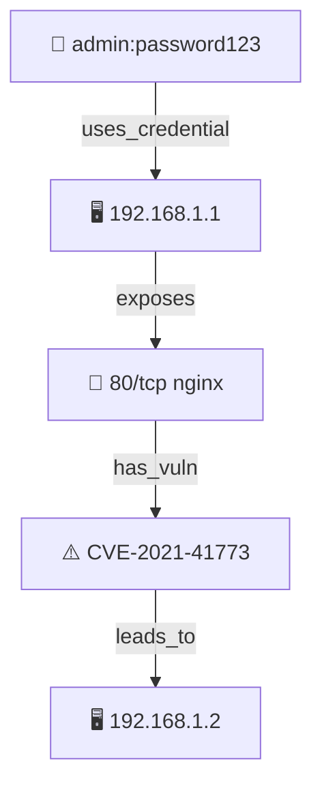

# Attack Path Graph — 攻击路径图谱

> 参考 pentestagent `ShadowGraph`（`knowledge/graph.py`）设计：Notes (Source of Truth) → Shadow Graph (Derived View) → Insights (Strategic Hints)。
> Hermes 等价物用 **Markdown 表格**（节点表 + 边表）+ **BFS 路径推导** 替代 NetworkX，无外部依赖。

## 触发条件 / When to Use

- hack-recon 完成侦察，需要向 hack-exploit 交接攻击面
- 需要可视化攻击路径（Mermaid 图）
- 需要自动推导多步攻击路径（如 Credential A → Host A → Credential B → Host B）
- 需要将攻击面洞察注入 orchestrator system prompt

## 核心设计

### 1. 数据模型：Markdown 表格

ShadowGraph 用 Python 对象 + NetworkX；Hermes 用 **Markdown 表格** 作为持久化格式，存储在 `attack-graph/` 目录下。

#### 节点表 (nodes.md)

| node_id | type | label | metadata |
|---------|------|-------|----------|
| host:192.168.1.1 | host | 192.168.1.1 | {"source": "recon"} |
| service:host:192.168.1.1:80 | service | 80/tcp nginx | {"product": "nginx", "version": "1.18"} |
| vuln:CVE-2021-41773 | vulnerability | CVE-2021-41773 | {"severity": "critical", "cvss": 9.8} |
| cred:webapp_admin | credential | admin:password123 | {"protocol": "http", "source": "config"} |
| vector:api_idor | attack_vector | IDOR on /api/users/:id | {"endpoint": "/api/users/:id", "method": "GET"} |

**节点类型枚举**：
| type | 含义 | 示例 |
|------|------|------|
| host | 目标主机/域名 | 192.168.1.1, api.example.com |
| service | 开放端口/服务 | 22/tcp ssh, 443/tcp https |
| vulnerability | 已知漏洞/CVE | CVE-2021-41773, SQLi on /login |
| credential | 有效凭据 | admin:password, API key |
| attack_vector | 攻击向量/端点 | IDOR, SSRF, file upload |

#### 边表 (edges.md)

| edge_id | source | target | type | metadata |
|---------|--------|--------|------|----------|
| e1 | host:192.168.1.1 | service:host:192.168.1.1:80 | exposes | {"protocol": "tcp"} |
| e2 | service:host:192.168.1.1:80 | vuln:CVE-2021-41773 | has_vuln | {"severity": "critical"} |
| e3 | cred:webapp_admin | host:192.168.1.1 | uses_credential | {"protocol": "http"} |
| e4 | vuln:CVE-2021-41773 | host:192.168.1.2 | leads_to | {"method": "pivot"} |

**边类型枚举**：
| type | 含义 | 典型场景 |
|------|------|---------|
| exposes | host → service | 主机开放端口 |
| has_vuln | service/host → vulnerability | 服务存在漏洞 |
| uses_credential | credential → host/service | 凭据可访问目标 |
| leads_to | vulnerability/host → host | 利用后可横向移动 |

### 2. 图谱构建流程

```
recon notes → 实体提取 → nodes.md + edges.md → 路径推导 → insights
```

#### Step 1: 从 recon notes 提取实体

recon 产出格式（`kanban_comment` 或 `findings/` 目录）：

```json
{
  "target": "192.168.1.1",
  "services": [{"port": 80, "product": "nginx", "version": "1.18"}],
  "vulnerabilities": [{"cve": "CVE-2021-41773", "severity": "critical"}],
  "credentials": [{"username": "admin", "password": "password123", "protocol": "http"}]
}
```

提取规则：
- IP/域名 → `host:` 节点
- 端口 + 协议 → `service:` 节点 + `exposes` 边
- CVE/漏洞 → `vulnerability:` 节点 + `has_vuln` 边
- 用户名/密码 → `credential:` 节点 + `uses_credential` 边
- 可疑端点/参数 → `attack_vector:` 节点

#### Step 2: 构建图结构（内存）

用 Python dict 邻接表替代 NetworkX：

```python
graph = {
    "host:192.168.1.1": {
        "type": "host",
        "label": "192.168.1.1",
        "edges": [("exposes", "service:host:192.168.1.1:80")]
    },
    "service:host:192.168.1.1:80": {
        "type": "service",
        "label": "80/tcp nginx",
        "edges": [("has_vuln", "vuln:CVE-2021-41773")]
    },
    "vuln:CVE-2021-41773": {
        "type": "vulnerability",
        "label": "CVE-2021-41773",
        "edges": [("leads_to", "host:192.168.1.2")]
    }
}
```

#### Step 3: 路径推导（BFS）

```python
from collections import deque

def find_attack_paths(graph, max_depth=5):
    """
    BFS 推导攻击路径：从 credential/attack_vector 出发，到 host 结束。
    返回所有长度 > 2 的路径（多步攻击）。
    """
    paths = []
    # 起点：credential 或 attack_vector 节点
    starts = [n for n, d in graph.items() if d["type"] in ("credential", "attack_vector")]
    # 终点：host 节点
    targets = [n for n, d in graph.items() if d["type"] == "host"]
    
    for start in starts:
        for target in targets:
            if start == target:
                continue
            path = bfs_shortest_path(graph, start, target, max_depth)
            if path and len(path) > 2:
                paths.append(path)
    return paths

def bfs_shortest_path(graph, start, target, max_depth):
    queue = deque([(start, [start])])
    visited = {start}
    while queue:
        node, path = queue.popleft()
        if len(path) > max_depth:
            continue
        if node == target:
            return path
        for edge_type, neighbor in graph.get(node, {}).get("edges", []):
            if neighbor not in visited:
                visited.add(neighbor)
                queue.append((neighbor, path + [neighbor]))
    return None
```

#### Step 4: 生成洞察（Strategic Insights）

```python
def get_strategic_insights(graph, paths):
    insights = []
    
    # 1. 未使用凭据
    for node_id, data in graph.items():
        if data["type"] == "credential":
            targets = [t for _, t in data["edges"] if graph.get(t, {}).get("type") == "host"]
            if targets:
                labels = [graph[t]["label"] for t in targets]
                insights.append(f"We have credentials that provide access to: {', '.join(labels)}")
    
    # 2. 高价值目标
    for node_id, data in graph.items():
        if data["type"] == "host":
            services = [t for _, t in data["edges"] if graph.get(t, {}).get("type") == "service"]
            vulns = [t for _, t in data["edges"] if graph.get(t, {}).get("type") == "vulnerability"]
            if services or vulns:
                parts = []
                if services: parts.append(f"{len(services)} services")
                if vulns: parts.append(f"{len(vulns)} vulnerabilities")
                insights.append(f"Host {data['label']} has {', '.join(parts)}.")
    
    # 3. 攻击路径
    for path in paths:
        readable = " → ".join([graph[n]["label"] for n in path])
        insights.append(f"Attack Path Found: {readable}")
    
    return insights
```

### 3. Mermaid 可视化

```python
def to_mermaid(graph):
    lines = ["graph TD"]
    type_emoji = {
        "host": "🖥️",
        "service": "🔌",
        "vulnerability": "⚠️",
        "credential": "🔑",
        "attack_vector": "🎯"
    }
    
    # 节点
    for node_id, data in graph.items():
        safe_id = re.sub(r"[^a-zA-Z0-9]", "_", node_id)
        emoji = type_emoji.get(data["type"], "")
        label = data["label"].replace('"', "'")
        lines.append(f'    {safe_id}["{emoji} {label}"]')
    
    # 边
    for node_id, data in graph.items():
        safe_u = re.sub(r"[^a-zA-Z0-9]", "_", node_id)
        for edge_type, target in data["edges"]:
            safe_v = re.sub(r"[^a-zA-Z0-9]", "_", target)
            lines.append(f'    {safe_u} -->|{edge_type}| {safe_v}')
    
    return "\n".join(lines)
```

### 4. Kanban 派卡集成

recon → exploit 交接时，将攻击路径作为 `kanban_create` body：

```python
# hack-recon 完成时
insights = get_strategic_insights(graph, paths)
mermaid = to_mermaid(graph)

body = f"""## 攻击路径图谱洞察

{chr(10).join(f'- {i}' for i in insights)}

## 攻击路径图

```mermaid
{mermaid}
```

## 建议优先测试目标
{format_priority_targets(paths)}
"""

# 创建 exploit 任务卡
kanban_create(
    title=f"Exploit: {primary_target}",
    assignee="hack-exploit",
    body=body,
    parents=[recon_task_id]
)
```

### 5. 与 Orchestrator 集成

将 insights 注入 orchestrator system prompt：

```python
system_prompt = f"""You are the pentest orchestrator.

## Current Attack Surface Insights
{chr(10).join(f'- {i}' for i in insights)}

## Strategic Recommendations
{generate_recommendations(paths)}
"""
```

## 完整示例

### 输入：recon notes

```json
{
  "target": "192.168.1.1",
  "services": [
    {"port": 22, "product": "openssh", "version": "7.4"},
    {"port": 80, "product": "nginx", "version": "1.18"}
  ],
  "vulnerabilities": [
    {"cve": "CVE-2021-41773", "severity": "critical", "service": "80"}
  ],
  "credentials": [
    {"username": "admin", "password": "password123", "protocol": "http", "source": "config"}
  ]
}
```

### 输出：攻击路径

```
Attack Path Found: admin:password123 → 192.168.1.1 → 80/tcp nginx → CVE-2021-41773 → 192.168.1.2
```

### Mermaid 图



## 与 pentestagent ShadowGraph 的映射

| ShadowGraph (Python/NetworkX) | Hermes Attack Path Graph |
|------------------------------|--------------------------|
| `GraphNode` dataclass | Markdown 节点表行 |
| `GraphEdge` dataclass | Markdown 边表行 |
| `nx.DiGraph()` | Python dict 邻接表 |
| `nx.shortest_path()` | BFS 实现 |
| `update_from_notes()` | 从 kanban_comment JSON 提取 |
| `get_strategic_insights()` | 注入 orchestrator prompt |
| `to_mermaid()` | 生成 Mermaid 语法 |
| `export_summary()` | 统计信息输出 |

## 与其他 skill 的联动

| Skill | 联动方式 |
|-------|---------|
| `pentest-methodology-fusion` | 本 skill 提供攻击路径推导，methodology 提供 playbook 执行 |
| `delegation-brief-format` | 攻击路径作为 delegation brief 的 context |
| `orchestrator-kanban-tracing` | 遵循 kanban_create/complete 生命周期 |
| `audit-orchestration` | 攻击面图谱可用于审计优先级排序 |

## 实现注意事项

1. **持久化**：`nodes.md` 和 `edges.md` 存储在 `attack-graph/` 目录，随会话持久化
2. **增量更新**：新 recon 数据到来时，只追加新节点/边，不重建全图
3. **去重**：`node_id` 和 `edge_id` 作为唯一键，避免重复
4. **深度限制**：BFS 默认 `max_depth=5`，避免路径爆炸
5. **优先级**：按 `severity × confidence` 排序攻击路径，优先派卡给 exploit

## 快速开始

```bash
# 1. 创建攻击图谱目录
mkdir -p attack-graph

# 2. 从 recon notes 构建图谱（在 Python 中执行）
python3 -c "
from attack_path_graph import build_graph, find_attack_paths, to_mermaid
import json

with open('recon-notes.json') as f:
    notes = json.load(f)

graph = build_graph(notes)
paths = find_attack_paths(graph)
print(to_mermaid(graph))
"

# 3. 生成 kanban 派卡 body（在 Hermes 中执行）
# 将 insights + mermaid 注入 kanban_create body
```
