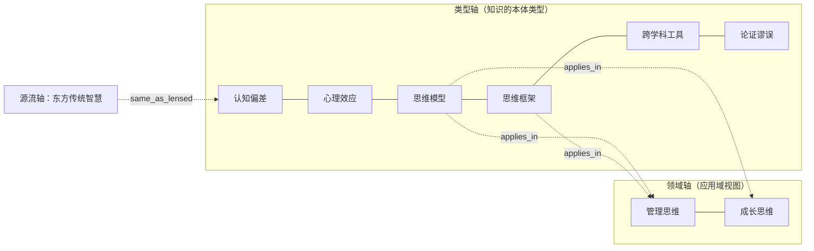

# 认知格栅领域本体（ontology.md）

> 版本 v1.0（2026-11-16）。本文件回答三件事：一个概念归哪个维度（§二）、概念之间是什么关系（§三）、这个库覆盖到哪里、哪里有坑（§五–§八）。
> 方法对齐集群共享本体 `~/.hermes/profiles/_shared/02-org-orchestration/ontology.md` v1.6：类定义用必要条件（OntoClean 纪律，类不等同于角色）、关系词汇显式化（Palantir link type 裁剪）、能力问题作范围契约（Grüninger & Fox 1995）、本体偏见审计（集群 §8.1，M-140）。
> 消费方：`SKILL.md` 的路由与引用纪律、`catalog.md` 的质量基线、`scripts/lattice.py` 的同义词表。本文件不含知识条目。

## 一、上层分类学：三条正交轴，不是九个平行维度

「九个维度」混用了三条分类轴。实测 `scripts/index.json` 的 188 个同名组可以证明这一点：

| 轴 | 维度 | 轴回答的问题 |
|---|---|---|
| **类型轴** | 认知偏差 CB、心理效应 PE、思维模型 MM、思维框架 TF、跨学科工具 IT、论证谬误 AF | 这个概念是什么类型的知识对象 |
| **领域轴** | 管理思维 MT、成长思维 GT | 这个概念主要服务哪个应用域 |
| **源流轴** | 东方传统智慧 EW | 这个概念来自哪个文化传统 |

188 个同名组的跨轴分布（2026-11-16 实测）：

- 纯类型轴内部重复 **117 组（62%）**：CB+PE 42、IT+MM 23、CB+MM+PE 15、CB+MM 12、MM+PE 10、其余 15。
- 类型轴 × 领域轴交叉 **66 组（35%）**：MT+TF 31、GT+MM 11、MM+MT 6、其余 18。
- 领域轴内部 4 组；涉及源流轴 1 组。

推论：62% 的「重复」是类型轴维度缺判定规则导致的边界模糊，要用 §二 的规则收敛；35% 是领域维度对类型概念的视图复制，属设计使然，不是错误，按 §三 `applies_in` 声明。

## 二、维度类定义与判定问句

新概念入库按此判维。一次只归一个主维度（canonical home）；领域维度只收「该域有独立操作细节」的视图条目；源流维度只收「叙事植根传统典籍」的条目。

| 维度 | 必要条件 | 判定问句 |
|---|---|---|
| 认知偏差 CB | 系统性偏离规范标准的判断模式（描述性：人**怎么错**） | 「它描述一种可重复的判断错误吗？」 |
| 心理效应 PE | 可观察、可复现的心理现象（描述性：人**怎么反应**，不预设对错） | 「它是现象本身，而不是一种错误吗？」 |
| 思维模型 MM | 对某机制的压缩表征，用于解释与预测（工具性：**怎么理解**） | 「它帮你看清机制，而不是纠正错误吗？」 |
| 思维框架 TF | 可执行的操作步骤或结构模板（工具性：**怎么做**） | 「它能写成 ①②③ 步骤照着做吗？」 |
| 跨学科工具 IT | 从具体学科定律迁移而来的模型（MM 的特化：**源头是学科**） | 「它带学科标签且机制来自该学科吗？」 |
| 论证谬误 AF | 论证结构的缺陷模式（规范性：**推理哪里错**） | 「错在论证文本里，而不是判断者脑子里吗？」 |
| 管理思维 MT | 领域视图：组织与经营场景 | 「管理场景下它有超出通用模型的操作细节吗？」 |
| 成长思维 GT | 领域视图：学习与个人发展场景 | 同上，域换成个人成长 |
| 东方智慧 EW | 源流标注：叙事植根儒释道兵易等传统 | 「离开传统典籍语境它还成立吗？」 |

### 相邻消歧规则（高频误判对）

1. **CB vs PE**（42 组同名，最大重叠带）：看「错」有没有规范标准。描述「偏离期望效用」判 CB，描述「实验现象」判 PE。规范主维度按研究传统定：Kahneman-Tversky 系判 CB，Asch 等社会实验系判 PE。
2. **MM vs IT**（23 组）：IT 是 MM 带学科溯源约束的子类。同名时规范主维度判 IT（更具体者胜）。
3. **MM vs TF**：能不能写成步骤。能 → TF；只解释机制 → MM。「框架」字样不决定归属（大量名为「XX框架」的条目实为模型）。
4. **AF vs CB/PE**：错误在论证文本 → AF；错误在判断者 → CB。幸存者偏差双栖合法（论证缺陷视角 = AF，认知倾向视角 = CB），引用时声明取哪个。
5. **MT/GT vs 类型轴**：领域条目是类型概念的视图实例。引通用机制优先类型轴条目，要操作细节才引 MT/GT。

### canonical home 优先序

同名组引用规则：**IT > MM > CB > PE > TF > AF**（具体度递减）。MT、GT、EW 不作主条目，除非问题本身限定在该领域或源流。跨视角对照时先引主条目，再补第二视角并说明差异。

## 三、关系词汇（对齐集群六权威关系的裁剪）

「相关概念」纯文本字段之外，本库显式承认以下关系语义。当前以本节清单承载，物理化为 index 字段属后续工作（gap-20261116-008）：

| 关系 | 语义 | 当前载体 |
|---|---|---|
| `same_as_lensed` | 同一概念在不同维度的视角变体 | `scripts/index.json` duplicate_name_groups（117 组类型轴内部） |
| `applies_in` | 类型轴概念在领域轴的视图 | 同上（66 组跨轴） |
| `mitigates` | 去偏工具对冲某偏差/谬误 | 本节清单（2026-11-16 建立） |
| `contrast_with` | 对照概念对，理解一个须同时看另一个 | 本节清单 |
| `debunks` | 证据状态降级说明 | §六 处置清单 |

`mitigates` 清单（去偏工具 → 被对冲的偏差）：

- 事前验尸 (TF-0086) mitigates 规划谬误、过度自信偏差、群体思维
- 魔鬼代言人 (TF-0231) mitigates 确认偏差、群体思维、从众效应
- 外部视角 (MM-0112) mitigates 基础比率忽视、规划谬误、过度自信偏差
- 切斯特顿栅栏 (MM-0324) mitigates 变革中的过度乐观移除决策
- 以牙还牙 (MM-0489) 防御重复博弈中的背叛剥削

`contrast_with` 清单：黑天鹅理论 (MM-0435) ↔ 灰犀牛 (MM-0453)；内部视角 ↔ 外部视角 (MM-0112)；系统 1 ↔ 系统 2（MM-0088/MM-0543）；锚定调整 ↔ 锚定效应。

## 四、条目 schema 与证据状态

标准字段沿用 `catalog.md` §三模板。2026-11-16 起新增可选字段 **证据状态**，枚举五档：

| 档 | 判定 | 例 |
|---|---|---|
| 稳健实证 | 多次独立复制支持 | 巴纳姆效应 |
| 存在争议 | 有效应证据但强度或机制有分歧 | 霍桑效应、皮格马利翁效应 |
| 复制危机 | 预注册大规模重复失败 | 自我损耗 |
| 已证伪/无实证 | 核心数字或机制无实证来源 | 学习金字塔的保留率数字 |
| 民间模型 | 流行但科学性弱 | MBTI |

引用纪律：证据状态非「稳健实证」的条目，不得作为论证的唯一支柱；用于辟谣或方法论警示场景时，必须连同证据状态一起引用。新增争议科学条目必须带该字段（§十一 演进规则 3）。

## 五、覆盖审计基线（2026-11-16 探针）

方法：133 个经典术语探针（Munger/Farnam Street 核心模型、Kahneman 去偏工具箱、系统/博弈/统计经典、哲学与软件工程经典、争议科学对照组），变体复测消除误报。

结果：直接命中 102；初判缺失 31 = 变体误报 8（如同义词形「反馈回路/均值回归/五个为什么」）+ 真缺失 23。真缺失 23 的处置：本轮补 10（§七）、登记待补 10（§八）、按伪科学屏障原则拒收 3（学习风格、左右脑、九型人格）。

复跑方式：任取术语表对 `search` 逐项 grep `[A-Z]{2}-\d{4}` 计数；本节数字以 `audit` 与 `index` 输出为准。

## 六、证据状态处置清单（2026-11-16 已执行，7 条）

| 条目 | 原状态 | 处置 |
|---|---|---|
| GT-0019 学习金字塔 | 5%–90% 数字当事实陈述 | 补「已证伪/无实证」（数字无原始研究，系 Dale 经验之锥误传） |
| GT-0093 MBTI | 无信效度警示 | 补「民间模型」（重测信度低、效度弱，不宜高风险决策） |
| GT-0045 一万小时法则 | 括注方向写反（「充分但非必要」） | 修正为「既非充分也非必要」+「过度简化」 |
| MM-0085 自我损耗 | 机制字段截断、来源占位 | 重写机制（Baumeister 1998 → Hagger 2016 复制失败）+「复制危机」+真实来源 |
| MM-0098 斯坦福监狱实验 | 无方法学警示、来源占位 | 补指导语污染等批评 +「重大争议」+来源 Zimbardo 1971 |
| MM-0108 霍桑效应 | 机制字段截断 | 重写机制（Levitt & List 2011 重析）+「存在性争议」 |
| PE-0206 莫扎特效应 | 正文已含复制失败说明（口径不统一） | 补「未获稳定复制」字段，统一口径 |

## 七、本轮新增条目（10）

| ID | 条目 | 维度/分类 | 判维依据 |
|---|---|---|---|
| MM-0112 | 外部视角 | 思维模型·决策与判断 | 解释机制（基率约束直觉），非步骤 |
| MM-0175 | 格雷欣法则 | 思维模型·经济与商业 | 货币制度机制模型 |
| MM-0322 | 康威定律 | 思维模型·系统与复杂性 | 组织-系统结构机制 |
| MM-0323 | 技术债务 | 思维模型·系统与复杂性 | 权衡机制（Ward Cunningham 类比） |
| MM-0324 | 切斯特顿栅栏 | 思维模型·系统与复杂性 | Munger 清单机制（存量实践=隐性学习） |
| MM-0453 | 灰犀牛 | 思维模型·概率与统计 | 风险类型学，与黑天鹅 contrast_with |
| MM-0454 | 伯克森悖论 | 思维模型·概率与统计 | 统计机制，与辛普森悖论同类 |
| MM-0489 | 以牙还牙 | 思维模型·策略与博弈 | 策略机制（Axelrod 锦标赛） |
| TF-0086 | 事前验尸 | 思维框架·决策 | Klein 五步可执行程序 |
| TF-0231 | 魔鬼代言人 | 思维框架·批判性思维 | 可执行角色程序 |

## 八、缺口登记（gap-20261116-NNN）

| 编号 | 缺口 | 优先级 | 验收方式 |
|---|---|---|---|
| gap-20261116-001 | 哲学思想实验组：电车难题、忒修斯之船、缸中之脑（IT·哲学类） | 低 | search 三术语各 ≥1 命中 |
| gap-20261116-002 | WYSIATI（眼见即全部，Kahneman 核心概念） | 中 | search 命中且带证据状态 |
| gap-20261116-003 | 统计实务谬误：p 值操纵、显著性/效应量混淆、摘樱桃 | 中 | 同上 |
| gap-20261116-004 | 米尔格拉姆服从实验（与权威偏差互补的实验条目） | 中 | 同上 |
| gap-20261116-005 | 布鲁克斯法则/人月神话（软件工程管理） | 中 | 同上 |
| gap-20261116-006 | 稀缺心态的带宽税视角（现有稀缺启发条目未覆盖 Mullainathan 机制） | 低 | 条目含「带宽税」 |
| gap-20261116-007 | 休谟归纳问题（现仅有休谟铡刀条目） | 低 | search 命中 |
| gap-20261116-008 | 188 组同名条目的 canonical home 判定执行：按 §二 规则跑全量，产出映射表并物理化进 index | 高 | index 含 canonical 字段，映射表覆盖 188 组 |
| gap-20261116-009 | MM 机制字段截断损坏全量盘点与修复（audit 全等比较漏检尾部截断；本轮仅修复 2 条示警级） | 高 | audit 新增截断检测探针并归零 |
| gap-20261116-010 | mitigates/contrast_with 关系从 §三清单物理化为 index.json 字段 | 中 | index 输出含关系字段 |

**拒收清单（伪科学屏障）**：学习风格（VAK）、左右脑分工、九型人格——证据状态为「已证伪/无实证」的民间模型不主动收录；辟谣场景需要时引用 §六 同类处置方式单独建条并强制带证据状态。

## 九、本体偏见审计（M-140 投影，2026-11-16 首轮）

本体是测量框架，自带偏见（集群 ontology.md §8.1）。本库已声明的偏见：

1. **文化源流偏差**：西方心理学与管理学主导（东方智慧 109/1985 ≈ 5.5%）。中西对照结论不得写成普适规律。
2. **时代偏差**：概念密集产生于 1970–2010 行为经济学黄金期；2010 年代复制危机后的修正未系统回写（§六 是首轮补写，覆盖 7 条）。
3. **领域权重偏差**：商业管理密集（经济商业 63 + 管理思维 135 + 组织管理框架 87），基础科学与工程偏薄（跨学科工具 64）。
4. **批次质量偏差**：模板批次集中在思维模型（978 模板标记）与思维框架（356）。引用优先手写批次。
5. **语言偏差**：中英混排但未经全库双语校验；东方智慧多数无英文术语。

## 十、能力问题（CQ，范围契约与回归测试）

| # | 问题 | 回答路径 |
|---|---|---|
| CQ1 | 概念 X 的规范主维度是哪个？ | §二 判定问句 + canonical home 优先序 |
| CQ2 | X 在库内有几份正文、各是什么视角？ | `search X` + index duplicate_name_groups |
| CQ3 | 偏差 X 有哪些已登记的去偏工具？ | §三 mitigates 清单（反向查） |
| CQ4 | X 的证据状态能否支撑论证？ | 条目「证据状态」字段 / §六 |
| CQ5 | 中西对应概念怎么对照？ | 东方智慧条目 + `search` 西方同名 |
| CQ6 | 某论证的谬误叫什么、如何识别？ | 论证谬误维度 + 文件尾部识别工具清单 |
| CQ7 | 某场景该组合哪些维度？ | SKILL.md 场景路由；先判类型轴再取领域视图 |
| CQ8 | 该条目质量够不够引用？ | audit 模板标记 + §九.4 批次偏见 |
| CQ9 | 中文变体词能否检索命中？ | lattice.py SEARCH_SYNONYMS |
| CQ10 | 库的覆盖缺口在哪里？ | §五 基线 + §八 登记 |
| CQ11 | 引用键用什么？ | ID 或 `references/文件:行号`；节内编号禁用 |
| CQ12 | 新概念怎么入库？ | §二 判维 → §四 schema（争议科学必带证据状态）→ audit+index 复跑 |

## 十一、演进规则

1. **加法优先**：新增条目、字段、关系不清除既有内容；破坏性变更须在 catalog.md 版本历史留迁移说明。
2. **ID 位移纪律**：条目 ID 按文件位置分配，分类中部插入会使后续 ID 位移。引用一律以当次 `index` 重生成后的 ID 为准，禁止跨版本缓存 ID；外部文档引用优先 `文件:行号`。
3. **争议科学准入**：新增心理学/医学条目若属 §四 非稳健档，必须带证据状态字段，否则 audit 应报错（当前为人工把关，机械化登记于 gap-20261116-009 附带）。
4. **机械验收**：任何数据或规则变更后重跑 `python3 scripts/lattice.py audit` 与 `index`，两命令 rc=0 才算完成。
5. **编号禁令**：节内编号四种口径共存（catalog.md §五），永不作为引用键。
