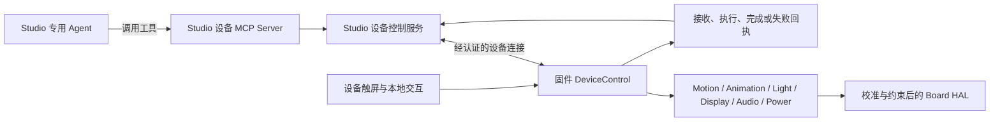

# StackChan 设备动作接口与 MCP 接入设计

日期：2026-10-26。状态：拟定契约，尚未实现。关联 [整机规划](ROADMAP.md) 与 [实时语音交互](VOICE-INTERACTION.md)。

固件提供一套可复用的动作、动画和状态方法，后续由 Studio 的专用 Agent 通过 MCP 使用。设备方法负责确定性的硬件与播放行为；Agent 负责理解用户意图、选择和组合方法。此阶段定义方法与结果，不创建 Agent，也不实现 MCP Server。

## 控制层次



MCP Server 放在 Studio 侧，固件通过现有设备连接承载版本化的控制请求和状态事件，不在单片机上运行语言模型或完整 MCP 服务。最终 MCP 接入的 Agent 运行时、Profile 与部署入口由后续 Studio 工作确定；公共控制服务归 Studio 模块，Agent 通过约定的端口调用，避免绑定某个 Agent 内部实现。

## 方法目录候选

下列名称属于本方案，尚不是可调用的已发布接口。固件内部可采用 C++ 类型方法，在线路上使用同义的方法名；不要求内部函数与 MCP 工具采用相同命名。

| 固件方法 | 参数与单位 | 执行结果 |
| --- | --- | --- |
| `device.get_info` | 无写入参数 | deviceId、板型、硬件修订、bootId、固件/协议版本 |
| `device.get_capabilities` | 可选能力分类 | 支持的方法、参数限制、已校准状态与当前可用性 |
| `device.get_state` | 可选状态分类 | 网络、监听、交互、播放、姿态、灯光、电源及执行中的 commandId |
| `motion.look_at` | yawDeg、pitchDeg、durationMs | 转到校准坐标；反馈结束时的实际姿态和结果 |
| `motion.gesture` | name、intensity、repeat、durationMs；动作名取能力表 | 点头、摇头等受限预设；接受后返回 commandId |
| `motion.home` | durationMs | 回到已校准的默认姿态，不把未知零位视为可归位 |
| `motion.stop` | 可选 commandId；省略时停止本调用范围内动作 | 停止相应动作并清理队列；具体保持/卸力由设备策略决定 |
| `animation.list` / `animation.get_state` | 可选角色/状态过滤与分页；查询当前播放 | 返回实际可用素材、参数约束与播放实例状态 |
| `animation.play` | animationId、repeat、durationMs、speedPct、queueMode；角色可选 | 有限播放、替换或排队；返回 commandId 和实际播放回执 |
| `animation.stop` / `animation.restore_default` | 可选 commandId 与当前交互归属 | 停止调用范围内实例或释放临时覆盖，恢复当前真实状态表现 |
| `animation.set_default` | state、animationId、角色可选 | 设置连接/交互范围内的默认表现，不修改真实状态或长期配置 |
| `light.set` | 已知区域、颜色、brightnessPct、transitionMs | 设置支持的灯区，不支持的灯区明确失败 |
| `display.set_state` | state 与有效交互标识 | 切换设备支持的表情/状态；未有素材时可用文字状态 |
| `display.show_text` | text、ttlMs、优先级 | 有长度和显示时长上限，不能遮蔽故障或监听状态 |
| `audio.set_volume` | volumePct | 设置 0–100 的设备音量，返回生效值 |
| `audio.stop` | 可选当前播放标识 | 终止播放并报告中断，不改变麦克风开关 |
| `power.set_mode` | active / display_standby / listening_paused | 切换允许的模式，返回实际电源与监听状态 |
| `command.get` | commandId | 查询动作状态、结果和失败原因 |
| `command.cancel` | commandId | 取消可取消的执行或队列项；已结束时返回原终态 |

转向使用固件校准后的用户坐标，俯仰/水平符号、原点、角度范围和速度约束由能力表声明。不能用任意角度值直接替代底层舵机校准；未校准时返回不可用，参数越界明确拒绝，不能悄悄钳制后宣称已执行原参数。

`display.set_state` 属于当前交互的表现层；监听状态、故障、维护和停止提示由本地状态机保持所有权。音量、表情和动作可以组合，但不允许远程方法把用户已关闭的监听悄悄开启。首版不向 Agent 开放寄存器写入、任意脚本、固件刷写或凭据读取。

动画方法与 `display.set_state` 使用同一个渲染调度器：前者控制具体素材播放，后者选择允许的角色语义表现，均不改写真实交互状态。素材、循环、默认恢复和系统抢占规则见 [动画控制方法设计](ANIMATION-CONTROL.md)。

## 通用请求与回执

所有写入方法共用请求封装。能力与状态查询可以即时返回；有持续时间的动作采用异步执行状态，避免堵塞实时监听。

| 字段 | 作用 |
| --- | --- |
| protocolVersion | 控制契约版本，与音频格式版本分别协商 |
| requestId | 一次调用的关联与重复请求识别；调用重试沿用原值 |
| deviceId | 明确目标，Studio 从认证连接校验，不能信任任意输入 ID |
| method / params | 能力表声明的方法与结构化参数 |
| connectionEpoch | 连接/控制会话代次；重连后使旧连接的待发命令失效 |
| interactionId / interactionEpoch | 交互产生的命令必带，语音打断后旧代次失效 |
| ttlMs | 命令剩余有效期；Studio 扣除本地排队耗时，设备按接收后的单调时钟执行剩余期限 |
| commandId | 固件接受持续动作后分配，后续状态/取消关联该 ID |
| bootId | 标识设备本次启动；重启后旧 commandId 的结果不能伪装成仍可确认 |

示例仅展示契约形状，不指定现有 Socket.IO 事件名或 HTTP 路径：

```json
{
  "protocolVersion": 1,
  "requestId": "req-demo-1",
  "deviceId": "stackchan-demo",
  "connectionEpoch": 3,
  "interactionId": "turn-demo-7",
  "interactionEpoch": 7,
  "ttlMs": 3000,
  "method": "motion.gesture",
  "params": { "name": "nod", "intensity": 0.3, "repeat": 1, "durationMs": 800 }
}
```

```json
{
  "requestId": "req-demo-1",
  "commandId": "cmd-demo-12",
  "bootId": "boot-demo-2",
  "status": "accepted"
}
```

示例的幅度与时长只是形状示意，实际范围由能力表决定。控制字段、事件名称、授权绑定与版本协商需在正式协议实现前冻结，不能把本文示例作为现有功能调用。

## 执行生命周期与取消

持续动作采用 `accepted → running → completed / failed / cancelled`。拒绝的请求不进入队列；过期执行进入失败或取消终态并携带明确原因。设备报告实测完成；若硬件只能确认命令已发出，结果应说明确认程度，不能把推测姿态标成反馈确认。

队列项带执行期限与资源占用，先返回是否接受，再发送进度或终态。查询和终态回执相互补充；MCP 调用可在有限时间内等待终态，也可返回 commandId 让后续查询，超时不等于动作已取消。

同一舵机不同时执行互斥动作；明确采用排队、拒绝 busy 或被高优先级请求替换的策略，不能让最后一条消息无条件覆盖所有动作。不同资源可在预算内并发，批量组合需要明确取消关系，不宣称跨资源的原子回滚。

优先级依次为本地停止/异常保护、语音打断、当前交互动作/动画、后台装饰表现。语音打断提升交互代次，取消旧轮次关联的音频、动画实例、临时默认映射和动作；系统维护等独立操作不与任意语音轮次混用。Studio 桥接与设备两端都要拒绝失效交互的迟到写入。

重复 requestId 在有限的近期记录窗口内返回同一次接受或原结果，不重复点头或转动；窗口大小与 TTL 由资源预算确定。设备重启、丢失记录或调用结果未知时，不承诺全局 exactly-once，也不自动重发可能已经完成的非幂等动作。重连先查询 bootId 与当前状态，旧队列不自动重放。

## 错误与能力协商

| 错误分类候选 | 含义与调用方处理 |
| --- | --- |
| unsupported_method / unsupported_version | 此板型/版本不支持，刷新能力表或停止调用 |
| invalid_params / out_of_range | 参数错误；返回具体字段与限制，修正后用新的 requestId 调用 |
| not_calibrated / unavailable | 需要校准或设备状态不允许；不盲目重试 |
| asset_unavailable / incompatible_asset / decode_failed | 动画素材缺失、不兼容或解码失败；新请求被拒绝时保留原播放，运行中失败则释放该实例并恢复默认表现 |
| busy / queue_full | 当前资源繁忙；按有效期决定等待或提示 |
| stale_interaction / stale_connection / expired | 旧交互、旧连接或过期请求，禁止自动续期重试 |
| offline / timeout / result_unknown | 无法确认执行结果；查询状态，不能当成确定未执行 |
| cancelled / hardware_fault | 已取消或硬件失败，返回终态和脱敏原因 |

能力表包含方法列表、参数类型/单位/上下限、枚举动作、默认值、可取消性、占用资源和校准要求。硬件缺失和临时不可用要区分：缺少外设不注册该能力，睡眠/未校准等状态保留能力描述但标明不可执行。

## Studio MCP 工具映射

MCP 提供工具发现与结构化参数调用；工具名、输入 Schema 与结果用于让 Agent 理解设备能力。此处只采用通用工具机制，不依赖某个客户端的任务扩展。[MCP 工具规范](https://modelcontextprotocol.io/specification/2025-06-18/server/tools)

| MCP 工具名候选 | 固件/服务映射 |
| --- | --- |
| `stackchan_list_devices` | Studio 返回当前 Profile 获准访问的设备和在线状态 |
| `stackchan_get_capabilities` | 查询目标设备能力表 |
| `stackchan_get_state` | `device.get_state` |
| `stackchan_look_at` | `motion.look_at` |
| `stackchan_gesture` | `motion.gesture`，name 使用能力表支持值 |
| `stackchan_stop_motion` | `motion.stop` |
| `stackchan_list_animations` / `stackchan_get_animation_state` | `animation.list` / `animation.get_state` |
| `stackchan_play_animation` / `stackchan_stop_animation` | `animation.play` / `animation.stop` |
| `stackchan_set_default_animation` / `stackchan_restore_default_animation` | `animation.set_default` / `animation.restore_default` |
| `stackchan_set_light` | `light.set` |
| `stackchan_set_display` | `display.set_state` 或受限的 `display.show_text` |
| `stackchan_set_volume` | `audio.set_volume` |
| `stackchan_stop_audio` | `audio.stop` |
| `stackchan_set_mode` | `power.set_mode`，受监听开关与用户选择约束 |
| `stackchan_get_command` / `stackchan_cancel_command` | 执行查询与明确取消 |

桥接从已认证的 Agent/Profile 上下文注入设备范围、interactionId 与代次，不能让模型自行伪造交互归属。一个 Agent 控制多个设备时显式指定 deviceId；没有明确目标时不得广播动作。

MCP 结构化结果保留 accepted/running/终态、commandId、bootId、错误和实际反馈。工具返回“已接收”不能由 Agent 转述为“动作已完成”；MCP 请求被取消或超时，也不自动证明物理动作已停，桥接需调用明确的设备取消/停止并核对结果。

实时音频继续走专用流通道，Agent 只接收文字/状态并调用低频语义工具。固件内部完成动作轨迹、限位和动画解码渲染，避免 Agent 经 MCP 逐帧控制舵机或推送屏幕帧。即使 Agent 或 MCP 不可达，本地停止、语音分段、默认表现和硬件保护仍可执行。

## 交付顺序与验收

先用模拟设备和主机测试验证方法/回执契约，再实现固件 Dispatcher 与 Board 适配，在校准后实测动作；这些工作不需要先完成 Agent。用户后续建设 Studio 专用 Agent/MCP 时复用同一份能力表和协议。

验收必须覆盖：能力发现、边界参数、未校准拒绝、动画素材缺失/不兼容、重复 requestId、队列满、接收与完成区分、执行中取消、连接中断、设备重启、结果未知和多设备目标隔离。重点验证语音打断后旧 Agent 即使继续返回工具调用，也不能让旧动作、动画或音频重新生效。

当前只交付文档，后续代码、MCP 注册、Agent 创建及实机动作另按阶段实施。
