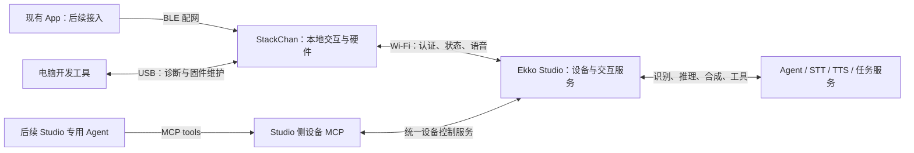

# StackChan 整机规划

日期：2026-10-26。状态：规划稿；实时语音、设备动作与动画接口方向已按用户要求确定，具体参数与实现待验证。

建议把这台设备定位为连接 Ekko Studio 的桌面语音助手与任务终端：用户通过触摸和语音发起请求，在设备上看到执行状态、听到回复，并通过表情和受控动作获得反馈。Studio 承担 Agent、语音识别、语音合成和任务执行；固件承担本地交互和硬件控制。

本轮仅整理文档，暂停继续开发。本文的阶段安排是后续实施建议，不表示已获准开始实施，也不表示原厂功能会全部保留。App 开发、动画播放器实现与角色素材制作继续延后。

## 1. 已确认的约束与当前基础

### 已确认的约束

- StackChan 使用独立目录 `packages/mcu/m5stack-stackchan/`，与 `esp32-c3/`、`esp32-s3/` 并列。
- 固件采用 C++，当前原型使用 ESP-IDF 和 LVGL；板级适配以实机验证结果为准。
- 先完成设备 Wi-Fi 页面，提供 BLE 配网能力；已有 App 暂不改动。
- 新设备语音优先评估 Opus，保留现有 C3 的协议与升级兼容性。
- 正常交互实时监听，用户说话结束后自动提交；设备播报时也能被用户语音打断，不以点击开始/结束作为正常对话流程。
- 固件封装统一的动作、动画与状态方法；后续由 Studio 专用 Agent 通过 Studio 侧 MCP 调用设备能力。
- 动画需要可查询、播放、停止、恢复默认和受限的默认映射方法；当前先确定接口，角色与动画素材制作保持暂停。
- 当前没有完成实机刷写和整机验收。

### 当前成果与缺口

下表是截至本文日期的开发盘点。其中 StackChan 原型尚未提交到仓库，不能作为克隆仓库后的构建基线；本次提交只引入规划与接口文档。

| 项目 | 截至本文日期的状态 |
| --- | --- |
| MCU 目录整理 | C3/S3 迁移已合入主分支；C3 原有升级入口保持兼容 |
| StackChan 独立工程 | 本地已有未提交的 C++/ESP-IDF 原型，候选基线为 ESP-IDF 5.5.4、CoreS3 BSP 3.0.1、LVGL 9.3.0 |
| Wi-Fi 与 BLE | 已有页面、网络状态管理和官方 BLE 配网服务实现，尚未通过实机验收 |
| 软件验证 | 阶段性固件曾构建成功，网络模型测试通过；此后的中文字体变更尚未重新构建，桌面 UI 测试尚未通过 |
| Studio 接入 | 新板型尚未完成绑定、认证、状态订阅和重连验证；现有 C3 实现可作为协议参考 |
| 语音 | 新板型持续采集、AEC、VAD、自动断句、语音打断、Opus 与完整对话链路均待实现和验证 |
| 动作/动画接口与 MCP | 已确定规划方向；统一方法、动画播放器、设备协议及 Studio Agent/MCP 均未实现 |
| 动作、睡眠、升级 | 尚未形成新板型可用功能 |
| App 与动画素材 | 实现与素材制作延后；动画调用契约纳入本轮规划 |

官方 K151/K151-R 资料以 CoreS3 为主控，列出 16 MB Flash、8 MB PSRAM，以及屏幕、麦克风、扬声器和反馈舵机等外设。这些是规划参考，不能替代实机型号、屏幕批次和分区核对。此前的 COM3、USB VID/PID 303A/1001 记录也不足以确认板型。[官方硬件资料](https://docs.m5stack.com/en/StackChan/)

## 2. 产品范围与版本目标

首个试用版本的目标是：不用手机常驻，设备连接 Studio 并启用监听后，用户直接说话，设备自动判断说话开始与结束、流式上传并提交，显示状态与字幕，播放回复；用户再次开口即可打断回复并开始新一轮。固件的统一控制契约同时覆盖动作和动画，为后续 Studio 专用 Agent/MCP 接入准备可查询、可取消的方法。

| 能力 | 首个试用版本 | 后续版本 |
| --- | --- | --- |
| 联网 | 触屏 Wi-Fi 配置、BLE 配网服务、连接进度、失败重试、重启自动连接 | 自有 App 配网体验、更多网络环境适配 |
| Studio 连接 | 后端地址配置、设备身份、允许的 Profile、认证结果、断线重连 | 自动发现、多后端切换、远程接入 |
| 语音 | 持续采集、AEC/VAD、结束自动提交、Opus 流式传输、播报中语音打断、本地停止与静音 | 可选唤醒词、更多声学环境和多人场景优化 |
| 屏幕 | 文字状态、当前轮字幕、连接详情、基本设置、明确的错误提示 | 自有角色、逐组确认的动画、长历史和复杂交互 |
| Studio 任务反馈 | 展示当前交互的思考、工具执行和结果状态 | 其他任务的订阅、提醒优先级和离线补收机制 |
| 身体动作 | 统一动作/状态方法、能力查询、取消与停止；完成校准后开放小幅转向与点头 | 更丰富的动作组合、状态联动与 Studio MCP 控制 |
| 动画控制 | 建立方法、能力、回执和缺少素材时的明确结果；文字状态页维持可用 | 本地播放器、已确认素材、Agent 动画调用、默认表现与动作联动 |
| 睡眠 | 用户可停止当前交互；试用阶段先保证待机行为明确 | 联网待机、触摸唤醒、通知策略；深睡另行评估 |
| 设置与维护 | 音量、亮度、版本与诊断信息；分别提供重配 Wi-Fi 和解除绑定入口 | 板型独立 OTA、失败回滚和素材包管理 |

“首个试用版本”用于开发验证；达到长期使用标准还需要后续的动作、联网待机、稳定性与可恢复升级验收。版本名称在发布时再与固件版本号对应。

摄像头识别、远程视频、NFC、红外、ESP-NOW 遥控、应用商店和复杂舞蹈先留在候选清单。独立 Studio 固件不会自动继承原厂应用，是否保留这些能力需要单独定范围。

## 3. 用户使用流程

### 首次开机

1. 显示启动与自检结果；没有可用网络时进入配网页。
2. 用户在设备上选 Wi-Fi 并输入密码；BLE 配网作为另一条路径，后续由自有 App 提供完整体验。
3. 获得 IP 后显示“Wi-Fi 已连接”，继续引导配置 Studio。
4. 配置 Studio 地址，完成设备认证与 Profile 授权，显示实际连接结果。
5. Studio 与语音服务准备就绪后进入可交互页面；依赖未就绪时说明缺少哪一项。

Wi-Fi 已连接、Studio 已连接、语音可用是三个不同状态。路由器连接成功不能直接显示“助手已就绪”。自有 App 尚未接入时，设备触屏流程应能独立完成基本配网；BLE 服务可先用兼容测试客户端验证。

### 一轮语音与任务交互

设备处于监听状态 → 用户直接说话 → 本地检测到语音，携带开头预留音频开始流式上传 → 检测到说话结束，自动结束本轮输入并提交 → Studio 识别和处理 → 显示文字与执行状态 → 播放回复，同时继续监听 → 播放结束后继续等待下一句。

播放、思考或工具运行期间检测到新的有效人声时，设备先停止旧音频、清空旧播放缓冲，取消属于旧交互的动作与动画，立即保留新一句话，再通知 Studio 中断旧交互。语音打断不等待模型判断或网络确认；触屏停止保留为备用入口。取消请求到达前已经完成的外部操作不能承诺撤销，界面应区分“已停止播报”和“任务已取消”。

正常对话不需要点击开始/结束。手动录放音只作为硬件诊断，不作为实时语音验收结果。持续监听以本地采集和判断为基础，空闲期间不默认向服务器连续上传环境音；开始说话后才建立本轮流并上传。用户可明确关闭监听，界面保持可辨认的麦克风状态。

每轮输入、音频、字幕、动作、动画和 Agent 工具请求归属到同一次交互。语音打断后，旧交互的迟到音频、字幕与控制命令均应被隔离。首版字幕显示当前轮内容，不把完整聊天记录塞入小屏。流程、参数候选与时序见 [实时语音交互设计](VOICE-INTERACTION.md)。

### 睡眠与唤醒

区分屏幕待机和暂停监听的睡眠模式。屏幕待机降低亮度或熄屏，保留网络及用户已经开启的实时监听；用户说话可以恢复交互和亮屏。仅因空闲熄屏不能悄悄改变麦克风开关。动作与舵机供电按姿态和支撑条件管理，超时值可设置。

用户主动选择暂停监听的睡眠模式或静音时，停止对话采集并结束本地语音缓存，不能自动恢复上传。触摸可唤醒，恢复监听需符合用户此前选择；此模式将来是否保留本地唤醒词另行设计。后台任务默认采用低干扰提示，是否亮屏或播报由设置决定。界面需区分“屏幕已熄灭、仍在监听”与“监听已关闭”。

芯片深睡会影响网络在线与远程唤醒能力，因此放在后续单独设计。不能承诺深睡后仍能随时接收 Studio 推送。

### 异常与恢复

| 场景 | 用户看到什么 | 设备如何处理 |
| --- | --- | --- |
| Wi-Fi 密码错误、找不到热点或获取 IP 超时 | 对应原因、重试和重新配网入口 | 不宣称已联网，保留可操作的设置页 |
| Wi-Fi 正常但 Studio 不可达 | “Studio 未连接”及地址检查入口 | 有上限的退避重连，不循环弹窗 |
| 设备凭据失效或无 Profile 权限 | 重新认证或选择获准 Profile 的提示 | 不在不同账号或 Profile 间自动尝试 |
| STT、Agent 或 TTS 失败 | 说明失败阶段，可开始新的交互 | 结束当前录音/播放状态，释放队列 |
| 对话中断网 | 连接中断提示 | 停止本轮上传，取消或清理未完成队列；重连后不自动重发旧任务 |
| 设备离线后恢复 | 当前连接状态 | 首版不承诺重放离线期间的任务通知；需要可靠补收时另行扩展协议 |

## 4. 设备、Studio 与 App 的分工

| 端 | 负责 | 不应成为其隐含依赖的事项 |
| --- | --- | --- |
| 设备固件 | 屏幕、触摸、录放音、编解码、连接状态、动作、电源、配置与升级执行 | 不在设备存放模型供应商主密钥，不要求手机始终在线转发语音 |
| Studio | 设备身份与授权、交互归属、语音服务、Agent 路由、设备控制服务、状态分发、后续升级分发 | 本地停止、AEC/VAD 和动作限位不依赖服务端响应 |
| 专用 Agent 与 MCP，后续阶段 | Agent 理解意图并组合动作/动画工具；Studio MCP 映射为设备方法并返回实际状态 | 固件不运行 Agent 或 MCP Server；音频与屏幕帧不通过逐帧 MCP 调用传输 |
| App，后续阶段 | 发现设备、BLE 配网、绑定入口和便捷设置 | 不承担日常语音中继，不在本阶段修改 App 代码 |
| USB 工具 | 首刷、日志、板级自测、版本和恢复诊断 | 不作为日常交互必须连接的数据链路 |

Wi-Fi 配网解决“设备如何联网”；BLE 配网会话解决“如何传入网络参数”；Studio 绑定解决“此设备能访问什么”。完成 BLE 配网不代表获得 Studio 的访问授权，也不等于必须先在手机系统设置里完成传统蓝牙配对。

设备控制链路固定为“Studio 专用 Agent → Studio 侧 MCP → 设备控制服务 → 设备协议 → 固件动作/动画方法”。固件通过能力表、参数约束和执行回执提供稳定接口，MCP 与触屏控制复用同一套设备方法。具体方法及桥接设计见 [设备动作接口与 MCP 接入设计](DEVICE-CONTROL.md)，动画细则见 [动画控制方法设计](ANIMATION-CONTROL.md)。

## 5. 设备页面与操作

页面以可读、可操作为优先，适配已核实的屏幕尺寸；当前按官方 320×240 规格规划。文字状态页与未来角色渲染共用交互状态，替换素材不改变网络和音频逻辑。

| 页面 | 必需内容与操作 |
| --- | --- |
| 启动/自检 | 固件版本、启动进度、关键外设失败原因、进入诊断的入口 |
| Wi-Fi 配网 | 热点列表、手动输入、密码遮挡与显隐、连接进度、重试、BLE 配网入口 |
| BLE 配网 | 设备名称、配网二维码或必要信息、当前步骤、退出和超时提示；敏感配网信息不进入常驻主页 |
| Studio 连接 | 后端地址、认证/绑定状态、当前 Profile、重连或重新认证入口 |
| 主交互页 | 网络与服务状态、持续监听/说话/提交状态、麦克风开关、停止、当前轮文字、执行状态、音量入口 |
| 设置 | 音量、亮度、待机策略、网络信息、版本、重配 Wi-Fi、解除绑定；清除操作说明其影响并确认 |
| 联网待机 | 熄屏或简洁表现，区分是否仍在监听；主动暂停监听的睡眠模式有独立提示与唤醒规则 |
| 错误/恢复 | 具体原因、可执行的下一步、诊断信息；后续升级时显示进度与失败恢复方式 |

中文提示、英文/中文 SSID、长文本、空列表、加载与禁用状态都需要验证。Wi-Fi 密码、设备令牌与诊断日志分别处理，不能通过截图或日志无意暴露凭据。

## 6. 固件结构与并发

沿用当前独立 ESP-IDF 原型，以官方 CoreS3 BSP 作为已选的初步适配层。BSP 是否覆盖实际 StackChan 的屏幕批次、电源和底座外设仍待验证；有差异时在 Board 层适配，并参考官方 StackChan HAL。先维护一套业务固件，不并行开发 Arduino 和 ESP-IDF 两套实现。

| 模块 | 职责与边界 |
| --- | --- |
| Board / HAL | 屏幕、触摸、I2C、麦克风、功放、底座、舵机、灯光与电源；屏蔽硬件批次差异 |
| Network / Provisioning | Wi-Fi 状态、BLE 配网、IP 变化、网络重连；不承担 Studio 业务授权 |
| StudioClient | 后端连接、认证、Profile、Socket.IO、能力声明和事件收发 |
| AudioService / AudioFrontEnd | 持续录放音、播放参考信号、AEC、降噪、VAD、预留缓冲、重采样、编解码和播放确认 |
| InteractionController | 当前交互、状态转换、超时、取消、旧结果过滤与任务通知优先级 |
| DisplayService | LVGL 页面、文字与字幕、输入反馈及受保护的系统提示层 |
| AnimationService | 本地动画目录、实例、循环/时长、默认映射与优先级调度；统一接入 DisplayService |
| MotionService | 校准、限位、限速、动作优先级、取消和舵机供电策略 |
| DeviceControl | 统一方法注册、能力表、参数校验、请求归属、执行回执、取消与幂等；触屏和远程调用共用 |
| Config / Diagnostics | NVS 配置、配置迁移、设备信息、日志脱敏和可恢复的重置 |
| UpdateService | 板型校验、下载校验、升级、回滚和素材包版本；后续阶段实现 |

网络、音频、UI 和动作通过有容量上限的队列协作。下载、重连和语音服务等待不能阻塞触摸与停止；LVGL 由单一 UI 上下文更新。音频缓冲与 PSRAM/DMA 内存的分配由驱动约束和实测决定，记录堆水位、欠载、溢出、任务栈与重启原因后再冻结预算。

监听前端与交互状态并行：交互处于思考或播放时，采集/AEC/VAD 仍运行；新的人声事件可以打断当前交互。连接区分未配置、获取 IP、Studio 认证、在线、重连和需重新认证；电源区分亮屏、屏幕待机、暂停监听的睡眠与升级。不能用单一的“播放中/录音中”枚举强制两者互斥。

## 7. 语音与通信契约

### 音频方案

现有 C3 上行以 16 kHz、单声道 PCM16 采集，再编码成带 HADP 分块头的 IMA-ADPCM；下行默认 24 kHz、单声道，已有 ADPCM 和 PCM 支持。新设备的 Opus 尚未实现，不能把旧协议直接标记为 Opus。[C3 实现](../../esp32-c3/v2/src/main.cpp)、[HADP 编解码](../../../server/src/modules/studio/services/voice/mcu/adpcm.ts)

| 项目 | 新板型建议基线 | 验证后才能冻结的部分 |
| --- | --- | --- |
| 上行 | 16 kHz、单声道 PCM16 输入，设备编码 Opus | 麦克风声道选择、增益、CPU 与内存占用 |
| 实时前端 | 同时采集与播放，AEC 后的人声判断，VAD 自动开始/结束，语音打断 | 参考信号与采集对齐、噪声/双讲表现、端点阈值和资源预算 |
| 下行 | Studio 将 TTS 结果转换为约定格式，设备解码后以 PCM 播放；先评估 24 kHz 单声道 | TTS 原始采样率转换、预缓冲与音质 |
| 编码参数 | 先评估 Opus 20 kbps、20 ms 帧 | 复杂度、DTX、音质、延迟与总传输量 |
| 服务端适配 | 明确解码到 STT 可接收的格式、TTS 到 Opus 的转换位置 | 现有语音服务的格式支持和并发成本 |
| 兼容与协商 | 设备声明格式能力，双方选定格式后发送 | 协商字段、协议版本、无共同格式时的明确失败或约定回退 |

20 kbps 是本方案选择的起点评估值：Espressif `esp_audio_codec` 2.6.2 的文档列出 Opus CBR 20–510 kbps，并支持 20 ms 帧；这不意味着 Opus 标准只能从 20 kbps 开始。该组件尚未加入本工程依赖。[组件格式与参数](https://components.espressif.com/components/espressif/esp_audio_codec/versions/2.6.2/readme)

按不含封装的负载估算，16 kHz、单声道 4-bit ADPCM 约 64 kbps，10 秒约 80 kB；20 kbps Opus 的 10 秒约 25 kB，约减少 69%。这里使用十进制 kB，不含 HADP、网络头、重传或 Base64 等开销；最终以同一段语音的抓包、听感、延迟和资源占用比较，不用负载估算代替实测。

### Studio 协议

先复用现有 `/global-agent` Socket.IO 通道的身份、交互和播放确认语义。普通 WebSocket 连接成功不代表兼容 Socket.IO/Engine.IO；实现前要核对现有握手、心跳、事件和二进制附件规则。

| 契约 | 规划要求 |
| --- | --- |
| 身份与能力 | 明确设备 ID、板型、固件/协议版本、格式能力和允许的 Profile；新字段须在联调时定义，本文不假定已存在 |
| 上行语音 | 对照 `voice.stream.start/chunk/end/abort`；明确帧边界、序号、采样率、声道、丢帧与超时处理 |
| 状态与字幕 | 复用 `interaction.status`、工具状态及现有消息语义，按交互关联；未有对应事件的内容先补契约再实现 |
| 下行播放 | 对照 `audio.enqueue/clear` 与播放 URL/数据的现有规则；新 Opus 的容器、分帧和 MIME 必须两端一致 |
| 播放确认 | `audio.started` 在实际开始时发送；`audio.done` 在实际播放完成后发送；中断使用对应中断语义 |
| 停止 | 对照 `mcu.interrupt`，使用 interactionId/segmentId 或经确认的同等标识过滤过期结果；本地停止优先 |
| 交互替换 | 语音打断后旧流终止/取消，新流使用新交互标识；旧 Agent 发来的动作也需按交互代次拒绝 |
| 动作控制 | 新增版本化的方法调用、接收与实际完成回执、查询与取消契约；与语音数据链路分开定义 |
| 断线 | 有界退避、身份失效单独处理；恢复连接不自动重复执行上一轮任务 |

Opus 裸帧、Ogg Opus 和旧 HADP 是不同封装，禁止只更改格式名称继续发送旧数据。建议对新板型采用明确分帧的二进制音频，具体承载方式需与现有 Socket.IO/下载链路共同验证；保留 C3 的 ADPCM 路径，不做全局默认格式替换。

## 8. 配网、授权与配置生命周期

设备触屏和 BLE 两条配网路径进入同一套网络状态管理，连接成功应以取得有效 IP 为准。当前原型基于 ESP-IDF Wi-Fi Provisioning 的 BLE 服务与 Security 1/PoP；后续自有 App 必须适配其协议与二维码信息，已有“蓝牙功能”并不代表已经兼容。[官方配网协议说明](https://docs.espressif.com/projects/esp-idf/en/v5.5.4/esp32/api-reference/provisioning/wifi_provisioning.html)

配网服务按用户主动进入或首次配置的受控窗口开启，完成或超时后退出。设备页说明如何重新进入；手机断开、密码错误和退出重试都要有确定结果。首版网络范围按个人路由器的 2.4 GHz Wi-Fi 设计，企业认证和网页认证网络后续评估。

Studio 的绑定/认证流程需复用并核实现有 MCU 设备身份机制，完成允许的 Profile 选择、撤销和重新绑定。设备只保存运行必需的凭据；配网 PoP、Wi-Fi 密码与 Studio 凭据分开管理，不在日志输出。跨不可信网络接入前需要完成 TLS 与证书校验方案，首版范围先限定局域网。

“重配 Wi-Fi”只处理网络配置，“解除绑定”撤销设备访问并清理设备侧绑定信息，“恢复出厂”才按明示范围清除用户配置。服务端不可达时也允许清理本地绑定，同时说明服务端撤销需要在线完成。所有配置带版本，升级后保留仍兼容的设置。

## 9. 动作、角色和长期维护

动作封装为语义方法，例如转向、点头、归位、停止、灯光、表情状态、音量和设备状态查询；Agent 不直接写 GPIO 或下发任意舵机寄存器。方法包含明确的参数、单位、能力声明、执行 ID 和结果；接收/入队不表示动作完成。设备侧定义动作优先级、队列上限、取消和重复请求处理。

动作必须在确认实机舵机型号、零位和反馈后逐步启用。角度、速度、加速度和连续动作时长由板级校准结果限制；启动不随机转动，停止能终止队列。联网待机时是否卸力取决于机构能否安全保持姿态，不能直接把“关闭舵机电源”视为通用睡眠动作。

本地状态机驱动默认动画，Agent 可通过统一动画方法请求临时表现。动画与真实监听、网络、音频状态分别管理，系统提示不能被覆盖；语音打断会取消旧交互动画并恢复当前状态的默认表现。后续素材包记录角色 ID、适用状态、尺寸、帧时序、循环约束、版本和校验值；Agent 根据已安装目录选择动画 ID，不传帧数据。恢复素材制作后仍逐组生成、逐组确认，不采用未获认可的旧素材。

固件维护按 StackChan 板型独立管理。发布物区分首次完整刷写包、单应用 OTA 包和素材包，记录硬件兼容范围、分区版本、镜像大小和校验值。OTA 阶段验证异常下载拒绝、启动自检、失败回滚与用户配置保留，不把 StackChan 镜像接入 C3 的发布通道。

刷写前先记录当前固件、实际 Flash/分区和原厂恢复方法，备份及其校验信息放在仓库之外。升级与动作、录音、播放互斥；设备维护页提供版本、重启原因和脱敏诊断，避免故障时只能整片擦除。当前分区文件是原型配置，不能作为实机兼容证明。

## 10. 开发阶段与交付门槛

本轮停留在方案整理。以后恢复开发时按下列顺序推进，不用预设工期代替阶段验收；实机、语音服务配置和协议改动是主要依赖。

| 阶段 | 交付物 | 完成门槛 |
| --- | --- | --- |
| P0 确认设备与恢复基线 | 型号/屏幕批次、外设清单、Flash/分区、依赖版本和恢复记录 | 实机身份明确；备份与校验记录完整；首次刷写前恢复路径可执行 |
| P1 配网与板级验证 | Wi-Fi/BLE、屏幕/触摸、麦克风与扬声器同时工作、参考信号接入、舵机校准和日志 | 中文字体与 UI 检查完成；配网实机通过；持续采集/播放与 AEC 路径具备验证条件 |
| P2 Studio 与控制契约 | 地址、身份、Profile、状态事件、重连；动作/动画能力表、方法框架和回执 | 认证后的事件可达；参数/执行状态/取消可验证；未校准或缺少动画素材时有明确结果 |
| P3 实时语音试用版 | AEC/VAD、实时监听、Opus 流式传输、结束自动提交、播报中语音打断、字幕 | 无需点击录音；自动提交、双讲打断、无自激与旧交互隔离通过；至少 10 轮自然对话并记录资源/时延 |
| P4 动作、动画与联网待机 | 校准动作、动画播放器与默认状态调度、灯光、待机与唤醒；素材另行确认 | 动作/动画可取消，系统提示不被覆盖；默认回退与待机恢复可用，不阻塞实时语音 |
| P5 长期使用版 | 独立升级、回滚、诊断、配置迁移和稳定性记录 | 长时实机、网络异常、重复唤醒与升级失败恢复通过；旧 C3 升级回归通过 |
| P6 Studio Agent/MCP 与扩展 | 用户后续建设专用 Agent 和设备 MCP，开放动作/动画工具；按需加入 App、更多角色、唤醒词和外设 | 方法映射、权限、执行结果和交互取消可联调；复用固件方法，不另建动画控制通道 |

P1 已有原型，不表示 P0 与 P1 已验收。P3 是首个试用交付点；P5 才作为长期使用的候选版本。App 和角色素材不阻塞前期设备、协议与语音验证。

AEC、VAD、自动断句和播报中监听属于 P3 的必需能力，不再列为可延后的优化。P2 纳入动画契约，P4 完成基础动作、动画播放与待机联动，P6 再把已有方法封装成 Studio MCP 工具。没有已确认素材时保持文字回退，不能虚报动画可用；本轮只设计这些契约。

### 建议验收场景

下列数量是用于安排验证的初始目标，尚非实测结论。实机报告需记录固件提交、硬件批次、环境、日志和未通过项。

| 范围 | 必测场景与初始目标 |
| --- | --- |
| 配网 | 正确/错误密码、无热点、扫描为空、隐藏/中文 SSID、获取 IP 超时、BLE 中途退出、重启自动连接；重配与重连各重复 10 次 |
| Studio | 错误地址、认证失效、Profile 无权限、服务重启、Wi-Fi 恢复后重新连接；无重复任务和旧回复 |
| 语音 | 至少 10 轮无需按键的对话；句中停顿/句尾停顿、轻声、无声、噪声、长句、断网和服务失败；比较 Opus 总传输量、听感与 CPU/内存 |
| 语音打断 | 不同播放音量下插话、连续多次打断、旧回复迟到；仅播放设备声音时不自激开新轮，插话开头不丢失 |
| 响应 | 本地确定有效新语音后到停止旧声音，建议目标不高于 200 ms；从用户开口计时另记录检测延迟，初始总目标不高于 400 ms；句尾静音到提交初始目标 600–1000 ms，均需实测调参 |
| 动作契约 | 能力发现、参数越界、未校准拒绝、重复请求、入队/完成区分、执行查询、取消、断线恢复；语音打断后旧 Agent 动作不能继续进入队列 |
| 动画契约 | 可用目录、有限循环、替换/排队、默认恢复、素材失效与资源限制；旧交互动画不复活，系统提示保持可见 |
| 待机与动作 | 屏幕待机继续监听、主动暂停监听、通知期间睡眠、断网待机和触摸唤醒；至少 20 次切换，无意外恢复上传或不可控姿态 |
| 稳定性 | P5 初始目标为 8 小时混合运行，期间反复对话、断网和待机；观察内存趋势、看门狗、音频欠载和卡死 |
| 升级恢复 | 校验失败、断网、模拟失败启动与回滚、配置保留、板型不匹配拒绝；影响发布通道时回归 C3 v1/v2 |

主机测试用于协议、状态和异常逻辑；UI 模拟器用于输入和布局；固件构建用于依赖与编译检查。三者都不能代替屏幕、音频、BLE、舵机和升级的实机验收。

## 11. 待讨论事项与后续文档

建议先确认三个产品决定：首版是否按“语音助手与任务终端”定位；哪些原厂功能必须保留；首次使用是否接受先完成设备触屏配网、后接入自有 App。当前文档按上述建议给出可讨论的默认方案，没有把这些建议标记为用户已确认。

恢复开发前，按阶段补充硬件/恢复记录、设备页面流程、通信契约和实机验收记录。协议文档应明确真实字段、版本、错误与兼容规则，再开始两端实现；避免在总体规划中虚构尚未存在的 API。

实时语音、统一动作与动画方法已作为确定需求；唤醒词、监听覆盖的人群/距离、声学阈值、素材格式、各方法最终命名及 MCP 所属 Agent/Profile 在联调前继续细化。

当前优先顺序是先评审本规划，再决定是否恢复 P0/P1。保持既有固件原型，不在本轮继续开发、修改 App、制作动画或刷写设备。

## 12. 参考入口

- [当前板型目录与状态](../README.md)
- [MCU 项目与 C3 升级说明](../../README.md)
- [实时语音交互设计](VOICE-INTERACTION.md)
- [设备动作接口与 MCP 接入设计](DEVICE-CONTROL.md)
- [动画控制方法设计](ANIMATION-CONTROL.md)
- 本地原型的依赖与网络模型尚未纳入仓库，后续工程提交时同步提供构建入口、版本锁定与测试记录。
- [现有 Studio MCU Socket.IO 服务](../../../server/src/modules/studio/sockets/global-agent.ts)
- [现有 MCU 任务事件说明](../../../../docs/mcu-webhook-events.md)
- [官方 StackChan 固件](https://github.com/m5stack/StackChan/tree/eff0d6b5109663faec8f1d98848b4b0e5246bbfc/firmware)：硬件适配与恢复资料参考，不等同于本工程已完整继承其功能。
- [CoreS3 BSP 3.0.1](https://components.espressif.com/components/espressif/m5stack_core_s3/versions/3.0.1/readme)：本原型的初步板级适配依赖。

上游源码、组件与后续素材的版本和许可在引入时记录。aora-bot 可作为产品表现的参考，当前不作为固件或角色素材依赖。
