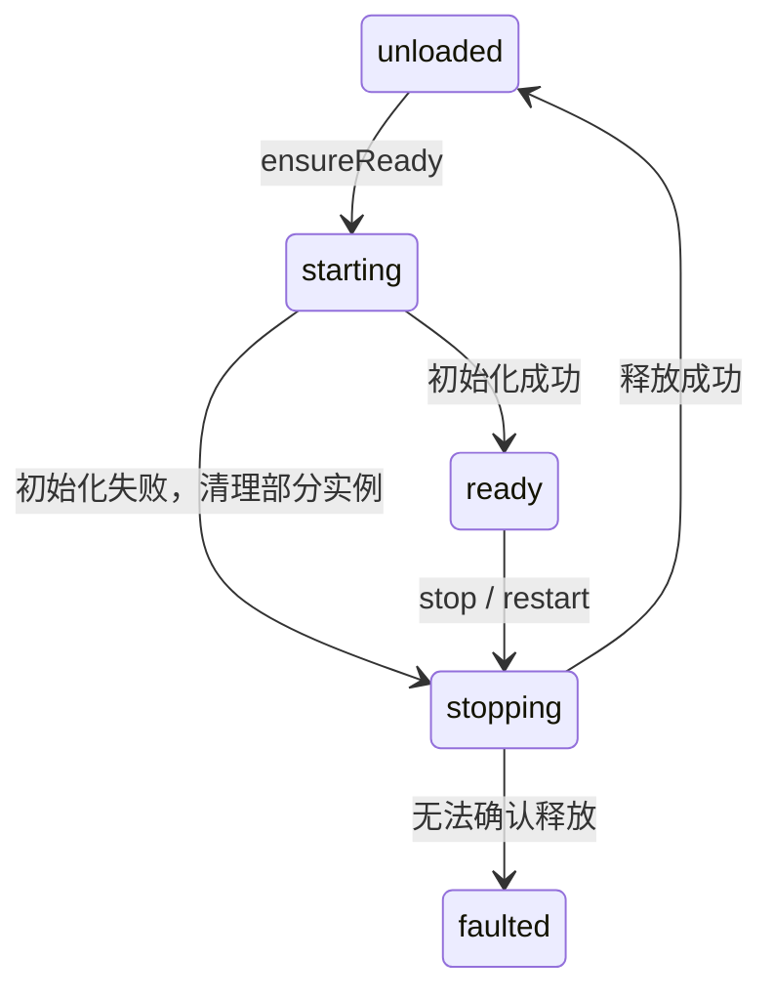
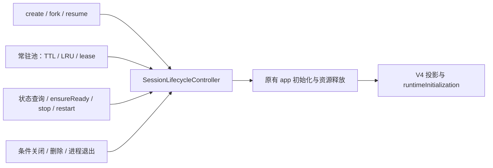
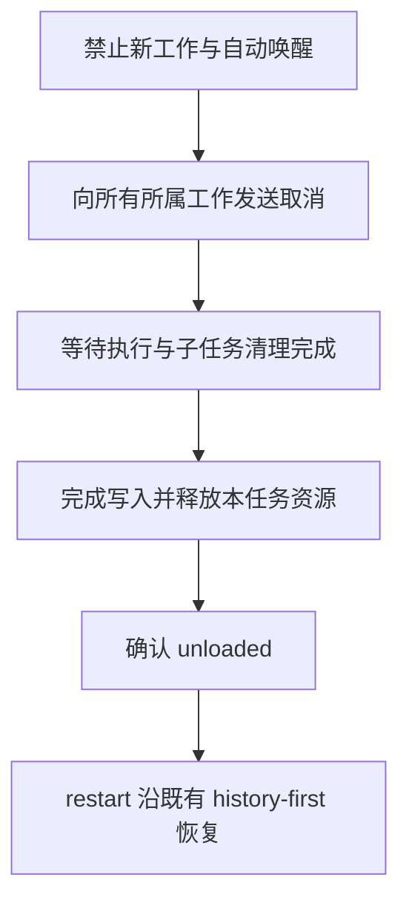
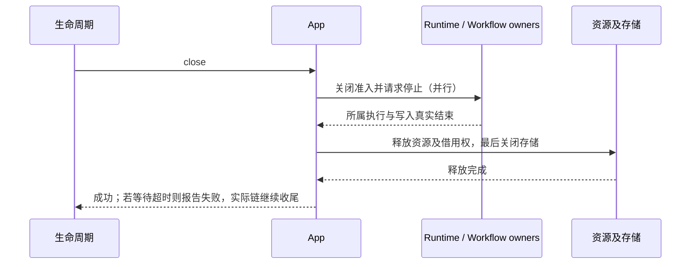

# Session runtime 生命周期

本规格统一 app-server 内单个 session 的运行实例管理。持久会话、消息、执行状态、goal、CommandInbox 和订阅投影继续由各自 owner 管理。释放实例不删除会话；会取消实例拥有的执行，但不替代“停止生成”接口及其产品语义。

## 状态与唯一写者

CLI 的 SessionLifecycleController 是每个 session 生命周期的唯一写者。Host/UI 只能查询和发起操作，不持久化生命周期，不用超时或 registry 是否存在猜测 ready。状态保存在当前 Agent 进程内。

| 状态     | 含义                                                           |
| -------- | -------------------------------------------------------------- |
| unloaded | 没有运行实例，且没有阻止安全启动的残留资源                     |
| starting | 正在创建或恢复实例；不能接收执行                               |
| ready    | 实例可用；不表示执行空闲，也不保证某个客户端的历史投影已完成   |
| stopping | 已关闭准入，正在释放实例                                       |
| faulted  | 释放失败或无法确认安全释放，当前实例停止服务；禁止创建替代实例 |



restart 持有同一操作所有权，跨越 stopping → unloaded → starting → ready；中间 unloaded 不能被另一调用抢占。

## 查询和变更接口

```ts
interface SessionLifecycle {
  getState(sessionId: string): Promise<SessionLifecycleSnapshot>;
  ensureReady(sessionId: string): Promise<void>;
  stop(sessionId: string): Promise<void>;
  restart(sessionId: string): Promise<void>;
}
```

snapshot 包含 sessionId、state、generation、revision 和 lastError（operation、code、message）。错误原因不扩张状态枚举。查询没有激活、回收、清除错误等副作用；不存在或软删除的会话返回错误。无法连接 Agent 是传输错误，不能解释为 unloaded。成功返回表示目标状态已经达到，关闭请求已接收不等于释放成功。

协议方法为 `session/lifecycle/getState`、`session/lifecycle/ensureReady`、`session/lifecycle/stop` 和
`session/lifecycle/restart`。参数共用严格 schema `{ sessionId }`；查询返回 snapshot，变更成功返回
`{ completed: true }`。客户端经已连接 workspace 的 `ZCodeProtocolClient.sessionLifecycle` 调用，
查询按 observation 处理，不参与业务 idle 续期或 watchdog。四个请求不进入传输层普通串行队列，
同 session 的互斥由生命周期 owner 决定，不同 session 不因长请求相互阻塞。
单 session 变更超时只返回请求超时，不触发客户端的 workspace watchdog；超时也不取消后端
操作或表示已经释放，调用方可继续查询。变更仍计入业务在途请求，不能把它伪装成只读观测。

ensureReady 只恢复已有会话，ready 时直接成功，正在启动时共享结果。产品 create/fork 使用内部初始化入口，仍遵守各自存在性和持久化规则；不新增同义 start 接口。stop 释放实例，保留历史；unloaded 时幂等成功。新操作开始才清除上一次错误。

## 并发与准入

| 在途操作    | 新请求                | 行为                                           |
| ----------- | --------------------- | ---------------------------------------------- |
| ensureReady | ensureReady           | 共享结果                                       |
| stop        | stop                  | 共享结果                                       |
| restart     | restart / ensureReady | 共享 restart 结果                              |
| stop        | ensureReady           | 等 stop 成功后启动；失败传播                   |
| ensureReady | stop                  | conflict，不隐式取消初始化                     |
| ensureReady | restart               | 合并重启请求，等初始化安全收口后释放并重新启动 |
| restart     | stop                  | conflict                                       |
| stop        | restart               | conflict                                       |

每个 session 独立协调。状态与在途操作在第一次 await 前登记。旧实例事件必须在释放时解除订阅；异步清理不得删除后续实例。ensureReady 不提供长期保活保证；协议操作继续持有现有 operation lease，自动回收策略继续尊重工作、订阅、交互与队列 pin。

冷打开使用同一个生命周期初始化入口，登记须早于启动前的异步持久读取。Gateway 提供历史数据与投影，不另建实例激活完成回调；显式 ensureReady 可以复用既有历史 opening，但必须由生命周期 owner 直接激活实例。历史投影观察实例结果，owner 不等待自己的观察者。restart 在等待已有初始化时已保留操作资格，stop 不得在旧初始化完成的 Promise 回调窗口抢占。

主动 stop/restart 不继承自动回收的 busy/订阅者限制。关闭执行准入、暂停 active goal、取消当前执行并释放所属资源；等待旧执行与旧 hydration 真实结束后清理 publisher 和 CommandInbox。未执行输入沿冷恢复规则丢弃，不自动重放。常驻池继续保留原有 TTL/LRU 保护。

生命周期变化通过独立的 `session/lifecycle/changed` 通知发布，版本只在当前 CLI 进程内单调递增。App 监听后查询对账，stopping 时使当前 session 的订阅失效，starting 时重新走 history-first 订阅。实例 ready 和新投影已应用是两个完成条件。详细交互、队列边界与验收见 [单任务重启规格](../../../../../docs/session-task-restart.md)。已有条件关闭、软删除和进程退出仍通过内部入口复用资源释放。

## 错误与恢复

启动失败且部分实例清理成功：回到 unloaded，保留启动错误，允许再次 ensureReady。预检失败：不开始释放、不解除订阅、不改变状态。关键资源释放失败或超时：进入 faulted，保存错误；超时不表示已释放。独立资源仍全部尝试清理，不能因一个失败跳过其余资源。

只对幂等资源释放实施重试：正常执行结束时的资源清理失败保留具体资源，最终 owner 关闭时再尝试释放；不重放执行或终态写入。诊断/遥测等非关键资源失败只记录警告。faulted 下 ensureReady、stop、restart 返回 recoveryRequired，不再重复关闭缓存 Promise，也不创建新实例。最终出口为用户显式触发已有的 workspace Agent 进程重建，影响整个 workspace；单 session 接口不自动升级成进程重启。

## 现有链路迁移



常驻池保留策略和 lease，生命周期错误不能被 pool 的日志处理转为可安全启动。runtimeInitialization 保留为历史投影及初始化进度的兼容表示；它不是后端生命周期的第二个写者。进程级资源 owner 继续收集尚未入册或临时 workspace app，负责整体关闭的最终资源边界。

现有已就绪实例在进程退出时经过同一个生命周期释放入口；尚未完成的初始化由进程资源 owner
关闭准入并清理，初始化完成前再次检查进程是否仍在服务，防止退出后发布 ready。冷恢复协调器
不再单独持有 runtime activation flight；gateway 的 READY/hydration flight 只管理投影水位。

## 验收

- 查询不激活；缺失/删除不返回 unloaded；ready 与运行空闲分离。
- 并发启动只创建一个实例；关闭中的启动等待真实关闭完成；restart 无中间抢占。
- 多 session 不互相阻塞；冲突操作无副作用。
- 启动失败清理后可重试；清理失败进入 faulted；迟到完成不能解除 faulted。
- 自动回收、条件关闭、恢复、创建/分叉与删除仍保持持久历史和 sessions-index 语义。
- 关键资源错误与超时可观察；所有独立资源仍执行关闭。
- 原有冷恢复、桌面 continuous、手机 replayable、工作/队列/订阅保护用例继续通过。

## 共享连接的协议约束

Host/CLI 通过 runtime/capabilities 协商 sessionWorkspaceRouting。协商后初始化偏好与子代理配置反向请求携带实际 workspace；旧 Host 不接收新增字段。共享 CLI 必须支持此能力，否则显式拒绝执行。V4 command、订阅和 command 查询由 session owner 管理并发，不再被另一 session 的长请求阻塞；单 session CommandInbox 的顺序与 ACK 契约不变。

## 所属工作整体关闭（2026-10-28）

主动 stop/restart 的关闭范围包括当前执行、全部前台/后台 subagent（含转后台与 SendMessage 再执行）、
其所属后代、后台 Bash、旧脚本 Workflow、新版动态 workflow 的引擎与 actor，以及 runtime 辅助异步工作。
后台只脱离当前 turn，不脱离所属 session；历史 parentSessionId 不用于遍历并关闭独立 fork 或其他任务。

`App.close()` 成功返回必须表示所属执行、必要持久化与资源清理完成。取消信号、任务 terminal 状态、
workflow run settlement 均不能单独作为关闭完成依据。不增加生命周期状态、全局任务管理器或持久化副本。
各现有 owner 持有自己的取消与完成句柄；启动必须在首个 await 前登记，关闭同步禁止新启动/恢复。



取消先广播再等待；共享执行器、MCP 和存储必须留到借用者收尾。执行器取消不能因等待一个借用者而
永远无法到达。每个 owner 的 close 幂等；正常执行失败与清理失败分别处理，清理失败或无法确认完成
沿现有 faulted 合同阻止新实例。超时只是失败，不作为清理完成。关闭期间不接受自动续跑、通知唤醒、
新权限等待或新子任务。保留消息、workflow journal 和已有文件结果，不重放旧输入或恢复被停止工作。

普通 subagent 必须等待底层 child 执行与异步终态写入；不能只等待 abort guard 的提前返回。
动态 workflow 保留现有同步 dispose 与 amend 静默查询语义，额外提供可等待的资源关闭结果，覆盖已
terminal 但仍在收尾的 run。旧脚本 Workflow 统一管理工具入口及直接 run/resume，既等待脚本退出，也
等待已经派发的 child activity；不将脚本进程退出误作 agent 已结束。

关闭后子任务视图通过既有历史/快照恢复真实终态；桌面 continuous 与手机 replayable 共用后端事实。
停止生成与单个后台任务取消保持原范围。无数据库 schema 变更，不新增数据迁移。

## 关闭契约收口（review 修订）

执行结果、在途工作与未释放资源分别由原有 owner 管理。历史执行失败不能成为永久关闭错误；
关闭成功表示准入已关闭、所属执行及持久化已收尾、资源或借用权已释放，而不是所有工作都成功。
不增加全局管理器、生命周期状态或持久化字段。

- Runtime 统一发布 shutdown signal，标题（含 goal 标题）、MCP 等辅助工作响应取消；已开始的写入须收尾。
  residency ledger 仍是唯一在途工作事实；取消由工作所属 owner 负责，不把 abort guard 的提前返回当作 drain。
- child 创建后立即登记，恢复/持久化失败也进入收尾。正常执行的结果不被清理异常覆盖；正常结束后允许
  已有后台工作自然结束，随后释放 runtime 并从 owner 移除。主动关闭则立即停止这些后台工作。
  资源释放失败保留 child 句柄，owner 最终关闭时重试幂等释放；不保存不可消除的历史清理错误数组。
- MCP pool entry 拥有物理连接的信号；session lease 仅拥有自己的等待与调用。取消一个 waiter 不取消其他
  session 的共享连接；lease close 禁止新准入并结束其等待，迟到结果不能复活 lease。最后的 session 隔离
  lease 关闭等待实际资源关闭；workspace 共享连接仍由连接池管理。
- App 保留一个实际关闭链，所有 owner 先收到关闭请求，再等待真实完成，之后释放依赖和 store。
  对调用方的有界等待与实际关闭链分离；超时进入 faulted，但不能因此跳过 drain、提前关闭 store。
  迟到完成不会解除 faulted。永久不响应停止的工作沿既有显式进程恢复出口处理。



验收覆盖标题取消、MCP 双 lease 隔离/迟到连接、成功子代理的清理重试、自然后台结束回收、
初始化失败回收、三类 child owner、关闭超时后的存储保活与迟到清理，以及桌面/手机原重启合同。

### 浏览器控制资源释放（2026-10-29）

BrowserControl closeSession 释放控制关系，主会话不默认销毁网页。停止准入与清理资格分开：
正常请求登记经过校验的 workspace/tab owner/browser generation 路由；关闭、轮尾和取消复用该路由，
不依赖 stopping 后已摘除的 session record。全部目标 settled 后检查失败，成功项按对象身份删除，
失败项与子会话绑定保留供 owner 收尾；新业务仍 requireSession，生命周期状态与并发合同不变。

### Browser control scope 释放确认

新后端通过 descriptor metadata.controlScopes=1 声明契约。broker 在首次 execute 前
以新 controlScopeId 建立作用域，明确拒绝可撤销责任，未知响应必须保留责任；
releaseScope 的 released/absent 是 Main owner 的确认，不从普通错误码或 sideEffect 推断。
后端 identity 由 Main 按窗口持有，Host 重连不换代。作用域关闭先拒绝新命令，
再等待受控请求、录制与 CDP 收尾；closed 屏障保留到窗口 owner 退出，拒绝迟到请求。
父子 owner 只缓存正在进行或成功的关闭，具体释放失败允许最终 owner 再次尝试；
App 整体进入 faulted 后仍按原恢复合同处理，不重放执行或终态事件。
完整路由、窗口/实例隔离、兼容与验证见根 `docs/session-task-restart.md` 的 Browser control scope。
