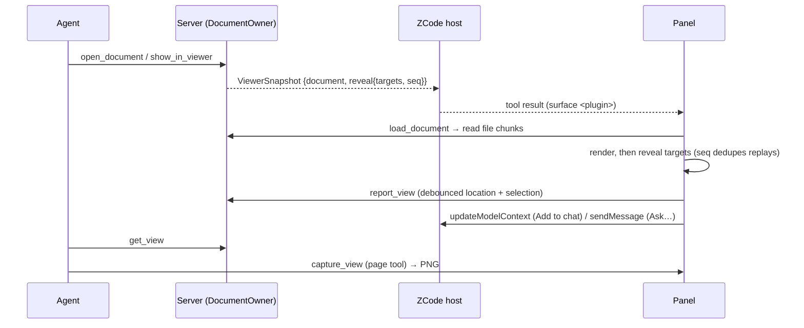

# Office viewer owner and ports

This runtime builds the viewer panels of several plugins. Each built-in plugin package (`apps/zcode-cli/packages/<plugin>-plugin`) declares its panel title and the formats it opens under `office` in its package.json; `scripts/build.mjs` turns that into the plugin's profile (`src/profile.ts`) and keeps only the parsers and viewers of those formats (`src/adapters/parsers.ts`, `ui/viewers/registry.ts`, lines tagged `kind:<format>`). The plugin's name names its MCP server, its panel surface and its resources (`ui://<plugin>/…`). Today `documents`, `spreadsheets`, `presentations` and `pdf` each open one format: docx, xlsx, pptx and pdf. Below, `<plugin>` is the plugin's name.

`DocumentOwner` (`app/documents.ts`) is the only owner of viewer state. Server tools and the panel read and write through it; the plugin never writes workspace files.

- **Documents**: parsed by format (`adapters/parse/*`) into a `ParsedDocument` (outline, paged text, search, locator check). Cached per path and invalidated by size + mtime; the revision is a content hash.
- **Anchors** (`domain/anchor.ts`): `<path>#<locator>` shared by panel, server and model. docx `p:N[-M]`, `t:N[/rRcC]`; xlsx `Sheet[!A1[:B2]]`; pptx `slide:N[-M]`, `slide:N/shape:ID` (the shape's `cNvPr` id); pdf `page:N[-M]`. 1-based. `check()` returns the canonical form (e.g. the real sheet name).
- **Sessions**: one server process serves every session of a workspace (`"isolation": "workspace"` in the manifest). Each `tools/call` names its session in `_meta.session_id`, set by the host for agent and panel calls; a subagent's calls also carry `_meta.root_session_id`, the top-level session that spawned it, and state is keyed by `root_session_id ?? session_id`. Calls without either share one default session. The parse cache is shared; everything below is per session (`app/documents.ts` keeps the 32 most recently used sessions).
- **Viewer state**: the current document (set by `open_document`, `show_in_viewer`, or the panel's `report_view`) and the user's last reported location and selection, per session.
- **Bytes to the panel**: `load_document` hands out a token; the panel reads `ui://<plugin>/file/{token}/{index}` in 4 MiB chunks. Tokens are in-memory and unique across sessions. A token is freed once its last chunk is read, or after the session's 4 newer loads.

## Tools

| Tool                                                                             | Visibility                                | Panel routing                                               |
| -------------------------------------------------------------------------------- | ----------------------------------------- | ----------------------------------------------------------- |
| `open_document`                                                                  | model, app                                | surface `<plugin>`, opens the panel                         |
| `show_in_viewer`                                                                 | model                                     | surface `<plugin>`, opens the panel                         |
| `read_document`, `search_document`, `get_view`                                   | model                                     | none                                                        |
| `list_documents`, `load_document`, `check_document`, `get_viewer`, `report_view` | app                                       | none                                                        |
| `capture_view`                                                                   | page tool (`app__<plugin>__capture_view`) | defined statically in `ui/host.ts`, bound once the UI loads |

`read_document` and `search_document` serve the conversation about the panel: the locations they return are the panel's anchors, ready for `show_in_viewer`. PDF text goes through the same normalization as the panel's text layer, so it works as a `quote`. Excel differs: a formula with no stored result has no value in the server's text, while the panel computes one (see the `xlsx-viewer` skill). The descriptions say what the tools are for, ask the agent to open the document first, and send extraction or processing outside the panel to the format's production skill (`docx`, `xlsx`, `pptx`, `pdf`). The server does not check that the file is open in the panel; any workspace file of the plugin's formats can be read.

## Panel

The page uses one official `App`; `ui/bootstrap.ts` connects it before loading the UI bundle through resources, keeping every tool result. The sandbox has no network: pdf.js cMaps, fonts and wasm, the pdf.js and react-xlsx workers, the xlsx wasm and the pdf plugin's bundled CJK fallback font (`fonts/*.woff2`, listed in `cjk-fallback.json`) are read as resources (`ui://<plugin>/assets/…`, only those of the plugin's formats); the panel resource declares `zcode/csp.wasmUnsafeEval`. How the PDF panel picks fonts for non-embedded CJK text and normalizes extracted text: `docs/plugins/2026-10-15-office-viewer-builtin-panels-spec.md` §5.
