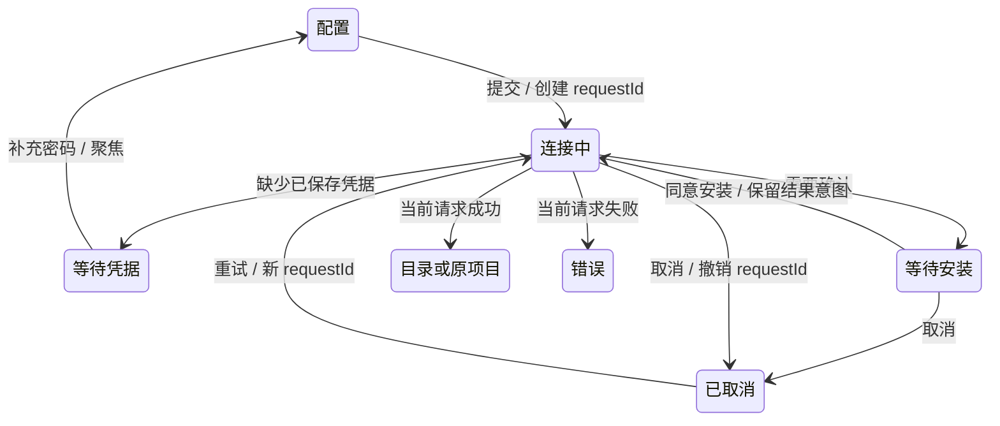
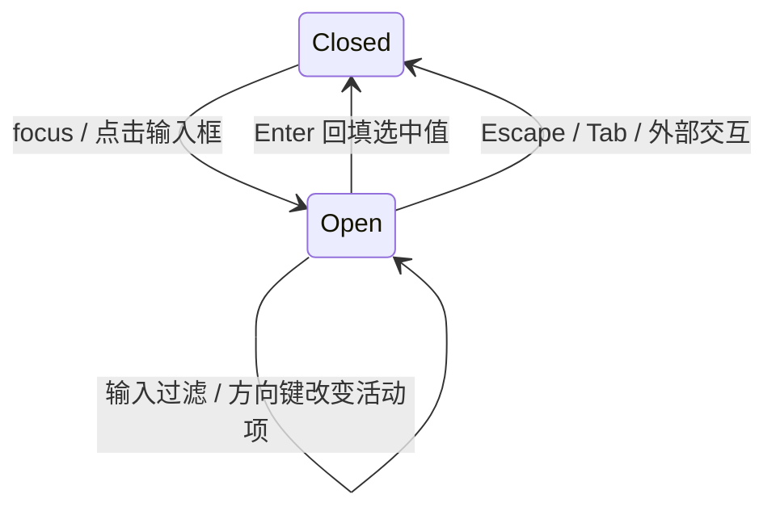

# 远程设备连接入口与状态展示规格

当前交互合同，覆盖 SSH / WSL / Docker 与开发 Server 入口。三屏向导与五态表是唯一展示规则；
原五步向导、设备分组及 connect-and-chat UI 不再适用。

2026-10-12 已确认下一轮目标：[项目创建与远程连接管理分离](../issues/remote-connection-ux/15-project-device-selection-and-connection-management.md)
（ready-for-agent，尚未实施）。实施该票时，通用三屏入口、混合发现列表、连接成功必进目录、侧栏收起进度位置及关闭清空所有草稿的相关规则由目标规格替代；
五态、错误分类、日志、凭据保存和安装确认仍沿用本文。以下现状与历史验证记录不代表新目标已完成。

- 项目入口、原地重连、断线与重启恢复见[项目导航规格](../remote/project-first-remote-navigation-spec.md)。
- 身份、安装与版本门禁见 [R3 主规格](r3-source-server-remote-architecture.md)；Provider 自动下发见[专项规格](../remote/provider-provisioning.md)。
- 设备管理不提供模型编辑/手动同步入口；模型设置始终绑定本地 Environment。技能/MCP/插件同步维持各自范围。
- 不改变 workspace identity、Host/task owner、桌面 continuous 或手机 replayable 边界。
- 验收与证据见[case 目录](../conversation-session-case-catalog.md)及[覆盖矩阵](../testing/conversation-session-e2e-coverage-matrix.md)；实跑不等于人工转正。

## 三屏向导与统一选择（2026-09-28，RDUX-10）

本节替代旧五步侧栏向导、离线最近目录不可点和收起失败自动弹窗的描述。项目/聊天入口顶部只显示“选择设备 → 连接 → 选择目录”；设置入口不显示步骤条（见 RDUX-27）。新建表单属于第一屏，首次进入不标记任何步骤完成。弹窗上边缘固定在视口顶部 10% 处，高度随内容向下伸缩，长列表在内部滚动。

- 首屏始终是可搜索的统一列表，按已保存设备（含状态、最近目录 chip）、SSH config Host、WSL 发行版（仅 Windows）、运行中的 Docker 容器（仅 Docker 可用）分组。点击条目立即连接；离线最近目录同样可点，保留目录意图直到连接并打开。发现加载和失败不阻塞其他来源或手动入口。
- 底部提供新建 SSH、手动 WSL（仅 Windows）和 Docker；开发 Server 入口及提示只在开发运行时出现。表单排布见 RDUX-27：主机与端口并排，认证分段切换，密码可显示/隐藏，高级选项折叠，页脚左返回列表、右连接。
- 表单使用真实 form；回车提交、端口校验为 1–65535 的十进制整数，主机和用户名去除首尾空格。切屏将焦点移到首个可操作控件，表单屏为主机字段；选中别名后显示关联标签。Docker 下拉和手动输入互斥、标签关联；区分 Docker 不可用与没有运行中的容器。
- config Host 缺密码时在连接屏补充；不要求重新填写 Host 信息。用户名缺失时返回已填充的表单。已有 Profile 缺凭据继续沿用补充凭据流程。
- 收起只改变可见性，保留全部草稿、别名、目标和请求。项目区顶部展示两行卡片：设备名与阶段百分比、当前阶段，下方进度条；百分比是既有阶段的完成比例。失败后保持收起，卡片呈危险色并显示原因，直到点击恢复查看。成功进入目录屏（已有目录则直接打开），卡片消失。
- 恢复收起卡片只恢复同一流程；新的显式连接入口有独立意图标识，失败、取消、表单或待补凭据的空闲流程让位于该意图。即使 Profile、WSL 发行版或目标值相同也须重新消费，使用最新参数；接受前撤销旧 epoch、清理等待确认和旧目录意图，迟到凭据/结果不得复活旧流程。实际建链/更新中或已连接待选目录时保留当前流程，不抢占资源。
- 关闭取消当前连接、撤销请求归属并清空所有表单草稿；持久化的输入历史保留。关闭后的迟到发现/凭据/连接结果不得重新打开旧流程。
- 选择、配置、目录屏主动收起时也提供对应恢复卡片；非连接态不伪造进度。目录导航路径由向导保留，浏览器实例卸载撤销旧请求，恢复后旧响应不能覆盖新目录。连接成功收尾移除卡片，换目标清除目录路径。

```text
列表 / 表单 → useRemoteConnectionFlow（唯一向导会话 owner）→ 既有连接命令
                   ├─ 当前 requestId / epoch → 结果、等待点、目录意图
                   ├─ 收起 → 同一会话直接渲染侧栏卡片（portal 只登记 DOM 容器）
                   └─ 关闭 → 撤销 epoch / 取消请求 / 清空草稿
桌面 continuous 与手机 replayable 的 Host、attachment、snapshot 和恢复边界保持既有合同。
```

验收接缝沿用父规格：向导 DOM + 服务端口，以及真实 SSH 桌面 E2E（config 首连操作量、离线最近目录、收起失败和关闭草稿）。连接中与目录屏的完整布局见 RDUX-11。

## 新建连接表单（RDUX-27，2026-10-14）

本节定义设置入口「新建连接」与项目/聊天入口「新建 SSH 连接」共用的表单。只改展示与前端交互，不改连接流程、协议与表单状态语义。实施票见 [#27](../issues/remote-connection-ux/27-new-connection-form-polish.md)。

```text
设置入口                                   项目/聊天入口
┌ 新建连接                     — × ┐      ┌ ① 选择设备 ─ ② 连接 ─ ③ 选择目录  — × ┐
│ root@10.0.0.5:2222（实时预览）   │      │ 新建连接 [SSH]                         │
│ [▣SSH|▣WSL|▣Docker]  从 SSH config 导入 ▾ │ user@host:22                           │
│ (🔗已关联 Host dev-box ×)        │      │ 主机 + 端口 / 用户名 / 认证 / 高级选项 │
│ 主机 + 端口 / 用户名 / 认证 / 高级│      ├────────────────────────────────────────┤
├──────────────────────────────────┤      │ ← 返回列表                      [连接] │
│                 [取消] [添加并连接]│      └────────────────────────────────────────┘
└──────────────────────────────────┘
```

- **头部**：两个入口标题均为「新建连接 / New connection」，不显示说明句。标题下用等宽字体实时预览连接目标（SSH `user@host:port`，Docker 容器名，WSL 发行版）；未填写时显示浅色占位。项目/聊天入口在标题旁显示类型标签；设置入口不显示，因为类型切换已表达类型。设置入口不显示步骤条。
- **类型切换**：SSH / WSL（仅 Windows）/ Docker 使用分段控件，每项带类型图标；选中项使用对应类型色的浅底、描边与前景（与 `RemoteConnectionKindTag` 同源）。类型切换的每项就是连接类型标签，属于 DESIGN.md「类型 token 只用于类型标签」的允许范围；其他 tab 仍保持中性选中态。
- **SSH config 导入**：仅设置入口在类型切换同行右侧提供「从 SSH config 导入 ▾」，打开现有可搜索弹层；没有 Host 时按钮禁用并显示原因，读取失败时在下方给出警告且不阻断手填。选中 Host 后在主机上方显示 SSH 类型色关联标签「已关联 Host xxx ×」与“修改任一字段会自动解除关联”。× 只解除关联，保留已填值。项目/聊天入口不提供别名入口（上一屏列表已提供 config Host）；从列表回到表单时仍显示关联标签。编辑连接弹窗的别名选择保持在高级选项内。
- **字段排布**：主机与端口同一行（端口约 6rem，窄屏同样并排），用户名独占一行；「认证方式」标签与分段控件同行，凭据输入紧随其后。高级选项为紧凑文字触发，无分隔虚线。字段标签使用 `text-ui-sm`。
- **粘贴拆分**：在主机框粘贴 `user@host`、`user@host:port`、`ssh user@host -p N`（含 `[IPv6]:port`）时拆分填入主机、用户名、端口，并在主机下方显示成功提示「已识别 …」；其他内容按原样粘贴。粘贴视为手动修改，解除别名关联。只在粘贴时触发。
- **焦点**：打开表单时焦点在主机。导入 Host 后焦点移到第一个为空的必填字段；全部已填时移到主操作。
- **校验**：提交时校验，错误显示在对应字段下方（`aria-invalid` + `aria-describedby`），焦点移到第一个出错字段；此后字段改为有效即消除错误。页脚不再显示校验文字，主操作不禁用。真实连接失败仍用顶部错误条。校验规则唯一来源为 `collectRemoteFormFieldErrors`，`buildRemoteTarget` 与编辑连接弹窗复用它。
- **Docker / WSL**：删除顶部说明段。Docker 输入方式（选择运行中的容器 / 手动输入）使用中性分段控件；Docker 不可用时在选择器下方显示警告卡片，没有运行中的容器时显示中性提示。容器候选行左侧显示 Docker 类型色图标块。WSL 以 root 运行的提醒保持警告卡片。
- **配色**：只复用既有 token。类型色用于类型切换、关联标签、候选行图标块与项目入口类型标签；警告卡片用 `warning-surface`，粘贴识别用 `success`，字段错误用 `destructive`；主操作与认证方式切换保持中性。
- **页脚**：设置入口「取消」「添加并连接」右对齐；项目/聊天入口左侧「← 返回列表」，右侧「连接」。页脚只有一条分隔线。

## 向导 P0 与流程归属（2026-09-27，RDUX-04）

手动新建连接直接复用已在线连接时，显示“这台设备已通过 `<连接描述>` 连接，已直接使用现有连接”。描述来自 Host 实际复用的连接目标，不使用本次表单值；本次未参与认证的密码或私钥口令不保存、不覆盖已有凭据。提示在进入目录或原项目后仍可见，连接描述复用统一展示模型（如 `SSH · dev@host:22`）。是否提示归属原始新建意图，补凭据、安装确认、更新重试继续沿用；选择已保存设备、设置页连接、在线设备选目录及后台重连不提示。Host 的连接结果携带可选 `reusedConnectionTarget`（脱敏目标），经 Main 按 requestId 透传；不能用 UI 快照猜测是否复用。窗口 registry 可投影已有 entry 的复用，缺少 entry 时必须继续消费 Manager 的物理连接复用结果。Host 建连前只登记无新凭据的 profile，实际连接完成且未复用才提交本次凭据；失败、取消、同设备归并或并发 join 不覆盖已保存值；唯一等待点例外是已实际认证后发现需要升级：只有执行认证的请求能在该等待点保存凭据，加入同一请求的调用不能提交另一份密码；管理服务可按原 profile 继续更新。

向导的入口意图、安装等待、取消、收起/关闭及结果去向由 `useRemoteConnectionFlow` 单独持有；表单草稿沿用 `useRemoteConnectionForm`，真实连接及凭据仍归 Host。缺凭据停在连接步，主操作“补充密码”返回配置并聚焦密码或私钥口令；补齐后保留原目录与下载方式。连接中主操作“取消连接”立即撤销该请求的 UI 归属；主动取消显示“已取消”，保留重试入口，不进入错误面板。



收起只隐藏当前流程，成功进入目录、失败保留侧栏结果（以 RDUX-10 为准）；关闭撤销当前请求并释放未确认 session。被撤销请求的迟到结果不能覆盖后续流程，迟到临时 session 只回收。此抽取不更改 Host、workspace identity、桌面 continuous 或手机 replayable 恢复边界。

## 统一展示合同（2026-09-27，RDUX-03）

本节替代下文和旧设计规格中的四态映射、pending→离线、状态借用连接类型色及工程术语；旧连接流程由[项目导航合同](../remote/project-first-remote-navigation-spec.md)约束。布局合同见本文 RDUX-10/11/13 与项目导航规格。

### 远程连接展示模型（UI 统一展示）

一个纯函数模块，把"设备和项目的连接事实"映射成"用户看到的展示结果"。以下界面**只能**从这里取状态展示，不得自行计算：

- 侧栏项目行、详情卡、会话头部、会话横幅
- 设置页设备行、向导、任务行设备标签
- "打开远程项目"菜单
- 创建项目弹窗的设备选择（布局见[创建项目弹窗布局](../specs/project-editor-dialog-ui.md)）

远控 Header 按现有 workspaceIdentity 会话解析器读取 attachment，不要求 tab 携带 remoteSessionId。设备名称从同一身份对应的共享窗口项目目录 Host 获取，桌面设备管理名称优先；禁止按路径借用其他设备。连接移除后显示未连接，重新登记后更新；不新增连接或重试。

现有三套映射删除，合并进这个模块：设备聚合状态映射、侧栏项目连接状态映射、设置页状态标签和展示辅助。

输入：

| 输入                 | 含义                                              |
| -------------------- | ------------------------------------------------- |
| 设备聚合状态         | 来自 Source 权威投影的设备级状态                  |
| 项目 attachment 状态 | 项目挂载是否就绪；设备在线不等于项目就绪          |
| 安装与身份           | 未安装 / 已安装 / 身份待确认（连接目标已变化）    |
| 升级需求             | 无 / 可选更新 / 远端必须更新 / 本机桌面端必须更新 |
| 断开来源             | 用户主动断开 / 异常断开 / 启动时尚未连接          |
| 自动恢复进度         | 当前是第 n 次，共 3 次                            |
| 最近错误             | 分类后的连接错误码及阶段                          |
| 凭据完整性           | 是否缺少已保存的密码或私钥口令                    |
| 连接方式与地址       | SSH / WSL / Docker，以及地址、发行版或容器名      |
| 设备显示名           | 用户改过的名称优先，默认用 SSH alias              |

输出：

| 输出                 | 说明                                                                                            |
| -------------------- | ----------------------------------------------------------------------------------------------- |
| 可见状态             | 5 种之一                                                                                        |
| 状态文案与短状态文字 | 短文字用于替换项目行里的设备名                                                                  |
| 语义色               | 成功 / 进行中（新增）/ 中性 / 警告 / 危险                                                       |
| 图标                 | 项目行只有一个图标位                                                                            |
| 主操作               | 连接 / 断开 / 取消连接 / 更新远端 / 更新桌面端 / 安装并连接 / 确认新设备 / 补充密码 / 重试 / 无 |
| 原因与修复操作       | 来自错误分类                                                                                    |
| 恢复进度文案         | 如"自动恢复 2/3"                                                                                |
| 连接描述             | 如 `SSH · dev@localhost:2222`，按连接方式生成                                                   |

5 种可见状态：

| 可见状态 | 触发事实                                                                                       | 语义色                         | 项目行图标       | 主操作                           |
| -------- | ---------------------------------------------------------------------------------------------- | ------------------------------ | ---------------- | -------------------------------- |
| 已连接   | 设备在线，且项目 attachment 就绪                                                               | 成功（只在详情卡、设置页显示） | 中性云，不加标记 | 断开                             |
| 连接中   | 显式连接、原地重连或自动恢复进行中；或设备在线但 attachment 未就绪                             | 进行中                         | 单个转圈         | 向导内为"取消连接"，其他位置无   |
| 未连接   | 用户主动断开、启动时尚未连接、自动恢复前的离线                                                 | 中性                           | 划掉的云         | 连接                             |
| 需要处理 | 需安装、远端必须更新、本机必须更新、身份待确认、缺凭据                                         | 警告                           | 云 + `!`         | 按原因取对应操作                 |
| 连接失败 | 最近一次显式连接失败或自动恢复用尽，且原因不属于"需要处理"；或设备在线但本次读取该设备项目失败 | 危险                           | 云 + `✕`         | 按错误分类的修复操作，默认"重试" |

判定规则：

- **"需要处理"优先于"连接失败"。** 只要存在可执行的修复动作，就显示为"需要处理"。
- **用户主动断开永远映射为"未连接"。**
- **"更新中"覆盖旧文案**，不再显示之前的"需要更新"或错误文案。
- **可选更新不改变可见状态**，只影响设置页设备行的辅助信息（中性“可更新到 vX”）和展开区横幅。设置导航不显示汇总状态点（2026-10-24 移除）。
- **非在线状态必须有文字**（短状态文字或详情卡文字），不能只靠颜色表达。
- **设备在线但项目读取失败**（例如远端数据库无法打开）时，该设备的项目行显示"连接失败"，详情卡显示错误分类与"复制错误"，原文就是本次读取的错误。错误只来自侧栏最近一次读取的结果，不落盘，也不写回设备状态。下一次读取成功后自动回到"已连接"。不新增重试循环，沿用现有的读取触发（目录变化、窗口聚焦等）。设备不在线时，不使用读取错误，仍按连接状态展示。读取开始时设备还没有在线，这次读取被拒绝不算读取失败：读取期间连接完成时，项目行仍显示"连接中"，不能把读取前的拒绝当成在线后的失败。

### 连接错误分类

- **错误码契约。**
  - 主进程和 host 对每一次传输或部署失败，都产出错误码集合中的一个错误码，外加一条非空消息。
  - 适配器已经确认的领域错误码优先于 `cause` 的文本推断；未明确分类的 `AggregateError` 和阶段包装继续查找内层错误码。
  - 消息为空或无法识别时，归入"未知"类，绝不因为 schema 校验失败而丢弃错误响应。这正是"拒绝连接时永远停在正在连接"的根因。
  - 探测（probe）只把远端环境检查本身的失败归入"预检失败"：探测脚本非零退出。远端平台不受支持时归入"远端系统不受支持"：uname 报告 Windows（如 MSYS）；探测脚本因目标是 Windows 原生 shell 而失败（stderr 含 cmd/PowerShell 特征，例如 `CommandNotFoundException`、`is not recognized as`）；架构不是 x64/arm64（如 riscv64）。stderr 只有乱码（含非法 UTF-8）不是 Windows 证据：POSIX 登录 shell 的启动脚本、WSL 里 `wsl.exe` 的 UTF-16LE 提示都会产生乱码，这类失败仍归入"预检失败"并保留原始 stderr 作诊断；只有 GBK 等本地编码报错、没有上述英文特征的 Windows 主机同样显示预检失败，这是已知取舍。Linux 远端 glibc 低于随包 runtime 的 2.28 下限或是 musl 时不归入错误，只在连接日志显示 `warn`，注明检测结果和可能启动失败，继续安装或连接，不新增确认步骤；之后真实的安装或启动失败仍按所在阶段报告。建立连接或执行探测命令时的传输失败（如握手超时、握手前连接断开）不做阶段兜底，识别不了时归入"未知"；断线自动恢复耗尽预算时据此显示"自动恢复已停止"，不提示安装环境问题。
  - 共享类型和运行时 schema 同步扩展。UI 遇到不认识的错误码时退回"未知"类的通用文案，保持向后兼容。
- **分类与展示：**

| 分类                       | 典型来源                                                | 标题                        | 修复操作                                                                                                                               |
| -------------------------- | ------------------------------------------------------- | --------------------------- | -------------------------------------------------------------------------------------------------------------------------------------- |
| 认证失败                   | 密码或私钥错误                                          | SSH 认证失败                | 修改密码或私钥：在连接中屏就地重新输入密码或私钥口令（与“需要密码”同一交互）；需要更换用户名或私钥文件时回到表单，聚焦该字段并标出错误 |
| 缺少凭据                   | 没有已保存的密码或口令                                  | 需要密码                    | 补充密码（属于"需要处理"）                                                                                                             |
| 需要额外验证               | 交互提示明确要求动态口令（如 `Verification code`、OTP） | 服务器要求额外验证          | 查看详情；当前不支持二次验证，提示改用私钥或 SSH agent，不显示密码输入框                                                               |
| 拒绝连接或不可达           | ECONNREFUSED、EHOSTUNREACH、ECONNRESET                  | 无法连接到主机              | 检查地址和端口；重试                                                                                                                   |
| 超时                       | ETIMEDOUT                                               | 连接超时                    | 重试                                                                                                                                   |
| 找不到主机                 | ENOTFOUND                                               | 找不到主机                  | 修改主机                                                                                                                               |
| 主机密钥变化               | host key 不匹配                                         | 主机身份已变化              | 查看安全说明，不提供一键忽略                                                                                                           |
| 下载、上传、预检、安装失败 | 部署各阶段；预检只含远端环境检查失败                    | 分别写明是哪个阶段失败      | 重试；只有在 SSH 且使用本地下载时，才额外提供"改用设备直接下载"                                                                        |
| 远端空间或权限不足         | 部署或启动阶段                                          | 远端空间不足 / 没有写入权限 | 查看详情                                                                                                                               |
| 远端系统不受支持           | Windows 原生主机、非 x64/arm64 架构                     | 不支持该设备的系统          | 查看详情；说明只支持 Linux / macOS 的 x64、arm64，Windows 请改用 WSL；不提供重试下载                                                   |
| 版本不兼容                 | 握手阶段                                                | 需要更新                    | 更新远端或更新桌面端（属于"需要处理"）；桌面端较旧时，向导与设备展开区另有次级动作"将远端切换到 <版本>"，须二次确认                    |
| 用户取消                   | 取消安装或取消连接                                      | 已取消                      | 重新连接，并且不以错误样式展示                                                                                                         |
| 未知                       | 兜底                                                    | 连接失败                    | 重试 + 详细信息                                                                                                                        |

- **原始报错**折叠在"详细信息"里，可以复制。
- **文案**按连接方式区分，给出 WSL 和 Docker 的变体。所有文案都有中英文。
- **展示位置**：错误就地显示在向导面板、设备展开区、会话横幅或项目行。toast 只用于后台事件，并且必须带"查看详情"，能跳到对应设备。
- **能力不足时的兜底**：主机密钥变化如果当前传输层无法可靠识别，归入"未知"，不要猜测。

### 术语与文案

| 用户看到的词  | 含义与用法                                                   |
| ------------- | ------------------------------------------------------------ |
| 远程设备      | 一台远端机器；一个 WSL 发行版或一个 Docker 容器也各算一台    |
| 连接          | 访问一台设备的一种方式，用连接描述展示；有多条时称"其他连接" |
| 项目 / 任务   | 不变                                                         |
| ZCode Server  | 只在安装和更新的场景出现                                     |
| 发行版 / 容器 | 分别替代 distro，以及 docker exec、docker cp 等命令名        |

- **禁止出现在界面上的词**：链路、线路、Source Server、换代、正史、canonical、direct-tcpip、远端组件、设备短 ID。设备 ID 只能在"更多 → 设备信息"里复制。
- **身份换代改写为用户语言**：比如"连接目标的身份已变化" + "作为新设备使用"。
- **"连接中"阶段文案**按 SSH、WSL、Docker 分别生成。
- **新增和改写的文案**都要有中英文，英文文案同样要验证项目行宽度。

### 设计系统

- **新增"进行中"语义色**，包括 surface 和 foreground 两个 token，写入设计规范和 token 文档。"连接中"不再借用 SSH 类型色或琥珀色。
- **SSH、WSL、Docker 的类型 token** 只用在类型标签上；新建连接表单的类型切换、关联标签和候选图标块属于类型标签（RDUX-27）。
- **清理不符合规范的写法**：字阶之外的字号、硬编码颜色、任意值颜色、不在规范内的图标尺寸和圆角。
- **深色主题**：复核状态标签、侧栏和设置导航的对比度。

### 展示归属与验收

```text
Host 连接状态 / Directory 安装身份 → 现有 management snapshot
项目 attachment / 自动恢复事实 → UI 纯函数展示模型 → 各处状态、主操作、颜色
用户操作 → 既有连接向导 / 更新命令 → Host owner → 下一次快照
desktop continuous 与 mobile replayable 的 attachment 恢复路径保持原有边界
```

- 设备错误码/原文与项目错误分别输入：项目错误可已本地化，不能覆盖设备错误用于认证分类的原文。Root 通过只读 Context 向头部/任务行转发既有项目恢复事实；展示结果保留产生状态的 profileId，以便修复正确的连接。
- 两个公开接缝：`resolveRemoteConnectionPresentation` 状态投影、`classifyRemoteConnectionError` 错误分类；不持有可变业务状态。
- 表驱动覆盖父规格状态组合、02 全部公开错误码与未知兜底、SSH/WSL/Docker 文案和本地下载门禁。
- 各组件用 DOM 断言模型输出；先复现本机更新方向、pending 状态、双转圈、恢复进度不可见问题。
- 主动断开后侧栏与设置均为中性未连接；真实 SSH E2E 验证并同步用例目录。
- token 对比度、禁用词、中英文键一致性检查；桌面深浅主题/窄屏及现有手机恢复回归。

## 设备名称与兼容

### 项目行设备名显示偏好

远程设备页底部使用“偏好设置”标题，在启动自动重连旁提供“隐藏项目行设备名”，默认关闭。此项是本机 UI 显示偏好，不属于 Source 或连接配置；全部桌面窗口即时同步、重启保留，手机远控不消费。项目行隐藏范围及完整身份详情以 [RDUX-HIDE-DEVICE](../remote/project-first-remote-navigation-spec.md) 为准。中英文文案及深浅主题沿用现有 Switch 行布局。

### 设备默认名称

- 新 Source 首次握手时，若当前 SSH Profile 的 `target.sshConfigAlias` 非空，则默认 `displayName` 为 trim 后的 alias。
- 没有 alias 时继续使用 `hostname · osUser`，两者均缺失时回退 `sourceServerId`。
- 已存在 Source 的 `displayName` 始终优先，避免覆盖用户改名。
- identity change 确认后发现的新 Source 同样采用上述规则。
- alias 仍不参与 `workspaceIdentity`、Profile 去重或设备身份判断。

### SSH 凭据降级兼容与自愈

- Source Profile 仍是当前版本的 SSH 凭据权威；为旧 Desktop 写入 `lastWorkspaceSession` 时，每个 workspace 使用独立的 `remote-workspace:<legacyIdentity>:*` mirror，避免旧版本关闭一个 workspace 时删除共享 Profile secret。
- rollback 快照必须先通过 `credentialService` 把 Profile secret 写入 legacy mirror，再写入对应 credential key；mirror 写入失败时禁止提交 settings 引用。
- 同一精确 SSH route 有多个 legacy workspace 时，非敏感 target 元数据仍取 `lastOpenedAt` 最新条目，密码/私钥口令分别取最新的“实际有值”条目。本机无法解密的值视为“无值”，跳过且不改写原记录，不得让 Directory 初始化失败。
- Profile 迁移只有在 secret 复制成功后才写 `connection-profile:<profileId>:*` 引用；空引用不再传播成新的悬空引用。
- `SourceServerDirectory.initialize()` 对已完成 migrationVersion=1 的 SSH Profile 执行幂等审计：canonical secret 缺失或无法解密时，仅从同一 `routeKey` 的 legacy siblings 恢复；找不到任何真实 secret 时保留“需要交互凭据”语义，不做模糊匹配。
- Host Directory 连接时同样处理：Profile secret 无法解密等同缺失，`resolveProfileTarget` 返回 `credentials-required`，启动重连跳过该 Profile、不影响其他设备；补充凭据后覆盖原 key，编辑、删除 Profile 不因该值失败。
- Renderer 读取 Profile secret 时同样处理（设备连接流程、原项目重连）：解不开等同缺失。从侧栏项目或设置页连接该设备时，连接屏显示需要补充凭据，不显示通用的连接失败；补充后覆盖原 key。
- 弹窗在密码和私钥认证链都不完整时不得调用 SSH；连接屏显示需要补充凭据并允许返回配置。该门禁是 defense in depth，不替代 mirror 与迁移修复。
- 不修改 workspace identity、Profile schema、credential 加密格式或 Mobile attachment 语义。

### 菜单和收起

- 设备更多菜单使用稳定最小宽度，动作行使用不换行布局；仍由内容和 viewport 约束最大可用宽度。
- 设备更多菜单在所有已安装状态（在线、离线、失败、重试中、需升级、更新中等）都提供「移除设备」；移除只删除本机记录与凭据，不依赖远端连接，Host `removeSourceServer` 会先幂等断开再删记录。「在侧边栏中显示」仅在设备有已打开项目时提供，定位现有项目不依赖在线状态；菜单不得出现空内容。「重启远端服务」「停止远端服务」的位置与可用状态见 [RDLC-01](#停止与重启远端服务rdlc-01)；「重新安装远端服务」见 [RDRI-01](#重新安装远端服务rdri-012026-10-24)。
- 收起按钮不再由 `loading || connectedSessionId` 门禁；任一步都可见。
- 收起不是关闭，不清理状态；关闭语义保持原合同。

## 安装与更新进度

- 自动或手动更新进行中，副题显示“正在更新远端服务”，优先于上次连接的需升级错误；失败或取消后仍保留可重试的错误现场。
- 上传百分比只表示 archive 传输，不能代表安装完成。传输后立即进入解压阶段；远端 CLI 通过可选的 `--progress` 输出逐行 JSON 事件 `{type:"source-server-install-progress", phase}`，phase 为 `verify-archive`、`extract`、`verify` 或 `restart`。默认 CLI 输出和最后一行结果 JSON 不变。
- Adapter 在命令运行期间校验并转发进度，复用 Host 操作日志；未知/非进度输出不作为阶段或成功依据。失败仍使用退出码和最终结果，保留 staging 清理、运行任务守卫和回滚语义。
- 连接屏安装阶段显示上传、解压、校验安装包或校验服务文件的本地化子说明；仅当前上传阶段显示百分比。其他阶段保留进行中指示，不模拟百分比。`restart` 进入已有“启动服务并握手”步骤，直到真实握手和连接就绪才完成。

```text
before: upload 100% -> [extract / verify / restart, no events] -> result
after:  Adapter upload/extract -> CLI verify-archive/extract/verify/restart
        -> Host operation log -> UI phase projection -> handshake -> ready
```

进度事实属于远端安装器，连接状态仍属于 Host manager；UI 只投影已有事件。不新增持久化状态或重试，不改变桌面 continuous 与手机 replayable 的会话恢复边界。SSH/WSL/Docker 共用 Adapter 进度解析。

验收：延迟校验期间已显示校验且没有上传百分比；命令未结束时阶段已可见；分片输出与非 JSON 日志不影响结果；校验/重启失败不能显示就绪；自动更新期间无旧失败副题，取消/失败后错误仍可见。

## 连接日志与失败契约

- SSH、WSL、Docker 连接失败的“反馈”入口默认开启诊断日志上传，用户可在提交前取消勾选。预填的最近 30 行脱敏连接日志与诊断 ZIP 是两份材料，正文有日志不能关闭附件默认值；提交与恢复选择遵循[反馈日志语义](../feedback-simplified-flow.md#日志语义)。
- Host 仅转发连接流水线 `onLog` 主动上报的进度，console 与其他服务的诊断输出不进入用户可见日志。统一过滤绝对路径、凭据、token、连接档案及设备标识；含空格路径按引号或明确路径字段边界过滤，保留路径之后的非路径失败原因；未加引号且无法消歧的路径尾部保持保守遮蔽，仅保留退出码等明确诊断；向导、最近日志与反馈使用相同过滤结果。密码、私钥口令等已知秘密只按完整 token 遮蔽（秘密两端为字母、数字或下划线时，相邻字符不能也是这类字符）；不能按子串替换，否则短密码会把 `device` 这类固定文案改成 `[redacted]ice`，反推出密码。
- 等待安装确认记为 info。失败响应始终包含非空消息和 shared 登记的错误码；已确认领域码优先于 cause 文本推断，未明确分类的 AggregateError 和阶段包装使用可识别的内层错误。SSH 认证及已知私钥解密失败由 SSH 适配边界赋予 `remote-authentication-failed`，阶段 fallback 不覆盖该分类；本次连接尝试中，keyboard-interactive 的名称、说明或提示文字明确要求动态口令或二次验证（`verification code`、`one-time`、`OTP`、`passcode`、`second factor` / `two-factor`、`2FA`、`MFA`、`authenticator`、动态口令、动态密码）且认证最终失败时，SSH 适配边界赋予 `remote-authentication-unsupported`，不提示"检查用户名、密码或私钥"。提示的轮数和个数不是证据：错误密码后服务器在同一轮里重复问 `Password:`、或其他文字的 challenge（如 `LDAP Password:`）都保持 `remote-authentication-failed`，保留就地补密码入口；只识别不到关键词时退回认证失败，这一方向可以让用户继续补凭据。该记录只属于单次连接尝试：自动恢复复用同一个 SSH backend 重新连接时重新判断，不能沿用上一次连接看到的提示。认证成功的流程不变：每个提示仍回答同一个密码；UI 中英文分类同步，旧无 code 文本保留兼容兜底。拒绝连接/不可达、超时、DNS、可信 host-key 错误、下载、上传、预检、安装、空间、权限、取消和未知分别分类，中英文映射同步。
- Host 连接管理服务是最近操作日志的唯一 owner；每台设备保留最近一次连接或更新最多 100 行，仅存在运行时内存。尚未握手的连接按 profile 隔离；握手后归到 sourceServerId，同设备不同线路共享最近操作。新操作替换旧日志，旧操作迟到输出不能覆盖新操作。更新后的内部重连属于同一次更新。
- `getRecentOperationLogs(profileId)` 查询所属设备的最新日志，关闭/重开向导或设置页后仍可读取；删除设备/线路及 Host 退出时清理。设置页设备展开区和未完成连接均提供“查看最近日志”；侧栏/聊天项目菜单的远程身份详情在连接中读同一份日志，只展示阶段、进度与耗时，不展示原始日志（见[连接进度详情](../remote/project-first-remote-navigation-spec.md#连接进度详情2026-10-15)）。查询结果是展示投影，UI 不维护独立日志历史。

```text
连接/更新 → SourceServerConnectionManager 接受操作 → 显式进度 → 统一过滤 → 有界内存日志
                                                └→ 事件通知 → UI 查询最新日志
失败 → shared 错误分类 + 非空消息 → Host schema → Main → 中英文文案
```

本合同只涉及设备连接管理 RPC 与连接日志，不改变 task stream 的 desktop continuous / mobile replayable 恢复边界。

## 连接中与目录屏（RDUX-11，2026-09-29）

按 06 已通过原型：连接屏以设备名、连接方式和完整地址为标题；竖向阶段为建立通道（SSH / WSL / Docker 分别命名）、识别设备、安装组件、启动连接。带项目目录的连接（打开已有远程项目、恢复上次项目、重连远程项目页签）在启动连接后多一个阶段“打开项目目录”，副标题显示“正在读取 <目录>”；Source 上线不代表这一阶段完成，只有窗口连接就绪才算完成。远端 30 秒没有返回时这一阶段失败，显示“远端读取项目目录 30 秒没有响应”及处理建议（Mac 的文件夹访问授权、网络盘或外接盘），主操作为重试（2026-10-21，R8；Host 侧规则见[远程项目目录](../remote/project-first-remote-navigation-spec.md#24-远程项目目录被外部删除)）。设备级连接（目录为 `/`）仍是四个阶段，目录读取的失败归到“启动连接”。阶段数只看本次连接是否带项目目录：拨号前的等待（读取已保存凭据、补密码或私钥口令）同样按本次意图显示，不沿用上一次连接的目录。没有“连接就绪”阶段，成功直接进入目录或恢复指定项目。当前阶段加粗、显示已用时间，完成项保留耗时；安装子步骤展示上传/下载进度、大小、速度和预计剩余时间；速度未知时明确显示正在估算。等待密码/私钥口令、安装、设备重新安装确认、强制更新确认与分类错误均嵌入对应阶段；连接失败的错误面板另有「重新安装远端服务」（[RDRI-01](#重新安装远端服务rdri-012026-10-24)）。日志默认收起、失败展开，复制日志仅在展开后出现。运行中或等待用户处理时，页脚左“在后台继续”、右“取消连接”；失败终态改为左“返回列表”、右“关闭”，不得把既有失败改写为主动取消。取消后允许重试。安装完成标记显示安装完成并等待启动，不倒退成正在校验文件。

安装信息来自 Host 的远端探测与同一发布描述：版本、绝对安装路径、安装包实际字节数（明确标为安装包占用空间，不将压缩包大小冒充解压后占用）；未知信息显示“暂无法获取”，不填假值。只读安装预览不上传或安装；确认后复用既有安装命令。运行中任务清单来自远端 task owner 的活动投影，强制更新仍先经过 force=false guard。老远端未提供清单时明确显示清单不可用，不伪造任务。安装预览、发布元数据或运行任务清单的附加读取失败，仍保留已确认的安装/强制更新等待点并显示信息不可用；实际安装所需发布解析及校验继续严格失败，不能绕过 force=false 守卫或替用户确认强制更新。

```text
用户选择/重试 → 向导流程 owner（requestId / epoch）→ Host 连接 owner
                   ↑ 只读状态、安装预览、日志、任务活动投影 ↓
              内联确认 → 既有安装/身份确认/更新命令
取消/关闭 → 立即结算取消遥测 → 撤销 epoch → 丢弃迟到结果；收起只改变可见性
显式新入口 → flow owner 清理旧等待点/意图 → 新 epoch 消费；卡片恢复保留原 epoch
目录 chip → 浏览器最新导航请求 → 成功路径 → 打开项目
```

目录屏显示完整路径，最近和远端记录分行；chip 导航必须更新目录内容，较早请求不能覆盖新导航。读取失败显示友好原因，失败或加载期间不能打开未经确认的目录；页脚保留“稍后选择”。设备名可就地保存，成功显示“已保存”，失败保留草稿并显示反馈；状态条只显示连接状态、连接方式/线路与已知版本，不重复设备名、不填占位符。

首次使用说明恢复原版「本地离线，任务照常运行」介绍页，移除目录页的一行提示。主动连接成功后、继续设备完成/目录/原项目之前展示；已连接设备的首次显式远端目录浏览也复用同一确认入口。后台完成和启动静默恢复不弹窗；后台结果由用户显式继续时才展示。已有确认框占用时，连接 flow 保留完成动作，在其释放后继续；确认关闭或更换入口则撤销。读取已读状态或保存期间收起，也必须保留完成结果，等待用户显式继续，不能自动弹介绍或交付原完成回调。只有点击「知道了」才写入 `remoteBoundaryIntroAcknowledgedVersion: 1`；展示、取消、卸载、读取失败与过期响应均不能记已读。版本 2 同时包含旧弹窗确认和一行提示自动已读，无法可靠区分，因此新标记未设置的用户（含旧字段版本 2）统一补看一次，新标记为 1 不再重复。旧字段保持 `remoteBoundaryOnboardingVersion?: 2`，仅供回滚兼容，不能作为新版已确认的依据。已落盘的旧字段版本 3 在完整 schema 校验前迁移为旧字段 2 和新标记 1；SettingService 读取时通过现有写锁重读、迁移、原子保存，迁移不能覆盖并发偏好更新。旧客户端剥离新标记后仍能读取和保存原设置，回滚不依赖额外发布兼容版本；回滚再升级允许重新显示一次介绍。读取/保存失败保留未读，不把说明故障转为连接失败；后续主动使用可再次确认。介绍页外观与文案复用原组件，Escape/遮罩不算确认；操作所属 entryEpoch/表单 epoch 失效后不继续旧导航。桌面 continuous 与手机 replayable 的任务 owner、身份隔离及恢复链不变。

介绍页正文的中文文案为「关闭 ZCode 或休眠本机，\n远程任务继续运行。」，在逗号后显式断行；英文为「Remote tasks keep running, even when you close ZCode or put your computer to sleep.」，使用均衡换行，不固定断行位置。正文保留换行符并允许窄窗口继续折行，避免末行只剩一两个汉字。沿用现有弹窗宽度、字号和主题；默认 14px 字号下中英文均为两行，16px 下中文仍为两行，英文允许三行。视觉验证直接挂载真实弹窗，覆盖桌面与 390px 窄窗口、深浅主题和 14/16px 字号，无需连接远程服务器。

```text
原行为：目录提示显示 → 自动记旧标记 2
存量旧标记 3 → schema 迁移 → SettingService 写锁内保存旧标记 2 + 新标记 1
新行为：主动连接成功 / 显式使用已连接设备 → 介绍页 → 知道了 → 新标记 1 → 原流程
后台完成 → 等待用户继续 ────────────────────────────┘
取消/换入口 → 撤销原 epoch → 丢弃迟到结果
```

验收：向导 DOM 覆盖内联等待、认证重试、取消与迟到响应、真实安装信息、阶段和传输、目录导航/错误/重命名；真实 SSH 覆盖认证失败/拒绝连接/首装信息/非阻断说明，截图覆盖深浅主题和 900px。

运行任务清单合同：Core 继续从 `turn.started/turn.terminal` 的 owner 事实推导活动集合，以 `workspaceIdentity || workspacePath` + sessionId 隔离；向 Supervisor 的 heartbeat/task-activity 增加可选清单。`running-tasks --json` 只读返回该清单（未知为 null），Host 在强制更新 guard 拒绝后读取并通过管理快照展示。该扩展不修改持久化 `status.json`、版本回滚格式、App ↔ Agent 消息、桌面 continuous 或手机 replayable 投递。

## 设置防护、编辑连接与机器标注（RDUX-05）

- 连接编辑弹窗复用已有连接字段；设备名与连接名称分别校验和保存，设备名错误不得显示连接名称错误。确认危险操作默认聚焦取消，不能以回车默认执行危险操作；断开前以内联说明提示影响。
- 设置页统一不显示“正在编辑：本机 / <设备名>（远程）”提示行及其图标，覆盖常规、插件、MCP、技能、命令、钩子、子智能体的列表与编辑表单；桌面与手机、深浅主题、中英文一致。作用域菜单保留设备名，设置读写归属沿用现有服务作用域。
- 设备操作按同一 sourceServerId（未识别时 profileId）防重与互斥；无关设备操作和只读详情、日志查看保持可用，不能因一台设备长时间更新而锁住整个面板。
- “在设置中管理”与开始更新只定位对应设备（展开并高亮该设备行，见 RDUX-13“定位”）；只有显式“查看详情”意图才打开失败详情。设备当前失败不意味着所有定位动作都要弹模态。
- 同设备不同连接的失败原因与更新信息独立展示；只有相同 Profile 的同一原因才能去重，不能用另一个连接的更新横幅遮蔽失败。

## 设置设备列表与更新提示（RDUX-13）

设备列表（2026-10-24 改为紧凑列表 + 行内展开，取代 2026-10-15 的设备卡布局）：

- **列表与排序**：每台已识别设备占一行，所有行放在同一个列表容器里。顺序按“最近使用”倒序：在线设备在前；其余设备取“最近在线”和“最近打开项目”中较新的时间；时间相同时保持快照顺序。顺序只在面板挂载后、快照首次就绪时计算一次。之后设备状态变化只更新行内容，不移动位置；快照里新出现的设备插到最顶部；被移除的设备直接消失。只有重新进入页面（包括设置导航让面板重挂）才重新排序。不提供排序切换，也不单独折叠长期未连接的设备。
- **搜索**：“设备 (N)”标题行右侧常驻搜索框。搜索词去掉首尾空白后，不区分大小写地包含匹配设备名、任一连接地址、主机名和已知项目显示名；没有匹配时在列表内显示空态。不提供状态筛选。
- **折叠行**：从左到右为连接方式图标、设备名、连接地址（等宽、截断、title 给出全文）、辅助信息、短状态、主操作、“更多”、展开箭头。
  - 辅助信息按优先级取一项：设备有待处理的连接历史时，显示警告图标和“N 个待处理”，title 为“连接历史需要处理”；否则有可选更新且未点“稍后”时，用中性色显示“可更新到 vX”（与展开区可选更新横幅同一条件，更新中不显示）；否则在线显示“N 个项目”，离线显示“最近在线 X”。
  - 列表容器宽度小于 36rem 时，地址移到设备名下方第二行，辅助信息隐藏，保证同名设备仍可区分。
  - 行上只在需要处理时显示主操作，例如连接、重试、更新远端、更新桌面端、重新安装并连接、作为新设备使用、补充密码。已连接设备的“断开”和“编辑”放进“更多”菜单。
  - 点击设备名按钮或行内空白处切换展开；主操作、“更多”及其菜单不触发展开。设备名按钮提供 `aria-expanded`。
- **短状态**：行内状态标签只显示短状态，例如显示“需要更新”而不是“需要处理 · 需要更新”，颜色仍按五态。自动恢复次数照常显示（“连接中 · 自动恢复 2/3”）。连接向导等其他位置仍显示完整标签。
- **展开规则**：进入页面时全部收起；可以同时展开多行；展开状态只存在于面板内存，面板重挂就重置。失败设备不自动展开；展开后，“最近日志”仍沿用失败时默认展开的规则。
- **展开区**：内容就是原设备卡主体，依次为：进行中操作的进度块（见下表）、连接行、错误或更新横幅、多条待确认身份的其他连接、最近项目、页脚、连接历史需要处理。展开区四周统一保留 16px 内边距，避免首行内容紧贴标题行；内部各区块保持 12px 间距，桌面与窄屏、深浅主题一致。
  - **连接行**：连接描述使用类型 token，优先展示实际在线连接；后接远端版本，离线时再接“最近在线”。设备只有一条连接时不显示“当前 / 默认”；有多条连接时用同一种中性小标签标记“当前”“默认”。
  - **最近项目**：小标题“最近项目”下按 `lastOpenedAt` 倒序列出已知项目，每行为文件夹图标、显示名、完整远端路径（等宽、截断、title 给出全文）、相对打开时间；该项目已在本窗口打开时加“已打开”标签。默认显示 3 行，超出时提供“显示全部 (N)”在展开区内展开，不能出现无法打开的 +N。点击先从共享项目目录按 Source 与目录解析唯一已有入口，传递 preferredProjectEntryId、preferredProfileId 与 preferredDirectoryPath，连接后直接打开原项目，不进入创建器；无法确定原入口时保留当前页面并提示从侧栏选择。入口与连接完成校验见[项目导航](../remote/project-first-remote-navigation-spec.md#2-入口与连接顺序)。没有项目时显示“0 个项目”。
  - **页脚**：一条分隔线下放“其他连接 (N)”与“最近日志”两个折叠入口，展开内容依次显示在页脚下方。最近日志默认收起；设备展示状态为失败时默认展开，用户手动切换后以用户选择为准。日志框使用 `bg-surface`，不加边框。其余连接展开后操作常驻、可换行，没有第二层卡片边框。
- **“更多”菜单**：依次为编辑、断开（仅已连接；菜单项内常驻“断开后，远端任务会继续运行。”）、在侧边栏中显示（仅该设备有已打开项目时）；分隔线后为设备信息（版本、主机名、系统用户、设备 ID）与复制设备 ID；再后为重启远端服务、重新安装远端服务（RDRI-01）、停止远端服务（RDLC-01）；最后为移除设备。断开仍不弹确认。
- **进度展示**：折叠时用行顶边 2px 进度线和状态标签表示进度；展开后进度线隐藏，在展开区顶部显示完整进度。点击“更新远端”等行内操作不会自动展开；“查看或处理”“取消此连接”只在展开区的进度块里。后台连接存在期间该设备的操作保持互斥禁用（RDUX-05）；只要后台连接停下来等用户（等待输入、已完成、失败或已取消），折叠行就显示“需要处理”，避免禁用的主操作没有说明。

  | 场景                                                     | 折叠                                                          | 展开                                                                                                         |
  | -------------------------------------------------------- | ------------------------------------------------------------- | ------------------------------------------------------------------------------------------------------------ |
  | 后台连接（向导最小化）                                   | 进度线按百分比增长；状态为“连接中 N%”                         | 后台连接进度块：标题、百分比、当前阶段、进度条、“查看或处理”“取消此连接”；完成后为“连接已完成 · 继续 / 关闭” |
  | 后台连接等待用户输入（补充密码、确认安装、确认强制更新） | 不显示进度线；状态为“需要处理”（警告色）                      | 进度块显示“等待确认或补充信息”和“查看或处理”                                                                 |
  | 后台连接已完成、失败或已取消（等用户继续、处理或关闭）   | 不显示进度线；状态为“需要处理”（警告色）                      | 进度块显示“连接已完成 · 继续 / 关闭”，或失败原因、“查看或处理 / 取消此连接”                                  |
  | 更新远端                                                 | 进度线按更新进度增长，没有进度值时循环滚动；状态为“更新中 N%” | 更新横幅显示阶段、进度条和“更新日志 (N)”                                                                     |
  | 自动恢复                                                 | 进度线循环滚动；状态为“连接中 · 自动恢复 n/3”                 | 顶部显示“正在自动恢复连接（n/3）”，过程写入最近日志                                                          |
  | 其他连接中（启动重连等）                                 | 进度线循环滚动；状态为“连接中”                                | 过程写入最近日志                                                                                             |

- **定位**：所有定位到某台设备的入口共用一次性意图 `{ sourceServerId, details? }`，包括项目菜单“远程设备设置”、待处理详情入口、更新失败 toast 的“查看详情”、从 toast 发起更新、设置内新建连接完成。快照就绪且目标设备存在时，依次清空搜索词、只展开目标行、滚动居中并聚焦目标行的设备名按钮；目标行持续高亮（`bg-selected` 加左侧品牌色竖条）。用户点击其他行、收起该行或离开页面后高亮消失，不使用定时器。只有显式 details 意图且存在失败连接时才打开失败详情。
- **页面顺序**：说明文案与“新建连接” → “设备 (N)”、搜索框与设备列表 → 无 sourceServerId 的“未完成的连接”（默认折叠，支持重试、删除和确认后清理） → 已归档连接 → 连接偏好。已识别设备即使离线或需重装仍保留设备行。
- **字号**：按 DESIGN.md 的字号角色：页面说明、设备名、横幅、项目名、分组标题和偏好标题用 `text-ui-base`；地址、辅助信息、项目路径与时间、偏好说明和日志用 `text-ui-sm`；`text-ui-xs` 只用于徽标、标签和计数。

```text
面板挂载 → 快照就绪 → 按最近使用排一次 → deviceOrder（面板内存）
  ├─ 设备状态变化        → 只更新行内容，位置不变
  ├─ 快照出现新设备      → 插到最顶部
  └─ 设备被移除          → 从列表删除
定位意图 { sourceServerId } → 快照就绪且目标存在
  → 清空搜索 → 只展开目标行 → scrollIntoView(center) + focus → 高亮目标行
  用户点击其他行 / 收起目标行 / 离开页面 → 高亮清除
进度：Host 管理快照（状态、恢复次数）+ 后台连接进度（唯一向导 owner）+ Host 操作日志
  → 折叠：顶边进度线 + 短状态      展开：完整进度块
```

排序、展开、搜索词与高亮都是面板内的展示状态，不持久化，也不写回 Host；进度和日志只读取既有 owner（Host 管理快照、后台连接进度、Host 操作日志），面板不维护第二份状态。

可选更新只在设备行辅助信息显示中性“可更新到 vX”，并在展开区显示中性横幅（稍后/更新），不弹 toast；必须更新在展开区采用警告横幅说明版本和影响，操作只放设备行。自动提示去重键为 sourceServerId + availableVersion，持久保存在版本化 UI 本地偏好；断线、换连接、重启不清除。稍后隐藏同设备同版本的可选横幅与行内“可更新到 vX”，本次 renderer 运行内有效，设置面板重挂不清除，应用重启后重新可见。持久去重不隐藏设备的可操作更新状态。主动更新展示既有阶段/进度；成功 toast，失败 toast 可打开该连接的详情与最近日志。

```text
Host 状态事件 → 管理快照 → 五态展示模型 → 设备行
                        → 通知控制器 → UI 持久去重（设备 + 目标版本）
用户更新 → updateSource(force=false) → 运行任务 guard
         → 读取同一 Host 快照任务清单 → 用户确认 → force=true
```

任务清单只读来自既有 owner；旧远端无清单时明确显示不可用。项目身份、桌面 continuous 与手机 replayable 均沿用原合同。验收覆盖失败连接归类、最近项目排序与展开全部、其他连接当前/默认、重启与重连去重、稍后生命周期、强制更新清单；设备列表的最近使用排序与冻结、搜索匹配与空态、展开 / 收起、定位后只展开目标行并持续高亮、折叠与展开两种进度展示、后台连接等待输入 / 已完成 / 失败 / 已取消时的“需要处理”、行内可选更新提示与稍后、短状态、断开与编辑位于“更多”菜单、设置导航无状态点；深浅主题和 1440 / 900 / 480px 宽度。

## 停止与重启远端服务（RDLC-01）

2026-10-20 确认，实施票见[停止和重启远端服务](../issues/remote-daemon-lifecycle/01-stop-restart-remote-service.md)；
CLI 语义见 [R2 §8.1](r2-server-cli-and-daemon.md#81-stop---wait-与整棵进程树-restart2026-10-20)，Host 收口见
[R3 主规格](r3-source-server-remote-architecture.md) §8.4.5。

- **入口**：只在设备行「更多」菜单，位于「设备信息」「复制设备 ID」之后、「移除设备」之前，用分隔线单独成组。
  「停止远端服务」使用 destructive 菜单项。侧栏、会话横幅、失败详情和手机 / Web 都不提供入口。
- **语义**：重启 = 重启整台设备的远端服务并连接；停止 = 本机先断开并停止自动恢复，再停远端服务，保持未连接。
  停止不留持久标记，下次启动是否重连仍由「启动时自动重连」决定。

| 设备状态                                 | 重启远端服务                   | 停止远端服务     |
| ---------------------------------------- | ------------------------------ | ---------------- |
| 已连接                                   | 可用；完成后重新连接           | 可用；变为未连接 |
| 未连接（用户断开）                       | 可用；完成后连接               | 可用；保持未连接 |
| 连接失败                                 | 可用；完成后连接               | 可用；变为未连接 |
| 连接中 / 更新中 / 本设备有其他操作进行中 | 禁用                           | 禁用             |
| 需要处理                                 | 隐藏                           | 隐藏             |
| 最近握手的远端版本低于首个支持版本或未知 | 禁用，提示“更新远端服务后可用” | 同左             |

- **可用状态细则**：“需要处理”按五态模型的 `pending` 判断，包括需安装、需升级、身份待确认与需要凭据，全部隐藏。
  SSH 密码未保存但设备显示未连接时，菜单项照常可用，点击后给补充凭据提示。版本门禁的提示以一行小号弱化文字
  显示在禁用菜单项内，不依赖悬停（禁用菜单项不响应指针）。可用状态由 `resolveSourceServerLifecycleActionAvailability`
  （`packages/ui/src/lib/sourceServerUpdateAction.ts`）统一计算，停止与重启共用；首个支持版本常量见 R3 §8.4.5。
  「重启远端服务」为普通菜单项，排在「停止远端服务」之前；两者的危险确认共用通用中断说明文案
  `settings.source.remoteServiceInterruptionDescription`，`data-confirm-intent` 分别为 `source-server-restart`
  与 `source-server-stop`。

- **确认**：点击后先读取运行中任务，再弹 destructive 确认（默认聚焦取消，回车不执行）。说明依次包含：会中断此设备上
  所有运行中任务且不会自动续跑；任务清单（复用强制更新的展示，读不到时显示设备未提供清单）；其他电脑上的 ZCode
  可能重新启动远端服务；仅停止且「启动时自动重连」开启时，提示下次打开 ZCode 会重新启动远端服务。
  实现落点（2026-10-21）：读取经管理服务 `getSourceRunningTasks(sourceServerId)`，结果为“清单”或“不可用”。
  清单每行 `sessionId — workspacePath`，与强制更新共用 `formatSourceServerRunningTasks`；清单为空时显示一行
  “此设备当前没有运行中的任务”；不可用时显示“设备未提供任务清单”（停止 / 重启专用 key，不复用含“强制更新”的
  `remote.runningTasksUnavailable`）。远端服务未运行时 `running-tasks` 失败；远端服务刚启动、Core 首个心跳（10 秒
  周期）之前输出 `null`，两者都显示不可用。读取遇到
  `credentials-required` 时不打开确认，内联错误与 toast 给出补充凭据提示；其他读取失败按不可用继续确认。
  读取、确认与执行处于同一个 `source:<id>` 互斥内，读取期间两个菜单项禁用。说明由
  `getRemoteServiceLifecycleDescription`（`packages/ui/src/lib/sourceServerUpdateAction.ts`）拼接，段落间空一行；
  确认框以 `scrollableDescription` 让说明区限高滚动、长路径换行，标题与按钮保持可见，其他确认框不受影响。
- **反馈**：成功和失败都给 toast 并写入该设备“最近日志”；失败 toast 可打开失败详情。重启期间设备显示“连接中”；
  重启失败时，原有恢复意图的设备进入现有自动恢复，否则显示连接失败（Host `failed`）。停止失败时保持未连接，可再次停止。
  SSH 凭据不可静默取得时给补充凭据提示：新增错误文案 `settings.source.error.credentials-required`（大意“无法自动取得
  SSH 凭据，请先连接一次此设备”），设备展开区内联错误与失败 toast 共用；更新遇到同一错误码时也使用该文案。
  远端服务无响应时显示专门文案。
- **文案**：统一称“远端服务”，界面不出现 daemon、Supervisor、Core；中英文同步。英文新文案统一用 “remote service”
  （如 “Restart remote service”“Stop remote service”）。存量安装说明原有的“后台 daemon”已于 2026-10-21 改为“远端服务”，
  术语测试不设豁免。

```text
设备行「更多」→ getSourceRunningTasks → 确认 → stopSource / restartSource
  → Host 连接管理器（停止先断开；重启登记生命周期操作 flight）→ transport exec 远端 CLI
  → 管理快照与操作日志 → 五态展示模型 → 设备行 / 侧栏 / 头部（手机只被动显示断线与恢复）
```

## 重新安装远端服务（RDRI-01，2026-10-24）

来源：[已安装 release 损坏后无法自愈](../issues/remote-startup-failures-3-16/03-corrupted-release-recovery.md)（A2）。
远端 release 文件损坏后，`serve --daemon` 在 Node 加载阶段失败，界面只显示“连接失败”；同版本重装此前被
immutable 冲突拒绝。服务端修复语义见 [R2 immutable promote](r2-server-cli-and-daemon.md)；本节定义用户入口。
入口位置按原型方案 C 确认（原型存档于分支 `prototype/a2-reinstall-entry`）。

- **语义**：用本机 Desktop 携带的同版本 archive 重新安装远端服务，然后连接。损坏的程序文件被整体替换，
  项目、任务、设置、登录信息和设备身份不变。没有损坏时安装器原样复用 release，效果等同一次更新链的重启。
- **执行链**：复用更新链 `runSourceServerUpdate` → 管理服务 `updateSource` → Host `updateServer`，不新增 Host 接口、
  状态或错误码。运行中任务守卫、强制更新确认、`updating` 状态、操作日志与进度展示都沿用更新。
- **入口（三处，共用同一套可用规则与确认）**：
  1. 设备行「更多」菜单：位于「重启远端服务」与「停止远端服务」之间，普通菜单项，带一行弱化说明
     “用本机版本重新安装，保留项目和任务”。
  2. 设备行展开区错误条：设备为“连接失败”时，在错误文字右侧提供按钮。失败设备不自动展开（RDUX-13），折叠行
     仍可从「更多」进入。
  3. 连接向导失败页：设备为“连接失败”时，在错误面板按钮行「重试」之后提供次级按钮。侧栏「连接」、会话横幅
     「重新连接」、输入框错误条「重新连接」对失败设备都会打开该页，因此不再各自增加按钮。
     手机 / Web 远控不展示远端设备失败，不提供入口。

| 设备状态                                       | 「更多」菜单 | 错误条 / 向导失败页 |
| ---------------------------------------------- | ------------ | ------------------- |
| 已连接 / 未连接                                | 可用         | —                   |
| 连接失败                                       | 可用         | 显示                |
| 连接中 / 更新中 / 本设备有其他操作进行中       | 禁用         | —                   |
| 需要处理（需安装、需升级、身份待确认、缺凭据） | 隐藏         | 隐藏                |
| 已卸载（主操作已是“重新安装并连接”）           | 隐藏         | 隐藏                |
| 最近握手的远端版本高于本机版本                 | 隐藏         | 隐藏                |

- **可用规则细则**：由 `resolveSourceServerReinstallAvailability`（`packages/ui/src/lib/sourceServerUpdateAction.ts`）
  统一计算。不设远端最低版本门槛：安装由 archive 内的本机版本 CLI 执行，不依赖远端控制命令。远端版本高于本机时，
  同一入口实际是降级，降级仍走既有降级确认，因此隐藏。向导没有已保存连接（Profile）时不显示。
- **向导的设备状态来源**：向导自身失败只决定失败面板是否出现；设备是否“连接中 / 更新中”读 Host 管理快照，
  与设备卡用同一投影。设备卡或另一窗口正在更新、重启同一设备时，向导失败页不显示入口，操作结束回到连接失败后恢复。
  Host 允许同一设备的更新并存，不会拦下第二次重装，所以 UI 不能把这项判断留给 Host。停止进行中在快照上没有独立状态，
  由 Host 生命周期互斥拒绝。
- **确认**：普通确认（非 destructive），`data-confirm-intent="source-server-reinstall"`，标题“重新安装远端服务？”，
  说明“将在 {设备} 上重新安装 ZCode Server {本机版本}。损坏的程序文件会被替换，项目、任务、设置和登录信息都会保留。”
  确认按钮“重新安装”。远端有运行中任务时，更新链的 `force=false` 被守卫拒绝，再弹既有“强制更新此设备？”确认。
- **反馈**：设备卡沿用更新的 toast 通道，使用“{设备} 已重新安装并重新连接”/“{设备} 重新安装失败…”；失败 toast 可打开
  该连接的失败详情。向导内失败显示在原错误面板，成功后按更新后的规则继续原连接意图（不触发自动更新循环）。
- **文案**：统一称“远端服务”；中英文同步，英文为 “Reinstall remote service”。
- **验收**：R3A-BLD-12（pending）。2026-10-24 macOS → Linux arm64 Docker PASS，run `local-docker-20261024053234-87ead8`。

```text
设备行「更多」/ 设备行展开区错误条 / 向导失败页
  → 确认（source-server-reinstall）→ runSourceServerUpdate（force=false → 守卫拒绝时强制确认）
  → Host updateServer → transport 上传同版本 archive → 远端 bootstrap CLI `update --from-archive`
  → immutable promote：复用 / 修复损坏副本 / 冲突失败 → current.json → connectForSource
  → 管理快照 → 设备卡 / 向导继续原连接意图
```

## 视觉与无障碍收尾（RDUX-A11Y，2026-09-29）

- 远程 UI、侧栏设备标签与设置导航的辅助文字使用 `remote-foreground-muted`，在四个内置主题的实际表面上达到 4.5:1；类型标签与五态标签分别验证，不通过降低字号规避对比度。
- 认证和资源下载分段按钮提供本地化组名与 `aria-pressed`；输入标签关联唯一 id。连接状态提供可读语义，动态状态标签使用 polite live region。
- 远程输入占位符统一 sans，路径值保留 mono。说明文字使用自然换行与 `text-pretty`，步骤序号与目录按钮遵守圆角规范。
- 对话框关闭名称随语言切换；项目拖拽预览保留与项目行一致的设备名（同一 Source 名称投影）。
- 侧栏项目行与聊天框项目列表中，项目名保留 `text-ui-base`，设备名保留 `text-ui-sm`；两段文字在同一容器内按文字基线对齐，云图标和选中标记仍在外层垂直居中。长名称保持单行省略，不挤出行尾操作；桌面与窄屏、深浅主题、14/16px 界面字号均遵守此规则。
- 键盘覆盖向导表单、密码显隐、下载选择、目录确认、侧栏详情/更多和设置卡操作；深浅 × 中英 × 1400/900px 截图均固定侧栏 264px。

历史候选的展开、活动项与密码显隐均由字段组件持有；输入值继续经原表单的 `onChange` 交还 owner。



打开历史时焦点保留在输入框，`aria-activedescendant` 指向活动候选；Escape 只关闭候选，Tab 继续原生焦点移动。密码显隐按钮不提交表单。
