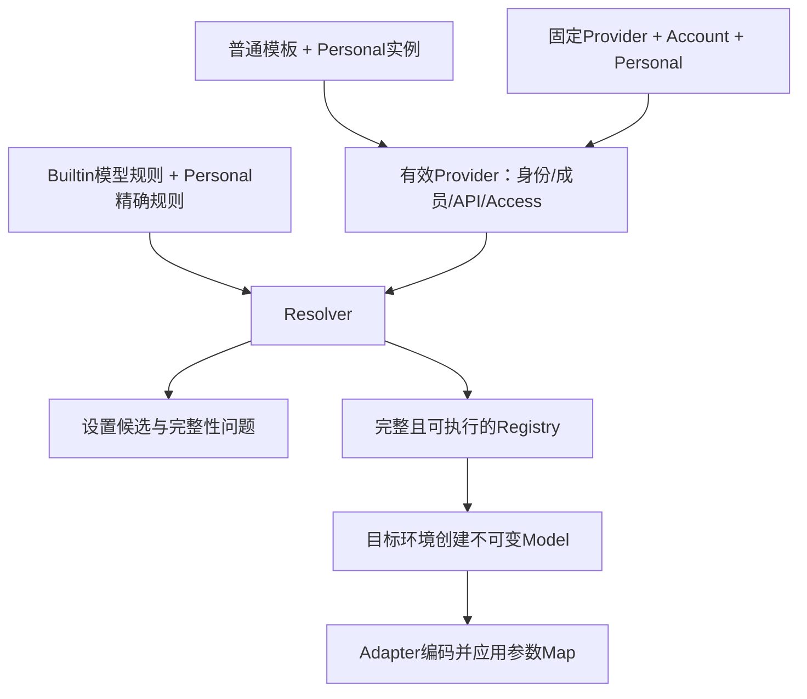

# 模板与模型规则配置规范

## 配置怎样成为一次调用

模板回答“通过哪个产品入口、协议和访问方式调用哪些模型”；模型规则回答“这些模型具有什么能力、逻辑选项怎样编码为请求参数”。两条路径在 Resolver 汇合，设置页和执行目录使用同一份解析结果，不能各自按型号或域名猜测能力。

| 概念            | 含义与维护边界                                                               |
| --------------- | ---------------------------------------------------------------------------- |
| Builtin Release | 随包或动态下载的完整配置，Provider 模板/固定 Provider 与模型规则共同版本化   |
| Template        | 普通供应商的连接与成员基线；`templateId` 是稳定模板身份，不是用户实例身份    |
| Provider 实例   | 由 `providerId` 标识的一组具体连接配置；模型身份是 `providerId + modelId`    |
| Account         | 只对已知固定账号 Provider 投影动态配置与资格，不向普通模板写入用户凭据       |
| Personal        | 用户的显式覆盖与个人模型成员；未声明字段继续继承，不保存整份解析结果         |
| Effective       | 按顺序叠加得到的生效配置，可以仍不完整；不是应写回用户文件的配置             |
| Registry        | 完整且可执行的 Provider/Model 集合；设置页还保留不完整候选及问题以供修复     |
| 执行 Model      | 从目标执行环境的 Registry 创建的不可变执行事实；后续刷新只影响新创建的 Model |



普通模板实例继承模板后再叠加 Personal；固定 Provider 先叠加 Account，再叠加 Personal。Account 只能作用于内置固定身份。配置更新不能覆盖用户显式地址、名称或选项，不能把本地 Host 的凭据或解析结果用于替代远程 Host 的事实。手机界面使用目标 Host 的投影。账号动态凭据在请求期取得，供应商仍对每次请求作最终授权。

## 文件和类型的唯一来源

| 文件                                                                          | 职责                                              |
| ----------------------------------------------------------------------------- | ------------------------------------------------- |
| [正式 JSON](../../config/provider/zcode-builtin.json)                         | 唯一手工编辑源，包含模板、固定 Provider、模型规则 |
| [测试 JSON](../../config/provider/zcode-builtin.test.json)                    | 从正式配置生成的完整 Release，不独立编辑模型      |
| [生成脚本](../../scripts/sync-test-builtin-provider-config.mjs)               | 测试端点映射和相应 Site 规则派生                  |
| [规则 Schema](../../packages/provider/src/config/rule-data-schema.ts)         | 每层字段、匹配格式和来源写权限                    |
| [Provider Schema](../../packages/provider/src/config/provider-data-schema.ts) | API、Access、模板元数据                           |
| [Model Schema](../../packages/shared/src/model-config.ts)                     | 能力、选项与完整性                                |
| [Resolver](../../packages/provider/src/resolver.ts)                           | 模板继承、成员及最终可执行配置                    |

文件外壳是 `{schemaVersion: 1, revision, config}`。配置内容变化要使用新 revision，避免同号异内容；纯文档整理不递增。revision 与产品版本号不同，具体交付见[交付规范](./delivery.md)。不手工扩展 Schema 未接受的字段。

## 模板、成员和规则

`providerConfigRules.templateRules` 定义普通 API 模板。维护 `templateId`、本地化名称、Logo、`access`、`api.type/baseUrl`、Key 管理链接与 `builtinModelIds`。模板不携带用户 Key，不是直接可执行的 Provider；实例从模板继承，再叠加 Personal。

当前 API 类型只有 `anthropic-messages`、`openai-chat-completions`、`openai-responses`。Access 仍包含普通 `api-key`、手工套餐 `zhipu-coding-plan-api-key` 和固定账号 `zhipu-account`。手工套餐统一为普通 Key 的后续方案不能提前写成当前实现。

地域与账号站点分别命名。TokenHub 的 `tencent-tokenhub-cn` / `tencent-tokenhub-intl` 分别表示中国站账号下的广州 / 新加坡 API，展示名称明确地域和中国站归属；模板 ID、API 地址和 Key 管理入口保持不变。中国站官方说明同时列出这两个地域，并要求在同一控制台选择对应地域创建 Key。国际站账户使用另一组域名，不因 API 地址包含 `intl` 就切换获取 Key 的站点。[中国站 API 说明](https://cloud.tencent.com/document/product/1823/130078)、[Key 管理](https://cloud.tencent.com/document/product/1823/130090)、[国际站 API 说明](https://intl.cloud.tencent.com/zh/document/product/1300/78941)。

模板创建 E2E 从本次加载的 Built-in 配置取得预期模型 ID，验证完整成员集合，而不固定某一版目录的数量。成员排序和默认启停由配置专项验证；不在模板创建用例里重复维护清单。G149-01 同时保留协议、地址、唯一获取 Key 入口和假 Key 保存验证，按钮文案与当前中英文翻译保持一致。

新增 Logo key 时核对[资源映射](../../packages/ui/src/settings/model-provider-section/ProviderLogo.tsx)、主题资源和来源记录；新名称核对本地化。纯配置动态更新不能凭空增加安装包内的图片资源。

`builtinModelIds` 决定模板成员；`templateModelRules` 的 `templateId + modelId` 决定该成员默认启停及差异。增加规则不会添加成员；`modelOrder` 只排序已有成员。当前所有模板成员都有精确启停声明，新增时保持这一可审查性。

### 供应商展示顺序

2026-10-26 确认，revision 37 整理模板发布顺序。排序以查找入口为目的，不按接入时间、模型发布时间、价格、模型数量或实时热度重排品牌。最新模型优先维护和默认启用，不等于品牌随新品发布改变位置。

**模板目录与已添加实例是两个顺序。** `providerConfigRules.templateRules` 数组顺序经 ProviderTemplateMap、ProviderSettingsView 传到添加供应商页面。页面单独提取智谱专区，其他模板保持发布顺序；不增加 Schema 外的 rank/category 字段或第二份运行时排序表。下述类别是维护约定，不表示界面新增分类标题。

1. **智谱专区 → 国内供应商 → 海外原厂 → 聚合平台。** 百炼、TokenHub、方舟归对应国内品牌；独立聚合服务 SiliconFlow、OpenRouter、OpenCode 放在聚合区。
2. **同品牌连续，普通 API 在前，套餐随后。** Coding/Token/Agent 等产品按下表稳定排列；新产品插在同品牌最相关产品之后，不追加到整个目录末尾。
3. **先产品，再地区，再协议。** 同产品国内在前、国际在后；普通 API 国内/国际相邻，然后再排套餐。相同产品、地区已有多个协议时固定 Responses → Messages（界面可显示 Anthropic）→ Chat。此顺序不代表性能排名，不新增协议或改变请求路径。
4. **新品牌进入所属类别尾部，保留已有品牌相对顺序。** 品牌移动、分类调整和排序例外先列具体差异并讨论；确认后同步规范、库存和排序断言。
5. **正式单源，测试派生。** 两环境模板 ID 顺序完全一致。只移动模板块，不顺手排序有覆盖语义的模型规则数组；启停、模型成员顺序、能力、端点和参数保持独立维护。

当前品牌块与产品顺序（每行保持连续）：

| 类别       | 品牌                              | 产品入口顺序                                                            |
| ---------- | --------------------------------- | ----------------------------------------------------------------------- |
| 智谱专区   | BigModel / Z.ai                   | 保留客户端固定专区顺序，见下文                                          |
| 国内供应商 | Kimi                              | API → Code 国内 → Code 国际                                             |
| 国内供应商 | MiniMax                           | API → M Plan                                                            |
| 国内供应商 | DeepSeek                          | API                                                                     |
| 国内供应商 | 百炼                              | API 中国 → API 国际 → Coding Plan 中国 → Token Plan 团队版中国          |
| 国内供应商 | 小米 MiMo                         | API → Token Plan                                                        |
| 国内供应商 | 腾讯 TokenHub                     | 广州 API（中国站）→ 新加坡 API（中国站）                                                     |
| 国内供应商 | 火山方舟                          | API → Coding Plan → Agent Plan                                          |
| 国内供应商 | 阶跃星辰                          | API → Step Plan                                                         |
| 海外原厂   | OpenAI、Anthropic、xAI            | 按此品牌顺序，各保留已有 API 入口                                       |
| 聚合平台   | SiliconFlow、OpenRouter、OpenCode | 按此品牌顺序；OpenCode 内先 Go 后 Zen，各按 Responses → Messages → Chat |

**智谱专区保留已有例外。** ProviderTemplatePicker 固定显示 BigModel Coding Plan → Z.ai Coding Plan → BigModel API → Z.ai API，不采用 JSON 内这四项的相对顺序。本轮保留四项原始数组顺序和专区 UI 行为，不能声称只改 JSON 就能改变专区次序。“创建自定义供应商”是其他供应商区第一张操作卡，不属于模板排序。

**个人实例顺序归用户维护。** 设置侧栏和聊天模型菜单的普通供应商使用 Personal `providerOrder`，用户可拖拽调整。同模板多个实例分别按 providerId 排序。模板重排不迁移、不重写该字段，不重排已有实例或替换当前模型选择；固定账号 Provider 保留现有专区规则。模板内模型的 `builtinModelIds` / `modelOrder` 是另一维度，本轮不改。

验证检查完整模板集合、品牌块、协议顺序、两环境一致性和 Decoder 输出顺序。revision 37 的纯排序变更与 revision 36 对账时，去除 revision 并按 templateId 规范化模板块后，全部内容必须相同。后续型号维护按对应批准差异更新完整内容保护基线，模板顺序继续独立逐项断言。库存摘要表按发布数组顺序排列，专区实际展示例外以上述说明为准。交付使用新 revision，不覆盖已发布 revision 36；随包或动态发布按[交付规范](./delivery.md)执行，Git 更新不等于线上更新。

### 字段归属与身份稳定性

模板外层只有 `templateId`、`templateNameMap`、`config`；名称 Map 支持 `zh-CN` / `en-US`。模板的 `config` 只接受 `logo`、`access`、`api`、`builtinModelIds`，其中 Access 禁止携带 `apiKey`。不要把实例字段、账号状态或个人模型写入模板。

实例规则外层保存 `providerId`、可选 `templateId/providerName/enabled` 和 `config`。`enabled` 的实例总开关与模型 `config.enabled` 不同；固定账号 Provider 不使用总禁用开关，仍受账号资格和模型启停约束。`group` 是产品分组，`visibility` 是展示控制，二者都不能替代鉴权或完整性检查。

`api` 保存 `type/baseUrl` 及可选静态 `headers`，URL 必须对应具体产品和协议，不将供应商宣传首页当作 API 地址。模板 ID、原始模型 ID 和实例名称分别维护；改模板展示名不能重命名已保存实例。模型 ID 中的前缀、斜杠和大小写原样用于请求。

成员按内置在前、个人在后的来源顺序组成；单集合去重保留第一次，个人与内置重名时保留内置来源。`modelOrder` 排序已有成员，不创建成员。缺模板、缺 Key、坏 URL 或能力不完整的候选可以在设置页显示，但不能因此进入 Registry；禁用模型也不能执行。`selectable` 还受 Provider 可见性限制，隐藏不是删除或失去内部精确查找身份。

### 内置成员移除与个人覆盖

模型列表由 `builtinModelIds` 与 `personalModelIds` 的并集决定；个人精确规则只覆盖参数，不创建成员。修改内置模型的参数、启停或关闭推荐配置，都不会自动把它转为个人成员。

内置移除成员后，如果同 ID 不在个人成员列表中，该模型会退出设置及可选模型列表，个人规则仍保留但不再赋予执行资格。个人手动添加的成员仍按当前有效规则解析；移除内置精确规则可能影响其继承字段。内置仅默认关闭时，用户显式保存的启用状态仍优先。维护操作不自动迁移用户选择，也不自动把已移除成员转为个人模型。

删除、默认关闭、删除规则与迁移身份分别审核。用户改过参数并不保证删除内置成员后仍能继续使用；需要保留旧入口时优先明确保留成员及默认状态，只有已确认不可用的旧型号才按移除流程处理。

### 稳定调用 ID 与版本维护

优先使用供应商官方明确支持、会跟随升级的稳定调用 ID；不能为了名称简短自行删日期或猜测别名。滚动 ID 的实际后端变化后，仍需更新能力、档位和回归证据。原厂、聚合入口和套餐分别核验，不能把一个入口的别名复制到其他入口。

2026-10-27 核验：DeepSeek 原厂使用 `deepseek-flash`（官方当前路由到 V4.1 Flash 1017）与 `deepseek-v4-pro`。Pro 没有在官方调用表中提供 `deepseek-pro`，因此保留现有 ID。其他入口只有在官方确认等价路由、协议与能力后才替换。日期 ID、版本系列 ID 与持续演进产品不是同一种承诺，不能仅因名称难看就互换。来源：[DeepSeek 官方调用说明](https://api-docs.deepseek.com/quick_start/pricing-details-cny/)。

## 规则层级

```text
modelRules                    型号通用能力
  → modelApiRules             型号 × API 协议差异
  → providerSiteRules         具体 Base URL 的差异，可限定型号和协议
  → templateModelRules        templateId + modelId 精确覆盖
  → builtinProviderModelRules 固定 providerId + modelId 精确覆盖
  → Personal 精确规则         用户覆盖
```

同层按数组顺序执行，后项只覆盖声明字段，无“最具体匹配优先”、长度排序或额外 priority。省略表示继承，`null` 表示显式清除，具体值表示覆盖；数组值按字段合同替换，不能期待自动合并思考档位。设置页的 Effective 值不能整份写回 Personal。

各数组中的记录使用下面的匹配字段和 `config`；文件不重复写内存层的 `type`，不使用 `providerMatch` 或跨层条件：

| 数组                        | 匹配字段                                         |
| --------------------------- | ------------------------------------------------ |
| `modelRules`                | `modelMatch`                                     |
| `modelApiRules`             | `modelMatch + apiTypeMatch`                      |
| `providerSiteRules`         | `modelMatch + baseUrlMatch`，可选 `apiTypeMatch` |
| `templateModelRules`        | `templateId + modelId`                           |
| `builtinProviderModelRules` | `providerId + modelId`                           |

Personal 只允许具体 Provider/Model 的智能精确覆盖或手动配置，同一身份不能同时进入两种集合，也没有个人全局正则层。手动模式固定产品开放的可编辑字段，系统字段仍由规则提供；维护 Builtin 不能顺带重写这些用户意图。智能/手动切换的字段归属可核验[手动配置实现](../../packages/provider/src/config/manual-model-config.ts)。

### 匹配与简化

- Model/Model+API 按有限维护集合使用简单前后缀正则，如 `.*deepseek-flash.*`；字面小数点仍转义。解析器对完整字符串匹配，模型名匹配忽略大小写，但请求 ID 不改变。
- 通用规则在前，具体变体在后。不能只按字符串长度自动排序；必须验证继承后的完整结果。
- 同一具体 Base URL 的规范化等价形式可以共用一条 Site 规则；不同域名或路径不以 alternation 合并。模型或协议条件不同而必须拆分时保留多条。
- Template/Provider 精确规则按完整身份匹配，不放宽成模型通配。Site 的 `modelMatch` 仍按 Schema 支持匹配，不能误写成只允许精确模型。
- 通用基线目前是 `contextWindow=1000000`、`maxOutputTokens.max=128000`。已知较小窗口/输出限额必须显式覆盖；基线不是上游实测承诺，也不是每次请求的输出预算。
- 只删除真正可继承的重复值。若前层家族改成较小值，具体型号恢复到通用值仍需显式覆盖。
- 保留有语义的例外，如 GLM-4.6 Messages 规则对视觉型号的 `(?!v)` 排除、Flash 与 FlashX 的覆盖顺序。历史别名转换不能随 matcher 放宽而扩大适用范围。

这些选择基于有限维护集合：用明确顺序表达家族与变体差异，减少重复声明和复杂边界，而不是承诺无限未知型号都准确。revision 32 将通用窗口从 200000 调为 1000000、输出上限从 32000 调为 128000；删除了仅为 `[1m]` 设置百万窗口、仅为预览别名设置 128000 上限的两条 Model 规则，因为可以继承新基线。协议层的推理映射、成员身份和显式请求预算不因这两条规则删除而改变。

### 能力与 Option Map

Properties 包括上下文容量、输入/输出形态、工具调用、结构化输出、原生搜索、对话中途 System 消息和 MFJS Schema 要求。不同字段分别核实：原生视觉徽标不等于媒体输入开关，支持图片不等于支持视频/PDF，支持工具不等于支持原生搜索。

2026-10-27 经确认，OpenCode Go Chat 统一关闭 `supportsJsonSchemaOutput`。这是降低维护成本的入口策略，不表示所有模型都无法输出 JSON：同一 Schema 的实测存在成功、代码块和上游拒绝等差异。规则只匹配 Go 的 Chat 协议与精确站点，覆盖模板及同站点自建供应商；新增成员默认沿用。保留文本、工具调用、媒体与推理配置，不改 Go Messages、Go Responses、Zen 或原厂入口。个人显式覆盖仍按既有优先级生效。重新启用须先讨论，并用产品 Adapter 验证对应模型及 Schema。

2026-10-27 经确认，方舟普通 API 模板 `volcengine-ark` 的 Seed 2.1 Pro/Lite/Turbo 默认关闭 `supportsVideo`：当前 `/api/compatible/v1/messages` 实测拒绝 `video` 内容块。能力声明必须同时满足模型、具体入口及产品现有适配，不能因为模型原生支持视频或另一协议支持视频就启用。保留图片、文本、工具和推理档位；不为视频切换协议或新增适配。Coding/Agent Plan 的独立入口未在这轮实测，不将普通 API 的结果扩大为套餐验证结论。个人显式覆盖仍按既有优先级生效。

2026-10-27 经确认，revision 41 在 `volcengine-ark` 新增并默认启用官方滚动 ID `doubao-seed-evolving`，置于现有三个日期型号之前，不替换、停用或删除旧身份。继续使用普通 API 的 Messages 入口；沿用已验证候选的 1024000 上下文、256000 输出上限和 `none/low/medium/high` 四档映射。启用文本、图片、工具，关闭当前入口不接受的视频；音频、PDF、原生搜索、JSON Schema 和 MCS 不额外声明。真实产品链路单次回归已通过文本、图片、工具续接、固定长文、四档推理和输出预算；未做容量上界压测。滚动更新由供应商决定，后续仍需回归能力及参数变化。官方依据见[模型价格与输入范围](https://docs.volcengine.com/docs/ark/model-pricing?lang=zh)和[最新模型](https://docs.volcengine.com/docs/ark/latest-model?lang=zh)。

2026-10-27 维护者核实：所有 Coding Plan 的 `GLM-5.3` 标准版均不支持视频。revision 42 在 Z.ai、BigModel 的套餐 Messages 站点和共用能力的加速卡站点，追加精确型号 `GLM-5.3` 的 `supportsVideo: false` 覆盖，放在站点通用视觉声明之后，防止 Fusion 图片能力误扩成视频能力。覆盖手动套餐模板、个人/团队账号、加速卡及相同站点的自建 Provider；测试地址由正式规则生成。低峰闲时入口的该型号原本已关闭视频，保持不变；Start Plan 当前只有 Flash，不扩大此次范围。图片、工具、搜索、思考档位以及 `GLM-5.3-Flash`、普通 API、聚合站点均保持原值。个人显式模型覆盖仍优先；此变更收窄内置默认能力，不新增禁止个人覆盖的机制。此前实际 App 视频不能识别的记录由这次产品能力确认收口，不再作为待定位适配故障。

完整执行配置需要 `enabled`、完整 properties、非空有序 `reasoningLevel.values/map` 和 `maxOutputTokens.max/map`。无推理模型也需要合法选项合同，不按型号猜默认值。

| 字段组                        | 必须核对的叶子                                                                                                                                        |
| ----------------------------- | ----------------------------------------------------------------------------------------------------------------------------------------------------- |
| `properties`                  | `contextWindow`、`requiresMfjsToolSchema`、`supportsToolCall`、`supportsJsonSchemaOutput`、`supportsNativeWebSearch`、`supportsMidConversationSystem` |
| `properties.inputFormat`      | `supportsText`、`supportsImage`、`supportsVideo`、`supportsAudio`、`supportsPdf`                                                                      |
| `properties.outputFormat`     | 当前只有 `supportsText`；不能借此声明图像或音频生成支持                                                                                               |
| `optionSpecs.reasoningLevel`  | 有序 `values` 与 `map`；不另存 `type`，不自动改名已有关闭档位                                                                                         |
| `optionSpecs.maxOutputTokens` | 能力上限 `max` 与 `map`；不另存请求默认预算                                                                                                           |

稀疏规则只写差异，完整性由解析后的配置证明。新模型应核对所有能力，即使最终借用了家族规则，也应留下继承值适用的依据。MFJS 是工具参数 Schema 要求，MCS 是允许对话中途 System 消息；二者不能从“支持工具调用”推导。

```text
Adapter 编码基础请求
  → reasoningLevel.map
  → maxOutputTokens.map
  → 最终 HTTP Body
```

Map 使用受限 CEL，输入是对应选项值，输出是 JSON Merge Patch；无 IO、环境读取或动态代码。`{}` 不修改请求，Patch 中的 `null` 删除字段。`values` 按低到高排列，`none/disabled` 等原始值不全局改名。每个合法值都要验证最终请求，不能只测表达式能编译；Map 也不能替代 Adapter 对媒体、流式工具调用和响应的支持。实现见 [Option Maps](../../packages/model-option-map/src/option-maps.ts)和[请求应用点](../../apps/zcode-cli/packages/adapters/src/model/model-option-map-fetch.ts)。

## 正式与测试配置

```text
编辑正式 JSON → sync-test → 测试 JSON → check-test → 同一 MR
```

生成器从完整正式文件重新派生，不在旧测试文件上增量修补：

- 仅转换固定 `zhipu-account` Provider 的已知正式端点，包括个人/团队、Start、闲时和加速卡；未知账号端点明确失败。
- 普通手工 API 模板、第三方地址和 Key 管理链接保留原值。因此测试包中的普通模板仍可能请求正式供应商并产生真实费用。
- 保留正式 Site 规则，紧随其后追加测试端点规则，继承相同型号/API 条件、能力和 Map。
- 模板、模型成员、其余规则、schemaVersion、revision 保持同源。测试环境差异不能用来维护第二套模型能力。

```bash
pnpm provider:config:sync-test
pnpm provider:config:check-test
```

新普通模板若确需不同测试端点，先确认环境要求，再修改生成策略及脚本测试；不能手工改测试 JSON。

### 当前账号端点映射

| 正式 Base URL                                    | 测试 Base URL                                            |
| ------------------------------------------------ | -------------------------------------------------------- |
| `https://api.z.ai/api/anthropic`                 | `https://api.z.ai/api/anthropic`                 |
| `https://open.bigmodel.cn/api/anthropic`         | `https://open.bigmodel.cn/api/anthropic`                  |
| `https://zcode.z.ai/api/v1/zcode-plan/anthropic` | `https://zcode.z.ai/api/v1/zcode-plan/anthropic` |
| `https://zcode.z.ai/api/v1/off-peak/anthropic`   | `https://zcode.z.ai/api/v1/off-peak/anthropic`   |
| `https://zcode.z.ai/api/v1/highspeed/anthropic`  | `https://zcode.z.ai/api/v1/highspeed/anthropic`  |

此表只驱动固定账号 Provider 地址转换及对应 Site 规则派生，不改同 URL 的普通模板。新增测试地址还需核对现有 Adapter 的官方版本请求安全校验准入；产品环境开关本身不授予新域名访问行为。

### 构建选源与最终资源

共同[构建入口](../../scripts/builtin-provider-config.mjs)拥有环境选源职责：显式非空 `ZCODE_ENV` 优先；否则先读取 `.env`，再按 `NODE_ENV=production` 读取 `.env.production`，其他情况依次读取 `.env.development`、`.env.development.local`。后读文件中的值覆盖前值，缺失文件跳过。最终值去空白、转小写，空值默认 `test`，非法非空值报错。

`production` 选 `config/provider/zcode-builtin.json`，`test` 选 `config/provider/zcode-builtin.test.json`。`NODE_ENV` 只决定上述环境文件组，不直接决定产品环境；分支名也不参与选择。

```text
ZCODE_ENV与环境文件 → 选择完整JSON → 复用Release Decoder校验
                                     ↓
                   包资源或嵌入常量 → Builtin Source → Registry
```

| 消费形态                   | 配置落点与核验要求                                       |
| -------------------------- | -------------------------------------------------------- |
| Desktop 安装包             | `resources/config/provider/zcode-builtin.json`           |
| 普通 CLI                   | `dist/provider/zcode-builtin.json`，构建刷新相邻资源     |
| SEA 单可执行文件           | 资源 key 为 `zcode-provider/zcode-builtin.json`          |
| HTTP / Remote / Server CLI | 完整 JSON 编译为常量，检查最终 JS/打包产物               |
| Desktop 开发态             | 按同一编译环境定位仓库源文件；显式配置路径注入优先级不变 |

读取、JSON 解析或 Schema 校验失败直接终止构建，不跨环境回退。构建只读选定本地文件，不下载在线配置、不隐式执行同步、不覆写源文件。Windows 加载解码器时先把文件路径转为 `file:` URL，避免盘符被当作协议。

构建缓存必须覆盖 `ZCODE_ENV`、环境文件、两份配置和公共构建工具。当前 CLI 的 Turbo 输入及 Desktop E2E 指纹包含这些相关输入，Server 嵌入内容参与产物 hash；bootstrap 重新构建 Agent JS 并刷新相邻配置资源。不同环境并行构建使用独立 worktree/输出目录，不能并发写同一个 dist。

构建只决定包内初始配置；客户端是否采用它还受有效缓存与 revision 影响，见[交付与恢复](./delivery.md)。环境变更的回归必须用内容不同的 Release 检查实际选源、坏文件失败、缓存失效和最终嵌入内容，不能因两份文件偶然相同就宣称通过。
