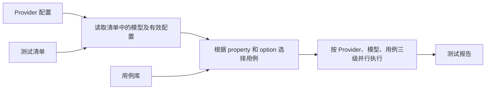
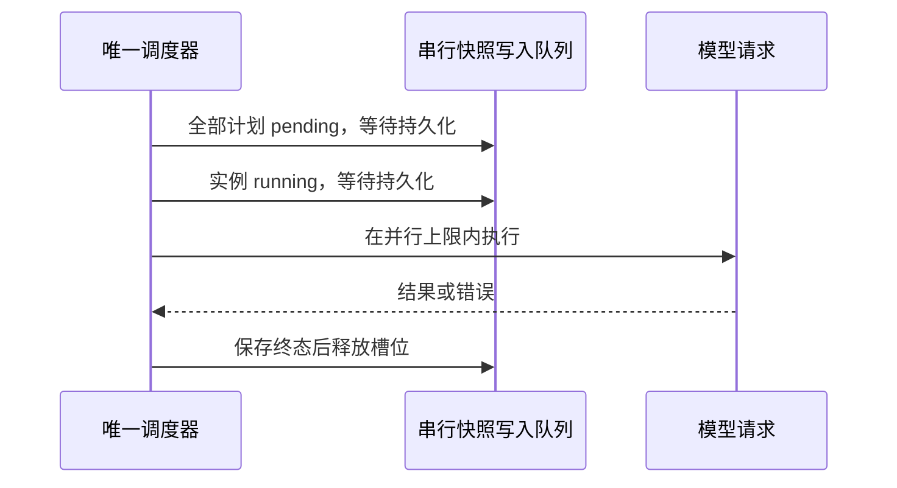
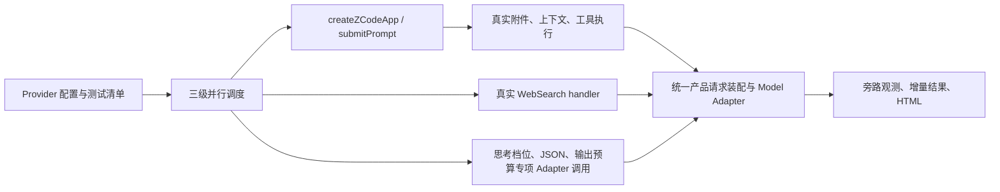

# Provider 与模型自动回归

状态：已实现命令行执行器；真实验证范围见文末。

## 核心流程

维护一份测试 Provider 配置、一份测试清单，以及一套按模型 property 和 option 编写的用例。运行时遍历清单中的模型，自动选择适用用例，执行后生成报告。



## 维护哪三样东西

| 内容                                 | 放什么                                                                             | 什么时候修改                     |
| ------------------------------------ | ---------------------------------------------------------------------------------- | -------------------------------- |
| `providers.json`：测试 Provider 配置 | 供应商入口、协议、模型及其 properties、optionSpecs；复用现有 Provider/模型规则格式 | 增加供应商、模型或调整模型配置时 |
| `test-list.json`：测试清单           | 本轮要跑的 Provider、模型；默认跑全部适用用例，也可指定用例编号                    | 调整回归范围时                   |
| `src/cases.ts`：用例库               | 每个用例的编号、适用条件、测试输入、执行步骤和通过条件                             | 新增能力或补充测试场景时         |

测试清单只引用 Provider 和模型，不重复填写它们的 property、option。实际 Provider 配置保存在本地或私有容器母板，API Key 不提交到 Git。仓库只维护无密钥示例和测试清单。正式和测试环境的内置配置均可作为测试 Provider 配置的来源；本轮使用哪个来源，就在报告中注明。测试专用配置只用于测试，不参与产品发布。

测试清单示意，字段为实际格式：

```json
{
  "targets": [
    { "providerId": "test-provider-a", "modelIds": ["*"] },
    { "providerId": "test-provider-b", "modelIds": ["model-b"] }
  ],
  "caseIds": ["*"]
}
```

含义：测试 A 的全部模型、B 的指定模型，每个模型自动运行所有适用用例。清单引用不存在的 Provider、模型或用例时直接报错。

## 用例怎样匹配模型

用例的适用条件写在用例实现中。执行器读取经过现有 Resolver 解析的最终配置，不再实现一套规则合并逻辑。

| 用例                    | 根据什么选择或展开                                           | 检查什么                                                 |
| ----------------------- | ------------------------------------------------------------ | -------------------------------------------------------- |
| TEXT-001 文本对话       | `inputFormat.supportsText` 和 `outputFormat.supportsText`    | 真实会话短问答、流式输出、正常结束                       |
| IMAGE-001 图片          | `inputFormat.supportsImage`                                  | 识别固定小图中的内容                                     |
| VIDEO-001 视频          | `inputFormat.supportsVideo`                                  | 识别固定短视频中的事件顺序                               |
| AUDIO-001 音频          | `inputFormat.supportsAudio`                                  | 产品附件链未提供对应输入时明确未测，不手造 file 输入     |
| PDF-001 文档            | `inputFormat.supportsPdf`                                    | 回答固定 PDF 中的问题                                    |
| TOOL-001 工具调用       | `supportsToolCall`                                           | 调用工具、校验参数、回传结果、继续回答；包含连续工具调用 |
| TOOL-002 工具 Schema    | `supportsToolCall`，按 `requiresMfjsToolSchema` 选择对应预期 | 与 TOOL-001 合并执行一次，报告注明兼容别名               |
| JSON-001 结构化输出     | `supportsJsonSchemaOutput`                                   | 返回值满足给定 JSON Schema                               |
| WEB-001 原生搜索        | `supportsNativeWebSearch`                                    | 真实 WebSearch handler 返回摘要；来源数量单独观察        |
| SYSTEM-001 中途系统消息 | `supportsMidConversationSystem`                              | 多轮中插入系统消息后，消息能正确传递并生效               |
| CONTEXT-001 上下文      | `contextWindow`                                              | 在声明范围内读取一段固定长文；报告实际测试长度           |
| REASON-001 思考档位     | 遍历 `reasoningLevel.values`，使用对应 `map`                 | 每档请求参数正确、调用成功；工具历史由 TOOL-001 单独验证 |
| OUTPUT-001 输出限制     | `maxOutputTokens.max/map`                                    | 用合法的小预算检查实际请求参数和输出结束行为             |

例如，模型支持图片、工具，思考档位为 `low / high`：自动跑文本、图片、工具，以及 low、high 两档测试；不支持音频就跳过音频用例，写明“不适用”。新模型加入配置后复用这些用例；新档位自动多跑一次，不为每个型号另写测试。

本机制验证 Provider 适配与默认配置，不评测模型的通用能力、算术、文风或指令遵循。

每个用例明确“怎样才算通过”。HTTP 200 不够：流必须正常结束并产出正文，工具名称和参数必须有效，结果回传后能继续回答；不要求最终回答恰好等于某个整数。架构题只用于观察档位参数、思考长度与耗时，不因标题或内容质量判失败。

图片、文档、上下文和系统消息保留固定标记观察；允许解释文字、大小写和空白差异。标记未命中记为 review（待复核），不能直接判为适配失败。

JSON-001 使用显式 responseJsonSchema，结构符合 Schema 是协议能力的验证要求，仍须严格校验。测试素材固定且不含私人数据。新增 property 或 option 时补对应的用例或明确的覆盖说明，避免新字段无人测试。

## 怎样跑一整轮

一个执行入口完成以下步骤：

1. 读取 Provider 配置和测试清单，检查引用与配置是否合法。
2. 遍历清单中的模型，按有效 property、option 选择用例、展开档位。
3. 按三级并行上限执行；主对话、附件、工具闭环复用 ZCode 会话，专项能力调用现有产品处理函数。
4. 保存每项结果。某项失败继续跑后面的项目，结束后生成报告。

按清单设置并行数，缺省串行，每项设超时，工具循环沿用产品运行时，不另设测试回合上限。整轮开始后按清单执行到底，耗时增加不是主动取消的理由；只有用户要求停止或明确无法继续的执行故障才中止。单项超时、截断和调用失败应记录后继续其余项目。复杂题可在开跑前统一放宽超时，不能只给某个档位额外预算。缺 Key 的模型标记未测，其他模型继续。百万上下文、最大输出等高消耗压力测试不默认执行；普通用例成功不能证明容量上界已实测。

整轮回归的范围就是测试清单。报告写清实际测了哪些模型，不把部分清单的结果说成整个内置目录都通过。已有的配置和协议单元测试继续保留；本机制重点组织模型调用回归。

## 报告长什么样

执行时持续保存 JSON 结果，结束后保留 Markdown 摘要；独立脚本将任意完整快照转成离线 HTML 报告。每项至少记录：

| Provider | 模型    | 用例       | option 值 | 结果 | 耗时   | 说明               |
| -------- | ------- | ---------- | --------- | ---- | ------ | ------------------ |
| A        | model-a | REASON-001 | low       | 通过 | 实测值 | 请求与结果满足断言 |
| A        | model-a | REASON-001 | high      | 失败 | 实测值 | 具体错误与失败步骤 |
| A        | model-a | AUDIO-001  | —         | 跳过 | —      | 模型未声明音频能力 |
| B        | model-b | —          | —         | 未测 | —      | 缺 API Key         |

以上为格式示例，不是已执行结果。报告汇总通过、失败、跳过、未测数量，记录配置版本、测试清单和执行时间。失败附必要的脱敏请求参数和错误；不保存 Key 或推理正文。若执行链可观测，附首响应、正文和工具步骤耗时，帮助定位慢调用。

## 本轮实现约定

运行时必须用 `--providers <本地文件>` 指定 Provider 配置，用 `--list <文件>` 指定测试清单。Provider 配置引用一份内置配置文件 `builtinFile`，并使用现有个人 `providerRules` 配置测试实例及 Key；需要调整模型时使用现有个人 `modelConfigRules`。相对路径按各配置文件所在目录解析，不读取日常用户会话或自动发现其他 Key。

重点用例 REASON-001 使用固定架构设计题 `task-platform-v1`：多租户长任务平台，在重复投递、Worker 失联恢复、外部副作用结果未知、取消竞态和跨地域恢复约束下给出方案。逐档测试，默认每档 1 次，只跑 1 pass；常规回归不追求多轮统计精度。只有明确需要重复观察时才增加 repetitions。

固定上下文、输出预算，只改变 reasoningLevel。示例清单每项超时 600 秒，不额外限制输出长度；专项探针未设置 maxOutputTokens 时使用各模型声明的上限，显式设置时取它与模型上限的较小值。真实会话的输出预算由产品上下文预算器决定，不能用测试清单覆盖；报告保留实际请求参数。同一模型所有档位使用同一预算，OUTPUT-001 单独使用至多 1024 token 检查参数和结束行为；模型自行 stop 不算适配失败，报告注明“未观察到截断”，也不声称已证明输出容量上界。报告保留单次结果；显式重复测试时才汇总中位数：供应商思考 token 数、可见思考文本 Unicode 字符数、首正文耗时和总耗时；未提供记为未知，不补零。只统计思考长度，不保存思考正文。请求参数映射的核验与长度观察分别报告；长度没有单调增长不直接判失败。

架构题自动检查正常结束与非空回答，不校验六节标题或设计质量；报告明确“设计质量待人工评审”。报告保存题目编号、题目全文、预算、超时及最终设计回答，便于复查；不保存思考正文。

先配置 MiniMax API 和 Coding Plan 两个独立实例。真实调用按三级上限执行，保留产品原有重试；1 pass 指用例只执行一遍，不代表禁用产品请求恢复。报告含当前配置指纹和实际范围，不含 Key；失败继续后续用例。用例不适用标记跳过，缺 Key 或素材标记未测。执行器是这一轮状态的唯一所有者，取消与超时通过 AbortSignal 传入实际模型请求。

## 实现与验收

用例库和执行器位于 `apps/zcode-cli/tools/provider-regression/`。上表用例均已接入选择流程；音频在产品尚无对应附件路径时明确未测；真实调用的验证范围见文末。

验收重点：不同模型自动选对用例；每个公开档位都执行；新增模型无需复制用例；失败不中断整轮；报告能看清失败原因和未测内容。

执行器本地测试覆盖三级并行上限与 Provider 覆盖、取消和超时区分、磁盘写入失败时停止请求、实际 CLI 强杀后的部分结果恢复、输出预算和离线 HTML 转义。浏览器验证覆盖桌面浅色与窄屏深色布局、回答展开及无外部请求。这些验证使用模拟模型响应或已有结果，不能替代新供应商的真实调用验证。

按费用预算调度、历史比较、断点续跑和自动补测不进入本次实现。

## 使用方式

仓库维护 `config/provider/regression/providers.example.json` 和 `test-list.json`。将 Provider 示例复制到私有目录，填入两个入口各自的 Key，将 `builtinFile` 指向要测试的内置 JSON（可使用相对 Provider 配置文件的路径）。需要可独立使用的容器母板时，把这份内置 JSON 一起放入私有目录。不要将填好 Key 的文件复制回仓库。

从仓库根目录运行（路径换成自己的文件）：

```bash
pnpm provider:regression --providers /private/providers.json --list config/provider/regression/test-list.json --output /private/reports/run-001
```

加 `--dry-run` 只列出匹配结果并生成预览报告，不发网络请求。路径按当前命令目录解析，`builtinFile` 相对于 Provider 配置文件解析。`--output` 指定报告根目录；省略时使用 Provider 配置所在目录的 `reports/`。每次自动创建唯一 run-id 子目录，生成 `report.json`，正常收尾时另存 `report.md`，不覆盖旧结果。正式运行若有失败、待复核或未测，退出码为 1；取消为 130；配置或保存错误为 2。

清单支持 `repetitions`（思考档位每档重复数，默认 1）、`maxOutputTokens`（可选，缺省使用模型上限，无测试器额外上限）、`timeoutMs`（每项默认 120000）。同题比较按配置的档位顺序入队，每次独立上下文；并行执行时完成顺序可以不同，报告仍按清单顺序呈现。普通用例使用模型最高公开档位，工具最多 3 轮。正式配置和测试配置分别运行时使用各自的 `builtinFile`，结果不混用。

媒体用例从清单的 `fixtures.image/video/audio/pdf` 读取素材，每项填写 `path`、`mediaType`、`prompt`、`expected`；素材路径相对于清单文件。模型支持该媒体但没有素材时标为未测。`expected` 是用于人工复核的短标记，缺失时记为 review，不直接判适配失败；素材最大 8 MiB（等于上限可读取）；在读取与 Base64 编码前异步检查大小。超限时该用例记录明确的素材错误，不提交模型请求。音频尚无产品附件入口时记为未测。原生搜索复用产品 WebSearch handler。

## 并行清单与结果持久化

```json
{
  "concurrency": { "providers": 3, "models": 2, "cases": 3 },
  "targets": [
    {
      "providerId": "test-minimax-api",
      "modelIds": ["MiniMax-M3.1-Flash"],
      "concurrency": { "models": 1, "cases": 5 }
    },
    {
      "providerId": "test-minimax-coding-plan",
      "modelIds": ["MiniMax-M3.1-Flash"],
      "concurrency": { "cases": 1 }
    }
  ],
  "caseIds": ["TEXT-001", "TOOL-001", "REASON-001"],
  "repetitions": 1,
  "timeoutMs": 600000
}
```

全局 providers 限制同时活跃的 Provider 数；models 限制每个 Provider 同时活跃的模型数；cases 限制每个 Provider + Model 同时活跃的测试实例数。三个数均为正整数，缺省 1。每个 target 可逐字段覆盖 models / cases；同一个 providerId 只能出现一次，把模型合并到其 modelIds。`["*"]` 仍选择该 Provider 的全部有效模型，不允许与具体 ID 混用。

REASON-001 的每个档位、每次 repetition 是独立实例。工具用例内部请求顺序不变；不同实例不共享 Adapter、上下文、usage 或 AbortSignal 超时。模型槽位等该模型全部实例结束后释放，Provider 槽位同理。每个测试实例通过现有 ModelInvocationContext 建立独立 sessionId；一个工具闭环内的所有请求复用它，并行实例互不共享。请求归因、供应商会话 Header 和官方版本的请求安全校验继续由现有 Adapter 负责，不在测试配置中硬编码公共会话 ID。取消后不再发起新请求。入口按 providerId 独立限流，同 Key 的多个协议入口可能共享供应商额度，应合计规划并发。并行数是任务数上限，不是每秒速率保证。

执行器是这一轮状态的唯一所有者。先展开全部实例，再首次保存完整清单，之后才能请求供应商。每项开始前保存 running，结束后保存终态，然后释放槽位；单项失败不影响其他实例。实例状态为 pending、running、passed、review、failed、skipped、untested、cancelled。取消时在途项为 cancelled，未启动项为 untested；超时为 failed，两者分别记录。正常完成的整轮状态为 completed（不代表所有用例通过），正常取消为 cancelled，运行基础设施错误为 error。



快照写入前对所有字符串脱敏，再排队异步写同目录临时文件，刷新文件内容后原子替换 report.json。排队时捕获不可变快照，不让旧写入覆盖新状态。磁盘写入失败须停止调度并取消在途请求，不允许继续产生无法保存的测试结果。正常信号取消等待请求结束及写入完成；强杀或崩溃后保留最近一次完整快照。快照中 pending / running 显示“未完成（排队 / 执行中）”，不猜测进程是否仍活着，不伪造通过或失败；只有明确取消才写取消状态。保证已保存的完整用例结果，不保证在途流式输出的最后一段，不逐 token 落盘，也不自动续跑。

参数与 usage 只统计带模型 ID 和 messages / input 的推理请求，前置鉴权等辅助请求不参与。请求体支持 Adapter 实际使用的 JSON 字符串、字节数组和 Request 副本；观测不得消费原请求体。

JSON 记录 schemaVersion、runId、startedAt / updatedAt / endedAt、整轮状态、配置指纹、清单指纹、revision、实际三级并行设置，以及每项起止时间和结果。专项调用记录有效输出预算；会话由产品动态计算预算，逐次请求参数才是实际值，不填入清单预算冒充产品预算。搜索记录 handler 使用的档位与预算。不保存 Key、思考正文或完整私有 Provider 配置。每轮独立目录权限 700，结果文件 600（权限语义以平台支持为准）。

## 离线 HTML 报告

```bash
pnpm provider:regression:report --input /private/reports/run-id/report.json
```

容器母板保留私有 Provider 配置、测试清单和素材。新建专用节点后，在对应版本的仓库中执行上述 pnpm 入口，构建并使用同一版本的产品模块。历史独立 runner 不再作为验收入口，避免执行到旧实现；只做报告转换时无需加载凭据或调用模型。

默认在 JSON 旁生成 report.html，可用 `--output /private/report.html` 指定文件。生成脚本只读取 JSON，不加载 Provider 配置或发起网络请求；测试未结束也可以生成快照报告。兼容旧版完整结果文件，旧版缺失的并行设置、运行状态、逐项预算标为未记录，不推断为已验证。

页面按 Provider → Model 分组，显示完成进度、各状态数量、每项用例编号 / 档位 / 耗时 / 结束原因 / 参数核验、可展开的最终回答和错误，以及同题思考 token / 字符 / 首正文耗时 / 总耗时对照。失败或截断样本明确标记，只在成功样本中汇总中位数。保存完整题目、实际预算、配置版本和并行设置；并行耗时只作本轮观测，不声称严格性能基准。所有外部文字按纯文本转义，HTML 自包含、无远程资源，适配窄屏和系统深浅主题。

## 首轮真实验证（历史计数题）

2026-10-26，使用 revision 38，验证 MiniMax API、MiniMax Coding Plan 两个入口的 `MiniMax-M3.1-Flash`。每个入口运行 TEXT-001、TOOL-001，以及 REASON-001 的 low / medium / high / xhigh / max 各 3 次，共 34 项，全部通过。逐档请求均发送对应的 `output_config.effort`，同题比较保持 `max_tokens=4096`。

这两个入口本次没有返回独立的思考 token 数，报告记为“未提供”；可见思考字符数和耗时已记录，长度没有严格随档位递增。该结果不覆盖其他模型、媒体、搜索和容量上界。密钥仅保存在私有容器母板的 Provider 配置中；仓库与报告均不含密钥。

## 架构题试跑

2026-10-26，将 REASON-001 换为 `task-platform-v1`，统一配置 16384 token、300 秒。API 入口的 `MiniMax-M3.1-Flash` 首次有效样本如下（不是三次中位数）：

| 档位   | 可见思考字符 | 首正文耗时 |     总耗时 | 结果                 |
| ------ | -----------: | ---------: | ---------: | -------------------- |
| low    |         2039 |   8.213 秒 |  29.181 秒 | 参数、结束和结构通过 |
| medium |        63855 | 225.106 秒 | 242.372 秒 | 参数、结束和结构通过 |

medium 正常结束，没有超时。发现单项耗时明显增加后主动暂停试跑，high 的在途请求被取消，剩余 27 项未执行；因此本轮不构成完整的 30 次回归，也没有 Coding Plan 的新题结果。取消前的思考长度不参与成功样本比较。两条成功样本已能观察到明显差异，但不能证明长度单调性或设计质量。该次试跑原计划每档 3 次；现行默认已改为单轮。后续运行使用新输出目录，保留旧报告。

## 单轮真实验证

2026-10-27，按每个档位一次执行两个入口的 `MiniMax-M3.1-Flash`：文本、工具各一次，架构题五个档位各一次，共 14 项。统一使用 revision 38、16384 token 输出预算和 600 秒单项超时。结果为 10 项通过、4 项失败、0 项未测；14 项请求参数均通过核验。两个入口的文本、工具和 low / medium / high 均通过。

| 档位   | API 可见思考字符 | Coding Plan 可见思考字符 | 两个入口的结果          |
| ------ | ---------------: | -----------------------: | ----------------------- |
| low    |             1874 |                      482 | 正常结束，结构通过      |
| medium |            33011 |                    53482 | 正常结束，结构通过      |
| high   |            44902 |                    48144 | 正常结束，结构通过      |
| xhigh  |            70162 |                    75549 | length 截断，未输出正文 |
| max    |            74853 |                    68013 | length 截断，未输出正文 |

截断项的字符数是结束前累计值，不能当作正常完成后的思考长度。四项失败均为生成长度限制，不是超时或主动取消；本轮没有加大预算复测。两个入口仍未提供独立思考 token 数。这些单次结果展示了档位差异，也显示出长度不一定单调递增，不能用长度代替设计质量评审。

执行期间按要求从三轮缩为单轮，保留 API 完整首轮并停止重复部分，再执行 Coding Plan 单轮；最终报告按预先确定的入口、用例和 repetition=1 选取全部结果，不按通过与否筛选，不混入前一天的试跑。默认清单和执行器均已改为 1 pass。

## 复用产品执行路径

测试工具只拥有清单调度、夹具、旁路观测和报告。ZCode 拥有请求装配、会话历史、附件处理、工具循环和恢复。



- TEXT、TOOL、IMAGE、VIDEO、PDF、CONTEXT、SYSTEM 使用独立 ZCode 会话。通过既有 runtime 配置限定工具，工具用例只注册无副作用夹具；不复制 Agent 循环或拼接工具历史。SYSTEM 的字符、首正文、请求数和耗时均以整项两轮会话为统计范围；首正文取第一轮最早事件，思考字符累加两轮，跨分块 Unicode 状态在每轮开始时重置。SYSTEM 同样使用真实会话：第一轮通过 outputStyle 设置 OLD，完成后通过 runtime.updateConfig 更新为 BLUE-42，再提交第二轮。中途消息的位置、包装和能力降级由产品负责，禁止手造 system/user/assistant 历史。
- WEB 通过公开 builtInTools 中的 WebSearch handler，保留其辅助档位、预算、流式兼容与来源提取。来源为空不等于搜索失败。
- REASON、JSON、OUTPUT 是明确标注的专项参数/协议探针；仍复用产品请求配置、网络路由和重试。REASON 保持固定架构题逐档 1 pass，避免全套业务背景影响长度比较。JSON 不替代产品具体结构化业务验收。
- TOOL-002 是历史重复编号，选择时归并为 TOOL-001，只执行一次；工具参数/Schema 验证在真实工具循环中完成。
- 每个用例独立 sessionId 和临时存储，不读写日常会话。关闭会话后删除临时目录；启动失败也清理。取消信号传入实际调用，等待调用退出再清理，不用延时推测结束。
- 请求头复用 bootstrap 的 createRuntimeAiSdkModelExecutionConfig；该工厂作为公开接线入口导出，不复制请求头常量。Provider 的入口路由继续用原有工厂。
- 报告增加执行路径、实际模型请求次数与错误原因链；review 单独计数。服务端错误保留证据，不自动定性为产品 bug；未通过真实产品路径复现前不关闭能力配置。
- 不测试桌面 UI 交互；真实会话调用验证 Agent 路径。桌面点击、渲染和平台专属行为需另行 E2E，不能从本报告外推。

请求旁路观察通过 Adapter 的 `observeTransport` 包装已经解析代理和 CA 的实际网络出口，不改全局 fetch；原有 `transport` 仅用于注入测试传输。这样配置代理时也不会绕过结果观测。

## 产品路径复测记录

2026-10-27，以 revision 38 对 MiniMax Coding Plan、BigModel 团队 Plan、OpenCode Go Chat、StepFun API 的五个模型组合各执行一轮。共 45 项：27 通过、14 因未声明能力跳过、2 待复核、2 失败。没有重跑 Kimi 容量问题，也没有增加思考题重复轮次。

- BigModel GLM-5.3 的 Fusion 识图通过，不能按基础模型的文本能力删除该入口的视觉声明。
- BigModel GLM-5.3 和 Flash 的产品 WebSearch 均通过，分别观察到 4 和 0 项结构化来源；空来源不等于没有搜索摘要。旧非流式探针的解析错误不能直接认定为 App 故障。
- OpenCode Go Flash 的 PDF 产品会话通过。JSON 专项首次因返回说明和代码块而解析失败；将题目改成固定对象后单次通过。两份报告分别保留，不能从一次成功推断稳定性，也不能从旧失败推断完全不支持 JSON。
- GLM-5.3 视频请求达到 600 秒超时；Go Flash 图片标记、BigModel Flash 中途系统标记未满足预期，记为待复核。未据此自动关闭现有能力。

主轮在最后补齐版本头及报告预算标注前启动；最终 JSON 专项和离线回归覆盖最终接线。此记录验证 Agent 与 Adapter 路径，不声称桌面 UI、所有供应商或所有思考档位完成新一轮验收。

### 2026-10-27 专项复核与结论修正

旧 SYSTEM-001 自行拼接了 `assistant → system → user`，绕过产品对中途系统消息位置的投影。因此该探针不能证明 App 的 MCS 能力有问题。现在改为两次真实会话提交，中间用 runtime.updateConfig 更换输出风格名称。离线回归检查实际流式请求、合法 system 位置及真实历史；BigModel 团队 Plan 的 GLM-5.3、GLM-5.3-Flash 均单次通过，撤回此前 Flash 的 MCS 故障判断。

Go Chat 的 JSON-001 复核使用同一个产品 Adapter 和同一 Schema：GLM-5.3 通过，GLM-5.3-Flash 返回 Markdown 代码块导致解析失败，DeepSeek-V4.1-Flash 返回 HTTP 400。对内置未声明该能力的模型，仅在独立测试 Provider 配置中临时声明后探测：MiMo-V2.6-Flash 通过；MiniMax-M3.1-Flash 的上游拒绝数字枚举。跳过不等于失败，一种 Schema 被拒绝也不等于所有结构化输出均不可用。这些证据不能证明 Go Chat 完全不支持该能力。随后经用户确认，以简化维护为目的，在 revision 39 统一关闭 Go Chat 原生 JSON Schema 声明；这是入口策略，不是扩大失败归因。个人显式覆盖仍按既有规则优先。

[Go 官方文档](https://opencode.ai/v2/docs/console/go/)及[Inference API 文档](https://opencode.ai/v2/docs/console/api/inference/)说明模型与协议入口，没有给出 Go 各模型均支持原生 JSON Schema 的保证。OpenCode 会话 SDK 的结构化输出含自身执行及重试逻辑，不能当作 Go HTTP 接口能力合同。JSON-001 是 Adapter 专项，不能代替 ZCode 具体业务场景验收。

StepFun step-3.7-flash 按原架构题再跑 1 pass：low、high 成功，medium 在约 180 秒后以 stop 结束但没有回答。与上一轮空回答重复，暂不能按偶发已恢复处理；当前证据仍不足以把根因归为供应商或客户端。保留现有档位，继续讨论后再改默认配置。

桌面补测使用安装版 Preview 3.16.2、revision 38 和已验证的团队 Plan Key：GLM-5.3 在实际 UI 上传图片后识别出红色方块与字母 A；视频上传及 Read 后仍未给出颜色序列，转而尝试外部抽帧。产品模型调用轨迹包含 image/video 媒体块，不能再将这次视频表现归为独立脚本伪造请求；但该轨迹也不能证明上游完成了解码。当时保留图片并将视频列为待确认。后续维护者核实所有 Coding Plan 的 GLM-5.3 标准版不支持视频，revision 42 已关闭套餐与共用能力的加速卡站点视频声明，保留图片与 Flash；该项按入口能力收口，不再列为待定位故障。抽帧的工具环境检查与用户权限等待时间不能记成模型首字延迟或供应商超时。

StepFun 3.7 Flash 的[官方模型仓库](https://github.com/stepfun-ai/Step-3.7-Flash)明确列出 low、medium、high 三档。[模型参数文档](https://platform.stepfun.com/docs/zh/guides/models/step-3.7-flash.md)将 medium 列为默认推荐，并明确 Messages 使用 `output_config.effort`；当前配置与之相符。medium 空回答不能认定为档位不存在，仍需结合服务端记录定位，保留三档。

### 2026-10-27 方舟开通后复测

普通 API 的 Pro `260915`、Lite `260915`、Turbo `260628` 与 `doubao-seed-evolving` 各跑一次适用用例，沿用产品会话、Adapter、路由与重试。前三项使用 revision 38 内置配置；Evolving 仅加入专用测试 Provider，显式采用同系列 Pro 的能力及四档映射作为候选配置，不据此宣称已加入内置或最大容量已验证。

共 60 项：36 通过、4 失败、20 因未声明能力跳过；每个模型均为 9 通过、1 失败、5 跳过。文本、图片、工具执行与续答、固定长文、none/low/medium/high 四档及输出预算均通过。音频、PDF、原生 JSON Schema、原生搜索和 MCS 未声明，本轮未测。没有残留的模型未开通错误。

四项失败均为 VIDEO-001：产品 Messages 路径发送视频后，服务端返回 HTTP 400 / InvalidParameter，明确拒绝 `messages.content.type=video`。这是当前入口的协议不兼容证据，不能扩大为模型在所有接口都不支持视频；已有视频声明暂不修改，后续讨论入口范围再处理。报告保留逐型号 Request ID。

本轮未从产品结果获得可统计的思考正文或思考 token 数，统一记为未记录，不能当作零或据此比较思考长度。架构题各档 1 pass，没有另设输出长度上限；专门验证预算参数的 OUTPUT-001 仍发送 1024。实际总耗时约为 Pro 108–126 秒、Lite 27–33 秒、Turbo 29–49 秒、Evolving 61–89 秒，仅作为本次样本，不是性能承诺。

### 2026-10-27 工程收尾验证

新增 Seed Evolving 后正式/测试配置为 revision 41。配置成员、映射、排序、既有内容保护及生成同步共 9 个测试文件、171 项通过；回归工具 44 项、请求执行层 28 项、核心 IO 边界 2 项通过。根与 CLI 类型检查、Lint、架构检查通过。8GB 容器的并行类型检查曾被内存限制终止，随后根检查与 CLI 单并发顺序重跑通过。根 affected 以本次工具调整前的提交为起点，官方选择全部 2621 个规格，按仓库规则跳过；上述定向通过不等于根全量通过。

此前 CLI 广范围检查的三项既有失败仍可定向复现，相关业务路径本轮未修改：

| 文件 / 用例                                                                     | 复测结果与边界                                                                                                 |
| ------------------------------------------------------------------------------- | -------------------------------------------------------------------------------------------------------------- |
| `packages/cli/tests/dwf-child-command.test.ts`：运行子命令、语法错误回传        | 两项失败；测试夹具只给 lowered，缺少运行身份，子进程初始化解析 undefined；未在本次供应商工作中修改该工作流合同 |
| `packages/bootstrap/tests/dynamic-workflow-report-reads.test.ts`：65,536 条记录 | 该项达到 120000ms 超时，另四项通过；保留规模与超时断言，不把容器内耗时归因为 Provider                          |

以上路径相对 `apps/zcode-cli/`，可在对应包执行其测试命令复核。按已确认的交付原则记录并继续提交，不宣称 CLI 全量通过；无新增桌面交互，本次未重跑桌面 E2E。真实模型的结果及局限沿用上面的单轮记录，收尾未重复发起计费测试。
