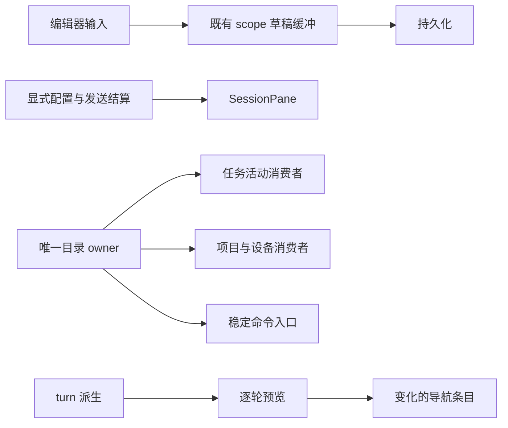
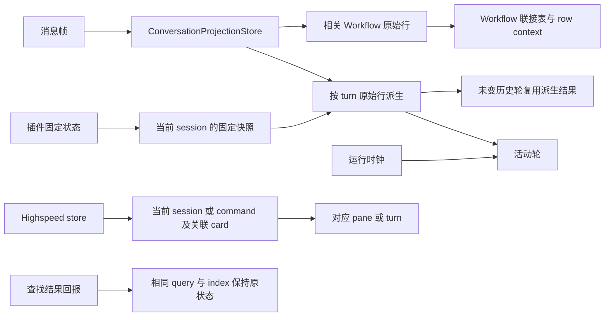
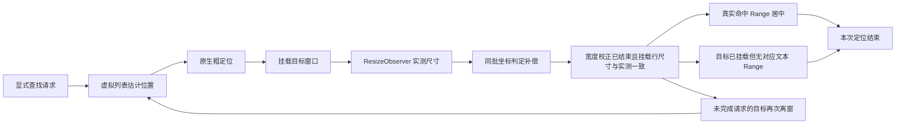

# Conversation Rendering Performance（当前事实）

V4 渲染边界是 `snapshot.rows.window`，不是 legacy `messages[]`。

```text
rows.window
  -> buildConversationTurnRenderUnits
  -> ConversationTurnGroup
  -> virtualizer visible range
  -> ConversationRowView
```

- `ConversationProjectionStore` 按 delta 更新 row/window；未变化 row 应保持稳定引用。
- `ConversationTimeline` 使用 `@tanstack/react-virtual`、动态测高和 overscan，只渲染可见 turn。
- 流式 row 高度变化由测量回流；follow-bottom 是 UI 状态，不写入 projection。
- 性能优化不能合并不同 seq、丢 row action、破坏 terminal snapshot 一致性或让 renderer 维护第二份消息数组。

主要入口：`packages/ui/src/v4/ConversationTimeline.tsx`、`ConversationRowView.tsx`、`ConversationProjectionStore.ts`。

## 更新隔离契约（2026-10-26）

收口本机自动化 profile 已确认的消息、草稿、目录和导航传播路径，不改变协议、消息 owner、发送或持久化语义。

### 草稿、侧栏与导航的传播边界

- 编辑器仍拥有当前输入；普通自动保存使用既有 staged content 和 scope/incarnation 写入持久化，不发布整页配置更新。显式替换、发送接纳/失败恢复、scope 迁移继续通知消费方；模式切换必须合并最新输入。持久化读取同一 draftFocusVersion 的最新分组意图，关闭分组行后不能由旧保存回调恢复归属；跨生命周期仍冻结原 scope 的归属。禁止用不重渲染换取草稿丢失或旧回调写入新会话。
- 目录仍由同一个 ProjectDirectoryProvider 订阅。只调用创建/刷新命令的 pane 不订阅任务树；工作区选择器只订阅项目、设备和可用性。项目重命名、顺序和在线状态仍须立即更新。
- 分组列表的任务活动只更新受影响行。行操作保持稳定引用，并在执行时读取最近已提交的展示树；移动、归档、未读、重命名与拖拽语义不变。排序 Context 的项目身份集合只在成员或次序变化时更新。首发接纳或切换当前任务时，行只接收自身是否选中，而不接收全局 activeTaskId；只更新旧、新选中行。
- 导航预览按 turn 原始输入复用，缓存仅保留当前窗口；正文、真实 query、运行状态、语言和位置变化必须使对应结果失效。hover/focus 只更新视觉状态实际变化的条目，不执行全部 HoverCard。
- 长历史查找的显式导航请求先定位虚拟窗口，再对已挂载 Range 居中；单命中回环也必须重新挂载已离窗的目标，不能仅靠高亮 effect。虚拟单元是一整轮消息，预挂载限制为前后各两轮，避免长正文把八轮 overscan 放大为大量不可见 Markdown 和测高工作。以无 Scan 的 CPU profile 验证测量与挂载成本。保留匹配数、当前命中、首个命中居中、上下项及清空恢复；不能只隐藏长任务或延迟结果而宣称已修。



验收 RRI05–08：导航更新与 hover 隔离、项目/分组活动隔离、草稿保存与切换/发送、长历史搜索。使用浏览器真实组件与完整 Electron；先记录失败基线，再记录必要更新和无关更新，普通构建单独采集耗时。候选保持 pending。



- Workflow 联接仅依赖创建、修订、填洞、保存工具及启动元数据行。普通 text/reasoning/其他工具更新不使已有联接表失效；相关行的状态、输入、图、次序或移除必须更新结果，包括非空联接。
- turn 派生缓存仅保留当前窗口。原始行（含隐藏行与 header）、终态控制、插件实际固定裁决或位置变化必须失效；时钟只使运行轮失效。缓存可随时丢弃，不能成为第二份消息状态。footer 的同卡归并、到期与 Bot 准备消息仍按当前输入计算。
- 已完成 turn 不接收逐秒变化的 `nowMs`；运行轮计时与 Highspeed 到期追平继续生效。
- 查找的被动回报相同 query/index 时保持状态身份；显式上下项导航即使单命中环绕仍递增 navigationRequestId。
- 插件固定状态按 session 读取不可变快照。Highspeed 消费者读取当前 command/session 以及所关联卡片的全部记录与 TPS；同卡跨会话统计、完成、水合、删除、淘汰与持久化通知不可丢失。

回归 RRI01–04 使用真实 React 组件与浏览器，记录 commit、可见正文和必要状态变化；完整应用另以隔离 WDIO/CDP profile 复核。渲染工作与帧耗时分别报告，Scan 关闭后复核，不用固定机器耗时阈值代替业务断言。候选保持 manual-review/pending；手机布局验证不代表远程传输验证。

### 本次验证

2026-10-26，macOS 本机固定构建：RRI01–04 的桌面/手机布局 × 深浅主题共 4 组浏览器验收通过。完整 Electron 的 32 组受控更新覆盖 4/30/120 轮、尾窗/完整窗口、正文/reasoning/工具/usage、后台固定、时钟、重复帧及无变化通知；336 个注入协议帧，以及真实链路在内共 497 个帧的 schema 校验通过。计数探针的必要更新、额外更新与 memo 跳过正反例通过。

| 相同输入                                            | 修复前                            | 修复后                |
| --------------------------------------------------- | --------------------------------- | --------------------- |
| 30 轮历史，20 次正文更新：row / turn / App 执行数   | 440 / 231 / 21                    | 20 / 21 / 0           |
| 4 轮历史，完整真实流式输出：row / turn / App 执行数 | 424 / 190–194 / 46–47（2 次基线） | 59 / 46 / 8–9（3 次） |

真实链路同时验证 Read 工具、前后台任务切换、最终正文精确相等、历史行不变及草稿清空。移除 Scan、React hook 和状态探针后，普通构建三次均无长任务；RAF 间隔 P95 从基线 17.4–17.6ms 到 17.5–17.6ms，样本重叠，不能据此认定可感知延迟改善。渲染工作减少与业务正确性分别验证。

可重复的仓库回归：`node --test packages/ui/test/browser/manual-review/pending/message-render-isolation.test.mjs`。截图和计数写入 `packages/desktop/.e2e-artifacts/message-render-isolation/`。工程受影响测试选择为 0 项，不计为工程测试通过；typecheck、lint、architecture 与改动文件格式检查单独记录。未覆盖 Windows/Linux 整机与真实手机远程传输；候选仍 pending。

消息查找去重仅放在 App 的被动命中回报入口；公用 selection/navigation 转换保持原样。最终普通构建的单命中首次定位、next、previous、Enter、Shift+Enter 均通过。额外运行的消息/文件变更组合用例在文件变更首次定位处失败（命中 1/1，但 scrollTop=0）；仅撤销去重的隔离构建仍在相同位置失败。此组合用例不记为通过，独立文件变更定位问题不纳入本次消息流修复；未修改 GitPane。

### 2026-10-27：草稿、目录、导航回归

RRI05–07 使用真实组件的浏览器回放，并保留必要更新的正例：草稿切换/模式变更/发送事务、项目重命名、任务选择读取最新 unreadAt、导航历史修订及裁剪。桌面/手机布局与深浅主题的相关场景通过；RRI01–04 及已有 SPT03/SPT06 一并回归，合计 22 个场景。首次并行回放的 Vite 缓存冲突已通过独立缓存隔离；一个冷启动加载超时的 SPT03 单独重跑通过。新增的选中切换断言修复前失败，修复后四个布局/主题组合通过。

- 完整 Electron、6 次间隔 450ms 的真实输入及自动保存：SessionPane 执行 6→0，Timeline 执行 17→0，草稿空态执行 6→0。编辑器仍更新，持久化正文与发送内容保持一致。
- 44 个项目、6 次任务活动：仅所属项目更新；分组视图的 8 个无关任务行、目录命令消费者及工作区选择器均为 0 次额外执行。项目改名仍更新选择器，当前任务切换仍更新选中行。
- 千轮导航、10 次屏外尾轮更新：已挂载历史 HoverCard 执行为 0；相邻 hover 移动只执行 4 个视觉变化项。进入/离开 hover 的整体视觉切换仍保留。
- 长历史单命中离开虚拟窗口后，旧实现 Enter 的证据为 scrollTop=0、Range=null。显式请求现同时驱动虚拟窗口与高亮定位；普通构建验证首次定位、Enter/Shift+Enter 回环和命中 1/1。

可重复入口：`node --test --test-concurrency=1 packages/ui/test/browser/manual-review/pending/message-render-isolation.test.mjs packages/ui/test/browser/manual-review/pending/new-task-rendering.test.mjs packages/ui/test/browser/manual-review/pending/render-boundaries.test.mjs`。截图、计数保存在 `.e2e-artifacts/message-render-isolation`、`new-task-rendering` 和 `render-boundaries`；PERF04 仍保留完整 Electron profile；本轮原始 CPU profile、采样汇总与渲染记录保存在 `.e2e-artifacts/render-boundaries/runtime-20261027/`。新候选保持 pending；这些证据不代表 Windows/Linux 整机或真实手机传输验收。

普通构建的千轮固定场景单次对比：搜索的最大长任务从 775ms 降到 460ms；布局读取 CPU 自耗时从 343.1ms 降到 281.8ms，目标窗口保留 6 个实际 turn。首次搜索仍存在长任务，这部分不能记为完全消除。计数探针与关闭 Scan 的耗时分别采集；本机单次对比不代表用户设备的稳定延迟比例。

完整 Electron 的 PERF04、composer-draft-switching、v4-turn-navigator、v4-scroll 共 4 个规格通过，验证最终正文、草稿/附件恢复、导航预览/跳转、历史位置恢复、流式不夺回滚动以及回到底部。类型检查（含 E2E）、lint、架构检查和 fixture 合约另行通过；受影响工程测试选择为 0 项，不计为工程测试通过。

任务分组的 6 个完整 Electron 场景另行通过：重载/取消空组、组内首发、移动/置顶/归档恢复、组织登记挂起时取消、整组拖拽、千行虚拟列表。组内草稿关闭回归曾暴露旧持久化闭包恢复已清除归属，已通过同生命周期实时读取组织意图修复，新增浏览器正反例。此规格的千行播种要求显式设置独立且 basename 以 `.e2e-home-` 开头的 `ZCODE_E2E_HOME_DIR`；默认 `.e2e-home` 不满足其防误写检查。

### 搜索跳转与索引契约（2026-10-27）

搜索的粗定位只负责让目标 turn 进入虚拟窗口，不建立持续追踪 turn 起点的滚动任务；实测尺寸提交后由真实命中 Range 立即居中，不启用会被测高补偿取消的平滑动画。宽度变化可能让粗定位的目标再次离窗；仅未完成的请求随挂载窗口和测量提交重新粗定位，到位后结束，不在用户随后滚走时拉回。行高仍由既有 ResizeObserver 提供，同批补偿比较 item 与 virtualizer 的同一坐标快照，不能把已累加补偿的原生 scrollTop 与旧 item 坐标混用。否则会将目标后的行也判成视口上方，错误挂载无关轮次。保留原有用户滚动权、历史位置恢复、宽度改变和流式吸底语义。

CR-01：`Range=null` 不能等同于目标未挂载。源码索引可能命中 Markdown 标记或链接地址，渲染后的文本节点没有对应内容。会话内查找与历史搜索结果跳转都必须区分目标行是否挂载：未挂载时允许继续粗定位；已挂载且布局已确认后，无论能否创建 Range，本次定位都结束。有 Range 才居中，无 Range 不再滚动；历史搜索结果无高亮时直接回报请求结束。随后用户滚动或窗口变化不能重启已结束请求；新的显式导航请求仍可再次定位。不改变源码匹配数或搜索语义。



回归沿用 RRI08/PERF04：先记录离窗首次搜索的失败耗时基线，再核对普通构建的 long task、CPU 与 Chromium Layout 事件。首次搜索、单命中回环、多命中切换、宽度改变、历史滚动恢复与流式滚动权都必须保留。性能预算由独立回放的 `ZCODE_E2E_SEARCH_LONG_TASK_BUDGET_MS` 指定，Scan 诊断不参与耗时判定。

RRI08 的 CR-01 浏览器回归使用生产 find hook、生产索引、真实 Streamdown 与虚拟列表，覆盖 Markdown 标记和链接目标的源码命中。断言手动滚动后的 `scrollTop` 保持、粗定位次数不增长，并以屏外可见文本仍能定位/高亮、新请求仍能再次跳转为正例；两条搜索入口均覆盖桌面/手机布局和深浅主题。

CR-01 验证：修复前 16 个无 Range 反例全部失败（手动滚动 900→0，粗定位调用 2→4），8 个未挂载正例通过；修复后新增 24 个场景和原有 10 个浏览器场景全部通过。完整 Electron 的 PERF04 与 v4-scroll 通过；千轮历史中搜索 Markdown 标记/链接地址后，滚动 850760→850760，不再拉回。类型检查（含 E2E）、lint、架构和 fixture 检查通过；lint 保留 172 个既有警告，受影响工程测试选中 0 项，未执行。前后截图、位置和调用次数记录位于 `.e2e-artifacts/render-boundaries/cr01/`。此证据覆盖本机 macOS 与浏览器布局，不代表 Windows/Linux 或真实手机传输验收。

搜索的代码评论投影必须先判断是否存在完整候选，再扫描 Markdown 代码保护区；没有候选时结果与原文相同，代码示例中的字面量仍可检索、真正隐藏的评论正文不可检索。历史命中缓存以不可变 turn 投影身份校验，不仅检查 turn key；正文修订与裁剪后立即更新匹配数。RRI08 浏览器场景覆盖普通文本、真实评论、代码保护区和同 key 历史修订。

未知 turn 以一屏高度作保守挂载预算，已知 turn 仍使用自身测量缓存；滚动容器尚不存在时才使用固定初值。不引入新的尺寸状态，只改变虚拟窗口预算，不改变真实行高。

连续输入搜索词时，正文投影与小写转换按不可变 row 对象及评论投影开关复用；只重新执行当前查询的匹配。缓存由 find hook 实例持有弱引用，不延长历史窗口生命期；空查询只统计行数，不扫描正文。正文修订、流式新 row 与投影开关变化必须失效。

高亮一批命中时，只解析已挂载行；同一行的 DOM 文本只能遍历一次，再按 rowMatchIndex 取 Range。大量同词命中不得按每个匹配重复遍历整行，也不得为屏外匹配反复查询 DOM。

精确定位必须等既有宽度校正生命周期结束。其间测高补偿被暂停，过早标记定位完成会让新挂载的上方缓冲行把命中推离视口。宽度 owner 在原有收敛回调中发布测量提交；find 消费该提交，不另建延时或宽度状态。

本轮固定千轮场景、关闭 Scan 的首次搜索最大长任务从失败基线 383ms 降至最终 78ms，通过显式 80ms 预算；仍超过 Long Tasks 的 50ms 定义，不声明长任务完全消除。独立诊断 trace 的 Layout 事件从 43 次、累计 232.289ms 降至 22 次、57.386ms；采样与普通构建耗时分别保存，不能把单机比例当作用户设备的延迟承诺。301 个同词命中的浏览器反例原为 304 次文本遍历，修复后桌面/手机布局 × 深浅主题均为 2 次。

完整 Electron 最终通过 PERF04、v4-scroll、v4-turn-navigator 三个规格；另通过宽屏加载后缩至 480px 的 PERF04，覆盖宽度重测、多命中切换、单命中离窗回环和定位完成后不夺回滚动。该宽度场景修复前出现计数 1/11 而 Range=null，以及居中后被缓冲行测高推离视口的失败。430px 浏览器布局通过，Electron 最小窗口为 480px；未声明真实手机传输或 Windows/Linux 整机验证。浏览器 RRI01–05、RRI07–08 合计 14 个场景通过；typecheck（含 E2E）、lint、architecture、fixture 合约通过，lint 保留 172 个既有警告。受影响工程测试选择为 0 项，未执行工程测试。新增候选仍 pending。

本轮原始 trace、CPU profile、失败基线、最终验收记录与 manifest 保存在 `packages/desktop/.e2e-artifacts/render-boundaries/search-runtime-20261027/`，不进入源码提交。沿用前述浏览器入口及 PERF04；设置 `ZCODE_E2E_SEARCH_VIEWPORT_WIDTH=480` 可复核宽度变化，设置 `ZCODE_E2E_SEARCH_LONG_TASK_BUDGET_MS=80` 可独立复核本机首次搜索预算。
