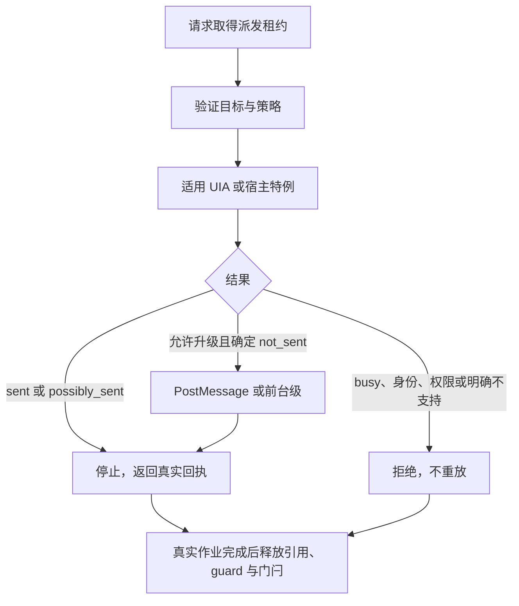

# Windows 输入派发优化总纲（14 工具底层，不改模型面）

> 状态：2026-10-18 极简架构（v3）——派发收敛为「三级阶梯 + 窗口类型路由 + 物理动作排队」；
> 仅物理动作（激活/SendInput/恢复/scroll/drag/全局键盘）进程内排队，后台 UIA/PostMessage 不过闸。
> S3 具体计划：[Windows 输入派发 S3 实施计划](./2026-10-16-windows-input-s3-dispatch-plan.md)（已 superseded，保留历史）。
> 第三方许可归属：trycua/cua `libs/cua-driver/rust/crates/platform-windows`（MIT）

## 0. 当前范围与结果

本总纲定义 Windows 14 工具的底层契约。点击链已实施并完成专项验证；文本、拖拽、
滚动和键盘的后续契约仍需按 §6 验收，不能由点击专项的结果替代。

- 当前点击专项 **53/53 通过**：47 格生效、6 格明确拒绝，无点击焦点违规。
- 历史口径（7d81a5cc08 整顿后，fe1967313f 时点）：117 动作 = 72 delivered、27 noop
  （19 诊断 + 8 S4 锚点）、9 refused；v3 验收轮（62ad36b73d，D1 断言口径下）：
  26 noop = 19 诊断 + 8 S4 锚点 + 0 意外，noopRate=0.257、后台占比 56/105、
  refused 9→3（D1 升级生效；WinUI3 升级格 delivered 且 path/escalated 断言过）。
- Windows GTK3 的两项元素路径明确未覆盖；架构与基线新鲜度门禁仍有阻断。
- 当前结果、命令、原始证据与未验证项统一见 S3 计划 §7，不再并列旧提交的阶段数据。

只改 producer/native/broker，14 工具签名保持不变。派发路径、attempts、effect 与升级
状态进入 broker delivery 元数据；模型可见回执不输出路径 JSON。读取到 COM 成功不等于
业务生效，fixture oracle 与真实前台事件独立裁决。

## 1. 目标与保留约束

后台优先派发采用 UIA → PostMessage → 前台 SendInput。只有已证实未发送且允许升级
的分支可换路径；busy、身份/权限拒绝、已调用后的失败或超时停止，不重放。
已确认不支持的后台手势明确拒绝，由调用方显式选择前台路径。

前台点击保留单批零驻留；PostMessage 按路径验证驻留、hover 与双击。不能用一条路径
的节拍证据声称另一条也通过。窗口、截图、帧投影与实时 probe 必须采用同源坐标。

后续工作继续关注文本读回与焦点、键盘目标、拖拽/滚动节拍及极端恢复边界，详见 §4、§6。

## 2. 当前实现（Windows）

### 2.1 入口与实际路径

| 目标/能力              | 当前实现                                                                                                              | 主要位置                                       |
| ---------------------- | --------------------------------------------------------------------------------------------------------------------- | ---------------------------------------------- |
| 普通元素左键单击       | Invoke → Toggle → Select → Expand → Legacy；仅 absent 推进                                                            | pointer.ts、axReadOnly.ts、ax_win.cc           |
| WinUI3 元素左键双击    | 两次 Invoke、40ms 间隔、同一真实作业；无 Invoke 明确拒绝                                                              | pointer.ts、PatternCallJob                     |
| 坐标普通点击           | 适用 UIA hit-test；按宿主分类尝试 PostMessage，允许时再前台升级                                                       | windowsInputDispatch.ts                        |
| Chromium 普通左键单击  | 直接与嵌套宿主均先尝试已验证 PostMessage（2026-10-25 对齐：直接宿主不再按矩阵升级前台）                                        | windowsInputDispatch.ts、win_input_dispatch.cc |
| 已确认不支持的后台手势 | WinUI3 坐标双击/右键/中键及 WPF 内嵌 WebView2 右键明确未发送拒绝                                                      | windowsInputDispatch.ts                        |
| 前台点击               | 精确 HWND/PID/几何校验，同步定位光标，每击单批 move/down/up；部分发送只补释放                                         | ax_win.cc / SendClickAt、SendClickBatch        |
| 所有权与生命周期       | broker 派发租约；实际 UIA 作业持有强引用、single-flight 与 shield；超时不提前释放门闩，但护盾由等待方按 §3.5 接管收口 | electronNativeBackend.ts、ax_win.cc            |
| 坐标元数据             | capture/window/probe 共用 ReadWindowFrameBounds，来源变化拒绝并重观察                                                 | win_window_geometry.cc、frame/probe 校验       |
| 文本、键盘、拖拽与滚动 | 现有入口接入派发准入门；全路径效果与焦点尚未验收完成                                                                  | §4.2–4.4、S3 计划 §7                           |

### 2.2 本项目边界

UIA 模式梯、shield、single-flight 与强引用均归实际作业所有。
保留 Legacy 兼容末级和确定未发送时的受控前台升级；暂不引入合成 pen/touch。
后台焦点事件独立验收，不能用事后恢复成功掩盖抢焦点。
元素 type 保持既有替换/插入契约。

### 2.3 点击状态链



外层超时可以先返回；真实作业仍持有资源。普通单击模式梯只在能力 absent 时推进，
已调用失败不能借后续模式、同步入口或前台输入重放。

## 3. 目标架构：后台优先升级链

### 3.1 自动升级与模型参数边界

本项目保持 14 工具签名，沿用现有
strategy=event 显式选择前台。auto 仅在确定未发送且允许升级时自动换路径；已确认
不支持的后台手势返回 background_unavailable，不自动前台重试。

我们的契约（v3 极简重构，2026-10-18；替代旧租约模型）：

```
工具调用（签名不变）
  ├─ 0. strategy=event 或带修饰键 → 直接进物理 lane（第 4 级）
  ├─ 1. 预检：身份 + UIPI 完整性（失败直接拒绝）
  ├─ 2. UIA 级（仅左/中键单击无修饰）
  │     元素目标：Invoke → Toggle → SelectionItem.Select → ExpandCollapse.Expand
  │     （四模式全部明确 absent 才用存量 Legacy 兼容级）
  │     坐标目标：窗口域枚举（ElementFromHandle 子树 + bounds 含点 + 白名单 +
  │     最小面积；使用单级窗口域枚举，
  │     全屏 ElementFromPoint 主级与祖先 HWND 解析已删除）
  │     仅 Miss / 模式确实不支持，且未发送 → 3；busy/timeout/unavailable 结构化拒绝不重放
  ├─ 3. PostMessage 级：deepest-child HWND 解析 + WM_* 投递（节拍驻留 §4.1-6）
  │     Chromium 左键单击特例直投；丢弃矩阵必丢（含 WinUI3 坐标双/右/中键等
  │     实测不可达手势）→ 跳过本级直接进 4（自动升级，不再预登记拒绝）
  ├─ 4. 物理 lane（前台 SendInput）：进程内排队 await——后到者等待前一个物理动作
  │     完成，不因队列占用而拒绝（
  │     input_dispatch_busy / uia_job_in_flight 两类模型可见错误随之废除）
  │     精确 HWND gate（同 PID 兄弟窗不算命中）→ 激活 → 发送前复核 →
  │     节拍化 SendInput → 条件恢复（用户切走不抢回）
  └─ delivery 元数据（成功/失败均保留，不进模型文本，§3.4）：
      { path: "ax" | "post_message" | "foreground_send_input",
        effect: confirmed | unverifiable | suspected_noop | refused,
        attempts: [...], escalated: bool }
```

要点：

- **升级是驱动侧的自主决策**，模型无感；自动升级只适用于允许升级、确定未发送且目标身份、权限仍有效的路径。
- **后台 UIA 与 PostMessage 不过任何进程内闸门**（Goal_2 多 session 并行区）；过闸的只有
  物理 lane 全体（激活/SendInput/恢复/scroll/drag/全局键盘）与 paste 的进程内有界串行。
  剪贴板跨进程冲突依赖既有接管检测（`pasteboard_changed_during_paste`）结构化失败。
- 焦点抢占披露语义：工具描述已声明会抢焦点；回执文本与旧实现对齐——**成功路径不披露
  升级**（`method` 字段投影为中性值），归因全走 delivery 元数据。
- 显式 strategy=event 与带修饰键点击直接走物理 lane，仍用精确窗口 gate、节拍和条件恢复。

```text
本级结果
├─ 允许升级 + 确定未发送 + 身份和权限有效 → 可尝试下一级
├─ 已发送 / 可能已发送 → 返回实际 effect；不确定时重新观察，禁止自动重放
└─ 身份/权限无效或已确认后台不支持 → refused；不激活、不注入
```

### 3.2 派发分类与丢弃矩阵

新增 native 分类接口（输入派发专用，见 §5 文件布局）：
`classify_delivery(hwnd, event_kind) -> droppable | deliverable | unknown`。

矩阵按窗口类别与事件种类分类；后续增删以本项目 fixture 证据为准。
`✕` = 判定 PostMessage 必然静默丢弃；`·` = 不标记（按可投递尝试）：

| 窗口类别                                                                        | 判定                    | 点击      | 移动 | 滚轮      | 单键      | 组合键    | 文本      |
| ------------------------------------------------------------------------------- | ----------------------- | --------- | ---- | --------- | --------- | --------- | --------- |
| Chromium 顶层（`Chrome_WidgetWin_` / `CefBrowser` 前缀，覆盖 Electron / NW.js） | `GetClassNameW` 前缀    | ✕         | ✕    | ✕         | ✕         | ✕         | ✕         |
| 内嵌 Chromium（WebView2 / Tauri 宿主）                                          | `EnumChildWindows` 扫描 | ·         | ✕    | ✕         | ·         | ✕         | ·         |
| WPF（`HwndWrapper…`）                                                           | 类名前缀                | ✕         | ✕    | ·（注 1） | ✕（注 2） | ✕（注 2） | ✕（注 6） |
| Tk（`TkTopLevel`）                                                              | 类名前缀                | ·         | ·    | ·         | ✕         | ✕         | ✕         |
| GTK（`gdkWindow` / `gdkSurfaceToplevel`）                                       | 类名前缀                | ✕（注 3） | ·    | ·         | ·         | ·         | ·         |
| VCL（`SAL*`，LibreOffice 族）                                                   | 类名前缀                | ·         | ✕（注 8） | ·         | ✕         | ✕         | ·（注 4） |
| WinUI3                                                                          | 刻意豁免（注 5）        | ·         | ·    | ·         | ·         | ·         | ·         |

分类说明与本项目验证边界：

1. **WPF 滚轮不标记**：scroll 工具把滚动条消息（WM_VSCROLL/WM_HSCROLL）直投顶层
   HWND，WPF 宿主无需前台即可消费；WPF 指针丢弃的真实机制是「仅当真实系统光标
   悬于窗口上时才处理投递的指针消息」。
2. **WPF 键盘前台依赖**：仅当目标**非前台**（前台根窗口比对，`target_is_foreground`）
   时标记键盘丢弃；前台时 PostMessage 键盘可投。
3. **GTK 广泛标记单击**：GTK 整窗单 HWND，HWND 级无法区分 button（丢弃）与
   drawing-area（可收），保守广泛标记；画布类拖拽实践中可用。
4. **VCL 文本可用**：加速键经 `TranslateAccelerator` 读 `GetKeyState`，PostMessage
   不更新该状态，故单键/组合键丢；但 WM_CHAR 纯文本经文档控件端到端验证可用。
5. **WinUI3 豁免**：普通单击使用后台 UIA Invoke。已缓存的 Invoke 元素可执行语义双 Invoke；
   后台坐标双击、右击和拖拽明确拒绝，不自动前台重试。语义双 Invoke 不承诺原生双击事件。
6. **WPF 文本列改标必丢（S4.2 矩阵实测，2026-10-19）**：WPF 控件无独立 HWND
   （单 HWND 渲染），WM_CHAR 只能投根窗，而 InputManager 的键盘焦点门控使
   后台窗口不消费它（四宿主矩阵 mirror 恒不变）。VCL 文本可用的结论不能用于 WPF。
   type(strategy=event)+元素目标在 WPF 上按 D1 自动升级前台。
7. **Chromium 单击特例路由**：上表对 Chromium 是整类标记；普通单击按
   §4.1-3/4 绕过 UIA 直投 PostMessage，由本项目探针验证其可达性。对 Chromium 的 UIA「成功」结构性不采信
   （遮挡时 S_OK 但 DOM 无事件）属路由设计；type 的 AX-echo 读回降级是 §4.2 的职责，
   与本矩阵（PostMessage 丢弃分类）是两件事。
8. **VCL 移动列改标必丢（bench 实测，2026-10-27）**：VCL（SAL*，含 Delphi VCL 系）宿主
   静默丢弃整段 PostMessage 拖拽序列（MOVE 预热 → DOWN → 插值 MOVE → UP）——消息入队
   成功、投递原语回执 ok、实为 no-op。此前移动列的"·"缺少拖拽证据，不能视为可投证明。本仓 native 矩阵不可改（预编译二进制），drag 派发
   层（`dispatchWindowsBackgroundDrag`）按 host=vcl 拦截升级前台，与 winui3_exempt
   同形；回执 reason=droppable_vcl。单测见
   `test/windows-scroll-drag-background-dispatch.test.ts` 的 vcl 用例。
9. **WinForms TrackBar 是控件级丢弃（真机+探针取证，2026-10-27）**：TrackBar
   （`msctls_trackbar32`）thumb 按下进入模态拖拽循环，不消费 posted
   WM_LBUTTONDOWN/MOUSEMOVE 序列——中间级回执 sent 但值恒 0（探针：对 deepest
   子 HWND 投完整序列，value 不动）。**同参数形状下 WinForms 常规控件正常**：
   自绘 drag_canvas 的 12 个 move 全中（drag_move_count 绿）。故 WinForms 是
   deliverable 宿主（宿主级不拦截），TrackBar 是其内部的控件级例外。当前
   classify 接口只回 host 字符串、不回窗口类名，控件级拦截需要新的 native
   接口（按 `msctls_trackbar32` 类名判丢），登记为宿主知识缺失待办；矩阵以
   `slider_drag_trackbar_noop` noop 契约格钉死现状（post_message sent + 值恒 0），
   中间级路由或 TrackBar 行为任一侧变化都会翻红。

规则：

- 分类结果 **unknown 时按 deliverable 尝试**，由读回校验与 delivery 元数据兜底判断，不得因未知类别直接拒绝。
  **自绘窗口（wps / godot 等）正是此默认的适用对象，而非分类难题**：矩阵按输入处理架构
  分类（消息队列偏离者才被标记），自绘应用直接跑 Win32 消息泵，投递消息与其真实输入
  不可区分——PostMessage 对它们是最优路径。UIA 树为空 → hit-test Miss → 不在矩阵 →
  PostMessage；生效性由 oracle/事后观察判断。
- **Qt6（`Qt…QWindow` 类名族）初始不标记丢弃**：Qt 主循环基于原生消息泵，PostMessage
  通常可达；其 bench bad case（AXPress 送达不生效）发生在 a11y 路径而非 PostMessage 路径。
  是否入表由 Qt6 fixture 证据决定（见配套矩阵规范 §4.1）。
- 矩阵是常量表 + 类名匹配，**不做**进程名/heuristic 大数据判断；新增类别必须先有 fixture
  证据（矩阵测试规范）再入表。
- UIPI 预检（§3.3）先于矩阵：完整性级别不可达时直接拒绝，不进入前台升级。

### 3.3 UIPI 预检

目标窗口完整性级别高于普通 helper 时，PostMessage 和 SendInput 都受 UIPI 限制。
预检比较双方完整性级别；不可达时直接返回 `refused`、`action_sent:false`，在 attempts
记录 `uipi_blocked`，不得激活目标后再尝试 SendInput。本批不新增提权或 UIAccess 通道。
PostMessage 被 UIPI 阻断时返回失败，`GetLastError` 为 5（access denied），并非静默成功；
SendInput 的失败返回不能单独识别 UIPI 原因，因此需要预检。
依据：[PostMessageW](https://learn.microsoft.com/en-us/windows/win32/api/winuser/nf-winuser-postmessagew)、
[SendInput](https://learn.microsoft.com/en-us/windows/win32/api/winuser/nf-winuser-sendinput)。

### 3.4 回执契约：按受众分通道

模型面是 node_repl SDK → broker JSON；程序化细节由 broker 响应元数据承载：

1. **模型可见文本（SDK 回执）**：保持现状形状。
   - 确定未发送 = 如实拒绝原因；已发送或可能已发送 = 保持 `possibly_sent` 语义，
     说明效果未确认、需重新观察，不把它描述为「未生效」或建议直接重试。
     允许升级时由驱动自动处理，不要求模型添加重试参数。
   - **不向模型文本追加 JSON 行；成功路径不披露升级**：note 的 `method` 字段投影为
     中性值（如 `click`），`foreground_send_input`/`ax`/`post_message` 等内部路径名
     只进 delivery 元数据（U6 审计 N14 裁决）。
   - 错误文本不出现内部原语/宿主术语（`PostMessage`、`double Invoke`、`winui3_exempt`
     等，U6 审计 N3/N4/N12 裁决）；busy 类拒绝随 v3 物理 lane（排队语义）整体废除。
2. **broker 响应元数据（程序化通道）**：方法响应体新增可选 `delivery` 字段
   （`{ path, effect, attempts[], escalated }`）；broker 协议**不 bump 版本**
   （新增可选字段，旧字段不动）。矩阵 harness 与评测从这里取数（矩阵规范 §2 的
   `delivery` / `observedBehavior` 维度）。
3. **运行时取证**：service logger `debug` 级落盘（与动作流同数量级，必须 debug）。

`effect` Windows 派发取值四档：
`confirmed` / `unverifiable` / `suspected_noop` / `refused`。其中 `suspected_noop`
（读回可读但尚未达到预期）仅表示怀疑，**不等于确定未发送，也不授予重放权限**。
每个 attempt 另记 `dispatch_status: not_sent | sent | possibly_sent`：仅 `not_sent` 可升级；
该字段供 broker 策略与测试使用，不改变既有模型回执字段。`effect` 与派发状态分开记录，
避免把观察滞后误判成安全重试条件。

TS 类型联合仍含 `partial` 字面量，但 Windows 派发不生产该值。

### 3.5 焦点自抢防守与超时边界

XAML/UWP/WinUI3 的普通元素单击继续后台 UIA。
make_guard 对 is_xaml_host_hwnd 或 is_chromium_target_window 命中的宿主启用
EnableWindow shield：归一到 GA_ROOT，保存原 enabled 状态，禁用后执行模式动作，
在同一实际调用线程的 RAII 析构中恢复原状态。原本已禁用的窗口不能无条件启用。

Chromium 普通左键单击按 §4.1-4 的独立提前分支走 PostMessage，不调用 UIA；
不能从该特例推导 XAML 也应跳过 UIA。其他适用点击先试 UIA，Miss/不适用后
才由矩阵决定是否跳过 PostMessage。XAML 元素无 bounds 时仍可直接调用已绑定 token，
不强制换成坐标，不新增前台 UIA 路由或对应阶段枚举。

guard、COM 引用与作业状态由实际执行 UIA 的线程持有，不跨 FFI 拆分 begin/end，
不由外层等待者提前恢复或释放。动作前检查 cancelled。single-flight 在超时后保持占用，直到实际调用结束；不能清门闩后重放。

必须记录而不能掩盖的边界：4s 是等待预算，不是 provider 取消或窗口恢复期限。
若调用已开始并永久阻塞，脱离线程的 RAII 析构时机完全取决于目标应用——
护盾（WS_EX_NOACTIVATE / EnableWindow(FALSE)）扣在用户真实窗口上，
原设计下用户窗口被失联线程无限期扣住，无恢复路径（2026-10-21 评审 CR-06）。
修订（用户批准）：超时分支按 spawn 前快照的 shield root 调
AdoptAbandonedShields 由等待方强制收口——per-root 计数表 entry 记录构造时
pid；depth==1 且窗口归属未变才接管（同根有并发护盾时跳过，不偷对方计数，
不劣于原状）。表项是护盾状态的唯一所有者：新建表项时分配唯一 generation，
交叠 guard 捕获该表项的代，不能捕获其他窗口可能推进的全局计数。析构只在
代匹配时减计数；被接管旧 guard 的晚到析构不得修改同根的新表项。
最后释放或接管时，在锁内将表项标为 restoring，锁外复核 PID 并恢复窗口，
恢复完成后才在锁内擦表并通知等待者。同根新 guard 等待恢复完成后再读取原状，
其他根窗口可继续执行；不能在擦表与实际恢复之间放入新护盾。等待只发生在原生
工作线程，由条件变量通知，不用定时重试。护盾构造在等待结束后、锁内复查 cancelled
（超时落在 run 的 cancelled 检查与构造之间的 TOCTOU 关闭，已取消不建）；
shield root 只读 spawn 前定格的独立快照字段（shield_snapshot），不读嵌套
线程懒解析并发写的 host_root（数据竞争）。线程本身不杀
（TerminateThread 腐坏 COM 套间与 loader lock），随目标应用关闭自然退栈；
single-flight 语义不变：超时后保持占用，直到实际调用结束，不能重放。
接线契约由 windows-uia-shield-timeout-adopt.test.ts 检查；原生行为回归由
win-shield-lifecycle-cua.test.ts 覆盖同根接管、跨根交叠、原状态恢复、取消以及
恢复阶段的新 guard 准入，直接断言 IsWindowEnabled / WS_EX_NOACTIVATE。
真实 provider 用例在超过等待预算后受控释放 UI 线程，再验证晚返回与后续正常
操作。边界：SetWindowLongPtr / EnableWindow 的同步通知可能等待目标 UI 线程；
4s 不保证窗口已经恢复，UI 线程永久挂起的恢复能力仍未证明。
先用可控 provider 验证晚返回后的原状态恢复、无重复动作与引用生命周期；
永久阻塞和 Helper 异常退出后的恢复能力保留运行时证据，未证明就写未验证。
该风险不能直接变成“XAML 全部先转前台”的新策略。S4 复用同一防护机制，
本批不新增 UIAccess 或独立 UIA 进程。

PostMessage 的 NoActivateGuard 与根窗 DisabledHwndGuard 覆盖完整 burst/settle，
恢复原 enabled 状态后结束作业；不用于已激活的前台 SendInput。单独 NoActivateGuard
不能阻止框架显式自激活。结束时仅在前台仍为目标且原窗口
身份有效时条件恢复；用户已切到第三个窗口时不抢回。broker 租约覆盖整个派发与恢复
过程，现有 key/type/paste/drag/hold 统一接入（§5.2）。

**前台化执行的条件式恢复（2026-10-20 补齐实现；E5/E7 真机回归观察项）**：
本节及 §5.2 早已写明物理 lane 收尾「条件恢复」，但实现从未落地——gate 记录的
`previousForegroundWindowId` 全仓零消费（且 `listWindows({pid})` 按 pid 过滤，
跨应用原前台根本不在列表里，该字段只覆盖同 pid 兄弟窗口），前台化路径
（typeText/键盘 `dispatchWindowsForegroundKeyed`、click 升级回调、scroll/drag
lease）激活目标后无一恢复原前台（真机 E5/E7：终态停在目标窗口）。补齐形态：
native 两个薄原语——`getForegroundRootWindowId`（激活前快照任意前台根窗，
GetForegroundWindow + GA_ROOT）与 `restoreForegroundWindow(prev, expectOccupied)`
（内建三条件：prev 有效、prev ≠ 目标根窗、此刻前台仍 == 目标根窗——用户切到
第三窗不抢回；两连投 SetForegroundWindow + 12ms 间隔 + AttachThreadInput 借
前台线程队列，形态同 ExecutePostMessageClick 收尾；best-effort 返回 bool，
失败不抛不影响主回执）。三个挂点在物理 lane 内、激活前快照、派发 settle 后
恢复（含派发抛错——激活已发生，finally 语义）。单点判定（不轮询）：Win32
目标足够；Chromium 类晚到异步自激活可能漏恢复（与 8fb2686aa8 press/hover
残差同族，已知边界）。旧 addon 无原语或 pid-only 目标无精确根窗时跳过。

**恢复前的键盘排水 settle（2026-10-21 补齐；H3/H8/H9/J2 全灭 + E7 丢 12 字
的根因修复）**：上述恢复落地后引入新竞态——SendInput 只把事件注入系统输入
队列即返回，`dispatch()` 一返回就 `restore()` 切回原前台，目标应用线程还没
泵到这些键，键盘焦点已易主，事件被重路由/丢弃，回执却 accepted（假成功）。
对照组锁定：前台和弦全过（prev==目标，恢复无操作，无前台切换）、鼠标/
滚轮升级路径不受影响（事件带坐标，不随键盘焦点重路由）、PostMessage 后台
键入不碰前台；唯独「键盘 SendInput + 立即恢复」的升级链全灭（真机回归
H3/H8/H9/J2 四场景零效果 + E7 typeText 只落地首字符——事件流恰在恢复瞬间
被截断）。上轮矩阵 E2E 未抓到是 WPF 极简夹具泵得快，竞态窗口内消费完毕；
真实应用（刚激活、输入管线更重）泵不过来。修复：finally 里 restore 之前
先等 120ms 排水（TS 侧 async 等待，值与 native `kInputPacing::
ForegroundSettleMs` 同源——修饰键释放后的完整事件排空值）。dispatch 抛错同样先排水再
恢复（已注入事件仍可能被消费）。单测锁定「settle 先于 restore」顺序。

**恢复链两处缺口修正（2026-10-21 评审 CR-03/CR-04）**：(1) native
`ExecutePostMessageClick` 的条件矫正块自引入（8fb2686aa8）起快照时序即错——
「原前台」在 settle 之后才采，与三条件里的「此刻前台==目标」判定背靠背
两次 `GetForegroundWindow`，恢复块为死代码（抢台发生在 settle 前时快照到的
已是目标自己，条件一恒假；发生在函数返回后则条件二恒假）。修正：快照移到
守卫就位后、首次投递前（恢复基准 = 投递前用户所在前台）；三条件判定与两连投恢复体不变。此前矩阵「普通元素格
终态恢复→豁免通过」实为 DisabledHwndGuard 使函数期内抢台无法驻留所致，
并非该块工作。(2) win32 drag 前台链（激活精确窗口 → 复核 → 修饰键 →
拖拽）漏挂 `foregroundRestoreScope`——同批 click/scroll/键盘乃至非 win32
drag 分支都有快照/恢复，唯独 win32 拖拽升级后原前台被抢不还。修正：按
scroll 同构形态包裹（激活前快照 → 激活复核后二次快照 → 拖拽 finally
恢复）。修正后真机矩阵（2026-10-21）：electron press_gated/hover_gated 双双
转绿（此前 12 轮全红——该残差的真实根因即死快照，非「消费晚于 settle」：
门控控件 ≥15ms 计时器在 dwell/settle 窗口内完成消费与抢台，投递前快照即可
覆盖）；仍盖不住的只剩 settle 检测之后才发生的更晚自激活（单点判定边界，
维持不轮询决策，见 2026-10-20 probe 报告 §4）。

**固定排水的长度缩放 + 逐字符节拍（2026-10-21 verify V3 补齐）**：120ms
修复后和弦/短文本全绿（V1/V2 五场景），但 V3 前台化 typeText 16 字 CJK
仍只落地前 7 字（尾部连续丢 9 字）——实测泵速 ≈17ms/字（120ms 泵完 7
字），固定排水对长文本结构性不足。
两处配套修复，数值均有出处：(1) native `SendTypeText` 从整批一次注入
改为**逐字符对注入**（每字符一对 down/up 单独 SendInputs）+ 键间
`Sleep(4)`（与后台 WM_CHAR 层 `TextInterCharMs` 同源；Enter 后 `4+20`
同 `TextEnterExtraSettleMs`），注入速率降到泵速以下，恢复时队列几乎无
残留；部分失败语义：已注入至少一对即 true（false 会被上层当 not_sent
触发重放 → 重复输入）；(2) TS 侧 `dispatchWindowsForegroundKeyed` 增加
`drainHintMs` 参数，**文本插入升级链**传 `text.length × 20`ms
（max(120, n×20)，斜率 20ms/字 = 实测泵速 17ms/字保守上取整），和弦/
hold/前台直达（无激活无恢复，无竞态窗口）维持 120 不变。代价：16 字
前台键入注入期 +60ms、排水 +200ms。后续迭代方向（本批不做）：恢复前
读回收敛（前台链多为 pid-only，无元素 ref 时尚缺少可靠读回目标）。

**无目标文本的异步边界（CR-03）**：Windows `type_text` 与应用前台文本链
都优先使用 `typeTextGlobalAsync`，逐字符节拍只在原生 worker 执行，Helper
主线程继续处理 IPC、心跳与计时器。无目标文本、全局 press_key / hold_key
与应用前台输入共用物理 lane，持有到 worker 返回；不能因异步化让另一
物理按键或前台动作在输入期间插入执行、改变落点。
异步回执 `sent=0` 的失败为未发送，`sent>0` 的截断为可能已发送，禁止自动
重放；只有完整注入才正常返回。旧 addon 缺少异步原语时保留同步兼容路径。
CR-03 只改变异步边界；当前前台文本收尾策略见下段。

**长文本保留前台（CR-02）**：Windows 文本确实走前台 SendInput 时，以请求的
UTF-16 单位数计数（与现有 text.length、1024 单位上限一致）：大于 50 且已有
输入发出时，完成原有排水等待后不恢复原前台；小于等于 50 保留原条件恢复。
50 是体验阈值，不是目标消费完成的证明。现有 min(3000, max(120, n×20))ms
等待、物理 lane 与窗口身份/激活复核保持，不能因跳过恢复提前放行下一步。
部分发送也算已发送，按请求长度决定是否恢复，仍返回 text_truncated、
action_sent=true，禁止重放；异步回执 sent=0 或发送前失败沿用原恢复且不排水。
旧同步 ABI 成功时使用相同阈值，失败保持既有回执语义。

策略由文本调用点显式传入，默认恢复。快捷键、持键、鼠标的恢复原语、快照
时机和三条件不改；UIA/PostMessage 后台路径及非 Windows 不改。不新增全局
开关或延迟恢复。长文本保留的目标窗口会成为后续操作的真实前台基准。

本轮固定验收集合（先记录红灯，再实现；旧恢复用例原断言保留）：

| 用例    | 场景                                            | 验收证据                                                         |
| ------- | ----------------------------------------------- | ---------------------------------------------------------------- |
| CR2-R01 | 16、49、50 单位文本                             | 原等待后条件恢复；16 单位仍等待 320ms                            |
| CR2-R02 | 51、1000 单位文本                               | 原等待后不调用恢复；1000 单位仍等待 3000ms                       |
| CR2-R03 | emoji 位于 50/52 单位边界；旧同步 ABI           | 按 UTF-16 请求长度执行同一策略                                   |
| CR2-R04 | 长/短文本部分发送失败                           | 先标记已发送并等待；长文本不恢复，短文本恢复；回执禁止重放       |
| CR2-R05 | 长文本零发送或原语缺失                          | 已激活后的原恢复保持，不按字数空等                               |
| CR2-R06 | 长文本后排队执行快捷键/持键                     | 等待原 lane；后一操作仍默认恢复，无策略泄漏                      |
| CR2-R07 | 原恢复、第三窗、拖拽回归                        | 原用例和原断言保持，通过受影响测试验证隔离                       |
| CR2-E01 | 两个真实 WinForms 窗口，分别输入 50/51 单位 CJK | 独立控件 oracle 全文匹配；50 恢复原窗，51 留在目标；保存运行记录 |

离线验收：windows-foreground-text-restore.test.ts；真机验收：
native/win-foreground-text-restore-cua.test.ts（ZCODE_CUA_HARNESS_E2E=1，
消费 build:cua 产物）。真机用例只证明这些目标与负载，不承诺任意目标消费完成。

WPF `UIElement.Focus()` 抢前台已修（2026-10-20，§6.1 账本条目随修复移除）：
写入作业现在双层守卫（NoActivateGuard 盖 WPF Focus() 链 + EnableWindow 盖
XAML/Chromium 显式自前台），前台插入升级路径在激活门后、SendInput 前对目标
元素显式建焦（次序红线：窗口先激活、元素后聚焦、聚焦失败不发键）。

### 3.6 UWP / XAML 宿主专项（身份与输入的双重分裂，本批硬约束）

UWP 是本批输入派发里**身份拓扑最特殊**的目标类别（`ax_win.cc` 2026-09-14 实测注释 +
`docs/cua/producer/windows-app-identity-and-transparent-launch.md` 身份文档已记录身份侧；
本节明确其对**输入派发**的约束）。身份进程、窗口宿主与 UIA 元素进程不能混用。

**三重 pid 分裂**（一个 UWP 目标同时涉及三个不同 pid）：

| 角色                             | 归属                                                                                                                      | 证据                                                                       |
| -------------------------------- | ------------------------------------------------------------------------------------------------------------------------- | -------------------------------------------------------------------------- |
| 身份 pid（list_apps 报出的 pid） | `ApplicationFrameHost.exe`，**多个 UWP 应用共享一个 pid**                                                                 | `ax_win.cc:1324`；面积启发式两次会话分别报出"计算器"与"设置"（pid 14556）  |
| 真实渲染进程 pid                 | AUMID 激活返回的进程（如 348），但其窗口 cloaked / 无可视帧                                                               | 身份文档 §1.5 表：UWP 行「激活返回的 pid=真实进程，该 pid 无可见窗口」     |
| UIA 元素 ProcessId               | 真实进程 pid；且 CoreWindow 的 UIA 树**不挂窗口节点下**——`ElementFromHandle` 返回空壳，真树注册在 desktop root 的兄弟节点 | 输入层按宿主 HWND 验证归属，不依赖元素 ProcessId |

对 §3.1 升级链各环节的硬约束（**保持最小**：UWP 身份/启动/观察层已有专门支持——
AUMID 通道、cloaked 唤醒、共享 pid 修法均见身份文档；输入层的 UIA 元素路径天然
覆盖 UWP（UIA 即 XAML 的原生 a11y 栈）。以下只列输入派发新增代码必须知道的事，
不新增 UWP 专属机制）：

1. **hit-test owner 校验基准用窗口 HWND 归属，不得用元素 ProcessId 对比 app_ref pid**
   （若把元素 ProcessId 用于 §4.1-3 的窗口身份校验，UWP 会被误判 wrong_owner：命中元素的 ProcessId 是
   真实渲染 pid，app_ref 报的是宿主 pid）。HWND 归属与 expected_window_id 比对即可，
   元素 ProcessId 只作诊断不作出拒。命中元素的 NativeWindowHandle 为 0 时，
   先沿 RawViewWalker 祖先找到最近非零 HWND，再用 GA_ROOT 比对；遍历带上限、
   deadline 与取消检查。不能假设所有按钮都有自己的 HWND，找不到归属只放弃候选。
2. **CoreWindow 空壳免疫靠主级路径选择，不建 fallback**：`ElementFromPoint` 从
   desktop root 出发查询，而 CoreWindow 的真树恰注册在 desktop root——主级天然
   免疫空壳问题；次级窗口域枚举（`ElementFromHandle` 语义）在 CoreWindow 上会拿到
   空树，**按 Miss 处理放行下层即可，不做 desktop-root 兄弟节点遍历**。
3. **键盘路由一行规则**：XAML 宿主（UWP/WinUI3）的 CoreInput 只消费系统输入队列
   ，键盘中间级对 XAML 宿主跳过 PostMessage 直接升级——
   实现为丢弃矩阵旁的一张宿主判定表（类名 + exe 名，exe 更可靠），身份侧复用同一表。
   **宿主判定统一（2026-10-20 修正，H3 真机根因）**：分类矩阵的 XAML 宿主判定、
   双 Invoke 门（ax_win.cc）、DisabledHwndGuard shield 三处必须共用同一谓词
   `IsXamlHostHwnd`（覆盖 `WinUIDesktopWin32WindowClass` + UWP 的
   `ApplicationFrameWindow` / `Windows.UI.Core.CoreWindow`）——此前分类与双 Invoke
   门只认 unpackaged WinUI3 类名，真实 UWP（计算器，AFH 托管）被判
   `unknown+deliverable`：键盘走 PostMessage 静默失败（H3：alt+2 回执 accepted
   但模式不切），坐标双击/右键/拖拽同样可能产生 sent-假成功。
   证据边界：本仓依据为 H3 键盘负样本与同一 CoreInput 输入栈机理外推，
   鼠标行为仍需直接实测，不能把键盘结论当成鼠标验证。
   统一后 UWP 行为对齐 winui3：键盘/文本走加速键通道或升级（H3 修复）；
   坐标双击/右键/中键/拖拽 not_sent → D1 前台升级（不再静默投递）；左键单击
   不变（本就 UIA-first）。
4. **cloaked（挂起 UWP）不新增输入侧唤醒**：现有 get_app_state 透明观察路径已做
   AUMID 激活唤醒（实测不抢焦点）；输入层对 cloaked 目标结构化拒绝并说明
   「先 re-observe（会自动唤醒）」，不在输入路径重复激活逻辑。
5. **shield 生命周期**：XAML/Chromium 宿主在 UIA 模式动作期间由实际
   调用线程持有 guard，返回后恢复原 enabled 状态。S3 XAML 普通单击保持后台 UIA，
   不先激活窗口；超时后的恢复边界与运行时验证要求见 §3.5。
6. **raw 前台门禁的 active 比对基准用唯一 pid 集合，不得数 active 条目数**
   （2026-10-20 真机回归实测根因）：§4.5 的 UWP 归属拆分（去重键 pid →
   (pid, aumid)）让共享 AFH 宿主的每个 UWP 各自成条，而 `active` 按条目归属
   pid == `GetForegroundWindow()` 的 pid 逐条计算——AFH 前台且名下多个 UWP
   可见时（实测：便笺×2 + 计算器 = 3 条），N 条同时 active=true，门禁
   `active.length === 1` 永不满足，raw 前台事件（click/scroll/drag/key 全部
   调用点）整体拒绝且无自愈（判定每次实时计算，窗口不关永远 ≥N）。
   修法：active 集合按唯一 pid 归并后比对——门禁语义本来就是「前台进程是否
   expected_pid」，条目数只是列表形态；归并后仍 >1 个 pid 是真瞬态（切换中
   的两个不同前台进程），维持 fail-closed 立即拒绝。`resolveFrontmostIdentity`
   同口径归并，但同 pid 多 bundle（AFH 托管多个 UWP）时身份无法唯一定名，
   仍返回 null（身份语义的 fail-closed 不变）。已知边界（不在本条修）：UWP
   目标按应用进程 pid 绑定时 expectedPid ≠ ForegroundPid 会被拒——pid 级
   门禁分不清「宿主前台」与「目标应用前台」，根治需要窗口级前台比对。

矩阵覆盖分两部分：**XAML 输入栈**（键盘路由 / UIA owner / shield 原状态恢复 /
后台焦点 / 手势拒绝）由 WinUI3 harness 覆盖；**AFH/UWP 拓扑**（三重 pid 分裂下
身份与输入一致性）由真实样本覆盖 list_apps → get_app_state → 元素/坐标点击。
unpackaged harness 不经过 ApplicationFrameHost，不能证明 AFH/UWP 拓扑已验证。

## 4. 工具级设计

实施顺序即本节小节顺序；每个工具 = 先补矩阵 fixture 用例（配套规范），再动实现。

### 4.1 left_click（先行打穿全链）

为什么先行：点击是 no-op 大户，且它的实现会逼着把 §3 全部环节真正跑通。

1. **坐标对齐**：capture、window 与实时 probe 已共用 win_window_geometry helper，
   读取 DWMWA_EXTENDED_FRAME_BOUNDS，DWM 失败时同次解析回退 GetWindowRect 并
   标记 geometry_source。捕获前后、screenshot_bounds、window.bounds 与 probe 必须
   同源；来源或几何变化拒绝并要求重观察。frame-projection.ts 保持纯投影，不额外
   裁剪或增加 inset，Helper 重启使旧 frame_id 失效。PostMessage 的 ScreenToClient
   独立验证 deepest-child 归属，每层从原始屏幕点换算。当前点击与 GTK3 缩放已验证，
   完整多屏/DPI、负坐标、自绘边框与 DWM 失败路径仍保留真机验证缺口，见 S3 计划 §3.1、§7。

2. **元素路径升级（存量 + 补强）**：按 Invoke → Toggle → SelectionItem.Select →
   ExpandCollapse.Expand 尝试；四模式全部明确 pattern_absent 才进入 LegacyIAccessible。
   token 失效、查询报错不能视为 absent。动作一旦调用，失败也按 possibly_sent 终止；
   S_OK 只证明调用被接受，不证明业务生效。Chromium 单击提前路由与 XAML shield
   的不同职责见 §3.5；不能把两者合并为“框架名命中就前台化”。
   NAPI 主线程查 registry 时 AddRef，再向 MTA 作业交付独占强引用；worker 不读写
   无锁 registry，不接收 borrowed 指针；真实调用结束后才释放，超时不提前清理。

3. **坐标路径 UIA hit-test**：
   - **主级：OS 原生 hit-test**（macOS 侧成熟先例：`clickElementAtPoint` 用
     `AXUIElementCopyElementAtPosition` 系统解析该像素最深元素，无手动枚举；
     Windows 等价物 `IUIAutomation::ElementFromPoint`）。命中元素必须归属已验证的
     目标根 HWND，不能对遮挡者执行动作。若命中其他窗口，只放弃该全屏候选，
     转入目标窗口域枚举；不能把遮挡者的元素或 HWND 当作目标。
     NativeWindowHandle=0 时沿 RawViewWalker 祖先解析最近非零 HWND，再 GA_ROOT
     归一；主级同样执行白名单、bounds 含点与 Invoke/Expand 能力约束，优先 Expand。
     **窗口身份独立验证**：根 HWND 与 `expected_window_id` 比对，窗口进程与既有
     app_ref 身份约束核对；目标消失、复用或 frame 几何过期直接拒绝。
     **不得比对元素 ProcessId 与 app_ref pid**——UWP 三重 pid 分裂下后者必然误判（§3.6-1）。
   - **次级：窗口域过滤枚举**：
     主级 Miss、命中遮挡者或命中不可按元素（容器/标签覆盖按钮）时，
     对目标窗口子树做 bounding 含点 + Invoke/ExpandCollapse 可用 + **坐标无关控件
     类型白名单**（Button/MenuItem/Hyperlink/TabItem/ListItem/CheckBox/RadioButton/
     SplitButton/TreeItem，防 Invoke 中心触发丢像素精度）+ 最深（最小面积）匹配；
     同具两模式时优先 Expand（Qt 菜单项 Invoke 无效）。CoreWindow 空壳树按 Miss
     放行下层（§3.6-2，不建 desktop-root fallback）。
   - **Miss 与身份失败分开**：两级查询均无可调用元素，但目标窗口身份与坐标仍有效，
     且尚未调用任何动作时，按 `not_sent` 放行 PostMessage；自绘画布、空 UIA 树也走
     此分支。PostMessage 只能投向已验证目标的子 HWND。裸坐标同样必须先通过既有
     frame/owner 解析绑定 HWND，无法绑定则拒绝。升级全局输入前必须重新经过现有
     精确窗口激活与前台 gate，不能复用全屏 hit-test 的遮挡者作为输入目标。
   - **Busy/Timeout/Unavailable 结构化拒绝且不重放**（provider 可能超时后
     才完成激活，重放会造成重复动作）；UIA 作业使用 single-flight + 4s deadline，等待超时
     不代表 COM 调用已取消，门闩保持到真实结束；COM/DPI 初始化在实际调用线程，
     外层不阻塞 broker 事件循环。详见 §5.2。
4. **Chromium 防假成功（口径修正：这是路由问题，不是读回问题）**：Chromium 类窗口
   **不进 UIA 点击路径**——左键单次无修饰直接 PostMessage，元素目标取已验证的
   元素中心；双击/右击/修饰走前台升级；对 Chromium 的 UIA「成功」结构性不采信：S_OK 不证明 DOM 已消费事件。类型值写入的 AX-echo 降级属 §4.2。
   **落地状态（2026-10-25 坐标/元素对齐）**：坐标路径与元素路径同一裁决——直接
   Chromium 宿主（host=chromium 类名判定）的左键单次无修饰**一律 PostMessage
   直投**，不再查丢弃矩阵（旧「直接宿主前台升级、嵌套直投」的分裂已移除）。
   依据：2026-10-20 探针（报告 2026-10-20-electron-postmessage-probe-report.md）
   对同一 electron 直接宿主实测元素中心 PostMessage 后台/遮挡 9/9 消费；矩阵的
   Chromium 鼠标行标记是键盘结论（CoreInput 只消费系统输入队列）的外推，鼠标
   从无直接负样本，被该探针证伪。旧教训「electron 计数器 PostMessage noop」
   属元素分流落地前的回归记录，与探针结论冲突时以探针为准；若后续真机复现
   直接宿主左键 noop，回滚点即本条。嵌套宿主（embedded_chromium*）维持 UIA/
   特例路由不动；双击/右击/修饰仍走前台升级。
   投前校验（宿主根窗/live bounds 解析）fail-closed 拒绝的文案用中性表述
   （"could not be verified/resolved before dispatch"），不得含 "background
   click" 字样——该校验只看几何与归属有效性，无任何前台/后台判定，
   2026-10-20 真机回归报告曾把旧文案误读成「前台被误判为后台点击」。
5. **验证口径**：点击后不读回元素状态，回执保留 `verified:false / unverifiable`，no-op 防守靠丢弃分类 + 结构化
   回执 + 升级链兜底；矩阵 oracle（click_counter）在测试层断言真实生效。
6. **点击节拍（新建；零驻留 no-op 的修复项，bench 反馈）**：现状
   `SendClickAt` 的 move→down→up 背靠背注入对按压时长 / hover 门控 / 时序敏感
   控件族无效。升级链各执行级按下表带节拍，常量收口（建议
   `kInputPacing`，与 §4.3 drag pacing 同处），初值按下表定义，
   矩阵 fixture 调优后固化：

   | 执行级                    | 节拍（初值）                                                                                                                                                                                                                                                                        |
   | ------------------------- | ----------------------------------------------------------------------------------------------------------------------------------------------------------------------------------------------------------------------------------------------------------------------------------- |
   | PostMessage（第 3 级）    | `WM_MOUSEMOVE` 预热（hover 状态先就位）→ DOWN → **驻留 35ms**（`CLICK_DELAY_MS`）→ UP；多击间隔 80ms；结束 settle 50ms；双击第二击投 `WM_*BUTTONDBLCLK`（按 `CS_DBLCLKS` 判定，系统不替投递消息推断双击）                                                                           |
   | 前台 SendInput（第 4 级） | SetCursorPos 先定位光标，不增加独立固定 hover sleep；[move,down,up] 单批保持，down→up 零驻留；多击间隔 80ms；修饰键按下后停 5ms 再点击；事后 settle 40ms（前台激活态 120ms）——retained-mode 框架在 mouse-down 建 capture/focus，过早收走光标会丢点击 |
   | UIA 元素模式（第 2 级）   | 无指针时序概念，不适用（COM 调用语义即动作）                                                                                                                                                                                                                                        |

   节拍设计只作用于合成/投递路径，不改变回执语义；驻留与间隔计入单次调用时长
   （§5.2 已评估，可接受）。矩阵按压时长敏感控件用例（配套矩阵规范 §4.1/§4.2）
   验证修复前后差异；参数调优以矩阵证据为准，禁止无证据拍脑袋改常量。

### 4.2 type / set_value（读回裁决）

> **S4.2 落地（2026-10-19）**：本节的读回设计与 WM_CHAR 插入中间级已实施，
> 见 [S4 实施计划](./2026-10-19-windows-input-s4-plan.md) §2/§3。落地要点：
> 替换路径三段式读回（before → UIA SetValue → after）+ 全等判据（幂等也算
> confirmed）；插入路径 PostMessage WM_CHAR 投递（focused_descendant 纯
> Win32 解析）+ changed+contains 判据；verify 五档
> （confirmed/pending/changed_contains/unchanged/unreadable）落 delivery
> 元数据 `readback` 字段，与 effect（confirmed/unverifiable/suspected_noop）
> 两层正交；读回失败从不报 error；Chromium 直接宿主的 UIA echo 降级挂读回层
> （confirmed 的 effect 改 unverifiable，不依赖投递前预拒顺序）。
> `suspected_noop` 语义细化：**verify=pending 表达延迟发布假说，effect=
> suspected_noop 表达 noop 怀疑**——同一观察（可读未变）的两个投影层，
> 均禁止重放，回执提示重新观察。

1. **保留现有工具契约**：元素目标的 `type(strategy=auto/a11y)` 与 `set_value` 都经
   `element_set_value` → ValuePattern **替换整个值**；空字符串清空。`type(strategy=event)`
   或无元素目标的输入保留现有光标/选区插入语义，不能改成 `CurrentValue + text` 尾部追加。
   替换路径不允许用裸 `WM_CHAR` 降级冒充替换；缺少
   ValuePattern 且无保持替换语义的既有路径时明确拒绝，拒绝文案须指明出路
   （选内层可编辑元素——Chromium 组合框容器在 UIA 层只读是常态形态；或
   `strategy=event` 插入语义；或坐标点击后 `type_text`），不给引导的裸拒绝
   会迫使模型盲试（2026-10-20 真机回归 P-E10-1）。
   S4.2 实施补充：`type(strategy=event)+元素目标` 的插入语义由工具层透传元素
   native token（`element_native` 参数，additive）识别，broker 路由 PostMessage
   中间级（矩阵 kTextInput 列分类，必丢宿主按 D1 自动升级前台）。
2. **读回（新建）**：写前快照 `before` → 写入 → 读回 `after`（ValuePattern 优先，
   TextPattern.DocumentRange 兜底，焦点无关）。替换路径必须 `after == requested` 才
   `confirmed`，包括 `before` 已等于目标值的幂等写入；不能仅以 contains 或 changed 判成功。
   插入路径（WM_CHAR）判据为 changed + contains（插入点不可知，全等不适用；
   before==after 时即便已含目标文本也不算送达——防「本来就含有」假阳性）。
   **换行映射两层统一（2026-10-20 修，真机 P-E3-1）**：`\n`/`\r` 产生换行靠
   真实 Enter 键击（后台层 WM_KEYDOWN/UP(VK_RETURN)，前台 SendTypeText 层
   VK_RETURN down/up 带扫描码），`\r\n` 折叠为一次，Enter 后追加额外 settle
   （富文本控件按真实键击创建段落，WM_CHAR(0x0A) 不被当换行——前台层此前
   只发 Unicode 字符导致 WPS 内联续排，属移植不对称，已对齐后台层）。
   写入已接受但读回仍旧时，记 `suspected_noop`；不可读记 `unverifiable`。两者都
   **禁止自动重放**，回执提示重新观察。COM 返回或一次短延迟复读不能证明效果已发布：
   参考 `DeferredValueTextBox` 在 400ms 后更新值，必须保留此延迟场景。
3. **Chromium AX-echo 降级**：Chromium 类窗口上 UIA 读回的「成功」降级为 `unverifiable`
   （UIA 层 echo 不证明 renderer/DOM 已更新）。本次调用终止并提示
   重新观察；不能在已写入后自动坐标点击再重发文本。后续独立操作仍须遵守原有替换/
   插入语义，单纯激活窗口不能证明 renderer 已获得正确焦点。
   S4.2 实施补充：降级挂在读回层（applyAxEchoSurfaceTrust），verify 保留
   confirmed 表达「读到过一致值但不可信」，delivery 带 `axEchoDemoted` 标注。
4. PostMessage `WM_CHAR` 仅作为插入语义的中间级，且前一级确定未发送才能进入。
   投递后读回未变不能触发 SendInput 重放；固定等待只能用于观察，不能证明没有发送。
5. set_value 仅在 confirmed 时宣称已达到目标值；其余结果保留已发送/可能已发送事实，
   不把不确定回执写成安全重试建议。验收必须覆盖非空字段替换、空串清空、同值写入、
   光标中部/选区插入及延迟发布值后无重复输入。

### 4.3 left_click_drag（pacing）

现状零延时 12 步是 WPF no-op / XUL 变 click 的直接根因。设计：

1. **pre-dwell**：down 后驻留（**修正 2026-10-19 drag 复核 + S4.4 落地**：35ms，
   复用 `kInputPacing::PostMessageDwellMs`；旧文 50ms 缺少验证依据，已作废）再开始移动。
2. **步进插值**：12 步 × 25ms（`kInputPacing::DragStepMs`，S4.4 落地值；总时长
   ≈300ms），常量收口 `kInputPacing`，矩阵
   drag_status oracle 验收。
3. **PostMessage 后台拖拽**（S4.4 已落地）：投递 `WM_MOUSEMOVE(wParam=0)` 预热
   → DOWN → 35ms → 12×(MOVE+25ms) → UP，投起始点最深子 HWND；WPF 后台拖拽
   no-op 根因 = PostMessage 不更新 `GetKeyState`（不可修复）→ 丢弃矩阵 MouseMove
   行 dropped → 自动升级前台；WinUI3 拖拽组合输入站不可达 → 同升级；前台链
   = 锁步 SetCursorPos+SendInput 绝对坐标注入，UP 后 40ms settle
   （`ForegroundDragSettleMs`；保留模式框架在 down 建 capture，
   真实光标过早移走会丢 up 事件）。
   **TODO（未落地，2026-10-21 核查发现 spec-实现漂移）**：标题栏/边框命中
   （`WM_NCHITTEST` 非 client 区）时后台拖拽直接拒绝进前台级（窗口移动类
   操作系统必须真实输入）——旧文写成已完成行为，实现里没有任何
   NCHITTEST/HTCAPTION 检查（全仓 grep 为空）。现状：起点落标题栏时
   `ResolveDeepestChild` 解析到根窗/caption 子窗，PostMessage 照投
   `WM_LBUTTONDOWN`——原生窗口移动手势由 `WM_NCLBUTTONDOWN` 驱动，客户区
   消息不会被当成拖窗，实际效果是静默无效但回执记 sent。落地时的形态：
   `ExecutePostMessageDrag` 投递前 `SendMessage(WM_NCHITTEST)` 命中
   HTCAPTION/HT\*/非 client → 返回 not_sent 类错误，随既有升级链进前台。
4. delivery 元数据（非回执文本，§0 术语）带实际路径与 attempts（§6 管线）。
5. **strategy=event 暴露与真机覆盖（2026-10-21 补齐）**：broker 的 drag
   handler 早已消费 `strategy !== "event"` 决定后台中间级去留，但
   `leftClickDragSchema` 无 strategy 字段且 `.strict()` 拒绝未知参数——
   显式前台拖拽在 MCP 层不可达，前台升级链（含 CR-04 恢复挂点）无真机
   覆盖入口；且矩阵 drag 格只在 deliverable 宿主（winforms/qt6）走后台
   中间级，升级链零覆盖。补齐：schema 加 strategy（缺省 auto，透传
   broker）；矩阵 qt6 加 `drag_foreground_event_delivery` 格（canvas 20%→80%
   投影端点，断言 path=foreground_send_input + drag_moves>0）。同日修
   winforms drag 死格（自有基线记录起恒红）：夹具 drag 画布在滚动流
   y≈1381 折叠线下，drag 端点屏内校验拒绝起点——画布挪底部 dock 面板
   （窗口加高 115px，滚动流内控件零位移）；`DragCanvasPanel` 计数门
   `Control.MouseButtons` 读全局物理键态，PostMessage 后台拖拽恒数不到
   move——改为消息自含判定（收到 down 未收到 up 即按住中）。另两处配套：
   画布 dock 后掉出 AX 树（Name 回退失效）补 `AccessibleName` 同步 aid；
   直达前台链回执从 `appendResolvedAppRef(null)` 改为带 `path=
foreground_send_input` 的 delivery（attempts 带 reason=
   explicit_event_strategy，escalated=false——无前序 not_sent），与 click
   前台链验收口径同构。真机矩阵复验（2026-10-21，e63cd8f244）：drag 五格
   全绿——winforms drag_move_count 恒红死格复活（drag_moves=34）、新增
   qt6 drag_foreground_event_delivery（moves=7 + path=foreground_send_input，
   前台升级链含 CR-04 恢复挂点首次拿到真机验收证据）。

### 4.4 scroll / key（后台路径补齐）

- scroll（**S4.4 探针 + 落地，2026-10-20**）：后台路径 = SB 码族
  （`WM_VSCROLL`/`WM_HSCROLL` + `SB_LINE*` 投根窗，amount=消息条数）；探针
  取证（[报告](./2026-10-19-scroll-postmessage-probe-report.md)）证实可达面
  = 宿主侧显式处理该消息族的窗口（WPF hook / WinUI3 subclass 形态），
  winforms（AutoScroll 非客户区滚动条）/qt6（自绘滚动）/gtk3 两族全忽略。
  旧文的 `WM_MOUSEWHEEL`/`WM_HWHEEL` PostMessage 中间级**探针全败，按证据
  收缩不落地**；Chromium（含内嵌）滚轮属丢弃类别直接进升级。路由三档：
  wpf/winui3 → SB 码族中间级（`postMessageScrollAsync`）；winforms/qt6/gtk3
  → not_sent 升级前台滚轮；Chromium 系 → 丢弃矩阵升级（既有口径）。
  `element_index` 目标维持 UIA ScrollPattern（`element_scroll`）首选。
- key：坐标/元素目标的 PostMessage `WM_KEYDOWN/UP` 中间级（S4.3 已落地），
  可达边界 = **单键 keystroke**（winforms 纯 Win32 泵 / qt6 eventFilter
  多轮真机实证送达）；带修饰键的组合键结构性不可投（下一款）。
- **组合键短路（2026-10-20 决策；同日由 paste 扩至全和弦）**：结构性
  根因：`WM_KEYDOWN` 的 LPARAM 没有任何能表达 CTRL/SHIFT 的位（仅 ALT
  有 context bit / WM_SYSKEYDOWN 通道），posted 组合键也不更新
  `GetKeyState`——宿主要感知 posted 修饰键只能逐条跟踪消息流，无通用
  机制。实证：2026-10-18 真机回归 J 组 paste（WPS/记事本，皆矩阵
  deliverable 类宿主）reads=0；S4.3 矩阵取证 WPF 前台态 ctrl+shift+h
  `accel_fired=0`（GetKeyState 根因）；本仓 354 份 baseline 零正样本。
  因此**所有多 token 和弦**
  （ctrl+v / ctrl+s / ctrl+shift+v / command+v 等）在
  dispatchWindowsBackgroundKeyed 内短路：attempts 记
  `post_message not_sent (chord_key_state_unreachable)` 后升级前台
  SendInput（系统输入队列，GetKeyState 可见；复用 §3.5 条件式前台
  恢复，escalated 判定照常）。保留：XAML 宿主先走 UIA 加速键通道
  （实测有效的后台路径，短路不得绕过）；单键 keystroke 照投。模型面
  零改动：escalated 属 delivery 取证面照常剥离，效果由 effect 指纹
  结算兜底（组合键无字段级读回，回执语义维持现状）。winforms/qt6
  的组合键无直接探针记录（同属 unknown 类，靠记事本同类负样本 +
  LPARAM 结构性论证支撑），矩阵 chord oracle 格补齐后回归。
- **无焦点短路（2026-10-25 用户裁决恢复 §3.1 升级契约）**：键盘/文本
  中间级的目标 HWND 解析按目标树 GUI 线程焦点记录（`GUITHREADINFO.
  hwndFocus`）三态分流：①焦点=真后代 → 照投该后代；②焦点=根窗自身
  （单 HWND 应用：Qt/GTK 整窗一个 HWND）→ 照投根窗，有焦点记录为证
  非瞎猜；③焦点=0 或指向其他窗口树（E07：后台线程焦点记录被清）→
  无合法投递目标，原生返回 `focus_missing`，attempts 记
  `post_message not_sent (focus_missing)` 后升级前台 SendInput（复用
  §3.5 条件式前台恢复，escalated 判定照常），句式与
  chord_key_state_unreachable 同模板。③不回投根窗的原因：多控件窗口
  里根窗不消费键，真机证实回执 sent 假成功且键盘无字段级读回面；
  强设焦点（AttachThreadInput/SetFocus）违反零后台焦点事件断言；
  记目标缓存违反无授权缓存契约。保留：①②照投、元素文本回落
  element_host（ax_win.cc PostCharRequest.element_host）、XAML 宿主
  先走 UIA 加速键通道（不依赖 HWND 焦点）。TS 层不得在中间级之前
  以 `focused_input_window_id === 0` 预检硬拒（4881359c1a 曾引入
  input_focus_unavailable 硬抛、无 attempt 不升级且误挡加速键通道，
  2026-10-25 移除）。
- 四层键名白名单收敛见 §4.5-1。
- 键盘节拍（§4.1-6 同理）：采用 `KEY_DELAY_MS=4ms` 基线与字符间
  追加延时（WM_CHAR 路径另有 40ms settle）；本批为 key/PostMessage
  WM_KEYDOWN/UP 与无元素 type 的 SendInput 补齐节拍，常量与 §4.1-6 / §4.3
  同处收口，矩阵调优。

### 4.5 快赢批（不依赖 §3 地基，先行落地）

1. **key 别名归一化下沉**：现状四层各自维护（SDK `KEY_ALIASES`（`computer-use-client.mjs`）
   → 工具层 `PUBLIC_KEY_TOKENS`（`src/tools/schemas/keyboard.ts`）→ broker `KEY_CHORD_KEYS`
   （`electronInputHandlers.ts`）→ native `VkForToken`（`ax_win.cc`））且裸调用面
   （node_repl 直调 `computer.key`）漏归一化。收敛：**归一化在工具层入口、
   `findUnsupportedKeyToken` 之前统一执行**，扩充别名表（return/enter、esc/escape、
   ctrl/control、win/super/meta/cmd 等跨形态归一），broker 与 native 层只接受已归一 token，
   各层白名单以工具层为单一事实源做 drift 断言测试。
   **S2 实现决策（2026-10-15）**：工具层新增 canonical 归一映射（含 SDK 的 xdotool 形态
   control_l / kp_enter / prior / next / period / comma 等），broker `KEY_CHORD_KEYS` 与
   native `VkForToken` 白名单收缩为只接受 canonical token；drift 断言 = broker/native
   白名单 ⊆ 工具层 canonical 集；node_repl 裸调用面 `computer.key` 在进入 broker 前归一。
   **SDK 旧表后续决策（2026-10-15）**：客户端 `normalizeKeyChord`（xdotool 前置兼容，
   canonical 方向相反且平台相关）**保留为前置兼容，不删、不对齐**到工具层逻辑——
   plugin 与 producer 同 workspace + 版本 lockstep，删除无兼容收益但影响面不可枚举；
   工具层也不引入平台相关 canonical（会拆掉统一 `command` 的结构）。两层组合关系由
   插件侧契约测试钉死（`sdk-key-chord-contract.node-test.mjs`）：I1 SDK 归一输出 ⊆
   工具层可接受域；I2 SDK 前置归一不改变最终 canonical（等价类内部闭合）。据此移除
   SDK 表 `greater: ">"` 死条目（输出从未通过工具层白名单，属端到端死路径）。
2. **paste awaitRead**：保存剪贴板 → 发布延迟渲染数据 → 触发一次粘贴键 →
   等待延迟渲染请求并核验读取方窗口/进程属于已绑定目标 → 提供数据，等待目标释放
   剪贴板后才还原。延迟渲染请求只能证明请求读取，不能证明控件已插入。
   剪贴板管理器等非目标读取不得完成 awaitRead；无法确认读取者或到期未收到目标读取
   时，返回 `possibly_sent` 并提示观察，**禁止重发粘贴键**。还原前核验剪贴板仍由本次
   操作持有且未被外部更新，否则保留外部新内容。无法完成安全清理时如实报告。
   `GetClipboardSequenceNumber` 只可辅助检测外部内容变更，**不能作为读取确认**，
   其值只在内容变化/清空等情况下递增（[API 文档](https://learn.microsoft.com/en-us/windows/win32/api/winuser/nf-winuser-getclipboardsequencenumber)）。
   先以 fixture 验证目标延迟读取、非目标先读、外部复制及读取超时；若所选格式的延迟
   渲染无法提供目标读取证据，不宣称 awaitRead 成功，不用固定延时或序列号变化替代证据。
   **S2 实现决策（2026-10-15，对齐 mac 实现后确定）**：
   - native **不新增文件**，落 `ax_win.cc` 追加。参照：mac 的 provided paste 四原语全在
     平台主文件 `ax_macos.mm`（`ProvidedPasteSession` + `g_provided_pastes` + 导出 +
     `ProvidedPasteReadWorker : AsyncWorker`），win 侧同形态（`ax_win.cc` 已有
     `ClipboardReadWorker` / `ClipboardWriteWorker` / `InstalledApplicationsWorker` 的
     AsyncWorker 先例），binding.gyp 零改动。§5 的 `win_input_dispatch.cc` 新文件建议
     只约束 S3 输入派发。
   - 导出名与 mac 完全对称：`pasteboardBeginProvidedPaste` /
     `pasteboardMarkProvidedPasteDispatched` / `pasteboardAwaitProvidedRead` /
     `pasteboardFinishProvidedPaste`（四导出）。TS 面 `nativeAxSource.ts` 可选声明与
     `nodeAutomationAdapter.ts` 能力探测复用，gate 从 `platform === "darwin"` 放宽为
     darwin || win32。
   - 读取方核验：`WM_RENDERFORMAT` 回调瞬间 `GetOpenClipboardWindow` →
     `GetWindowThreadProcessId` → 对比绑定目标 pid；核验不可靠时按上文返回
     `possibly_sent`。等待走 AsyncWorker（§5.2 硬约束）。
   - 矩阵 4 场景落 **winforms + electron 两个代表框架**（剪贴板语义与 UI 框架基本无关，
     深测代表即可，决策 2026-10-15）。
     **S2 实现细化（2026-10-15；2026-10-16 修正误判后定稿为延迟渲染）**：
   - **误判修正记录（2026-10-16）**：前轮取证判定「SetClipboardData(fmt, NULL)
     延迟占位发布被 build 26200 一律拒绝」是**误判**。根因：微软文档对
     hMem=NULL 成功调用的返回值**无专门说明**——"the return value is the handle
     to the data"（传入 NULL 即返回 NULL）与失败 NULL 结构性重叠，返回值判据
     在该场景不可用；官方示例（EditCopy）发布占位时**不检查返回值**，占位后以
     `IsClipboardFormatAvailable` 驱动 Paste 菜单。正确成功判据 =
     `IsClipboardFormatAvailable` 为真（+gle 非 0 为真失败，实测 1418）。
     复现证据（2026-10-16 两轮独立探针）：跨进程读者触发 `WM_RENDERFORMAT`、
     回调内读取方 PID 精确匹配、88 字节精确读回；本机延迟渲染完全可用。
   - **实现方案（恢复本节原设计）**：begin 快照→Empty→逐格式
     `SetClipboardData(fmt, NULL)` 占位（每格式发布后以 availability 校验）；
     投递前 `markDispatched` 幂等地启用渲染；投递标记之前拒绝所有读取，避免
     监听器提前物化格式。Windows 每个格式只触发一次成功渲染，后续读取走系统
     缓存，`reads` 表示格式物化次数，不能用投递前后读取计数差识别缓存读取。
     `WM_RENDERFORMAT` 回调内核验读取方
     （`GetOpenClipboardWindow` → `GetWindowThreadProcessId` → 对比绑定 pid）
     ——回调内**不得 OpenClipboard**（文档明示：请求方正持有剪贴板，打开必失败）；
     核验通过 → 直接 `SetClipboardData` 渲染交付、`reads++`；pid 不匹配
     （refused）或无法识别（unverified——含请求方 `OpenClipboard(NULL)` 打开时
     `GetOpenClipboardWindow` 返回 NULL 的文档例外，PowerShell 等读者即此形态）
     → **拒绝渲染**。拒绝渲染语义为运行时背书（文档空白，探针三断言实测：
     拒绝后读者拿 NULL、占位保留、后续读取**再次触发**回调——「非目标先读
     不烧证据」成立）。`expectedReaderPid==0`（全局粘贴）投递标记后任意可识别
     读者可完成等待。awaitRead cv 等核验通过的首次物化 → 最小持有 1200ms +
     静默 400ms（只观察到其他格式物化，缓存读取不可观测）→ 收尾 owner 复核；
     finish owner 守卫还原；
     `WM_RENDERALLFORMATS` 按官方范式（OpenClipboard → `GetClipboardOwner`
     复验 → 物化全部格式，否则未物化格式被系统从可用列表移除）。
   - **原子接管**：快照 → `EmptyClipboard` → 占位发布，三步在 owner 线程的同
     一次 OpenClipboard 会话内完成。载荷字节在目标索要前**从不上板**——剪贴板
     管理器窥探不到（对齐 mac provider 语义）。
   - **全格式字节级快照**（用户决策 2026-10-15：防「完成后丢了」覆盖图片/文件）：
     `EnumClipboardFormats` 逐格式拷字节；CF_BITMAP/CF_PALETTE/CF_METAFILEPICT
     跳过（其 HGLOBAL 等价 CF_DIB/CF_DIBV5 总在板上）；CF_ENHMETAFILE 经
     `GetEnhMetaFileBits` 序列化。总量上限 64MB，超限 begin 直接失败（此刻尚未
     Empty，用户剪贴板原样未动）——fail-closed。
   - **等待语义（与 mac 同形）**：四导出（markDispatched 基线原语回归——
     防剪贴板监听器投递前读一次造成假消费，mac 真机 sess_00ca0f91 同根因）；
     默认超时 2000ms；三态失败 `pasteboard_write_failed /
pasteboard_read_timed_out / pasteboard_changed_during_paste` 与 mac
     同名同义。超时返回 possibly_sent（action_sent=true，禁止重发粘贴键）。
   - **还原前置条件**：`GetClipboardOwner() == ownerHwnd` 才还原（第三方接管
     必转移 owner——覆盖别人的新内容才是丢数据）；**open 后复核**：成功
     OpenClipboard 后、EmptyClipboard 前再验一次 owner（本方持开期间他人无法
     再接管，post-open 复核是权威判据，消除 check-then-act 窗口——评审指出
     的静态风险修复）；还原用有界重试 OpenClipboard 等目标释放。begin/finish
     在 worker 等待 owner，不阻塞 Node。finish 只在全部快照格式恢复成功或确认
     外部接管后释放 session；打开或写入失败返回 false，保留快照供再次 finish。
     下次 begin 先恢复待清理 session，未恢复时拒绝接管，禁止把临时载荷当成原内容。
     backend 等待 finish；清理失败报告 `pasteboard_restore_failed` 和
     `clipboard_restore_pending=true`，明确按键可能已发送，禁止重发。
   - **owner 线程任务生命周期（评审静态风险修复）**：投递到 owner 线程的任务
     状态**堆分配 + 引用计数**，闭包只按值持有状态。超时取消尚未执行的任务；
     正在快照的任务在接管前检查取消；已接管的任务由 owner 回滚。取消与完成用
     原子状态决胜，禁止超时返回后留下无人持有的剪贴板 session。
   - **format 三映射**（对齐 mac 全集）：text → CF_UNICODETEXT；md →
     CF_UNICODETEXT（源码即纯文本，平台差异如实记）；html → "HTML Format"
     （CF_HTML 头部偏移构造）+ CF_UNICODETEXT 回退 = html 源码本身（不剥离）。
   - **TS 面最小改动**：backend 编排（begin→markDispatched→chord→awaitRead→
     finally await finish）；begin/finish 兼容 mac 同步返回和 Windows Promise；
     `begin` 可选第三参 expectedReaderPid（读取方核验
     目标，来自 `resolveAppRefIdentity` 同源解析）；awaitRead 结果带
     reads/readsBeforeDispatch/readerPid/refusedReads/unverifiedReads 回执
     （additive）。gate win32 另要求 `isInteractiveSession()`（与
     hasNativeClipboard 同判据），且必须存在 markDispatched 导出，不能退化为
     缺少启用渲染步骤的三原语 ABI。
   - **消息窗口线程基建**：owner 隐藏顶层窗口 + 独立线程消息泵（`WM_RENDERFORMAT`
     同步应答要求窗口线程泵消息；`WM_DESTROYCLIPBOARD` 接管监听——自发
     Empty 之外的到达即第三方接管信号）。之前实写方案曾删掉 UIA 插入探测的
     全部代码，本轮不留死代码。
   - 真机证据：矩阵 4 场景 × winforms + electron 两框架**全量**（用户决策
     2026-10-15）+ happy path（text/html）+ 图片剪贴板还原用例；「非目标先读」
     为硬判据（延迟渲染下载荷不上板，非目标读者必须拿不到——探针用目标外
     进程读取，同时覆盖 OpenClipboard(NULL) 读者的 unverified 路径）。
3. **list_apps 对齐 mac 决策**（2026-10-15 S2 已实现；**不引入「已安装应用
   merge」**，维持「只列运行中 app」——2026-08 mac 评审决策，win 对齐而非扩张）：
   mac 语义基准：name 取 `localizedName`（应用**自声明**的元数据，永不是窗口标题）、
   按应用身份去重、别名面只服务拉起方向且歧义返回 null。对齐的实质是 **list 输出
   的 name 与 `{name}` 解析的事实源同源**。
   - **命名链**（TS 适配层 `win.ts` `displayNameFor`，AppsFolder 索引已有 cache +
     inflight 去重，native 同步热路径不进异步枚举）：aumid → AppsFolder 显示名
     （packaged）；exe → ①**唯一无参记录的标签**（无参快捷方式 = 应用自注册，
     标签即显示名，如「飞书」）→ ②**target exe 版本资源 FileDescription**
     （任务管理器「应用」列同口径，exe 自声明、同一 exe 恒定）→ ③**packaged
     desktop 反查**（Store 打包 Win32，如新版记事本/画图：窗口读不到
     PKEY_AppUserModel_ID、记录 target_path=null，①②全断——2026-10-20 真机
     回归 O1 实测记事本 list_apps 显示窗口标题「笔记.txt - Notepad」；按
     package family ↔ WindowsApps 路径反查记录，与绑定方向
     `bindLiveInstalledApp`(b) 的 `packagedAppMatchesExe` 同一判据，保证
     list 输出名与 `{name}` 解析事实源同源；多条记录名歧义时 fail-closed）
     → 落空保留窗口标题（如实降级，与 mac 报 null 的差异在此）。list_apps
     输出与 capture 快照 `app.name` 走同一 resolver，避免 list 与 get_app_state
     自相矛盾。
     反例根因（2026-10-15 真机）：快捷方式 target 可指向宿主二进制（SDK 快捷方式
     target=explorer.exe），按 target 反查标签会把 explorer 改名
     "Windows Software Development Kit"、cmd.exe 被 10 条提示符快捷方式随机命名
     ——拉起方向的别名数据源不得反向给观察方向的身份命名。
   - **参数门控**：索引记录带 `PKEY_Link_Arguments`（带参快捷方式是自定义启动器，
     标签只标识启动器不标识应用）与 `description`（版本资源，枚举 worker 一次性读）。
     带参记录跳过命名链①，其 target 派生别名（exe 基名/FileDescription）不生效。
   - **别名/拉起规则**（`createInstalledAppIndex.find`）：别名集 = 标签（恒可用，
     开始菜单名即用户寻址方式）+【仅无参记录】exe 基名与 FileDescription。仅精确
     匹配不做子串/模糊（拉起有副作用）；同别名多条 → fail-closed 列候选；
     `isUninstaller` 守卫恒生效。**参数随拉起传递**：`launchApplicationAsync` 第三参（additive ABI）→
     CreateProcess 完整命令行，按标签拉起 = 复刻开始菜单行为（SDK 记录打开 SDK
     目录，非裸 explorer）。
   - **UWP 归属**（native 小改）：`ListApplications` 去重键 pid → **(pid, aumid)**，
     共享 `ApplicationFrameHost` 宿主的多个 UWP 各自成条；同 pid 的无 AUMID 辅助
     窗口不单独成条（防 Chrome 主窗+对话框拆两条）；无任何 AUMID 窗口的 pid 维持
     pid 去重（经典 Win32 路径不变）。两遍扫同一 hwnds 向量，无二次枚举。
   - **ABI（均 additive，旧调用行为不变）**：`applicationIconPngAsync` 可选
     windowId（拆分后同 pid 多个 UWP 的图标按身份来源窗口取 AUMID）；
     `AxAppPayload.window_id`（presentation items 携带完整身份，模型可见 4 字段
     形状不变）。跨语言别名（mac .lproj）在 Windows 无平台等价物（Appx 多语言藏
     resources.pri），如实记为平台差异。
   - **真机冒烟 `smoke:windows:list-apps`**（opt-in
     `ZCODE_CUA_WINDOWS_LIST_APPS_LIVE=1`，Helper→broker→MCP 全链）：计算器
     （packaged：AFH 拆分/AUMID 显示名/图标按窗口/隐式拉起）+ winver.exe（经典
     Win32：无 AUMID/降级链）+ explorer 常驻条目（name === FileDescription，绝
     不等于任何指向 explorer.exe 的快捷方式标签）三锚点，双内置应用零 fixture
     依赖；不变量判定抽独立 lib 纯函数离线单测。

## 5. 实现约束

- native 新原语放独立文件（建议 `src/native/win_input_dispatch.cc/.h`，
  `binding.gyp` 增加源文件）；若实测需切 DWM，几何共用 `win_window_geometry.cc/.h`。
  `ax_win.cc` 仅追加导出、registry 强引用桥接与必要调用点；允许 §4.1-1 的
  capture/window/probe 一起换几何来源，不重构其余存量观察/输入代码。
- broker / 工具层改动遵守现有分层：派发决策在 broker handler，native 只提供原语
  （分类、PostMessage 投递、读回），不做策略。
- 注释用中文；修复处留问题原因注释（仓库规约）。
- 每工具改动先有矩阵 fixture 用例（红）再实现（绿），见配套测试规范。

### 5.1 多显示器与虚拟桌面（继承现状，防回退）

多显示器支持是**继承现有能力，本批不新增也不得回退**：

- 前台 SendInput 级的绝对坐标已做虚拟屏幕归一化（现有 `ax_win.cc`
  `MOUSEEVENTF_ABSOLUTE | MOUSEEVENTF_VIRTUALDESK` + `SM_XVIRTUALSCREEN` 族取值；
  保持当前系统调用路径），升级链保留该路径即继承该行为。
- 升级链各路径与显示器布局的耦合关系：UIA 元素级无坐标概念；PostMessage 级经
  deepest-child HWND + `ScreenToClient` 得到客户区坐标，天然与屏幕布局、副屏负坐标、
  多屏 DPI 混排无关（转换由系统 API 完成）；仅 SendInput 级涉及屏幕绝对坐标，沿用现有归一化。
- 防回退验证：矩阵基线与回归在多显示器开发机上运行即天然覆盖坐标换算路径；
  §4.1 的坐标对齐先验证 WGC 实际边界；若切 DWM，直接比较的消费者必须一起切。
  PostMessage 的 ScreenToClient 使用相同物理坐标/DPI 上下文；API 换算不能代替
  副屏负坐标、多屏 DPI 混排和边缘目标的真机验证。

### 5.2 broker 性能、物理 lane 与线程模型（v3 重写）

delivery 每动作约 200–500B，流量不是主要风险。主要风险是事件循环阻塞、
异步窗口内的前台切换，以及借用 COM 元素的跨线程生命周期。

**物理 lane 契约（v3）**：
只覆盖物理动作、**排队等待从不拒绝**，后台 UIA/PostMessage 完全不过闸：

- 物理 lane = 进程内 promise 链：激活、SendInput、条件恢复、scroll、drag、
  全局键盘注入、`dispatchWindowsForegroundKeyed` 全部排队串行，后到者 await
  前一个完成，**无 busy 拒绝**。
- 后台 UIA、后台 PostMessage、观察类调用不进 lane（多 session 并行区）。
- paste 在进程内另有有界串行（防两个 paste 的 begin/finish 交错）；其 chord
  部分照常经物理 lane。单向嵌套（paste 串行 → 物理 lane），无死锁环。
- 组合动作只在最外层进一次 lane，内部步骤传递所属，不递归排队。

```text
A：lane 空闲 → 立即执行（gate → 激活 → 发送/settle → 条件恢复）
B：lane 占用 → await 排队；A 结束（含异常）后执行；没有激活、输入或恢复副作用提前发生
用户切前台：→ 发送前复核失败；停止余下输入，不抢回前台
```

native `g_inputSequenceMutex` 仍只保护输入 burst 的原子性；`UiaSingleFlight`
**收窄到坐标 hit-test 入口**（元素模式调用不走该 gate），
不再作为 broker 层输入准入条件（`uia_job_in_flight` 废除）。

全部新增输入 native 原语走 Promise/AsyncWorker；存量同步导出保留，新 Windows
click 调用改走新异步节拍原语，含显式 strategy=event。UIA 用 single-flight 与
4s deadline；嵌套线程负责实际 COM/DPI 初始化、私有 CUIAutomation、取消检查和清理。
S_FALSE 正常，RPC_E_CHANGED_MODE 拒绝，不把 STA 当成 MTA 继续调用。

registry 保持 V8 主线程单 owner；在 NAPI 入口查表并 AddRef，作业只持自己引用，
真实结束后释放。超时后堆上状态与强引用留给实际调用线程，不能由等待者提前释放；
线程不持 Napi::Env，不访问已结束 AsyncWorker，不在 teardown 后回调 JS。

超时不清空 native single-flight，不取消已发送 COM。broker 返回 timeout 后可以释放
本次 JS 租约，但下一次输入须在激活前检查 native pending 作业；未结束则 busy。
作业完成只清理自身代次，不更改已返回回执。输入等待不阻塞事件循环和非 UIA 查询；
不承诺卡死 provider 的 UIA 观察能返回，禁止向其继续堆积输入 UIA 作业。
EnableWindow shield 按 §3.5 由实际调用线程析构恢复；等待超时不提前恢复，
不把“有界返回”误写为“窗口恢复有界”，也不因此绕过 XAML 后台 UIA。

同一 JS cell 顺序调用只减少额外模型轮次，不能证明 broker 跨请求已经串行。
上述准入与时序必须通过交错暂停点测试以及多窗口真机输入验证。

## 6. 当前阶段与验证

| 阶段                                    | 当前状态                                                                                                                                                                                                                                                                                                                                                                                                                                                                                                                                                                                                                                                                                                                                                                      | 验收边界                                                                      |
| --------------------------------------- | ----------------------------------------------------------------------------------------------------------------------------------------------------------------------------------------------------------------------------------------------------------------------------------------------------------------------------------------------------------------------------------------------------------------------------------------------------------------------------------------------------------------------------------------------------------------------------------------------------------------------------------------------------------------------------------------------------------------------------------------------------------------------------- | ----------------------------------------------------------------------------- |
| S1：harness 与证据链                    | 已具备八宿主 runner、独立 oracle 与焦点 watcher                                                                                                                                                                                                                                                                                                                                                                                                                                                                                                                                                                                                                                                                                                                               | 当前结果采用同一固定集合，原始报告不覆盖                                      |
| S2：key 别名、provided paste、list_apps | 已实施                                                                                                                                                                                                                                                                                                                                                                                                                                                                                                                                                                                                                                                                                                                                                                        | 保留对应工具契约与测试                                                        |
| S3：派发地基与点击                      | **v3 极简重构进行中**：租约→物理 lane、删全屏主级、6 格拒绝→自动升级                                                                                                                                                                                                                                                                                                                                                                                                                                                                                                                                                                                                                                                                                                          | 原 53/53 点击专项口径随 D1 决策变化（6 拒绝格并入升级格），需重跑矩阵重建基线 |
| S4：文本、键盘、滚动、拖拽、后台并发    | 计划见 [S4 实施计划](./2026-10-19-windows-input-s4-plan.md)（2026-10-19）：WM_CHAR 插入中间级、type/set_value 读回裁决、键盘 PostMessage 中间级（focused_descendant）、scroll/drag 后台路径与节拍、Chromium 元素路径分流、PostMessage 锁重设计（per-root 队列）+ E2E 并行实验                                                                                                                                                                                                                                                                                                                                                                                                                                                                 | 插入锚点 8 格保持红直到 PostMessage WM_CHAR 中间级落地                        |
| S5：完整矩阵验收                        | **首轮全量完成（2026-10-20，baseline-04-53/04-57 两轮）**：133 动作（含本轮补格 xaml_popup + electron type 五格），100 delivered、21 noop（15 诊断 + 5 S4 锚点[qt6×2 登记边界 + electron×2 同族] + 1-2 轮次抖动）、3 refused、9 unresolved（gtk3 结构性）；点击验收 63 格 61-62 绿，blocker 经隔离轮定性为轮次抖动（gtk3 首击竞态、wpf selection 轮次性，均有复绿证据）；cleanBackground=61、后台占比 75/121、路径取证覆盖率 1.0；electron press/hover gated 两格登记红灯保持；electron 插入两格全量轮 oracle 值正确（abXcd/aXd），noop 由路径断言改判 + 升级固有抢台构成。三个轮次抖动格（gtk3 首击竞态 / wpf selection / wpf accel）均有复绿证据（隔离轮或次轮）。遗留：winforms paste readTimeout 环境存量（干净 HEAD 复现，环境剪贴板观察者干扰），paste suite 需串行执行 | 不能以点击专项通过替代原始全动作的全矩阵验收                                  |

点击专项 47 格生效、6 格按已确认支持边界明确拒绝，点击无焦点违规。2026-10-18
矩阵整顿后的原始报告为 72 delivered、27 noop（19 诊断 + 8 S4 插入锚点 + 0 意外）、
9 refused、9 unresolved、0 unknown，后台占比 56/99，路径取证覆盖率 1.0；8 个原始
suite 均未整体通过（焦点违规集中在文本路径与 WPF Focus() 已归档缺陷）。当前唯一
验证摘要与原始证据位置见 S3 计划 §7。各阶段可独立回退，不靠更改分母、诊断分类
或历史报告宣称改善。

### 6.1 已归档已知缺陷（阶段门禁的豁免账本）

矩阵测试**永远如实**：已知缺陷对应的用例照常 status=fail + `focusViolation:true`，
不放宽任何断言（防止把新缺陷混入豁免）。豁免只作用于**阶段出口判据**：剩余失败要
全部命中本账本条目才允许推进，否则阻塞。§6.2 预先登记的诊断集合不属于功能必过集合，
只排除指针时序不适用的 oracle 失败；其焦点、错目标、重放和回执错误仍阻断。

账本条目必须同时满足：缺陷已定位到机制级（含源码依据）、已有明确修复方向、
修复超出本批 scope。当前条目：无。

（2026-10-20 移除「WPF `UIElement.Focus()` 抢前台」条目：EnableWindow 单层
不能覆盖全部焦点路径，需由 NoActivateGuard/WS_EX_NOACTIVATE 与 EnableWindow
共同保护。`RunSetValueReadbackJob` 补 NoActivateGuard，并接通 `getWindowId` /
`elementWindowId`，使守卫拿到真实宿主 HWND；此前恒 nullptr 空转。前台插入升级
路径补元素建焦前置后，矩阵 13 格焦点违规清零，取证见 S4 计划 §14。）

新增条目需在 MR 中单独评审（附机制依据），禁止以「先豁免后排查」的方式入账；
缺陷修复后条目必须移除，对应用例转绿后门禁口径自动收紧。

### 6.2 S3 必过集合、诊断集合与路径见证

矩阵原始 oracle 结果不变。实施前按机制与实际执行路径登记集合，不能看回归结果再
调整集合、改断言或扩大豁免；旧报告保持不变，同集合比较通过登记清单派生。

- **必过**：普通点击、坐标/身份/权限保护、精确 HWND、并发隔离与条件恢复；
  适用宿主的 PostMessage 按压驻留、hover、双击；前台点击功能；回执与路径证据。
- **诊断**：UIA 元素路径的 press/hover 门控，以及保留零驻留单批契约的前台 press
  门控。无鼠标事件或驻留不足时仍记 fail/noop；额外断言 effect=unverifiable、
  不重放、路径如实，不能把 oracle 失败改成通过。同一用例实际进入 PostMessage
  时转为该路径的必过项，不再按 UIA/前台机制豁免。
- **已归档缺陷**：仅使用 §6.1 账本。其他功能失败、unknown、必过项 unresolved
  均阻断；既有框架目标暴露缺口继续作为未完成项列出，不宣称覆盖通过。

显式 strategy=event 的 press/hover 坐标用例只证明前台路径；WinUI3 元素双击
按语义双 Invoke 验证。独立 coordinate + auto 用例使用不可 UIA 激活的鼠标控件
验证 PostMessage dwell/hover；双击用坐标目标。必须断言 delivery.path=post_message、
未先执行 UIA 动作且未升级，再以业务 oracle 判定。路径错误不能因控件最终变化而通过。
PostMessage 必丢或没有已验证投递路径的宿主记录机制与替代验证，不声称八框架
均覆盖投递级；不能用该限制跳过 XAML 已有后台 UIA。

全量原始 pass/noop 与诊断数量分别报告；固定必过集合 noop 率不升、pass 率不降。
历史后台占比（78712b3515 时点 64/97；7d81a5cc08 时点 56/99）单列，XAML 后台 UIA
单独见证送达与零抢前台；v3 起以当次报告为准。
S3 新增点击路径使用 broker_metadata；全矩阵取证覆盖率维持 1.0，
S4 未改路径仍允许已核实的 legacy_trace。当前结果与验证契约见 S3 计划 §7-8；点击节拍是其 §5 的独立任务。

## 7. 明确不做（本批 defer，不留半成品）

- **不扩展观察功能**（仅 §4.1-1 的坐标元数据同源修正例外）：list_windows 的
  subrole / text_preview 填充、弹出层独立 HWND 截图、跨进程对话框可见性、
  get_app_state 的 recordModelVisibleTree 台账 stale 问题。
- **合成注入层（pen/touch digitizer）defer**：本批不引入合成 digitizer。
  PostMessage 必丢且 UIA 不适用的分支，只有确定未发送且允许升级才进入前台级；
  已有可用 UIA 路径仍优先执行。若矩阵证明前台升级占比不可接受，再单独立项，
  验证设备生命周期、tap 节拍、焦点影响与重复输入边界。
- 不新增模型可见工具/参数/选项袋。
- 不新增 `launch_app` / `list_apps` 已安装 merge / zoom / get_accessibility_tree
  等超出 14 工具面或与既有决策冲突的能力。
- 不做跨虚拟桌面目标的前台升级专门优化（目标位于其他虚拟桌面时的后台级
  UIA/PostMessage 按 HWND 路由本就可达；该边缘场景本批不专门处理，
  `delivery` 元数据如实记录实际路径）。
- CI 不因矩阵测试改变强制门禁（矩阵是 opt-in，见配套规范）。
