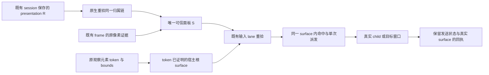
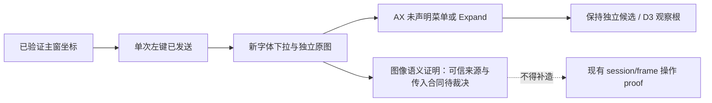

# Windows App Frame Surface：观察 / 派发 / 回执修复 spec

> 状态：**已裁决（2026-10-24，见 §0）/ 第 1–6 步实现及所列 fixture 验收完成；WPS 图像语义证明等待后续裁决（§9.6.1）；用户明确本轮不执行 Edge、多屏及其他 OS 验证（§9.6.2）**。2026-10-25 的通过范围见 §9.1–9.6；环境缺口和未执行项不计通过。历史独立探针不构成产品验收。
> 2026-10-23 初稿；2026-10-24 完成四轮真机取证后整体重构：按「决策记录 → 分类骨架 → 合同 → 事实账本 → 验收与实施」分层，证据统一编号为 E01–E31（§7，附原 P/R/§8.6 编号对照）。重构前的过程叙述已压缩进 §7.7 轮次记录。2026-10-25 补 E32（链③起点自返 bug 与修复复测）。
> 2026-10-28 补 D8（§0.1）：显式主窗观察帧纳入已证明面板像素的裁决，§0.2/§1/§2.3/§4.2/§4.3 随裁决回改，§9.8 登记。
> 2026-10-24 二轮走查：六个应用（Zotero/Notion/资源管理器/Shotcut/WPS/记事本）约 40 个真机场景代入观察/派发链对照，零骨架级矛盾；新增裁决 D3–D7（§0.1），修订分布于 §2.1/§2.3/§3.1/§4.1/§4.5/§4.6/§5.0/§5.1/§5.2/§5.4/§7.8/§8.1/§9。同日独立评审修复三处硬矛盾（§5.0 流程图旧前台判据、cloak 档位语义、E27 宿主 app 名）及多处软不一致。
> 历史注记：2026-10-24 上午曾以「根 WGC + `IncludeSecondaryWindows=true`」为暂定审阅前提；同日 WGC 对照取证（E17–E20）证明该前提不可靠，已裁决放弃，改为确定性合成管线（§0.1 D1）。ISW 降级为后续可考虑项（§0.3）。
> 初始调研：飞书《win-cua菜单气泡/文件面板修复调研》（wiki `GNrFwMZQEiRDtEkvVyjcqgHCnMe`，docx `DsHGdGFaZovUbSxzgemcmIQcnSg` rev 470）。其中 Chromium 文件选择器跨 pid 为调研**实测**事实；2026-10-23 网盘真机取证（§2.4）补充了同 pid 模态与跨 pid child 样本。两者并存，逐窗断言实际 pid，不互相推翻。
> 姊妹规约：[macos-app-frame-surface-provenance.md](./producer/macos-app-frame-surface-provenance.md)。
> 隶属：[Windows 输入派发总纲](./2026-10-13-windows-input-delivery-spec.md)。本文扩展目标解析与观察合同，保留既有升级链、物理 lane 和禁止不确定重放的规则。
> 验收入口：[Windows harness 矩阵规范](./2026-10-13-windows-harness-fixture-matrix.md)。
> 实现载体：`packages/zcode-cua/src/native/ax_win.cc`、`src/native/screen_capture_win.cc`、`src/native/win.ts`、`src/broker/server/`、共享 surface 合同 `src/lib/app-frame-surfaces.ts` 与既有 targeting/frame 合同。

## 0. 决策记录（2026-10-24）

### 0.1 已裁决

| ID  | 决策点             | 裁决                                                                                                                                                                                                    | 主要依据（§7 E 编号）                                                                                                                                                                   |
| --- | ------------------ | ------------------------------------------------------------------------------------------------------------------------------------------------------------------------------------------------------- | ---------------------------------------------------------------------------------------------------------------------------------------------------------------------------------------- |
| D1  | 菜单/弹层像素主路径 | **根 WGC（不开 `IncludeSecondaryWindows`）+ 已证明弹层各自独立 WGC 捕获 + 预乘 alpha 按实际 z 序合成，范围限于根窗口边界内**，合同见 §4.3                                                                 | E18–E20：true 的纳入行为不确定（真实 Shotcut 反例 E19），筛选算法未公开，无法推导判定函数；属性仅 24H2+ 可用；「true + 内容验证」路线中验证本身也要独立捕获，成本与合成相同却多一条分支。E17：false 下弹层**稳定不入**根图，这使「根图 + 独立弹层图」天然无重复混合。E15：独立捕获稳定。E23：合成数学已验证 |
| D2  | §3.2 操作关联优先级 | **保留设计，排在三条系统关系路径（owner 链 / GUI 菜单态 / UIA 链）全部落地之后实现与验证**（WSF-13/14）。落地前此类菜单按 unknown / 独立候选处理：可见、可由模型显式选择，不自动入 frame                                                | E08–E10：系统链覆盖多数实测样本。E13：WPS 类样本三链全失败，只有 §3.2 能救，故不能砍。E14：组合证据原料存在，但正反例未验证，且该路径验证面最重 |
| D3  | unknown/独立候选的发现通道 | **frame 观察结果内嵌独立候选清单，准入谓词见 §4.1**（装饰窗出局 → 归属证明进 surfaces[] → 归属失败且**同 exe** 进候选清单 → 其余不进观察结果）：候选（含跨 pid）带身份/PID/class/bounds/z 序/归属失败原因，不作 surface、不参与合成、无坐标权限；异 exe 交叠不作为准入信号（遮挡归 §5.0 命中校验管）。模型用现有 `window_id` 显式选定后，**以该窗为观察根**（自己的树＋独立捕获，边界以自身为准），按该窗自身身份验证，不与应用 pid 比对。同 exe 身份（bundle 宽松相等）是候选清单唯一准入信号＝§3.1「同 exe 仅帮助发现候选」的可执行形式，最终归属仍须 §3.1/§3.2 证明。候选显式选定的窗口作为独立观察根时，坐标接收根 surface 即该窗自身（§5.0） | 代码查证（2026-10-24，见 §7.9）：现实现归属为纯 PID 判定（`ax_win.cc:1741` pid 严格相等、`cuaAppIdentity.ts:195` pid+bundle 三元组、`ax_win.cc:4888` 显式 window 跨 pid fail-closed），全仓 Windows 无 GW_OWNER 消费方；`list_windows` 强制 app_ref、`IsUserTopLevelWindow` 的 TOOLWINDOW 过滤被 listApplications/主窗挑选/captureApp/派发校验四处共用，跨 PID 弹层在发现/枚举/像素归属三层全部不可见。skill 的「不绑定 app」仅指动作参数可选与最近帧隐式绑定，不是发现通道。E13/E14：WPS 类唯一能被同 exe 收窄；两实例多开互串风险由「exe 只生成候选不证明归属」规避 |
| D4  | 菜单 SendInput 前台前提 | **统一为「前台根属于该菜单归属链的宿主集合」**：前台根是归属链（系统关系/§3.2）的根、其实际宿主、或显式选定的观察根即通过；线程一致与 GUITHREADINFO 菜单态降为佐证（各自单独不作必要条件）。unknown/独立候选在 D2 落地前保守处理：物理级默认拒绝，走 L1 元素/L2 hit-test/L3 PostMessage | 二轮走查四处独立发现同一冲突（WPS：fg=另一进程主窗 202388、菜单线程 25872，跨 pid 下线程判据永假；资源管理器现代菜单菜单态恒空；Notion/记事本菜单态亦空）。E02：菜单 HWND 不必前台。E14/WPS 遮挡实验（E15/E22）：命中校验已独立防误投，前台判据放宽不引入新风险 |
| D5  | 归属搜索预算定位 | **降为性能护栏，删除授权语义**：元素路径的归属判据＝挂在已验证宿主 HWND 的 UIA 子树＋重解析命中同一宿主＋引用未失效；不再要求元素到根的链在预算内。UIA 上溯遍历仍设上限（防卡死防环，GW_OWNER 链 ≤8 级保留），超限只影响「逻辑弹层要不要单列为 surface」的分类呈现（如实标注深链未走完，像素＝宿主图、元素＝宿主子树照常可用） | Notion 走查：Actions 菜单项挂载 11–14 层（E05），同宿主子树内可见可用，预算把它误变成授权门槛；超预算的成本只是「不知挂多深」，不是「不可信」。get_app_state 树本就无 pid 过滤（§7.9 代码查证），预算只挡住了元素路径授权 |
| D6  | 装饰窗（阴影/keytip/tooltip）处置 | **分层筛选（§4.6），按证据强度分两档**：直接过滤档（硬编码类名 SysShadow/Ghost/tooltips_class32、编号 #32769/#32771/#32772——二十年稳定系统实现细节，零交互语义；cloak 窗分原因留档、不进当次模型面）不进模型面仅留档；降权档（组合信号：layered 透明穿透、屏幕外停靠、阴影空间形态、owner 指向弹层、聚簇非代表 keytip——实测归纳无先例，按聚簇粒度记汇总一行，不逐窗带 HWND/bounds）。两档都不进 surfaces[]、不单独捕获合成、不进候选清单、不占模型上下文。白名单永不降权（#32768 菜单本体、#32770 对话框、正在接收输入的窗）；「装饰判别允许用图像核对」与「点击权限禁自研 alpha 分析（交给 OS 命中语义）」分开；阈值可配，留 E2E 调整空间，误杀可回溯（原始记录留原生层） | 网络调研（2026-10-24，见 §7.9）：采用组合判定、分原因 cloak 与白名单豁免，不依赖单一信号；#NNNN 官方文档化编号仅 5 个，#32774 真实 Windows 未确证不加；keytip 同类同标题无人区，聚簇规则标注实测归纳。E13（WPS 阴影近全透明）、记事本走查（13 keytip 膨胀 15 块捕获面）、Shotcut 走查（SysShadow 与菜单同身份进候选清单） |
| D7  | 后台定向消息合同 | **补为正式合同（§5.4.1）**：允许条件＝宿主链已证明（PID/class/父链门卫）＋动作限定为可读回验证的定向消息（WM_SETTEXT 类）＋投后必须读回裁决（不符即报失败/不确定）＋明确不适用于键盘、点击、确认类动作；进 §7.8 验证项（多控件类型正反例） | E27 单例（Shotcut 面板 Edit、后台无焦点、门卫先行、完整读回、前台零扰动）。当时锁单例的原因是 WM_SETTEXT 只在 Win32 Edit 一种控件验证过、且它是「直接赋值」不是「输入」；合同化的边界就是把这三点写成条件，不放开键盘/点击 |
| D8  | 显式主窗帧的面板像素（2026-10-28 裁决） | **像素收编、树/身份不收编**：§4.3 像素合成面从「当前展开菜单链」扩为**全部已证明 `owned_popup`/`menu_popup` surface**（含模态面板与非模态 owned 浮层）——显式主窗观察的帧里，压在主窗上的面板像素直接可见，模型不必再显式切 `window_id` 补一轮截图；**树合并仍限菜单链**（`is_menu`），面板树与元素级交互仍由显式 `window_id` 切换取得（§4.2）。坐标路由不变：帧内面板区域坐标按 §5.0 落到面板 surface（`capture_surfaces` 记录像素属主），前台动作仍按 §5.3 激活实际面板 | 2026-10-28 用户裁决。导火索＝spec↔代码交叉审查发现口径分裂：像素侧（win.ts `selectCompositePopups`，19b1bfe645）按 kind 全收，树侧（win.ts `is_menu` 合并门，d02bfbac7c）仅收菜单，§4.2/§4.3 旧文与像素侧冲突、§2.3 第 2 条又与像素侧一致；显式主窗＋模态面板的像素合同从未被真机钉死（panel live smoke 该场景 `include_screenshot:false`，§9.8）。收益：省一轮显式切换截图；合成图与物理屏幕所见一致；面板是已证明 surface，§5.0 命中校验与 D4 前台门不受影响 |

### 0.2 本轮不再重议

- 越界 popup（超出观察根边界）本轮暂缓：合成时裁掉，不扩展根图边界——完全越界不入图、记 `outside_root_bounds` 缺口；部分越界的被裁区域量化留档顺延（§9.8）。事实保留（E18 越界行、§7.8），WSF-04 的越界部分顺延。
- 屏幕裁剪只作诊断/测试工具，不进产品路径。三个负例：遮挡污染、隐藏窗假像素、负坐标黑边（E22）。
- 不无条件给所有弹层合成：只合成「有独立 HWND 且归属已证明」的顶层弹层；普通 child 与同 HWND 逻辑弹层用根图/宿主图像素，不重复叠加（E17、E21、E25、E04）。
- 捕获前后校验、物理屏幕坐标、投前重验、业务证据回执维持原文（§4.4 / §5 / §6）。

### 0.3 ISW 的后续考虑（非当前路径）

`IncludeSecondaryWindows`（Windows 11 24H2+）留作**未来优化候选**：若想在 24H2+ 上省掉逐弹层独立捕获，可在根会话开启该属性，但前提是已有可靠的「内容完整性验证」证明所需弹层确实入图——当前没有该验证，E19 反例正说明「属性读回 true + 菜单在根内」不等于像素完整，且 API 筛选规则未公开（E20）。内容验证能力建立之前不启用；届时须保留 false 对照与失败降级路径，并补 §7.8 所列 ISW 专项未验证项。

## 1. 问题与产品行为

逻辑应用、承载像素的窗口、接收输入的窗口或元素可能不同。不能只用进程身份或主窗口解释三者。

| 编号 | 问题                                             | 已知实现约束（2026-10-23 锚点）                     | 受害 case（bench）                                                                                                                            |
| ---- | ------------------------------------------------ | ---------------------------------------------------- | --------------------------------------------------------------------------------------------------------------------------------------------- |
| N1   | 部分菜单、下拉、气泡不在观察结果中               | `ax_win.cc:1695` `IsUserTopLevelWindow` 过滤部分 `TOOLWINDOW`；`EnumWindows` 不枚举普通 child HWND | inkscape-clone（被迫自建 PowerShell 抓屏旁路 6-8 轮）、wps-condfmt（"下拉没打开"错误假设下空转 12 轮 0/5）、tb-triage、tb-invoice、chrome-har |
| N2   | 独立面板与逻辑应用身份混淆                       | `ax_win.cc:1741` `EnumerateUserHwndsForPid` 按 pid 硬过滤；面板可能同进程，也可能跨进程            | chrome-ext（主窗 disabled、对话框开着，列表只有主窗）、tb-invoice（每次开系统对话框要额外一轮 list_apps 兜底再按标题猜）                      |
| N3   | 主窗被模态面板阻塞或菜单持有输入时，仍按主窗派发 | 主窗、菜单 owner、焦点接收者不是同一个概念；被过滤窗口恰为前台时返回无任何信号                     | wps-doc（促销弹层持有焦点，唯一列出窗口既非 main 也非 focused，click 全被激活门拒）                                                           |
| N4   | 无树和窗口不存在被混报                           | `win.ts:1030` 指定窗口的 capture 失败也可能被解释成进程没有可见窗口                                | godot-anim（文案断言 pid 无可见窗口，而两轮前 list_windows 刚返回过它的主窗）                                                                 |

本次确定两种主要交互：

- **菜单链**：当前窗口的一次附属交互。根窗口与当前展开菜单链一起观察，模型不逐个管理菜单 HWND。
- **文件面板 / 模态面板**：独立交互目标。仅指定应用时，可选择已证明归属的活动面板，返回它自己的截图和树；不自动给应用所有窗口分别截图。显式观察主窗时，已证明面板的像素并入主窗帧（§4.3，D8），面板的树与交互身份仍按独立目标处理（§4.2）。

普通窗口、非模态独立面板和未知气泡不强行归入上述两类。归属已证明的弹层属于当前 frame 的观察内容（§2.1）；不要求模型先逐个选择菜单窗口。同 frame 下多个并列候选无法唯一确定观察根时，工具返回候选窗口或元素的身份与状态，由模型根据当前任务显式指定目标后继续，工具不得自动切换（§2.3）。

范围边界：

- 只讨论完整位于当前观察根内的 popup；文件面板是观察根时，边界以该面板为准。越界样本与 API 裁剪限制保留为事实（E18），本轮不实现其捕获与坐标扩展（§0.2）。
- 图像已包含菜单，不代表拿到了它的 AX、HWND 关系和实际输入接收者。归属、AX、投前重验和效果验证继续分别记录。

总览（观察 → 派发，D1/D2 生效后）：

```text
观察请求（指定 window_id / 仅指定应用）
   ├─ 1 选观察根（§2.3）：唯一可信目标直接用；被面板阻塞只报 blocker 不切换；
   │     多候选无法区分 → 返回身份/状态，模型按任务选，全程不向用户提问
   ├─ 2 枚举 frame surfaces（§4.1）：EnumWindows 去 TOOLWINDOW 过滤 + child 单独解析
   │     归属证明按序：① GW_OWNER 链 → ② GUI 菜单态+child 父链 → ③ UIA 层级链
   │                  → ④ §3.2 操作关联（候选，D2 排最后；落地前 unknown/独立候选）
   ├─ 3 像素管线（§4.3，D1）：根 WGC（不开 ISW，弹层稳定不入）＋已证明弹层独立 WGC
   │     ＋预乘 alpha 按 z 序合成（限根边界）；child/同 HWND 内容用根图不叠加；
   │     前后校验失败 → 光栅不可操作，保留树与缺口原因
   └─ 4 签发 frame（物理屏幕坐标；capture_surfaces 逐块记录真实来源）

派发请求（元素 / 坐标）
   ├─ 5 lane 开始时重验（§5.1）：代际 + 引用 + 关系 + bounds；失败按原错误边界拒绝
   ├─ 6 目标解析（§5.2–5.4）：实际接收者可以是 child；菜单不要求 HWND 前台；
   │     坐标路径统一过 §5.0 命中事实源（预期接收根来自 frame 记录）；
   │     面板类动作显式激活实际面板窗
   ├─ 7 发送：沿用总纲既有升级链（后台 UIA/PostMessage → 前台物理）；
   │     坐标投前 hit-test 实际命中（防无关遮挡窗，E15/E22）
   └─ 8 回执（§6）：dispatch_surface + 业务证据判 confirmed；面板关闭≠确认（E29）
```

## 2. 分类骨架

### 2.1 承载四类 kind

四类 kind 是结构骨架——它驱动枚举来源、归属判据、派发重验证路径与验收矩阵；但**承载方式不等于交互场景**：`owned_popup` 可以承载菜单或文件面板，"有 HWND"不等于"必须单独截图"。kind 只描述**有独立 HWND 的承载**；无独立 HWND 的逻辑弹层不属于 surface 体系，以元素身份进 UIA 树（§2.2 末段），不进本表。

| kind           | 承载形态                                                                             | window_id                                | 归属判据（唯一允许，§3）                                                                 | 枚举来源                                      |
| -------------- | ------------------------------------------------------------------------------------ | ---------------------------------------- | ---------------------------------------------------------------------------------------- | --------------------------------------------- |
| `window`       | 独立顶层 HWND（frame 窗口本身）                                                      | 是                                       | 就是 frame 窗口                                                                          | `EnumWindows` z-order                         |
| `owned_popup`  | 被主窗拥有的弹层（`GW_OWNER` 链，可跨进程）；含 `#32770` 对话框、layered、非模态浮层 | 是                                       | GW_OWNER 链有界上行（≤8 级）到达 frame                                                   | `EnumWindows` z-order，不过 `TOOLWINDOW` 过滤 |
| `menu_popup`   | 菜单 / 下拉 / 工具弹窗（含 owner=0 的框架菜单）                                      | 是                                       | 菜单对象/GUI 菜单态、可信 UIA 链，或 §3.2 操作关联（**候选路径，D2 排后**；落地前此类为 unknown/独立候选，经 D3 清单可见可选）；实际 PID/TID 逐窗读取 | `EnumWindows` z-order，不过滤（装饰层按 §4.6 降权） |
| `child_window` | `WS_CHILD` 子窗口（含跨 pid 渲染 child）                                             | **是（自身 HWND）**                      | 父链 `GetAncestor(GA_ROOT)` 有界上行（≤8 级）到达承载窗                                  | `EnumChildWindows`（root 直接 child、跨 pid 内容承载者，范围见 §2.2），不插顶层排序 |

### 2.2 child 与弹层的切分判据

"哪些窗口进观察面、哪些只做派发基础设施"按**窗口层级（顶层 vs child）+ 有来源的归属证据**切分。窗口层级是 OS 事实；归属可以来自系统关系或 §3.2 的本次操作关联，两者分别记录。

**先破一个直觉：视觉上的"弹层"几乎都是顶层窗口。** 下拉、右键菜单、悬浮工具条，看起来浮在主窗里面，但 Win32 实现上几乎全是 `WS_POPUP` 顶层窗口——Qt 的 QMenu、WinForms 的 ToolStripDropDown、原生 ComboBox 下拉（类名 `ComboLBox`）、WPF 带 AllowsTransparency 的 Popup 都属此类（E01）。它们出现在 `EnumWindows`、有全局 z 序、内容可超出主窗显示；**顶层身份不保证可独立激活**（E02）。所以这类窗口**不需要判断"像不像弹层"**：是顶层的、可见的、归属证明通过的（§3 判据），就进 surfaces[]。N1 的根因正是它们被 `TOOLWINDOW` 过滤器藏住，不是它们难认。

**child 的层级事实与截图完整性必须分开。** 普通 `WS_CHILD` 的可见区域受父窗 client 区裁剪，不作为普通顶层窗口进入 `EnumWindows`，也不能独立成为前台窗口；这些事实**不能推出任何捕获 API 必然包含其全部像素**。本轮独立 WGC 实验中，同进程与跨进程 GDI child 在开关两种状态下都完整出现在根图（E17）；WPS 根图也含文档编辑内容。普通 child 默认不重复作为捕获面，但仍保留其身份供 AX/输入解析；GPU/DirectComposition child 已有 Chromium 形态正例（E25：2026-10-24 本机复测 VS Code，根 verified-WGC 图完整包含跨 pid `Intermediate D3D Window` child 承载的页面内容），正例不外推为保证。发现缺图应记录捕获完整性缺口，不能用 `WS_CHILD` 将其忽略。

| 判据                         | 顶层弹窗（进 surfaces[]）              | 同 pid 普通 child（不进，仅作派发基础设施） |
| ---------------------------- | -------------------------------------- | ------------------------------------------ |
| 出现在 `EnumWindows`         | 是                                     | 否（只在 `EnumChildWindows` 里）           |
| 内容能超出主窗 client 区显示 | 能（常见）                             | 物理不可能（被裁剪）                       |
| 独立 z 序 / 可独立激活       | 有；激活能力须按实际样式与菜单机制核验 | 仅兄弟间 z 序 / 不能                       |
| 像素位置                     | 可能溢出承载窗；本阶段只讨论根范围内   | 屏幕可见区域在父窗内；API 是否完整捕获另验 |
| 归属证明                     | 系统关系 / 本次操作关联（§3）          | 父链（同 pid 仅派发验证；跨 pid 内容承载者以父链入列，见下段） |

一条硬几何判据：**可见内容超出承载窗 client 区 → 必是顶层弹窗**（child 被裁剪，物理上不可能越界）。此方向可从几何直接下结论；反向不成立——bounds 在主窗内的不一定是 child，仍按层级判。标题、形状、"看起来浮在上面"不替代层级或归属证据；§3.2 的图像只用于核对本次交互内容，不从外观推断 parent/owner。

**模糊地带只有一类**：视觉上像弹层、但确实是 child（或同 HWND 逻辑内容）的东西（如 XAML root 内 Popup）。对这类不猜几何，也不进 surface 体系——它没有独立 HWND，像素本就属于宿主图（E04/E17），观察与派发都走元素身份：UIA 树挂载点 + control type 有界上溯锚定宿主 HWND（D5：上溯超预算只影响呈现，不影响元素可用性）。真有独立 HWND 的 windowed Popup 自然落入顶层枚举，按 `owned_popup`/`child_window` 行处理。

**child 在链路中的两个角色**（默认不重复入图，但派发与元素层离不开）：

- **输入接收者**：点击 / 键盘事件的落地 HWND 常是 child（对话框里的 EDIT 等；`GetGUIThreadInfo.hwndFocus` 读到的通常也是 child HWND，§5.4 消费）。派发侧解析"实际接收者"时 child 是一等事实。
- **元素宿主**：UIA 元素挂在 HWND 上；无独立 HWND 的逻辑弹层以元素身份进树，其观察与元素派发后的重验证（重解析后仍归属同一宿主）都以宿主 HWND 锚定（§2.2 末段）。

网盘样本（§2.4、E12）印证了身份区分：主窗存在**另一进程的渲染 child HWND**，它是内容承载者而不是弹层，默认不重复入图；派发解析实际接收者时必须正确处理跨 pid 身份（WSF-08 断言"不按 root PID 排除合法 child"）。

**child 进 `surfaces[]` 的范围（上表「不进」的精确边界）**：上表的「普通 child」指同 pid child——UIA 树已表达、是派发基础设施，逐个列出只会重复占模型上下文，一律不进 `surfaces[]`。唯一入列的是 **root 直接 child 中跨 pid 的可见内容承载者**（网盘/Chromium 的 `Intermediate D3D Window` 形态，E12）：跨 pid 身份无法从宿主树的 pid 推出，是 frame 完整性的一部分，按 `child_window` kind、`parent_chain` 归属单独解析入列，不插顶层 z 序（§4.1）。入列只是观察事实：像素仍取根图（E17/E25：child 内容完整在根 WGC 图内；E21：child HWND 不能独立建捕获项），不参与 §4.3 合成，派发消费走 §5.0/§5.4 的接收者解析。

**不按框架名推断承载方式。** XAML/WinUI 同时存在 root 内 Popup 和 windowed Popup，也允许 Popup 超出 root bounds。UIA 没有暴露 HWND 不等于系统不存在 HWND。既有 `xaml_popup` 绿格只证明 marker 进入树，没有证明所有 Popup 都无独立 HWND——windowed Popup 落入 `owned_popup`/`child_window` 行按 HWND 判据处理。

### 2.3 菜单气泡与面板的判别表

| 场景                  | 需要的证据                                                                                                     | 单独不足的信号                            | 观察方式                                         |
| --------------------- | -------------------------------------------------------------------------------------------------------------- | ----------------------------------------- | ------------------------------------------------ |
| 菜单链                | 可信菜单元素层级；标准菜单对象与 GUI 菜单态；或 §3.2 操作关联（候选，D2 排后）                                  | class、同 PID/TID、重叠、失焦关闭各自单独 | 根窗口 + 当前展开菜单链 + 菜单项                 |
| 文件面板              | 先证明面板与 presentation root 的关系，再由面板自身可访问语义识别选择/保存流程；控件角色、标识和结构需真机验证 | 标题含"打开/保存"、进程名、仅存在输入框   | 面板自己的截图和树，附所属主窗身份；显式主窗帧含面板像素、树不并入（§4.2/§4.3，D8）               |
| 通用模态面板          | 关系成立；UIA `WindowPattern.IsModal`，或主窗 disabled 与对应可交互 owned 面板等一致证据支持模态关系           | 主窗 disabled 本身、最近活动窗口本身      | 与文件面板相同的独立目标方式，不推断文件业务语义 |
| 其他气泡 / 非模态面板 | 关系成立但不满足上述语义；tooltip 只作观察信息                                                                 | 把所有 popup 当成菜单或文件面板           | 返回身份和可用操作；多候选时明确选择，不自动改投 |

分类次序：先确定调用者的观察根和可信模态面板，再收集本次选定根下的活动菜单链。**文件面板里打开右键菜单**应观察"面板 + 它的菜单链"，同时保留最初主窗身份，不能错回主窗。

**目标由谁选择、如何继续：**

1. 只有一个符合上述证据的目标时，工具可以按规则直接观察，不增加选择步骤。调用者已经指定 `window_id` 或元素引用时，以该明确目标为准。
2. 归属已证明的弹层（§2.1 判据通过）属于当前 frame，目标是在同一次观察中看到它——**不需要先选窗口再观察**。像素按 §4.3 管线合成。"多候选"只指无法唯一确定**观察根**的情形（如 §2.4 之外的同级非模态多窗），不适用于是否逐个选择菜单。
3. 观察根有多个并列候选且无法唯一确定时，工具返回候选的实际身份、标题或角色、归属关系、可见/可用状态及可用操作；不自动轮流截图，也不按窗口面积、标题相似度或"最近活动"替模型决定目标。
4. 模型根据当前任务选择候选，并通过现有 `app_ref.window_id` 指定窗口，再观察和操作；没有独立 HWND 的候选通过已有元素引用定位，不伪造 `window_id`。例如同一应用同时打开"搜索"和"属性"两个非模态窗口，任务要求修改属性时，模型从候选中选定"属性"窗口。窗口选择**始终由模型依据任务上下文和观察事实完成，全流程不向用户提问**——观察、选择、派发没有任何需要用户执行的步骤。候选事实不足以区分（如两个标题相同的窗口）时，责任回到工具：返回更多区分性事实（bounds、z 序、文本预览、元素摘要），模型据此自行判定并继续；判定依据要在工具结果里可见。
5. 选择不替代归属证明和派发校验。候选关系未知或不可操作时，明确报告该限制。§3.2 允许使用工具记录的操作过程建立关联，但模型选择或口头声称"刚打开了它"本身不构成证据。

`GetLastActivePopup` 只提供候选，继续验证存活、可见、enabled、关系和模态证据。`hwndMenuOwner` 可以指向已关联面板或 child，不能只因它不等于 presentation root 就丢掉菜单（E09）。没有充分证据时保持 unknown，不降级成标题或几何猜测。

```text
观察请求
  ├─ 指定 window_id → 保留这个窗口为观察根
  │                    └─ 若被面板阻塞，只报告 blocker，不静默切换
  └─ 仅指定逻辑应用 → 选择唯一可信目标
                       ├─ 已证明的活动模态面板 → 面板
                       ├─ 普通主窗 → 主窗
                       └─ 多个候选无法区分 → 返回身份/状态，由模型按任务选择
                                            └─ 用现有 window_id / 元素引用继续
                                      |
                           根下有当前菜单链？
                              ├─ 是 → 根 + 菜单链组合观察（§4.3）
                              └─ 否 → 选定窗口单独观察
```

### 2.4 已有真机证据：百度网盘上传面板

2026-10-23 20:12（Asia/Shanghai），对用户已打开的主窗与"请选择文件/文件夹"执行只读 Win32/UIA 查询；未激活窗口、未输入路径、未选择文件、未上传。

| 对象                 | Win32 事实                                                            | UIA 事实                                                         |
| -------------------- | --------------------------------------------------------------------- | ---------------------------------------------------------------- |
| 主窗                 | `Chrome_WidgetWin_1`；disabled                                        | `IsModal=false`，`BlockedByModalWindow`                          |
| 文件面板             | `#32770`；enabled；与主窗**同 PID、同 GUI 线程**；`GW_OWNER` 指向主窗 | `IsModal=true`，`ReadyForUserInteraction`；RawView parent 是主窗 |
| 主窗的部分渲染 child | 真实 child HWND，存在**不同 PID、不同线程**的渲染子窗口               | 本次未验证 child 输入                                            |

```text
外层启动器进程
  └─ 实际主窗进程
       ├─ 主窗 R ── child ── 另一进程的渲染 HWND
       └─ 文件面板 D ── GW_OWNER / UIA parent ── R
          PID(D) = PID(R)，TID(D) = TID(R)
```

当前台为其他应用时，该 GUI 线程的 `hwndFocus=0`，但 `GetLastActivePopup(R)` 仍返回 D。只证明"后台可发现最近活动模态面板"，**没有证明当前焦点、后台输入或激活能力**。

该样本适用于同进程模态和跨进程 child 的后续验证。不能比较外层启动器 PID 与面板 PID 来声称跨进程面板。PID/HWND 每次重新读取，不固化为测试常量。

## 3. 归属证明与状态所有者

### 3.1 系统关系（先行实现）

允许的系统关系：精确根 HWND/PID/规范化 exe 身份；到可信根的 `GW_OWNER` 链；到可信承载窗的 parent 链；从可信根出发的 UIA 关系。跨 pid 允许，但实际 owner 身份与关系必须分别证明。窗口标题、几何重叠、同 exe 和进程亲缘仅帮助发现候选（见本节末「候选生成的辅助信号」），单独不构成归属或操作授权。无系统链不等于无法关联；满足 §3.2 时可以建立有范围的操作关联，不能伪造 `GW_OWNER` 或 parent。

标准菜单先用 `GUITHREADINFO` 菜单态和 `hwndMenuOwner` 找到所属交互，再用菜单对象/子菜单信息（如 `GetMenuBarInfo`）或可信 UIA 层级把**该候选菜单**关联到当前链。某线程正在菜单模式，不代表该进程全部工具窗都是菜单；主窗线程的菜单态可能为空，必须读实际面板线程（E09）。具体框架的关联方式必须按 §7 探针验证。

关系遍历设性能护栏：GW_OWNER/parent 链最多 8 级，UIA 关系发现设节点上限（防卡死防环）；护栏超限、循环、缺失或歧义如实报告。**护栏不是授权条件（D5）**：元素路径的归属判据是「挂在已验证宿主 HWND 的 UIA 子树＋重解析命中同宿主＋引用未失效」，不要求元素到根的链在预算内；UIA 上溯超限只影响「逻辑弹层要不要单列为 surface」的分类呈现（标注深链未走完，像素＝宿主图、元素＝宿主子树照常可用）。链路发现失败本身不是操作关联证据；若另走 §3.2，须独立满足其全部条件。

**候选生成的辅助信号（D3）**：同 exe 身份（exe 路径宽松相等）、空间重叠、进程亲缘仅用于在链①失败后**收窄候选范围**（如 WPS 文档进程的弹层优先于全局窗口池进入候选清单），不构成归属或操作授权；最终证明仍走 §3.1 系统关系或 §3.2 四条件。同 exe 多实例（两个 wps.exe 各开文档）的互串风险由「exe 只生成候选」规避，并列入 §7.8 未验证项。

### 3.2 本次操作关联：PID/TID + 状态变化 + 输入上下文（D2，系统链之后）

**状态：第 5 步实现，fixture 正反例见 §9.4；按 D2 排在三条系统关系路径之后。未满足以下四条件的菜单仍按 §2.3 unknown / 独立候选处理（经 D3 候选清单可见、可显式选定作独立观察根，不自动入 frame）。** 对没有静态归属链的菜单、下拉和其展开子菜单，允许结合受控操作前后事实建立当前交互的关联。它回答"这次从哪个目标打开"，不宣称 Windows 存在 owner/parent 关系，也不将同进程的所有窗口收进 frame。

初始支持范围限定为：候选与已选根或其**已由系统关系证明的实际宿主/child**同 PID、同 TID；主窗与该 child 可以跨 PID。仅同 PID、跨 TID 或仅有进程亲缘不能走此路径；继续寻找系统关系。独立文件/模态面板、无关工具窗和通知不因这条规则自动获得归属。

建立关联时必须同时满足：

1. **有可追溯的起点与动作。** 在既有 lane 实际执行输入前验证目标 frame、根及实际宿主身份，记录既有调用标识、目标元素或坐标，以及相关窗口的可见性和输入状态。动作必须确实沿已验证路径发出；只有动作意图、未知发送结果或模型叙述，不足以建立关联。
2. **有前后变化。** 动作后发现新建或从隐藏变可见的菜单候选；不能只因某窗口"最近出现"或位于主窗附近而关联。复用 HWND 的隐藏菜单也要记录本次显示转换；同 HWND 逻辑弹层继续按原宿主/元素合同处理。
3. **身份与当前交互一致。** 候选 PID/TID 匹配上述实际宿主，并记录进程启动身份；读取相应 GUI 线程的 `active`、`focus`、`capture`、`hwndMenuOwner`。非零且可解释的活动/焦点/捕获关系须指向选定根、其可信 child 或该候选链，并与本次动作一致。共享输入队列会提供线索，不能单独代替关联；若关键状态为空或与另一窗口冲突，不能仅凭 PID/TID 通过。
4. **可唯一解释为本次菜单交互。** 使用可用的候选 AX 内容或独立图像，并核对展开层级及本次动作预期的菜单/下拉内容。class、控件类型、几何或"非黑图"单项不够。唯一性指可交互菜单链，不要求只新增一个 HWND：阴影、tooltip 不因同 PID/TID 自动入链；子菜单仍需菜单对象、UIA 层级或它自己的展开动作证据。多个竞争候选、同期无关弹层或其他输入导致的变化无法排除时保持 unknown。

候选的图像/AX 可只读用于上述判别，未建立关联前不签发该 frame 的可操作像素或派发权限。记录动作与状态转换的先后及其一致性，不用"落在固定毫秒窗口内"或单个 WinEvent 代替关联证据（E31）。

```text
选定根 / 可信 child → 输入前事实 → 已验证的一次打开动作
                                      ↓
                         新建 / 隐藏转可见的菜单候选
                                      ↓
                 PID/TID + 输入上下文 + AX/图像内容 + 唯一性
                    ├─ 不足或冲突 → unknown / 独立候选
                    └─ 一致 → 本次操作关联 → 捕获、AX、投前重验
```

关联成立后，该菜单属于当前 frame 的观察内容，像素呈现按 §4.3 管线处理，AX 仍从实际 HWND/元素宿主读取；§5 按实际接收者派发。系统关系与操作关联均可支持这些路径，但必须保留来源，不把操作关联写成原生 owner，不把图像识别结果伪造成 AX 元素。没有 AX 时仍可在捕获和命中验证成立后走坐标路径。

操作关联仅对当前 frame/session 和这次菜单交互有效。观察到 hide、destroy、重开、身份/宿主变化、竞争输入或相矛盾的关系时使其失效；重新展开时重新取证。连续观察不应无故丢失仍有效的关联，但不能用相同 HWND/RuntimeId 或超时未到续期（E30）。派发前复核身份、菜单仍可见、所记录的关系和输入前提仍成立，并按路径核对实际命中；不要求每次都重复打开动作，也不为补证关闭/重开菜单。失效后的原生投递和不确定发送处理沿用 §5/§6。

首次接管已经展开的菜单而没有动作前记录时，不能倒推一次不存在的操作证据；仍可沿 §3.1 建立系统关系，否则作为独立候选观察。不得为收集证据盲目重放可能已执行的业务命令。

### 3.3 同源记录与对外解释

原生层提供事实，broker 在既有观察/frame 合同中保存不可变记录；派发使用同一记录，不另设独立 surface 身份缓存：

- presentation 身份说明任务属于谁，actual 身份说明图像/输入实际落在哪个窗口。
- 跨进程输入后仍观察逻辑应用，不能把 mutation barrier 改绑到辅助进程。
- `capture_surfaces` 只收参与图像的真实承载窗；普通 child 与无独立 HWND 的逻辑节点不伪造捕获窗口。像素块来自哪个捕获就记哪个来源：根 WGC、面板独立 WGC 或弹层独立 WGC＋软件合成；不把合成图冒充单窗捕获，也不能仅因像素出现就声称系统提供了其归属关系。
- 复用 `frame_id`、session/generation、`actual_window_id`、`presentation_window_id`、owner 和既有 surface 字段。本文四类 kind（全部有独立 HWND）落到共享合同时，统一扩展 `AppFrameSurfaceKind`（`src/lib/app-frame-surfaces.ts`）与解析器、运行时 schema，不另造 Windows 专用第二套 frame 合同。无独立 HWND 的逻辑弹层不进 kind 体系（§2.1/§2.2）。
- 关联记录区分"系统关系 / 本次操作关联"，后者保留起点、既有动作调用标识、前后变化、PID/TID/进程启动身份、输入状态及失效条件。对模型说明依据或歧义原因，不只输出无来源的置信度分数；这些事实附于既有 frame 记录，不增加独立全局缓存。
- 既有 14 工具签名不变；模型可见事实采用兼容的附加字段，不新增必传参数，不要求模型管理菜单 HWND。

## 4. 观察侧合同

### 4.1 枚举与绑定

`EnumerateSurfacesForFrame(pid, rootHwnd)` 是关系发现入口，与应用列表的 `EnumerateUserHwndsForPid` 分开：验证根 → 枚举可见顶层候选 → 按 §3 证明归属 → 保持顶层 front-to-back 顺序。owned/menu 候选不套应用列表的 `TOOLWINDOW` 过滤。child 按层级单独解析，不插入顶层排序；仅 root 直接 child 中跨 pid 的可见内容承载者以 `child_window` 入 surfaces[]（范围裁决见 §2.2），同 pid child 不占模型面。

设计前 `IsUserTopLevelWindow` 的 TOOLWINDOW 过滤曾被四处共用（历史锚点见 §7.9）。本分支依据 D1/D3 已将显式 captureApp、`ScreenCaptureProbeWindows` 与 frame-surface 枚举改用各自的真实窗口校验；应用列表与主窗挑选继续保留共享过滤。不能为放开工具窗观察而改变整个应用列表的语义。

**独立候选清单（D3）与准入谓词**：候选清单是 frame 的常设字段（可为空），每次观察跑同一谓词，没有时机开关。桌面全部可见顶层窗按序判定：

```text
① 装饰/系统窗（§4.6：阴影、keytip 聚簇、#32769/71/72、cloak 分原因…）→ 出局，不进任何清单
② 归属链①②③证明成功的                                              → 进 surfaces[]（正常观察）
③ 归属失败 + 与 frame 同 exe 身份（exe 路径宽松相等：
     根或任一已证 surface 的 exe）                                    → 进独立候选清单
④ 其余（不同 exe、无系统链）                                          → 不进观察结果；
                                                                        误点由 §5.0 命中校验拒绝
```

- 候选进清单只解决「看见」：身份/PID/class/bounds/z 序/归属失败原因（§2.3 第 3 条同构），不作 surface、不参与合成、无坐标权限。异 exe 交叠不作为准入信号——交叠是遮挡事实，归派发时刻命中校验管（§4.5 不设遮挡者字段）。
- 同 exe 是③的唯一准入信号，即 §3.1「同 exe 仅帮助发现候选」的可执行形式；不同 exe 且无系统链的"真相关"弹层（宿主拉起的 helper exe 等，罕见）在静态证据下与无关窗口不可区分，留待 §3.2 操作关联，不放宽谓词。
- 模型用现有 `app_ref.window_id` 显式选定候选后，以该窗为**观察根**：返回它自己的树与独立捕获（边界以自身为准），按该窗自身身份验证（PID/exe/HWND 存活），不与原应用 pid 比对；此时坐标接收根 surface 即该窗自身（§5.0），§5.1 重验走「显式引用＋身份一致」分支。
- 同 exe 多实例互串不在谓词层硬防：清单里的归属失败原因如实标注，由 WSF-13/14 验证。

已知精确 HWND 时直接复核原生身份和关系，不为验证一个窗口而强制枚举全局 UIA 树。`listApplications` 等原有应用列表消费者不收编弹层；`list_windows` / `get_app_state` 展示关系结果。

`ScreenCaptureProbeWindows` 是全局窗口快照，frame surface 集是其中有关系证明的子集。无关窗口仍可能是遮挡者；不能先过滤遮挡者，再将下层窗口当成可见像素 owner。保留 shell surface 和原有全屏帧回归合同。

### 4.2 文件面板 / 模态面板：单独观察

仅指定应用时，按 §2 选择唯一可信活动面板，返回其截图、树和 presentation root。其余关联窗口先给元数据，不全部截图。

显式主窗 HWND 保持主窗，附 `modal_blocker` 和面板身份，由模型用现有 `app_ref.window_id` 明确切换。显式面板 HWND 精确捕获面板。旧 HWND 失效不能自动绑定新面板或主窗。

**显式主窗帧的面板像素（D8）**：主窗为观察根时，已证明面板（`owned_popup`）的像素按 §4.3 合成管线并入主窗帧——模型在显式主窗观察里直接看到压在主窗上的面板，不必为确认面板内容再显式切换补一轮截图。像素收编不等于身份收编：面板的 UIA 树仍不并入主窗帧（树合并限菜单链，§4.3），元素级操作面板内容仍由显式 `window_id` 切换后取得；帧内面板区域的坐标动作按 §5.0 路由到面板 surface（`capture_surfaces` 已记录其像素属主），前台路径仍按 §5.3 激活实际面板。面板越出主窗边界的像素被裁剪（§0.2）：完全越界不入图、记 `outside_root_bounds` 缺口，部分越界的被裁区域暂不单独量化留档（§9.8 顺延）——模型需要完整面板图时以面板为观察根。

保留 `captureWindowPngVerified` / verified WGC，并在捕获前后检查身份、bounds、关系。不能把其他应用的覆盖像素冒充面板图（E22）。

### 4.3 弹层像素管线（D1 已裁决；D8 扩面）

自动收集选定根下当前展开的菜单链，目标是根与菜单内容在同一次观察中可见，并返回对应元素；模型不逐个选择菜单 HWND。像素合成面按 D8 收**全部已证明顶层弹层**（`owned_popup` / `menu_popup`，含模态面板与非模态 owned 浮层——显式主窗观察时面板像素直接入帧，见 §4.2）；**元素合并面仍限菜单链**（`is_menu`），面板树不并入。文件面板中的菜单以面板为观察根，presentation 仍可追溯到主窗。

像素来源按承载分层，只有一类需要合成：

- **普通 child 与同 HWND 逻辑弹层**：像素取根图/宿主图，不单独捕获、不重复叠加（E17：GDI child 恒在根图；E04：同 HWND 逻辑菜单属于宿主图像）。
- **有独立 HWND 且归属已证明的顶层弹层**（`owned_popup` / `menu_popup`）：根 WGC 会话**不开** `IncludeSecondaryWindows`（E17：false 下弹层稳定不入根图，这是无重复混合的前提）；对每个弹层按真实 HWND 独立 WGC 捕获（E15）；按实际 z 序以**预乘 alpha** 合成进根图坐标平面（E23：合成数学已验证，须声明合成方式）；合成范围限于根边界内：完全越界不入图、由选面侧记 `outside_root_bounds` 缺口；部分越界被裁区域暂不单独量化留档（§0.2/§9.8 顺延）。
- 复用 HWND 的隐藏菜单（本次显示转换）按当前显示状态照上两条处理。

合同细节：

- 树合并只收当前可见的一级菜单及已展开子菜单，不预测未展开分支；像素合成收全部已证明 owned/menu 弹层（D8），候选清单窗与未归属窗不参与（无归属证明即无像素权限），不收编应用全部窗口。
- 每个参与窗口独立做捕获前后身份/bounds/前台校验（E24）；任一变化 → 光栅不可操作，保留树与缺口原因。
- `capture_surfaces` 逐块记录真实来源（root WGC / per-HWND WGC＋合成）；软件合成与系统一次合成分开命名，不把合成图冒充独立捕获（§3.3）。
- 独立捕获失败或弹层隐藏：该区域不签发可点击像素，保留可用 AX 与缺失原因（E15：隐藏窗 WGC 显式报错，不给假像素）；不通过激活、关闭、重开菜单或修改用户窗口 owner 来修复观察。
- 坐标从合成图投影到屏幕用各块真实原点（§4.4）。
- ISW 不进本管线；其未来考虑见 §0.3。

### 4.4 坐标与捕获时序

原生、probe、surface、`screenshot_bounds` 全部采用**物理屏幕 `[x,y,width,height]`**。窗口几何继续从共享 `ReadWindowFrameBounds` 读取，保持截图、probe 和派发同源，不在某一路单独改用含不可见边框的矩形。不另存 root 相对坐标。根 WGC 图使用其实际边界；弹层合成在根图坐标平面内进行，使用各弹层真实屏幕原点，超出根边界的部分裁剪并记录缺口，不扩展根图边界（§0.2）。继续用 `frame_pixel_projection_v1` 处理图像缩放、crop 和像素中心。

```text
捕获前：根身份 + 关系集合 + bounds/z-order + 显示器拓扑
   ↓
捕获根窗口与各已证明弹层（各自独立 WGC），记录每块像素来源
   ↓
捕获后：重读上述事实
   ├─ 变化或不能证明 → 保留树，光栅不可操作
   └─ 一致 → 预乘 alpha 按 z 序合成（限根边界）→ 签发 frame，保存真实原点与 capture_surfaces
```

前后校验只证明身份、关系和几何在该观察边界一致，不承诺多个窗口在同一物理时刻渲染完成。

### 4.5 模型面与无树处理

在既有 AppState/frame 字段中表达：选定实际窗口、presentation root、关联 `surfaces[]`、系统关系/本次操作关联的依据、捕获来源及不可操作原因、独立候选清单（D3）。无 HWND 的逻辑弹层用元素身份；不拿 0 当可绑定窗口。

**不设模型可见的遮挡者字段**：遮挡是派发时刻的事实，唯一权威是 §5.0 命中校验（拒绝并报告实际命中者）；观察时预告知会被时序推翻（两个事实源，其一必然过期）。同 exe 的未证明交叠窗走独立候选清单可见；异 exe 交叠窗不进观察结果，误点由命中校验拒绝。`ScreenCaptureProbeWindows` 内部仍保留全局快照不做遮挡者剔除（§4.1），那是像素归属事实，不是模型面信息。

将原 `foreground_held_by` 的两种含义拆开：`foreground_surface` 是系统实际前台身份；`modal_blocker` 是阻塞目标主窗的已证明面板。两者可以同时存在，也可以属于不同应用。不能要求 blocker 在 frame 集外；面板有关系证明时本来就在集合内。

窗口存在但 UIA 不可用时，仍尝试其已验证截图；有图不虚构元素，无图不冒充窗口不存在。指定 `window_id` 的无树错误不能再宣称"该进程没有可见顶层窗口"。

### 4.6 装饰窗筛选（D6：阴影 / keytip / tooltip 过滤与降权）

枚举面放开 TOOLWINDOW 过滤后，装饰窗会混进候选（二轮走查：SysShadow 与菜单本体同等身份进候选清单；记事本一次菜单观察膨胀 15 块捕获面）。处置按证据强度分两档，防上下文噪声（记事本样本：13 个 keytip 不能变成 13 份 HWND/bounds 进模型面），也防误杀无补救（真实下拉被误判装饰，模型永远打不开那个菜单且无任何提示）：

- **直接过滤（不进模型面，仅原始记录留档备查）**：硬编码类名 `SysShadow`/`Ghost`/`tooltips_class32`、硬编码编号 `#32769`（桌面）/`#32771`（任务切换器）/`#32772`（图标标题）——这些是二十年稳定的系统实现细节，零交互语义，过滤无损失。**cloak 窗**（分原因留档：当前不可见故不进当次模型面，原始记录保留原因值；换虚拟桌面后的新观察自然重新纳入——"过滤"仅指当次观察呈现，不是当窗口不存在）。
- **降权（不出现在模型面，但保留**汇总级**记录）**：组合信号判定的装饰窗——聚簇非代表 keytip、阴影空间形态、NOACTIVATE+小面积等。它们没有先例背书（实测归纳，E2E 可推翻阈值），按聚簇粒度记一行汇总（如「keytip ×13（已聚簇，代表 <HWND>）」），不逐窗带 HWND/bounds；原始完整记录留原生层备查，误杀可回溯。两档共同点：不进 surfaces[]、不单独捕获合成、不进独立候选清单、不占模型上下文。

筛选规则：

- **白名单（永不降权，优先级最高）**：`#32768`（原生菜单**本体**——要滤的是它的阴影，不是它）、`#32770`（对话框/文件选择器/消息框全是它，误杀即丢失全部面板交互）；正在接收输入的窗（`GUITHREADINFO` caret/focus 所属顶层链）。
- **必选条件（全 AND，不过即不进枚举面）**：`IsWindowVisible`；无 `WS_CHILD`；非零 client 面积。（cloak 已移入「直接过滤」档。）
- **强降权信号（任一命中即按上述两档处置）**：`WS_EX_LAYERED` 且（`WS_EX_TRANSPARENT` 置位或 per-pixel alpha 近 0）→ 对点击穿透，天然非交互目标；bounds 完全在虚拟屏幕外（典型 -32000,-32000 停靠）；阴影空间形态（bounds 仅比某关联内容窗大一圈＋位置近重合＋z 序相邻＋layered）；owner 链指向弹层而非 frame 的框架阴影形态（WPS/Qt 阴影 owner=popup）。
- **聚簇去重（keytip 专用；实测归纳，无外部先例）**：按（class, owner）或（class, title, owner）分组，组内只保留面积最大（或 z 序最顶）一个为代表，其余降权；`NOACTIVATE` 且面积小于阈值（可配，初始 ~40×40 物理像素）作辅助信号（NOACTIVATE 单独不可用——文档语义仅"不抢前台"）。代表窗若与内容窗同类同标题（记事本形态），进正常归属流程。
- **不采用（反模式清单，防回归）**：单独 `WS_EX_TOOLWINDOW` 过滤（误伤 Qt/第三方菜单，即本 spec N1 的原始坑）；单独 owner=0 剔除（等价判死全部 owned 菜单/对话框）；单独无标题剔除（tooltip 有标题、真菜单可能无标题，双向都错）；cloaked 无记录剔除（连原始记录一起删、当窗口不存在——PowerToys #15887 虚拟桌面误杀坑；本 spec 的 cloak 处置是分原因留档＋不进当次模型面，见「直接过滤」档）。
- **边界切分**：装饰判别允许用图像核对（透明度统计、内容比对）；点击权限**禁自研 alpha 分析**——交给 OS 命中语义（layered 全透明像素命中下沉，§5.0）。两条规则不混用。
- **编号稳定性**：#32768–#32772 为官方文档化系统类（二十年稳定，应用无法用整数 atom 注册伪造自定义类）；`#32774`（tooltips）在真实 Windows 未确证存在，**不硬编码**。

## 5. 派发侧合同

### 5.0 坐标接收者解析：四级链路共用同一命中事实源

升级链四级：AX 元素（元素引用）、UIA hit-test（坐标→元素）、PostMessage（坐标→定向消息）、SendInput（坐标→物理注入），后三级收坐标。总纲 §4.1-3 已要求"命中归属已验证目标根、不采信遮挡者"；多 surface 后该规则的**目标根从单一 bind 窗口推广为 frame 记录的像素属主 surface**——否则同一坐标在四级可能落到四个窗口（bind 根、遮挡者、菜单 HWND、child）。

**目标来源唯一：观察时 frame 记录。** `capture_surfaces`（§4.3/§4.4）记录每块像素的来源 surface（真实原点、z 序、归属证明）；坐标 `p` 落在哪个 surface 的已验证区域内，其根 HWND 即**预期接收根 surface**；多个已证明 surface 重叠时取观察时 front-to-back 最前者（与模型所见图像一致）。派发时的实时查询只验证、不产生目标——不得用"派发时 WindowFromPoint 直接选目标"，那会把无关遮挡者变成目标（E22 同类污染），且后台路径永远无法工作。

| 级别 | 接收者确定 | 前提校验 | 不成立时 |
| --- | --- | --- | --- |
| AX 元素 | 不经坐标；元素合同宿主 HWND | §5.1 同宿主重解析、代际有效 | window_gone / surface_replaced |
| UIA hit-test | `ElementFromPoint(p)` 主级（总纲 §4.1-3）；所得元素宿主根必须 == S.root，次级窗口域枚举同样限定在 S 子树 | 元素/模式可用；p 在已验证区域内 | 放弃该级、按升级链下行；不调用无关元素 |
| PostMessage | S 子树内解析：`ChildWindowFromPointEx(S.root, 本地坐标)` → child 或 S.root；消息不下传，必须定向到 child；外来窗口不参与子树解析，保住总纲后台优先语义 | §5.1 身份复验；**菜单/瞬态弹层另需当前全局命中可见**（§5.2"点位确实命中"）——菜单态无法靠身份复验保证语义，被遮挡菜单不接受盲命令 | 拒绝，或按升级链走显式激活（§5.3） |
| SendInput | OS 路由，落到注入时刻的当前命中窗 | **全局命中一致**：`WindowFromPoint(p)` 的根 == S.root（与物理路由同源，遮挡与透明穿透即拒，E13 阴影由此自动出局）；**前台前提（D4）**：前台根属于该目标归属链的宿主集合（系统关系链的根 / §3.2 实际宿主 / 显式选定的观察根）即通过——菜单 HWND 不必前台（E02）；线程一致与 GUITHREADINFO 菜单态仅作佐证，各自单独不作必要条件（跨 pid 菜单线程判据恒假、WinUI/Qt 菜单菜单态恒空，二轮走查四处实证）。unknown/独立候选在 §3.2 落地前保守处理：物理级默认拒绝，走 L1–L3——「显式选定的观察根」不覆盖独立候选（它们没有归属链，物理级缺授权前提），候选的物理路径待 §3.2 落地后按操作关联放行；UIPI 沿总纲 §3.3 | 走精确激活 + 前台 gate（总纲既有），不盲注 |

边界两条：

- **竞态**：命中与前台校验在 lane 实际开始执行时一次完成（与 §5.1 同一边界），不在发送前轮询重试；注入后到效果确认前的漂移由既有前台 watcher（总纲 §3.5）与回执效果验证（§6）承担，不用超时逻辑补偿同步。
- **透明区域**：layered 全透明像素（per-pixel alpha=0）与 `WS_EX_LAYERED|WS_EX_TRANSPARENT` 整窗下沉是两种官方文档化的穿透机制，单独 `WS_EX_TRANSPARENT`（非 layered）不提供 hit-test 穿透；UIA hit-test 与 SendInput 级自动拒绝，PostMessage 级的菜单例外同样拒绝——"不透明像素才有点击权限"由 OS 命中语义落实（E13：阴影 bounds ≠ 可点区域），不自研 alpha 分析。

```text
观察时（事实源）: 合成图每块像素 → capture_surfaces[i]（原点+z 序+归属证明）
                       ↓
                  坐标 p → 预期接收根 surface（p 须在该 surface 的已验证区域内；重叠取最前）

派发时（lane 开始）: §5.1 通用重验
   ├─ AX 元素     : 宿主重解析仍 == 元素合同宿主（不经坐标）
   ├─ UIA hit-test: ElementFromPoint(p) 宿主根 == S.root → 调用模式
   ├─ PostMessage : S 子树内 ChildWindowFromPointEx → child/S.root 定向投递
   │                （菜单/瞬态弹层：另需全局命中可见）
   └─ SendInput   : WindowFromPoint(p) 根 == S.root ＋ 前台前提（D4）
                    （前台根 ∈ 归属链宿主集合；线程/菜单态仅佐证；
                     unknown 候选落地前物理级默认拒绝）→ 注入

任一坐标级命中无关窗口 / frame 内别的 surface / 透明穿透 → 拒绝或降级，报告实际命中者
```

### 5.1 重验证与生命周期边界

在既有队列/lane **实际开始执行时**重验：frame/session/元素引用有效且未被已知生命周期变化失效 → 实际 HWND 存活、可见，PID/TID/exe 一致 → 系统关系或 §3.2 操作关联仍成立。坐标路径另验 bounds、拓扑和捕获来源，元素在原实际宿主下重解析（D5：元素归属＝宿主子树命中，不查链预算）。

**独立观察根的重验分支（D3）**：目标来自模型显式选定的独立候选时，第三步退化为「显式引用有效＋HWND 存活/可见＋该窗自身 PID/exe 一致」——它没有归属链可复验，合法存在性即其身份合同；仍受 §5.0 命中/前台校验约束。

失败按原错误边界报告 `window_source_unavailable`、`window_identity_unverified`、`window_gone` 或 `surface_replaced`，`action_sent=false`；不静默改投主窗、同名元素或兄弟窗口。

HWND 和 UIA RuntimeId 都可能复用，`IsWindow + PID + relation` 不是绝对代际保证（E30：复用行为按应用分化，无通用规则）。复用现有 frame/session generation；已观察到 destroy、hide/reopen、关系或身份变化就使相关记录失效。WinEvent 仅补充失效信号，菜单事件可能缺失，不能替代投前读取（E31）。

本版保证拒绝**已知失效**及**当前身份不匹配**的旧引用，不声称凭有限快照识别全部未观察到的复用。严格代际隔离的剩余边界须如实记录，不能靠缩短超时宣称已解决。

### 5.2 菜单：保留菜单态

元素优先：中间项用适用的 `ExpandCollapse`，叶子项用适用的 `Invoke` / `SelectionItem`。每次展开后重新观察、获取新引用；复用现有工具，不要求模型管理菜单窗口。

坐标从选定观察图投影到屏幕点（该图可能是根图、面板独立图或 §4.3 合成图，按 `capture_surfaces` 的真实来源），先在有归属证明且像素来源已核验的区域内选目标，再验证实际接收者；坐标接收者的确定与各级前提统一按 §5.0 执行。无关窗口即使前后身份稳定，也不能获得 app frame 的输入授权。

**菜单 HWND 不必成为 `GetForegroundWindow()` 的返回值**（E02）。物理输入的前台前提按 D4 统一：前台根属于该菜单归属链的宿主集合（系统关系链的根 / §3.2 实际宿主 / 显式选定的观察根）即通过，线程一致与菜单态仅作佐证；另要求活动菜单仍有效、点位确实命中目标菜单。禁止为满足"菜单 HWND 必须在前台"而激活菜单或主窗。

后台 UIA 路径仍按既有策略和焦点保护执行；物理前提不成立就拒绝，不自动关闭重开或把旧坐标点到主窗。投递后菜单关闭可能是正常结果，不能因旧菜单不再存活而把已发送动作判成未发送。

```text
打开菜单 → 观察根 + 菜单链 → 展开子菜单 → 重新观察
                                              ↓
                                     校验本次菜单项/菜单链
                                       ├─ 失效 → 拒绝
                                       └─ 有效 → 派发一次 → 检查命令效果
```

### 5.3 文件面板 / 模态面板：实际窗口接收

以面板自身 HWND/PID/exe 进入既有 UIA、PostMessage、前台物理链。宿主分类按实际接收窗口：逻辑应用是 Chromium，不意味着其标准 Win32 文件面板也采用 DOM 的输入丢弃规则。

需要前台的动作通过现有显式激活入口指定**实际面板**，再重验身份、关系、前台后发送（E26：后台精确激活已验证可行；Zotero 样本附带恢复宿主尺寸的副作用，须记录，不能宣称激活无几何副作用）。该处理不只适用于跨 pid；同进程面板也可能需要精确激活。保持物理 lane，禁止为了恢复面板去激活 disabled 主窗。

能力和副作用需按 §7/§8 真机验证。关系不成立、歧义或激活失败则拒绝，不用标题或另一窗口补救。

### 5.4 键盘与 child

先确定实际承载窗，再复用 `FocusedDescendantForRoot` 逐线程解析，从该窗及其 child 的 GUI 线程读取 `hwndFocus`，验证实际身份和父链。不能永远只读 presentation root 的线程，也不能要求合法 child 与 root 同 PID（E12）。

后台 `hwndFocus` 可能为空（E07）；`GetLastActivePopup` 能提供面板候选，但不证明当前焦点。没有明确元素或有效焦点时（焦点三态③：焦点为 0 或指向其他窗口树），不默认把键投给主窗、不冒充焦点、不强设焦点——该状态＝中间级**确定未发送**：原生返回 `focus_missing`，attempts 记 `post_message not_sent (focus_missing)` 后按 2026-10-13 spec §3.1 自动升级前台 SendInput（激活+条件恢复，模型无感）。焦点=真后代或根窗自身（①②）时照投，元素目标回落 element_host，XAML 宿主先走 UIA 加速键通道（2026-10-25 用户裁决；4881359c1a 曾把该状态改为 TS 预检硬拒 input_focus_unavailable，与升级契约冲突，已移除）。菜单键盘同样核对所属输入队列，不强行给非激活菜单 HWND 设置焦点。SendInput/UIPI 与禁止不确定重放的规则不变。

### 5.4.1 后台定向消息（D7）

后台无焦点时，允许向**已验证宿主链**内的控件发送可读回验证的定向消息，条件全部满足才允许：

1. **宿主链已证明**：目标控件的 PID、class、parent/owner 链经门卫核验（错误 PID 先拒，E27 实测）；
2. **动作限定**：仅限结果可完整读回的定向消息（`WM_SETTEXT` 类直接赋值），不适用于键盘序列、点击、菜单命令或确认类动作——这些必须走前台物理链或 UIA；
3. **投后读回裁决**：投后必须读回目标控件内容，不符即报失败/不确定，不得当作已生效（禁止不确定重放的既有规则）；
4. **焦点零扰动**：不改变当前前台与焦点（E27：前后 fg/focus 不变）。

能力边界如实记录：该路径只在 Win32 Edit 单控件上真机验证过（E27），RichEdit/Qt/XAML 编辑器的行为未测，列 §7.8 验证项。

## 6. 回执与效果

复用 `dispatch_surface` 报实际 owner/window 及 presentation 身份；不另造 `{hwnd,pid}` 同义外壳。保留 `WindowsDelivery` 的 attempts、not_sent/sent/possibly_sent、path、escalated、readback。`stripDeliveryForModelText` 不剥离模型需要的实际目标与效果事实。

| 动作          | 支持 confirmed 的证据                               | 不充分的证据                         |
| ------------- | --------------------------------------------------- | ------------------------------------ |
| 展开菜单      | 目标项展开且对应子菜单进入新观察                    | 任意树 digest 变化                   |
| 菜单命令/选择 | 对应勾选、选择或业务状态按预期变化                  | 菜单消失、SendInput/PostMessage 成功 |
| 文件面板确认  | 宿主可见的选择结果、文件名/路径或业务状态与目标一致 | 面板关闭且主窗恢复前台；取消也满足（E29） |
| 通用模态确认  | 对应动作的业务结果                                  | 任意面板退出                         |
| 文本          | 实际目标控件完整读回符合既有文本合同                | 事件已投递、主窗其他输入框变化       |

生命周期 `closed` 与业务 confirmed 分开。没有结果证据就保持 `unverifiable` 并提示观察；fixture 状态文件/DOM oracle 仅用于测试，不是产品可以直接读取的能力。`return_state=none` 也报告实际目标和重试风险。

纯读失败不产生 `possibly_sent`；输入已开始而事后读取失败时，仍保留已发送/不确定发送事实，不能降成可安全重试的读错误。全局快捷键可能截获发往目标的组合键（E28），回执须按实际前台与业务效果核对，不以工具回执优先于宿主事实。

## 7. 事实账本（统一证据编号）

三份脱敏证据：独立探针 `2026-10-24-windows-surface-independent-probes.json`（P 编号）、补测 `2026-10-24-windows-surface-followup-probes.json`（R 编号）、WGC 对照 `2026-10-24-wgc-secondary-window-probes.json`，均仅存本地（见下）。E 编号是本 spec 唯一引用方式；来源列使用轮次名（独立探针轮 / 补测轮 / WGC 对照轮，见 §7.7）与原始 P/R 编号，**不再引用重构前稿的章节号**（历史对照见文首注记）。原始材料（源码、构建记录、PNG、报告 HTML）在本机 `.tmp/windows-app-frame-surface/` 三个目录，不入 git、不对外上传；全部脱敏证据 JSON（含 §9 各步真机与真实应用证据）体积过大，2026-10-25 起同样不入 git，仅存本机 `.tmp/windows-app-frame-surface/evidence/`，清单与找回方式见 `evidence/README.md`；脱敏样本中的 HWND/PID/TID 只是当次轨迹身份，**禁止固化为后续测试选择器**。

### 7.1 身份与枚举

| 编号 | 事实                                                                                                                                       | 来源              | 对合同的约束                                   |
| ---- | ------------------------------------------------------------------------------------------------------------------------------------------ | ----------------- | ---------------------------------------------- |
| E01  | 视觉"弹层"几乎都是顶层 `WS_POPUP`：Qt QMenu、ComboLBox、WinForms ToolStripDropDown、WPF Popup；出现在 `EnumWindows`、有全局 z 序、可越主窗显示 | §2.2 综合、P01/P02 | N1 根因是 `TOOLWINDOW` 过滤；去过滤即入枚举面 |
| E02  | 顶层 ≠ 可激活：Notion 菜单为 `WS_EX_NOACTIVATE` 顶层 TOOLWINDOW，owner 回主窗，GUI 菜单态空，仍有菜单 WinEvent                              | P02               | §5.2 不要求菜单 HWND 前台                      |
| E03  | class/标题/IsModal 不能当分类器：记事本一个菜单与 13 个 keytip 同类同标题、均 NOACTIVATE；逻辑菜单 `IsModal=true` 而主窗 enabled；资源管理器现代内容窗与命令栏是 owned、NOACTIVATE、非 TOOLWINDOW 顶层，命令栏 top=-4；`#32768` 菜单 exstyle 在展开动画期两次读取不同（LAYERED 位时变） | R09/R10/R13 | 分类只按层级 + 归属证据（§2.2）；样式位不缓存不判定 |
| E04  | 逻辑弹层可无独立 HWND：Notion Actions 菜单只有逻辑 Dialog，`NativeWindowHandle=0`，未新增顶层 HWND；取消后字段不匹配，重开换 RuntimeId，图像属于宿主 | R10               | 逻辑弹层走元素身份（宿主树），不进 surface/kind 体系，不伪造 `window_id` |
| E05  | UIA RawView 父链可达 14 级（菜单搜索框到渲染宿主）、Dialog 到宿主 11 级                                                                     | R10               | 8 级/64 节点预算不覆盖全部内容；超限如实报告，不放松预算 |
| E06  | 同 PID 不构成归属：资源管理器属性窗与主窗同 PID、不同 TID，`IsModal=false`，主窗 enabled；owner 只到隐藏 StubWindow32，UIA parent=Desktop | R14               | 不按 PID 收编；作为独立候选可精确激活         |
| E07  | 后台可发现 ≠ 当前焦点：无关应用前台时面板线程 `hwndFocus=0`、主窗仍被阻塞；`GetLastActivePopup` 仍返回面板；按面板 HWND 的 WGC 成功且未抢前台 | §2.4、Zotero 后台态见补测 R01 快照 006（P03 面板在前台、P11 为 Shotcut）     | §5.4 后台键盘前提检查；最近活动面板不冒充焦点 |

### 7.2 归属

| 编号 | 事实                                                                                                                                                     | 来源        | 对合同的约束                             |
| ---- | -------------------------------------------------------------------------------------------------------------------------------------------------------- | ----------- | ---------------------------------------- |
| E08  | GW_OWNER 链可跨进程：Zotero 文件面板与主窗不同 PID、不同 TID，owner/UIA parent 回主窗，主窗 disabled、面板 `IsModal=true`                                  | P03         | 链①允许跨 pid                            |
| E09  | GUI 菜单态 + child 父链：Zotero 面板内 EDIT 右键菜单与网盘查看菜单均为 `#32768`、owner=0、UIA parent=桌面，但 `hwndMenuOwner` 指向面板内 child，经父链回面板；资源管理器经典菜单 `hwndMenuOwner` 为 `SHELLDLL_DefView` child，5 级 parent 回主窗；主窗线程菜单态可能为空 | P03/P05、R13 | 链②必须读实际面板线程；`hwndMenuOwner` 指向 child 不是丢弃理由 |
| E10  | UIA 层级链：Shotcut File 菜单 owner=0、GUI 菜单态空，UIA 分别 3/5 层回主窗；时间线子菜单 UIA 只回一级菜单                                                 | P01、R07    | 链③；层级可达不代表像素自动入图（E19）；2026-10-25 发现链③实现存在起点自返 bug（E32），修复后 E10 形态实测命中   |
| E11  | 面板三形态并存：跨 PID 模态（Zotero）、同 PID 同 TID 模态（网盘）、同 PID 异线程非模态（资源管理器属性窗）                                                 | P03/P04、R14 | 不按 root PID 过滤任何一侧（WSF-08）     |
| E12  | 跨 PID 渲染 child 存在：网盘主窗 child 中有另一 PID 的 `Intermediate D3D Window`，是内容承载者而非弹层                                                     | §2.4、P04   | child 是派发基础设施，默认不重复入图     |
| E13  | WPS 三组件（字体/颜色、条件格式级联、演示版式）popup 的 owner=0、UIA parent=桌面、GUI 菜单态空，三链全失败；主窗与 popup 分属不同 PID **但 exe 相同**（P06 实测 popup/阴影/主窗 `exe_basename` 均为 `wps.exe`——谓词③同 exe 准入的事实依据），文档 child 可经父链回主窗；另有 owned layered 阴影窗，WGC 几乎全透明 | P06–P09     | 只有 §3.2 能救（D2 动因）；合成需保留 alpha、bounds ≠ 可点击区域 |
| E14  | §3.2 组合证据原料存在但未验证：WPS 字体下拉与可信编辑 child 同 PID/TID，该线程 `active`=主窗、`focus`=child；Shotcut 时间线菜单与主窗同 PID/TID，`active=focus`=主窗、`capture`=菜单，子菜单 UIA 回一级 | P06、R07            | 正例候选；同线程多主窗、竞争弹层下能否唯一判定未测（WSF-13/14） |
| E32  | 链③起点自返 bug（2026-10-25 修复）：`NearestHwndAncestorInUia` 照抄 `ResolveInputHostFromElement` 的"先查自身 HWND"写法，但其调用方传入的是 `ElementFromHwnd(候选)` 的结果——该元素**自身 NativeWindowHandle 恒非零**（E10 探针 P01/R07 共 9/9 个 Qt/WPS 候选样本 depth-0 均自报 HWND），循环第一轮即命中候选自己而短路，`GetParentElement` 从未执行，链③恒 false。后果：§9.1–9.6 期间全部真机证据 738 次归属记录中 `uia_ancestor` **0 命中**（owner_chain 419 / presentation_root 201 / parent_chain 53 / operation_association 33 / menu_thread_parent 32），E10 形态（Qt 菜单 owner=0、菜单态空）实际全靠 §3.2 运行时兜底，链③"观察期自动归属"的设计目标从未达成。修复＝语义收窄为**严格祖先**（进循环前先走一步 `GetParentElement`；调用方本就拒绝 `nearest==候选自身`，不需要自返值）。修复后真机复测（Shotcut File 菜单，同 E10 形态）：5/5 轮菜单 popup 以 `relation="uia_ancestor"` 进入 frame surfaces，归属在观察期一次完成、不再依赖操作关联；同轮回归：frame composite 与 menu harness smoke 全绿，Win32 形态仍走链①②（owner_chain 77+4 / menu_thread_parent 14），互不抢占 | 本地 `2026-10-25-chain3-fix-shotcut-probe.json` 与 `2026-10-25-chain3-fix-{frame,menu}-harness.json`（evidence 目录）；修复前分布统计自 §9 各步真机证据（本地） | 链③语义＝严格祖先；同型函数复制时输入契约（元素自身 HWND 是否恒为零）必须随之核对——"同型"只对调用方输入形态成立 |
| E33  | 后台无焦点升级契约回归（2026-10-25 用户裁决）：4881359c1a 在原生层正确封死回投根窗（`FocusedDescendantForRoot` 无命中返回 nullptr → 投递层 `focus_missing`，键盘 ax_win.cc `ExecutePostMessageKey` / 文本 `ExecutePostMessageChar`），但同提交又在 TS 层 `dispatchWindowsBackgroundKeyed` 入口与 `type_text_to_app` 裸文本分支加 `focused_input_window_id === 0` 预检硬抛 `input_focus_unavailable`——抢在中间级之前 throw，不记 attempt、不进升级链，且误挡不依赖 HWND 焦点的 XAML UIA 加速键通道；WSF-09 的 live oracle（isError + 零激活断言）随之把硬拒绝固化为验收标准，与 2026-10-13 spec §3.1「升级是驱动侧自主决策、模型无感」冲突。裁决：焦点三态①②（真后代/根窗自身）照投 PostMessage，③（焦点 0/指向他人）＝确定未发送 `not_sent(focus_missing)` → 自动升级前台。修复＝删两处 TS 预检（原生 focus_missing 与 TS 既有 not_sent 映射已构成完整正确链路），WSF-09 oracle 翻转为升级形态 | 本仓 4881359c1a diff、`windows-keyboard-background-dispatch.test.ts` / `windows-receipt-live-smoke.mjs` 改写前后对照 | 中间级「确定未发送」类判定的唯一表达是 attempts 里的 not_sent 记录 + 升级链，不得以入口预检 throw 的形式绕过取证面 |

### 7.3 捕获

| 编号 | 事实                                                                                                                                                                                     | 来源                | 对合同的约束                                         |
| ---- | ---------------------------------------------------------------------------------------------------------------------------------------------------------------------------------------- | ------------------- | ---------------------------------------------------- |
| E15  | 独立 HWND WGC 是全部实验中最稳路径：可见样本内容正确；NOACTIVATE 遮挡窗下 RGB 内容与遮挡前相同；隐藏窗显式返回错误（不给假像素）                                                           | P09、R02/R07/R09/R10、补测轮 | D1 的弹层捕获方式；遮挡负例同时约束坐标权限（§5.0）  |
| E16  | PrintWindow 能读出菜单内容，但透明边缘与 WGC 不等价                                                                                                                                       | 独立探针轮               | 不与 WGC 混作同一像素来源；仅诊断                    |
| E17  | ISW=false 时弹层稳定不入根图：10 组对照 false 列全部 0 弹层像素；同/跨 PID GDI child 在 false/true 下都完整在根图（各 21,600 像素）；WPS 根图含文档编辑内容                                | WGC 对照轮（初始对照）              | D1 前提：根图与弹层图无重复混合；child 默认不单独捕获 |
| E18  | ISW=true 纳入行为不确定：正例（同 PID owner=0、跨 PID owner=根，各 33,600 像素）；反例（跨 PID owner=0、owner 指向另一主窗、中间夹普通窗均 0；部分越界只入一部分 14,240；完全在根外不入） | WGC 对照轮（初始对照）              | D1 放弃 ISW 的第一依据；越界事实保留（§0.2）         |
| E19  | 真实反例：Shotcut 文件菜单完全位于根图内（ROI `[14,100,548,610]`）、同 PID、属性读回 true，菜单 ROI 334,280 像素 false/true 0 差异；独立 WGC 得到完整 548×610 菜单图；UIA 同时能 3 层回主窗 | WGC 对照轮（真实 Shotcut 复测）              | 「true 读回 + 在根内」≠ 像素完整；UIA 有关系 ≠ 自动入图 |
| E20  | owner 非必要非充分：原生与真实 Qt 均有 owner=0 正例（外部进程也能捕获）；同 PID popup owner 指向另一主窗不入；Qt 同一菜单 owner 0→根→0 出现历史状态相关的不一致；API 筛选算法未公开        | WGC 对照轮（扩展对照）＋API 文档查证      | 无法推导确定性判定函数 → D1；ISW 仅 24H2+            |
| E21  | 以 child HWND 直接创建 WGC 捕获项返回 `0x80070057` / `E_INVALIDARG`。原始证据仅同 pid fixture child（`run2/direct-child.json`）；2026-10-24 复测补齐跨 pid：六个已取证真实桌面应用的 `Intermediate D3D Window` child＋同 pid `Chrome_RenderWidgetHostHWND` 对照，7/7 同错误——child 不可独立建项与 pid 无关。注意勿与 E17/E25 混淆：child **内容**能经**根捕获**稳定入图，不等于 child HWND 能直接建捕获项 | WGC 对照轮（初始对照）＋2026-10-24 本机复测 | child 不走独立捕获（同 pid/跨 pid 均否） |
| E22  | 屏幕裁剪三负例：无关窗遮挡时被污染（遮挡图案入图）；隐藏菜单返回原位置像素（假像素）；负坐标越界区为黑（单屏 left=-122 时 WGC 仍完整）                                                      | P09、补测轮、R12      | 屏幕裁剪只作诊断，不进产品路径（§0.2）               |
| E23  | 预乘 alpha 合成已验证：Notion 两级菜单独立 WGC 按实际原点/z 序与主窗图合成，对比屏幕裁剪，99.55% 像素最大通道误差 ≤8，半透明区平均误差约 2.51（straight alpha 约 4.20，故选预乘）           | 独立探针轮               | D1 合成数学依据；须声明合成方式；不代表已实现组合图   |
| E24  | 捕获前后几何会变：移动期间 10 帧并发捕获 3 帧 bounds/dwm_bounds 变化而 PNG 仍有效；Shell 扩展加载会改资源管理器命令栏 bounds                                                              | R12、R13            | 前后校验必须保留；变化帧不签发稳定坐标               |
| E25  | GPU/DirectComposition child 覆盖：正例从两个 GDI 色块与 WPS 文档图扩到 Chromium 形态——2026-10-24 本机复测 VS Code，根 verified-WGC 图完整包含跨 pid `Intermediate D3D Window` child 承载的页面内容（child HWND 独立建捕获项仍被拒，E21）；正例不构成所有 GPU child 的保证 | WGC 对照轮（child/越界/Qt 扩展对照）＋2026-10-24 本机复测 | 缺图按捕获完整性缺口记录（§2.2），不据层级推断        |

### 7.4 派发与回执

| 编号 | 事实                                                                                                                                                                | 来源    | 对合同的约束                                   |
| ---- | ------------------------------------------------------------------------------------------------------------------------------------------------------------------- | ------- | ---------------------------------------------- |
| E26  | 面板可从后台精确激活：Shotcut/Zotero 文件面板经操作树面板 Raise 后成为实际前台，主窗仍 disabled；Zotero 路径附带恢复宿主窗口尺寸的副作用                             | R01     | §5.3 显式激活实际面板；副作用如实记录           |
| E27  | 后台无焦点时存在受控接收者路径，仅单例：**Shotcut 文件面板内的 Edit child**（宿主 `#32770` 后台，记事本仅充当前台哨兵、fg 恒定）、目标线程 focus=0，经 PID/class/parent/owner 门卫后一次 `WM_SETTEXT` 完整读回；错误 PID 先被拒绝               | R08     | 不推广到后台键盘、UIA 或确认；仅证明该 Edit 的消息赋值 |
| E28  | 全局快捷键可截获组合键：网盘全局截图快捷键截走发往记事本的 Ctrl+Shift+S，前台转到截图窗；取消后改用可见菜单完成                                                        | 补测轮 R11    | 回执按实际前台/宿主效果核对，不以工具成功回执优先 |
| E29  | 面板结束 ≠ 业务确认：Shotcut 确认后宿主文件名、320×200 属性与四色标记一致；Escape、Cancel、关闭按钮均结束面板且原媒体不变；记事本另存为实际生成 46 字节同 SHA-256 文件 | R05/R11 | §6 confirmed 判据用业务证据                     |

### 7.5 生命周期

| 编号 | 事实                                                                                                                                                                   | 来源          | 对合同的约束                                   |
| ---- | ---------------------------------------------------------------------------------------------------------------------------------------------------------------------- | ------------- | ---------------------------------------------- |
| E30  | hide ≠ destroy 且复用行为分化：记事本菜单取消后 HWND 隐藏、重开复用相同 HWND/RuntimeId；Shotcut 菜单与文件面板各十轮，十组不同 HWND/RuntimeId、关闭即销毁；Notion 同 HWND 菜单三组 show/hide、RuntimeId 相同；不推出系统永不复用。**宿主 HWND 复用时内层逻辑元素身份换新**：记事本菜单重开 Win32 RuntimeId `[42,1511736]` 相同但内层 XAML Dialog RuntimeId 53→168——比 bounds 变化更硬的元素级失效信号 | R03/R04/R09、独立探针轮 | 投前重验 + 已知变化即失效；无通用复用规则可写 |
| E31  | WinEvent 会缺失/延迟：Qt/WPS 菜单无 `MENUPOPUPSTART` 而 Notion/Zotero 有；两轮面板记录缺 DIALOGSTART；接收延迟中位约 8ms、P95 约 19ms（粗估，非时限合同）                 | 独立探针轮、R03/R04 | 事件不替代投前读取；仅作失效补充信号           |

### 7.6 已证伪命题汇总

| 命题                                       | 反例证据            |
| ------------------------------------------ | ------------------- |
| hide 等于 destroy；RuntimeId 是代际号      | E30                 |
| WinEvent 可替代当前状态读取                | E31                 |
| 后台无焦点就不存在任何明确接收者           | E27（限定单例路径） |
| 面板结束就是业务确认                       | E29                 |
| 逻辑弹层必须有独立 HWND                    | E04                 |
| 八级关系遍历覆盖任意 UIA 内容              | E05（不修改预算）   |
| 同 PID 异线程面板可视为主窗模态子面板      | E06、E11            |
| 静止尺寸可以代替捕获前后校验              | E24                 |
| 按 class、TOOLWINDOW 或单个 IsModal 分类   | E03                 |
| 只有 owner 非零才被 ISW 纳入 / 有 owner 必纳入 | E20              |
| true 读回 + 菜单在根内 = 截图完整         | E19                 |
| 普通 child 总要单独捕获或合成              | E17、E21、E25       |
| 任意 child 必然进入任意根截图              | E25                 |
| 开启 ISW 同时解决 AX 和动作目标            | E18（属性只改像素） |

### 7.7 探针轮次记录（过程摘要）

环境：Windows 11 25H2 build 26200.9711、单屏 3200×2000、DPI 192（200%）。GUI 输入由独立 computer-use 控制器执行；Win32/UIA/WGC 探针从 Windows SDK 单独编译，不导入本仓库实现。查询进程以 PMv2 DPI context 读取物理坐标；遮挡实验用有界存活的 `NOACTIVATE` 测试窗，不向应用投递输入。应用版本与 SHA-256 见各 JSON。

| 轮次         | 时间（Asia/Shanghai）      | 状态与中止记录                                                                                                   | 规模                                                                                          | 证据编号             |
| ------------ | --------------------------- | ---------------------------------------------------------------------------------------------------------------- | --------------------------------------------------------------------------------------------- | -------------------- |
| 独立探针     | 10-24 02:00–02:29          | 部分完成；首轮因无法可靠识别 Chrome URL 中止一次，经用户授权后继续其他应用；两次早期 UIA 工作进程崩溃已隔离修正     | 50 Win32 快照、31 有效 UIA、54 控制器状态、81 图（WGC 35 / PrintWindow 22 / 裁剪 24）、7,475 WinEvent | P01–P11              |
| 补测         | 10-24 10:00–10:44          | 完成，保留未验证项；10:53 再次遇 Chrome URL 检查中止后仅离线整理；含一次授权的 `WM_SETTEXT` 后台实验（E27）        | 107 快照、60 UIA、145 状态、151 图（WGC 84 / PrintWindow 32 / 裁剪 35）、19,612 事件；3 张 WGC 图前后几何变化不计稳定捕获 | R01–R15              |
| WGC 对照     | 10-24 下午                  | 完成（针对 ISW 与 owner 条件）；用户手动打开菜单，探针只读；未修改产品实现与真实应用 owner                          | 10 组初始条件、2 次真实 Shotcut 菜单、32 原生 + 20 Qt 对照状态；218 张 WGC、2 张裁剪；168 张已复核 | E17–E21（对应原 §8.6） |

所有 PNG 均通过尺寸/解码校验与捕获前后身份、几何、前台一致检查（不含上表已剔除的不稳定帧）。测试窗口与独立捕获/事件进程均已回收；真实用户应用只读取证，未扩大授权；原始截图与本机路径不入 git。代表性校验（文字/图标/图案）与逐次身份、哈希保留在各 JSON。

### 7.8 仍未验证项

- **§3.2 真实应用验收**（WSF-13/14）：fixture 正反例及同 exe 双实例隔离已通过 §9.4/9.5；Shotcut 的实际 Qt 菜单已通过 §9.6 产品链路，不能仅因旧调研记录仍保留而标成未执行。WPS 图像证明及真实多文档适用路径留待后续；Notion 工作区仍受网络环境阻塞。同 HWND 内容、Shell 属性窗到隐藏 proxy 的关系仍不能转成独立 surface 授权。
- **样本缺口**：同 PID 异线程模态、无关同标题、捕获中换关系已有 fixture 结果；Edge 本地页面/文件面板按用户要求本轮不执行。单屏左上溢出/负坐标已测，多屏负原点与拓扑变化本轮不执行。GDI 窗无可操作 UIA 内容已测，系统仍提供根代理；不能据此宣称所有 UIA 根对象完全不可得的环境已测。
- **输入与时序边界**：后台无焦点、UIA 动作、业务命令次数、代际与 producer 隔离见 §9.4/9.5。D7 的 Edit/RichEdit 正例与只读/伪控件/吞写负例已测；Qt/XAML 的直接赋值不因这些结果扩大到未经验证的控件类别。真实应用的纯激活副作用另测。
- **捕获**：GPU/DirectComposition child 的非 Chromium 形态仍缺独立像素完整性证据。Zotero 主窗已在 §9.6 完成产品截图；这修正了调研期“全数据集无 Zotero 根图捕获”的旧状态，但截图本身不替代 layered compositor child 的像素完整性 oracle。
- **装饰窗筛选（§4.6/D6）**：完整小窗组、混合尺寸组与真实输入接收者的 fixture 正反例已校准；阈值仍是实测归纳。白名单/黑名单对真实应用的误杀扫描见 §9.6。
- **越界量化限制**（D 决策：量化记录＋维持顺延）：Zotero 面板内 EDIT 右键菜单 542px 高中 424px（78%）在面板根外、15 项中多数项无坐标像素；资源管理器"显示更多选项"63 项长菜单（高 1978 > 根高 1904）底部 2–3 项常态越界。受影响菜单项由元素路径（L1）兜底，坐标路径系统性不可用直至越界捕获落地（WSF-04 越界部分顺延）。
- **产品剩余验收**：MCP → broker → native 的 fixture、回执/possibly_sent/dispatch_surface 与 14 工具已执行，范围见 §9.1–9.5；真实应用、全屏/Shell 已测范围及剩余缺口见 §9.6，其他 OS 本轮不执行。独立探针不转换成产品绿格。
- **ISW 专项**（仅当未来按 §0.3 启用）：持续 WGC 会话先于菜单打开 vs 之后创建；真实 WPS/Notion/Zotero/网盘/记事本/资源管理器逐场景开关对照；与 Shotcut 同版 Qt 6.11.2 的最小复现；捕获期间 owner/窗口身份变化。

### 7.9 二轮查证记录（2026-10-24，支撑 D3–D7）

**代码查证**（只读，行号为当日锚点）：

| 事实 | 位置 |
| --- | --- |
| `list_windows` 强制 app_ref；`ListWindows(pid)` 无全局模式（pid≤0 直接空） | `schemas/observation.ts:17`、`ax_win.cc:4740-4760` |
| 应用归属纯 PID：`EnumerateUserHwndsForPid` pid 严格相等；`appMatchesRef` pid+bundle 三元组；显式 window 跨 pid fail-closed | `ax_win.cc:1741-1754`、`cuaAppIdentity.ts:195-214`、`ax_win.cc:4880-4902` |
| 全仓 Windows native 无 `GW_OWNER` 消费方（GetAncestor 仅 GA_ROOT/GA_PARENT 用于根归一） | `ax_win.cc` grep |
| TOOLWINDOW 过滤四处共用：listApplications / PickPrimaryHwndForPid / captureApp / `ScreenCaptureProbeWindows`（全屏像素归属快照，模型不可见） | `ax_win.cc:1695-1706、4250、1877-1900、4794` |
| get_app_state 树从单 HWND 起根 BFS，无 pid 过滤，元素记真实 pid；跨 pid child 靠拓扑入树（副作用非设计） | `ax_win.cc:4906-4948` |
| macOS 已有 surfaces 产出（AXParent 有界收集＋跨进程 owner_pid）；Windows `snap.surfaces` 从不产出——共享合同有消费端、缺生产端 | `ax_macos.mm:3372-3517`、`axReadOnly.ts:1368` |
| skill 的「不绑定」仅指动作参数可选＋最近帧隐式绑定；坐标无帧 fail-closed；全屏截图已从 14 工具面删除 | `SKILL.md:218/267`、`pointer.ts:127-134`、`frame-registry.ts:238`、`observation.ts:1507` |

**网络调研**（装饰窗筛选，两轮）：

- 组合判定、分原因 cloak 与白名单豁免共同约束筛选结果；窗口捕获列表与可交互观察的目标不同，不能一律过滤 TOOLWINDOW。
- #NNNN 官方文档化系统类仅 5 个（#32768 菜单 / #32769 桌面 / #32770 对话框 / #32771 任务切换 / #32772 图标标题；微软其余内部类为字符串名）；编号二十年稳定、应用无法用整数 atom 注册伪造；`#32774`（tooltips）真实 Windows 未确证不加；tooltip 真实类名 `tooltips_class32`、阴影 `SysShadow`、挂起替身 `Ghost`（字符串类硬编码最可靠，SO/spice 先例）。
- DWM 无任何"查询阴影"属性——阴影判定只能类名＋空间启发式（GetWindowRect − EXTENDED_FRAME_BOUNDS 差值为官方语义基础）；`EVENT_OBJECT_CLOAKED/UNCLOAKED`（Win8.1+ 官方常量）可做候选清单事件驱动刷新；`EVENT_SYSTEM_MENUPOPUPSTART` 官方自述发送不一致，只作辅助。
- keytip 同类同标题按组内相对属性（聚簇＋NOACTIVATE＋小面积）判断；屏幕外停靠仍须结合其他证据，不能单独作为装饰窗判据。
- 透明穿透两种官方机制：layered per-pixel alpha=0 与 `WS_EX_LAYERED|WS_EX_TRANSPARENT` 整窗下沉；单独 `WS_EX_TRANSPARENT`（非 layered）不提供 hit-test 穿透；`SetLayeredWindowAttributes` 整体 alpha 不改 hit-test。
- #32770 误杀即丢全部对话框交互（Ranorex/AutoIt/SO 多案例）；#32768 一刀切降权=菜单不可操作，正确目标是其 SysShadow。

主要来源：[About Window Classes](https://learn.microsoft.com/en-us/windows/win32/winmsg/about-window-classes)、[DWMWINDOWATTRIBUTE](https://learn.microsoft.com/en-us/windows/win32/api/dwmapi/ne-dwmapi-dwmwindowattribute)、[Window Features](https://learn.microsoft.com/en-us/windows/win32/winmsg/window-features)、[Event Constants](https://learn.microsoft.com/en-us/windows/win32/winauto/event-constants)、[Raymond Chen: Alt+Tab](https://devblogs.microsoft.com/oldnewthing/20071008-00/?p=24863)、[OBS window-helpers](https://github.com/obsproject/obs-studio/blob/master/libobs/util/windows/window-helpers.c)、[PowerToys WindowWalker](https://github.com/microsoft/PowerToys/blob/main/src/modules/launcher/Plugins/Microsoft.Plugin.WindowWalker/Components/OpenWindows.cs)。

## 8. 验收与真机操作

### 8.1 验收矩阵（逐项进度见 §9.1）

WSF 编号是本 spec 的需求 ID；实施时先登记到 harness 矩阵与 `packages/zcode-cua/scripts/windows-harness-matrix-baseline.mjs`，关联实际 case ID，再按测试先行实现。已有相近绿格和 `it.todo` 均不算覆盖。D1/D2 生效后，WSF-04/15 已按合成管线改写；ISW 开关对照不再是产品验收路径，保留为事实记录（E17–E20）。越界部分按 §0.2 暂缓。

每格必须有"准备事实 → 单次产品动作/观察 → 回执 → 独立 oracle"。坐标只来自同次可操作图，不以旧 bind 图或无图时的元素 bounds 替代。探针可只读原生事实；行为回归必须走真实 MCP → broker → native，不用脚本代替被测输入。

| ID                  | 准备与操作                                                                                              | 必须断言 / oracle                                                                               |
| ------------------ | ------------------------------------------------------------------------------------------------------- | ----------------------------------------------------------------------------------------------- |
| WSF-01 单窗回归     | 观察并操作既有宿主                                                                                      | 身份/投影/14 工具不回退；既有业务 oracle、全屏/shell 回归                                       |
| WSF-02 菜单链       | 真 TrackPopupMenu 打开一级/二级菜单，逐级观察后选择                                                     | 根和当前链入图（合成管线）；新引用、实际目标正确；无额外激活；宿主记录命令 ID 与次数            |
| WSF-03 菜单失效     | 观察后取消，确认关闭已被观察/事件记录，再打开并尝试旧引用                                               | 已知旧引用拒绝、零命令执行；关闭不等于 confirmed；生命周期和命令日志佐证                        |
| WSF-04 弹层捕获与遮挡 | 根内菜单经独立 HWND 捕获入合成图；用无关 NOACTIVATE 窗遮挡菜单                                          | 专属图案正确入图、来源真实（独立捕获＋合成，非屏幕裁剪）；遮挡/不明空隙无错误坐标权限；不能只验非黑。越界部分顺延（§0.2） |
| WSF-05 同进程面板   | 主窗被面板阻塞；仅应用与显式主窗观察各一次                                                              | 默认选择可信面板；显式主窗不切换；modal blocker、HWND/PID/TID、owner/UIA 证据一致               |
| WSF-06 面板内菜单   | 文件面板打开菜单并操作                                                                                  | 观察根为面板；presentation 仍为原主窗；面板命令 oracle，主窗零误操作                            |
| WSF-07 跨进程面板   | 双进程 fixture，辅助进程承载真实文件面板并关联主窗                                                      | 先断言实际不同 PID 与关系；实际身份派发；观察回到逻辑应用；确认/取消 oracle、进程回收           |
| WSF-08 线程与 child | 同进程异线程面板；另测跨进程渲染 child                                                                  | 实际接收 HWND/TID 正确；父链证明；不按 root PID 排除合法 child                                  |
| WSF-09 后台无焦点   | sentinel 在前台，证明目标 hwndFocus=0 后请求无元素的后台键盘动作（auto 策略，未显式选前台）              | 不回投主窗；最近活动面板不冒充焦点；attempts 含 not_sent(focus_missing) 且自动升级前台（激活+SendInput+条件恢复）；真实业务计数>0；前台 watcher 记录面板激活并最终恢复 sentinel |
| WSF-10 确认/取消    | 文件面板分别确认、Escape、Cancel、关闭按钮                                                              | 只有业务结果支持 confirmed；关闭独立记录；取消无业务提交，不自动重试                            |
| WSF-11 无树/几何    | 无 UIA 的有效窗口；捕获期间移动、换关系、变拓扑；左上溢出/负坐标                                        | 树/图分别降级；变化期间无错误可操作图；原点和图案投影正确                                       |
| WSF-12 其他气泡     | tooltip、非模态工具窗、兄弟窗、伪同标题窗                                                               | 不冒充菜单/文件面板，不自动激活/派发；普通 child 不污染顶层排序                                 |
| WSF-13 操作关联     | owner=0、UIA parent=桌面的菜单；分别由同线程主窗、跨 PID 的可信 child 打开，展开子菜单并操作            | 记录 §3.2 的动作与前后事实；关联来源明确；正确图像/AX 入当前链；一次命令只影响目标宿主          |
| WSF-14 关联边界     | 同 PID/TID 多主窗、旧工具窗、同时弹出的无关窗、阴影/tooltip；接管已展开菜单；取消重开、换宿主及并发输入 | 不凭 PID/TID 批量归属；歧义/缺少动作证据保持 unknown；旧关联失效；错误目标命令计数为零          |
| WSF-15 弹层像素管线（D1） | 根内菜单/弹层；根捕获、逐弹层独立捕获与合成；child 与同 HWND 内容对照；无关遮挡窗                                                  | 根图（不开 ISW）不含弹层像素；已证明弹层完整入图且来源记录为独立捕获＋合成；child/宿主内容不重复叠加；遮挡窗不获得坐标权限；ISW 开关对照仅作事实记录 |
| WSF-16 命中一致性 | 同一菜单/弹层坐标分别经 UIA hit-test、PostMessage、SendInput 派发（菜单 PostMessage 须可见命中）；变体：无关窗遮挡、透明阴影、frame 内 z 序变化、child 接收（EDIT） | 每级接收者等于 frame 记录的预期接收根（child 计入其根）；遮挡/透明/换 surface 拒绝或降级且报告实际命中；被遮挡菜单 PostMessage 零命令；child 路径实际接收 HWND 正确 |
| WSF-17 独立候选与装饰窗 | WPS 形态（跨 pid、同 exe、owner=0、TOOLWINDOW 下拉）：观察主窗返回独立候选清单；模型显式选定后独立观察/元素派发。变体：keytip 聚簇、SysShadow 阴影、#32770 白名单、同 exe 多实例、`#32768`/`#32770` 不被降权 | 候选清单含身份与归属失败原因；选定后以该窗为根可观察可派发（§5.1 独立根分支）；keytip 只留一个代表、阴影按 §4.6 档位处置（硬编码类名直接过滤/组合信号降权汇总）且不进清单、汇总不投影 MCP structuredContent（2026-10-25 裁决，从快照/session 面断言）；「对话框/原生菜单零误降」从可见面正断言——白名单类名窗口必须出现在 frame_surfaces 或候选清单；多实例菜单不互串（或按 §7.8 留未验证） |

### 8.2 在仓资产与补齐范围

- WPF 已有 `owned_popup`、`layered_popup`、`message_box` 和触发器，可直接作为宿主。`OwnedPopupWindow` 当前只有 marker 与 Close，需先补控件和 oracle，不能宣称已支持弹层文本读回。
- WPF/WinUI3 状态文件管线复用；全局 `seq` 只表示新快照，不能作为当前命令完成。新增动作专属值/次数，区分准备与正式动作。
- 保留 WinUI3 `xaml_popup` marker 绿格，分别补真实承载身份、像素、坐标、重开断言；root 内与 windowed Popup 分开验证。
- 标准菜单用真 TrackPopupMenu，必须有级联与业务命令。框架菜单与标准菜单分别验证，不能互相代替。
- 跨进程面板用双进程原生 fixture；辅助进程创建真实文件对话框并指定主窗 owner，启动后先证明实际 PID 和关系。不成立则准备失败，不能放宽断言。
- 浏览器复用 `withFixture`、临时 profile、上传页面与 DOM oracle，作为真实应用兼容格。调研已实测 Chromium 文件选择器 HWND 属独立 pid，§2.4 又实测了网盘面板同 pid——fixture 断言写"逐窗断言实际 pid"，两种形态都可能出现，不预设唯一结论。
- mac M14–M17 蓝本照抄**结构**：身份 → 单次派发 → 回执 → 应用 oracle 四层断言链、精确路径工作流（预填避免目录翻找）、前台哨兵证后台（`list_apps` 断言 `active=false`，后台是证明的不是假设的）、预算与清理断言（panel 阶段 ≤15 次 CUA 调用、0 次脚本旁路）、`ZCODE_CUA_TS_SERVER_DIST` 新旧 dist 前后对比；不复制其平台身份假设（AX 血统 / CGWindowID 是 mac 概念）。已知取舍沿用：宿主极简、真实导航被精确路径绕过、跨进程宿主测一种浏览器——压测的是身份/派发/回执契约，不是 UI 复杂度。任务包 patch lane 不能代替行为 evaluator。

### 8.3 真机测试步骤

**菜单气泡**：记录根 HWND/PID/TID、前台与命令初值 → 打开菜单 → 取菜单对象、GUI 菜单态、owner/UIA 关系 → 检查合成图的实际覆盖、各块来源与原点 → 展开子菜单并重新观察 → 分别执行元素和坐标路径 → 用宿主命令结果和次数确认。追加取消重开、无关遮挡、面板内菜单负例，核对无额外激活和无重放。

**无静态链菜单（§3.2，D2 阶段执行）**：在上述流程中保留输入前快照、实际宿主/child 及动作标识，比较显示变化与 PID/TID、active/focus/capture，再按 §3.2 判定。分别构造唯一菜单链和 WSF-14 的竞争候选；不要把人工看到"点了以后出现"当成产品已经记录同等证据。首次接管、输入不确定和重开复用必须单测；重验失败时确认零误投，不通过重复业务动作补证。

**文件/模态面板**：从实际主窗开面板 → 取两者 HWND/PID/TID、关系、enabled/IsModal → 判定同进程/异线程/跨进程 → 验证默认面板观察与显式主窗不切换 → sentinel 在前台时分别读最近活动面板和当前焦点 → 在授权 fixture 中验证实际面板激活、重验、输入、确认 → 对照取消 oracle → 重开检查已知旧引用失效 → 在面板内开菜单检查观察根。

每次保留最小证据：系统/应用/fixture 版本、时间、窗口身份与关系、前台/焦点/模态事实、截图来源和 bounds、frame 身份、真实派发路径/次数、回执和业务 oracle。准备失败、能力不支持和未验证均保留，不能记成通过。控制调用预算并检查 fixture 进程回收；报告去除私人路径、文件列表和账号信息。真实用户应用的只读取证不扩大成未经授权的上传或提交。

## 9. 实施顺序

1. **观察地基**：`EnumerateSurfacesForFrame`、去 `TOOLWINDOW` 过滤、归属链 ①owner ②菜单态+父链 ③UIA、child 单独解析（修 N1/N2 枚举面）；装饰窗筛选（§4.6）与独立候选清单（D3）在此步落地——枚举面放开后必须同时有降权和候选通道，否则观察结果被装饰窗污染；补 WSF-12（其他气泡负例）与 WSF-17（候选/装饰窗）；同步扩展共享 `AppFrameSurfaceKind` 与解析器/运行时 schema（§3.3）。
2. **捕获管线（D1）**：根 WGC（不开 ISW）＋已证明弹层独立 WGC＋预乘 alpha 按 z 序合成（限根边界）＋捕获前后校验＋真实坐标原点；补 WSF-15、WSF-02 像素面、WSF-11。
3. **面板观察与派发**（证据最充分、风险最低）：默认面板观察、显式主窗不切换、实际窗激活与派发；补 WSF-05/06/07/08/10。
4. **菜单派发**：链校验、元素/坐标路径、失效拒绝；坐标接收者按 §5.0 落到预期接收根；补 WSF-02/03/16。
5. **§3.2 操作关联（D2）**：实现与 WSF-13/14 正反例验证；救 WPS 类样本。落地前该类菜单保持 unknown/独立候选（D3 清单通道可用，独立观察与元素派发不受阻）。
6. **回执扩展与全量回归**：dispatch_surface、确认/取消/不确定结果测试；WSF-01/09、全屏/shell、跨平台回归；将实际 case ID、结果及未覆盖项同步回本文与矩阵。

每步完成后先过 `pnpm test:unit:affected` 与对应 harness 矩阵登记，必要验证通过后再提交实现。

### 9.1 第 1/2 步验收补齐（2026-10-25）

- 使用 `scripts/windows-frame-composite-live-smoke.mjs` 与 `test/matrix/windows-frame-surface.cua.test.ts` 执行真实 MCP → broker → native 观察；fixture 握手记录实际 HWND/PID/bounds，不能只调用 broker 后声称 MCP 已验证。
- 根窗四象限与逐像素透明 owned popup 提供解析像素 oracle；分别验证根独立 WGC、弹层独立 WGC、MCP 合成图、无关窗遮挡后的合成图和关闭后根图。采样按握手的物理 bounds 投影，不能假设 DIP 等于物理像素。另保留整窗 `Opacity` 样本的探针结果，不把它当作逐像素 alpha 的替代。
- `frame_surfaces`、`independent_candidates` 必须经过快照 intake 到达 MCP structuredContent；Windows surface 保留真实 `layer`。`decorative_summaries` 保留在 broker payload 与快照（快照 intake 的数据源，误杀回溯、live smoke 与 pipeline 测试从快照面断言），但**不投影进 MCP structuredContent**（2026-10-25 用户裁决：structuredContent 是宿主会投影给模型的通道，D6「不占模型上下文」以字段不出现在该面为准；broker→快照是内部链路不是模型面）。测试直接检查当前 session 签发帧的 `capture_surfaces`，不把诊断副本当作坐标权限。
- 独立同 exe 遮挡窗须出现在候选中，不进入捕获来源；fixture child 须出现在负层级段，不重复合成。所有断言须有实际样本，缺字段不算通过。
- 测试从 fixture 状态确认 popup 已关闭后才重新观察；清理仅回收本次启动的进程。默认不启动桌面测试，显式 opt-in 后准备失败必须报错。
- 本节仅记录第 1/2 步子集；后续实施见 §9.2。WSF-02 级联业务命令、WSF-11 捕获期变化、WSF-17 的 keytip 聚簇/白名单/多实例等尚未执行的部分继续列为未验证。

2026-10-25 真机结果（Windows 11 build 26200，200% DPI，producer 0.6.5）：

| case                     | 结果与范围                                                                                                                                                                                                  |
| ------------------------ | ----------------------------------------------------------------------------------------------------------------------------------------------------------------------------------------------------------- |
| WSF-15 / WSF-04 捕获子集 | 两层不同 alpha 的 owned popup、重叠 z 序、根/弹层独立捕获与 MCP 合成图、无关遮挡窗、关闭后恢复均通过；每幅根图 30 个采样点，最大通道误差 2（容差 8）；独立弹层 RGBA 为 `[163,109,0,204]`、`[31,61,153,153]` |
| WSF-12 child 子集        | 实际不同 PID 的直接 child 以 `parent_chain`、负 layer 入观察面但不重复合成；同 PID child 不占观察面，二者都有独立 Win32 parent 证据                                                                         |
| WSF-17 候选/装饰子集     | 无 owner 的同 exe 遮挡窗以失败原因进入候选，不进入 capture_surfaces；SysShadow 类名 fixture 直接过滤；layered+TRANSPARENT fixture 降权汇总且不进候选/来源                                                   |
| 生命周期                 | popup 关闭由状态文件确认，随后 MCP 新帧不再含弹层或合成证据；所有本轮 fixture/helper 正常退出                                                                                                               |

可重复入口：`ZCODE_CUA_HARNESS_E2E=1 pnpm exec vitest run packages/zcode-cua/test/matrix/windows-frame-surface.cua.test.ts`（PowerShell 用 `$env:ZCODE_CUA_HARNESS_E2E='1'` 设置）；仅跑探针可用 `ZCODE_CUA_WINDOWS_FRAME_COMPOSITE_LIVE=1 pnpm --filter @zcode/zcode-cua smoke:windows:frame-composite --output <本地证据目录>`。目录包含报告（系统版本、时间、产物 SHA-256、HWND/PID/父属关系、逐点结果）和六幅 PNG。以上不代表 WSF-01–17 全量产品验收。

验证记录：定向单测 95/95、真机 harness 1/1、typecheck、lint（0 error）和架构检查通过。`test:unit:affected --base 19b1bfe645` 选中 2616/2616，按仓库合同跳过全量 UT；上述定向测试另行执行。旧 screen-capture smoke 因 broker 已无 `list_displays` 在准备阶段失败，换回 HEAD 原始 fixture 后同样失败，不算本轮通过项。宿主 pnpm 11 会自动尝试重装现有依赖；验证命令临时使用 `pnpm_config_pm_on_fail=ignore`、`pnpm_config_verify_deps_before_run=warn`，未改安装目录或仓库配置。原始结果见 真机证据 JSON（`2026-10-25-windows-frame-harness.json`，仅存本地）。

### 9.2 第 3 步实施验收登记（2026-10-25）

复用现有 capture/frame 路径，补 `frameWindowContext` 原生只读事实（实际 PID/exe、owner、enabled、UIA IsModal、物理 bounds）。仅在系统归属已证明且模态证据一致时自动选择唯一面板；显式主窗保持不变并报告 `modal_blocker`。跨进程面板的元素、像素、激活使用 actual 身份，后续观察与 presentation 保留逻辑应用。候选显式独立选定按 D3 使用自身身份。先覆盖选择/拒绝单测，再跑 WSF-05/06/07/08/10 真机；未运行不登记通过。

新增 `test/matrix/windows-panel-surface.cua.test.ts` 和 `scripts/windows-panel-live-smoke.mjs`，用真实系统 OpenFileDialog 分别建立同 PID 同 TID、不同 PID、同 PID 不同 TID 三种关系。准备先核实实际 HWND/PID/TID、owner、可见与模态事实；菜单由面板内测试按钮打开真实 TrackPopupMenu，命令计数独立落盘。所有被测观察、菜单/文件确认与取消都经过 MCP → broker → native，准备通道不派发被测输入。

12 组业务场景覆盖默认面板、显式主窗 blocker、面板菜单命令、文件确认、Escape、Cancel 与关闭按钮。每组检查实际面板图/树、frame 的 actual/presentation、关闭后回到逻辑主窗和主窗输入零变化；菜单业务命令恰好一次，取消没有文件提交。每组产品调用 4–7 次，结束核实 fixture/helper 正常退出。关闭与 accepted 分别记录，不把消失认作 confirmed；回执精化仍由第 6 步完成。

验证入口：`ZCODE_CUA_HARNESS_E2E=1 pnpm exec vitest run packages/zcode-cua/test/matrix/windows-panel-surface.cua.test.ts --maxWorkers 1`。`ZCODE_CUA_PANEL_EVIDENCE_DIR` 可保存报告与面板/菜单 PNG。脱敏轨迹见 第 3 步真机证据（`2026-10-25-windows-panel-harness.json`，仅存本地）。异进程 fixture 使用同一系统宿主 exe，真实应用的不同 exe 面板、跨进程 child 输入、后台零焦点与生命周期重开等仍待后续验收。

本步验证：受影响 UT（起点 `bb638093da`）选中 101/2619 个规格，1129 条通过、1 条 opt-in 真机测试默认跳过；另行开启真机门控后该测试通过（内含 12 组）。新增与相邻定向 UT 36/36；根 typecheck、producer 增量类型检查、lint（0 error，仓库已有 warning）及架构检查通过。D1 原生合成 smoke 的十项断言和清理回归通过。所有通过项均来自本分支重建的 addon/helper/server；不代表真实应用端到端验收完成。

### 9.3 第 4 步实施验收登记（2026-10-25）

复用第 3 步面板 fixture 承载真实级联 TrackPopupMenu，逐级获取新观察。沿既有原生元素 registry 增加已知窗口生命周期失效与引用代际；同 HWND/RuntimeId 不可复活已失效 token。坐标仍从同次已交付图投影到 capture_surfaces 记录的预期接收根 surface，分别核对 UIA、PostMessage 和 SendInput 的接收者；菜单的物理发送核验可信宿主前台，不激活菜单 HWND。以下记录对应测试先红、实现、重建后的真机结果。

`test/matrix/windows-menu-surface.cua.test.ts` → `scripts/windows-menu-live-smoke.mjs` 已覆盖 9 组：同 HWND 隐藏再显示后的旧帧拒绝、遮挡、frame 内 z 序改变、layered+TRANSPARENT 穿透、旧元素引用退役及重开新引用、级联元素、坐标 UIA、PostMessage、SendInput。所有被测输入走 MCP，旁录真实 broker 调用与回执；原生窗口/消息钩子只作独立事实。每组产品调用不超过 15 次，并核实主窗零变化与进程清理。

发现并修复的根因：

- frame 路由只更新 PID/app_ref，遗留主窗 expected_window_id；Windows 又提前进入了通用的 PID-only hit-test。现在 Windows 使用既有升级链，各级共享 S 的 HWND/exe，UIA 主级恢复 ElementFromPoint＋同宿主校验，次级仅查 S 子树。
- GUI 菜单态曾把同线程无关窗口批量收进 frame。链②现在还要求该候选的真实菜单对象；同线程 owner=0 的普通按钮窗口留在独立候选，不进入 capture_surfaces。
- 标准菜单循环收到普通控件客户区坐标时取消。WH_MSGFILTER 的红灯轨迹记录客户区值与零命令；菜单专用的屏幕坐标编码修复后，独立命令 ID=50003、次数=1。接收 HWND 仍固定为 S，不用实时命中反选目标。
- 旧 native ref 曾在窗口关闭后变成 PID=0/空 Custom 元素；旧帧在同 HWND hide/reopen 后曾执行 1 次命令。元素 registry 现在退役已知失效引用，并将同源宿主代际作为兼容字段 window_generation 附于既有 frame，同时携带 owner_tid/process_start_time。绿灯轨迹记录旧代际 3、新代际 5，拒绝发送且业务计数 0。lane 排队期间的代际变化另有红绿单测。性能预算耗尽时可在已验证宿主子树按 RuntimeId 重新解析，不把发现预算用作授权条件（D5）。
- 面板内的非模态 popup 不因外层主窗 disabled 就成为第二个模态面板；对应 blocker 要匹配实际 disabled owner。合成图 root 的像素原点身份与逻辑主窗的 owner_chain 也分别保留。

业务结果：无遮挡的元素、UIA、PostMessage、SendInput 和透明穿透各执行一次目标菜单命令；遮挡、z 序变更与旧帧各执行零次。旧元素 ref 关闭后拒绝，重开签发新 ref，只有新 ref 的命令计数为 1。PostMessage 多击在菜单已消费首击并关闭后保留 possibly_sent，不重放；关闭本身不被认作 confirmed。模型可见回执的完整化仍由第 6 步完成。

入口：`ZCODE_CUA_HARNESS_E2E=1 pnpm exec vitest run packages/zcode-cua/test/matrix/windows-menu-surface.cua.test.ts --maxWorkers 1`；`ZCODE_CUA_MENU_EVIDENCE_DIR` 保存报告与逐级 PNG。脱敏证据见 第 4 步真机证据（`2026-10-25-windows-menu-harness.json`，仅存本地）。第 3 步 12 组和 D1 十项断言另行回归通过。跨框架真实菜单、child 实际接收者、D3 独立候选物理级边界与全部未顺延项继续纳入第 5/6 步及真实应用验收，不据这 9 组扩大通过范围。

受影响 UT 以 `d02bfbac7c` 为起点选中 119 个规格。初轮 1281 条通过，8 条失败均来自旧 CGEvent/系统 AX 测试未固定平台、在 Windows 宿主上套用 macOS ABI；按既定 Windows 精确 HWND 方案将该段固定为 darwin，该文件定向 29/29 通过。随后复跑全部 119 个官方选中规格，1289 条通过、1 条 opt-in 真机格默认跳过；真机格另行开启门控通过。Windows 的同源 S 路由另由新单测和上述真机三条坐标路径覆盖。类型检查、lint（0 error、234 条已有 warning）、显式 producer lint（0 warning/error）和架构检查通过。原生 addon、helper、server 均已重建。

全仓 `fmt:check` 本机有 10553 个既存检查失败，未作全仓格式改写。对照未改动的 package.json：工作区含 148 个 CRLF，HEAD 原始 blob 为 LF，除换行外完全相同；原始 blob 单独格式检查通过、工作区文件失败。当前 `core.autocrlf=true`。本步新增文件单独格式检查通过，diff 无空白错误；该环境格式检查结果与代码/真机验证分别记录。

### 9.4 第 5 步实施验收登记（2026-10-25）

关联状态的唯一 owner 为现有 AccessibilitySession；既有 frame 保存不可变 proof，broker/native 只采集和复验事实。输入起点使用已有 broker 请求/连接标识，按现有 lane 的实际执行边界采集前后窗口与输入事实。菜单预期从既有 Expand/ShowMenu/hasMenu、上下文菜单鼠标/键盘动作推导，不从一般 click 意图或窗口外观补造。新增事实只作兼容附加字段。

原生输入活动只保存序号和生产者实例身份，不记录按键或文本；本进程注入与外部输入分开记数。只读观察不推进输入代际。竞争派发、不确定发送、空/冲突 GUI 上下文、旧可见候选、多候选或内容不足均不建立关联。已有 proof 在每次观察与投前重验；hide/reopen、换身份/宿主或竞争输入使其失效。D3 独立观察根的来源同时保存在现有 session/frame，D2 尚未证明前不进入物理级。

```text
原生前事实 → 既有 lane 单次发送 → 原生后事实
                                  ↓
                     四条件校验 → AccessibilitySession
                                  ↓
                         同源 frame proof → 后续观察/投前重验
```

原生事实补充实际输入承载 HWND 的 PID/TID、进程启动时间、窗口代际、GUI 上下文和 producer 实例身份。跨进程 child 先由 parent 链证明；child 线程尚无 GUI 输入态时，可使用根线程的非空且一致的上下文，不把全空状态当成证明。输入活动序号在实际原语入口推进；只读分类结束后重新采集投前事实，避免把 UIA 查询期间出现的窗口误记成动作结果。Windows 钩子实测把注入标记截为 32 位，标记因此使用包含实例身份的非零 32 位值，不忽略其他进程的注入。

已有 AccessibilitySession 是关联与代际的唯一 owner。MCP 和共享 host runtime 都从既有 session 异步上下文取当前会话，不能把共享 BrokerClient 绑定成单一会话。不同 app 的只读观察只更新其自身关联；清空 session 使迟到结果失效。原生元素引用仍存活，也不能绕过已失效的操作 proof。已知关联消费后，单纯 hide/show 与只读观察不能复活旧操作证据。

`test/matrix/windows-operation-surface.cua.test.ts` 执行 14 组真实 HWND 场景：唯一 owner=0 菜单、坐标、首次接管、双候选、非菜单窗口、重开、换宿主、不确定发送、跨 PID child、隐藏到可见、同链继续操作、真实 UIA Expand 级联、并发会话和官方共享 host runtime。所有被测输入经过正式 MCP/runtime → broker → native；fixture 控制只准备窗口状态，独立业务 oracle 记录命令与勾选。正例目标命令恰好一次，拒绝格零命令。级联 provider 同时提供 Invoke/Expand，独立记录实际调用 Expand，不以普通 Invoke 冒充展开。每组产品调用不超过 15 次，helper/fixture/child 退出与临时目录移除均单独核实。

入口：`ZCODE_CUA_HARNESS_E2E=1 pnpm exec vitest run packages/zcode-cua/test/matrix/windows-operation-surface.cua.test.ts packages/zcode-cua/test/matrix/windows-operation-native-cua.test.ts --maxWorkers 1`；`ZCODE_CUA_OPERATION_EVIDENCE_DIR` 保存报告与逐级 PNG。最终重建产物的 14 组及 native 显式退出测试通过；之前的第 3 步 12 组、第 4 步 9 组与 D1 捕获回归也通过。脱敏证据见 第 5 步真机证据（`2026-10-25-windows-operation-harness.json`，仅存本地）。这些是 fixture 产品链路结果；真实应用与第 6 步的模型回执、后台无焦点、D7 和未顺延缺口继续验收。

验证：起点 `580e6fc5d6` 的官方 affected 清单为 146 个规格，完整复跑 1434 条通过、27 条跳过（含原生 opt-in 与仅 macOS 合同），无 worker 错误。此前失败来自旧 AF_UNIX/TCC/Gatekeeper 格未限定平台及显示名格使用 macOS 标识；按各自既有平台合同同步测试，Windows named pipe 另有实际覆盖，不改安装/认证业务。新增关联定向 UT 33/33；根类型检查、lint（0 error，234 条已有 warning）、显式 producer lint（0 warning/error）和架构检查通过。全仓 CRLF 格式环境问题仍见 §9.3；本步新文件格式检查与 diff 空白检查通过。

### 9.5 第 6 步实施与 fixture 验收登记（2026-10-25）

按 §6 保留既有 dispatch_surface 与 WindowsDelivery；元素路径在副作用前从原 token/宿主记录 actual 身份，不能在窗口关闭后另猜目标。模型回执只投影实际派发面、发送状态与中性读回文案；派发路径与读回原始证据只进 delivery 元数据（2026-10-25 剥离裁决，同 2026-10-13 spec §3.4，早期版本曾要求投影最终路径与读回裁决，已废除），不把 accepted、树变化或窗口关闭提升为业务 confirmed。不确定错误同样保留派发事实；不重放。先写发送状态/目标丢失的红灯，再补投影与真机拒绝/确认/取消 oracle。

后台无焦点、D7、深树、捕获期变化和装饰/多实例剩余格按 §8.1 单独登记。D7 复用既有 set_value 的三段式读回和 lane，只在确定未调用写模式时选择已验证原生控件的直接赋值，投后完整读回并核对前台/焦点；不能把键盘、点击或确认动作纳入该路径。测试只使用临时窗口/文件，不读取 fixture oracle 作为产品能力。

工具回归实测发现 scroll 工具漏传既有 strategy 字段：显式 event 被 broker 当作 auto，窗口消息已入队而业务滚动计数仍为零。按既有“event 使用物理输入”合同补齐透传；不改变 auto 的既有升级链、命中要求或效果证据标准。drag 已透传，保留相邻回归。

本步实现边界：

- 回执沿既有 WindowsDelivery 投影 actual/presentation、派发路径、sent/not_sent/possibly_sent 与读回结论。元素副作用前固定实际进程和 HWND；跨 PID child 使用其已证明输入宿主，不能把外层 HWND 和 child PID 拼成假身份。窗口关闭和树 digest 改变均不支持业务 confirmed。
- 后台键盘以真实 GUI focus 为前提；无 focus 不再默认回投 root——该状态＝中间级确定未发送（focus_missing），按 2026-10-13 spec §3.1 自动升级前台（2026-10-25 裁决；曾以 TS 预检硬拒 input_focus_unavailable 固化，与升级契约冲突，已移除）。显式元素赋值仍按 D7 单独处理。原生 Edit/RichEdit 只在确定缺少 ValuePattern 时定向赋值，核对 HWND/class/PID/父链、完整文本与前台/焦点；已尝试写入或超时不得换路径重放。只读、伪 Edit 和吞写控件为负例。
- D4 的操作关联菜单沿现有请求上下文传本次已复验事实，原生每个输入 burst 重验宿主身份、代际、输入序号、前台及命中。没有新增持久授权缓存，也没有激活菜单来满足前台条件。
- D5 在已捕获元素 registry 中保留实际输入宿主；80 层跨 PID child 超出全局遍历预算后，仅在该已证明宿主子树重解析 RuntimeId。D6 对完整同类小窗组判定一次，混合尺寸组不降权；真实输入接收者保留白名单优先。
- producer 实例身份附入既有 frame；Helper 重启不可凭相同数字代际复用旧帧。捕获期间几何/归属变化拒绝生成错误的可操作图。已证明主窗的最小化恢复沿既有观察链进行；无关隐藏窗口不因此获得授权。

真机菜单物理格的前置状态已同步：AX 打开菜单不保证宿主前台，不能依赖 fixture 启动时抢台。夹具准备宿主前台后先独立核实，再由产品工具打开、展开和执行菜单命令；物理打开再恢复原前台会取消菜单，不能代替准备。菜单阶段仍保持 D4，不额外激活菜单 HWND。

连续运行的 child 正例曾被桌面窗口遮挡：发送入口实测 foreground=预期面板，而 WindowFromPoint 的根为另一应用，产品按命中合同拒绝，未派发。正例准备现在只把自身临时面板置顶并核实前台；跨 PID fixture 的准备命令附明确目标 HWND，避免 parent/child 共用准备目录时由错误线程消费。被测菜单打开与业务动作仍全部经过产品工具；遮挡负例不采用该准备。临时原生诊断取证后删除，不进入最终产物。

旧帧在投前被拒绝时，也须保留其已选定 surface 的身份：既有错误包装曾把 surface_replaced 的实际 popup 换写成逻辑主窗。拒绝回执从同一帧保留该目标身份和 not_sent；这只是错误事实投影，不授予失效 surface 任何派发权限。

D1 像素回归的一次红灯经 PNG 确认是捕获到的系统鼠标箭头覆盖了固定采样点。夹具根据只读的显示器/光标事实选择另一角落，并以实际握手 bounds 核实光标在根外；不移动系统光标、不遮掉样本、不放宽像素容差。正式测试同时接入本地原图证据目录，失败原图也保留。

最终重建产物的真机组通过：面板 12、菜单 9、操作关联 17、后台/D7 2、边界 4，共 44 组；另有 D1 合成与 native 退出回归。操作关联新增了宿主前台的物理菜单、80 层跨 PID child、同 exe 双实例各自恰好一次命令；边界覆盖完整小窗组与混合尺寸、输入白名单、捕获期移动/换 owner、负坐标 GDI 图案与坐标命令。后台无 focus 的普通键、组合键和无元素 type 本轮按 TS 预检时期口径均拒绝、零接收计数——该结果反映的是已废除的旧行为，现行契约见 §5.4/E33：focus_missing → not_sent → 自动升级前台，WSF-09 与 receipt smoke 已翻转为升级形态并复跑通过，不得按本句把硬拒绝重新固化为验收标准；D7 两类原生编辑器完整读回，三类负例不伪报 confirmed，前台哨兵无额外切换。

最终入口：设置 `ZCODE_CUA_HARNESS_E2E=1` 后执行 `pnpm exec vitest run packages/zcode-cua/test/matrix/windows-panel-surface.cua.test.ts packages/zcode-cua/test/matrix/windows-menu-surface.cua.test.ts packages/zcode-cua/test/matrix/windows-operation-surface.cua.test.ts packages/zcode-cua/test/matrix/windows-operation-native-cua.test.ts packages/zcode-cua/test/matrix/windows-frame-surface.cua.test.ts packages/zcode-cua/test/matrix/windows-receipt-boundary.cua.test.ts --maxWorkers 1`，6 文件/7 测试通过。14 工具另由设置 `ZCODE_CUA_WINDOWS_TOOL_SURFACE_LIVE=1` 后执行 `node packages/zcode-cua/scripts/windows-tool-surface-live-smoke.mjs` 验证，所有工具、业务计数/读回和清理均通过。旧 API、sideband 和图文相邻顺序按现行合同同步，未恢复已删除的工具。原图和完整报告保留本机；脱敏身份、逐级派发/回执、业务结果、截图哈希及一致的 native/helper/server 哈希见 第 6 步真机证据（`2026-10-25-windows-receipt-boundary-harness.json`，仅存本地）。

以 `8691e6780f` 为起点重新计算官方 affected 清单：144 个规格，1407 条通过、29 条按各自门控跳过；真机门控已另行运行，不用 skip 充数。根类型检查、lint（0 error、234 条既有 warning）、producer 显式 lint（0 error、10 条既有测试 warning）、架构检查及 diff 自检通过。新增文件和修改后的 smoke 脚本格式检查通过；全仓 CRLF 基线问题仍见 §9.3。这里只登记 fixture 与工具回归，不能替代下节真实应用，也不覆盖单屏环境无法执行的多屏/拓扑和其他 OS 原生验证。

### 9.6 真实应用产品链路验收（进行中）

使用同一分支构建的正式 MCP server、broker 与 Windows Helper。输入全部经产品工具；原生读取、文件/数据库和浏览器 DOM 只作独立事实或业务 oracle。每个应用独立会话，记录产物哈希、窗口身份、逐次参数/回执、PNG 与清理。以下场景尚未执行时不得登记通过。

记事本真机发现引用立即退役的普通 bug：可见 UIA 菜单的父链经过隐藏的 `InputSiteWindowClass`，它仍是可见主窗的真实 child。独立 UIA/Win32 读取已证明这条链；产品两次拒绝且零发送。可见性约束属于已证明的 surface S，不能套到所有内部 HWND。保留 S 可见、内部句柄存活、父链和捕获代际，仅删除内部句柄必须恒可见的冗余条件；隐藏→显示等实际生命周期变化仍因代际改变退役引用。该修复不扩大 D2/物理输入或 D7 的授权规则。

同一临时文档进一步确认两处同步遗漏。最小化后，进程级主窗启发式改选同 PID 的伴随窗，显式已观察主窗在恢复前被当成 window_gone；恢复应复用既有 session 的 presentation 身份、同一 HWND 的原生 minimized 事实及既有激活链，并在准备完成后取新的捕获基线，不把恢复造成的合法几何/代际变化误判成捕获竞态。只有明确的 IsIconic 窗口可以走这条恢复，普通隐藏窗口仍拒绝。另一次 PID-only 键盘请求已实际保存文件，但回执漏掉解析器已经验证的 exe/HWND；在请求私有副本上补齐同一解析结果，不修改调用方对象、不增加第二次目标解析或授权缓存。

级联菜单物理点击已实际把缩放 100%→110%，随后恢复 100%。broker 的同帧 popup S、foreground_send_input 与 sent 均完整，但纯坐标工具成功路径未把已有 result 传到 action_receipt。点击、滚动、拖拽统一补齐既有 dispatch 投影；不新增效果判定，也不把这次业务 oracle 注入产品或把菜单关闭当作 confirmed。

记事本 11.2607.14.0 的上述场景已用重建产物执行：临时文本经工具定向赋值、Ctrl+S 保存，文件完整内容和单次标记符合预期；Ctrl+O 的实际文件面板可观察并取消；同一已观察主窗最小化后显式观察恢复同 HWND；展开菜单后获取新引用，级联菜单的同帧物理点击产生 110% 业务状态，并用产品键盘恢复 100%。模型回执保留实际 popup HWND、主窗 presentation 与 action_sent；foreground_send_input 等路径名按 2026-10-25 剥离裁决只进 delivery 元数据（broker 侧证据完整，见上段），效果仍诚实标为 unverifiable，业务 oracle 单独证明。测试标签页已关闭，应用恢复出的其他标签页未修改并保留；Helper 正常退出。逐次身份、红绿灯、截图哈希、产物和清理见 记事本真实应用证据（`2026-10-25-windows-real-notepad.json`，仅存本地）。原始截图和轨迹留在本地证据目录，含应用恢复的无关标签名称，不提交原图。

本轮普通 bug 修复遵循先红灯后实现：新增隐藏 input host 真 HWND fixture、已观察最小化主窗回归、PID-only 键盘回执及坐标 click/scroll/drag 回执单测。以 `4881359c1a` 为起点的官方 affected 清单选中 75 个规格，826 条通过、2 条按门控跳过；单独开启真机门控后 6 个文件 7 项通过，内含面板 12、菜单 9、操作关联 18、后台/D7 2、边界 4 共 45 组及 D1/native 退出回归。原生 addon 重建和 server/helper 重建、根 typecheck、lint（234 条既有 warning，0 error）、改动 producer 显式 lint（0 warning/error）、架构和 diff 检查通过。产物、45 组摘要和新增隐藏宿主完整事实见 修复回归证据（`2026-10-25-windows-real-followup-regression.json`，仅存本地）。远端 fetch 因当前网络不可达失败；脚本 `--no-fetch` 在已有远端引用下检查通过，ahead 294 / behind 0；这项网络限制不写成新拉取成功。

资源管理器与 Zotero 的真实链路又暴露了同一身份合同的三处同步遗漏，修复前不登记为全场景通过。资源管理器的独立属性窗虽正确拒绝物理输入，但后续观察沿隐藏 owner 改写了 presentation，违反 D3 的“以该窗为观察根”；已有独立根必须保持自身。Zotero 文件面板实际跨 PID；后续隐式观察用 actual PID 向进程主窗重找关系，丢掉已证明的 wizard presentation；应从既有 session 的 presentation 重新验证同一链，显式新目标也保留已观察的逻辑根作归属比较。元素右键转为点坐标时还丢失了 token，只剩逻辑 app PID，导致原生因真实面板 PID 不符拒绝。原始指针路径须携带同一元素引用及观察 bounds，在既有 registry/native 代际和输入 lane 内复验实际接收者、几何与命中；不重新选元素、不增加授权缓存。坐标路径保持现有 frame 权威，元素与坐标混用时接收者必须一致。

跨 PID child 的两种身份继续依 §5.0 区分：L1 可直接作用于原生 child；元素转为原始指针时，接收根 surface 仍取该 token 已证明的宿主根，PostMessage 再在其子树命中真实 child，SendInput 复核同一根。不能把 child PID 与外层根 HWND 拼成假身份，也不能把仅用于 L1 的子控件句柄交给顶层窗口事实接口。新增原生回归已抓到并修正这处接线错误；归属证据仍由同一原生 token 的代际、父链及真实 child 验证提供。

跨 PID 不确定发送也新增专格：第一击后 fixture 销毁实际按钮，原生中断后续 burst；应保留 possibly_sent、不重放，并用真实面板 PID/HWND 回执。真机红灯证明内部验证副本与外层原请求之间丢失了 S，导致错误回执把逻辑 PID 配到另一进程的窗口；修复仅把同一次验证的事实同步到既有请求级 WeakMap 的两个引用。身份尚未验证的元素错误不虚构 dispatch_surface。独立消息日志须只有一次右键 down，菜单命令计数为零。

Zotero 最终复测还发现 D3 限制在“独立向导 → 已证明文件子面板 → 关闭子面板 → 默认观察向导”后丢失。受控负例在隔离向导上实际发出了本应拒绝的取消点击；数据库仍为零条目。既有 window 快照与请求 context 兼容附加 `presentation_independent_root`，仅续传已选择 presentation 的限制来源；子面板观察不覆盖这一来源，回到同一 presentation 时恢复 independent_root。标记随既有快照续传，不另设缓存或超时；实际输入仍验证当前 frame/token 身份和代际。离开该 presentation 或观察到另一个已证明根时不转移限制。原生隐藏 owner 格增加真实 owned 子面板打开/关闭循环，并在回到独立根后证明物理点击 not_sent、命令零次；L1 命令仍恰好一次。

同一真实链路的重开向导还确认：既有 presentation 已关闭时，进程主窗启发式可能改指新向导。显式选择的新窗口若仅由该启发式成为自身 presentation，不能据此成为可信物理根，须按 D3 独立观察重新证明。这由既有根已关闭、新窗口显式选择且未取得其他归属证明直接推出，不将旧根授权或限制转给另一个已证明面板。独立库本轮导入恰好一条的业务结果仍单独保留。

同步核对 D3 物理边界时，scroll/drag 的前台升级还缺少 click 已有的同一限制。三种原始指针动作共用当前 session/context 的拒绝判据，均在激活和发送之前拒绝未关联的独立根；既有后台消息级保持可用。不增加授权状态。

Notion 的应用菜单实测为已证明 owner 链的独立 HWND，UIA 根是 Pane，完整 MenuBar 由透明 Pane 承载；原实现仅识别 HWND 的直接 Menu 角色，把菜单误作普通弹窗，尝试激活后被系统拒绝且零发送。按 D4，菜单内容的承载包装不能改变“保持宿主前台、不激活菜单”的语义。复用同一原生菜单分类函数，识别 Menu/MenuBar 及 Pane/Group 中覆盖同一宿主完整范围的菜单内容，并在同一宿主子树重验；主窗内局部菜单栏不因此成为窗口级菜单。该分类不替代 owner/GUI/UIA 归属证明、代际或命中校验。新增真实 wrapped-menu fixture，独立记录原生菜单事实、宿主前台、菜单激活次数和一次业务命令。

WPS 实测又发现 D6 已写明的“阴影空间形态”未接线：layered 边框直接由主窗拥有，bounds 各边只外扩 16 物理像素、z 序紧邻主窗，却进入 capture_surfaces 并截获坐标 S，最终安全拒绝且未发送。按 §4.6 补齐组合判据：owner 是根或已证明 owner 链内容窗、窗口可见、layered、z 序直接相邻、各边外扩非负且不超过 32 物理像素并至少一边外扩；仅降权并记录原因，不按类名过滤。32 是可由 E2E 调整的分类阈值；不用于点击权限。输入白名单仍先于全部启发式。真实原生夹具另核实 64 像素外扩不被此规则降权，以及同窗取得输入焦点后优先保留。



| 应用 | 隔离范围与适用场景 | 业务证据 |
| --- | --- | --- |
| 记事本 | 临时文本；菜单、文件面板、最小化后显式观察恢复、保存 | 临时文件完整内容与次数；实际面板/主窗身份 |
| 资源管理器 | 已执行：临时目录/文件；Shell 菜单、属性独立候选的显式观察及元素操作 | 属性窗自根及物理拒绝复测通过；测试文件属性 32→33→32，主窗关闭；身份、截图与业务证据（`2026-10-25-windows-real-explorer.json`，仅存本地） |
| Shotcut | 已执行：独立 appdata；Qt 菜单、文件面板取消/重开/确认、临时图案预览 | §3.2 接入实际 Qt 菜单；四块专属图案 RGB 误差≤1，主窗关闭；身份、截图与业务证据（`2026-10-25-windows-real-shotcut.json`，仅存本地） |
| Zotero | 已执行：独立 profile/dataDir；跨 PID 文件面板重复观察、元素右键/菜单、确认/取消与重开 | 最终限制往返/重开负例均 not_sent，L1 正常；SQLite 0→1、预期标题恰好一份，退出后仍为 1；逐轮产物、身份与业务证据（`2026-10-25-windows-real-zotero.json`，仅存本地） |
| Notion | 应用菜单已执行；独立用户目录，真实 View/File 级联、菜单物理命令与全屏恢复 | 主窗 2642×1721→3200×2000→原几何，实际 popup S 回执保留；File→Exit 后进程正常退出。工作区加载被 ERR_CONNECTION_CLOSED 阻塞，深层 Actions 逻辑菜单未验证；逐轮证据（`2026-10-25-windows-real-notion.json`，仅存本地） |
| WPS | 部分执行后按约定停止；仅临时 RTF，D6 阴影降权及主窗坐标打开字体下拉 | 阴影不再进入 surface，真实跨 PID 浮动工具栏仍保留；纯图像字体下拉保持 D3 独立根，§3.2 未建立。格式修改/保存验收未执行，文件哈希不变、测试标签已关闭；证据与停止点（`2026-10-25-windows-real-wps.json`，仅存本地） |
| Edge | 尚未启动；用户明确本轮不执行，保留准备好的独立 profile/本地上传页 | 文件选择、取消重开与全屏未验证，不记作通过；见 §9.6.2 |

真实链路修复的最终重建产物再次通过 6 文件/7 项真机测试：面板 12、菜单 9、操作关联 21、后台/D7 2、边界 4，共 48 组，另含 D1 与 native 退出回归。D3 格包含 click/scroll/drag 的物理拒绝，原始元素路径的拒绝也发生在激活之前。以 `93579f5e7e` 为起点的官方 affected 清单为 136 个规格，1392 条通过、26 条按门控跳过；真实门控另行开启通过。根 typecheck、lint（234 条既有 warning、0 error）、改动 producer 显式 lint（0 warning/error）、架构及 diff 自检通过。按本次任务最初起点 `19b1bfe645` 再查，官方选择器因包元数据变更选中整个根 UT 套件（2628 个规格），依仓库合同跳过全量，不记作通过；前述逐步增量记录保留。48 组摘要、限制往返、跨 PID 正确/不确定回执、截图哈希与产物哈希见 真实链路修复回归（`2026-10-25-windows-real-chain-regression.json`，仅存本地）。

之后的 D4 包装菜单与 D6 阴影修复已重建原生 addon、server/helper，并再次通过上述 6 文件/7 项：操作关联增为 22 组，总计 49 组；D1/native 退出与 14 工具另行通过。以 `9f245ee8d0` 为起点的官方 affected 为 4 个规格，20 条通过、2 条门控跳过；门控场景已单独真机执行。根 typecheck、lint（234 条既有 warning、0 error）、改动脚本显式 lint（0 warning/error）、架构、smoke 格式及 diff 检查通过。D6 修复前回放使用与绿灯完全相同的夹具：焦点明确在其他输入窗，旧产物仍错误纳入阴影；取得焦点后的白名单反例则始终保留。分类红绿、业务计数/激活次数、截图与一致产物哈希见 原生分类修复回归（`2026-10-25-windows-native-classification-regression.json`，仅存本地）。这些通过不覆盖下面的 WPS 图像证明停止点。

多屏/拓扑切换及其他 OS 的原生验证受当前单屏 Windows 环境限制，单独列未验证项；不以 mock、fixture 或本平台类型检查替代。

#### 9.6.1 WPS 纯图像下拉：等待补充裁决（停止点）

实际产品调用先验证了 D6 修复：同一临时文档中，阴影只保留汇总，跨 PID 浮动工具栏仍有真实 owner 证明；主窗坐标点击正常打开字体下拉。下拉窗无 owner、无 UIA 父链、无 GUI 菜单态，以独立候选返回。显式选择后可独立观察，图中有字体列表；但 45 个原生 AX 元素仅为 Window/Group/Custom/Edit/Button 等，没有 Menu/MenuBar/MenuItem，字体名称本身也没有对应可操作元素。原控件 `has_menu=false`，动作只提供 AXPress/AXSetValue；正式工具对 AXExpand 明确返回 not_sent（请求 wps112）。没有把图像文字伪造成 AX 元素。

这里的合同缺口需要补充裁决：§3.2 第四条件允许使用“候选 AX 内容或独立图像”，但 §9.4 同时要求菜单预期从 Expand/ShowMenu/hasMenu/上下文菜单动作推导，“不从一般 click 意图或窗口外观补造”；现有工具签名也没有承载图像语义判读进入操作 proof 的合同。上述样本的普通左键只有已验证坐标与真实发送事实，不能虚构成原生声明的 Expand；同 exe、类名、非黑图、或模型显式选中独立窗口均不能替代菜单证明。现有 session/frame 可绑定原图与身份，但尚未裁决由谁生成图像语义证明、如何传入及复验。

因此停止后续实现，等待明确图像语义证据的可信来源和进入既有 proof 的规则，或由用户明确调整此类场景的本轮范围。没有扩展物理授权、修改 D1–D7、删除四条件，或把字体/字号和 Edge 未执行项顺延为通过。D3 的现有 L1–L3 仍按原合同保留；它们不构成此样本的 §3.2 验收证据。



停止时已通过产品工具关闭 WPS 测试标签，RTF 的 SHA-256 与初始值相同；Notion 测试实例已从 File→Exit 正常退出。Helper 正常退出。隔离文件、原图和完整轨迹留作复现与审阅，未触及个人文档；不把“保留复现资产”写成目录已删除。仅继续验证此前已经实现的 D4/D6 普通 bug 修复，不越过上述停止点。

#### 9.6.2 用户后续范围确认（2026-10-25）

用户对 WPS 问题回复“回头再说”，随后明确“edge也不用弄了，多屏和其他OS现在也弄不了”。据此保留 §9.6.1 的合同缺口，不作实现裁决；Edge、多屏及其他 OS 不再列为本轮待执行工作，也不登记为通过。没有继续启动 Edge 或修改测试应用。

其余已测应用场景中，没有尚未修复的已确认 bug：记事本、资源管理器、Shotcut、Zotero 的所列业务 oracle 均通过；Notion 本地菜单及全屏恢复通过，工作区/Actions 菜单仍因隔离实例日志中的 ERR_CONNECTION_CLOSED 未验证。§7.8 的完全缺失 UIA 根对象、非 Chromium GPU/DirectComposition child 像素完整性及未覆盖应用的纯激活副作用仍是证据缺口，不称为已发现故障，也不据 fixture 或其他应用通过消除。越界捕获和 ISW 优化继续按原裁决顺延。

本次范围确认仅同步验收状态与调研期旧标记；没有代码、工具签名、归属、命中、代际或效果标准变更。此前 49 组真机 fixture、D1/native 退出、14 工具及必要代码检查的结果保留，不因纯文档状态同步重复执行。

### 9.7 2026-10-26 spec↔代码交叉审查修正

四个独立审查切面（元素溯源、活体复验/关联、派发升级链、回执分层）对照本 spec 与 2026-10-13 spec 复核 `electronInputHandlers.ts` 全量改动后，落地以下修正与登记。真机矩阵未随本轮复跑（用户指示先提交）；链③前台门与独立根放行的真机复测为遗留验证项。

**A1 独立根物理放行（§5.0/§9.6「未关联的」补全落地）**：观察侧 `observeWindowsOperationMenus` 已把已证明候选升级为 `operation_association` surface，但派发侧三道门（TS `assertWindowsPhysicalAssociation`、native physical 拦截、`frameWindowContext` 独立根短路）仍只判 `independent_root` 标志、不查关联，已关联根永远进不了物理输入。修正为统一放行判据：**当前请求的操作关联覆盖目标窗（candidate=已证明菜单，root=关联观察根）即放行**；surface 无法解析或未被覆盖仍拒绝（fail-closed，错误词 `independent_surface_requires_association` 不变）。TS 与 native gate 同判据；独立根短路移除后，`operation_foreground_host_window_id` 的补齐对独立根同样生效。

**A2 菜单前台门补链③（D4「菜单态不作必要条件」补全）**：`MenuForegroundHost` 此前只认 GUITHREADINFO 菜单态与 GW_OWNER 链，链③形态（owner=0、菜单态空、UIA 层级回主窗，E10/E32，如 Shotcut File 菜单）host 恒 null、归属链根在前台也必拒 `menu_host_not_foreground`。补第三条信号：菜单经 `NearestHwndAncestorInUia`（与帧枚举链③同原语、同严格祖先语义）到达前台根即通过；UIA 不可用时保持 null 由调用方 fail-closed。

**C 组边界修正**：C1 元素路径 kind 推导改为 owner_window_id 先于 is_menu（对齐链①，回执与 frame 记录不再分叉）；C2 `enumerateSurfacesForFrame` 不可得时不再按「无 window_generation 即放行」跳过 §5.1 第三步——收紧为拒绝（fail-open 降级无授权）；C3 关系复验放宽为「同窗同 PID 在列」，不要求 relation 来源原样复现（E32 后链②→链③归属迁移为合法形态）；C4 元素路径 presentation 回退链删除「宿主自身」兜底，旁路直连缺 context 时不虚构 presentation；C5 `surface_replaced` 错误只保留 `dispatch_surface` 单一事实源，顶层冗余身份字段删除；C6 包装层对验证开始前的早期拒绝不再附来自请求自报 `app_ref` 的 `dispatch_surface`。

**E 组合同补登记（既有行为成文）**：
- E1 无中间级直落前台（裸文本/显式 event/能力缺失）的回执形态：单 attempt `foreground_send_input/sent`、无后台前序、`escalated=false`，与 §3.1 第 0 级同构。
- E2 元素溯源拒绝词并入 §5.1 词汇表：`element_surface_replaced`、`element_geometry_changed`、`element_surface_unavailable`、`pointer_receiver_mismatch`、`invalid_element_provenance`。
- E3 请求参数合同：`frame_provenance`/`element_provenance` 由工具层（pointer.ts）注入、broker 消费，记录观察帧/元素 token 的接收者事实；broker 只验证、不产生目标（§5.0 同源）。
- E4 派发拒绝词登记：`independent_surface_requires_association`（D3 物理门）、`menu_host_not_foreground`（D4 菜单门）。
- E5 回执字段合同：`resolved_app_ref`/`presentation_app_ref` 承载 §3.3 的 presentation 身份（优先链 `dispatchTarget.presentationAppRef ?? presentation_app_ref ?? app_ref`）；实际承载 HWND 只进 `dispatch_surface`；两条改写 `params.app_ref` 的路径（frame 像素属主、元素宿主根）必须先写 `presentation_app_ref`。
- E6 拒绝错误中并列 `expected_window_generation`/`actual_window_generation` 为纯数字事实投影（非路径/宿主术语，中性投影允许）。

**遗留验证项**：真机复测结果（2026-10-26）：菜单矩阵 9 组全绿（链③前台门无回归）；操作关联矩阵 19 场景中 18 场景通过——含 `same-host-change`（该场景红灯抓到 A1 首版缺口：放行只查 windowId 命中、未复验关联，已修正为放行前 `verifyWindowsOperationChain` 复验，单测补失效关联拒绝档）；`same-concurrent` 单独执行通过（`ok:true`）但 19 场景顺序全量执行时报「association changed during image capture」。**干净基线对照（b09ec68cea worktree 全新构建复跑）确认该错误为预存**：基线在第 2 场景 `same-coordinate` 即复现同款报错，属跨会话 `capture_app` 收尾 verify 的既有场景间状态污染，非本轮引入（本轮版本反而推进到第 19 场景），按预存缺陷登记待后续专项。链③前台门（A2）与独立根物理放行（A1）的真实应用级复测（Shotcut File 菜单等）未做。审查另确认 `test/broker/controllerCoordinator|controllerLease` 12 例失败为预存（stash 对照），与本轮无关。

### 9.8 2026-10-28 D8 裁决与 spec 回改登记

spec↔代码交叉审查发现观察合同两处口径分裂：像素侧 `selectCompositePopups`（win.ts，19b1bfe645）按 surface_kind 收全部已证明 `owned_popup`/`menu_popup`——含 `#32770` 模态面板（单测 windows-frame-composite-capture.test.ts 已固化该行为）；树侧合并门（win.ts，d02bfbac7c）仅收 `is_menu` surface，注释明确「模态面板仍由观察根选择处理，不能混进显式主窗」。§4.2/§4.3 旧文（「显式主窗…不全部截图」「只收当前展开的菜单链」）与像素侧冲突，而 §2.3 第 2 条「归属已证明的弹层…在同一次观察中看到它」又与像素侧一致——spec 自身已有张力，且「显式主窗＋模态面板打开」的像素合同从未被真机钉死（panel live smoke 该场景 `include_screenshot:false`）。

用户裁决（D8，§0.1）：**两边都含面板像素**。显式主窗观察不必为看清模态面板再显式切换补一轮截图；像素收编、树/身份不收编。本次仅回改 spec（§0.1/§0.2/§1/§2.3/§4.2/§4.3），实现零改动：像素侧行为即裁决后行为，树侧 `is_menu` 门即「树不收编」的实现。默认路径（仅指定应用→面板为根、返回自己的截图和树）本就符合 §2.3，不受影响。

遗留（顺延，不阻塞）：

- panel live smoke 显式主窗场景补 `include_screenshot:true` 真机断言（帧含面板像素、`modal_blocker` 照附、elements 不含面板树元素）；现行 12 组断言不动。
- 部分越出根边界的弹层：像素按根边界裁剪，被裁区域的量化缺口未单独留档（完全越界已记 `outside_root_bounds`；native 合成 gaps 仅记 invalid_target/target_changed/capture_failed）；模型需完整面板图时以面板为观察根。

## 10. 跨平台与参考依据

macOS 保留姊妹规约的 surface/派发行为；Linux 单 surface 路径本次不变。共享类型扩展须保留既有运行时校验；不强迫平台共用同一种原始输入方式。

Win32 / UIA：

- [EnumWindows](https://learn.microsoft.com/en-us/windows/win32/api/winuser/nf-user-enumwindows)、[EnumChildWindows](https://learn.microsoft.com/en-us/windows/win32/api/winuser/nf-user-enumchildwindows)、[GetWindow](https://learn.microsoft.com/en-us/windows/win32/api/winuser/nf-user-getwindow)、[GetAncestor](https://learn.microsoft.com/en-us/windows/win32/api/winuser/nf-user-getancestor)、[GetWindowThreadProcessId](https://learn.microsoft.com/en-us/windows/win32/api/winuser/nf-user-getwindowthreadprocessid)。
- [GUITHREADINFO](https://learn.microsoft.com/en-us/windows/win32/api/winuser/ns-winuser-guithreadinfo)、[GetMenuBarInfo](https://learn.microsoft.com/en-us/windows/win32/api/winuser/nf-user-getmenubarinfo)、[GetLastActivePopup](https://learn.microsoft.com/en-us/windows/win32/api/winuser/nf-user-getlastactivepopup)。
- [MenuItem UIA 合同](https://learn.microsoft.com/en-us/windows/win32/winauto/uiauto-supportmenuitemcontroltype)、[ElementFromHandle](https://learn.microsoft.com/en-us/windows/win32/api/uiautomationclient/nf-uiautomationclient-iuiautomation-elementfromhandle)。
- [WinUI windowed popup 焦点机制](https://github.com/microsoft/microsoft-ui-xaml/blob/main/docs/design-notes/focus.md#windowed-popups)、[Popup 超出 root bounds](https://learn.microsoft.com/en-us/windows/apps/develop/ui/controls/dialogs-and-flyouts/popup#show-a-popup-outside-the-app-window)。
- [IsWindow 句柄复用](https://learn.microsoft.com/en-us/windows/win32/api/winuser/nf-user-iswindow#remarks)、[UIA RuntimeId](https://learn.microsoft.com/en-us/windows/win32/winauto/uiauto-automation-element-propids)、[WinEvent 菜单事件限制](https://learn.microsoft.com/en-us/windows/win32/winauto/event-constants)。

WGC / ISW（本轮调查引用，均非产品保证）：

- [IncludeSecondaryWindows API 文档](https://learn.microsoft.com/en-us/uwp/api/windows.graphics.capture.graphicscapturesession.includesecondarywindows?view=winrt-26100)与[文档源码](https://github.com/MicrosoftDocs/winrt-api/blob/docs/windows.graphics.capture/graphicscapturesession_includesecondarywindows.md)。
- [OBS 实现提案](https://github.com/obsproject/obs-studio/pull/13339)（真实运行正例，非通用保证）；[Win32CaptureSample dirty-region 讨论](https://github.com/robmikh/Win32CaptureSample/issues/81)（历史问题，当前状态未测）。
- [Qt popup 类样式来源](https://github.com/qt/qtbase/blob/6.11/src/plugins/platforms/windows/qwindowswindowclassdescription.cpp)。
