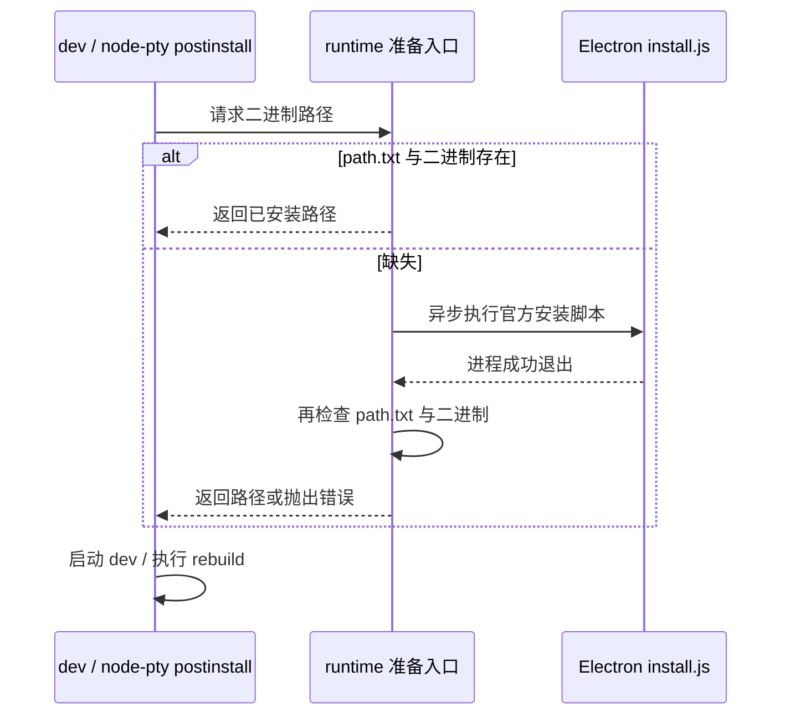
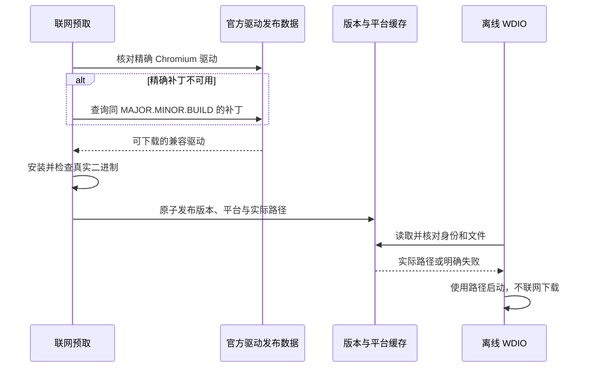
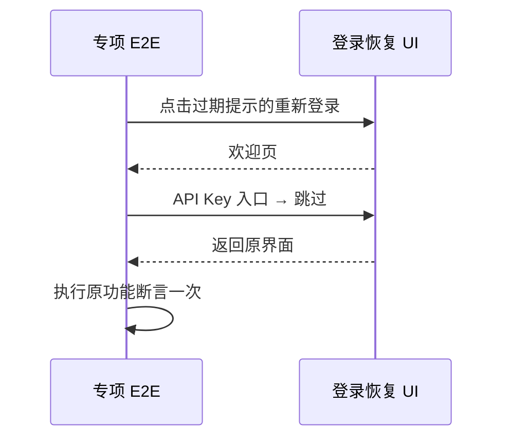
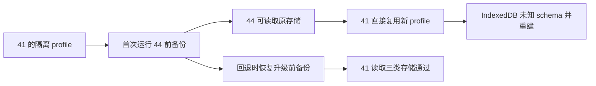

# Electron 44 升级规格

## 目标与边界

将桌面 Electron 从 41.0.3 升级到精确版本 44.7.0。版本唯一来源为
`packages/desktop/package.json`，开发、安装包、Windows Helper 和 CI 都读取该值。
macOS 最低版本为 13.0；Windows/Linux 保留既有 x64/arm64 发布矩阵。
不改变 Agent 协议、任务 schema、远端 Node、编译 target、浏览器承载方式或文件选择交互。
不同时升级无兼容阻塞的 builder、updater、Playwright 或 WDIO。

## 2026-10-14 收口验收范围

用户要求缩小范围。此范围取代此前“逐项关闭全量正式集失败”的推进方式；原 177 文件整轮、CLI/根全量及后续定向结果保留为历史证据，不要求重跑，也不把所有失败修完作为升级完成条件。

| 必验组         | 本次边界                                                                              |
| -------------- | ------------------------------------------------------------------------------------- |
| 运行时与依赖   | 真实 44.7.0、启动与构建、运行时准备及版本一致性                                       |
| 剪贴板与 IPC   | 原生 PNG/文本读写、失败传播、过期实例拒绝                                             |
| 原生模块与终端 | ABI、SQLite、随包依赖和实际 terminalService 创建/读写/清理                            |
| 核心会话       | 单个代表链路覆盖发送、流式输出、刷新恢复和停止；复用已通过的模型/思考隔离和 Goal 回归 |
| 打包与更新     | 当前生产包、41→44 显式安装更新及配置/项目文件保留                                     |
| macOS 边界     | 13+ 目标包、12 保留旧版；清单和 updater 下限检查                                      |

收口后的单个核心会话代表用例已通过：实际发送、流式输出、renderer 刷新后的同一 session 与历史恢复、再次发送和停止均保留原断言，retryIndex 为 0。

只对选定链路中的失败做有依据的定位。只有明确属于 Electron 44 的兼容变化或新回归，才在升级分支修复。其余共有产品 bug、通用测试维护、后台遥测、双 Host、无关 pending 和全量矩阵补齐转为后续事项。已完成的改动与原失败证据保留，不自动删除或混入升级提交。

权限 origin 与普通退出安装两个共有 bug 保持独立修复交付。普通退出安装在旧版 sender 中的故障不能算成 44 新回归；升级分支的显式安装与独立修复结果分别记录。正式证书、公证、真实旧系统、其他平台、真实远端及旧版本历史任务/会话恢复仍列为未验证或发布验收项，不以缺少环境触发本机重复运行。

本轮完成条件：选定的本机链路及代码门禁通过，已发现的 44 特有阻断项关闭，剩余风险明确列出。此结论只表示收口范围内的验收，不等于所有平台和产品功能全部验证。

## 运行时准备

Electron 44 不再通过 npm postinstall 下载二进制，但仍提供 `install.js` 和
`install-electron` 命令。现有 E2E 的有界 preflight 保留。开发启动与 node-pty
准备共享同一个异步运行时准备入口：先检查官方 `path.txt` 指向的二进制，缺失时
运行 Electron 官方安装脚本，安装退出后再核对二进制；失败直接终止，不启动旧运行时。
不新增同步 IO，不通过延时猜测安装状态，不维护第二份运行时版本或缓存身份。

运行时安装子进程默认使用既有的 `https://npmmirror.com/mirrors/electron/` 镜像，
保留调用方显式设置的 Electron 镜像；空白配置视为未设置。镜像仅注入安装子进程，
不修改父进程环境，避免影响后续 electron-builder 辅助工具的下载源。

## 插件图片复制

Main 继续拥有 guest 与实例身份。使用 `ClipboardItem`、PNG `Blob` 和
`await clipboard.write(...)` 写入；保留截图前后 owner、initId、registry 和
guest 校验。写入完成才 resolve IPC，写入失败传播给现有调用方。
PNG 使用 nativeImage 的编码接口，不将未经授权的像素或 Electron API 暴露给页面。
桌面与手机投影继续复用原业务 owner，本次不增加远控状态或新协议。
独立 Gen UI 原生夹具同样使用异步 `clipboard.read()` 读取 PNG，再由 nativeImage 解码，
不再调用 Electron 44 已移除的 `readImage()`。保留按钮状态、非空图像、截图尺寸和
过期实例拒绝断言；没有 PNG 或解码失败时，夹具直接失败。
过期捕获夹具先等待 `writeText()` 完成，再开始捕获与释放；拒绝旧请求后等待
`readText()`，确认哨兵未被覆盖。两项文本 API 在 Electron 44 中返回 Promise。

## 打包、更新与兼容

- builder 显式配置 macOS 13.0.0 下限；Linux 缓存校验从 package.json 读取 Electron 版本。
- bundle 完成后为 macOS 更新清单写入 `minimumSystemVersion: 22.0.0`（Darwin 内核版本），供现有 updater 拒绝 macOS 12 下载；覆盖 `-mac.yml` / `-mac.yaml` 渠道清单及 `-mac-arm64`、`-mac-x64` 架构后缀，保留更严格的系统下限。CI 收集为 `latest.yml` 后仍须保留该字段；其他平台清单不变，即使使用同一输出目录。
- `@electron/rebuild` 的传递依赖 `node-abi` 固定到 4.37.0：原 4.28.0 不认识 Electron 44，官方新注册表已包含 ABI 149。保留现有预编译/重编译决策，不硬编码 force-abi。
- `electron-to-chromium` 固定到 1.5.452：原映射表查询 44.7.0 返回 undefined；新表映射到真实 Chromium 152.0.7977.130，WDIO 与容器预取共用该值。
- ChromeDriver 精确补丁未发布到目标平台时，按官方 `MAJOR.MINOR.BUILD` 查询可用补丁；禁止换到其他 build。容器在联网预取阶段保存真实可执行路径，离线运行读取该路径，不再猜缓存目录或在隔离网络内下载。驱动缓存必须匹配 Electron、Chromium 与平台。
- 既有 RunAsNode fuse 保留；重建桌面 Agent 和 Windows Helper 资产。字节码试验必须重建。
- Electron 42 的 macOS 通知需要签名；验证开发副本与正式签名包，不以未签名失败宣称产品通知可用。
- macOS 开发副本写入身份后进行 ad-hoc 重签名，成功后才写缓存指纹；格式版本递增使旧副本重新准备。只处理 ignored 开发副本，不重签源 Electron 或正式应用。权限允许及通知显示仍需系统功能验收。
- Electron 43 的文件对话框、Linux 窗口与图像色彩变化以实际回归为依据；不自行增加目录记忆或其他产品行为。
- 更新 manifest 必须表达目标系统下限。正式发布前验证 macOS 12 不会被强制更新到不可运行版本；本次不发布新包。
- macOS 12 保留旧版还必须通过启动验收：启动强更读取 `/client/configs` 的
  `minimalVersion`，与 updater 的 `minimumSystemVersion` 是独立链路。发布配置须继续
  接受保留的旧版，不能因统一提高最低应用版本而阻止其启动；生产策略尚待验证。
- 正常升级沿用既有数据路径，不新增 Chromium profile 复制、隔离或反向格式转换。
  直接安装旧 41 包可能导致 IndexedDB 记录不可读；用户已接受本轮将其保留为已知
  降级限制，不继续专项改造或追加验证，不将该决定表述为无损降级已通过。

## 容器驱动的联网准备与离线运行

精确驱动存在时使用精确版本；不存在时，仅查询同 `MAJOR.MINOR.BUILD` 的官方可用补丁。
安装成功并确认文件存在后，原子保存按 Electron 版本和平台区分的缓存记录。离线运行先校验
缓存里的 Electron、Chromium、平台和文件，再将真实路径交给 WDIO。缓存缺失或不匹配时
明确失败，不在 `--network none` 内发起下载。

## 测试场景与验收

登录过期遮挡的专项复验由用户明确要求执行一次。仅在该专项入口启用 UI 准备：确认
“登录已过期”标题，点击“重新登录”，进入 API Key 表单并选择产品提供的跳过入口，
确认提示和欢迎页离开后执行原 case。保留原凭据种子、业务断言和超时，不修改产品
登录逻辑，不删除遮罩 DOM，不自动重试失败 spec；其他失败项继续停止。

先新增回归再实现：缓存命中不安装、二进制缺失后安装、安装失败、成功退出但仍缺文件；
builder 与 package 版本一致、macOS 下限、CI 版本读取；图片复制等待异步写入、
错误传播、截图期间实例失效、PNG 载荷正确。
真实 Electron E2E 沿用 MCP Apps host fixture，覆盖 guest 截图、生产 IPC、原生剪贴板
读回和旧 initId 拒绝，记录为 pending 回归，不自动晋升 CI。

此前执行过用户要求的根/CLI 全量、桌面正式集及可运行的集成/打包检查。最终验收以
本文的六组收口范围为准，保留原始结果，不重复全量。运行时证据记录真实 Electron、
Node、Chromium、OS/架构与日志。缺少环境的发布项目明确列为未验证，不以 mock 或
当前 macOS 结果代替；本轮选定的必要验证失败时保留改动，不自动提交。

## 来源

- [Electron 44.7.0](https://releases.electronjs.org/release/v44.7.0)
- [44.7.0 npm 契约](https://raw.githubusercontent.com/electron/electron/v44.7.0/npm/package.json)
- [目标版本兼容变化](https://raw.githubusercontent.com/electron/electron/v44.7.0/docs/breaking-changes.md)
- [剪贴板 API](https://www.electronjs.org/docs/latest/api/clipboard)
- [官方驱动匹配规则](https://developer.chrome.com/docs/chromedriver/downloads/version-selection)

## 升级报告

2026-10-12，在 `chore/electron-44-upgrade` 分支实施。起点为
`c19561c367e8b5dae2829e0fa2fea10e62eb61ac`。升级适配已落地；验收尚未全绿，
不具备发布条件。必要验证未通过，因此保留工作区，不自动提交、推送或发布。

随后用户明确要求提交到 `staging` 的 MR，因此将本次适配提交并推送为 Draft MR，
保留上述失败与未验证项，不表示验收通过。创建 MR 时 `origin/staging` 比测试起点
前进 75 个提交，未修改本次升级涉及的文件；合入前仍需在最新基线上复验。

### 已取得的证据

- 真实 macOS arm64 runtime：Electron 44.7.0 / Chromium 152.0.7977.130 / Node 24.21.0 / ABI 149 / N-API 10。
- 构建工具：Node 24.14.0 / pnpm 10.33.2。根 Vitest 实际 4.1.4，lock 期望 4.1.7；CLI 实际 4.1.7。没有因本次升级广泛更新无关依赖。
- 根全量单测：2,563 文件通过、5 文件跳过；24,290 案例通过、48 跳过。已包括清单隔离与驱动预取适配，原生资产补齐后部分旧跳过场景进入执行。
- typecheck 通过；lint 0 错误、208 警告；架构门禁 0 违规、架构自测 37 项通过；项目与 CLI session schema 基线校验通过。
- 本次代码与规格的定向格式检查通过；全仓多文件格式不通过，未改动文件及原有 vendor mirror 也复现。保留原有 vendor mirror 格式，不重写全仓。
- 真实 Electron Node 模式：PTY 正常输出并退出；sharp、node:sqlite、CUA 原生模块成功加载。原生 rebuild 完成。
- 真实 MCP Apps fixture：guest 截图经生产 IPC 异步写入、原生 PNG 读回、Retina 尺寸及旧实例拒绝通过；storage write/read/empty 通过。
- macOS 开发副本 strict/deep 签名校验通过；真实通知显示未验收。
- 本地目录包完整性检查通过，Node 模式确认安装包 runtime 为 44.7.0，Info.plist 最低 13.0。
- 本地 bundle 链路生成 DMG、ZIP 和 blockmap；运行时依赖校验与 ZIP 254.6 MiB 体积审计通过；实际 `latest-mac.yml` 下限为 Darwin 22.0.0。复用测试构建输出与本机 ad-hoc Helper；不代表正式生产构建、证书签名、公证或自动更新验收。

- 独立当前源码副本的 production 编译通过，renderer 测试桥接关闭；标准 runtime 暂存后，完整 DMG/ZIP/blockmap、运行时和原生资源校验通过，ZIP 251.0 MiB。正式签名与公证未验收。
- 生产输出内的 Electron Node24.21.0 执行随包 Agent0.16.9 的 `--version` / `--help` 成功。只证明入口加载，不代替会话功能验收。
- Linux 原生补充 fixture 在离线普通用户虚拟显示中输出 PNG 读回与过期实例拒绝 PASS；随后 storage write 阶段超时。未宣称完整 fixture 通过。

### 完整测试中的未通过项

- CLI 全量以串行包任务、continue=always、force 执行全部 36 任务：33 通过、3 失败。
  bootstrap 有 2 个 Skills 用例受到本机用户技能 frontmatter 错误影响，1 个大报文 gateway 用例超时；
  cli 的 SEA 资源断言发现 Windows Android 设置脚本与预期不符；dynamic-workflow-runtime 的
  provider-stop 取消列表断言失败，单文件复跑通过，仍保留整轮失败记录。这些 CLI 文件未在本次修改；
  缺少同环境原版本全量基线，不宣称全部为原有问题。
- 首轮桌面默认全量选择 194 个文件任务，包含部分 pending；共同前置失败后停止用于诊断。原 HEAD / Electron 41 的 2 项对照也在工作区前置条件失败，未进入目标断言，不用于排除全部 44 回归。随后用隔离分片执行完整正式集，88 + 89 = 177 个文件任务；最终 177 文件全部执行，32 通过、145 失败；367 案例中 147 通过、219 失败、1 跳过。其中 106 项为 Skip/跳过按钮不可点击；其余涉及工作区前置、模型/思考深度与设置入口，归因未完成，不宣称全部为历史问题。
- Linux 默认容器测试首次在 Electron 44 编译头文件下载时 TLS 连接中断；缓存方案完成原生重建后，修复了精确驱动补丁缺失导致的 404。最终本地派生镜像以 replay-isolated 网络执行全部 5 文件：2 通过、3 失败；7 案例中 4 通过、3 失败。失败为工作区前置条件与 high 思考深度切换，标准联网镜像仍需 CI 验收。
- conversation/plugins 专项容器入口因现有准入清单为空，均退出 2，未执行案例，未绕过准入规则。

### 2026-10-14 登录前置复验

真实 Electron 44 复跑 AskUserQuestion 键盘导航案例，窗口录制确认登录过期弹窗
覆盖职业引导，案例在 Skip 前失败。删除假共享 JWT 不足以隔离账号请求，假 OAuth
access token 仍可能被请求链使用并触发退出广播。该案例只需 Personal Provider 回放，
测试启动应不播种账号身份；认证专项保持原夹具，产品过期保护不变。
此证据只确认该代表案例的阻塞，不据此判定旧整轮全部 106 项的原因。

修正启动夹具后登录弹窗不再阻塞，但默认 `high` 与当前回放模型仅声明 `disabled`
的 Option Spec 不匹配。以 `E2E_PROVIDER_THOUGHT_LEVEL=disabled` 复验，保留所有
键盘交互断言，正式案例完整通过（1/1）；默认档位不匹配仍是后续测试配置检查项。
回归单测先失败后通过；最终受影响 Vitest 97 项、Node 测试 14 项通过，根与 E2E
类型检查、lint、架构、改动格式检查通过。类型检查会重写 `out/host`，E2E 应在其后
重新构建，不能复用已被覆盖的 bundle。旧整轮结果及其他平台未验证项继续保留。

### 2026-10-14 最新基线复验进度

业务基线为 `48a849153f865eddc7fb7da55e07151a855f26cc`，生产包验证来源为
`b1fdac4d1224181a8bdc97a8fc7dc3799d0fb3b3`。后来确认远端升级提交与本地升级
提交的 patch-id 相同，标准合并 `b11398e5e4` 只对账历史，提交树与合并前完全一致。
旧备份保留，推送无需强制改写历史。

- 当前根 lockfile 与实际 Vitest 均为 4.1.4；CLI 为 4.1.7。此前报告中的根版本不匹配说法不适用于当前基线。
- 静态清单包含 536 个桌面 spec：181 个正式、355 个 pending；默认入口选择 177 个正式文件，另外 3 个 SSH 文件和上游 smoke 需显式环境。静态声明 1,131 个，其中 4 个显式跳过；参数化运行数应以最终执行结果为准，pending 不自动转正。
- 修正回放种子的档位声明后，键盘导航案例在默认 high 下完整通过。上游 smoke 显式回放完整通过，保留请求、思考档位、回复和 usage 断言；录制响应未改写，不代表真实供应商网络验收。
- 首轮最新基线根全量：2,612 文件通过、3 失败、5 跳过；25,158 案例通过、3 失败、48 跳过。失败分别为 WSL 测试临时路径约定、文件名大小写改名缓存重复、UI 测试一次性 mock 残留。定向修正后正在复跑全量，不能用单项通过替代整轮结果。
- 原生文件监听专项复验：27 通过、1 跳过；UI 测试整文件 42 通过。最终根与 E2E 类型检查通过。根 lint 为 0 错误、209 警告；CLI lint 为 0 错误、69 警告。
- 最新基线首轮 CLI 全量为 33/36 任务成功。测试隔离、HTTP 安全校验触发时机、Browser 旧 MCP 产物清理已取得定向回归证据；外网插件市场导入和整轮重试/超时问题继续复验，不宣称全部为历史问题。
- 后续 CLI 全部 36 任务已执行，35 成功，仅 bootstrap 失败（46 案例，主要是 5 秒超时，另有计数及清理错误）。在其余整轮测试和构建结束后，以单 worker 完整复验该包 229 文件：3,014 通过、1 失败、12 跳过，原时限和断言保留。剩余失败为真实 GitHub 归档下载 `fetch failed`，保留原失败及外部网络未验证项；不能将整轮 46 个失败简单删除或宣称原执行全绿。CLI 类型检查 30/30 任务通过，lint 0 错误、69 警告。
- Host 配置缓存与监听已登记为 `host-subagent-runtime` 受管模块。仅移动既有缓存和 scope，管理服务沿原入口消费，未增加 RPC 或改变 owner；门禁 0 违规，架构自测 37 项通过，未增加预算、基线或豁免。大小写改名按真实目录条目去重，同时保留大小写敏感文件系统上的两个真实文件；补充了空缓存同批事件和大小写敏感回归。
- 同业务基线 Electron 41 对照已完成两项：定时任务创建/编辑/暂停/恢复/删除、上游 Provider 显式请求回放各 1/1 通过；Electron 44 对应两项也完整通过。Electron 41 源码逐文件校验到上述业务基线，依赖独立安装，实际运行 41.0.3 / Chromium 146 / ABI 145；两边使用相同测试前置修正，不能外推为全部功能对照通过。
- 最后一轮根单测四组全部完成，结果覆盖 2,622 个唯一文件，与正式入口清单一致，无遗漏或重复：25,172 通过、0 失败、48 跳过。首组服务端更新回滚测试曾用固定等待推断操作结束，清理时仍持有生命周期锁；改为观察原更新 Promise 并断言旧版本恢复后，整文件及首组复跑通过，产品实现未改。Gen UI 原生通知在第四组 3/3 通过，但此前一次超时的根因未确认，不以本次通过抹去原证据。
- 当前业务基线的真实 MCP Apps 存储夹具复验通过 write/read/empty 三阶段，包含生产截图 IPC、异步剪贴板、原生 PNG 读回、Retina 尺寸和过期 init 拒绝。各阶段 40 次页面切换与存储读写/清理断言保留；该结果仅代表 macOS arm64。
- 双 Host pending 案例先由假 OAuth 过期弹窗阻塞；隔离凭据后发现未声明案例所需的 low 档位、新窗口仍假定自动绑定旧目录。已补专项档位和真实请求参数，显式经项目 UI 创建草稿，原断言保留。当前失败在第三 Host 首发，UI 仍为草稿而日志已有创建和订阅；Electron 41 同业务基线复现了相同的 `E2E_SHP_B_SEED` 失败点，第二条亦停在共享前置。该点并非仅在 Electron 44 出现，但根因仍未确认，不改变 pending 状态或 CI 准入。
- 双 Host 的独立详情复验确认 `SEND_FAILED` 详情为“草稿会话已切换，请重新发送”，原输入仍保留。对应现有预热 binding 的过期代际保护，未修改产品 guard 或追加发送重试；触发时序仍需进一步定位。当前正式桌面默认集经官方双分片入口新构建复验；用户要求停止时，100 个文件已完成，14 通过、86 失败，另外 77 个未完成。该轮仍保持停止，不能用旧 177 文件结果代替本轮结论。

- 登录过期遮挡专项仅复验受影响的 57 个正式文件，每个文件执行一次：19 通过、38 失败；150 个实际 case 中 46 通过、104 失败、0 跳过。56 个文件通过真实 UI 完成过期提示确认与 API Key 跳过；另外 1 个文件因 ChromeDriver 连接失败未进入界面。剩余失败按文件归类为工作区准备 24、权限模式准备 4、其他断言 9、驱动启动 1，其中 5 个文件未进入业务 case。原 spec 文件、断言与超时保持不变，无遗漏、重复或失败用例重跑；登录提示遮挡的 Skip 报错未再出现，不据此宣称其余失败都是 Electron 44 回归。专项准备测试 13/13 通过，根与 E2E 类型、lint 和架构检查通过。其他已停止任务未恢复。

用户确认暂无额外 Windows/Linux、真实 SSH/WSL 或供应商测试环境，相关项目保留未验证。
用户进一步确认本轮范围为升级验收矩阵、全部 177 个正式桌面文件和本次改动相关 pending；
其余 355 个 pending 仅保留清单背景，不要求全部运行或转正。
WSL 更新向导的本地合成回放在当前 Electron 44 上执行 12 项，11 通过、1 失败。
失败视频已显示更新按钮，但用例仍查找旧英文 `Update server`，当前文案为
`Update remote device`。同步按钮定位时保留自动更新一次、显式再次更新、同一 Profile、
`force:false` 与实际用户重连断言。同步定位后的完整文件复验 12/12 通过，
Electron 41 原定位也在同一点失败，新定位后的相同 12 项全部通过。真实 WSL 安装仍未验证。
V4 预览卡片文件在两个版本中均为首条通过、第二条准备失败：首发后当前任务使用独立的
托管工作目录，通用 shell 准备却仍等待旧 `ZCodeProject`。V4 准备按既有工作流确认当前
主 pane，再走新任务 UI 与原 Provider 准备；固定目录由具体案例的严格路径断言验证，
不放宽 `waitForWorkspaceApp`。先在独立比较副本验证，正式整轮运行期间不修改其共享 helper。
独立实跑还发现 Provider 已正确播种后，其通用准备仍先等待同一个旧目录；因此仅修正
主 pane 准备不足以完成第二条。有效的 Provider 种子应复用原偏好与真实模型选择；
缺失、禁用、API Key 不匹配或缺少目标模型时仍走原准备和配置 UI，不能直接跳过。
已核对浏览器空态、文件 URL、权限、视口、tab 生命周期，月/年定时表单及默认键盘焦点
只依赖本地回放。其无关的假 OAuth 会在两个版本中弹出登录过期提示；仅同步这些明确
匿名场景的凭据种子，账号、登录和鉴权专项保留原前置及断言。

后续按“不改变既有产品功能”收口：Subagent 大小写缓存与模块搬迁、Browser 插件旧
构建产物清理移出升级分支，保存为独立后续修复。恢复后的受影响单测为 77 通过、
1 跳过；最新测试准备回归 40/40 通过，类型、Lint 与架构检查通过。
思考参数专项的三个真实桌面文件全部通过：模型状态隔离、思考深度隔离和 Goal 暂停/恢复。
原失败抓包实际走已配置的供应商协议，但种子的参数 map 为空；仅为这些专项播种真实思考参数，
保留对最终请求体的严格断言，其他案例保持原参数种子。

macOS 验收边界已确认：13 及以上升级，12 保留旧版。更新清单、平台选包与 builder
下限的 34 项单测通过。使用锁定的真实 updater、模拟内核版本验证：Darwin 21.6
不提供更新且下载次数为零；22.0、22.6、23.0 可更新。自定义 Provider 保留清单字段。
此结果不替代真实 macOS 12、发布服务字段透传和签名更新验收。

最新整轮保持同一代码快照，两个隔离分片合计 177 个唯一正式文件，无遗漏或重复，
不启用自动重试。仅对已取证的 57 个文件执行真实登录恢复，认证与套餐用例保留原前置。
新增失败录像显示飞书机器人运行错误和工作流中枢也被过期弹窗遮挡，单独保留待处理。
浏览器权限的原生对照确认本机无摄像头：41/44 均返回 NotFoundError，不进入请求处理器；
仅提供模拟摄像头时，两版均进入真实权限处理器且拒绝后返回 NotAllowedError。
模拟设备不是自动授权；该测试准备修正及真实 UI 复验尚待完成。
权限专项仅为 `browser-permission-prompt.test.ts` 的 worker 提供模拟摄像头，其他
worker 不添加媒体参数，不启用模拟权限确认。页面启动 getUserMedia 后立即返回，
由真实确认条的允许/拒绝操作完成请求；仍严格验证默认拒绝、再次询问与持久授权。

正式集的同快照整轮已完成：177 个唯一文件，70 通过、107 失败；案例 378 通过、193 失败、2 跳过。此为原始整轮结果，不等于 107 个产品回归。失败仍需逐项区分测试前置、业务基线问题和升级影响；后续定向结果单列，不能覆盖原始记录。running-guide 文件的 reporter 带有 retries 注记，未观察到重复 worker，暂不将它计作成功重跑。

此前验证快照的根全量覆盖 2,626 个唯一文件，无遗漏、重复或意外文件：25,204 通过、0 失败、48 跳过。后续新增的剪贴板、媒体设备、后台行、工作流灰度与可见节点夹具回归共 25 项通过，单独记录，不加进上一轮全量统计。通用测试改动已隔离，该统计不代表最终升级分支再次执行了全量。
Gen UI 真实 Electron 44 完整夹具通过，包括 PNG 复制、裁剪、旧 capture 拒绝、异步文本剪贴板、主题及历史挂载。
后台控件误判来自祖先 `display: contents` 没有盒子；Electron 41 的运行时也复现。测试可见性判断已修正，业务断言和截止时间保持不变，此前失败及未完成的 14 项定向验证已完成，5 通过、9 失败；保留 Bash 标记及完成通知等剩余失败，不能据此宣称整文件通过。

权限授权后 query 仍 denied 的根因是 request 与 check 的 origin 键不一致，两版均复现。经确认，产品修复在独立分支 `fix/browser-permission-origin-normalization` 提交 `f166dfcbac`，未并入升级分支。该分支完成模块准入、95 项受影响单测、类型/Lint/架构检查及 Electron 41 真实确认条回归；41/44 的真实权限策略探针均验证允许为 granted、拒绝为 denied。44 界面对照最初因测试驱动仍选 41 对应 ChromeDriver 而启动失败；修正独立对照 runner 的版本选择后，真实 Electron 44 的同一确认条回归也通过，原启动失败记录保留。

来源 `b1fdac4d12` 的独立 production 编译和 macOS arm64 目录包组装通过，renderer 测试桥接关闭。最终升级分支的产品源码、依赖及构建配置与该来源完全一致，后续变更仅涉及测试、文档和历史对账。安装包确认为 Electron 44.7.0 / Node 24.21.0 / ABI 149，最低 macOS 13.0；实际产品依赖路径下的 sharp、koffi、SQLite，以及既有 terminalService 初始化后的原生 PTY 创建、读写和清理通过。绕过产品初始化直接调用 node-pty 的探针曾失败，原结果保留；成功证据来自实际 terminalService。暂存 Helper 及更新测试使用本地 ad-hoc 签名，不表示正式证书或公证通过。

隔离 bundle 身份和数据目录的真实 Squirrel.Mac/ShipIt 完成 41→44 显式安装更新，保留语言、终端偏好与项目文件内容。普通退出安装在旧版 41 中复现最终退出抢先终止安装的问题；经确认，独立分支 `fix/update-install-quit-ownership` 提交 `ead2ec926e`，保持升级分支的产品范围。89 项相关单测、类型/Lint/架构检查通过；同一入口的最小修复覆盖到 41 和 44 sender 后，41→44、44→44 的普通退出安装及上述数据保留均通过。实际 installed 41 基线与业务基线 Main 的复现分别保留；Main overlay 与完整应用源码身份分开记录。升级分支本身尚未包含该修复，不能直接计为普通退出安装通过。

工作流中枢最终完整文件 10/10 通过，retryIndex 均为 0。中文语言前置、当前可见页面及数值输入 value 已修正；原生菜单复用当前可见节点，排除关闭侧板的保留 DOM。实际鼠标先移出再移入后，运行时 hover 为 true 且 Stop 透明度为 1；窗口焦点已确认正常，不以 focus-within 替代悬停。此前 4/6、8/2 和诊断失败均保留，不覆盖正式整轮记录。

未选入收口范围的 pending、其余 Electron 41 对照和其他平台验收保留为后续事项；真实历史会话/任务恢复、正式更新服务和隔离降级尚未验证。

### 最终分支与代码门禁

35 个已跟踪文件及 14 个新增文件的通用测试维护，已按 SHA-256 原样保存在独立分支
`test/electron44-validation-followups` 的工作区。键盘回放凭据的通用修正也从升级分支
撤出，原提交历史及补充结果保留。升级分支只新增 Gen UI 夹具的 Electron 44 异步
剪贴板适配、5 项回归测试和既有规格/计划更新；不包含上述两项独立产品修复。

最终类型检查、Lint（0 错误、209 条既有警告）、架构门禁通过。直接兼容范围的
12 个单测文件共 149 项通过，包含恢复为基线的凭据夹具测试。官方 affected 选择
因依赖变化覆盖整个根套件，按仓库合同跳过全量；成功退出不表示执行或通过了全量。
Gen UI 原生完整夹具及核心会话 1/1 的运行结果复用；核心会话使用已隔离的测试准备
修正，不宣称最终分支的默认 177 文件入口已全绿。本轮本机兼容适配已完成，发布仍
受下列未验证项约束。

### 发布验收要求

关闭升级相关失败并完成必要验收后，才具备合入和发布条件。发布前仍需 Windows x64/arm64、Linux
发布目标、macOS x64 的安装与核心操作验收；生产包的正式证书签名、公证、真实通知与 Helper
身份、macOS 12 的更新服务拦截、真实远端/手机、深浅主题与国际化。
IndexedDB 降级限制按下文确认的范围保留，不再作为本轮新增改造或专项验证项。
不以当前平台结果或 mock 证明其他平台可用，也不宣称未经测量的性能收益。

后台文件屏障路径的最后一次补充验证：9 项定向回归中 8 通过、1 失败。混合子任务已完成主流程，遥测断言收到 3 个 completion，其中 2 个属于旧会话、1 个属于当前会话；按收口范围停止继续修正该通用用例，不计为已确认的 Electron 44 产品回归。

## 2026-10-15 审阅问题与剩余验证

Gen UI 旧剪贴板 API 的历史 CR 针对 `c3ba3e7271`，修复已在 `0da54aa1e3`
提交并推送。最新审阅明确确认该项已修复。本次从该提交新建隔离验证工作区，
8 项剪贴板单测通过；完整 Gen UI 原生夹具在真实 Electron 44.7.0 上再次通过，
覆盖 inline/preview 图片复制、重复复制、PNG 裁剪、过期实例拒绝、异步文本、
主题、reload 及历史挂载。未重复修改已修复的产品代码。

新工作区先离线安装依赖且跳过安装脚本，首次 renderer 构建因未生成 CUA `dist`
失败。按既有准备入口执行 `pnpm build:cua` 后，renderer 构建和完整原生夹具通过。
保留准备失败记录，不将其计为 Electron 回归。

### 正式签名和更新服务

- 在已验证生产包的隔离副本上，Developer ID Application 证书签名、hardened runtime
  及 `codesign --verify --deep --strict` 通过；签名后 `app.asar` 哈希与源包一致，
  Node 入口启动报告 Electron 44.7.0 / Node 24.21.0 / ABI 149。此为本机签名 smoke，
  不代替正式 CI 产物、公证、Gatekeeper、真实通知或 Helper 权限验收。
- 公证所需 `APPLE_ID`、`APPLE_PASSWORD`、`APPLE_TEAM_ID` 未配置，本次未提交公证。
- 使用真实发布平台值 `darwin-aarch64` 查询稳定/预览通道，均收到有效 YAML，当前
  版本为 3.15.3，未包含 `minimumSystemVersion`。匿名启动配置请求成功，未下发
  最低版本要求。当前尚无本次 44 发布清单，不能据此证明未来下限透传或 macOS 12
  强更保护已通过；最初使用错误平台值得到的业务错误记录另行保留。

### 存量数据与隔离回退

Electron 41 隔离产品测试实际生成的 task 索引和 CLI session 数据库，经一致性备份后，
使用 41→44→41 的真实 Electron Node 运行时只读检查。18 个 task、25 个 session、
124 条 message、228 条 part 及其他表的行内容哈希一致，SQLite integrity_check 通过。
此证据覆盖数据库读取兼容性，不代替完整产品 UI 的历史任务恢复。

真实 Chromium profile 的合成数据验证中，41 写入的 localStorage、IndexedDB 和 cookie
在 44 中均可读取。直接以 41 重开该 profile 时，IndexedDB 日志报告 unknown schema，
随后删除并重建库，原记录不可读；localStorage 与 cookie 仍可读取。该失败保留，不能
宣称共用升级后的 profile 可安全降级。另一路在首次启动 44 前备份 profile，回退时
恢复该备份，41 对三类存储的读取全部通过。

### 已确认的 IndexedDB 降级限制

2026-10-15，用户确认无法制作保留 44 内核的专用业务回退包，并认为 profile 复制的
存储成本不适合作为默认方案。此前的业务回退包方案不再作为实施或验收要求。

用户评估数据丢失场景较少，本轮先不处理该风险：不新增备份、profile 复制或隔离、
反向格式转换、自动清理或自动回退，不再追加 IndexedDB 专项验证。Coding Plan
购买页和奖励页不纳入本次专项范围。直接安装旧版 41 仍可能丢失被 44 更新过的
IndexedDB 记录；正常 41→44 读取通过的证据和降级失败记录继续保留。

此决定不代表无损降级已通过，也不扩大到业务数据库的兼容性结论。macOS 13+
升级、macOS 12 保留旧版的发布边界不变。

### 旧版历史任务的生产包界面恢复

在隔离的 Developer ID 签名生产包中，实际运行 Electron 44.7.0，使用 Electron 41
测试生成的业务目录副本与已核验的一致性数据库快照。仅重映射测试目录路径，移除
副本中的假鉴权种子和过期进程文件；外部网络阻断，不读取真实用户目录或发送新消息。
生产源码、依赖和构建配置与已验证包来源一致。

旧任务在列表中出现，真实点击后恢复到原 session，用户消息和回复均显示，截图确认。
刷新后原 session 和两条历史文本的 DOM 断言通过；刷新截图捕获到尚未重绘的启动页，
不计作刷新后的视觉通过。验证后该会话的 message / part 内容及顺序与原快照一致，
测试应用已关闭。此结果覆盖一个旧任务的恢复与刷新，不代表全部历史迁移、真实供应商
续发、其他平台或 IndexedDB 降级通过。

## 2026-10-19 同步 staging 基线

升级分支 rebase 到 `f5521273b7`，沿用新基线的应用版本 3.16.1，Electron 仍为
44.7.0。原 HEAD `e0d68e8636` 已保留本地备份。历史中的两份升级提交具有相同
patch-id，仅重放一份；不改变文件内容的历史对账合并不重建。通用登录凭据改动在
旧升级分支中已加入后撤回，冲突处理保留当前 staging 的 helper 与测试，不引入旧实现。
完成历史重放时，升级分支净补丁的 patch-id 与 rebase 前一致，仍为 32 个文件。

新基线验证发现两项测试适配：Main 新增加载结束监听，图片复制单测 mock 缺少
WebContents.on，导致三项用例在进入复制断言前失败；补齐事件接口。新增的图片预览
pending 用例仍调用已移除的 readImage，导致类型检查失败；改为异步读取 PNG 后解码，
保留 SVG/PNG 原始尺寸、非空图像和键盘菜单断言。均不修改产品交互或新增正式 case。

此前安装包及运行证据保留其原提交身份，不宣称已覆盖新业务基线；本次不验证此前
新打出的安装包，也不运行根单测或桌面 E2E 全量。

根与桌面 E2E 类型检查、Lint（0 错误、188 条既有警告）、显式 staging 基线的架构
检查通过。12 文件定向单测首轮 164 通过、3 项因上述 mock 接口缺失失败；补齐后该
文件 3/3 通过。affected 以任务起点为基线时选中整个根套件，按合同跳过，不计为全量通过。
图片复制 pending 实跑 1/1 通过，保留原 SVG/PNG 尺寸和键盘断言；首次因精确补丁
驱动缺失而未进入 case，显式使用本机同 build 的 152.0.7977.82 驱动后通过，失败记录
不覆盖。测试前后保存并恢复系统剪贴板。该结果为新基线源码 E2E，不是已打出安装包的验收。
