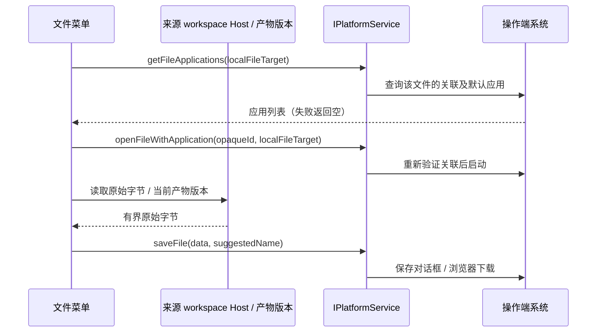

# 文件的系统应用打开与另存为

## 用户行为

文件的 Open / 打开方式菜单显示操作系统为当前文件类型注册的真实应用，例如演示文稿的演示应用；不再把固定的 IDE、终端及文件管理器清单当作文件关联应用。适用于文件卡片、Preview Pane、消息文件链接、文件树文件项和 Work 产物。目录仍使用现有工作区编辑器与文件管理器入口，不改变目录展开、工作区打开及远程编辑器语义。

- 应用条目统一显示名称和 16px 图标：优先渲染系统返回的 `iconDataUrl`；系统没有返回图标或图片加载失败时，显示一致的通用应用图标占位，不留空白，也不使用另一应用的图标。图标失败状态按应用身份与图片来源隔离，切换文件或应用后不能沿用旧失败状态。系统明确返回的默认应用排在前面并标记 Default / 默认。查询失败或没有系统默认信息时不猜测，不退回固定 App 白名单。
- 文件树右键、文件卡片右键和下拉、消息链接、Preview Pane 与 Work 产物复用相同的应用图标组件；目录的既有编辑器菜单也使用它。打开、打开方式、浏览器打开、保存、定位、复制和添加到聊天等行为项使用现有语义图标及菜单尺寸，不改变动作和默认标记。
- 一级外部打开动作：系统明确返回 `isDefault` 时，显示该应用真实图标与“在 {应用名} 中打开”；未知默认应用时保留中性的“使用默认应用打开”和系统打开图标，不把列表首项或用户上次选择当作系统默认。已显示具体应用的动作使用该应用身份打开，确保执行与名称一致。
- 应用先按稳定身份去重，再把明确的系统默认应用置顶，其余保持原顺序。1～3 个全部直显；超过 3 个直显前 3 个，剩余候选放入“更多打开方式”。默认应用使用“在 {应用名} 中打开”快捷项并占一个直显名额，不重复列出。未知默认应用时正常直显实际候选，不把首项冒充默认；无候选时仅保留平台确实支持的中性默认打开，不造应用条目。
- “更多打开方式”只包含未直显的剩余候选，与前 3 个没有交集，不再增加外层应用选择层级。该子菜单一次最多可见 6 行，每行固定 28px，行距 2px，列表视口上限为 178px；菜单外层保留既有 padding/border。超过 6 项在内部滚动并显示滚动条及提示，所有候选仍可通过鼠标和键盘访问。整体继续受当前视口可用高度约束，窄屏不横向溢出。OpenSplitButton、Preview Pane、Work 产物、消息链接和文件树共用直显分组及尺寸规则。
- 保存、路径操作、Markdown/SVG 视图切换和自动换行留在主菜单固定分组，应用超过 3 个后不再使主菜单持续增长；Web/remote 不支持本机选择时隐藏无效应用入口，保留保存、复制及视图操作。少于 4 个候选时不显示无意义的“更多打开方式”。
- 文件预览右上角统一使用 Open 下拉：外部打开、另存为及路径操作只出现一次；Markdown/SVG 的预览与源码切换、代码自动换行放在同一菜单的独立视图分组。文件有路径时移除旧“…”菜单；无文件路径但确有独立显示选项时保留其唯一视图菜单。Web/remote 无本机应用能力时仍能打开统一菜单使用保存、复制和视图项，不把禁用外部主按钮等同于禁用菜单。面板布局、源码定位、评论、调试及 Work 产物版本/编辑等其他语义控件保持独立。
- 本身执行外部打开的工具栏按钮也显示默认应用图标，并用完整名称作提示；仍执行 ZCode 内置预览的主按钮保留预览语义。菜单在打开时查询，外部打开工具栏在目标改变时查询，不为文件树所有行或所有聊天卡片预先批量查询。目标变化立即清除旧名称和图标，旧请求不得覆盖新目标。
- 预览菜单的来源工作区沿用 `source.workspacePath ?? workspacePath`；仅提供外层工作区时也不丢失复制、保存及远程判定。支持远程编辑器的主按钮在首次显示时按当前来源查询，无需先展开菜单；每个来源仅自动尝试一次，失败后允许展开菜单重试。
- 选择应用后用该应用打开本机文件；既有系统默认打开入口、复制路径、预览和文件管理器定位动作沿用原义。
- 聊天产物文件卡片的右键菜单和 Open 下拉均提供 Save as… / 另存为，将原文件字节保存到用户选择的位置。保留文件名和格式，不把预览渲染结果当作原文件。
- Work 产物保存当前所选版本的字节，不读取可能已被后续版本覆盖的同名工作区文件。仅在用户点击打开、展开打开方式菜单或复制副本路径时物化该版本的本机副本；挂载、加载字节和切换版本不会为了图标预取而自动落盘。首次交互前主按钮使用中性的系统打开图标，展开菜单查询到默认应用后才显示其图标；另存为直接使用当前版本字节。
- 保存成功显示一次简短反馈：桌面确认写入完成后显示“已保存”，浏览器仅在下载交付后显示“已开始下载”。用户取消时不显示任何反馈；失败沿用错误提示。卡片、预览、消息、文件树共用同一保存入口，Work 产物使用相同的结果判定，不重复提示。
- 不新增“更多应用”选择器，不修改系统默认关联，不添加没有既有实现的复制正文等菜单动作。

## 平台与职责

| 场景                    | 查询与启动应用                                                      | 另存为                                       |
| ----------------------- | ------------------------------------------------------------------- | -------------------------------------------- |
| macOS 本机文件          | NSWorkspace 查询系统关联与默认应用，系统 open 按返回的应用 URL 启动 | 原生保存对话框                               |
| Windows 本机文件        | Shell 关联处理器枚举；由处理器消费文件，不把文件路径拼成 shell 命令 | 原生保存对话框                               |
| Linux 本机文件          | XDG MIME 类型及关联的 desktop entry；由桌面启动器启动               | 原生保存对话框                               |
| SSH / WSL / Docker 文件 | 不把远端路径交给本机 App；保留原有明确支持的远程编辑器入口          | 从所属 workspace Host 读取字节，保存到操作端 |
| 手机 Web / 普通 Web     | 不提供桌面 App 查询与启动                                           | 浏览器下载；保存位置由浏览器决定             |

文件源由 workspace-scoped fileService / artifact 当前版本持有；查询系统关联、验证和调用本机应用由 desktop main 持有；UI 仅持有菜单加载投影。远程路径不能因为本机也存在同名路径而被打开。

Linux 优先使用桌面已有的 GIO 查询和启动；缺少 GIO 时，通过 xdg-mime 确认默认处理器并只显示能够由 xdg-open 启动的默认项。缺少桌面 MIME/启动工具时返回空列表，保留既有系统打开动作；不要求用户为本功能安装额外软件。macOS 只调用系统自带的 osascript/open，Windows 使用系统 PowerShell/Shell COM，不依赖开发工具链。

Windows 默认标记以 `IApplicationAssociationRegistration.QueryCurrentDefault(AL_EFFECTIVE)` 返回的有效关联为准，不直接把注册表 `UserChoice` 当作已生效的默认配置。读取有效 ProgID 对应的 AppID、可执行文件，再按 handler 的 ProgID、AppID、唯一可执行路径依次匹配；高优先级产生多个候选时，只能用后续证据收窄，不能另选同名应用。无法唯一匹配或系统查询失败时不标默认。此规则兼容没有 exe 路径的浏览器或打包应用，并保留 Shell 实际有效默认与原始 UserChoice 不一致的情况。候选查询与实际启动仍使用原 Shell handler；不修改默认关联。

Windows 关联图标在原生查询中批量读取，不为每个候选启动一个进程。内部保留 `GetIconLocation` 的原始路径、带符号资源索引、HRESULT 和系统 AppID：EXE/DLL/ICO 按原始资源路径与 index 提取；`@` 间接资源先交给 `SHLoadIndirectString`，解析为实际本地图片后读取，不把 URI 直接交给 `File.Exists`。不按应用名称、安装目录或 scale 文件名硬编码。仅使用系统内置 PowerShell、Shell/GDI 和 .NET 图像能力，不新增运行依赖。

Windows 的 WPS Office 统一显示系统实际登记的红色套件图标，DOCX/PPTX/XLSX 不按格式区分，名称仍使用系统返回的 WPS Office。内部继续分别保留 suite AppID、当前 handler ProgID 与图标资源 identity，不能因为共享 wps.exe 启动就把 Writer 图标当成套件图标。通过同一 AppID 在系统 AppsFolder 中精确定位套件入口并取得其真实目标图标；不硬编码 ksolaunch 安装路径、Logo 或应用显示名称。每次查询只解析/读取一次套件资源，供同一套件候选复用；无法定位或提取时使用通用占位，不能退回 Writer 或其它组件图。其它 App 沿用既有图标逻辑；public ID、真实 launch key、候选集合、默认排序和 handler 启动方式不变。

资源提取必须检查 HRESULT、空句柄、文件及图像大小，并释放 HICON、Bitmap 和图像流。查询子进程受既有超时和输出上限约束，返回的 PNG 还需校验格式与尺寸。Windows 提取失败时保留候选并返回无图，由既有 UI 通用图标占位；不再回退到可能与应用资源不符的普通 EXE 文件图标。公共 `FileApplicationInfo` 仍只传 `iconDataUrl`，原生资源路径不开放给 renderer 执行。应用身份、默认标记、候选去重与打开/保存语义不变；macOS/Linux 沿用各自现有图标链路。

## 接口与生命周期

- `FileApplicationTarget`：`path`、`pathKind: "file" | "directory"`、可选 `workspaceIdentity` 与 `remoteTarget`。
- `getFileApplications(target)` 返回 `FileApplicationInfo[]`：`id`、`name`、可选 `iconDataUrl`、`isDefault`。`id` 是 main 生成的不透明身份，UI 不传入可执行命令或应用路径。
- 系统可能把同一应用的多份安装或注册全部返回。按可靠应用身份合并：macOS 优先 bundle identifier、缺失时用解析符号链接后的规范应用路径；Windows 使用 Shell handler 对应的可执行文件规范路径或稳定 handler/package 身份；Linux 使用 desktop entry ID。不能只按显示名称合并，Chrome、Chrome Canary 或不同 bundle/package 的同名应用仍是不同应用。
- 同一身份只保留一个真实可启动实例：系统默认实例优先，其次标准安装位置、较新版本（系统有提供时），最后按规范路径稳定选择，不随系统枚举顺序变化。保留该实例的图标和默认标记；公开 id 仍对应保留实例的启动 key，打开时重新枚举并应用同一去重规则。不同身份仍同名时，以可靠身份作为名称后缀区分，不显示无法区分的同名条目。
- `openFileWithApplication(id, target)` 重新验证本地绝对路径、真实文件类型和系统关联，防止应用卸载、关联变化或伪造 ID 后打开错误程序。
- 原 `getInstalledEditors()` / `openInEditor()` 保留工作区目录和已支持远程编辑器语义，不用新的文件应用选择覆盖工作区编辑器偏好。
- 文件查询是异步的；结果绑定文件路径及来源身份。切换文件、关闭菜单或卸载组件后，旧请求不得覆盖新目标。系统应用列表不持久缓存，下一次查询反映安装及关联变化。
- 另存为复用 `saveFile` 的 50 MiB 上限和取消返回值；允许零字节原文件。读取使用 `stat` / `readFileRange`，不扩大已有 preview 读取上限。取消不报错，失败显示本地化反馈，不报告成功。
- Web `saveFile` 必须实际接入 `createWebPlatform`。此前只具备 UI 调用和测试桩，真实 Web 平台缺少该方法；本次补齐浏览器实现：原字节或有界 URL 响应生成 Blob，保留安全文件名，触发浏览器下载。派发成功后保留 object URL 40 秒，避免下一轮任务回收早于浏览器消费；派发失败立即回收。`success` 仅表示已交付浏览器下载，无法确认浏览器最终保存位置或落盘结果，也不保证无限时长的下载确认。
- Work 产物的保存能力与本机打开菜单能力分开判断。Web 只有保存能力时，同时保留「另存为」和独立的「在工作区显示」入口；桌面仍将定位动作收进打开菜单，避免重复入口。
- 不改变 session/task/queue/owner；desktop continuous 与 web remote replayable 消息链路不参与菜单状态。远端文件读取保留 `workspaceIdentity` / `remoteSessionId` 来源隔离。

## 验证

系统应用单测覆盖三平台解析与启动边界、系统默认标记、未安装/异常/未知关联返回空、伪造 ID、相对路径、目录、远端目标拒绝，以及中文、空格和特殊字符路径不经 shell 拼接。

去重回归覆盖同 bundle 多份安装、默认实例优先、标准位置优先、无默认时枚举反序仍选择同一实例、默认图标保留、Chrome/Canary 不合并、不同身份同名可区分，以及打开时重新枚举仍调用保留实例。

UI 组件回归覆盖系统关联应用、目录原语义、异步结果不覆盖新目标、保存原字节与文件名、零字节、取消/失败及 Work 所选版本。conversation-session 的 APC E2E 使用 `getFileApplications` 协议及正确的 Office 样本路径，按应用身份、可见名称、默认标记和“更多打开方式”分组断言，维护对应 case catalog 与 coverage matrix；受控候选用于验证分组及 IPC 派发，不冒充原生应用启动。另存为、零字节和 Work 所选版本尚未全部纳入 APC 自动化，依据对应组件回归及已完成的手工验收分别记录；完整手机链路或原生平台未实测的范围明确标为未验证。
