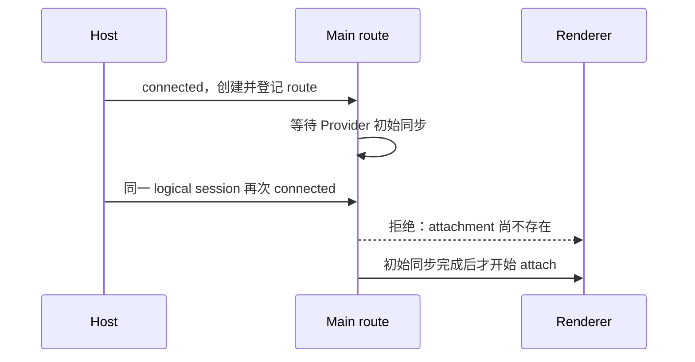

# 远程重复连接在 renderer attachment 创建前失败

Status: needs-triage

2026-10-17 转正回放记录。按用户要求只记录业务问题，本轮不修改业务实现。

## 现象与证据

新建远程项目并打开草稿时，Host 已连接，Main 却报 `远程 workspace route 尚无可用 renderer attachment`；页面停留在本地项目，远程用例尚未进入附件或故障注入步骤。

- `packages/desktop/.e2e-artifacts/r3-server-promotion-20261016-budget-attachments/`：01:19:27.196 Host connected，01:19:27.524 Main join 报错。
- `packages/desktop/.e2e-artifacts/r3-server-promotion-20261016-budget-connectivity/`：01:08:07.023 Host connected，01:08:07.267 出现同样错误。
- 两次堆栈均为 `handleConnected → waitForJoinedRouteReady → waitForRendererAttachmentReady`。失败证据包含窗口录像和桌面日志；时间为本地日志时间。

## 已定位的竞态

[desktopRemoteSessions](../../../packages/desktop/src/main/desktopRemoteSessions.ts) 先将新 route 放入 `routesBySessionId`，再等待 `registration.initialSync`，随后才创建 renderer attachment。此窗口内合法的重复 connect 会找到 route，却因 attachment 尚不存在被立即拒绝。已有注释明确允许 Source 自动恢复与显式连接 join 同一个 logical session。

回归应在 Provider 初始同步未完成时触发重复 join，验证两个调用等待同一 ready 屏障；不得重建健康 route，也不得用延时或重试掩盖错误。其他远程用例的超时不能仅凭相似现象归入本问题，须逐条核对日志。

## Comments

2026-10-17 补充复跑：逐条扫描失败 spec 的最新桌面日志，16 个 spec 命中同一条 attachment 缺失错误。新增证据包括 `r3-mobile`、`r3-mobile-permission`、`r3-shared-waiters`、`r3-server-update`、`ssh-remote-cold-reconnect`、`web-remote-project-directory`、`web-remote-unread`。完整 run/file/line 索引在 `packages/desktop/.e2e-artifacts/pending-promotion-20261016-02001f1247/remote-attachment-race-evidence.json`。`remote-accessibility` 已成功建立连接，它后续的项目弹窗键盘关闭失败不归入本问题。

2026-10-18 核对追加三次失败：`docker-current-r3-docker-transport`、`authority-current-ssh-remote-share-authority`、`remaining-current-r3-soak-dual` 的 desktop runtime 日志均命中同一 `waitForRendererAttachmentReady → waitForJoinedRouteReady → handleConnected` 堆栈，分别位于日志第 848、1309、1140 行。Docker 已改用用例内 Provider 回放，分享权限已在创建项目之前建立账号，仍在远程 attachment 创建前失败，尚未触达各自主要断言。不能将它们归因于模型无数据，也不能通过连接重试转绿。

## 2026-10-20 staging 52cd1bc1d3 续跑

`r3-server-pending-52cd-a-pending-sharedwait` 本轮成功连接 A/B，没有出现 attachment 缺失错误，随后失败在 `settings-back-button` 不存在。录像显示创建项目表单；测试意图是设置向导，但调用 helper 时没有指定 entry，走了默认项目入口。这项独立测试错误已改为显式设置入口，补跑 `r3-server-pending-52cd-b-pending-sharedwait` 1/1 通过，未跳过、重试或缺失 fixture。共享连接、取消隔离和成员关系断言均保留。

当前 Main 的重复 join 路径在没有匹配的 bind flight 时仍直接检查 renderer attachment，而新 route 要等初始同步完成后才开始 attach；本次自然回放没有命中旧竞态，不能据一次通过判定业务修复。该文件继续 pending，待针对初始同步窗口的回归证明完成后再准入。

同基线后续 `r3-server-pending-52cd-a-isolated-cancelretry` 再次命中本问题：
取消首个阻塞 socket、改用正确凭据及安装均已完成，16:45:21.457 与 .723 的
`remote-projects.connectHost` 成功；16:45:21.741 Main 报
`远程 workspace route 尚无可用 renderer attachment`，
堆栈仍为 `waitForRendererAttachmentReady → waitForJoinedRouteReady → handleConnected`。
16:45:21.767 session 被释放。失败录像显示远程项目行已连接，实际 Composer 却留在本地；
用例最终在远程 tab 身份屏障超时。原生日志第 1188 行为直接错误证据。
这次回放证实竞态在当前 staging 仍存在，不能因其他远程文件自然通过而关闭问题。
`conversation-session-ssh-remote-cancel-retry.test.ts` 已恢复 pending，未加延时或重试。

## 资源设置 Hook 变体再次复现

`r3-server-pending-52cd-a-isolated-resource-hook` 在连接第二台设备时失败，尚未进入 Hook 保存。
Desktop 日志第 2799 行记录 `17:16:23.175` 的 `waitForRendererAttachmentReady` 错误；
同一 session 在 `.233` 才报告 renderer attachment ready，相差 58ms；`.238` 即被释放。
这直接复现了先判断缺失、后收到就绪的顺序，不能用延时或重试证明修复。
同文件 skill/command 隔离变体通过；MCP 变体另见
[重叠导航问题](24-remote-project-entry-overlapping-navigation.md)，不能把不同现场混成 MCP/Hook 业务保存失败。
本轮不修改业务实现，整个资源设置文件继续保留 pending。

分享账号权威用例 `r3-server-pending-52cd-a-pending-share-authority` 同样在远程项目打开阶段受阻，
未执行发布请求。日志 `17:23:06.026` 已因 attachment 缺失报错，同一 session 的 ready 到 `.624`
才到达，`.631` 被释放。测试最终 Timeout，附带冷重启期间 4 帧录像采集失败；不能把这些
记录归为分享账号选择错误。业务连接失败与录像采集限制分别保留。
