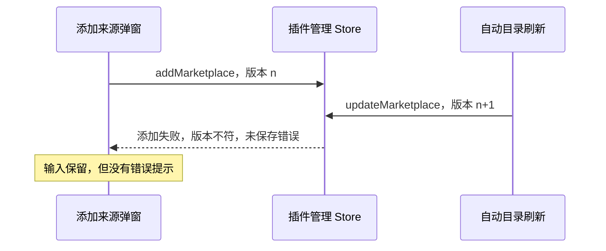

# 插件目录自动刷新丢弃添加来源的错误

Status: needs-triage

2026-10-17 转正回放发现。按用户要求只记录，不修改业务实现，不通过延时避开并发。

- 用例：`plugin-management-recoverable-failures.test.ts` 的 PLM-LC-008。
- 复现：进入插件市场后立即添加不存在的本地来源。后台返回 `Marketplace source path does not exist`，弹窗保留输入，但没有错误提示。
- 证据：`packages/desktop/.e2e-artifacts/pending-promotion-repair-finish-1-8-20261016-02001f1247/` 的失败录像和桌面日志。12:15:33.279 添加来源失败，耗时 1744.9 ms；12:15:33.632 自动更新完成，耗时 365.2 ms。由调用耗时可知自动更新在添加失败之前开始。
- 根因：`PluginStorePage` 取得官方目录后自动调用 `updateMarketplace`；它与 `addMarketplace` 共用 `runWorkspaceOperation` 的 `operationVersion`。后启动的后台刷新递增版本，添加来源的 catch 因 `ownsVisibleOperation()` 为 false 丢弃错误。`handleAddMarketplace` 从 store 读取不到错误，弹窗因此不展示提示。
- 规格：[插件市场交互](../../plugins/plugin-market-interactions-scope.md) 要求失败反馈可见，后台刷新不能覆盖当前视图操作错误。

验收：两个操作重叠时，添加来源的错误仍在对应弹窗显示；后台刷新完成不清除它。修改输入并重新成功提交后，错误按正常操作清除。

## 2026-10-20 续跑证据（staging 52cd1bc1d3）

`pending-resume-52cd-extra-a-921-pending-20261019` 再次出现来源错误不可见。Host 在 `00:27:19.797` 返回 addPluginMarketplace 失败（1100.2 ms），在 `00:27:20.844` 返回 updatePluginMarketplace 成功（1059.2 ms）。后台刷新约在添加失败前 12 ms 开始，重叠顺序与既有根因一致；弹窗错误控件始终未出现。
