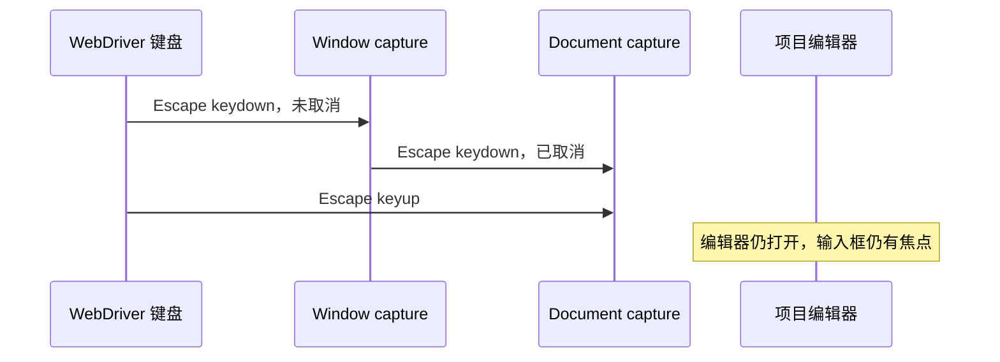

# 远程项目编辑器收到 Escape 后仍保持打开

Status: needs-triage

## 追加证据（2026-10-17）

`conversation-session-project-settings-return.test.ts` 在真实 SSH 连接成功后出现「切换设备？」
确认层，界面明确显示取消快捷键 `esc`。发送一次 Escape 并等待确认层消失仍失败；
现场同时保留 SSH 进度向导和设备切换确认层，项目编辑器尚未恢复。
证据：`r3-server-promotion-20261016-confirm-current-project-settings-return` 的 `failed-page.txt`、
`failed-project-settings-return.png` 和失败录像。此次已排除测试在异步取消完成前直接读取项目名：
失败点是确认层本身未关闭。与编辑器 Escape 是否同一根因仍待定位，不改成鼠标取消规避。

2026-10-17 转正回放发现。按用户要求只记录业务行为异常，保留失败断言，不改业务实现。

- 用例：`conversation-session-remote-accessibility.test.ts`。
- 复现：通过键盘建立 SSH 连接、选择目录并保存项目，打开项目的编辑菜单；切换中英文、深浅主题及 1400/900px 视口后，按一次 Escape。
- 实际：项目编辑器仍可见，输入框仍有焦点。键盘事件记录显示真实 `keydown/keyup` 均到达 window 和 document，键值为 `Escape`，Ctrl/Meta 均未按下；keydown 在 window capture 时未取消，到 document capture 时已被 `preventDefault`。因此不是测试没发送 Escape 或窗口失焦。
- 证据：`packages/desktop/.e2e-artifacts/r3-server-promotion-20261016-keyboard-events-remote-accessibility/project-editor-escape.json`，同批失败录像及布局截图；前一批 `r3-server-promotion-20261016-keyboard-remote-accessibility` 同样失败。
- 待定位边界：按键到达后，弹层关闭回调或事件拦截没有完成编辑器关闭；目前未确定具体拦截者，不能仅凭 `defaultPrevented` 归因于某个组件。
- 规格：[远程键盘与可访问性](../remote-connection-ux/14-visual-polish-and-accessibility.md)。不能改成点击取消来替代 Escape 验证。

验收：上述键盘流程中 Escape 关闭最上层项目编辑器，焦点按现有弹层契约返回入口；保留主题/语言/视口切换覆盖。真实远程已连通不等于后续键盘路径通过。

2026-10-20，staging `52cd1bc1d3` 的 `r3-server-pending-52cd-a-pending-accessibility`
再次在一次 Escape 后的关闭断言失败。`project-editor-escape.json` 显示操作前后窗口均有焦点，
名称输入框保持激活，没有残留菜单；window capture 收到未取消的 Escape，
document capture 收到的同一 keydown 已被取消。保留完整键盘传播记录和录像，
不把输入事件成功送达当成弹窗关闭成功。具体拦截者仍待定位。

同一基线的 `r3-server-pending-52cd-a-pending-projectreturn` 也停在设备切换确认的 Escape
关闭断言。`failed-page.txt` 明确保留“切换设备？”、“取消 esc”和“确认”控件，
底层 SSH 向导仍在；不是首次介绍页尚未确认。该场景仍单独保留证据，不推定与编辑器共用同一拦截者。
