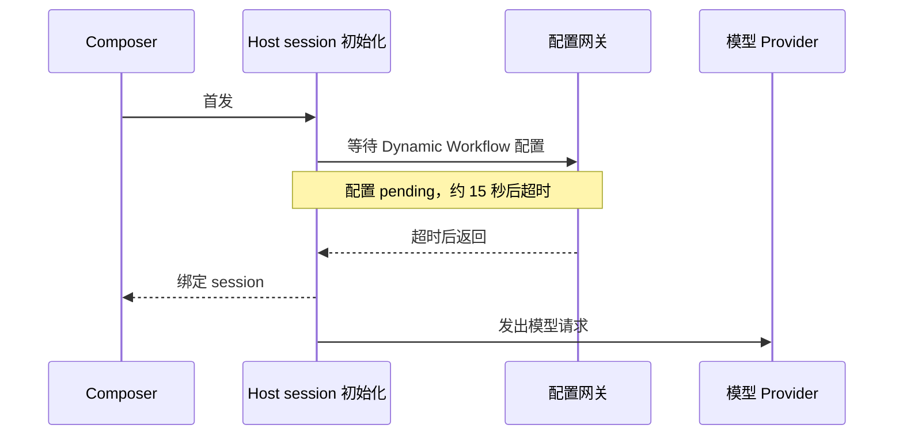

# 配置请求 pending 阻塞普通聊天首发

Status: needs-triage

2026-10-17 批量 E2E 转正期间记录。本轮只修 E2E，业务代码未修改。

- 回归：[SCB01/02](../../../packages/desktop/test/e2e/conversation-session/manual-review/pending/conversation-session-config-independent-startup.test.ts)。配置网关保持 pending，自定义 Provider 正常响应；普通首发应独立完成，不等待配置请求超时。
- 运行证据：`packages/desktop/.e2e-artifacts/pending-promotion-repair-closeout-final-1-3-20261016-02001f1247/`。Enter 到 session 绑定为 14,703 ms，到用户消息可见为 15,419 ms，到真实模型请求为 16,070 ms；配置响应数始终为 0。
- 同轮 Host 日志：`getDynamicWorkflowClientConfig` 15,030.8 ms 后返回；`readWorkspacePresentation` 15,152.4 ms；首个 `sendConversationCommandV4` 15,364.0 ms。不能通过提高 15 秒断言阈值掩盖这段依赖。
- 静态路径：[zcodeAgentService](../../../packages/services/src/zcode-agent/zcodeAgentService.ts) 的 session 初始化等待 `resolveDynamicWorkflowSessionFlags`，后者等待 `resolveDynamicWorkflowGate` 读取服务端配置。该路径与运行时等待一致；其是否应改变为非阻塞初始化需要业务方案确认。

验收：配置仍 pending 时，普通首发、续发、重启恢复后的发送均完成；配置工具可见性保持既有合同。原时间阈值和零配置响应断言保留。

## 2026-10-20 续跑证据（staging 52cd1bc1d3）

`pending-resume-52cd-extra-a-906-pending-20261019` 首发耗时 15,825 ms，超过原 15,000 ms 断言。Host 日志中 `getDynamicWorkflowClientConfig` 耗时 15,032.0 ms，`readWorkspacePresentation` 14,903.3 ms，`sendConversationCommandV4` 15,088.9 ms。配置响应仍未到达，与既有等待链一致，未增大超时阈值。
