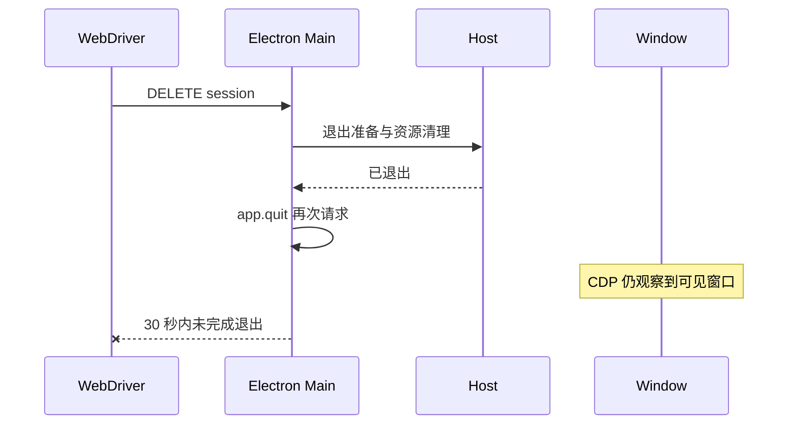

# 项目列表回放结束后 Electron 窗口未关闭

Status: needs-triage

2026-10-17 运行时诊断记录。尚未判定是 Electron 自动化清理问题还是应用退出问题，不修改业务逻辑，也不将强杀清理计为通过。

- 用例：`conversation-session-project-behavior.test.ts`，包含保留 profile 的完整 Electron 重启和项目拖拽。
- 实际：退出日志依次出现 `forceQuit enabled`、`host process cleanup completed`、`preparation finished, resuming quit with windows=1`，随后 WebDriver DELETE session 在 30 秒超时。
- 同时通过 Main/renderer CDP 读取：窗口仍可见、未销毁、未加载；renderer 已 complete，显示项目列表，没有确认弹窗。Main 没有 `will-prevent-unload` 监听；仍有正常的 macOS close 处理器与应用 before-quit 处理器。
- 证据：`pending-promotion-repair-order-current-1-3-20261016-02001f1247` 的原始运行日志；`pending-promotion-20261016-02001f1247/project-behavior-quit-70253.json` 保存现场读数。
- 本轮另有两条删除用例因刷新回到 API key 登录页失败；它们与退出超时分开修复和计证据。其余 11 条断言通过不能代替整个 spec 成功退出。

后续应对比有无完整重启、拖拽以及 native close/ChromeDriver close 的退出事件顺序，确认是哪一层阻断关闭。不得靠增加退出超时或提前强杀掩盖问题。

## 追加证据

`pending-promotion-repair-view-current-1-1-20261016-02001f1247` 已修正刷新登录与时间线等待条件，
13 条测试断言全部通过；仍在最后的 DELETE session 清理超时，runner 未生成 summary，退出码 1。
因此该 spec 仍记失败，不能把 13 条断言通过计成完整转正验收。业务退出代码未修改。

## 2026-10-20 续跑证据（staging 52cd1bc1d3）

`pending-resume-52cd-extra-a-914-pending-20261019` 的 13 条断言全部通过，最终 DELETE session 仍超时，runner 退出码 1 且没有 summary。中途两次完整重启（00:25:15、00:25:22）均完成关闭；最终退出从 `00:26:04.771` 开始，Host 在 `05.310` 清理后恢复 quit（windows=1），没有后续 all-windows-closed，`34.786` DELETE 超时。保留 pending；尚未确认业务退出还是驱动清理根因。
