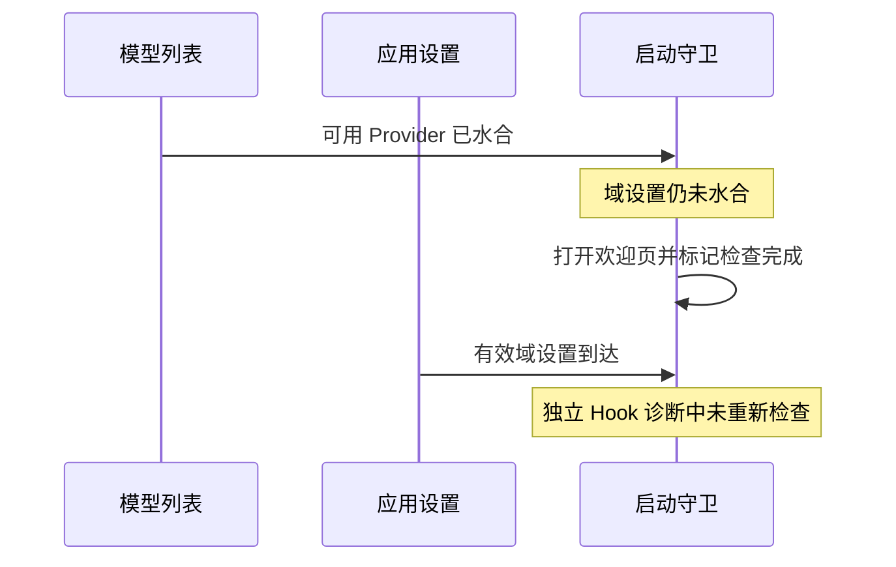

# 冷恢复欢迎页与设置水合顺序

Status: needs-triage

2026-10-19。仅记录诊断，不修改业务实现。已经复现 Hook 的顺序缺口；尚未证明正式 E2E 的失败由该缺口触发。

- 正式用例：`conversation-session-thought-level-cold-resume.test.ts`（I63）。隔离回放通过，默认回放 `pending-promotion-formal-default-32-20261019` 在准备阶段的 renderer reload 后停在 API Key 欢迎页，未执行首个被测模型请求。
- 运行时：完整 Electron 重启后曾进入工作区；恢复模型偏好的 helper 随后执行 renderer reload，第二次启动停在欢迎页。Provider 数量与隔离成功轮相同，数量本身不能证明域设置与模型可用性。
- 独立诊断：给 `useProviderAvailabilityLoginEntryGuard` 先输入可用的模型列表、尚未加载的 `providerFamilyDomain`，再将域更新为有效值。首次检查打开欢迎页；后续域水合后没有关闭。期望最后一次调用 `setLoginEntryOpen(false)` 的断言失败，实际仍为 `true`。
- 静态关联：`Root.tsx` 先设置 `providerFamilyDomainMigrationComplete`，然后才等待 `refreshAppSettings()`；守卫只完成一次启动检查。需要证明失败轮中这两个事实的实际到达顺序，不能由 Hook 诊断直接认定 Electron 根因。
- 证据目录：`packages/desktop/.e2e-artifacts/pending-promotion-20261016-02001f1247/`，包含 `login-guard-hydration-diagnostic.test.ts`、对应日志及诊断范围说明。诊断测试保存在 artifact，未加入业务测试套件。

I63 已追加失败时的脱敏配置读数：域、Provider 开关、API Key 是否存在、模型禁用原因。补跑用于判断配置丢失还是启动判断顺序；单次补跑通过不等于旧失败已经解释或修复。

补充：失败轮重启前的所有设置写入均保留 `providerFamilyDomain=zai` 和 `providerFamilyDomainMigrated=true`；之后至失败只有读取日志，没有新的设置写入。隔离成功轮也使用同一域。脱敏提取见同目录 `login-guard-persisted-domain-evidence.json`。这支持继续检查 renderer 水合顺序，但仍不能证明守卫第一次调用时看到的值。

第二个独立现场：`conversation-session-purpose-section-drag.test.ts` 的正式隔离回放
`pending-promotion-formal-isolated-83-20261019`。初次进入工作区、准备阶段刷新、拖拽排序和折叠断言均成功；
首个用例为验证持久化再次刷新后，录像显示 API Key 欢迎页，随后三个用例也因不在工作区失败。
刷新前最后三次 settings 写入均保留 `providerFamilyDomain=zai`、`providerFamilyDomainMigrated=true`，
之后没有设置写入。该用例不发送模型请求，因此缺失模型响应不能解释这个现场。
两个用例都追加失败时的脱敏配置读数；仍需确认 renderer 首次守卫调用时的水合顺序，不能用补跑通过关闭问题。

第三个独立现场：PV4-25U `conversation-session-command-unknown-recovery.test.ts`。
隔离轮通过，默认轮 `pending-promotion-formal-default-190-20261019` 在 renderer reload 后停在欢迎页，
失败录像末帧可见账号连接与 API Key 入口；pane 的 sessionId 为 null。已补失败时的脱敏配置读数。
该测试原本还以整个 timeline 匹配提示中的回答 marker，现改为等待 assistant 正文再刷新；
这是前置屏障修正，不能据此认定欢迎页问题已经修复。

第四个独立现场：AUTH-08 `web-remote-control-auth-gate.test.ts` 的隔离轮
`pending-promotion-formal-isolated-236-20261019`。中文深浅主题和英文浅色均完成认证门禁断言并留有截图；
切换英文深色后刷新，失败录像显示欢迎页，无法进入工作区，尚未验证该组合的远控门禁。
该轮没有模型请求，不能归因于模型响应缺失；继续记录为启动恢复异常，不以重复刷新或后续补跑通过关闭。

## staging 52cd1bc1d3 续跑

I63、CWP02、PV4-25U、AUTH-08 本轮共 8 项通过，未再次出现欢迎页。
回放 ID 分别为 `pending-resume-52cd-b-32-pending-20261019`、
`pending-resume-52cd-b-83-pending-20261019`、`pending-resume-52cd-b-190-pending-20261019`、
`pending-resume-52cd-b-236-pending-20261019`。后三份通过只读 CDP logpoint 保存实际守卫输入，
观测到的检查均为域已水合、Provider 可用、`shouldOpenLoginEntry=false`；I63 的冷启动未命中刷新 logpoint。
旧失败仍未解释，相关文件继续 pending。诊断配置第一次因 TypeScript 加载入口错误而未启动用例；
该尝试属于诊断基础设施失败，不算产品复现或通过证据。

## 2026-10-20 续跑证据（staging 52cd1bc1d3）

目录选择 NDP01/NDP02/PRO01 的 `pending-resume-52cd-g-265-isolated-20261019` 也在刷新后停留欢迎页。独立诊断 `extra-b-265` 的守卫输入正常，页面已恢复新建项目的主要目录；该轮另因 E2E 还等待旧默认目录误报，已改为等待实际主要目录。`t-265` 随后的失败发生在确认信任之前（弹窗仍在），未到刷新步骤；不能以此关闭或复现欢迎页问题。

目录选择的单独布局缺陷已修正：`u-265` 只读采样看到还原窗口后按钮从 x=1037 移到 x≈727，点击时仍存在 max-width/max-height 过渡；`v-265` 的“点击前过渡已结束”回归断言失败。等待实际视口与弹窗过渡完成后，`w-265` 全路径 1/1 通过。该测试修正没有修改登录守卫，文件继续 pending，旧欢迎页现场仍待解释。
