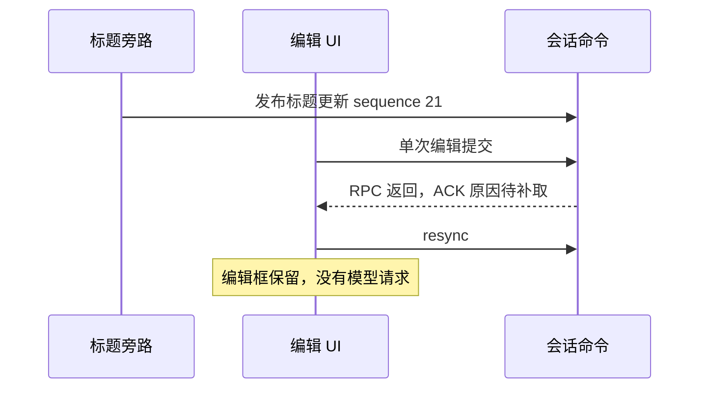

# 标题更新附近编辑提交没有发起重跑

Status: needs-triage

2026-10-19。仅记录运行时现场，尚未确认拒绝原因，不修改业务代码。

- 用例：`conversation-session-fork.test.ts` 第三条“edit 重跑后的 assistant fork 应只复制编辑后的 active branch”。
- 正式隔离回放通过；默认回放 `pending-promotion-formal-default-160-20261019` 中，首发与前两条 Fork 均通过，第三条编辑后没有模型请求。
- `08:21:13.016`：Lexical 读回编辑后的完整正文；`.081`：测试点击提交；`.091`：点击返回成功。
- `.098`：`sendConversationCommandV4` RPC 返回；`.101`：应用调用 `resyncConversationV4`。录像中编辑框始终保留新文本，没有错误提示或重跑。
- 同一会话标题在 `.066` 发布 `session_title_updated`，sequence 为 21。这与提交时间接近，但还不能证明发生 revision 冲突。
- 现有日志只记录 RPC 成功，不包含命令 ACK；UI 日志在当前构建下不可用于确认原因。
- E2E 已在单次编辑提交后读取现有 ACK bridge，拒绝时输出结构化 status/reasonCode；不自动重发，也不等待标题完成来绕过竞态。补跑偶然通过不能关闭此记录。

失败录像与日志位于 `packages/desktop/.e2e-artifacts/pending-promotion-formal-default-160-20261019/`。

第二个独立现场：`conversation-session-edit.test.ts` 的
`pending-promotion-formal-isolated-167-20261019`。第一条首次编辑后没有重跑请求；
标题更新于 `08:27:31.504` 发布，sequence 为 22，随后 `.527` 调用 resync。
同文件第二条“中断后编辑重发”通过。第一条同样增加单次提交 ACK 断言，
不修改点击次数或模型响应来规避失败。

## staging 52cd1bc1d3 续跑

`pending-resume-52cd-167-pending-20261019` 的两条编辑回归通过，
`pending-resume-52cd-b-160-pending-20261019` 的三条 Fork 回归通过；旧编辑拒绝尚未再次捕获，不能据此关闭本票。

本轮 Fork 曾另在冷恢复后的输入阶段失败，尚未执行编辑命令，需与本票分开。
只读诊断 `composer-input-admission.json` 记录：`13:34:14.066` 和 `.166`，
编辑器 `contenteditable=false`、模型选择尚为空，测试 helper 已通过 Lexical bridge 写入提示。
该 helper 缺少可编辑状态准入，独立回归也证明持续禁用时会覆盖旧草稿。
修正仅限 E2E helper，等待真实输入开放后写入；不重发命令、不改业务实现，
也不能用这处修正解释此前的编辑 ACK 异常。

修正后 `pending-resume-52cd-c-160-pending-20261019` 的 3 条 Fork 回归通过，
原生诊断确认禁用期间输入始终为空，开放编辑后才出现本次提示。相关 helper 单测 12/12 通过，
无新增固定延时或发送重试；本票原有编辑拒绝仍待确认。
