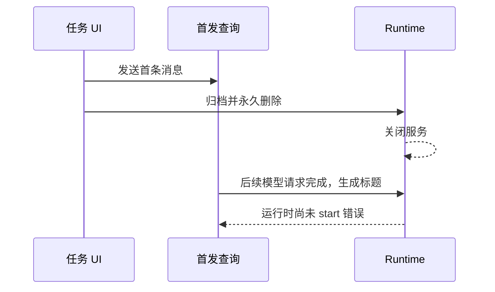

# 归档并删除首发任务后，已关闭运行时仍继续查询

Status: needs-triage

2026-10-19。正式回放发现以下时序，尚未修改业务代码。

- 现场：`pending-promotion-formal-isolated-176-20261019`、`pending-promotion-formal-default-176-20261019`，用例为 `conversation-session-deleted-task-restart.test.ts`。
- 原 E2E 将用户提示中的回答 marker 误认为 assistant 已完成，提前归档和永久删除；这是测试屏障错误，已改为观察 assistant 正文。
- 该误操作也暴露了运行时异常。隔离轮中，`turn.started` 在 `08:35:47.120`，`dynamic_workflow.service.closed` 在 `.260`；之后 `08:35:48.036` 仍出现 `model.request.started`，`.141` 完成并尝试生成标题，报 `ApiProviderModelRuntime 必须先 start() 再创建 Model`。
- 默认轮同样出现此错误，时间为 `08:36:17.113`。两次均早于应用重启或 after 清理，不能归为测试结束的日志噪声。
- 待核对：关闭会话是否遗漏了尚在首发准备阶段的查询取消，以及异步标题是否与 runtime 关闭共享生命周期。现有证据不足以断言具体漏点。
- TSL20 只验证已完成任务删除后的冷启动隔离，修正其前置屏障不代表此竞态已修复；运行中删除应另有业务回归。

日志位于上述 run ID 的 `runtime-logs/0-0/agent/`；修正后的 E2E 仍须双轮正式回放。
