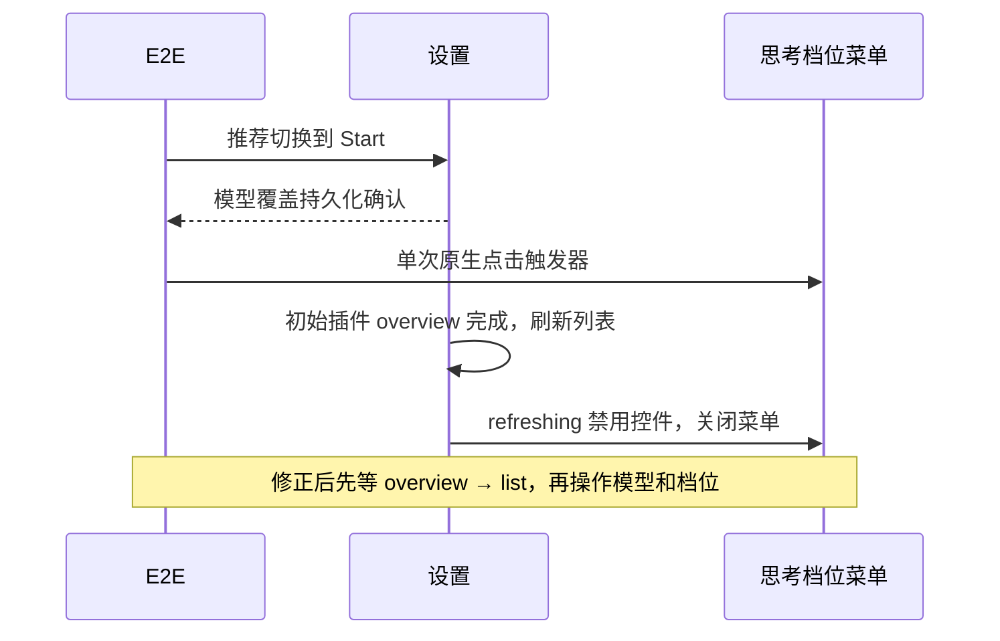

# Start Plan 回放中思考档位菜单未打开

Status: done

2026-10-19，业务基线 `52cd1bc1d3`。确认为测试缺少设置初始化屏障，未修改业务实现。修复后的 `pending-resume-52cd-p-56-isolated-20261019` 与 `pending-resume-52cd-p-56-default-20261019` 均 1/1 通过，无重试、跳过、缺失 fixture 或标题协议错误，文件已转正。

- 用例：`conversation-session-start-plan-independent.test.ts`，Subagent 推荐切换到 Start 后选择 `high`。
- 默认回放 `pending-resume-52cd-m-56-default-20261019`：设置持久化已确认 Start；原生点击思考档位触发器后，10 秒内未出现 `chat-thought-level-select-item-high`。录像显示触发器位于设置列表底部，菜单未打开。
- 严格回放 `pending-resume-52cd-m-56-isolated-20261019` 通过整条用例。
- 只读诊断 `pending-resume-52cd-extra-c-56-pending-20261019` 通过。记录显示 `pointerdown` 命中触发器，`pointerup` 命中 HTML，随后菜单选项仍成功出现；因此仅凭鼠标抬起位置不能证明失败原因。该轮推荐弹窗已关闭，也不能据此认定原失败由关闭动画触发。
- 初始诊断不足以归因；后续结合失败轮 Host 日志和控件禁用实现，确认下述初始化竞态。未改为重复点击。

这与同文件的响应式截图问题分开处理：后者已通过只读坐标和失败断言证明，恢复视口后仍有 `max-width` CSS 过渡，测试提前点击会落空。该测试修正等待真实动画结束；本票发生在更早的 Subagent 设置阶段。两处测试修正均保留在已转正文件中。

## Comments

2026-10-19 补齐同轮时序：默认失败轮的原生点击为 `15:40:22.532–22.616Z`；同一 Host 的 `plugin-management.getPluginsOverview` 在 `.601Z` 完成，触发 `subagents.list`，直到 `.627Z` 才返回。首次查找 high 选项为 `.623Z`，正处于刷新窗口。`SubagentsSection` 的初始化回调调用 `loadAgents(false)`，其 `refreshing` 禁用行内控件；`SubagentReasoningField` 在 `interactive=false` 时关闭菜单。诊断通过轮在 `15:45:05.516Z` 已点击控件，overview 到 `.586Z` 才返回，解释了该轮能先完成菜单操作。

测试准备遗漏了已有的设置初始化屏障。复用 `subagentSettingsReadyCursor`，进入设置前记游标，等本次同一 Host 的 overview→list 完成再操作模型推荐；保留单次原生点击及原档位断言。不修改刷新或禁用逻辑。严格和默认回放均通过；仅关闭测试准备问题，不据此宣称初始化期间所有用户交互已验证。
