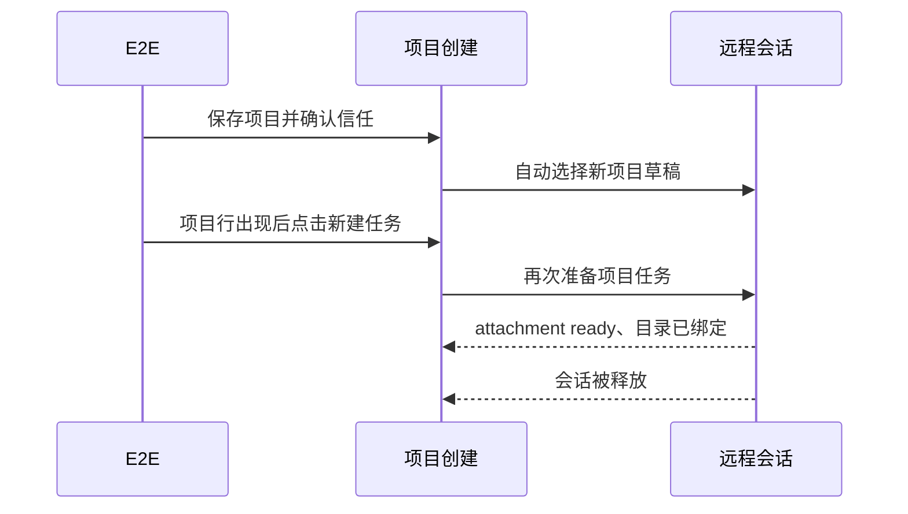

# 远程项目创建后立即新建任务，连接完成却返回本地草稿

Status: needs-triage

## 复现证据

基线 `52cd1bc1d3`，用例 `conversation-session-r3-project-entry.test.ts`：
隔离回放 `r3-server-pending-52cd-a-isolated-projectentry` 通过；
默认回放 `r3-server-pending-52cd-a-default-projectentry` 在等待目标远程 tab 时超时，未转正。

默认回放的 `runtime-logs/0-0/desktop/2026-10-20.log` 显示：

- 15:39:37.457 项目保存成功；37.504 第一次 `project.prepareSession` 完成。
- 37.735 renderer attachment ready；37.768 绑定 `/home/dev/r3-workspace-a`。
- 37.805 第二次 `project.prepareSession` 完成。
- 37.818 detach attachment；37.819 `remote-session-disposed`。
- WebDriver 随后一直读到本地 active path、远端 tab/session 为空。

录像末帧 `failures/0-0/5fd30b6a94606146/attempt-0/frames/captured-000477.png`
显示远程项目已在侧栏、状态为已连接，正文却仍为本地草稿。
本轮没有出现 Issue 04 的“尚无可用 renderer attachment”，不能归入同一原因。

## 待确认边界

当前 `ProjectCreation.saved` 会为仍有效的空草稿调用 `onCreateTask`。
E2E 的 `selectSSHRemoteDirectory` 在发现新项目行后又点击该行的新建任务按钮；
运行日志中的两次 prepare 与这两个入口相符。

测试的第二个点击对于“保存后自动选中”的正常路径是多余操作；
但它也是可由用户执行的有效操作，不能靠删掉它就宣布会话释放问题已修复。
目前尚未捕获释放调用方与导航代次的运行时关联，不能断言具体取消分支是根因。
应先补该关联证据，再分别验证单次自动选择与重叠新建意图。
保留当前失败与原断言，不加延时或重试，业务实现本轮不改。

## 现有函数的并发边界验证

使用原版 [attachRemoteProjectWorkspace](../../../packages/ui/src/project-sidebar/remote-navigation.ts)
注入 Host join/cancel 端口，通过 Promise 屏障构造两个调用共享同一 session、尚未登记 workspace identity 的窗口：

1. 两次 `findSession(identity)` 都为空，两个 connect 都返回 `shared-session`。
2. 第二次导航仍有效，第一次导航已失效。
3. 放行第一次 bind，它因旧导航失效而失败。
4. 真实函数的 catch 根据调用开始时的 `!existing` 执行 cancel，释放共享 session。
5. 第二次 bind 因该释放而失败。

结果记录在本轮证据目录的 `projectentry-ownership-probe.json`，对应探针源码为
`projectentry-ownership-probe.mjs`。此探针没有等待时间、重试或业务源码替换。
它确认了业务函数存在所有权判断缺陷：**connect 返回 session，不代表本次调用独占创建了它**。
现有单测只覆盖调用前已登记的共享 session，未覆盖 connect 在途复用。

这是受控端口的函数验证，不冒充第二轮真实 Electron 复现。
原 E2E 的释放调用栈仍未采集，因此原失败与该缺陷的具体关联保留待确认。
修复应明确共享连接的取得/释放责任，旧导航不得取消新导航正在使用的 session；
需要用户另行授权业务修改，不能靠测试串行化或重复点击解决。

## 资源设置回放中的同类现象

`r3-server-pending-52cd-a-isolated-resource-mcp` 在第一台远程设备的项目打开阶段失败，
尚未进入 MCP 设置。`waitForRemoteTab` 连续读到本地草稿、空远程 identity/session。
同文件 skill 变体此前通过，不能据此认为 MCP 的保存或隔离逻辑有问题。

Desktop 日志显示 `17:12:26.508` 和 `.792` 两次 `remote-projects.connectHost` 成功，
对应两次连接请求；`.835` renderer attachment 就绪，`.842` logical session 已释放，
connections/logicalSessions 均变为 0。该现象与本票的重叠导航相似，没有出现
Issue 04 的“尚无可用 renderer attachment”。仍未取得释放调用方堆栈，暂按同类导航问题分诊，
不将相似时序当作唯一根因证明，也不通过重试把文件转正。
