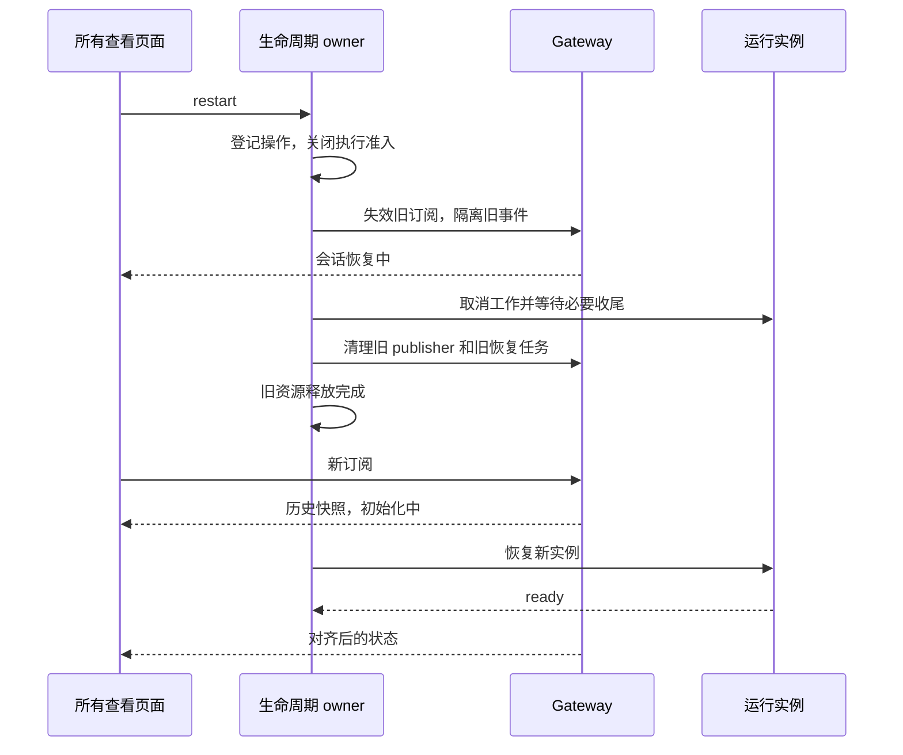
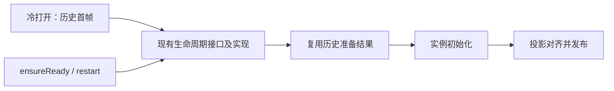

# 单任务重启与生命周期恢复

## 目标与边界

任务标题菜单的“重启任务”和 App 本地命令 `/reload` 调用同一个 session lifecycle restart。释放当前运行实例、旧 publisher 与订阅后，复用历史优先恢复。保留 session 身份、持久历史、会话配置与前端草稿，不重建 workspace Agent，不自动重做上一条指令。

CLI 生命周期 owner 管理运行实例与在途操作；Gateway 管理 publisher、投影及订阅；Host 负责作用域路由；UI 只保存展示和未提交草稿。多个查看者共享同一运行实例。独立工作区、其他 session、只读子代理会话不因本操作被隐式启动或重启。

## 接口与状态

公开接口继续为 getState / ensureReady / stop / restart。状态为 unloaded / starting / ready / stopping / faulted；错误保存在 lastError。ready 表示实例能执行，不表示空闲或页面快照已应用。stop 释放实例，与停止生成接口分开。生命周期查询不启动实例，传输断开不解释为 unloaded。

每个 session 只有一个生命周期操作 owner，restart 占有整个关闭到恢复区间；重复 restart 合并，ensureReady 加入当前启动/重启。初始化中提出重启时，等待旧初始化结束并安全收尾，禁止并行创建第二个实例。faulted 是无法确认释放后的隔离状态；不盲目重复已失败的 close Promise，不自动升级为 workspace 重启。

生命周期通知独立于 publisher，经现有控制连接传递完整状态。实例代次与状态版本隔离迟到状态；Host 结合 workspace/进程身份路由。publisher logEpoch、subscriptionId 与帧 seq 继续承担发布链路身份，不混用生命周期版本。

## 重启时序



历史准备不得等待整个 restart；实例激活不得递归进入自己拥有的 ensureReady。复用单次历史读取，历史修复才重读。已登记订阅的历史首帧先进入 transport outbox，再执行实例初始化；无订阅者也继续完成重启，不等待客户端 ACK。CLI 仍需启动才能读取历史。

Gateway 直接使用现有生命周期实现，不增加中间服务。历史准备与实例激活分开：Gateway 只返回可复用的历史数据；生命周期 owner 直接执行激活，不等待 Gateway 的激活回调。普通冷打开在读取启动所需的持久信息之前登记初始化，后来的 ensureReady 共享同一操作结果。重启等待已有初始化时即保留重启资格，其他 stop 不能在旧启动完成与重启开始之间插入。投影收尾可以观察启动结果，但生命周期不能反向等待这个观察者。



旧回调、旧初始化结果、旧订阅 ACK、分片、分页结果及工具回复必须被代次或原对象身份拒绝。清理不能删除新对象。停止后的最终持久化与资源收尾在新实例创建前结束；投影等待者不能阻塞释放。

## 执行与输入语义

- 主动重启不沿用自动回收的“无人查看、无工作”准入限制；自动回收仍保留原保护条件。
- 当前执行中断；active goal 暂停；授权/问答等待结束；实例所属后台任务和工作流通过 owner 关闭。
- 已发生的工具外部副作用不回滚；不重放执行。
- 沿用现有冷恢复输入合同：未消费 admitted/queued/guide 输入明确结算为 discarded，不跨重启自动重放。不得直接丢弃 in-flight/pinned CommandInbox 事实。
- 已持久化历史保留；启动/关闭过程的真实业务结算可更新活动事实，不能伪造 task 创建时间或 session.removed。
- 模型、mode、permissions、workspace 身份与 additionalDirectories 沿正常恢复来源，不由某个客户端抢先订阅决定。

## 发布与前端

旧 publisher 销毁后新建，获得新 logEpoch；新订阅使用新 subscriptionId 和 full snapshot。旧快照只作临时可读内容，不再用于执行。当前有效快照、实例 ready 和业务门禁同时满足才开放执行。

Host/transport 按 workspace + session 隔离旧 ownership、pending ACK、分片及恢复请求，其他会话不变。断线重连核对当前 lifecycle，不能仅依赖一次广播。桌面 continuous 与手机 replayable 保留原交付语义。

UI 保留草稿、允许阅读已加载历史和切换任务；暂时禁止执行、上传与旧交互响应。第一版按正常打开重新展示历史，不承诺保留已加载分页及精确滚动位置。初始化失败和快照失败分别提供正确重试；快照失败不重复重启已正常运行的实例。

任务菜单使用现有共享组件、主题和 i18n。/reload 属于 AppSlashCommand，与 Plan 一样由应用直接执行，不发给模型、不入队、不生成消息。三个入口共用重启动作，输入处理分别约定：

- 标题菜单直接重启，不插入或回显命令，不改草稿。
- slash 面板选择重启即执行，只消费本次搜索 token，保留其余正文、附件及附加上下文。它们不是命令参数，也不限制该操作是否可见。失败通过状态/提示反馈，不回填 prompt。沿用现有 AppSlashCommand 选择语义，不因无法清理搜索 token 而新增执行限制。
- 点击发送提交纯文本 /reload 时，在消息发送门禁前截获；只接受无参数、无附件或附加上下文的独立命令。不符合时保留输入且不重启。成功后仅清理仍属于本次提交的命令，不覆盖后续编辑。

新任务草稿无 session 不创建会话。重复点击共享后端操作。面板允许与草稿共存是明确的产品合同，替代原先将整条输入校验同时套到菜单选择上的规定。

## 失败与恢复

启动失败且清理成功：unloaded + 错误，可重试。清理失败/超时且无法确认资源释放：faulted。请求超时不等于后端失败或取消，查询后再决定；不自动重发 restart。实例正常但快照恢复失败只恢复发布链路。faulted 的最终人工出口是 Agent 进程重建；[共享 CLI](shared-task-cli.md) 下会中断该进程的全部任务，包括其他工作区，确认文案必须明确作用范围。单任务 restart 仍不重建进程。

运行态字段不落数据库，无需 schema migration。旧协议 capability 未支持时明确报不支持，不回落为 workspace 重启。

## 验收范围

CLI 单测/协议集成：重启互斥、启动中重启、工作/队列结算、失败隔离、历史先到、无观察者完成、迟到事件与完整新快照、不同 session 隔离。
App E2E：标题菜单与 /reload、运行中重启、草稿保留、换代后继续发送、其他任务保持可用；手机 shared-host 同步、失败与重新连接、深浅主题。
Review 回归：阻塞真实 store 的启动读取，分别插入 restart / ensureReady 后放行，检查操作结束且无并行实例；覆盖先有历史 opening 再显式启动、旧启动结束时的 stop 竞争，以及实例未 ready 时已返回历史快照。桌面面板覆盖鼠标/键盘选择与正文、附件共存；手机面板覆盖触屏选择与正文保留；标题入口与纯文本提交继续分别验证。Plan 原有交互不变。
使用稳定信号和可控制的测试 barrier，不以 sleep 保证时序。

## 所属工作整体关闭（2026-10-28）

stop/restart 关闭本 session 拥有的前台/后台 subagent、其所属后代、后台 Bash、两种 workflow 及辅助异步工作。
后台执行可以脱离当前 turn，但不能脱离 session。独立 fork 与其他任务不受影响，不按历史 parentSessionId 遍历关闭。

关闭先阻止新启动与自动唤醒，取消所属工作，等执行和清理完成，再释放共享执行器、MCP、存储。
任务终态或 workflow 结算不能代表清理完成。关闭失败沿既有 faulted 合同阻止新实例。
重启继续使用既有 history-first 加载，保留历史和文件，不重放被停止的任务；不新增状态或数据迁移。

owner、并发准入与真实清理等待合同见 [CLI 生命周期 spec](../apps/zcode-cli/docs/design/v2/session-runtime-lifecycle.md#所属工作整体关闭2026-10-28)。
场景与验证证据见 [实施计划](plans/session-task-restart-implementation.md#所属工作整体关闭实施2026-10-28) 和 SLR06–08。

## 浏览器释放与展示修正（2026-10-29）

先进入 stopping 阻止新工作，再释放旧实例控制资源；主会话标签页默认保留，独立子会话临时标签页
沿用 closeTabs 策略。Browser broker 是连接记录的唯一 owner：正常 execute 校验 ready/归属后，
将 workspace 路由、实际 tab owner 和 browser id/generation 随连接保存。turnEnded、cancelRequest、
closeSession 使用已校验的旧路由，不再查询已摘除的活动 runtime；新业务继续 requireSession。
关闭等待所有目标结果；拒绝或 ok:false 必须传播，成功项按记录对象身份移除，失败项及子会话绑定保留。
旧关闭回调不得删除新记录；不增加公开代次、持久 schema 或第二套 session 状态。

```text
正常浏览器请求 → 校验并记录资源归属 → stopping/摘除活动实例
                                    → 按旧记录释放控制资源 → unloaded
```

App slash 菜单统一展示 /命令名，/reload 使用英文说明
“Reload the task runtime, preserving history and stopping current execution.”；任务菜单仍本地化。
/plan 同样保留命令名，执行语义及原有说明语言不变。输入框上方不再显示 starting/stopping 状态文案，
也不新增替代横幅；运行未就绪时的执行限制、失败与恢复入口、任务菜单 pending 提示继续保留。

回归包括停用后浏览器与独立子会话释放、取消在途请求、多目标部分失败及重试、旧记录隔离；
桌面/手机 slash 展示与重启无阶段横幅，以及真实浏览器标签页跨实例保留和继续使用。

## Browser control scope（释放确认重构）

浏览器资源的唯一 owner 是 Main 的 BrowserGuestManager，Host 只转发，不根据断线或普通命令错误推断资源释放。Main 为窗口创建稳定 backend identity，Host 重建沿用该 identity。窗口销毁后旧代次退休；新 owner 不恢复旧 Agent 控制权。

CLI 首次使用某条完整路由时创建 controlScopeId，先发送 openScope，确认成功后才发送业务 execute。同一作用域的并发建立共享结果。明确的 scope admission rejected 表示未登记、未执行任何业务操作，可以移除这次记录；建立结果未知保留记录供 releaseScope 确认，禁止从 backend_unavailable 或 sideEffect 推断资源事实。普通浏览器命令结果不改变作用域归属。

```text
runtime → broker（释放责任）→ Host（转发）→ Main（资源事实）
openScope → 确认 → execute* → stopping → releaseScope → 确认 → unloaded
                               旧请求迟到 → closed scope 拒绝
```

作用域绑定 window/workspace/remote/session/clientMode/backend identity；同一 session 的不同路由分别登记，禁止覆盖。停止时沿已校验路由释放，不查询已经退出活动表的 session。释放先关闭准入，再中断并等待已准入命令，最后释放控制资源。主任务保留用户可见 tab，独立 child 关闭自己的临时 tab；共用父 tab 的 child 由父作用域释放。releaseScope 的 released/absent 只由资源 owner 确认，重复释放成功，未知传输结果保留责任。

释放记录中的作用域 ID 与 runtime 实例绑定，旧释放不能影响重启后的新实例。Main 保留最小 closed 标记到窗口 owner 退出；不以 TTL 遗忘关闭事实。窗口退出清理资源后删除该窗口作用域，旧身份不得复用。主任务可见 tab 恢复不恢复控制作用域；新实例必须重新认领。

父子清理仍由现有 runtime/subagent/workflow owner 编排；不新增 broker 子树清理器。共享正在进行的 close，成功的资源不重做，失败的关闭 flight 允许最终 owner 重试。无法确认释放仍沿现有 faulted 合同，不能静默升级为成功。

协议使用现有 interaction/browserExecute 通道，新增严格校验的 openScope/releaseScope 命令及 controlScopeId。旧客户端保持原命令路径；新 CLI 仅在后端 descriptor 宣告 controlScopes 能力时启用。未声明能力的后端保留保守的旧清理合同，不假报释放。无会话历史或数据库 migration。

回归必须覆盖：建立被明确拒绝、建立响应丢失、释放响应丢失、关闭前已在途与关闭后迟到命令、同 session 不同实例/路由隔离、Host 重建沿用资源身份、child owner 重试、桌面/手机真实 reload。

### Review 回归：会话只读视图与建立重试

Host 在发送前收集 browser ambient 时没有实例 controlScopeId；其只读 list 应按相同
window/workspace/remote/session/clientMode/backend identity 汇总受控页面。带 controlScopeId
的 list、执行、取消和释放仍只作用于对应实例；不能通过放宽通用 sameScope 来恢复只读视图。
list 返回的 meta.openTabIds 必须与其 tabs 一致。Renderer 继续按 tab/session 接收展示事件。

openScope 结果未知时保留原 ID 和释放责任，但失败的 opening flight 不能成为永久结果。
下一次业务请求用同一 ID 幂等重试，并发请求共享本次 flight；成功后复用确认结果。
close 标记必须先于任何重试准入检查：开始关闭后不得重发 open，已有 opening 完成后只释放，
迟到结果不得触发业务执行或删除后续实例记录。不开自动重试循环，不改变错误/超时预算。
