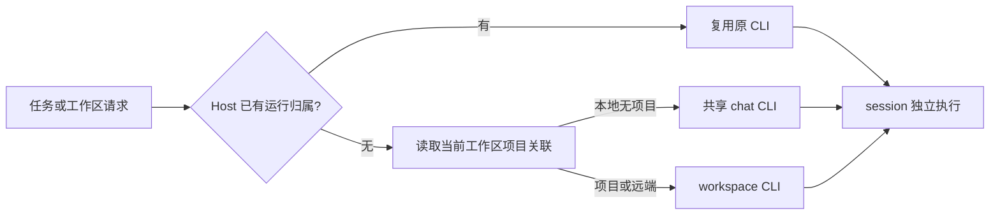

# 无项目工作区共享 CLI

## 目标与分配规则

本期将本地无项目执行工作区放入同一个 chat CLI。项目工作区继续按 workspace 分配；远端、插件管理和 MCP 状态探测保持独立。长期可将同一选择入口扩展到全部 session。CLI 进程共享不改变任务 cwd、配置发现、项目归属、两库持久化或输入队列。

Host 是进程选择与运行归属的唯一 owner。逻辑地址仍是 `workspaceIdentity?.trim() || workspacePath`，不能把进程池 key 写入业务身份、cwd 或数据库。一个 workspace 的所有 session 复用同一运行归属；首次分配时，没有未删除项目 roots/项目任务关联的本地 workspace 进入共享池，其余保留独立进程。同目录已有归属优先，不能因新建任务或组织态变化同时启用第二个 CLI。软删除项目保留的任务关联仍有效；默认任务迁移已清空关联，其残留 roots 不算项目归属。

已分配的 workspace 在该进程存活期间固定归属。无项目任务移入项目、项目之间移动、关闭页面、停止生成、session stop/restart 均不迁移 CLI。项目移动只改 project_id，必要时原子添加任务原目录为 root。同一项目可能包含多个运行归属。原 CLI 确认退出后撤销绑定，下次请求读取当前项目事实重新分配，不持久化最初的分类。

## 通信与生命周期

- 一个物理 CLI 只有一个协议 client、request ID 分配器和一组消息监听。响应继续按 request ID 匹配。
- 会话消息按 session 登记路由；workspace 消息按显式 workspace/topic 路由。反向请求也须找到实际工作区；无可证实归属时拒绝，不回落到第一次连接的目录。
- 定时与闲时工具的列表、创建、更新、删除和暂停请求同样携带归属 workspace；列表的空业务参数、automationId 和绑定 session 字段不能作为复用首次目录的理由。新增字段只在能力协商成功后发送。
- 首次创建、冷恢复和订阅在发命令前登记 session 归属，确保首帧和初始化反向请求可路由。CLI 创建的派生会话必须显式携带工作区或可验证父链归属。
- 共享启动由同一个进程启动 Promise 合并；逻辑 workspace 释放不能取消其他 workspace 的启动。
- 草稿释放只尝试关闭该工作区的 deferred session，不关闭共享 CLI。逻辑运行归属保留至进程退出；页面订阅仍由原订阅 owner 释放。单 session 重启复用 session lifecycle，不扩大为进程重启。
- 显式进程重建和不可恢复的进程故障使该进程的全部 workspace 连接、订阅和 pending 失效。故障恢复确认须说明所有共用任务都会受影响。
- 旧进程退出和旧请求完成不能清理新一代的绑定。进程树释放失败时不得建立第二个实例。下一代启动仍通过现有初始化与历史优先恢复链路，不重放输入。
- desktop continuous 与 mobile replayable 保留既有 attachment、owner、序号与恢复语义。

## 影响与实施顺序

改动层为 commit-effect / recovery。必须检查 ProcessManager、AgentService 消息接线、TaskService 草稿释放/进程重建、Host 项目事实注入、CLI 初始化反向请求与全局 transport 排队。任务目录、项目移动存储、CommandInbox 与单 session 生命周期保持原 owner。

| 用户入口               | 既有提交路径                                | 本次检查点                            |
| ---------------------- | ------------------------------------------- | ------------------------------------- |
| 全局新建、预热、发送   | Project.prepareSession → AgentService → CLI | 独立目录、共享进程、并发启动          |
| 打开历史任务、手机查看 | V4 subscribe → 同一 Host                    | 首帧归属、恢复、continuous/replayable |
| 停止、审批、重启任务   | session 命令/lifecycle                      | 仅影响目标 session                    |
| 拖入项目               | Project.moveTask                            | cwd 与活跃运行归属不变                |
| 放弃草稿               | releaseWorkspacePreparation                 | 不回收共享进程                        |
| 故障恢复               | restartWorkspaceProcess                     | 全部关联 workspace 换代               |

实施：先登记用例与运行时回归，再实现统一进程选择；随后改消息路由、释放/换代与恢复文案；最后做类型、lint、架构、CLI 和桌面/手机验证。新模块使用受控契约。没有可用 codegraph，调用关系依据精确符号和文本检索；架构 services/session 当前为 legacy，门禁通过不代表运行语义已证明。

## 验收场景

| ID      | 准备与操作                             | 必须断言                                           |
| ------- | -------------------------------------- | -------------------------------------------------- |
| STCLI01 | 两个独立目录无项目任务并发启动并发送   | 同一个 PID；目录、回复、状态分别正确               |
| STCLI02 | A 工作，创建并放弃草稿 B               | A 的 PID、订阅和执行不变                           |
| STCLI03 | A、B 共用 CLI，停止/重启 A             | B 继续工作；A 使用同 PID、新 session generation    |
| STCLI04 | A 移入项目，继续发送，再完全重启 CLI   | 存活期间 PID 不变；下一次按当前 workspace 关联分配 |
| STCLI05 | 共享进程退出/显式恢复                  | 所有关联任务旧订阅失效；恢复无重复输入与迟到污染   |
| STCLI06 | 项目 workspace、远端与共享任务同时存在 | 项目/远端隔离；workspace 身份与 cwd 不串           |
| STCLI07 | 手机与桌面查看两个共享任务             | 同一 runtime；手机重连只恢复对应订阅               |

验证证据与未覆盖边界见 [覆盖矩阵](testing/conversation-session-e2e-coverage-matrix.md#无项目工作区共享-cli-stcli)。候选用例保留 pending，实跑通过不代表已人工转正。项目→无项目没有现有产品入口，不新增；删除项目仍保留任务归属。主题、locale 不产生不同的进程规则，只验证涉及恢复提示的共享 UI。

## 共享连接的协议约束

Host/CLI 通过 runtime/capabilities 协商 sessionWorkspaceRouting。协商后初始化偏好与子代理配置反向请求携带实际 workspace；旧 Host 不接收新增字段。共享 CLI 必须支持此能力，否则显式拒绝执行。V4 command、订阅和 command 查询由 session owner 管理并发，不再被另一 session 的长请求阻塞；单 session CommandInbox 的顺序与 ACK 契约不变。
