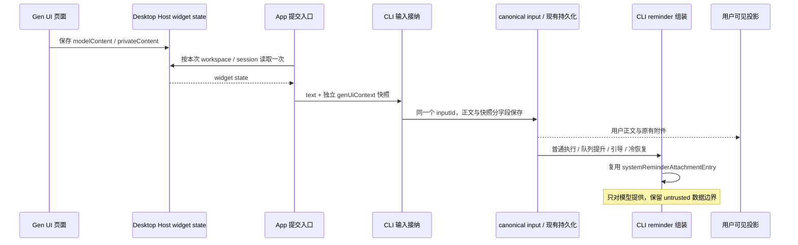

# Gen UI 输入上下文与用户正文分离

状态：已实施并验证。2026-10-20。

## 目标与已确认边界

用户确认：Gen UI 状态属于附加上下文，应复用 CLI 的 system reminder 链路；App 不再拼进用户 `text`，UI 不新增分散过滤。本轮按该边界实施。

变更层：commit-effect、persistence、recovery。范围限于现有 `sendText` 携带的 Gen UI 状态，包括普通发送、排队、立即发送和引导。新建任务首发、goal、插件上下文、划词、网页元素等不随本次扩展。

修复前的问题有两层：

- `SessionPane` 在提交命令前读取 widget state，调用 `buildGenUiModelContext`，把尾块拼进 `text`。队列接纳的已是混合正文，因此在执行模型请求之前就可能可见。
- `composerPromptContexts` 的完整解析路径会剥离尾块，但队列、历史和分享等出口不都经过它。只新增标签或 UI 正则不能解决正文的数据归属。

现场截图及日志支持“发送前读取状态、排队时已经可见”；日志包没有完整的目标 provider request。模型侧验收采用本轮 E2E 重新抓取的请求，见末尾验证记录。

## 目标链路与唯一数据源

widget state 的最新值仍由 Desktop Host 管理；某次输入的模型上下文由该输入的 canonical intent 管理。执行端可能在远端，CLI 不读取桌面 widget state 文件，也不在出队时重新查询最新状态。

输入语义：

1. 发送入口固定 workspace、session 和 command/input 身份，在接纳前采集一次快照；迟到返回不能改投当前新选中的聊天。传输重试复用同一个命令负载。
2. 快照仅含 `{ path, state: modelContent }`，不传 `privateContent`。沿用 16 KiB widget state、100 条记录、64 KiB 上下文上限及确定顺序；新版发送空数组也保留，明确表示正文未使用旧尾块编码。
3. 排队后页面从 A 改成 B，已排队输入仍用 A；后续新输入用 B。引导降为排队、队列立即发送不重采集。
4. retry 和历史编辑沿用原 canonical intent 的快照；队列撤回后重新提交是新输入，重新采集。沿用现有编辑/撤回身份语义，不新增第二份 draft context。用户本轮授权按此方案实施。
5. 重启沿用既有“丢弃未执行队列”策略，不恢复未执行输入或其 reminder。已执行消息从持久 intent 恢复状态。
6. 页面单纯改变状态不触发模型轮次。取消输入不残留待注入 reminder。读状态失败沿用当前降级行为，允许原正文发送并记录现有告警。

## 最小改动

| 改动           | 位置与职责                                                                                                                                                                                 | 不增加的机制                                                      |
| -------------- | ------------------------------------------------------------------------------------------------------------------------------------------------------------------------------------------ | ----------------------------------------------------------------- |
| 分开正文与快照 | `packages/ui/src/v4/SessionPane.tsx`：移除 `text += context`，发送独立字段；保留现有状态采集时点和作用域                                                                                   | 不在队列面板、消息组件分别补过滤                                  |
| 定义有界数据   | `packages/shared/src/gen-ui/contract.ts`、`zcode-protocol-v4/command.ts`、`input-intent.ts`：增加可选 `genUiContext` schema/type，校验 JSON、条数及大小                                    | shared 只承担协议与纯数据约束，不放新的显示解析器或 reminder 业务 |
| 完整传递并保存 | CLI `contracts/.../session.port.ts`、bootstrap 的 `commands/input-intent.ts`、`session-flow.ts`、`canonical-intent-replay.ts`，Core 的 `input-intent-persistence.ts`：所有显式映射保留字段 | 复用现有输入账本及消息 metadata，不新增表或旁路存储               |
| 统一模型组装   | CLI `core/src/system-reminder/source.ts` 登记 `gen_ui_state`；普通发送、`steering.ts`、`session-history-hydrator.ts` 共用一个函数把快照挂到输入 entry 上，投影排序后派生                   | 不新增上下文插件框架，不把页面数据提升为可信系统指令              |
| 恢复及投影     | CLI `event-normalizer.ts`、`transcript-hydration.ts`、`product-projection.ts` 核对 canonical intent 显式映射及旧记录读取；发布的用户正文来自规范化后的 `text`                              | 不逐个修改 copy、导航、搜索、分享组件                             |
| 收掉旧编码责任 | Gen UI 文本编码与旧尾块解码收口到 CLI；源头和旧记录接入完成后删除 App 对 `buildGenUiModelContext` 的调用、UI 对 `stripGenUiModelContext` 的调用及无调用导出                                | 不迁移其他类型的上下文解析器                                      |

这是职责清单，不表示每个列出的文件都必改。实施时先做引用检查，删除无用逻辑；协议字段变化必须核对 App、Host 透传与 CLI 三端。

### Reminder 复用方式

复用现有 source registry、`systemReminderAttachmentEntry` 和 provider 投影。新增来源具有 meta、provider-visible、随所属输入保留历史的语义。内部仍包住 `<untrusted_gen_ui_state>`，明确内容是页面状态数据；外层 system reminder 只是既有投递机制。

快照持久化在 canonical input 中，热态和冷恢复从同一快照把状态挂到该输入的 runtime entry 上：挂载时校验并渲染一次 reminder 正文，存为 `metadata.genUiState`。请求组装每次请求会运行多次（正式请求、token 估算、compaction），只做包装，不重复序列化。历史里没有独立的状态条目，状态和输入是同一个对象。不要另外写一条独立的 Gen UI synthetic message，避免双写、半次提交和重复恢复。队列输入提升沿用现有事务。

普通用户输入和引导目前使用不同组装路径，必须接入同一个挂载函数。之后再给输入 entry 补 metadata（例如子代理输入的 `inputPresentation`）必须合并，不能整体替换，否则状态会在热态请求里丢失。无需顺带重构两条路径的全部附件处理。模型请求重试和后续工具轮会再次携带历史，这是正常行为；断言的是同一历史内每个输入只有一份对应状态。

请求组装时，状态不参与冒泡、MCS system 合并这些排序步骤。排序全部结束后，才在所属输入旁边派生 `gen_ui_state` reminder：输入并入 MCS system 时（MCS 下的纯文本引导），状态留在 user 侧、排在这条 system 之前，为 `[状态][system]`（状态可并入 tool result）；其余输入为 `[输入][状态]`。所以输入怎样移动，状态都和它相邻：一个边界取出多条引导、同一边界还有后台通知、输入带文本附件、取出引导后 turn loop 又追加输入附件都一样。与旧版本（状态是输入之后的独立条目，不冒泡）相比，下列形状的请求字节不同；升级前已存的这类会话，下一次请求在该处前缀缓存失效一次：

- 一个边界取出多条引导：MCS 关时旧为 `[引导1][引导2][状态1][状态2]`，现为 `[引导1][状态1][引导2][状态2]`。MCS 开时两条引导合成一条 system，状态都排在它之前，为 `[状态1][状态2][system]`，与旧版本相同。
- 下列形状只在 MCS 关时不同，MCS 开时字节不变。旧版本中引导和其后的条目一起冒泡，越过不冒泡的状态：
  - 引导之后同一边界还有后台通知：旧为 `[引导][通知][状态]`，现为 `[引导][状态][通知]`。
  - 取出引导后 turn loop 又追加输入附件：旧为 `[引导][runtime_mode][todo][状态]`，现为 `[引导][状态][runtime_mode][todo]`。
  - 立即发送跟在 prompt 之后（prompt 带不带文本附件都一样）：旧为 `[prompt][引导][prompt 状态][引导状态]`，现为 `[prompt][prompt 状态][引导][引导状态]`。

单条 prompt（带不带文本附件）和连续 prompt 的字节不变。输入本身没有恢复（例如冷恢复时既无正文也无附件）时，状态也不发出。最终内容走 `<system-reminder>` 包装并保留 untrusted 数据边界，不提升为独立 system 指令。连续输入在 MCS 开关两种模式下都验证顺序。

### 历史与兼容

- 新输入有独立字段后，不再对正常正文做标签猜测。新输入中用户写出的同名标签应按正文保留。
- 旧 App 及旧数据库中的混合正文需要 CLI 的单一兼容解码器。仅识别既有完整尾部格式、合法 JSON 和合法条目；解出正文与快照供接纳、恢复及投影复用。不要把内部队列执行数据只截断后丢掉状态，也不批量重写历史数据库。
- 旧格式无法从字节上区分“系统追加”与“用户手写了完全相同的合法尾块”。兼容判据为 `genUiContext` 字段缺失；新版 `sendText` 即使没有状态也传 `[]`。完全相同的旧手写尾块仍无法区分，不声称无损识别。无效 JSON、非尾部文字和代码示例均需回归。
- 已发布分享是静态快照，不再经过本机 CLI。最小修复覆盖此后新发布/重新发布的分享，不追溯修改服务器上的旧快照。历史与索引共用 CLI `mapMessageWithParts` 的规范化 snapshot；旧索引在既有会话回源同步时更新，本次不批量扫描离线历史。
- App → Host 使用 V4 hello 的 `genUiContext` 能力；Host → CLI 使用既有 `runtimeCapabilities` 查询。非空状态要求两跳显式支持，否则拒绝发送并保留草稿，不回退为正文拼接。空快照仍允许旧端普通输入。
- UI 删除 GenUI 专用过滤。新输入正文、V4 事件/历史投影、旧协议 snapshot 共用 CLI 规范化事实；新分享消费这些消息。已发布的旧静态分享仍保留原快照。

## 用户可见出口与影响分级

| 场景 / 出口                         | 当前入口或数据链                                                   | 本次检查与归属                                                                         | 分级           |
| ----------------------------------- | ------------------------------------------------------------------ | -------------------------------------------------------------------------------------- | -------------- |
| Composer 普通发送、Gen UI follow-up | `SessionPane` → `sendText`                                         | App 采集；CLI 接纳；本次已固定的目标不能被异步切换覆盖                                 | must-inspect   |
| 排队预览、悬浮完整文本、撤回编辑    | `QueueItem` → `v4ConversationQueuePanel` / `v4QueueEditExtraction` | canonical intent 保存快照；所有可见正文均为原输入；撤回恢复原正文及原附件              | must-inspect   |
| 即时消息、历史、冷恢复、编辑/重试   | CLI 用户行投影及 canonical intent replay                           | 热态与冷态一致；隐藏状态不生成额外用户行、轮次或编辑目标                               | must-inspect   |
| 复制正文/对话、消息导航、会话内查找 | 用户行与派生展示文本                                               | 对同一规范化正文消费；不得暴露状态路径、JSON 或标签                                    | should-inspect |
| 任务摘要/标题、全局搜索结果         | 会话摘要、索引及标题输入                                           | 人工设定标题不受影响；自动标题输入不混入尾块，最终标题不含内部标记；旧索引检查重建路径 | should-inspect |
| 新分享发布、匿名分享页              | CLI 会话投影 → 分享快照 → 只读页面                                 | 发布的数据本身干净，不能只断言页面隐藏；旧快照见兼容边界                               | must-inspect   |
| 手机远控的队列、历史及重连          | `web-remote-replayable` → 同一 CLI 投影                            | 断线恢复 snapshot/delta 不重新暴露尾块；不新增手机 Gen UI sandbox 或 RPC allowlist     | invariant-only |
| SSH / WSL / Docker 执行             | Desktop Host widget state → 原输入协议 → 执行端 CLI                | 状态不从执行端本地文件重读；workspace identity、session、path 隔离                     | must-inspect   |
| fork / rewind / compact             | 现有分支复制、截断与有效历史边界                                   | 仅继承保留输入的快照；删除或 compact 掉的输入不能被额外状态存储复活                    | invariant-only |

共享数据是同一 canonical input；各出口交互、桌面 continuous 与手机 replayable 的交付方式保持现状。附件、模式、模型选择和其他上下文同在输入映射中，需防止新增字段时丢失它们。

代码证据来自精确文件/调用搜索；codegraph 本轮不可用，未宣称完成图索引的调用覆盖。功能图已补充 Gen UI 状态上下文入口、当前代码种子与归属。

## 用例与剪枝

主要维度为 delivery（普通/queue/startNow/guide）、生命周期（热态/冷恢复/重试/分支）、隔离（workspace/session/path）、消费者（桌面/手机/分享）。采用代表场景加高风险组合，不展开全部乘积。

| ID    | 设置与动作                                                                         | 必须断言                                                                                                                            | 证据 / 状态                                                     |
| ----- | ---------------------------------------------------------------------------------- | ----------------------------------------------------------------------------------------------------------------------------------- | --------------------------------------------------------------- |
| GUC01 | 页面通过真实 bridge 写入可识别 model/private state；发送普通文字                   | canonical `text` 等于用户原文；状态只在独立字段；最终 provider request 有一份对应 reminder 且无 private state；界面只有一条用户消息 | Core/schema UT + Desktop E2E；accepted / planned                |
| GUC02 | 受控流保持执行；状态 A 时排队，改 B 后再排队；分别自动出队和立即发送               | 排队阶段无尾块；输入 A/B 各自冻结；立即发送不重读；重复 command 不重复接纳，失败重试不多注入                                        | Bootstrap/Core UT + Desktop E2E；accepted / planned             |
| GUC03 | 受控工具边界提交 guide；另设 guide 降为 queue                                      | 两条路径均保留对应快照；只在既有安全边界消费；附件、模式与原文不变                                                                  | Core/Bootstrap UT + Desktop E2E；accepted / planned             |
| GUC04 | 已执行输入关闭运行时；修改/删除实时 widget state；重启恢复并继续                   | ledger/message roundtrip 保留原快照；热冷历史相关片段一致；未执行队列继续按旧规则丢弃；无额外用户行                                 | Storage/Core UT + Desktop restart E2E；accepted / planned       |
| GUC05 | 对同一输入 retry、历史编辑、队列撤回重发；fork/rewind/compact                      | retry/编辑保留原快照；撤回后新提交重新采集；分支只带保留输入；compact 后不从旁路复活旧状态                                          | canonical replay/Core UT；快照策略已固定，具体运行覆盖见 matrix |
| GUC06 | 同路径不同 workspace/session；读取状态期间切换聊天；远端执行；手机重连观察         | 不串目标；远端 CLI 不读桌面路径；桌面发送的干净队列/历史在手机 snapshot/delta 也干净；手机无新增采集能力                            | service/Bootstrap UT + Desktop/mobile E2E；accepted / planned   |
| GUC07 | 已排队及已完成消息执行复制、编辑、查找、导航、标题/摘要、发布分享                  | DOM、title 属性、剪贴板、索引和分享数据本身均无系统追加尾块；原文和原附件未丢失                                                     | UI/索引 UT + Desktop/share E2E；accepted / planned              |
| GUC08 | 载入旧尾块记录；输入空/null/超限状态、非法尾块及用户文本标签；跑 provider/MCS 变体 | 有界 schema、JSON 转义、确定顺序；旧格式解码不丢模型数据；新格式正文不误删；同一次历史无双份状态                                    | CLI/schema UT；字段缺失兼容判据与两跳能力门禁已固定             |

剪枝：

- `privateContent` 进模型、状态变化自动开轮、执行时重新采集、另建 context 队列：pruned，违反既有隔离或输入身份。
- 新建任务首发、goal 和所有其他上下文的统一大迁移：pruned，本次不扩大生产入口。
- 手机 Gen UI 交互：pruned，现有产品没有 sandbox；只测现有读取/重连路径。
- 跨主题/语言不作全乘积：本次不改布局。桌面/手机 E2E 使用现有代表配置，文本与属性断言复用，不计全主题/语言覆盖。
- 新版回写旧分享、批量改写数据库：pruned，最小方案不涉及。旧格式精确歧义保留上述限制，版本门禁按两跳能力检查。

## 实施与测试顺序

1. 以本规划定稿 spec，确认两处兼容边界及 GUC05 的快照策略；同步 Gen UI 各层 CONTRACT，记录旧拼接的根因。先写能复现 GUC01/GUC02/GUC03 的失败测试，再改生产逻辑。
2. 先接通协议字段、canonical intent 全链和 Core reminder。扩展现有 `system-reminder-source`、`input-intent-persistence`、`runtime-reminders`、`queue-input-fidelity`、`v4-native-queue` 和 `v4-retry-reminder-persistence` 等定向套件，补旧解码及冷恢复断言。
3. App 改独立传参，CLI 旧读取兼容接好后删除旧生产/剥离调用。复查所有显式映射，不用各出口过滤补救遗漏。
4. 新 Desktop E2E 放 `conversation-session/manual-review/pending/`，按“发送与可见出口”“队列/guide”“冷恢复/手机”分组。页面 fixture 用真实 `window.zcode.setWidgetState`；既有 `gen-ui-e2e.mjs` 只能证明沙箱/bridge，不能代替完整 App → CLI → provider 验证。
5. 用 case-local provider fixture 和 `controlled-stream` 明确屏障，等待状态或事件再放行，不用 sleep 制造时序。主请求、标题旁路都登记；保存 DOM/截图、命令与 canonical input、最终 HTTP 请求三层证据。测试不得往 UI store 注入“已经过滤”的结果冒充成功。
6. 执行根 `pnpm typecheck`、`pnpm lint`、`pnpm architecture:check --changed`；`pnpm test:engineering:affected --base <实施起点> --dry-run` 后运行实际选择范围。CLI 单独运行 `pnpm --dir apps/zcode-cli typecheck`、`lint` 及受影响 Core/Bootstrap/Storage 包与调用方测试。使用已定稿的 pending E2E 跑桌面及手机链路。
7. 完成覆盖矩阵审计、fixture 校验、diff 自检，必要检查通过后再按仓库规则提交。pending E2E 不自动转正；真实 SSH 传输、macOS/Windows/Linux 实机覆盖和环境阻塞按实际执行证据报告。

## 验证记录

先补失败测试，再接入生产路径。定向回归覆盖字段接纳、queue/guide 元数据往返、引导 reminder、旧尾块解码、新格式字面标签、私有状态隔离、MCS 顺序、SQLite 冷恢复、retry/rewind 后仅保留一份状态、旧 Host/CLI 拒绝带状态输入，以及历史/索引 snapshot 共用解码。

E2E 候选：`packages/desktop/test/e2e/conversation-session/manual-review/pending/conversation-session-gen-ui-context.test.ts`。真实页面按钮保存状态 → 运行中排队 → 页面再变化 → 放行队列 → 捕获模型请求 → 重启恢复；同例连接实际 Web 手机视口，检查队列 delta、刷新后 snapshot 和完成历史。夹具仅替换外部模型/relay，不写 UI 会话 store。

CLI 定向回归 235 项通过。桌面/手机 E2E `desktop-e2e-20261020111709815-p82403-f4e763c93003e5b0` 1/1 通过，无跳过或重试；五个模型/标题请求均为 200。出队请求只含入队快照，冷恢复保留每次输入各一份状态，所有请求均无私有状态。桌面及手机队列的 DOM/属性与截图均只有用户正文。

根受影响单测以实施起点 `ffb33ac0930f95591a5805e85659407768e52c4d` 选择 1461 个文件，1460 通过、1 跳过；16414 项通过、6 跳过。根/CLI/E2E 类型检查、根/CLI lint、架构检查、变更文件格式检查、fixture 校验和 conversation 覆盖矩阵审计均通过。

候选不自动转正。真实 SSH、实体手机及 Windows/Linux 实机未作为本轮运行证据。功能图原有 4 条无关悬空边保留，不扩大本次修复。
