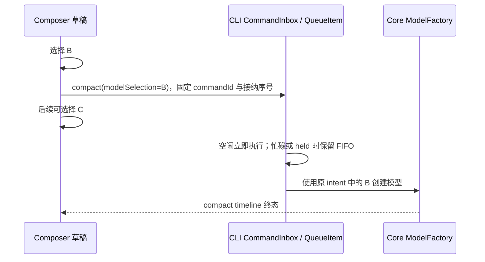

# Conversation Session Compact Decision Worksheet

## 手动压缩固定提交模型（2026-10-20）

用户确认：会话使用 A，在菜单选择 B 后直接 `/compact`，摘要必须使用 B。
本次覆盖原 N08「沿用会话 A」的裁决。修改层级为提交副作用与队列恢复，
模型候选、布局、自动压缩、工具、模式与权限不变。

### 状态与时序



桌面 continuous 与手机 replayable 都提交同一命令到同一 CLI owner；
重连只恢复命令及其原参数，不从恢复时的 Composer 重建 B。
workspaceIdentity、sessionId、commandId 与 admissionSeq 沿用原隔离和去重契约。

### 入口与实现计划

| 入口/层                | 现状与修改                                                         | 权威归属与边界                                                                      |
| ---------------------- | ------------------------------------------------------------------ | ----------------------------------------------------------------------------------- |
| 输入框 `/compact`      | 使用发送前已经捕获的 Submission.modelSelection                     | Composer 仅持有未提交草稿；不附带模式、Plan 或加速凭据                              |
| 上下文用量面板压缩按钮 | 点击时通过既有 Composer builder 捕获选择；缺少有效选择时不发空命令 | 与输入框共用 dispatchSlashCommand                                                   |
| V4 compact schema      | 增加可选 modelSelection，复用严格模型选择 schema                   | 旧发送端无字段时，在 CLI 接收边界固定当前会话选择                                   |
| compact handler        | 先构造包含选择的 canonical intent，再立即执行或入队                | 使用现有 inputIntentMetadata 与 resolveSubmittedExecutionState，只取 modelSelection |
| queue promotion        | 由原 QueueItem 恢复 intent，传入 startManualCompact                | 自动消费及 sendQueuedNow 共用；不改写其他排队项                                     |
| Core                   | 复用已存在的 intent.modelSelection → Active Model 路径             | 当前已开始的 A 不变；旧序号压缩不得覆盖较新输入的续跑选择                           |

必须检查：两个 UI 入口、schema、compact handler、queue promotion、持久队列恢复。
相邻回归：停止、重复 compact、模型不可用、冷恢复就绪检查、稀疏 reasoning 选择。
只保持不变量：自动 compact、Goal、Subagent、自动化模型、跨工作区选择。
codegraph 在本次环境无可用工具；依据以上文件的直接调用关系核对两层，
不把测试可达性当作产品依赖。功能图补充模型选择到手动压缩提交的关系。

### 接受的验证场景

| 编号         | 前置/操作                                  | 断言                                                      | 证据                                                   |
| ------------ | ------------------------------------------ | --------------------------------------------------------- | ------------------------------------------------------ |
| N08          | A 历史，菜单选 B，立即 `/compact`          | 实际摘要请求 model=B，选中 options 随请求传递，stream-first 保持 | UI 单测、bootstrap 单测、既有模型切换 compact E2E 抓包 |
| N08-panel    | 相同前置，点击上下文面板压缩               | 与 `/compact` 携带同一选择；选择无效时不发命令            | desktop/mobile 参数化组件测试                          |
| N08-queue    | A 忙碌或 held，选 B 提交 compact，之后选 C | 入队与提升均持有 B，A 不变，不消费 C 草稿                 | bootstrap 入队/提升测试、运行时选择测试、held queue E2E                |
| N08-recovery | 持久队列项带 B，恢复后会话选择为 C         | 以原 B 执行，不以 C 重建意图                              | 恢复形态 QueueItem 的提升测试                          |
| N08-legacy   | 老客户端不带选择，在就绪检查期间会话变化   | 接收时固定的模型不变                                      | bootstrap deferred gate 测试                           |
| N08-invalid  | 模型字段非法或 B 无法创建                  | schema 拒绝或原模型创建错误；不静默回退 A                 | schema 与 Core 创建失败回归                            |

剪枝：不将每个 provider、语言、主题和操作系统做笛卡尔积，因为本次不改 UI 呈现、
文件 I/O 或 provider adapter；选跨模型代表。桌面/手机分别验证命令 payload；
真实 Electron E2E 验证摘要请求，不能以组件测试替代整条链路。
没有新增待确认产品问题：按用户已确认的 B 语义，队列顺序与恢复复用现有规则。

实施顺序：先更新 N08、覆盖矩阵与功能图；先写失败回归；接通协议/CLI/UI；
再运行 focused 单测、CLI 检查、根 typecheck/lint/architecture、affected 测试与对应 E2E。
E2E 复用既有 case-local synthetic fixture，由真实 App/CLI 产生请求并抓包。
不新建模型缓存、同步屏障、队列或数据库 migration。

### 本次验证证据

- 先运行失败回归：协议 schema 丢失选择、桌面/手机两入口未携带 B；接通后 focused App 134 项、CLI 77 项通过。
- 受影响根单测：525 文件、7111 通过、5 跳过。覆盖 CLI runtime 的实际 ModelFactory 请求，证明旧 B 不覆盖较新 C。
- Electron 立即压缩：`desktop-e2e-20261020-031645-300`，1/1 通过，实际请求包含 B、所选思考档位、历史内容及 SSE。
- Electron held queue：`desktop-e2e-20261020-031840-277`，1/1 通过，入队后改选 A，提升仍请求 B，其他队列项保持 held。
- 根类型检查、lint、架构检查通过；两个既有 E2E 的 fixture 检查通过。CLI 完整类型检查（32 个 Turbo task）及 lint 通过。
- 环境记录：首次并发类型检查被 8 GiB 容器内存限制终止，串行重跑通过；Electron 改用容器启动参数并重建产物后通过。诊断包装只增加失败时 DOM/截图采集，不修改断言。
- 边界：真实手机远控、Windows/macOS 未实跑；手机共享提交路径由参数化组件测试验证，未改变传输、持久化和操作系统适配。

## `/compact` 队列裁决（2026-07-13）

用户确认 running 输出过程中 `/compact` 不能丢弃，必须进入队列；随后确认 goal verifier
过程中的普通消息也必须进入同一 future queue。实现按以下边界收口：

| 边界 | 裁决 | 分类 |
| --- | --- | --- |
| running primary/tool/foreground subagent/goal continuation/goal verifier | `/compact` 作为第三种 `kind=compact` 意图追加 CLI FIFO，不打断 active work | accepted |
| completed + held queue | compact 追加队尾，保持 `autoDrain=false`；不绕过既有 future intent | accepted |
| active 或 queued compact 已存在 | 后续 compact 显式 `failed(compactOperationLock)` 并 toast，不重复排队 | accepted |
| queue 操作 | 可删除、重排、立即执行；compact 不可编辑为普通文本 | accepted |
| auto compact 已刚完成 | queued manual compact 仍执行，允许 runtime 产出 noop；禁止静默消费 | accepted |
| queued compact 失败/Stop | 后续 queue 保持 held，不越过失败/取消自动消费 | accepted |
| desktop/mobile | 两端共享 Host/CLI CommandInbox；保留各自 `deliveryKind`，不在 relay/main 建第二队列 | accepted |
| goal verifier | text/goal/compact 都是 future intent；单次 verifier terminal 不触发 drain，等待 target complete | accepted |

```text
desktop-continuous ─┐
                    ├─> shared Host / CLI FIFO: [text, compact, goal]
web-remote-replayable ┘                    │
                                          └─> 按 kind 分派，compact 只写 timeline
```

状态 owner 是 CLI runtime `CommandInbox` 与 session queue；UI 只渲染 projection，relay/main
只透传。核心证据层为 command ACK、queue snapshot kind/order、compact lifecycle marker、provider
request 次序以及 goal target terminal 状态。

目标：把 `F09/G11/G12` 三个 compact undefined case 变成可确认、可回写、可自动化的产品合同。本文不替产品做决定，只把必须确认的分叉拆到足够具体。

关联文档：

- 主路径 catalog：[conversation-session-case-catalog.md](../conversation-session-case-catalog.md)
- 覆盖矩阵：[conversation-session-e2e-coverage-matrix.md](./conversation-session-e2e-coverage-matrix.md)
- 决策 backlog：[conversation-session-decision-backlog.md](./conversation-session-decision-backlog.md)
- compact 回放用例：`packages/desktop/test/e2e/conversation-session/manual-review/pending/conversation-session-compact*.test.ts`

## 当前缺口

已清零。`F09 / G11 / G12`（含 fault alias `C01-C03`）于 2026-07-05 全部裁决并回写（catalog accepted、coverage missing、roadmap ready-to-write），本工作单转为归档；12 个协议题的逐项结论见下文「裁决归档」。

## 当前统计

| 指标 | 数量 |
| --- | ---: |
| Compact case | 0 |
| Compact 协议题 | 0 |
| answered | 0 |
| unanswered | 0 |

> 统计口径是「审计面上仍待处理的题目」，裁决完成的批次已退役，全部归零。裁决记录：2026-07-05 用户逐项确认（v4 重构 M0 决策清收）；催生本轮裁决的协议影响见 `docs/v4-refactor/10-protocol-spec.md`（compact marker 终态枚举、switchModelConfig CAS）。

## 裁决归档（2026-07-05）

> 编号加 ✅ 前缀以避免被审计脚本再次统计为待决协议题。

| 题目 | 产品结论 |
| --- | --- |
| ✅ F09.1 | 保持 completed（回到 compact 前原状态）+ failed marker；不 error、不 interrupted |
| ✅ F09.2 | 保留原 queue 且不自动消费；不改 autoDrain、不清空 |
| ✅ F09.3 | 全部操作恢复（文本 / `/goal` / fork / edit / 再次 compact），无按钮锁定 |
| ✅ F09.4 | failed marker 展示失败结果 + retry compact 入口（点击 = 重新发起手动 compact） |
| ✅ G11.1 | 继续无压缩执行 pendingAction（第 4 个请求是主模型请求；与现状一致） |
| ✅ G11.2 | 继续 running（进入正常主请求流） |
| ✅ G11.3 | 保留 retrying 历史与最终 failed marker，不阻塞后续输出 |
| ✅ G11.4 | circuit breaker 生效（阈值后一段时间跳过）；手动 compact 成功后重置计数 |
| ✅ G12.1 | 保留为当前轮 interrupted user message（时间线可 edit/retry），不复制回 queue、不丢弃 |
| ✅ G12.2 | completed(interrupted)，与普通 stop 完全一致 |
| ✅ G12.3 | marker 置 cancelled（v4 枚举复用；等价旧表述 interrupted） |
| ✅ G12.4 | 显式追加的 queue 全部保留且不自动消费（held queue，autoDrain=false） |

## P0 协议题索引

本批次协议题已全部裁决并退役（见上文「裁决归档」），审计脚本不再统计。历史上这张表是给审计脚本读的最小协议面：`Status=unanswered` 表示还不能回写 catalog；产品确认后先写产品结论、改 `answered`、再回写源 catalog / fault catalog / coverage matrix、最后从审计面退役。

确认后回写规则：

1. 更新 `docs/conversation-session-case-catalog.md` 中 `F09/G11/G12` 的期望结果和 Review。
2. 更新 `docs/testing/conversation-session-environment-fault-catalog.md` 中 `C01/C02/C03` 的 Review。
3. 更新 `docs/testing/conversation-session-e2e-coverage-matrix.md`：先从 `undefined` 改为 `missing`，等 E2E 有独立断言后改为 `covered`。
4. 从 `docs/testing/conversation-session-decision-backlog.md` 移除对应待确认行。
5. 写对应 WDIO spec，并让 `pnpm audit:conversation-session-coverage` 重新通过。

## 已有事实

这些是当前代码和已确认产品规则给出的边界，不代表还未确认的产品结论。

| 事实 | 含义 |
| --- | --- |
| 手动 compact 不自动重试 | 手动 compact 失败只发生一个逻辑 compact attempt；该 attempt 内可包含 streaming 主腿与 non-stream fallback 腿，不应期待自动第 2 个逻辑 attempt |
| 自动 compact 最多重试 3 次 | G08/G09/G10 已覆盖第 1、2 个逻辑 attempt 失败后重试，以及第 3 个成功后继续 pendingAction；物理 provider request 数不固定 |
| compacting 中允许普通文本和 `/goal` 入队 | 已确认 `F04/F05/G05/G06`，所以失败/stop 后 queue 是否保留必须定义 |
| compacting 中重复 `/compact` 被拒绝 | 已确认 `F06/G07`，失败/stop 用例必须断言不会产生额外逻辑 compact attempt |
| compacting 中不能 fork | 已确认 `E06/CA`，失败/stop 后何时恢复 fork 能力必须定义 |
| stop 后 queue 默认保留且不自动消费 | 已确认 `B02-B04/F07`，但 auto compact stop 的 pendingAction 是否算 queue 仍需确认 |

## F09：手动 Compact 失败

前置状态：`compacting(origin=manual)`。

事件：compact streaming 主腿失败后进入 non-stream fallback，fallback 仍失败。

当前代码观察：runtime 写入 `CompactFailed` timeline payload，UI projection 可生成 failed 横条和 retry 入口；`executeManualCompact` 仍会抛 `Compact failed`。

### 必须确认

| 决策点 | 选项 | 影响 |
| --- | --- | --- |
| F09.1 最终 task/session 状态 | A. `completed(success)` + failed marker；B. `completed(interrupted)` + failed marker；C. `error/failed` + failed marker；D. 其他 | 决定输入框、toolbar、列表状态、错误 banner 和后续发送行为 |
| F09.2 queue 处理 | A. 保留原 queue，`autoDrain=false`；B. 清空 queue；C. 保留并允许手动立即发送；D. 其他 | 决定是否复用 held queue 断言 |
| F09.3 操作恢复 | A. 允许继续发普通文本/`/goal`/fork/edit/再次 compact；B. 只允许 retry compact；C. 进入错误态，仅允许修复/重试；D. 其他 | 决定按钮 disabled 和后续 action case |
| F09.4 failed marker 交互 | A. 展示 retry compact；B. 只展示失败结果；C. 展示日志/详情入口；D. 其他 | 决定 UI test-id 和点击断言 |

### E2E 断言草案

| 层 | 应采集信号 |
| --- | --- |
| UI | compact marker 从 `running` 变 `failed`；输入框/按钮状态符合 F09.1-F09.4 |
| Network | 只发生 1 个手动 compact 逻辑 attempt；物理请求包含 SSE/HTTP legs 及各自 adapter retry，数量不写死；不会产生主模型请求 |
| Queue | compact 前已存在的 queue 是否按 F09.2 保留 |
| Runtime/Log | task runtime 状态、compact failure trace、activeInputId 清理 |
| Files | session timeline 中保留 compact started 和 failed marker |

建议 spec：`packages/desktop/test/e2e/conversation-session/manual-review/pending/conversation-session-compact-failure.test.ts`。

## G11：自动 Compact 三次失败

前置状态：`compacting(origin=auto)`，存在触发 auto compact 的 pendingAction。

事件：auto compact 第 1、2、3 次均失败。

当前代码观察：retryable compact 失败会写 `retrying` 横条；第 3 次失败写 `failed` 横条。当前实现会吞掉非取消错误，并继续无压缩执行原 pendingAction；连续失败计数增加，达到阈值后后续 auto compact 可能被 circuit breaker 跳过。

### 必须确认

| 决策点 | 选项 | 影响 |
| --- | --- | --- |
| G11.1 pendingAction 处理 | A. 继续无压缩执行；B. 回到 held queue 且不自动消费；C. 丢弃并提示；D. 进入错误态等待用户决定；E. 其他 | 决定第 4 个请求是否应该是主模型请求 |
| G11.2 task/session 状态 | A. pendingAction 若继续则进入 `running`；B. 若保留 queue 则回到 `completed/interrupted`；C. 进入 `error/failed`；D. 其他 | 决定 toolbar、composer 和列表状态 |
| G11.3 marker 展示 | A. 保留 failed marker，同时继续原请求；B. failed marker 阻塞后续请求；C. 只展示 retrying 历史，最终不展示 failed；D. 其他 | 决定 timeline UI 断言 |
| G11.4 后续 auto compact 策略 | A. circuit breaker 生效，后续一段时间跳过 auto compact；B. 下一轮仍可继续尝试；C. 需要用户手动 compact 成功后重置；D. 其他 | 决定跨轮状态和后续 e2e |

### E2E 断言草案

| 层 | 应采集信号 |
| --- | --- |
| UI | auto compact marker attempt=1/2/3 的 retrying/failed 表达；最终状态符合 G11.2 |
| Network | 精确 3 个逻辑 compact attempt；物理 SSE/HTTP 请求数不写死；是否有后续主模型请求取决于 G11.1 |
| Queue | pendingAction 是消失、回到队列，还是被执行 |
| Runtime/Log | retry count、circuit breaker、activeTurnKind 清理或切换 |
| Files | timeline marker 和触发 pendingAction 的 user message 是否持久化 |

建议 spec：`packages/desktop/test/e2e/conversation-session/manual-review/pending/conversation-session-compact-auto-failure.test.ts`。

## G12：自动 Compact 被 Stop

前置状态：`compacting(origin=auto)`，存在触发 auto compact 的 pendingAction；用户在 compact 请求未完成时点击 stop。

事件：stop/abort auto compact。

当前代码观察：auto compact 发生在当前 user turn 的主请求之前；当前 user message 已经进入 runtime history / 持久化。stop 会让 `autoCompactIfNeeded` 重新抛 cancellation，主模型请求不会继续；turn 按 cancelled 收口。runtime 内部 pending steer inputs 会被 discard，但 UI 可见 queue 是否保留还不是协议事实。

### 必须确认

| 决策点 | 选项 | 影响 |
| --- | --- | --- |
| G12.1 pendingAction 处理 | A. 回到 held queue，`autoDrain=false`；B. 保留为当前轮 interrupted user message，不再进入 queue；C. 丢弃并提示；D. 保持待执行但不自动消费；E. 其他 | 决定 stop 后用户能否看到并编辑这条待执行输入 |
| G12.2 task/session 状态 | A. `completed(interrupted)`；B. `completed(success)` + interrupted marker；C. `error/failed`；D. 其他 | 决定与普通 stop 的一致性 |
| G12.3 compact marker 状态 | A. `interrupted`；B. `failed`；C. 移除 running marker；D. 其他 | 决定 timeline 展示 |
| G12.4 compact 期间追加 queue | A. 全部保留且不自动消费；B. 只保留用户显式追加项，不保留原 pendingAction；C. stop 后清空；D. 其他 | 决定 queue count 和顺序断言 |

### E2E 断言草案

| 层 | 应采集信号 |
| --- | --- |
| UI | 点击 stop 后退出 streaming/compacting；marker 状态符合 G12.3；输入框和按钮恢复符合 G12.2 |
| Network | auto compact 请求被中止；不会发起 pendingAction 的主模型请求 |
| Queue | 原 pendingAction 和 compact 期间追加项按 G12.1/G12.4 处理 |
| Runtime/Log | activeInputId 清理；stopRequested 与 autoDrain 状态符合普通 stop 或新定义 |
| Files | interrupted marker、user message、queue snapshot 是否持久化 |

建议 spec：`packages/desktop/test/e2e/conversation-session/manual-review/pending/conversation-session-compact-auto-stop.test.ts`。

## 回答模板

产品确认时只需要按下面格式回答即可：

```text
F09:
- F09.1 = A/B/C/D，补充：
- F09.2 = A/B/C/D，补充：
- F09.3 = A/B/C/D，补充：
- F09.4 = A/B/C/D，补充：

G11:
- G11.1 = A/B/C/D/E，补充：
- G11.2 = A/B/C/D，补充：
- G11.3 = A/B/C/D，补充：
- G11.4 = A/B/C/D，补充：

G12:
- G12.1 = A/B/C/D/E，补充：
- G12.2 = A/B/C/D，补充：
- G12.3 = A/B/C/D，补充：
- G12.4 = A/B/C/D，补充：
```

## 确认后的落地顺序

1. 先只处理 `F09`，因为它不涉及 pendingAction，是最小闭环。
2. 再处理 `G11`，它决定 auto compact 失败是否继续原请求。
3. 最后处理 `G12`，它同时牵涉 stop、pendingAction、queue 和 marker。
4. 每完成一条，先让 catalog 从 `undefined` 到 `accepted`，coverage 从 `undefined` 到 `missing`。
5. 写 WDIO 后再把 coverage 改为 `covered`，并运行 `pnpm audit:conversation-session-coverage`。
