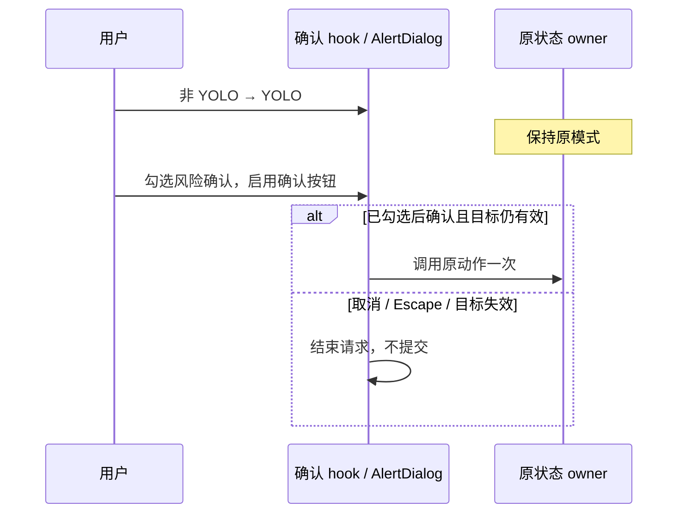

# YOLO 模式切换确认

## 行为

用户每次主动从非 YOLO 权限切入 YOLO（完全访问）时，先显示确认框。确认前不修改 Composer、表单或 Runtime；确认才执行原入口动作。取消、Escape 保持原权限和 Plan、模型等其他配置。已经是 YOLO 时重复选择不弹框。切出后再次切入必须再次确认。

恢复原风险小字，保留风险说明、仅在信任任务内容时启用及可随时切回权限模式的提示。在其下方、操作按钮上方单独显示复选框，中文标签为“我已了解风险，并对自己的数据安全负责。”，英文为“I understand the risks and take responsibility for my data security.”。每次新请求默认未勾选；只有勾选后确认按钮才可用，取消勾选立即禁用。勾选本身不修改权限、不提交审批。英文确认按钮使用“Confirm”，中文保留“确认启用”。

恢复会话、继承默认权限、程序同步状态不触发。没有历史会话提醒、用户确认记录或自动降权。

| 入口                          | 确认后的动作             | 取消后的状态                 |
| ----------------------------- | ------------------------ | ---------------------------- |
| Composer 菜单、循环权限快捷键 | 原 onSwitchMode 更新草稿 | 草稿不变                     |
| 定时任务、闲时任务表单        | 原字段修改回调           | 值、dirty 状态不变           |
| 权限审批的 fullAccess 选项    | 原完整授权响应           | 原审批继续等待，可选其他响应 |

## 状态与时序

共享确认调度仍由 confirmDialogStore 独占一个待处理请求。专用 presentation 使用现有 AlertDialog；useYoloModeConfirmation 只持有本次确认的 AbortController，不复制业务状态。各入口继续使用自己的 owner 和提交路径。

每个请求绑定入口生命周期、原模式和目标身份：Composer 绑定原 owner 的切换回调；表单绑定记录、项目及可编辑状态；审批绑定 workspace/task/request。卸载、目标改变、原模式发生同步更新时取消请求，迟到结果不提交。重复点击不会排队或覆盖第一次请求；弹窗期间 Composer 快捷键不穿透。关闭后可重新发起。

风险勾选复用 ConfirmDialogHost 的本地 checkboxSelection，并以当前请求对象隔离；不持久化、不写入权限 owner，也不记住上次勾选。取消、确认或目标失效后，新请求均重新要求勾选。

desktop continuous 与 mobile replayable 都在共享 UI 的显式事件入口确认，确认后沿用既有命令路径；不改变 Host/Agent 权限算法、协议、队列或持久化结构。程序恢复路径不调用确认 hook。

## 展示

中英文原创说明文件修改/删除、命令运行、网络和应用访问，以及数据丢失/泄露风险。初始焦点为“取消”；Enter 遵循当前按钮焦点，不能使用普通确认框的全局 Enter 自动确认。使用语义颜色、深浅主题和可滚动的手机布局，取消与确认按钮始终可达。

风险确认复用共享 Checkbox，标签可点击并支持换行，使用 text-ui-base、leading-relaxed 和主文字颜色 text-foreground；上方风险小字独立保留 text-foreground-subtle、手机基础字号/相对行高和桌面辅助字号/行高。键盘可聚焦复选框并用空格切换；未勾选时按钮 disabled，鼠标、Enter 和空格均不能触发授权。

当前接受关闭后不自动恢复到输入框或原控件的交互取舍；桌面继续输入时可能需要重新点击输入框。本次不增加自动回焦或手机输入框聚焦。

视觉层级遵循 APP 设计系统，字号随界面设置一起缩放。手机与桌面均使用 `text-ui-lg` 标题；手机说明使用 `text-ui-base` 和随字号缩放的 `leading-relaxed`。桌面沿用通用确认框的 448px 宽度上限，权限详情与风险说明使用 `text-ui-sm` 辅助字号。弹窗使用 `bg-popover`、`rounded-2xl`，手机内边距 16px、桌面 20px，区块间距统一 16px。权限列表使用 `bg-surface`、`rounded-xl`、`border-border` 分隔线、20px 图标与紧凑行距。文件、网络图标使用 `text-icon-blue`，命令图标使用次级前景；图标垂直对齐每组文字。

按钮复用共享 lg、px-4 和 rounded-lg；取消为 secondary，确认为现有 destructive 红色按钮，不自定义颜色或添加按钮图标。手机沿用切换账号弹窗的双列等宽布局，间距 12px，按钮 `h-auto min-h-11 whitespace-normal`，最小触控高度 44px，长文案和放大字号可换行。桌面保持 h-9、同排靠右、间距 8px、按内容宽度呈现。手机适配使用现有 sm 断点；不显示会暗示 Enter 直接授权的快捷键提示。不新增主题变量或全局组件变体。

视觉验收覆盖 390/1200px、中英文与 Zai Light/Dark，检查正文可读性、界面字号放大后的横向溢出、按钮同排与可达性，并保留默认字号截图。风险勾选只作用于 YOLO presentation，保留既有焦点与请求生命周期。

## 验收（accepted，manual-review/pending）

| ID   | 场景与断言                                                                                                                                                   |
| ---- | ------------------------------------------------------------------------------------------------------------------------------------------------------------ |
| YC01 | build、guarded、历史 edit → YOLO；确认前无改动，确认后一次提交；取消/Escape 保留原模式和 Plan                                                                |
| YC02 | 菜单和循环快捷键共用确认；重复点击/连续按键不重复提交，其他 Composer 快捷键不穿透；切出再进入重新确认                                                        |
| YC03 | 两种自动化表单都在确认后才更新 mode，取消不产生 dirty；保存沿用原动作                                                                                        |
| YC04 | 审批 fullAccess 确认前不应答；取消后原审批可继续处理；确认保留完整原响应                                                                                     |
| YC05 | 确认期间切换目标、卸载、请求结束或权限同步更新：旧确认不授权；再次进入同目标也不能复活旧请求                                                                 |
| YC06 | 已有 YOLO 恢复、继承和重复选择静默；两种宽度、中英文、深浅主题，取消焦点与布局一致                                                                           |
| YC07 | 所有入口每次打开风险框均未勾选、确认禁用；勾选仅启用按钮，取消勾选再次禁用；点击标签与键盘空格均可操作；取消、确认或目标失效后新请求重置；英文确认为 Confirm |

单测验证共享请求生命周期；浏览器组件集成验证实际入口和布局；Desktop E2E 验证真实 Composer 菜单、快捷键及审批完整授权链路。浏览器夹具不代表真实手机 relay 传输，Host/Agent 路径沿用已有契约。新用例保持 pending，不自动晋级 CI。

YC04 的完整授权回归复用 PA158：使用当前菜单可选的 build/guarded 排入 Plan 开启、关闭的两条输入。二次确认前及取消后，原审批继续等待、工具输出文件不存在、Composer 权限与队列不变；再次确认后真实 Write 执行，两条输入撤回编辑时均为 yolo，各自 Plan 保持原值。历史 edit 的恢复兼容仍由已有恢复测试覆盖，不通过已隐藏的菜单项准备该场景。

## 风险勾选验证（2026-10-19）

- 测试先行：定向单测和手机浏览器均在旧实现上复现未勾选时确认按钮仍可用；实现后定向单测 13/13 通过。
- `pnpm test:unit:affected --base c7a7d43bac`：479 文件、5048 项通过。根类型、E2E 类型、Lint（0 errors，188 warnings）、架构、代码格式、覆盖矩阵及开源词检查通过。
- YOLO 浏览器 8/8、既有审批浏览器 8/8 通过；覆盖桌面/手机、中英、深浅主题、标签点击与键盘、取消勾选、每次请求重置和 18px 界面字号。核对截图中的原风险小字合并布局。
- macOS Electron `desktop-e2e-20261019064551355-p69400-dddb5c5733fefffa`：YC01/02/07 与 PA158 共 2/2 首次通过，0 flaky。确认勾选不授权，确认按钮提交后才切换模式或执行工具；取消和 Escape 保留原状态。
- 后续展示调整恢复原风险小字，勾选标签独立放在按钮上方并使用 text-foreground / text-ui-base。新增浏览器断言先在旧合并布局失败，调整后 8/8 通过，覆盖独立段落、主/辅助文字颜色、18px 字号和按钮可达性。`pnpm test:unit:affected --base 73a71ff155`：474 文件 / 5030 项通过；根/E2E 类型、Lint（0 errors，188 warnings）、架构、格式及覆盖审计通过。已核对桌面/手机、中英与深浅主题截图；本轮纯展示调整，未重跑原生 Electron。
- 用例保持 pending；手机仍为浏览器仿真，未覆盖实体手机 relay 或 Windows/Linux GUI。

## 验证记录（2026-10-16）

- 根类型检查、E2E 类型检查、Lint（0 errors，187 warnings）、架构检查通过；受影响单测 479 文件、5027 项通过。
- macOS Electron E2E：`desktop-e2e-20261016090009132-p28318-85b75b3d45540775`，1/1 通过。菜单、快捷键和原 Composer 配置均走实际产品入口。
- 共享 UI 浏览器用例覆盖 390/1200px × 中英 × 深浅主题共 8 组，包含两种实际自动化表单与实际审批组件。外部服务使用夹具；不代表实体手机 relay 或 Windows/Linux GUI 已验证。
- 既有审批浏览器回归 `permission-full-access.test.mjs` 8/8 通过。两份浏览器 runner 使用独立 Vite 缓存，避免并行启动时复用不同入口的依赖预构建。
- Desktop 已于 2026-10-20 经人工审阅转正；`pending-resume-52cd-q-919-{isolated,default}-20261019` 各 1/1 通过。用例无模型业务请求，默认回放命令：`pnpm --filter @zcode/desktop test:e2e -- --spec './test/e2e/conversation-session/conversation-session-yolo-confirmation.test.ts'`。
- 浏览器命令：`node --test packages/ui/test/browser/manual-review/pending/yolo-confirmation.test.mjs`。截图位于 `packages/desktop/.e2e-artifacts/yolo-confirmation-browser/`；用例保持 pending。
- YC04 完整授权补验：先在 `desktop-e2e-20261016102021040-p7043-30f435482ecd87bb` 复现旧 edit 菜单步骤失败；修正测试后 `desktop-e2e-20261016102405153-p17903-f251c26df3acc8b9` macOS Electron 1/1 通过。验证确认前/取消后的零写入、原审批与配置保留，再次确认后真实 Write 输出以及两项队列撤回的 yolo/Plan。根类型检查、E2E 类型检查、Lint、架构和 fixture 校验均通过；本次补验只修改测试和文档。
- PA158 回放：`ZCODE_E2E_MANUAL_REVIEW=1 E2E_PROVIDER_HTTP_MODE=replay E2E_PROVIDER_REPLAY_FIXTURE_PATH=packages/desktop/test/e2e/fixtures/upstream/common.json,packages/desktop/test/e2e/fixtures/upstream/conversation-session/conversation-session-permission-full-access.json pnpm --filter @zcode/desktop test:e2e -- --spec './test/e2e/conversation-session/manual-review/pending/conversation-session-permission-full-access.test.ts'`。仍保持 pending。
- 视觉调整保持文案与确认流程不变。正文可读性和手机按钮同排的新增断言均先在旧样式失败，再在新样式通过。最终浏览器 8/8 通过，包含 18px 界面字号、无横向溢出、按钮同排及可达性；已检查中英文、深浅主题截图。根类型检查、Lint（0 errors，187 warnings）和架构检查通过；视觉迭代期间受影响单测 479 文件 / 5027 项通过，手机收紧后的确认相关定向单测 18/18 通过。
- 桌面视觉回归首轮 `desktop-e2e-20261016113127768-p84378-374b60709347033f` 在第二次 Escape 关闭断言超时；未改代码原样重跑 `desktop-e2e-20261016113633721-p97426-f1ea706601ade73c` 1/1 通过。该次超时原因尚未确认，不据此修改焦点或关闭逻辑；后续手机调整只改变小屏布局，桌面展示规则不变。E2E 类型检查通过，用例仍为 pending。
- 按钮统一为通用弹窗样式后，浏览器 8/8、确认相关定向单测 18/18、根类型检查、Lint（0 errors，187 warnings）、架构与格式检查通过。macOS Electron `desktop-e2e-20261016122033407-p67478-b54547bd4137cfb9` 首次运行 1/1 通过，包含 Escape 关闭；保留既有焦点恢复问题的待处理边界，未修改确认逻辑。
- 最终桌面改为 448px 紧凑布局、确认使用共享 destructive 变体。新增宽度断言先在 576px 旧样式失败；调整后浏览器 8/8、定向单测 18/18、根类型检查、Lint（0 errors，187 warnings）、架构和格式检查通过。macOS Electron `desktop-e2e-20261016122552270-p79983-48455cfa0390b102` 首次运行 1/1 通过，确认/取消/Escape 与快捷键流程保持原行为。
- 手机适配沿用切换账号弹窗的标题层级、相对行高与双列等宽触控按钮，保留 16px 内容间距。标题断言先在旧样式失败；最终浏览器 8/8 通过，验证默认及 18px 界面字号、手机 44px 最小按钮高度与 12px 间距、桌面 36px 按钮高度与 8px 间距，并核对深浅主题截图。按起点提交选择的受影响单测 479 文件 / 5027 项、根类型检查、E2E 类型检查、Lint（0 errors，187 warnings）、架构和格式检查均通过。本轮为纯样式调整，桌面与手机视觉证据来自浏览器组件回归，未新增实体手机或原生 Electron 运行证据。
