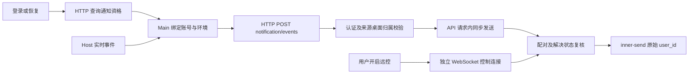

# ZCode 移动端事件推送开发规格

## 1. 目标与规则

本文定义移动端离线通知能力。桌面和 Go server 已接入通知协议、连接 owner、事件分类与请求内同步发送（单次调用，不自动重试）；默认关闭，部署方需填写推送服务地址和 secret 后进行真实推送联调；设备接口可选。

- agent-im 已完成部署，服务间 secret 已具备；通过 Nacos 配置接入，文档示例不填凭据。
- server 可选地通过无鉴权设备接口查询有效 App 登录设备；推送始终使用认证账号原始 user_id。
- 未配置设备接口时允许有效账号向全部设备推送；配置后要求当前有效 App 登录设备，不保存历史永久标记。
- 桌面登录后自动发现通知资格，以 HTTP 上报，无需开启远控；关闭远控不影响通知。
- 覆盖桌面已加载的本地、SSH、WSL、Docker 工作区及后台任务，不要求 Renderer 当前打开该会话。
- 只做实时通知。桌面断网、退出、HTTP 资格未就绪或无通知资格时不保存待发事件，不补发历史事件；server 已接收任务可以单次发送，不自动重试。
- 来源桌面已配对时跳过系统 Push；未配对且存在有效设备时推送。未知或不能可靠识别的业务事件忽略。
- 本期不增加通知中心、MySQL 通知表、桌面持久待发队列、营销推送或 IM 消息迁移。

## 2. 状态与生命周期



Main 是通知上报的唯一 owner；Host 仍是业务事件生产者。登录、恢复、切号刷新资格，每 60 秒通过 HTTP 刷新；旧账号和旧环境的异步结果作废。HTTP 通知不建立 WebSocket，不授予控制权限；开启远控才建立控制连接，关闭时释放控制连接和 attachment，通知资格继续保留。

未配置 device_lookup_url 时，已启用推送且账号有效即允许上报，接收方由上游按 user_id 查找全部设备。配置查询地址时沿用有效设备资格和定向发送；查询失败暂停上报，不能退回全设备模式。全局 enabled 仍由部署方控制。

配对抑制按来源桌面生效。HTTP 不依赖桌面 WebSocket presence；Redis 查询成功但无有效 presence 表示当前无已知配对，可发送。Redis 查询错误仍停止发送，matched 跳过整条通知。旧 WebSocket 事件仍要求有效 presence。校验与上游提交有并发窗口，不承诺撤回已提交通知。

## 3. 事件与 HTTP 协议

### 3.1 事件识别

Host/services 观察 CLI/runtime 权威投影，独立于手机订阅与 Renderer 展示。Main 负责连接和上报，Go server 负责识别标准事件、校验及路由，不解析远控 RPC 分片或回答文本。

| kind           | 触发规则                                                   | 排除项                                             |
| -------------- | ---------------------------------------------------------- | -------------------------------------------------- |
| question       | 新增普通 userInput 待处理交互，具有稳定 interaction_id     | 计划确认、文本问句、自动解决                       |
| approval       | 新增真正等待用户处理的 permission 交互                     | 自动放行、自动拒绝、普通工具调用                   |
| plan           | 新增计划确认；依据 ExitPlanMode / plan_approval 结构化标记 | 普通规划文本、todo 更新                            |
| task_completed | 当前会话执行进入 completedSuccess                          | completedInterrupted、单次模型结束、子任务单独完成 |
| task_failed    | 当前会话执行进入 error                                     | 中间工具错误、自动重试、用户主动中断               |

完成/失败沿用一次用户输入执行结束后的会话终态，不要求长期目标整体结束。终态依据会话投影，不直接照搬桌面本地通知对 completedInterrupted 的显示行为。

初始快照、重连快照只建立基线；历史恢复不生成通知。保留工作区身份隔离，不以同名路径合并远程工作区。不为观察通知启动新 Agent、恢复历史会话或建立第二份业务状态。

同一事实由业务 owner 生成稳定 event_id，重复观察复用该标识。缺少稳定交互或执行标识时忽略，不猜测。多个窗口不得分别制造同一通知。

### 3.2 HTTP 上报

- `GET /api/v1/remote/notification/status` 使用 ZCode Bearer JWT，返回 `data: {protocol_version:1,event_transport:"http",status:"available|unavailable|unknown"}`。新桌面必须确认 HTTP 能力，不回退 WebSocket。
- `POST /api/v1/remote/notification/events` 使用同一认证，正文为 `{device_sid,event}`。event 沿用 version、event_id、kind、workspace_id、session_id、run_id、interaction_id、state、occurred_at、locale。
- 复用现有桌面注册 API 和串行注册 owner 获取 DeviceSID，不为通知另建一份设备身份。
- server 从 JWT 获取用户，检查 DeviceSID 归属；正文不允许指定接收用户。未认证或设备越权拒绝，未知版本和业务类型 ignored。
- 成功 HTTP 响应为 `{code:0,msg:"",data:{event_id,status:"accepted|ignored|rejected"}}`。accepted 仅表示接收成功，不表示手机送达。
- Main 每事件最多一次 HTTP 尝试，内存去重包含在途及失败尝试；不因超时、断网、切号或响应丢失重放。上报总超时 20 秒（包含设备注册与事件请求），资格查询仍为 5 秒；切号中止旧请求。server 使用 Redis 事件键和上游 dedup_key 幂等。
- 前三类交互解决仍发送 state=resolved。关闭状态先到不能被迟到的开启事件覆盖。
- 普通远控 data 仍需配对。桌面只通过 HTTP 上报通知，Relay WebSocket 只承载远控，不携带通知字段或消息。

## 4. 服务端实现边界

### 4.1 责任与落点

| 子系统            | 职责                                                                 |
| ----------------- | -------------------------------------------------------------------- |
| 共享协议          | 强类型、运行时 schema、新能力协商、兼容测试                          |
| Host/services     | 从既有业务 owner 观察并分类五类事件，不依赖可见页面                  |
| Desktop Main      | 账号级通知资格与 HTTP 上报；远控 WebSocket 由各窗口 runtime 独立持有 |
| Go 通知服务       | 认证及设备归属校验、标准事件消费、HTTP 回执                          |
| 通知应用/领域服务 | 资格、幂等、交互终结状态、配对抑制、模板与有效期                     |
| httpx 适配器      | 无鉴权设备查询及 agent-im 签名请求                                   |
| API 同步发送      | 已接收通知的单次发送，不自动重试、状态复核及结果指标                 |

复用现有分层和依赖注入；HTTP 细节不进入 Relay 业务协议；Go 控制器不直接持有仓储。组合根显式注入通知服务及端口。

### 4.2 跨 Pod 状态

配对 presence 写入 Redis，按环境、用户、来源桌面隔离。注册、心跳、控制启停及断开负责更新；写入和清理由连接 ID/代次约束，旧连接不能删除新连接状态。API 同步发送 不用某个 API Pod 的 MemoryHub 推断全局配对。

HTTP 来源允许无 presence；旧 WebSocket 来源仍要求有效 presence。Redis 读取失败与缺记录分开处理。心跳 lease 用于失效检测，不作为业务完成或交互解决的推断依据。确认未配对与无法判断必须分开记录。

### 4.3 接纳与发送

1. 校验来源及通知资格；生成按用户、来源设备、event_id 隔离的稳定事件键。
2. 对已配对、未知或不支持的事件返回 ignored；其他事件由当前 请求同步发送并得到上游受理后返回 accepted。Redis 去重拦截本地重复事件，返回 ignored。
3. API 同步发送 检查有效期、交互终结标记及当前来源桌面配对状态。
4. 配置查询地址时发送前重新查询有效设备；查询失败或空列表停止，不退回全部设备。
5. 使用认证来源的原始 user_id 调用 inner-send；未配置查询地址时省略 device_ids，配置后传入查询列表；模板只含简短提醒，不含任务结果。
6. 每个事件仅调用下游一次；网络错误、超时和业务错误返回 rejected，不自动重试，且不得超过事件有效期。

dedup_key 使用稳定事件身份，加入 zcode 命名空间，并限制在 64 字节内；相同事件不更换键。Redis 去重标记保留 24 小时，不保存待发载荷。客户端发生时间用于过期判断，不能通过重新入队或重试刷新有效期。

状态读取错误、配置查询后的无设备、已配对、已解决、已过期分别记录并停止。参数与签名错误停止并告警。不增加 MySQL 通知中心或额外可靠 outbox。

## 5. 配置与外部接口

### 5.1 设备查询契约

下列是待提供接口的开发契约，不表示当前用户态 /me 接口已经取消鉴权。地址可配置；server 不获取、不保存用户上游 access token。

```http
GET {device_lookup_url}?provider={provider}&user_id={zcode_user_id}
```

请求不发送 Bearer 或 Push 签名，查询身份来自 server 认证用户记录。参数使用标准 URL 编码。

```json
{
  "agent_user_id": "10001",
  "devices": [{ "id": "dev_example", "platform": "android" }]
}
```

- 响应只包含该账号、本产品及当前环境的有效 App 登录设备。agent_user_id 保留为设备接口兼容字段，仍校验为数字字符串，但不作为 Push user_id。
- devices[].id 必须与注册标识 zbot*<device_id>*<user_id> 的 device_id 相同；后缀必须等于 agent_user_id。不传完整 RegistrationID、FCM Token 或 Relay DeviceSID。
- 支持额外原设备字段；设备去重后为空表示无资格。查询失败或身份字段异常是 unknown，不伪装成空列表。
- 接口未配置时跳过查询，省略 device_ids 推送全部设备，不调用用户态 Bearer /me 接口。
- 手机负责 SDK 注册、账号切换、退出和远程移除；设备接口应及时反映失效关系。登录设备记录不保证系统通知权限已开启，最终送达仍需真机验证。

### 5.2 Nacos 配置

在主配置中新增 mobile_push 块。下列配置由 server 读取，示例默认关闭；本次代码交付不修改线上 Nacos。

```yaml
mobile_push:
  enabled: false
  base_url: ""
  app_id: "zcode"
  secret: ""
  device_lookup_url: ""
  device_cache_ttl: "30s"
  http_timeout: "5s"
  event_ttl: "5m"
```

开启前校验地址与凭据完整、时长及次数有效。secret 由部署方补充，仅在服务端读取，不进入客户端、队列或日志。配置关闭后停止新通知和队列后续发送，不影响普通远控；重新开启不补发已过期或已跳过事件。

### 5.3 Push 请求

```http
POST {base_url}/agent-im/v1/push/inner-send
Content-Type: application/json
x-auth-appid: zcode
x-auth-timestamp: <Unix 秒>
x-auth-sign: <小写十六进制 MD5>
```

```text
sign = md5(appid + "&" + timestamp + "&" + secret)
```

```json
{
  "user_id": "00000000-0000-4000-8000-000000000001",
  "device_ids": ["dev_example"],
  "kind": "task_completed",
  "title": "修复登录接口超时",
  "body": "任务已完成\nZCode 远程控制 · macOS",
  "dedup_key": "zcode:task:example",
  "data": {
    "v": "1",
    "open_target": "zcode_remote_control",
    "source_device_id": "desktop_example",
    "conversation_id": "session_example",
    "run_id": "run_example",
    "event_id": "event_example",
    "workspace_id": "workspace_example"
  }
}
```

`device_ids` 可选：传入非空列表时定向发送；nil 或空列表在 JSON 中省略，由上游推送到该用户全部设备。未配置设备查询地址时 API 同步发送 直接使用认证账号原始 user_id，省略 device_ids；配置查询地址后查询失败或空列表仍跳过。

`data` 透传为点击 Ext，`open_target` 固定为 `zcode_remote_control`。`source_device_id` 对应来源桌面 DeviceSID，`conversation_id` 对应会话 ID；`run_id` 仅为执行标识，不代替会话 ID。Ext 的 source、push_id、target_user_id 仍由上游生成；标题和正文仍放外层，业务事件种类、签名和幂等不变，取消自动重试。

每次请求重新生成秒级 timestamp/sign，时差不超过上游 10 分钟窗口。kind 不超过 32 字节；title 不超过 40 UTF-16 单位；body 保守限制在 100 UTF-16 单位；data 不超过 1KB。文案不包含问题全文、命令、代码或任务结果。

HTTP 401/业务 code=401 按签名错误处理，code=400 为参数错误，code=502 为可恢复上游故障；其他响应同时检查 HTTP 和业务 code。deduplicated=true 表示已去重；delivered=true 仅表示腾讯受理至少一台；device_count 为受理数量，不能当作实际送达数。零受理记录原因并核查设备/UID 对应，不随机更换去重键补发。

手机点击通知后核验当前账号、定位来源桌面及会话，并重新加载状态和权限。不以通知载荷授予控制或数据访问权限；关闭远控时不因点击通知自动启用远控。

## 6. 验收与交付

### 6.1 功能影响与不变量

| 等级           | 入口/链路                  | 权威 owner 与效果                 | 必须保留                       |
| -------------- | -------------------------- | --------------------------------- | ------------------------------ |
| must-inspect   | 登录、切号、恢复、远控开关 | Main 管理 HTTP 上报及独立远控连接 | 不自动开放控制，不互相踢连接   |
| must-inspect   | 所有已加载工作区的任务     | CLI/runtime 提供事实，Host 分类   | 不改变任务状态，不依赖页面订阅 |
| must-inspect   | Relay 与 API 同步发送      | server 校验、Redis 状态、同步发送 | 跨 Pod、代次隔离、账号隔离     |
| should-inspect | 手机控制与点击通知         | 原控制 attachment、业务权限校验   | 未开启远控不能执行控制 RPC     |
| invariant-only | 桌面本地系统通知           | 原展示链路                        | 不改变原有偏好和显示行为       |
| invariant-only | 本地/远程实时同步          | 原 continuous/replayable owner    | 不混流，不把快照当新事件       |

状态、校验、发送属于本轮变化；不新增 UI 设置或视觉样式。服务源事件、Main 转发和手机交互的测试需独立验证，不能以单层 mock 证明完整链路。

代码阅读入口：Main 的 webRemoteControlManager 与 WebRemoteControlDeviceTransport；Host 的 zcodeTaskIndexSyncer 及会话投影；shared 的 Relay V2 和 protocol-v4 schema。现有 UI taskNotificationOrchestrator 可核对分类，但不是后台事件生产者。代码图谱不可用时使用定向调用链，不能据此声称完成图索引验证。

### 6.2 验收用例

以下 MP01–MP12 产品语义 accepted。App 业务单测已退役，连接 E2E 的实际范围见 coverage matrix；未验证场景继续保留 planned。

| ID   | 前置与动作                                         | 断言                                                         | 证据                               |
| ---- | -------------------------------------------------- | ------------------------------------------------------------ | ---------------------------------- |
| MP01 | 登录账号无设备；随后查询出现有效设备               | 不建立 WS；有资格后可 HTTP 上报，无控制权限                  | HTTP、WS、状态日志                 |
| MP02 | 已有通知资格，开启再关闭远控                       | 仅远控建立 WS；关闭后 HTTP 通知继续，控制停止                | WS 数量、RPC 拒绝、UI              |
| MP03 | 依次产生普通问答、权限、计划确认                   | 三类各发送一次，稳定 ID；解决状态阻止未发送提醒              | owner 投影、事件、Push 请求        |
| MP04 | 一轮成功、最终错误、用户中断、工具重试、子任务结果 | 仅 completedSuccess/error 触发；其他不误推                   | 真实状态转换、网络计数             |
| MP05 | 手机配对后产生事件，再断开后产生新事件             | 前者跳过且不补发，后者向有效设备推送                         | Relay、API 同步发送、Push 请求     |
| MP06 | 桌面断网/未就绪时发生事件，恢复或重启              | 不补发；初始/重连快照只建基线                                | 断网时序、请求计数                 |
| MP07 | server 进程已接纳；Push 网络超时、502、401、400    | 单次发送，不自动重试且 key 不变；401/400 停止；超期不发      | fake upstream、任务记录            |
| MP08 | 切号、切环境、设备退出与迟到查询结果交错           | 旧结果无效；配置查询后无设备停止，读取错误停止               | 身份、请求与连接代次               |
| MP09 | 两个窗口/同名远程路径同时观察事件                  | 不串工作区、不重复；后台会话可触发                           | 本地及代表性远程 Host、稳定 ID     |
| MP10 | 多 Pod、旧连接断开、resolved 先到、状态与下发并发  | 旧连接不清新状态，关闭不被重开；已发通知不承诺撤回           | Redis、并发测试、API 同步发送 日志 |
| MP11 | 未认证/terminal/伪造收件人/未知版本或 kind         | 越权拒绝；未知业务 ignored，不断开合法连接                   | schema、HTTP 回执、队列计数        |
| MP12 | 多设备、重复输入、零受理、点击时账号变化、旧客户端 | 原始 user_id/可选 device_ids；上游受理不等于送达；旧协议兼容 | HTTP、手机 UI、旧 schema           |

测试先行：Go 适配器/Redis/同步发送测试，再实现产品代码；App 侧不新增业务单测，协议与状态行为由对应桌面/手机 E2E 验证。E2E 先进入 manual-review/pending，不直接宣称转正或加入 CI。代表性远程工作区测试不替代所有 SSH/WSL/Docker 真机组合。

指标区分 received、queued、accepted、ignored、paired、unknown、no_device、resolved、expired、deduplicated、failed；仅有真实回执后统计 delivered/opened。日志不含 Token、secret、完整设备凭据及业务正文。

### 6.3 发布与文档边界

先实现服务端新能力并验证设备适配器，再灰度桌面/控制端；默认总开关关闭。发生问题关闭 mobile_push，不改变普通远控和任务执行。真实设备 API 地址、secret 通过部署配置补充，不能从示例推断环境可用性。

本地规格和飞书保留同一份最新行为，不保留历史讨论。实现前完成适用架构门禁；实现后运行 typecheck、lint、architecture:check --changed 与对应 E2E，CLI 变更另按子级要求验证。纯文档交付只检查格式、链接、契约与用例引用，不将文档检查当成产品验证。

## 实现边界

- 资格入口为 `GET /api/v1/remote/notification/status`；通知通过 `POST /api/v1/remote/notification/events`，远控独立使用 WebSocket。
- Host 复用 WindowHostSessionsIndexObserver，只从 online delta 生成事件；initial/recovery 不触发。当前读取 summary 的单个 pendingInteraction；不能识别或不出现在摘要中的交互忽略，不声称覆盖摘要外的全部并发阻塞。
- workspace_id 为 workspace identity/path 的 SHA-256，避免上报本地绝对路径。Host 在实时进入 running/prewarming 时，以权威 lastActivityAt 建立执行标记；Main 将此标记绑定当前账号，后续事件必须匹配；切号或切环境立即清除，同账号重复登录通知只刷新资格、不清除。Main 在事件到达时同步确认 owner 与去重，之后才异步读取 locale。recovery 快照保留仍在 running/prewarming 的 session 标记，其余及删除的 session 清除。该字段是推送归属标记，不冒充 CLI turnId。冷快照中已运行的任务没有本次账号绑定的开始事实，因此其通知忽略，直到观察到新一轮实时开始。
- 终态仅从 running/prewarming 转入 completedSuccess/error 触发；不修改桌面原有系统通知。
- `mobile-event-push.test.ts` 为 manual-review/pending；验证自动 HTTP 资格查询不建立 WS，开启远控建立 WS，关闭后释放 WS 且仍具备 HTTP 通知资格。
- 五类分类、HTTP 上报、Host 在线 delta、账号代次、Go 签名和 Redis fencing 由定向测试覆盖。真实移动设备、实际 agent-im、所有远程工作区组合及手机点击全链路尚未验证；本次未修改原生手机的通知点击实现。

### 推送日志

`Host generated → Main dispatch(http_started/skipped) → HTTP receipt(accepted/ignored/rejected/request_failed) → server receive → deliver → upstream result`。

客户端使用 `[mobile-push]`，服务端使用 `mobile push`。按 event_id、run_id、session_id 和 dedup_key 关联。仅记录分类和关联标识，不记录 JWT、签名、secret、业务正文。上游 delivered 仅表示受理，不能证明手机实际收到。

## 会话标题、桌面来源与通知直达

HTTP 事件增加可选 session_title、desktop_platform（windows/macos/linux）。Host 从当前会话投影取标题；Main 覆盖为桌面宿主平台。标题变化本身不触发通知。server 将标题清理并限制为 40 UTF-16 单位；空值按语言显示“未命名会话”/“Untitled conversation”。正文为事件文案加换行及“ZCode 远程控制 · macOS”等来源，限制 100 UTF-16 单位，不拆分 Unicode 码点。不显示项目、hostname 或任务正文。

五类中文文案：有问题需要你回复、有一项操作等待你确认、有一份计划等待你确认、任务已完成、任务执行失败，请查看。旧事件无平台时仅显示产品来源；新字段不参与幂等。交互类点击载荷补充 interaction_id，其他既有标识不变。

手机仅将 source=zcode/open_target=zcode_remote_control 路由到 ZCode 页面。当前环境、目标账号、来源 device_sid、workspace_id、conversation_id 共同定位。手机对已认证工作区 key（trim 后 identity 优先，否则 path）按 UTF-8 SHA-256 小写 hex 匹配，不通过名称定位，不信任通知提供的 URL。复用现有远控 session/selectTask；不依赖任务首屏列表。

```text
点击 → 账号门禁 → ZCode 来源桌面 → 远控连接 → 工作区摘要匹配 → 会话最新状态
        └ 未登录暂存         └ 不可达提示重试                  └ 交互仍待处理才定位
```

手机单一导航 owner 管理目标，最新点击替代旧目标；切号或退出取消旧异步操作。未登录保留本次 ZCode 点击，其他通知行为不变；账号不匹配不自动切号。远控关闭不自动开启，桌面离线不新增云端副本。缺定位字段的旧通知仅进入 ZCode 入口。端到端验证冷/热启动、本地/远程工作区、切号、连续点击、断线、会话删除及已解决交互。日志仅记录关联 ID 和结果，不记录标题正文或凭据。

实现边界：本轮复用手机 Remote control → ZCode 的远控 session 和会话页面。通过实时 pendingInteractions.anchorRowId 定位现有工具卡片，已解决、自动解决或锚点不可见时不猜测；不新增审批操作按钮。

HTTP 通知由独立 MobilePushController 调用通知服务，设备归属校验不经过 RelayService。当前请求内同步调用一次下游，删除 goroutine、任务组、退出等待及重试。桌面上报总预算20秒，下游默认5秒。只有上游受理/确认去重返回 accepted；本地重复或规则跳过 ignored；调用失败 rejected；解决状态写入成功的 accepted 只表示状态同步完成。超时不证明未发送，不更换 dedup_key 补发。
